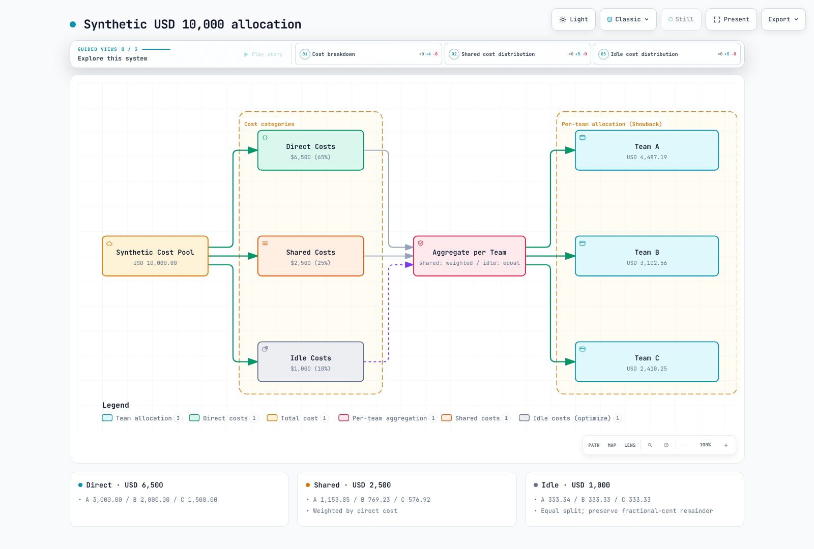
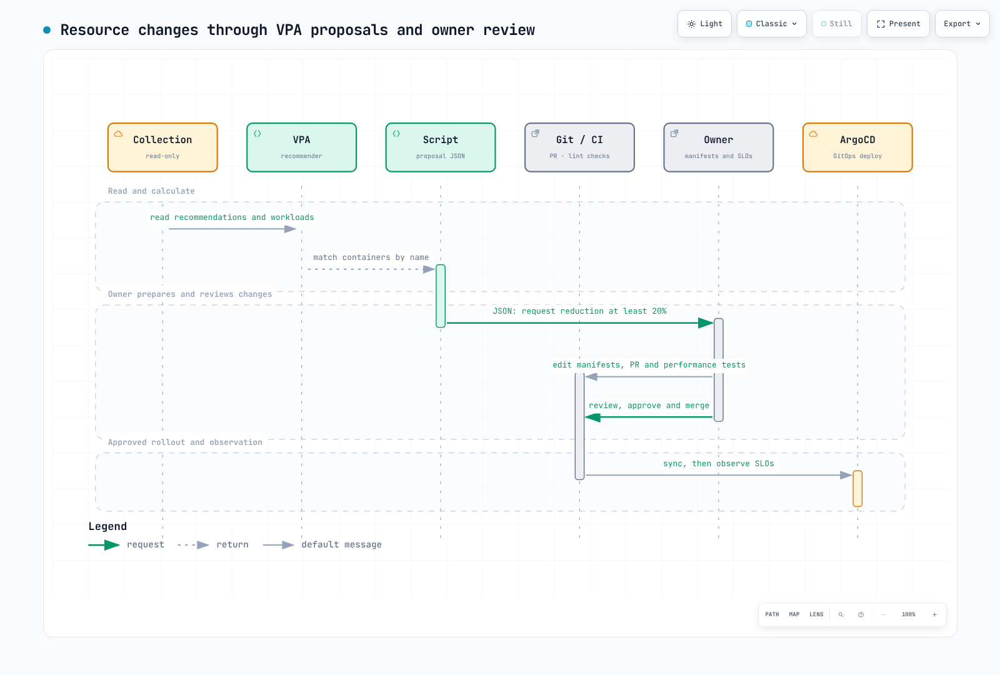

# Plataforma de visibilidad de costos de FinOps

> **Última actualización**: 16 de octubre de 2026. OpenCost 1.121.3 / chart 2.5.33, Kubecost 3.2.4, Kyverno 1.19.1.
> **Validación**: renderizado de Helm, esquemas de Kubernetes, proveedores simulados de Terraform, cálculos locales de costos y evaluación de políticas. Esto no representa una instalación en un clúster de producción ni una conciliación con una factura real de AWS.

< [Anterior: Planificación de capacidad para eventos](./12-event-capacity-planning.md) | [Contenido](./README.md) | [Siguiente: Pipelines de Tekton](./14-tekton-pipelines.md) >

## Descripción general

FinOps reúne a los equipos de ingeniería, finanzas, producto y negocio para gestionar el valor del gasto en tecnología. Reducir costos por sí solo no es el criterio de éxito: también importan los niveles de servicio, el crecimiento, la economía unitaria y una atribución confiable.

Este capítulo distingue el modelo de asignación de Kubernetes, los datos de facturación de AWS y los presupuestos de los equipos, y después los conecta. Sustituya los nombres de clúster, espacios de nombres, buckets y roles de IAM de ejemplo antes del despliegue. Los comandos de instalación crean recursos reales; la validación aquí descrita se realizó localmente.

## 1. Modelo operativo de FinOps

Informar abarca la recopilación de datos, la asignación y la visibilidad. Optimizar convierte las mediciones en mejoras. Operar mantiene la responsabilidad, los presupuestos y las revisiones. Estas fases se repiten.


[Ver diagrama interactivo](https://www.atomai.click/kubernetes-docs/archmaps/en-ops-13-finops-cost-platform-0.html)

| Rol | Responsabilidad |
| --- | --- |
| Plataforma | Recopilación confiable, control de acceso a los datos de costos y actualizaciones |
| Equipos de servicio | Etiquetas, solicitudes de recursos, pruebas de rendimiento y revisión de cambios |
| Finanzas / FinOps | Conciliación de facturas, reglas de costos compartidos, presupuestos y previsiones |
| Producto / negocio | Economía unitaria, valor y prioridades de inversión |

Crawl/Walk/Run describe capacidades en áreas específicas. No representa cronogramas universales de 1–3 o 6–12 meses. Establezca la calidad de los datos y la responsabilidad antes de automatizar la refacturación o la eliminación.

## 2. Datos de costos e instalación

### 2.1 Distinguir las mediciones

| Medición | Significado | Limitación |
| --- | --- | --- |
| Tasa de asignación actual, USD/hora | Asignación y modelo de precios actuales | No representa el gasto mensual real |
| Costo del modelo de asignación en un período | Atribución de Kubernetes durante un período explícito | Depende de la cobertura, la retención y el modelo |
| CUR 2.0 / Cost Explorer | Costos basados en la facturación de AWS | Retrasos de actualización, descuentos, créditos, impuestos y opciones de amortización |
| Estimación lineal de fin de mes | Costo hasta la fecha / días transcurridos × días del mes | No modela la estacionalidad ni los cambios en la demanda |

Por lo general, EC2 no factura CPU y memoria como productos separados. Los precios por núcleo y por GiB de OpenCost distribuyen el costo de las instancias. No presente precios arbitrarios de CPU/RAM ni un segundo descuento general del contrato como si fueran una factura. Sumar los totales de Cloud Cost a los de Allocation para la misma infraestructura puede contabilizar dos veces el gasto.

### 2.2 Instalar OpenCost

Se presupone que el Prometheus Operator y el CRD ServiceMonitor de la [pila de observabilidad](./09-observability-stack.md) ya están instalados, además de una StorageClass `gp3` adecuada. El almacenamiento de EKS puede usar el controlador EBS CSI o la configuración de StorageClass de Auto Mode. El valor de ejemplo `release: prometheus` debe coincidir con el selector real de ServiceMonitor de Prometheus.

La retención de Prometheus de siete días configurada anteriormente no permite reconstruir un mes completo. El análisis mensual requiere suficiente retención y almacenamiento. Aumentar la retención no recupera los datos eliminados. El PVC del exportador que se muestra a continuación no reemplaza el almacenamiento de Prometheus.

**`opencost-values.yaml`**

```yaml
serviceAccount:
  create: true
  name: opencost
opencost:
  mcp:
    enabled: false
  exporter:
    defaultClusterId: eks-production
    resources:
      requests:
        cpu: 100m
        memory: 256Mi
      limits:
        memory: 2Gi
    persistence:
      enabled: true
      accessMode: ReadWriteOnce
      storageClass: gp3
      size: 10Gi
  prometheus:
    internal:
      enabled: true
      serviceName: prometheus-kube-prometheus-prometheus
      namespaceName: observability
      port: 9090
    external:
      enabled: false
  metrics:
    serviceMonitor:
      enabled: true
      namespace: opencost
      additionalLabels:
        release: prometheus
      honorLabels: true
  customPricing:
    enabled: false
  cloudCost:
    enabled: false
  ui:
    enabled: true
    ingress:
      enabled: false
```

```bash
helm repo add opencost https://opencost.github.io/opencost-helm-chart
helm repo update opencost
helm upgrade --install opencost opencost/opencost \
  --version 2.5.33 --namespace opencost --create-namespace \
  -f opencost-values.yaml --wait --timeout 10m
kubectl -n opencost get pods,pvc,svc,servicemonitor
kubectl -n opencost port-forward service/opencost 9090:9090 9003:9003
```

La interfaz local usa el puerto `9090`; la API usa el `9003`. `opencost.prometheus` y `opencost.cloudCost` no son elementos secundarios de exporter. El chart 2.5.33 habilita MCP de forma predeterminada, por lo que esta configuración base lo deshabilita explícitamente. Si expone herramientas de costos mediante MCP, diseñe por separado la autenticación y el alcance de acceso; MCP para datos de costos es distinto de MCP para búsquedas en documentación.

### 2.3 Elegir Kubecost 3.x

Kubecost es un producto y una opción de despliegue independientes. La versión 3.x usa almacenamiento ClickHouse y recopilación mediante `finops-agent`. No copie sin cambios la configuración `kubecostModel`, de Prometheus o de ETL de la versión 2.x. Las instalaciones existentes de la versión 2.x requieren el procedimiento oficial de migración, incluidos agentes intermedios, reingesta y restricciones de funcionalidades.

El repositorio actual del chart es `https://kubecost.github.io/kubecost/`. Esta es una configuración base con funcionalidades limitadas. Deshabilita explícitamente Cluster Controller, Admission Controller y las previsiones. No la use como comando de reemplazo en el lugar para instalaciones y almacenamiento existentes.

**`kubecost-values.yaml`**

```yaml
global:
  clusterId: eks-production
  defaultStorageClass: gp3
frontend:
  enabled: true
  service:
    type: ClusterIP
localStore:
  enabled: true
  persistentVolume:
    enabled: true
    size: 32Gi
    storageClass: gp3
finopsagent:
  enabled: true
aggregator:
  enabled: true
cloudCost:
  enabled: false
networkCosts:
  enabled: false
clusterController:
  enabled: false
kubecostAdmissionController:
  enabled: false
forecasting:
  enabled: false
ingress:
  enabled: false
telemetry:
  enabled: false
```

```bash
helm repo add kubecost https://kubecost.github.io/kubecost/
helm repo update kubecost
helm template kubecost kubecost/kubecost --version 3.2.4 \
  --namespace kubecost -f kubecost-values.yaml > kubecost-rendered.yaml
# Review storage, RBAC, images and product entitlements before installation.
helm install kubecost kubecost/kubecost --version 3.2.4 \
  --namespace kubecost --create-namespace -f kubecost-values.yaml
```

Compruebe las licencias y funcionalidades del producto para SSO, RBAC detallado y funciones multinube. La presencia de valores SAML/OIDC no habilita esas funciones en todos los despliegues. `global.acknowledged` corresponde a la confirmación de actualizaciones mayores de Enterprise, no a la aceptación general de la licencia. Un ALB interno no autentica a los usuarios.

### 2.4 CUR 2.0, Athena y Cloud Cost de OpenCost

El siguiente Terraform define una **exportación CUR 2.0 nueva, dos buckets de S3, un grupo de trabajo de Athena y un rol IRSA para OpenCost**. Compruebe la titularidad e importe los recursos existentes antes de administrarlos. Los datos de facturación de toda la organización requieren los permisos adecuados de la cuenta de administración.

No se incluye la creación de tablas ni del rastreador de Glue. Siga el procedimiento de procesamiento de Athena de Data Exports: espere a la entrega inicial y, después, cree y actualice la tabla y las particiones de Glue usando el **directorio de datos** de la exportación. No combine los manifiestos ni los metadatos con la tabla de datos. Proporcione los nombres resultantes de la base de datos y la tabla. La protección de Lake Formation requiere concesiones adicionales.

`COST_AND_USAGE_REPORT` es el origen SQL de Data Exports, no un nombre universal para una tabla de Glue en Athena. Inspeccione el esquema resultante: CUR 2.0 usa una partición `billing_period`; no dé por sentado el diseño heredado de CUR con `year`/`month`.

Data Exports entrega los datos mediante SSE-S3. No copie una configuración que requiera la entrega directa cifrada con KMS. Si se necesita KMS, diseñe conjuntamente el proceso documentado de cifrado posterior a la entrega y los permisos de los consumidores. El almacenamiento de archivo que requiera restauración puede interrumpir las consultas sobre datos activos.

**`cur.tf`**

```hcl
terraform {
  required_version = ">= 1.12.0"
  required_providers {
    aws = {
      source  = "hashicorp/aws"
      version = "= 6.69.1"
    }
  }
}

provider "aws" {
  region = var.region
}

provider "aws" {
  alias  = "billing"
  region = "us-east-1"
}

variable "region" {
  type    = string
  default = "ap-northeast-2"
}

variable "cur_bucket" {
  type = string
}

variable "results_bucket" {
  type = string
  validation {
    condition     = var.results_bucket != var.cur_bucket
    error_message = "Use separate CUR source and Athena result buckets."
  }
}

variable "oidc_provider_arn" {
  type = string
}

variable "oidc_issuer" {
  type = string
}

variable "glue_database" {
  type = string
}

variable "glue_table" {
  type = string
}

data "aws_caller_identity" "current" {}
data "aws_partition" "current" {}

locals {
  account = data.aws_caller_identity.current.account_id
  arn     = "arn:${data.aws_partition.current.partition}"
  issuer  = trimprefix(trimsuffix(var.oidc_issuer, "/"), "https://")
  buckets = { cur = var.cur_bucket, results = var.results_bucket }
}

resource "aws_s3_bucket" "cost" {
  for_each      = local.buckets
  bucket        = each.value
  force_destroy = false
}

resource "aws_s3_bucket_public_access_block" "cost" {
  for_each                = aws_s3_bucket.cost
  bucket                  = each.value.id
  block_public_acls       = true
  block_public_policy     = true
  ignore_public_acls      = true
  restrict_public_buckets = true
}

resource "aws_s3_bucket_ownership_controls" "cost" {
  for_each = aws_s3_bucket.cost
  bucket   = each.value.id
  rule {
    object_ownership = "BucketOwnerEnforced"
  }
}

resource "aws_s3_bucket_server_side_encryption_configuration" "cost" {
  for_each = aws_s3_bucket.cost
  bucket   = each.value.id
  rule {
    apply_server_side_encryption_by_default {
      sse_algorithm = "AES256"
    }
  }
}

resource "aws_s3_bucket_policy" "delivery" {
  bucket = aws_s3_bucket.cost["cur"].id
  policy = jsonencode({
    Version = "2012-10-17"
    Statement = [{
      Sid       = "AllowDataExports"
      Effect    = "Allow"
      Principal = { Service = "bcm-data-exports.amazonaws.com" }
      Action    = "s3:PutObject"
      Resource  = "${aws_s3_bucket.cost["cur"].arn}/cur/*"
      Condition = {
        StringEquals = { "aws:SourceAccount" = local.account }
        ArnLike = {
          "aws:SourceArn" = "${local.arn}:bcm-data-exports:us-east-1:${local.account}:export/*"
        }
      }
    }]
  })
}

resource "aws_bcmdataexports_export" "cur" {
  provider = aws.billing
  depends_on = [
    aws_s3_bucket_policy.delivery,
    aws_s3_bucket_public_access_block.cost,
    aws_s3_bucket_server_side_encryption_configuration.cost
  ]
  export {
    name = "opencost-cur"
    data_query {
      query_statement = "SELECT * FROM COST_AND_USAGE_REPORT"
      table_configurations = {
        COST_AND_USAGE_REPORT = {
          BILLING_VIEW_ARN                      = "${local.arn}:billing::${local.account}:billingview/primary"
          TIME_GRANULARITY                      = "HOURLY"
          INCLUDE_RESOURCES                     = "TRUE"
          INCLUDE_MANUAL_DISCOUNT_COMPATIBILITY = "FALSE"
          INCLUDE_SPLIT_COST_ALLOCATION_DATA    = "FALSE"
        }
      }
    }
    destination_configurations {
      s3_destination {
        s3_bucket = aws_s3_bucket.cost["cur"].bucket
        s3_prefix = "cur"
        s3_region = var.region
        s3_output_configurations {
          overwrite   = "OVERWRITE_REPORT"
          format      = "PARQUET"
          compression = "PARQUET"
          output_type = "CUSTOM"
        }
      }
    }
    refresh_cadence {
      frequency = "SYNCHRONOUS"
    }
  }
}

resource "aws_athena_workgroup" "opencost" {
  name          = "opencost-cur"
  force_destroy = false
  configuration {
    enforce_workgroup_configuration    = true
    publish_cloudwatch_metrics_enabled = true
    bytes_scanned_cutoff_per_query     = 10737418240
    result_configuration {
      output_location       = "s3://${aws_s3_bucket.cost["results"].bucket}/opencost/"
      expected_bucket_owner = local.account
      encryption_configuration {
        encryption_option = "SSE_S3"
      }
    }
  }
}

resource "aws_iam_role" "opencost" {
  name = "opencost-cur-reader"
  assume_role_policy = jsonencode({
    Version = "2012-10-17"
    Statement = [{
      Effect    = "Allow"
      Principal = { Federated = var.oidc_provider_arn }
      Action    = "sts:AssumeRoleWithWebIdentity"
      Condition = {
        StringEquals = {
          "${local.issuer}:aud" = "sts.amazonaws.com"
          "${local.issuer}:sub" = "system:serviceaccount:opencost:opencost"
        }
      }
    }]
  })
}

resource "aws_iam_role_policy" "opencost" {
  role = aws_iam_role.opencost.id
  policy = jsonencode({
    Version = "2012-10-17"
    Statement = [
      {
        Effect = "Allow"
        Action = ["athena:StartQueryExecution", "athena:StopQueryExecution",
        "athena:GetQueryExecution", "athena:GetQueryResults", "athena:GetWorkGroup"]
        Resource = aws_athena_workgroup.opencost.arn
      },
      {
        Effect = "Allow"
        Action = ["glue:GetDatabase", "glue:GetDatabases", "glue:GetTable",
        "glue:GetTables", "glue:GetPartitions"]
        Resource = [
          "${local.arn}:glue:${var.region}:${local.account}:catalog",
          "${local.arn}:glue:${var.region}:${local.account}:database/${var.glue_database}",
          "${local.arn}:glue:${var.region}:${local.account}:table/${var.glue_database}/${var.glue_table}"
        ]
      },
      {
        Effect   = "Allow"
        Action   = "s3:GetBucketLocation"
        Resource = [for b in aws_s3_bucket.cost : b.arn]
      },
      {
        Effect    = "Allow"
        Action    = "s3:ListBucket"
        Resource  = aws_s3_bucket.cost["cur"].arn
        Condition = { StringLike = { "s3:prefix" = ["cur", "cur/*"] } }
      },
      {
        Effect    = "Allow"
        Action    = "s3:ListBucket"
        Resource  = aws_s3_bucket.cost["results"].arn
        Condition = { StringLike = { "s3:prefix" = ["opencost", "opencost/*"] } }
      },
      {
        Effect   = "Allow"
        Action   = "s3:GetObject"
        Resource = "${aws_s3_bucket.cost["cur"].arn}/cur/*"
      },
      {
        Effect   = "Allow"
        Action   = ["s3:GetObject", "s3:PutObject", "s3:AbortMultipartUpload"]
        Resource = "${aws_s3_bucket.cost["results"].arn}/opencost/*"
      }
    ]
  })
}

output "opencost_role_arn" {
  value = aws_iam_role.opencost.arn
}

output "cur_export_arn" {
  value = aws_bcmdataexports_export.cur.arn
}

output "athena_results" {
  value = "s3://${aws_s3_bucket.cost["results"].bucket}/opencost/"
}
```

`glue_database` y `glue_table` identifican el destino de la consulta; no lo crean. El límite de análisis de Athena del ejemplo es de 10 GiB por consulta: investigue los errores y ajuste el valor al tamaño del conjunto de datos. Que los registros sean horarios no implica que los informes se entreguen cada hora.

Este ejemplo usa **IRSA**. Proporcione el ARN y el emisor del proveedor OIDC existente, y haga coincidir `sub` en la política de confianza con la cuenta de servicio real `opencost/opencost`. EKS Pod Identity usa una política de confianza y una asociación diferentes, en lugar de la anotación de IRSA.

**`cloud-integration.json`**

```json
{
  "aws": {
    "athena": [
      {
        "bucket": "s3://REPLACE_QUERY_RESULTS_BUCKET/opencost/",
        "region": "ap-northeast-2",
        "database": "REPLACE_GLUE_DATABASE",
        "catalog": "AwsDataCatalog",
        "table": "REPLACE_GLUE_TABLE",
        "workgroup": "opencost-cur",
        "account": "123456789012",
        "authorizer": {
          "authorizerType": "AWSServiceAccount"
        }
      }
    ]
  }
}
```

**`opencost-cloud-values.yaml`**

```yaml
serviceAccount:
  create: true
  name: opencost
  annotations:
    eks.amazonaws.com/role-arn: arn:aws:iam::123456789012:role/opencost-cur-reader
opencost:
  cloudIntegrationSecret: opencost-cloud-integrations
  cloudCost:
    enabled: true
```

```bash
# Replace all placeholders and account IDs in the files first.
kubectl -n opencost create secret generic opencost-cloud-integrations \
  --from-file=cloud-integration.json=cloud-integration.json \
  --dry-run=client -o yaml | kubectl apply -f -
helm upgrade opencost opencost/opencost --version 2.5.33 \
  --namespace opencost -f opencost-values.yaml -f opencost-cloud-values.yaml
```

El `bucket` del JSON es el **bucket de resultados de consultas de Athena**, no el bucket de origen de CUR. `AWSServiceAccount` usa la cadena de credenciales predeterminada del SDK de AWS, no claves de acceso estáticas. Verifique las lecturas del origen, las escrituras de resultados, el montaje del Secret y la actualización del importador antes de afirmar que la integración de facturación funciona.

Es posible que las claves de etiquetas de asignación de costos no estén disponibles antes de su activación. Actualmente AWS admite la reposición de datos históricos desde la cuenta de administración hasta por 12 meses, sujeta a que las etiquetas existieran realmente en los recursos durante ese período y a los retrasos de procesamiento. Aplicar una etiqueta ahora no genera etiquetas históricas.

## 3. Transparencia y refacturación

La transparencia permite que los equipos consumidores vean sus gastos. La refacturación los asigna y factura según reglas contables acordadas. El valor de un modelo no se convierte automáticamente en una factura interna. Defina primero el período, la moneda, las categorías directas/compartidas/inactivas/no asignadas, los impuestos, los créditos, los reembolsos y el redondeo.

### 3.1 Etiquetas y políticas

Use etiquetas `team` en los espacios de nombres para agrupar por equipo y etiquetas `team` / `cost-center` en las plantillas de Pod para una atribución más detallada. Las etiquetas de Kubernetes y las etiquetas de asignación de costos de AWS son datos independientes. La asignación por espacio de nombres puede seguir funcionando sin etiquetas de equipo, pero no se garantiza la correspondencia con los equipos.

Kyverno 1.19.1 advierte que ClusterPolicy está obsoleto. Los ejemplos nuevos usan `ValidatingPolicy` con CEL de `policies.kyverno.io/v1`, que requiere el CRD correspondiente y la versión adecuada del controlador. Se aplican a los espacios de nombres con la etiqueta `finops.example.com/enabled=true` y generan comprobaciones para las plantillas de los controladores de Pod.

**`cost-labels.yaml`**

```yaml
apiVersion: policies.kyverno.io/v1
kind: ValidatingPolicy
metadata:
  name: finops-pod-labels
spec:
  validationActions: [Audit]
  evaluation:
    admission:
      enabled: true
    background:
      enabled: true
  autogen:
    podControllers:
      controllers: [deployments, statefulsets, daemonsets, jobs, cronjobs]
  matchConstraints:
    namespaceSelector:
      matchLabels:
        finops.example.com/enabled: "true"
    resourceRules:
      - apiGroups: [""]
        apiVersions: [v1]
        operations: [CREATE, UPDATE]
        resources: [pods]
  validations:
    - expression: >-
        ['team', 'cost-center'].all(label,
          object.metadata.?labels[label].orValue('') != '')
      message: "Add team and cost-center labels to the Pod template."
```

**`resource-requests.yaml`**

```yaml
apiVersion: policies.kyverno.io/v1
kind: ValidatingPolicy
metadata:
  name: finops-container-requests
spec:
  validationActions: [Audit]
  evaluation:
    admission:
      enabled: true
    background:
      enabled: true
  autogen:
    podControllers:
      controllers: [deployments, statefulsets, daemonsets, jobs, cronjobs]
  matchConstraints:
    namespaceSelector:
      matchLabels:
        finops.example.com/enabled: "true"
    resourceRules:
      - apiGroups: [""]
        apiVersions: [v1]
        operations: [CREATE, UPDATE]
        resources: [pods]
  validations:
    - expression: >-
        object.spec.containers.all(c,
          has(c.resources) && has(c.resources.requests) &&
          ['cpu', 'memory'].all(r,
            r in c.resources.requests &&
            quantity(c.resources.requests[r]).isGreaterThan(quantity('0'))))
      message: "Set positive CPU and memory requests for each regular container."
```

`Audit` no bloquea las infracciones. Revise los informes de segundo plano y el alcance, resuelva los problemas con las personas responsables y, después, cambie a `Deny` las políticas seleccionadas. Elija `Warn` por separado si desea mostrar advertencias a los usuarios. La CLI local puede devolver un error de prueba para una política Audit; eso no demuestra que la admisión vaya a denegarse.

La política de solicitudes comprueba que **cada contenedor normal tenga solicitudes positivas de CPU y memoria**. Los presupuestos y las estrategias de límites para contenedores de inicialización y a nivel de Pod requieren políticas separadas. Los límites universales de cuatro núcleos / 8 GiB no demuestran que las aplicaciones tengan el tamaño adecuado.

```yaml
apiVersion: v1
kind: Namespace
metadata:
  name: team-backend
  labels:
    team: backend
    finops.example.com/enabled: "true"
---
apiVersion: v1
kind: ResourceQuota
metadata:
  name: team-capacity
  namespace: team-backend
spec:
  hard:
    requests.cpu: "20"
    requests.memory: 40Gi
    requests.storage: 200Gi
    persistentvolumeclaims: "20"
    pods: "100"
```

Esta cuota es un límite de recursos de ejemplo, no un presupuesto en dólares ni un tope para todo el gasto en la nube. Ajústela al uso actual y a los máximos del escalado automático, y prevea solicitudes de creación rechazadas.

### 3.2 API de asignación por período

Esto usa `/allocation/compute` de OpenCost 1.121.3. Verifique el período, la agregación y la estructura de respuesta para el producto y la versión correspondientes. `includeIdle` y `shareIdle` son valores booleanos; `shareIdle=weighted` no es el formato booleano documentado.

```bash
curl --fail --silent --show-error --get \
  'http://127.0.0.1:9003/allocation/compute' \
  --data-urlencode 'window=2026-09-01T00:00:00Z,2026-09-12T00:00:00Z' \
  --data-urlencode 'aggregate=namespace' \
  --data-urlencode 'includeIdle=true' \
  --data-urlencode 'shareIdle=false'
```

### 3.3 Asignación de costos compartidos y conservación

Estos son **datos de entrada sintéticos en USD para validar los cálculos, no una factura real**. Los grupos no superpuestos contienen costos directos de 6,500, costos compartidos de 2,500 y costos inactivos de 1,000. Los costos compartidos se ponderan según el costo directo; los costos inactivos se dividen por igual. Para los centavos fraccionarios se usa el método del mayor resto, con desempate por nombre de equipo en orden lexicográfico.



[Ver diagrama interactivo](https://www.atomai.click/kubernetes-docs/archmaps/en-ops-13-finops-cost-platform-1.html)

```text
Team     Direct    Shared     Idle      Total
A        3000.00   1153.85    333.34     4487.19
B        2000.00    769.23    333.33     3102.56
C        1500.00    576.92    333.33     2410.25
Total    6500.00   2500.00   1000.00    10000.00
```

**`allocation-example.json`**

```json
{
  "description": "Synthetic reconciled expense pool, not an actual account bill.",
  "currency": "USD",
  "direct": {
    "team-a": "3000.00",
    "team-b": "2000.00",
    "team-c": "1500.00"
  },
  "shared": "2500.00",
  "idle": "1000.00",
  "unallocated": "0.00"
}
```

**`allocate_costs.py`**

```python
"""Allocate one reconciled USD expense pool using explicit, conserved cent amounts."""
import argparse
import json
from decimal import Decimal
from fractions import Fraction


def cents(value):
    if isinstance(value, bool):
        raise ValueError("Money cannot be boolean")
    value=Decimal(str(value))
    if not value.is_finite() or value < 0:
        raise ValueError("Use finite nonnegative expense amounts; handle refunds explicitly")
    scaled=value*100
    if scaled != scaled.to_integral_value():
        raise ValueError("Settle source amounts to cents under an approved rounding policy first")
    return int(scaled)


def money(value):
    return f"{Decimal(value)/100:.2f}"


def distribute(total, weights):
    if not weights:
        raise ValueError("At least one allocation target is required")
    rational={}
    for name, weight in weights.items():
        value=Decimal(str(weight))
        if not value.is_finite() or value < 0:
            raise ValueError("Weights must be finite and nonnegative")
        rational[name]=Fraction(value)
    denominator=sum(rational.values(),Fraction(0))
    if denominator==0:
        if total:
            raise ValueError("A positive pool cannot be allocated with zero total weight")
        return {name:0 for name in weights}
    exact={name:Fraction(total)*weight/denominator for name,weight in rational.items()}
    result={name:value.numerator//value.denominator for name,value in exact.items()}
    remainder=total-sum(result.values())
    # Largest remainder; ties resolved by stable target name.
    order=sorted(exact,key=lambda name:(-(exact[name]-result[name]),name))
    for name in order[:remainder]:
        result[name]+=1
    assert sum(result.values())==total
    return result


def allocate(config):
    if config.get("currency")!="USD":
        raise ValueError("This example accepts a single USD ledger; do not mix currencies")
    direct={name:cents(value) for name,value in config["direct"].items()}
    if not direct:
        raise ValueError("No teams supplied")
    shared=cents(config["shared"])
    idle=cents(config["idle"])
    unallocated=cents(config.get("unallocated","0"))
    shared_alloc=distribute(shared,direct)
    idle_alloc=distribute(idle,{name:1 for name in direct})
    teams={name:{"direct":money(value),"shared":money(shared_alloc[name]),"idle":money(idle_alloc[name]),
                 "total":money(value+shared_alloc[name]+idle_alloc[name])} for name,value in sorted(direct.items())}
    source_total=sum(direct.values())+shared+idle+unallocated
    allocated_total=sum(cents(value["total"]) for value in teams.values())+unallocated
    assert source_total==allocated_total
    return {"currency":"USD","policy":"Shared weighted by direct cost; idle split equally; unallocated retained",
            "rounding":"Exact cents; largest remainder with lexical tie-break",
            "teams":teams,"unallocated":money(unallocated),"source_total":money(source_total),
            "allocated_total":money(allocated_total),
            "limits":["Use one reconciled pool; do not add overlapping Allocation and Cloud Cost totals.",
                      "This policy is an example, not an inherently fair or mandatory chargeback rule.",
                      "Refunds, credits, taxes and currency conversion require explicit separate policies."]}


if __name__=="__main__":
    parser=argparse.ArgumentParser()
    parser.add_argument("input")
    args=parser.parse_args()
    try:
        with open(args.input,encoding="utf-8") as stream:
            result=allocate(json.load(stream))
    except (ValueError,KeyError,ArithmeticError) as error:
        parser.error(str(error))
    print(json.dumps(result,ensure_ascii=False,indent=2))
```

```bash
python3 allocate_costs.py allocation-example.json
```

Mantenga los importes sin atribuir como `unallocated`. Esta calculadora no redistribuye automáticamente los costos negativos ni los reembolsos. La contabilidad real requiere reglas independientes para créditos, reembolsos y conversión de monedas. La política de ejemplo no es necesariamente la opción más justa para todas las organizaciones.

### 3.4 Prometheus y Grafana

Estas reglas presuponen **el Prometheus de un solo clúster**. Las consultas de Prometheus/Thanos centralizados deben conservar un identificador de clúster real en cada agregación y unión. Una unión de varios clústeres basada solo en el nombre del nodo puede mezclar costos.

`node_cpu_hourly_cost` se expresa por núcleo y `node_ram_hourly_cost`, por GiB por hora. Multiplique por las métricas de asignación y elimine duplicados de scrapes repetidos con `max`. No invente métricas como `kubecost_container_cpu_cost`. Combine esta configuración de kube-state-metrics con los valores del chart de observabilidad existente antes de unir las etiquetas.

```yaml
kube-state-metrics:
  metricLabelsAllowlist:
    - namespaces=[team]
```

**`cost-rules.yaml`**

```yaml
groups:
  - name: finops-current-rates
    rules:
      - record: finops:node_cpu_hourly_cost
        expr: max by (node) (node_cpu_hourly_cost)
      - record: finops:node_ram_hourly_cost
        expr: max by (node) (node_ram_hourly_cost)
      - record: finops:namespace_cpu_cost_per_hour
        expr: |
          sum by (namespace) (
            max by (namespace, pod, container, node) (container_cpu_allocation{container!=""})
            * on (node) group_left finops:node_cpu_hourly_cost
          )
      - record: finops:namespace_ram_cost_per_hour
        expr: |
          sum by (namespace) (
            max by (namespace, pod, container, node) (container_memory_allocation_bytes{container!=""}) / 1073741824
            * on (node) group_left finops:node_ram_hourly_cost
          )
      - record: finops:namespace_compute_cost_per_hour
        expr: finops:namespace_cpu_cost_per_hour + finops:namespace_ram_cost_per_hour
      - record: finops:team_compute_cost_per_hour
        expr: |
          sum by (label_team) (
            finops:namespace_compute_cost_per_hour
            * on (namespace) group_left (label_team)
              max by (namespace, label_team) (kube_namespace_labels{label_team!=""})
          )
      - alert: OpenCostMetricsUnavailable
        expr: absent(node_cpu_hourly_cost)
        for: 15m
        labels:
          severity: warning
        annotations:
          summary: "OpenCost CPU pricing metrics are absent"
      - alert: KubernetesComputeRateAboveReviewThreshold
        expr: sum(finops:namespace_compute_cost_per_hour) > 20
        for: 30m
        labels:
          severity: warning
        annotations:
          summary: "Allocated compute model exceeds the example USD 20/hour threshold"
```

El archivo tiene el formato de archivo de reglas de Prometheus. Con el Operator, colóquelo en `PrometheusRule.spec` y establezca etiquetas de metadatos que coincidan con el selector real de reglas. USD 20/hora durante 30 minutos es un umbral de revisión de ejemplo sobre datos del modelo. `for` exige que la condición persista; no elimina los falsos positivos.

Los paneles de Grafana pueden usar `finops:namespace_compute_cost_per_hour` y `finops:team_compute_cost_per_hour`, con la etiqueta **USD/hora**. Son tasas asignadas de CPU/RAM, no una factura que incluya todo el almacenamiento, las redes, el plano de control y los costos inactivos. Etiquete cualquier panel `* 730` como estimación fija de 730 horas. Los precios faltantes deben aparecer como datos faltantes, no como costo cero.

Los espacios de nombres sin etiquetas de equipo pueden desaparecer de la agregación por equipo. Compare el total de todos los espacios de nombres con el total por equipo. Las variables y carpetas del dashboard no aplican la autorización de las fuentes de datos. Use permisos de fuentes de datos del lado del servidor o tenants separados para aislar a los equipos, y compruebe que se denieguen las consultas entre equipos.

## 4. Detección de anomalías basada en la facturación

Un monitor de detección de anomalías de costos `DIMENSIONAL` / `SERVICE` abarca el gasto en servicios de AWS. Llamarlo “EKS” no lo limita a EKS. Para los monitores CUSTOM que usan etiquetas, cuentas vinculadas o Cost Categories, verifique el alcance admitido y la disponibilidad de los datos. Cuando corresponda, reutilice un ARN de monitor existente.

Esta configuración opcional va junto al archivo Terraform anterior. Separe los resúmenes por EMAIL `DAILY` de las notificaciones SNS `IMMEDIATE`. La entrega por SNS sigue dependiendo de las actualizaciones de facturación y de la detección de anomalías; no detiene el gasto instantáneamente. El tema requiere suscriptores aprobados por separado. Este ejemplo no crea una suscripción a Slack.

**`anomaly.tf`**

```hcl
# Optional: supply an existing monitor ARN to avoid duplicating a SERVICE monitor.
variable "cost_monitor_arn" {
  type = string
}

variable "notification_email" {
  type = string
}

resource "aws_ce_anomaly_subscription" "daily" {
  provider         = aws.billing
  name             = "daily-cost-anomalies"
  frequency        = "DAILY"
  monitor_arn_list = [var.cost_monitor_arn]
  threshold_expression {
    dimension {
      key           = "ANOMALY_TOTAL_IMPACT_ABSOLUTE"
      match_options = ["GREATER_THAN_OR_EQUAL"]
      values        = ["100"]
    }
  }
  subscriber {
    type    = "EMAIL"
    address = var.notification_email
  }
}

resource "aws_sns_topic" "anomalies" {
  provider = aws.billing
  name     = "cost-anomalies"
}

resource "aws_sns_topic_policy" "anomalies" {
  provider = aws.billing
  arn      = aws_sns_topic.anomalies.arn
  policy = jsonencode({
    Version = "2012-10-17"
    Statement = [{
      Effect    = "Allow"
      Principal = { Service = "costalerts.amazonaws.com" }
      Action    = "sns:Publish"
      Resource  = aws_sns_topic.anomalies.arn
      Condition = {
        StringEquals = { "aws:SourceAccount" = local.account }
        ArnLike = {
          "aws:SourceArn" = "${local.arn}:ce::${local.account}:anomalysubscription/*"
        }
      }
    }]
  })
}

resource "aws_ce_anomaly_subscription" "immediate" {
  provider         = aws.billing
  depends_on       = [aws_sns_topic_policy.anomalies]
  name             = "immediate-cost-anomalies"
  frequency        = "IMMEDIATE"
  monitor_arn_list = [var.cost_monitor_arn]
  threshold_expression {
    dimension {
      key           = "ANOMALY_TOTAL_IMPACT_ABSOLUTE"
      match_options = ["GREATER_THAN_OR_EQUAL"]
      values        = ["100"]
    }
  }
  subscriber {
    type    = "SNS"
    address = aws_sns_topic.anomalies.arn
  }
}
```

La creación de recursos y suscripciones tiene efectos reales sobre los costos y las notificaciones. Para SNS cifrado con KMS, configure también los permisos de clave necesarios para `costalerts.amazonaws.com` y limite SourceAccount/SourceArn. Ajuste el umbral de ejemplo de USD 100 a las necesidades de la organización.

AWS Budgets Actions puede realizar acciones admitidas sobre EC2/RDS, además de acciones de IAM/SCP. Siguen aplicándose los retrasos de actualización y el alcance de las acciones; no es un tope estricto que detenga de inmediato todo el gasto.

## 5. Presupuestos de equipo e informes programados

### 5.1 Presupuestos numéricos explícitos

`label_replace` no convierte una cadena de anotación de un espacio de nombres en una serie temporal numérica. Este ejemplo analiza presupuestos explícitos en USD a partir de JSON. Si falta un presupuesto, la proporción resultante es `null`; se rechazan los presupuestos cero, negativos o numéricamente no válidos.

**`budgets.json`**

```json
{
  "currency": "USD",
  "namespaces": {
    "backend-production": "3000.00",
    "frontend-production": "2000.00"
  }
}
```

### 5.2 Informe mensual del modelo y envío opcional a Slack

Este script usa únicamente la biblioteca estándar de Python 3.12. Consulta fechas UTC completadas; `--as-of` es la **fecha final exclusiva**. El primer día del mes informa sobre el mes anterior ya completado. Si los datos están vacíos o hay varios pasos temporales, el script falla en lugar de producir un resultado falso de USD 0. El script no puede demostrar que la cobertura histórica esté completa: inspeccione las advertencias de la API y la actualización del importador.

De forma predeterminada, crea archivos JSON y no envía mensajes a Slack. La entrega requiere tanto `--send` como `--webhook-file`. Los canales distintos necesitan webhooks entrantes independientes; no se usa ninguna sobrescritura `channel` en el contenido de la solicitud.

**`report_costs.py`**

```python
"""Read-only OpenCost monthly model-cost report and optional reviewed Slack delivery."""
import argparse
import calendar
import json
from datetime import date, datetime, timedelta, timezone
from decimal import Decimal, ROUND_HALF_UP
from pathlib import Path
from urllib.parse import urlencode, urlsplit
from urllib.request import Request, build_opener, HTTPRedirectHandler


class NoRedirect(HTTPRedirectHandler):
    def redirect_request(self, req, fp, code, msg, headers, newurl):
        return None


def decimal_value(value, name, positive=False):
    if value is None or isinstance(value, bool):
        raise ValueError(f"{name}: missing/invalid number")
    amount=Decimal(str(value))
    if not amount.is_finite() or (positive and amount <= 0):
        raise ValueError(f"{name}: invalid finite range")
    return amount


def usd(value):
    return format(value.quantize(Decimal("0.01"),rounding=ROUND_HALF_UP),"f")


def month_window(as_of):
    end=date.fromisoformat(as_of)
    month_reference=end if end.day>1 else end-timedelta(days=1)
    start=month_reference.replace(day=1)
    completed=(end-start).days
    return start,end,completed,calendar.monthrange(start.year,start.month)[1]


def summarize(payload, budgets, as_of):
    start,end,days,month_days=month_window(as_of)
    if not isinstance(payload,dict) or not isinstance(budgets,dict) or not isinstance(budgets.get("namespaces",{}),dict):
        raise ValueError("Expected API and budget JSON objects")
    if budgets.get("currency")!="USD":
        raise ValueError("This report requires an explicitly configured USD cost source and budgets")
    if payload.get("code",200)!=200 or payload.get("status","success")!="success" or payload.get("errors"):
        raise ValueError("Cost API reported an error")
    sets=payload.get("data")
    if not isinstance(sets,list) or len(sets)!=1 or not isinstance(sets[0],dict) or not sets[0]:
        raise ValueError("Expected one nonempty whole-window allocation set; missing data is not zero cost")
    namespace_costs={}
    for namespace,allocation in sets[0].items():
        if not isinstance(allocation,dict) or "totalCost" not in allocation:
            raise ValueError(f"{namespace}: missing allocation cost")
        namespace_costs[namespace]=decimal_value(allocation["totalCost"],namespace)
    total=sum(namespace_costs.values(),Decimal(0))
    rows=[]
    for namespace,cost in sorted(namespace_costs.items(),key=lambda row:(-row[1],row[0])):
        budget=budgets.get("namespaces",{}).get(namespace)
        budget_value=None if budget is None else decimal_value(budget,"budget",positive=True)
        projected=cost*Decimal(month_days)/Decimal(days)
        rows.append({
            "namespace":namespace,
            "model_cost_to_date_usd":usd(cost),
            "linear_month_estimate_usd":usd(projected),
            "budget_usd":None if budget_value is None else usd(budget_value),
            "model_budget_ratio":None if budget_value is None else str(cost/budget_value),
            "linear_estimate_budget_ratio":None if budget_value is None else str(projected/budget_value),
        })
    return {
        "source":"OpenCost allocation model, not an AWS invoice",
        "currency":"USD","window_start":start.isoformat()+"T00:00:00Z",
        "window_end_exclusive":end.isoformat()+"T00:00:00Z",
        "completed_calendar_days":days,"days_in_month":month_days,
        "total_model_cost_to_date_usd":usd(total),
        "total_linear_month_estimate_usd":usd(total*Decimal(month_days)/Decimal(days)),
        "namespaces":rows,"api_warnings":payload.get("warnings",[]),
        "limits":[
            "Linear estimates assume complete coverage and stable daily cost; inspect retention, gaps and importer freshness.",
            "Idle and unallocated buckets are retained; this is not automatic chargeback.",
            "Calendar-to-date model cost, a linear estimate and actual billed cost are different quantities.",
            "Do not add overlapping cloud-billing and Kubernetes-allocation totals."
        ]
    }


def get_allocation(base_url, as_of):
    start,end,_,_=month_window(as_of)
    parsed=urlsplit(base_url)
    if parsed.scheme not in ("http","https") or not parsed.netloc or parsed.username or parsed.query or parsed.fragment:
        raise ValueError("Use an HTTP(S) API base URL without credentials, query or fragment")
    query=urlencode({
        "window":start.isoformat()+"T00:00:00Z,"+end.isoformat()+"T00:00:00Z",
        "aggregate":"namespace","includeIdle":"true","shareIdle":"false","resolution":"1m"
    })
    request=Request(base_url.rstrip("/")+"/allocation/compute?"+query,
                    headers={"Accept":"application/json"},method="GET")
    with build_opener(NoRedirect).open(request,timeout=30) as response:
        if response.status != 200:
            raise ValueError(f"Cost API status {response.status}")
        body=response.read(10*1024*1024+1)
    if len(body)>10*1024*1024:
        raise ValueError("Cost API response exceeded the configured limit")
    return json.loads(body,parse_float=Decimal)


def slack_payload(report):
    # Dynamic names stay in plain_text blocks to avoid markup/mention interpretation.
    header=f"Calendar-month Kubernetes model costs — {report['window_end_exclusive'][:10]}"
    blocks=[{"type":"header","text":{"type":"plain_text","text":header}},
            {"type":"section","text":{"type":"plain_text","text":
                f"UTC window: {report['window_start']} to {report['window_end_exclusive']} (exclusive)\n"
                f"Model cost: USD {report['total_model_cost_to_date_usd']}\n"
                f"Linear estimate: USD {report['total_linear_month_estimate_usd']}\n"
                "This is an allocation estimate, not an AWS invoice."}}]
    for row in report["namespaces"][:10]:
        text=f"{row['namespace']}: USD {row['model_cost_to_date_usd']}"
        blocks.append({"type":"section","text":{"type":"plain_text","text":text[:2900]}})
    omitted=max(0,len(report["namespaces"])-10)
    if omitted:
        blocks.append({"type":"section","text":{"type":"plain_text","text":
            f"{omitted} additional buckets are included in the total. See the full JSON report."}})
    return {"blocks":blocks}


def send_slack(payload, webhook_file):
    url=Path(webhook_file).read_text().strip()
    parsed=urlsplit(url)
    if parsed.scheme!="https" or parsed.hostname not in ("hooks.slack.com","hooks.slack-gov.com"):
        raise ValueError("Use a trusted HTTPS Slack incoming-webhook URL file")
    body=json.dumps(payload,ensure_ascii=False).encode()
    request=Request(url,data=body,headers={"Content-Type":"application/json"},method="POST")
    with build_opener(NoRedirect).open(request,timeout=15) as response:
        result=response.read(1024).decode().strip()
        if response.status!=200 or result!="ok":
            raise ValueError("Slack did not acknowledge the message")


def main():
    parser=argparse.ArgumentParser()
    source=parser.add_mutually_exclusive_group(required=True)
    source.add_argument("--input")
    source.add_argument("--api-url")
    parser.add_argument("--budgets",required=True)
    parser.add_argument("--as-of",default=datetime.now(timezone.utc).date().isoformat(),
                        help="Exclusive UTC reporting end date")
    parser.add_argument("--report",default="cost-report.json")
    parser.add_argument("--slack-payload",default="slack-payload.json")
    parser.add_argument("--print-report",action="store_true",
                        help="Write model-cost JSON to stdout for controlled log collection")
    parser.add_argument("--send",action="store_true")
    parser.add_argument("--webhook-file")
    args=parser.parse_args()
    try:
        if args.send and not args.webhook_file:
            raise ValueError("--send requires --webhook-file")
        payload=(json.loads(Path(args.input).read_text(),parse_float=Decimal) if args.input
                 else get_allocation(args.api_url,args.as_of))
        budgets=json.loads(Path(args.budgets).read_text(),parse_float=Decimal)
        report=summarize(payload,budgets,args.as_of)
        slack=slack_payload(report)
        Path(args.report).write_text(json.dumps(report,ensure_ascii=False,indent=2)+"\n")
        Path(args.slack_payload).write_text(json.dumps(slack,ensure_ascii=False,indent=2)+"\n")
        if args.print_report:
            print(json.dumps(report,ensure_ascii=False))
        if args.send:
            send_slack(slack,args.webhook_file)
        print(f"Report written: {args.report}; Slack delivery: {'requested' if args.send else 'disabled'}")
    except (ValueError,KeyError,ArithmeticError,OSError) as error:
        parser.exit(1,f"Cost report failed: {error}\n")


if __name__=="__main__":
    main()
```

```bash
python3 report_costs.py \
  --api-url http://127.0.0.1:9003 \
  --budgets budgets.json --as-of 2026-09-12 \
  --report cost-report.json --slack-payload slack-payload.json
```

Los datos sintéticos verificaron un costo total del modelo de **USD 1,610.10** y una estimación lineal de fin de mes de **USD 4,391.18**. Estos no son costos de la cuenta del lector. La estimación usa 11 días completados de un septiembre de 30 días, no una proyección fija de 730 horas.

### 5.3 Ejecutar como CronJob

Guarde el script y los presupuestos en un ConfigMap. Este CronJob se ejecuta a diario a las **09:00, hora de Asia/Seúl**, imprime el informe en stdout y no envía mensajes a Slack. Los límites temporales de los informes siguen siendo UTC. Los registros contienen información interna de costos, así que configure el acceso y la retención. Los archivos de salida en `emptyDir` desaparecen cuando se elimina el Pod.

```bash
kubectl -n opencost create configmap finops-report-code \
  --from-file=report_costs.py --from-file=budgets.json \
  --dry-run=client -o yaml | kubectl apply -f -
```

**`reporter-cronjob.yaml`**

```yaml
apiVersion: batch/v1
kind: CronJob
metadata:
  name: finops-report
  namespace: opencost
spec:
  schedule: "0 9 * * *"
  timeZone: Asia/Seoul
  concurrencyPolicy: Forbid
  startingDeadlineSeconds: 1800
  successfulJobsHistoryLimit: 2
  failedJobsHistoryLimit: 2
  jobTemplate:
    spec:
      backoffLimit: 0
      activeDeadlineSeconds: 180
      template:
        spec:
          automountServiceAccountToken: false
          restartPolicy: Never
          securityContext:
            runAsNonRoot: true
            runAsUser: 10001
            runAsGroup: 10001
            fsGroup: 10001
            seccompProfile:
              type: RuntimeDefault
          containers:
            - name: report
              image: python:3.12.13-slim
              command: [python, /app/report_costs.py]
              args:
                - --print-report
                - --api-url
                - http://opencost.opencost.svc.cluster.local:9003
                - --budgets
                - /app/budgets.json
                - --report
                - /output/cost-report.json
                - --slack-payload
                - /output/slack-payload.json
              resources:
                requests:
                  cpu: 50m
                  memory: 64Mi
                limits:
                  memory: 256Mi
              securityContext:
                readOnlyRootFilesystem: true
                allowPrivilegeEscalation: false
                capabilities:
                  drop: [ALL]
              volumeMounts:
                - name: app
                  mountPath: /app
                  readOnly: true
                - name: output
                  mountPath: /output
          volumes:
            - name: app
              configMap:
                name: finops-report-code
            - name: output
              emptyDir: {}
```

Verifique el digest de la imagen y la compatibilidad con la plataforma antes del despliegue; después, fije el digest. La versión de Python y el código de la biblioteca estándar se probaron localmente; no se probaron ni la descarga de la imagen del contenedor ni la ejecución del CronJob en el clúster.

Para habilitar la entrega operativa a Slack, monte el webhook como archivo Secret y añada `--send --webhook-file /secrets/webhook`. Nunca lo incluya en la documentación, Git ni los registros. `concurrencyPolicy: Forbid` y `backoffLimit: 0` reducen el riesgo de duplicados, pero no garantizan una entrega exactamente una vez. Si se reintenta tras perder una confirmación, los mensajes pueden duplicarse; determine si se necesita un registro de entregas y eliminación de duplicados.

## 6. Ajuste del tamaño de los recursos

### 6.1 Recopilar recomendaciones de VPA

Se presupone que el recomendador VPA y el CRD ya están instalados. Observe en modo `Off` y evite que varios VPA apunten a la misma carga de trabajo. Si Goldilocks administra los VPA, no los duplique con el ejemplo manual. `target` es una solicitud recomendada; `upperBound` no es un límite obligatorio del contenedor.

**`vpa.yaml`**

```yaml
apiVersion: autoscaling.k8s.io/v1
kind: VerticalPodAutoscaler
metadata:
  name: backend-api
  namespace: team-backend
spec:
  targetRef:
    apiVersion: apps/v1
    kind: Deployment
    name: backend-api
  updatePolicy:
    updateMode: "Off"
  resourcePolicy:
    containerPolicies:
      - containerName: "*"
        controlledResources: [cpu, memory]
        controlledValues: RequestsOnly
```

Goldilocks es un dashboard opcional, habilitado por espacio de nombres, para recomendaciones de VPA. Antes de instalarlo, compruebe las dependencias actuales del chart, los permisos del controlador y el acceso al dashboard; no añada un recomendador duplicado. Etiquetar un espacio de nombres con `goldilocks.fairwinds.com/enabled=true` no ahorra dinero ni aprueba cambios por sí solo.

### 6.2 Generar propuestas de cambios

Este script **no modifica el clúster ni crea un PR**. Lee instantáneas JSON de `kubectl`, compara contenedores de Deployment/StatefulSet por nombre y propone reducciones de solicitudes de al menos un 20 %. Requiere `kubernetes==36.0.3`, cuyo analizador de cantidades se probó con el ejemplo.

Compruebe si las recomendaciones abarcan suficiente tráfico, los picos y los escenarios de recuperación, y si los cambios en las solicitudes de CPU afectan los cálculos de utilización de HPA. Los contenedores de inicialización y los recursos a nivel de Pod requieren una revisión aparte. No se hacen conjeturas sobre VPA duplicados, contenedores desconocidos ni solicitudes faltantes.

```bash
python3 -m venv .venv
.venv/bin/python -m pip install 'kubernetes==36.0.3'
kubectl --context YOUR_CONTEXT get deployments,statefulsets -A -o json > workloads.json
kubectl --context YOUR_CONTEXT get vpa -A -o json > vpas.json
.venv/bin/python recommend_resources.py \
  --workloads workloads.json --vpas vpas.json --threshold 0.20 > proposals.json
```

**`recommend_resources.py`**

```python
#!/usr/bin/env python3
"""Build review proposals from kubectl JSON snapshots; never patch workloads."""
import argparse
import json
from collections import Counter
from decimal import Decimal
from pathlib import Path

from kubernetes.utils.quantity import parse_quantity


def quantity(value):
    parsed = parse_quantity(str(value))
    if not parsed.is_finite() or parsed <= 0:
        raise ValueError("resource quantity must be finite and positive")
    return parsed


def propose(workloads, vpas, threshold=Decimal("0.20")):
    if not Decimal(0) < threshold < Decimal(1):
        raise ValueError("threshold must be between zero and one")
    index = {}
    for w in workloads.get("items", []):
        key = (w["metadata"].get("namespace", "default"), w["kind"], w["metadata"]["name"])
        index[key] = w
    results = []
    targets = Counter(
        (v["metadata"].get("namespace", "default"),
         v.get("spec", {}).get("targetRef", {}).get("kind"),
         v.get("spec", {}).get("targetRef", {}).get("name"))
        for v in vpas.get("items", [])
    )
    for v in vpas.get("items", []):
        namespace = v["metadata"].get("namespace", "default")
        target = v.get("spec", {}).get("targetRef", {})
        key = (namespace, target.get("kind"), target.get("name"))
        row = {"vpa": v["metadata"]["name"], "namespace": namespace,
               "kind": key[1], "workload": key[2], "proposals": [], "warnings": []}
        if target.get("apiVersion") != "apps/v1" or key[1] not in ("Deployment", "StatefulSet"):
            row["warnings"].append("unsupported target: only apps/v1 Deployment/StatefulSet")
        elif targets[key] > 1:
            row["warnings"].append("duplicate VPA target: remove overlap before proceeding")
        elif key not in index:
            row["warnings"].append("target missing from workload snapshot")
        else:
            workload = index[key]
            pod = workload["spec"]["template"]["spec"]
            containers = {c["name"]: c for c in pod["containers"]}
            conditions = v.get("status", {}).get("conditions", [])
            if not any(c.get("type") == "RecommendationProvided" and c.get("status") == "True" for c in conditions):
                row["warnings"].append("RecommendationProvided is not True")
            else:
                recommendations = v.get("status", {}).get("recommendation", {}).get("containerRecommendations", [])
                if not recommendations:
                    row["warnings"].append("recommendations missing")
                for rec in recommendations:
                    name = rec.get("containerName")
                    if name not in containers:
                        row["warnings"].append(f"unknown container {name}")
                        continue
                    container = containers[name]
                    for resource in ("cpu", "memory"):
                        current = container.get("resources", {}).get("requests", {}).get(resource)
                        target_value = rec.get("target", {}).get(resource)
                        if current is None or target_value is None:
                            row["warnings"].append(f"{name}/{resource}: missing current request or target")
                            continue
                        try:
                            current_number, target_number = quantity(current), quantity(target_value)
                            reduction = (current_number - target_number) / current_number
                            limit = container.get("resources", {}).get("limits", {}).get(resource)
                            if limit is not None and target_number > quantity(limit):
                                row["warnings"].append(f"{name}/{resource}: target exceeds existing limit")
                                continue
                        except (ValueError, ArithmeticError) as error:
                            row["warnings"].append(f"{name}/{resource}: invalid quantity ({error})")
                            continue
                        if reduction >= threshold:
                            row["proposals"].append({
                                "container": name, "resource": resource,
                                "currentRequest": current, "proposedRequest": target_value,
                                "requestReductionRatio": str(reduction),
                                "estimatedBillingSavings": None
                            })
                if pod.get("initContainers") or pod.get("resources"):
                    row["warnings"].append("init containers and Pod-level resources require separate review")
        results.append(row)
    return {"mode": "proposal-only", "threshold": str(threshold), "workloads": results,
            "limitations": ["No PR, patch, or cluster change is created.",
                            "VPA history, peak load, HPA interaction, and SLOs require human review.",
                            "Lower requests do not guarantee fewer nodes or billing savings."]}


if __name__ == "__main__":
    parser = argparse.ArgumentParser()
    parser.add_argument("--workloads", type=Path, required=True)
    parser.add_argument("--vpas", type=Path, required=True)
    parser.add_argument("--threshold", type=Decimal, default=Decimal("0.20"))
    args = parser.parse_args()
    print(json.dumps(propose(json.loads(args.workloads.read_text()),
                             json.loads(args.vpas.read_text()), args.threshold), indent=2))
```



[Ver diagrama interactivo](https://www.atomai.click/kubernetes-docs/archmaps/en-ops-13-finops-cost-platform-2.html)

`estimatedBillingSavings` es `null`: unas solicitudes menores no garantizan menos nodos ni menores costos de compromiso. La persona responsable edita los manifiestos reales de Git, ejecuta pruebas de rendimiento, revisa el PR y supervisa los SLO después del despliegue. Para automatizarlo se requiere asignar los archivos del repositorio, configurar la autenticación, gestionar PR duplicados y establecer las reglas de CI y aprobación.

## 7. Candidatos inactivos y gobernanza

### 7.1 Listas para revisar, no instrucciones para eliminar

Esta consulta de un solo clúster busca PVC Bound que no tengan una referencia actual a un volumen de Pod. Compara el indicador con 1 y coincide tanto con el espacio de nombres como con el nombre de la solicitud.

```promql
(kube_persistentvolumeclaim_status_phase{phase="Bound"} == 1)
unless on (namespace, persistentvolumeclaim)
kube_pod_spec_volumes_persistentvolumeclaims_info
```

Esto puede incluir datos de StatefulSets escalados a cero, volúmenes de recuperación o tareas pausadas. Antes de eliminar, compruebe la titularidad, los requisitos de recuperación, el último uso, las instantáneas y la retención. Que un Deployment se haya creado hace siete días no demuestra que haya permanecido con cero réplicas durante siete días. Verifique la continuidad del historial, la cobertura y las brechas.

Un uso bajo de CPU o memoria puede ser válido para cargas de trabajo con picos o en espera. Para agregar Pods en Deployments se requieren relaciones de propietarios (ReplicaSet → Deployment), espacios de nombres e identificadores de clúster. El tráfico de recepción de red por sí solo no permite identificar el tráfico de negocio ni determinar si se necesita un recurso.

### 7.2 Revisiones periódicas

| Frecuencia | Revisión |
| --- | --- |
| Diaria | Brechas de recopilación, actualización del importador, anomalías y estimaciones presupuestarias |
| Semanal | Responsables de los candidatos inactivos, propuestas de VPA y efectos en los SLO |
| Mensual | Conciliación de facturas, descuentos, créditos, costos no atribuidos, reglas compartidas y economía unitaria |

Registre el período, la moneda, la fuente del modelo frente a la facturación, la hora de actualización, la política de asignación, el importe no atribuido y quién aprobó. No dé por sentado que las etiquetas completas implican una precisión perfecta, que reducir solicitudes equivale a ahorrar dinero ni que los filtros del dashboard aplican el acceso de los equipos.

## 8. Referencias

- [Definición de FinOps Foundation](https://www.finops.org/introduction/what-is-finops/)
- [Versión de OpenCost 1.121.3](https://github.com/opencost/opencost/releases/tag/v1.121.3)
- [Helm chart de OpenCost](https://github.com/opencost/opencost-helm-chart)
- [API de OpenCost](https://opencost.io/docs/integrations/api/)
- [Código del autorizador de AWS de OpenCost](https://github.com/opencost/opencost/blob/v1.121.3/pkg/cloud/aws/authorizer.go)
- [Chart y migración de Kubecost](https://github.com/kubecost/cost-analyzer-helm-chart)
- [AWS Data Exports](https://docs.aws.amazon.com/cur/latest/userguide/what-is-data-exports.html)
- [Cifrado de Data Exports](https://docs.aws.amazon.com/cur/latest/userguide/data-protection.html)
- [Política del bucket de Data Exports](https://docs.aws.amazon.com/cur/latest/userguide/dataexports-s3-bucket.html)
- [Reposición de etiquetas de asignación de costos](https://docs.aws.amazon.com/awsaccountbilling/latest/aboutv2/cost-allocation-backfill.html)
- [Permisos de SNS para anomalías de costos](https://docs.aws.amazon.com/cost-management/latest/userguide/ad-SNS.html)
- [Migración de Kyverno a CEL](https://kyverno.io/docs/guides/migration-to-cel/)
- [ValidatingPolicy de Kyverno](https://kyverno.io/docs/policy-types/validating-policy/)
- [Goldilocks](https://goldilocks.docs.fairwinds.com/)


- [Pila de observabilidad](./09-observability-stack.md)
- [Optimización de recursos](./10-resource-optimization.md)
- [Planificación de capacidad para eventos](./12-event-capacity-planning.md)
