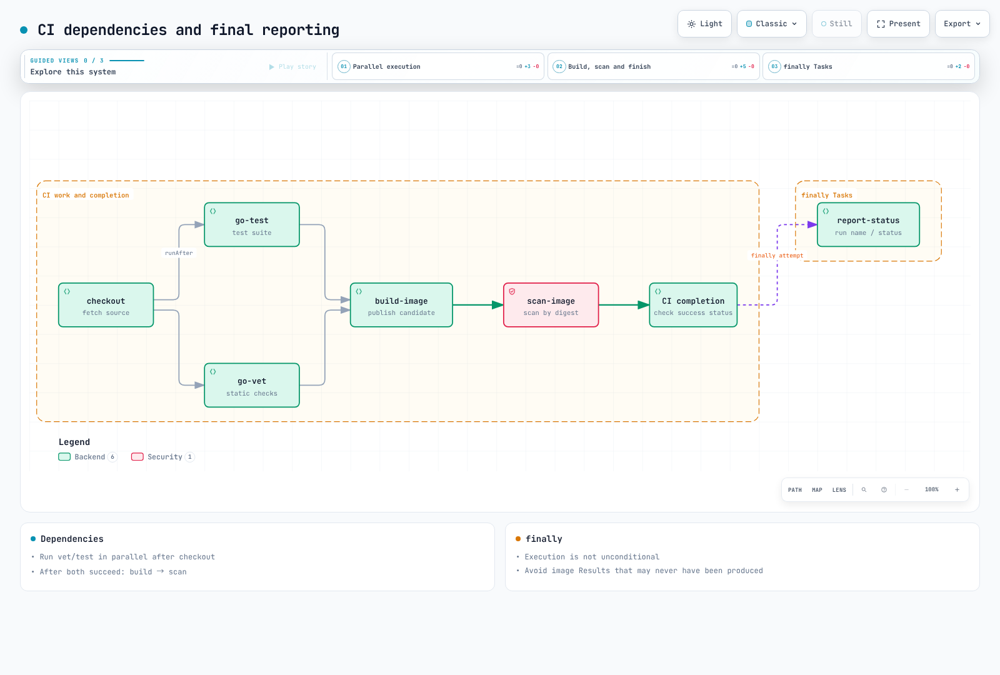
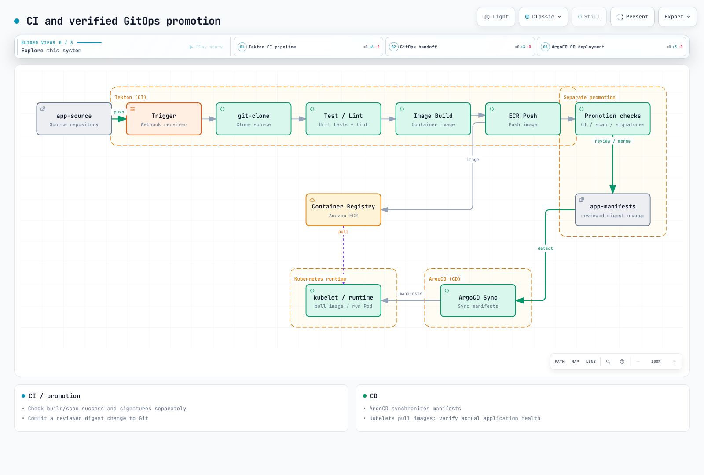

# Tekton Pipelines: integración continua sobre Kubernetes

> **Última actualización**: 16 de octubre de 2026. Pipelines 1.17.0, Triggers 0.37.1, Chains 0.29.0, Dashboard 0.73.0, tkn 0.46.1.
> **Validación**: Esquemas CRD de las versiones indicadas, dependencias de Tasks, scripts locales y programas simulados. No se realizaron instalaciones reales en EKS, compilaciones ni publicaciones de imágenes, firmas con KMS, webhooks externos ni notificaciones.

< [Anterior: FinOps](./13-finops-cost-platform.md) | [Índice](./README.md) | [Siguiente: Operaciones zonales](./15-zonal-operations-guide.md) >

## Descripción general

Tekton define Tasks, Pipelines y sus ejecuciones mediante la API de Kubernetes. Los operadores siguen siendo responsables de los controladores, la capacidad de ejecución, el almacenamiento, las actualizaciones y el acceso. Otros sistemas de CI también pueden ofrecer ejecutores sobre Kubernetes, escalado automático y declaraciones firmadas sobre los artefactos; estas capacidades no son exclusivas de Tekton ni eliminan su coste operativo.

Este ejemplo ejecuta la integración continua de una aplicación Go para **la rama main protegida de un repositorio aprobado**: clona el código, ejecuta la revisión estática y las pruebas en paralelo, publica una imagen candidata y la analiza por su digest. El procesamiento de Chains y la verificación criptográfica preceden a un cambio de GitOps que se revisa por separado. Los PR de forks externos no deben compartir los roles IRSA, los PVC ni los permisos de firma de este Pipeline.

## 1. Modelo de ejecución

| Componente | Función |
| --- | --- |
| Task / Pipeline | Definiciones reutilizables del trabajo y sus dependencias |
| TaskRun / PipelineRun | Ejecuciones con parámetros y estado |
| Step / Sidecar | Trabajo secuencial o servicio auxiliar, normalmente dentro del Pod de un TaskRun |
| Workspace / Result | Vinculación de un volumen o valor de salida pequeño; no son CRD independientes |

Definir una Task no crea un Pod; ejecutar un TaskRun sí lo crea. Los resultados admiten cadenas, arrays y objetos. Utilice almacenamiento de artefactos para los informes grandes. Los Steps del mismo Pod comparten la red y los volúmenes, de modo que no proporcionan un aislamiento fuerte entre fragmentos de código que no confían entre sí.


[Ver diagrama interactivo](https://www.atomai.click/kubernetes-docs/archmaps/en-ops-14-tekton-pipelines-0.html)


[Ver diagrama interactivo](https://www.atomai.click/kubernetes-docs/archmaps/en-ops-14-tekton-pipelines-1.html)

## 2. Instalación y permisos de ejecución

### 2.1 Versiones y vías de instalación

La instalación oficial exige como mínimo Kubernetes 1.28, mientras que los campos de seguridad y la validación de esquemas de este capítulo se han preparado para Kubernetes 1.36. Ese mínimo del proyecto no constituye una recomendación sobre las versiones de EKS que mantienen soporte. Dashboard 0.73.0 admite explícitamente Pipelines 1.15 LTS y 1.17, y Triggers 0.37 LTS.

Este ejemplo instala manualmente versiones fijadas. La guía oficial también remite a Tekton Operator para gestionar el ciclo de vida en producción. Determine quién administra los recursos antes de combinar la aplicación manual de manifiestos con recursos gestionados por el Operator. Los comandos modifican un clúster real: revise esa responsabilidad antes de forzar la resolución de conflictos.

```bash
kubectl version -o yaml
kubectl get storageclass

curl --fail --location \
  https://infra.tekton.dev/tekton-releases/pipeline/previous/v1.17.0/release.yaml \
  -o pipelines-release.yaml
kubectl apply --server-side --field-manager=tekton-install -f pipelines-release.yaml
kubectl wait --for=condition=Established --timeout=120s \
  crd/tasks.tekton.dev crd/taskruns.tekton.dev \
  crd/pipelines.tekton.dev crd/pipelineruns.tekton.dev
kubectl -n tekton-pipelines wait deployment --all \
  --for=condition=Available --timeout=300s

kubectl apply --server-side -f \
  https://infra.tekton.dev/tekton-releases/triggers/previous/v0.37.1/release.yaml
kubectl apply --server-side -f \
  https://infra.tekton.dev/tekton-releases/triggers/previous/v0.37.1/interceptors.yaml
kubectl apply --server-side -f \
  https://infra.tekton.dev/tekton-releases/chains/previous/v0.29.0/release.yaml
kubectl apply --server-side -f \
  https://infra.tekton.dev/tekton-releases/dashboard/previous/v0.73.0/release.yaml
kubectl -n tekton-pipelines port-forward service/tekton-dashboard 9097:9097
```

`release.yaml` instala el Dashboard de solo lectura; `release-full.yaml` incluye funciones de escritura. El modo de solo lectura no autentica a los usuarios ni aplica automáticamente permisos de usuario por namespace. Antes de exponerlo para uso operativo, valide un proxy de autenticación con OIDC y el modelo de acceso. Un ALB interno no proporciona autenticación por sí solo. La integración con Cognito necesita el listener HTTPS real, los endpoints de Cognito u OIDC y el Secret correspondiente.

`https://tekton.dev/helm-charts` no es un repositorio oficial de charts operativo para este ejemplo. No utilice el antiguo chart inexistente ni sus valores de configuración.

### 2.2 Significado actual de la configuración

| Ajuste | Significado actual |
| --- | --- |
| `feature-flags.coschedule: workspaces` | Programa en el mismo nodo los TaskRuns que comparten un Workspace basado en PVC; conserve este ajuste para el ejemplo RWO |
| `disable-affinity-assistant` | Opción antigua eliminada después de v0.68 |
| `set-security-context: true` | Valor predeterminado de 1.17 para los contenedores que inyecta Tekton; los Steps definidos por el usuario necesitan contextos compatibles propios |
| `results-from: termination-message` | Vía predeterminada, sujeta a los límites del mensaje de terminación de Kubernetes |
| `max-result-size` | Se aplica a `sidecar-logs`; cambiarlo por sí solo no amplía el mensaje de terminación predeterminado |
| Tiempo de espera predeterminado | Se administra en `config-defaults`; este ejemplo fija explícitamente los tiempos de espera del PipelineRun |

`running-in-environment-with-injected-sidecars` no proporciona aislamiento de Workspaces, y `keep-pod-on-cancel` no define un TTL de retención de PipelineRuns. No sustituya un ConfigMap completo por un fragmento reducido.

### 2.3 ServiceAccounts y roles IAM separados

Los controladores utilizan `tekton-pipelines` y `tekton-chains`; las compilaciones utilizan `tekton-builds`. Las referencias a Tasks o Pipelines por su nombre se resuelven en el mismo namespace. No puede referenciar una Task de un namespace compartido únicamente por su nombre.

Cree primero los roles IAM. Cada política de confianza de IRSA debe limitar el acceso al proveedor OIDC existente del clúster, a `aud=sts.amazonaws.com` y al valor exacto de `sub=system:serviceaccount:tekton-builds:<SA name>`. Cree previamente los repositorios ECR; las compilaciones no necesitan `CreateRepository`. A pesar de su nombre, `ci-readonly` no tiene un Role de la API de Kubernetes en este ejemplo: es la cuenta de ejecución predeterminada sin privilegios.

**`service-accounts.yaml`**

```yaml
apiVersion: v1
kind: Namespace
metadata:
  name: tekton-builds
---
apiVersion: v1
kind: ServiceAccount
metadata:
  name: ci-readonly
  namespace: tekton-builds
automountServiceAccountToken: false
---
apiVersion: v1
kind: ServiceAccount
metadata:
  name: ci-image-push
  namespace: tekton-builds
  annotations:
    eks.amazonaws.com/role-arn: arn:aws:iam::123456789012:role/tekton-candidate-push
automountServiceAccountToken: false
---
apiVersion: v1
kind: ServiceAccount
metadata:
  name: ci-image-read
  namespace: tekton-builds
  annotations:
    eks.amazonaws.com/role-arn: arn:aws:iam::123456789012:role/tekton-candidate-read
automountServiceAccountToken: false
---
apiVersion: v1
kind: ServiceAccount
metadata:
  name: ci-triggers
  namespace: tekton-builds
---
apiVersion: rbac.authorization.k8s.io/v1
kind: Role
metadata:
  name: ci-triggers
  namespace: tekton-builds
rules:
  - apiGroups: [triggers.tekton.dev]
    resources: [eventlisteners, triggers, triggerbindings, triggertemplates, interceptors]
    verbs: [get, list, watch]
  - apiGroups: [tekton.dev]
    resources: [pipelineruns]
    verbs: [create]
  - apiGroups: [""]
    resources: [configmaps]
    verbs: [get, list, watch]
  - apiGroups: [""]
    resources: [secrets]
    resourceNames: [github-webhook]
    verbs: [get]
---
apiVersion: rbac.authorization.k8s.io/v1
kind: RoleBinding
metadata:
  name: ci-triggers
  namespace: tekton-builds
subjects:
  - kind: ServiceAccount
    name: ci-triggers
    namespace: tekton-builds
roleRef:
  apiGroup: rbac.authorization.k8s.io
  kind: Role
  name: ci-triggers
---
apiVersion: rbac.authorization.k8s.io/v1
kind: ClusterRole
metadata:
  name: ci-triggers-interceptors
rules:
  - apiGroups: [triggers.tekton.dev]
    resources: [clusterinterceptors, clustertriggerbindings]
    verbs: [get, list, watch]
---
apiVersion: rbac.authorization.k8s.io/v1
kind: ClusterRoleBinding
metadata:
  name: ci-triggers-interceptors
subjects:
  - kind: ServiceAccount
    name: ci-triggers
    namespace: tekton-builds
roleRef:
  apiGroup: rbac.authorization.k8s.io
  kind: ClusterRole
  name: ci-triggers-interceptors
```

**`ecr-push-policy.json`**

```json
{
  "Version": "2012-10-17",
  "Statement": [
    {
      "Effect": "Allow",
      "Action": "ecr:GetAuthorizationToken",
      "Resource": "*",
      "Condition": {
        "StringEquals": {"aws:RequestedRegion": "ap-northeast-2"}
      }
    },
    {
      "Effect": "Allow",
      "Action": [
        "ecr:BatchCheckLayerAvailability",
        "ecr:GetDownloadUrlForLayer",
        "ecr:BatchGetImage",
        "ecr:InitiateLayerUpload",
        "ecr:UploadLayerPart",
        "ecr:CompleteLayerUpload",
        "ecr:PutImage"
      ],
      "Resource": "arn:aws:ecr:ap-northeast-2:123456789012:repository/myapp-candidates"
    }
  ]
}
```

**`ecr-read-policy.json`**

```json
{
  "Version": "2012-10-17",
  "Statement": [
    {
      "Effect": "Allow",
      "Action": "ecr:GetAuthorizationToken",
      "Resource": "*",
      "Condition": {
        "StringEquals": {"aws:RequestedRegion": "ap-northeast-2"}
      }
    },
    {
      "Effect": "Allow",
      "Action": [
        "ecr:BatchCheckLayerAvailability",
        "ecr:GetDownloadUrlForLayer",
        "ecr:BatchGetImage"
      ],
      "Resource": "arn:aws:ecr:ap-northeast-2:123456789012:repository/myapp-candidates"
    }
  ]
}
```

Asocie la política de publicación a `tekton-candidate-push` y la de lectura a `tekton-candidate-read`. Sustituya la cuenta, la región y el repositorio en todas las referencias. `GetAuthorizationToken` no admite limitar el recurso a un repositorio concreto, por lo que se configura por separado y se restringe mediante la región solicitada.

IRSA autentica las llamadas al SDK o a la CLI de AWS realizadas dentro del Pod. Kubelet descarga las imágenes de ECR mediante otras vías: los roles de los nodos, los roles de ejecución de Fargate o imagePullSecrets. Añadir una anotación IRSA a una Task no resuelve por sí solo un error ImagePullBackOff.

## 3. Definiciones completas de Tasks

Estas seis Tasks forman un ejemplo coherente. El repositorio de código debe contener un módulo Go, pruebas y un Dockerfile. Sustituya la URL fija `myorg/myapp` de la Task de clonación por el repositorio aprobado y ajuste la lista de repositorios permitidos del Trigger para que coincida. No acepte URL de Git ni comandos de shell arbitrarios procedentes de un webhook.

Las sustituciones de Tekton son textuales. Pase los parámetros mediante variables de entorno o argumentos, en lugar de interpolarlos en el cuerpo de los scripts. Valide hashes completos de commit de 40 caracteres. Los archivos de autenticación de ECR utilizan un `emptyDir` local de la Task; no los escriba en volúmenes Secret de solo lectura ni suponga que una herramienta de la imagen de otro Step está disponible.

BuildKit sin privilegios de root requiere un entorno de compilación dedicado y validado, con namespaces de usuario, montajes y una configuración adecuada de seccomp y AppArmor. `Unconfined` y `--oci-worker-no-process-sandbox` implican concesiones explícitas de seguridad que la política restricted del namespace rechaza. No son valores predeterminados seguros para todos los entornos. Utilice un entorno separado para los PR externos.

**`tasks.yaml`**

```yaml
apiVersion: tekton.dev/v1
kind: Task
metadata:
  name: checkout
  namespace: tekton-builds
spec:
  params:
  - name: revision
    type: string
  workspaces:
  - name: source
  results:
  - name: CHAINS-GIT_URL
    type: string
  - name: CHAINS-GIT_COMMIT
    type: string
  steps:
  - name: checkout
    image: golang:1.27.2
    script: |
      #!/usr/bin/env bash
      set -euo pipefail
      if [[ ! "$REVISION" =~ ^[0-9a-f]{40}$ ]]; then
        echo "Expected a full commit SHA" >&2
        exit 1
      fi
      cd "$SOURCE"
      git init .
      git config credential.helper ''
      git remote add origin "$REPOSITORY"
      git -c protocol.file.allow=never fetch --depth=1 origin "$REVISION"
      git -c advice.detachedHead=false checkout --detach FETCH_HEAD
      test "$(git rev-parse HEAD)" = "$REVISION"
      printf '%s' "$REPOSITORY" > "$GIT_URL_RESULT"
      printf '%s' "$REVISION" > "$GIT_COMMIT_RESULT"
    env:
    - name: REVISION
      value: $(params.revision)
    - name: REPOSITORY
      value: https://github.com/myorg/myapp.git
    - name: SOURCE
      value: $(workspaces.source.path)
    - name: GIT_URL_RESULT
      value: $(results.CHAINS-GIT_URL.path)
    - name: GIT_COMMIT_RESULT
      value: $(results.CHAINS-GIT_COMMIT.path)
    computeResources:
      requests:
        cpu: 100m
        memory: 128Mi
      limits:
        memory: 1Gi
  stepTemplate:
    securityContext:
      runAsUser: 1000
      runAsGroup: 1000
---
apiVersion: tekton.dev/v1
kind: Task
metadata:
  name: go-vet
  namespace: tekton-builds
spec:
  params: []
  workspaces:
  - name: source
  results: []
  steps:
  - name: vet
    image: golang:1.27.2
    script: |
      #!/usr/bin/env bash
      set -euo pipefail
      cd "$SOURCE"
      go vet ./...
    env:
    - name: SOURCE
      value: $(workspaces.source.path)
    - name: GOCACHE
      value: /tmp/go-build
    - name: GOMODCACHE
      value: /tmp/go-mod
    computeResources:
      requests:
        cpu: 100m
        memory: 128Mi
      limits:
        memory: 1Gi
  stepTemplate:
    securityContext:
      runAsUser: 1000
      runAsGroup: 1000
---
apiVersion: tekton.dev/v1
kind: Task
metadata:
  name: go-test
  namespace: tekton-builds
spec:
  params: []
  workspaces:
  - name: source
  results: []
  steps:
  - name: test
    image: golang:1.27.2
    script: |
      #!/usr/bin/env bash
      set -euo pipefail
      cd "$SOURCE"
      go test -count=1 -race -coverprofile=/tmp/coverage.out ./...
      go tool cover -func=/tmp/coverage.out
    env:
    - name: SOURCE
      value: $(workspaces.source.path)
    - name: GOCACHE
      value: /tmp/go-build
    - name: GOMODCACHE
      value: /tmp/go-mod
    computeResources:
      requests:
        cpu: 100m
        memory: 128Mi
      limits:
        memory: 1Gi
  stepTemplate:
    securityContext:
      runAsUser: 1000
      runAsGroup: 1000
---
apiVersion: tekton.dev/v1
kind: Task
metadata:
  name: build-image
  namespace: tekton-builds
spec:
  params:
  - name: image
    type: string
  - name: revision
    type: string
  - name: region
    type: string
  workspaces:
  - name: source
  results:
  - name: IMAGE_URL
    type: string
  - name: IMAGE_DIGEST
    type: string
  steps:
  - name: ecr-token
    image: public.ecr.aws/aws-cli/aws-cli:2.36.44
    script: |
      #!/bin/bash
      set -euo pipefail
      umask 077
      aws ecr get-authorization-token --region "$AWS_REGION" \
        --query 'authorizationData[0].authorizationToken' --output text > /auth/token
    env:
    - name: AWS_REGION
      value: $(params.region)
    - name: AWS_DEFAULT_REGION
      value: $(params.region)
    computeResources:
      requests:
        cpu: 100m
        memory: 128Mi
      limits:
        memory: 1Gi
    volumeMounts:
    - name: auth
      mountPath: /auth
  - name: docker-config
    image: python:3.12.13-slim
    script: |
      #!/usr/bin/env python3
      import base64, json, os, re
      from pathlib import Path
      image, region = os.environ["IMAGE"], os.environ["REGION"]
      match = re.fullmatch(r"([0-9]{12})\.dkr\.ecr\.([a-z0-9-]+)\.amazonaws\.com/([a-z0-9][a-z0-9._/-]*)", image)
      if not match or match.group(2) != region or ".." in match.group(3):
          raise SystemExit("Use a private ECR repository in the configured region")
      token = Path("/auth/token").read_text().strip()
      decoded = base64.b64decode(token, validate=True)
      if not decoded.startswith(b"AWS:") or len(decoded) <= 4:
          raise SystemExit("Invalid ECR authorization token")
      Path("/auth/config.json").write_text(json.dumps({"auths": {image.split("/")[0]: {"auth": token}}}))
      Path("/auth/config.json").chmod(0o600)
      Path("/auth/token").unlink()
    env:
    - name: IMAGE
      value: $(params.image)
    - name: REGION
      value: $(params.region)
    computeResources:
      requests:
        cpu: 100m
        memory: 128Mi
      limits:
        memory: 1Gi
    volumeMounts:
    - name: auth
      mountPath: /auth
  - name: build-and-push
    image: moby/buildkit:v0.33.0-rootless
    script: |
      #!/bin/sh
      set -eu
      case "$REVISION" in *[!0-9a-f]*|"") echo "Invalid commit tag" >&2; exit 1;; esac
      test "${#REVISION}" -eq 40
      buildctl-daemonless.sh build \
        --frontend dockerfile.v0 \
        --local "context=$SOURCE" --local "dockerfile=$SOURCE" \
        --output "type=image,name=$IMAGE:$REVISION,push=true" \
        --metadata-file /build-result/metadata.json
    env:
    - name: SOURCE
      value: $(workspaces.source.path)
    - name: IMAGE
      value: $(params.image)
    - name: REVISION
      value: $(params.revision)
    - name: DOCKER_CONFIG
      value: /auth
    - name: BUILDKITD_FLAGS
      value: --oci-worker-no-process-sandbox
    computeResources:
      requests:
        cpu: '1'
        memory: 1Gi
      limits:
        memory: 4Gi
    securityContext:
      runAsUser: 1000
      runAsGroup: 1000
      seccompProfile:
        type: Unconfined
      appArmorProfile:
        type: Unconfined
    volumeMounts:
    - name: auth
      mountPath: /auth
      readOnly: true
    - name: buildkit-state
      mountPath: /home/user/.local/share/buildkit
    - name: build-result
      mountPath: /build-result
  - name: record-digest
    image: python:3.12.13-slim
    script: |
      #!/usr/bin/env python3
      import json, os, re
      from pathlib import Path
      data = json.loads(Path("/build-result/metadata.json").read_text())
      digest = data.get("containerimage.digest", "")
      if not re.fullmatch(r"sha256:[0-9a-f]{64}", digest):
          raise SystemExit("BuildKit did not return an image digest")
      Path(os.environ["URL_RESULT"]).write_text(os.environ["IMAGE"])
      Path(os.environ["DIGEST_RESULT"]).write_text(digest)
    env:
    - name: IMAGE
      value: $(params.image)
    - name: URL_RESULT
      value: $(results.IMAGE_URL.path)
    - name: DIGEST_RESULT
      value: $(results.IMAGE_DIGEST.path)
    computeResources:
      requests:
        cpu: 100m
        memory: 128Mi
      limits:
        memory: 1Gi
    volumeMounts:
    - name: build-result
      mountPath: /build-result
      readOnly: true
  volumes:
  - name: auth
    emptyDir: {}
  - name: buildkit-state
    emptyDir: {}
  - name: build-result
    emptyDir: {}
  stepTemplate:
    securityContext:
      runAsUser: 1000
      runAsGroup: 1000
---
apiVersion: tekton.dev/v1
kind: Task
metadata:
  name: scan-image
  namespace: tekton-builds
spec:
  params:
  - name: image
    type: string
  - name: digest
    type: string
  - name: region
    type: string
  workspaces: []
  results: []
  steps:
  - name: ecr-token
    image: public.ecr.aws/aws-cli/aws-cli:2.36.44
    script: |
      #!/bin/bash
      set -euo pipefail
      umask 077
      aws ecr get-authorization-token --region "$AWS_REGION" \
        --query 'authorizationData[0].authorizationToken' --output text > /auth/token
    env:
    - name: AWS_REGION
      value: $(params.region)
    - name: AWS_DEFAULT_REGION
      value: $(params.region)
    computeResources:
      requests:
        cpu: 100m
        memory: 128Mi
      limits:
        memory: 1Gi
    volumeMounts:
    - name: auth
      mountPath: /auth
  - name: docker-config
    image: python:3.12.13-slim
    script: |
      #!/usr/bin/env python3
      import base64, json, os, re
      from pathlib import Path
      image, region = os.environ["IMAGE"], os.environ["REGION"]
      match = re.fullmatch(r"([0-9]{12})\.dkr\.ecr\.([a-z0-9-]+)\.amazonaws\.com/([a-z0-9][a-z0-9._/-]*)", image)
      if not match or match.group(2) != region or ".." in match.group(3):
          raise SystemExit("Use a private ECR repository in the configured region")
      token = Path("/auth/token").read_text().strip()
      decoded = base64.b64decode(token, validate=True)
      if not decoded.startswith(b"AWS:") or len(decoded) <= 4:
          raise SystemExit("Invalid ECR authorization token")
      Path("/auth/config.json").write_text(json.dumps({"auths": {image.split("/")[0]: {"auth": token}}}))
      Path("/auth/config.json").chmod(0o600)
      Path("/auth/token").unlink()
    env:
    - name: IMAGE
      value: $(params.image)
    - name: REGION
      value: $(params.region)
    computeResources:
      requests:
        cpu: 100m
        memory: 128Mi
      limits:
        memory: 1Gi
    volumeMounts:
    - name: auth
      mountPath: /auth
  - name: scan
    image: aquasec/trivy:0.76.0
    script: |
      #!/bin/sh
      set -eu
      trivy image --scanners vuln --severity HIGH,CRITICAL \
        --exit-code 1 --format json --output /tmp/trivy-report.json "$IMAGE@$DIGEST"
    env:
    - name: IMAGE
      value: $(params.image)
    - name: DIGEST
      value: $(params.digest)
    - name: DOCKER_CONFIG
      value: /auth
    - name: TRIVY_CACHE_DIR
      value: /tmp/trivy-cache
    computeResources:
      requests:
        cpu: 100m
        memory: 128Mi
      limits:
        memory: 1Gi
    volumeMounts:
    - name: auth
      mountPath: /auth
      readOnly: true
  volumes:
  - name: auth
    emptyDir: {}
  stepTemplate:
    securityContext:
      runAsUser: 1000
      runAsGroup: 1000
---
apiVersion: tekton.dev/v1
kind: Task
metadata:
  name: report-status
  namespace: tekton-builds
spec:
  params:
  - name: run
    type: string
  - name: status
    type: string
  workspaces: []
  results: []
  steps:
  - name: report
    image: python:3.12.13-slim
    script: |
      #!/usr/bin/env python3
      import json, os
      print(json.dumps({"pipelineRun": os.environ["RUN"], "status": os.environ["STATUS"]}))
    env:
    - name: RUN
      value: $(params.run)
    - name: STATUS
      value: $(params.status)
    computeResources:
      requests:
        cpu: 100m
        memory: 128Mi
      limits:
        memory: 1Gi
  stepTemplate:
    securityContext:
      runAsUser: 1000
      runAsGroup: 1000
```

El repositorio original de Google Kaniko está archivado; este nuevo ejemplo utiliza BuildKit 0.33.0. Ejecutarlo sin root no garantiza un aislamiento completo de los procesos. Antes de usarlo en producción, verifique y fije los digests y las plataformas de las imágenes, y pruebe las rutas de escritura y los contextos de seguridad en nodos reales.

El código de salida 1 del escáner, que indica hallazgos, y los demás códigos de error hacen fallar la Task. La ausencia de un informe no debe interpretarse como «cero vulnerabilidades». `/tmp/trivy-report.json` es temporal; si necesita conservarlo a largo plazo, expórtelo a un almacén de artefactos aprobado antes de limpiar la ejecución.

## 4. Pipeline y ejecución



[Ver diagrama interactivo](https://www.atomai.click/kubernetes-docs/archmaps/en-ops-14-tekton-pipelines-2.html)

**`pipeline.yaml`**

```yaml
apiVersion: tekton.dev/v1
kind: Pipeline
metadata:
  name: trusted-image-ci
  namespace: tekton-builds
spec:
  params:
    - name: revision
      type: string
    - name: image
      type: string
    - name: region
      type: string
      default: ap-northeast-2
  workspaces:
    - name: source
  results:
    - name: CHAINS-GIT_URL
      value: $(tasks.clone.results.CHAINS-GIT_URL)
    - name: CHAINS-GIT_COMMIT
      value: $(tasks.clone.results.CHAINS-GIT_COMMIT)
    - name: IMAGE_URL
      value: $(tasks.build.results.IMAGE_URL)
    - name: IMAGE_DIGEST
      value: $(tasks.build.results.IMAGE_DIGEST)
  tasks:
    - name: clone
      taskRef:
        name: checkout
      params:
        - name: revision
          value: $(params.revision)
      workspaces:
        - name: source
          workspace: source
    - name: lint
      runAfter: [clone]
      taskRef:
        name: go-vet
      workspaces:
        - name: source
          workspace: source
    - name: test
      runAfter: [clone]
      taskRef:
        name: go-test
      workspaces:
        - name: source
          workspace: source
    - name: build
      runAfter: [lint, test]
      taskRef:
        name: build-image
      params:
        - name: image
          value: $(params.image)
        - name: revision
          value: $(tasks.clone.results.CHAINS-GIT_COMMIT)
        - name: region
          value: $(params.region)
      workspaces:
        - name: source
          workspace: source
    - name: scan
      runAfter: [build]
      taskRef:
        name: scan-image
      params:
        - name: image
          value: $(tasks.build.results.IMAGE_URL)
        - name: digest
          value: $(tasks.build.results.IMAGE_DIGEST)
        - name: region
          value: $(params.region)
  finally:
    - name: report
      taskRef:
        name: report-status
      params:
        - name: run
          value: $(context.pipelineRun.name)
        - name: status
          value: $(tasks.status)
```

**`pipelinerun.yaml`**

```yaml
apiVersion: tekton.dev/v1
kind: PipelineRun
metadata:
  generateName: trusted-image-ci-
  namespace: tekton-builds
spec:
  pipelineRef:
    name: trusted-image-ci
  params:
    - name: revision
      value: REPLACE_WITH_FULL_40_CHARACTER_COMMIT_SHA
    - name: image
      value: 123456789012.dkr.ecr.ap-northeast-2.amazonaws.com/myapp-candidates
  workspaces:
    - name: source
      volumeClaimTemplate:
        spec:
          accessModes: [ReadWriteOnce]
          storageClassName: gp3
          resources:
            requests:
              storage: 10Gi
  taskRunTemplate:
    serviceAccountName: ci-readonly
    podTemplate:
      automountServiceAccountToken: false
      securityContext:
        fsGroup: 1000
  taskRunSpecs:
    - pipelineTaskName: build
      serviceAccountName: ci-image-push
    - pipelineTaskName: scan
      serviceAccountName: ci-image-read
  timeouts:
    pipeline: 1h
    tasks: 50m
    finally: 5m
```

```bash
kubectl apply -f service-accounts.yaml
kubectl apply -f tasks.yaml -f pipeline.yaml
# Replace the commit placeholder and provision the referenced IAM roles first.
kubectl create -f pipelinerun.yaml
tkn pipelinerun logs --last -n tekton-builds --follow --exit-with-pipelinerun-error
```

Se crea un PVC nuevo para cada ejecución. ReadWriteOnce permite que varios Pods lo utilicen en el mismo nodo, pero no equivale a RWX entre varios nodos. Un emptyDir no comparte almacenamiento entre Pods de TaskRun diferentes. Separe las cachés según el nivel de confianza y coordine los procesos que escriban en ellas simultáneamente.

`finally` se ejecuta después de las Tasks ordinarias, pero su ejecución no está garantizada en todas las circunstancias. Las referencias a resultados ausentes pueden provocar que se omita; el modo de cancelación, el tiempo de espera total, los fallos de recursos y las referencias sin resolver también pueden impedirla. Este ejemplo solo informa del nombre de la ejecución y de `tasks.status`, sin utilizar resultados de imágenes que quizá nunca se hayan generado. No suponga que varias Tasks finally se ejecutan en un orden determinado.

## 5. Webhooks y Triggers

Este Trigger verifica primero el HMAC de GitHub y después comprueba **el repositorio, la rama, el estado de eliminación y el SHA completo**. La URL de Git, la ruta de ECR, los nombres de las Tasks y los ServiceAccounts permanecen fijados en definiciones de confianza. No conecte eventos de PR externos a esta plantilla. HMAC verifica el origen de la entrega; no autoriza al código de un PR a desplegar.


[Ver diagrama interactivo](https://www.atomai.click/kubernetes-docs/archmaps/en-ops-14-tekton-pipelines-3.html)

**`triggers.yaml`**

```yaml
apiVersion: triggers.tekton.dev/v1beta1
kind: EventListener
metadata:
  name: trusted-github
  namespace: tekton-builds
spec:
  serviceAccountName: ci-triggers
  triggers:
    - name: protected-main-push
      interceptors:
        - ref:
            name: github
          params:
            - name: secretRef
              value:
                secretName: github-webhook
                secretKey: token
            - name: eventTypes
              value: [push]
        - ref:
            name: cel
          params:
            - name: filter
              value: >-
                body.repository.full_name == 'myorg/myapp' &&
                body.ref == 'refs/heads/main' &&
                body.deleted == false &&
                body.after.matches('^[0-9a-f]{40}$')
      bindings:
        - ref: trusted-commit
      template:
        ref: trusted-image-ci
---
apiVersion: triggers.tekton.dev/v1beta1
kind: TriggerBinding
metadata:
  name: trusted-commit
  namespace: tekton-builds
spec:
  params:
    - name: revision
      value: $(body.after)
---
apiVersion: triggers.tekton.dev/v1beta1
kind: TriggerTemplate
metadata:
  name: trusted-image-ci
  namespace: tekton-builds
spec:
  params:
    - name: revision
  resourcetemplates:
    - apiVersion: tekton.dev/v1
      kind: PipelineRun
      metadata:
        generateName: trusted-image-ci-
        namespace: tekton-builds
      spec:
        pipelineRef:
          name: trusted-image-ci
        params:
          - name: revision
            value: $(tt.params.revision)
          - name: image
            value: 123456789012.dkr.ecr.ap-northeast-2.amazonaws.com/myapp-candidates
        workspaces:
          - name: source
            volumeClaimTemplate:
              spec:
                accessModes: [ReadWriteOnce]
                storageClassName: gp3
                resources:
                  requests:
                    storage: 10Gi
        taskRunTemplate:
          serviceAccountName: ci-readonly
          podTemplate:
            automountServiceAccountToken: false
            securityContext:
              fsGroup: 1000
        taskRunSpecs:
          - pipelineTaskName: build
            serviceAccountName: ci-image-push
          - pipelineTaskName: scan
            serviceAccountName: ci-image-read
        timeouts:
          pipeline: 1h
          tasks: 50m
          finally: 5m
```

En el Secret `github-webhook`, el campo `token` debe coincidir con el secreto del webhook de GitHub. Proporciónelo desde un almacén protegido, nunca desde Git. Configure por separado el endpoint HTTPS externo y la política de reintentos y deduplicación de entregas. EventListener dispone de un Service interno de forma predeterminada; este YAML no crea por sí solo un endpoint accesible desde Internet.

Conserve el cuerpo original de la solicitud durante la terminación de TLS y el procesamiento del gateway o Ingress para poder verificar el HMAC. Configure la autenticación, los límites de solicitudes, la disponibilidad y el enrutamiento fijo adecuados para el callback. Un periodo sin actividad no demuestra que el webhook haya fallado: examine los resultados reales de las entregas y los errores de procesamiento de EventListener.

No suponga que `head_commit` siempre existe ni recorte `refs/heads/feature/a` utilizando un único elemento de una división de la cadena. Los filtros de cambios de archivos deben considerar las rutas añadidas, modificadas y eliminadas, así como los límites del contenido de la entrega. Este ejemplo no define un filtro de rutas específico de una aplicación.

## 6. Chains y verificación de firmas

### 6.1 El éxito de CI y la finalización de la firma son etapas independientes

Chains es un controlador independiente que procesa los TaskRuns y PipelineRuns completados. La firma de una imagen no demuestra por sí sola que todas las pruebas y el análisis hayan finalizado correctamente. `chains.tekton.dev/signed=true` no constituye una aprobación de despliegue ni una verificación criptográfica.

La información de procedencia del Pipeline se crea después de que este termine. Esperar dentro del mismo Pipeline a su propia declaración firmada puede entrar en conflicto con ese orden. El ejemplo realiza la verificación y la promoción mediante un procedimiento independiente, una vez completada la integración continua.


[Ver diagrama interactivo](https://www.atomai.click/kubernetes-docs/archmaps/en-ops-14-tekton-pipelines-4.html)

### 6.2 Configuración KMS

Utilice una clave KMS asimétrica existente de tipo `SIGN_VERIFY`. Sustituya el ARN de la clave y `builder.id`. Configure un rol IRSA independiente en el **ServiceAccount del controlador Chains `tekton-chains/tekton-chains-controller`**, con permisos de escritura de ECR en el repositorio candidato y los permisos de KMS que aparecen a continuación. Asignar un rol IRSA al Pod de compilación no proporciona esas credenciales al controlador.

El backend OCI actual busca credenciales de Kubernetes y utiliza las cadenas predeterminadas y los asistentes de credenciales de ECR. Configure la identidad AWS disponible en el entorno del controlador y compruebe que las firmas se carguen correctamente. El emptyDir `/auth` de una Task de compilación no es un Secret compartido que Chains pueda leer.

**`chains-kms-policy.json`**

```json
{
  "Version": "2012-10-17",
  "Statement": [{
    "Effect": "Allow",
    "Action": ["kms:Sign", "kms:GetPublicKey", "kms:DescribeKey"],
    "Resource": "arn:aws:kms:ap-northeast-2:123456789012:key/REPLACE_KEY_ID"
  }]
}
```

**`chains-config.yaml`**

```yaml
apiVersion: v1
kind: ConfigMap
metadata:
  name: chains-config
  namespace: tekton-chains
data:
  artifacts.taskrun.storage: ""
  artifacts.pipelinerun.format: slsa/v2alpha3
  artifacts.pipelinerun.storage: oci
  artifacts.pipelinerun.signer: kms
  artifacts.oci.format: simplesigning
  artifacts.oci.storage: oci
  artifacts.oci.signer: kms
  signers.kms.kmsref: awskms:///arn:aws:kms:ap-northeast-2:123456789012:key/REPLACE_KEY_ID
  signers.x509.fulcio.enabled: "false"
  transparency.enabled: "false"
  storage.oci.encoding-format: dsse
  builder.id: https://ci.example.com/tekton/trusted-image-ci
  builddefinition.buildtype: https://tekton.dev/chains/v2/slsa
```

El nombre del formateador `slsa/v1` no significa que genere procedencia SLSA v1.0. En la versión actual de Chains, `slsa/v1` y `in-toto` corresponden a v0.2; `slsa/v2alpha3` y `slsa/v2alpha4` corresponden a v1.0. Este ejemplo utiliza `slsa/v2alpha3` para la procedencia del Pipeline, desactiva su almacenamiento duplicado por Task y habilita las firmas de imágenes por separado.

`storage.oci.encoding-format: dsse` conserva el almacenamiento antiguo `.sig` y `.att`. La opción `sigstore-bundle` de la versión 0.29 utiliza referencias OCI 1.1; cambie conjuntamente el almacenamiento y las herramientas de verificación. Aquí se han desactivado las cargas a Rekor, por lo que la verificación sigue explícitamente una política interna de clave pública. Si necesita transparencia, configúrela por separado y revise los metadatos de compilación que se expondrán.

La firma sin clave necesita un emisor en el que confíe el servicio Fulcio utilizado y un token válido de la carga de trabajo. Configurar el nombre de un emisor de GitHub Actions en un Pod de EKS no proporciona autenticación. Las firmas y las declaraciones firmadas no establecen por sí solas un nivel SLSA concreto.

### 6.3 Verificar por separado la ejecución y los artefactos

Este script comprueba un PipelineRun **obtenido de una API de confianza** para confirmar el éxito de CI, la finalización del procesamiento de Chains y el repositorio, el commit y las imágenes aprobados. No verifica firmas. También debe realizar las comprobaciones posteriores de Cosign y revisar la política de procedencia.

**`check_run.py`**

```python
"""Check trusted API output before separate cryptographic artifact verification."""
import argparse
import json
import re
from pathlib import Path


def check(run, repository, revision, image):
    if run.get("kind") != "PipelineRun" or run.get("apiVersion") != "tekton.dev/v1":
        raise ValueError("Expected a tekton.dev/v1 PipelineRun")
    metadata = run.get("metadata", {})
    if metadata.get("namespace") != "tekton-builds" or not metadata.get("uid"):
        raise ValueError("Unexpected namespace or missing run UID")
    if run.get("spec", {}).get("pipelineRef", {}).get("name") != "trusted-image-ci":
        raise ValueError("Unexpected pipeline")
    succeeded = [c for c in run.get("status", {}).get("conditions", []) if c.get("type") == "Succeeded"]
    if len(succeeded) != 1 or succeeded[0].get("status") != "True":
        raise ValueError("CI has not succeeded")
    if not run.get("status", {}).get("completionTime"):
        raise ValueError("CI completion time is missing")
    if metadata.get("annotations", {}).get("chains.tekton.dev/signed") != "true":
        raise ValueError("Chains has not completed; retry later with a fresh API read")
    results = {}
    for result in run.get("status", {}).get("results", []):
        if result["name"] in results:
            raise ValueError("Duplicate result")
        results[result["name"]] = result["value"]
    if not re.fullmatch(r"[0-9a-f]{40}", revision):
        raise ValueError("Expected full source revision")
    expected = {"CHAINS-GIT_URL": repository, "CHAINS-GIT_COMMIT": revision, "IMAGE_URL": image}
    if any(results.get(k) != v for k, v in expected.items()):
        raise ValueError("Run outputs do not match the approved source and repository")
    digest = results.get("IMAGE_DIGEST", "")
    if not isinstance(digest, str) or not re.fullmatch(r"sha256:[0-9a-f]{64}", digest):
        raise ValueError("Missing or invalid image digest")
    return image + "@" + digest


if __name__ == "__main__":
    parser = argparse.ArgumentParser()
    parser.add_argument("--run", type=Path, required=True)
    parser.add_argument("--repository", required=True)
    parser.add_argument("--revision", required=True)
    parser.add_argument("--image", required=True)
    args = parser.parse_args()
    try:
        print(check(json.loads(args.run.read_text()), args.repository, args.revision, args.image))
    except (ValueError, KeyError, TypeError) as error:
        parser.exit(1, f"Run gate failed: {error}\n")
```

```bash
set -euo pipefail
DOCS_RUN="REPLACE_PIPELINERUN_NAME"
DOCS_REVISION="REPLACE_WITH_FULL_40_CHARACTER_COMMIT_SHA"
DOCS_IMAGE="123456789012.dkr.ecr.ap-northeast-2.amazonaws.com/myapp-candidates"
kubectl -n tekton-builds get pipelinerun "$DOCS_RUN" -o json > run.json
DOCS_IMAGE_REF="$(python3 check_run.py --run run.json \
  --repository https://github.com/myorg/myapp.git \
  --revision "$DOCS_REVISION" --image "$DOCS_IMAGE")"

# chains.pub must be the independently trusted public key for the configured KMS key.
# Registry read authentication must already be configured.
# Explicit private-key policy: verify signatures, without requiring a Rekor entry.
cosign verify --key chains.pub --insecure-ignore-tlog=true "$DOCS_IMAGE_REF" \
  > verified-signature.json
cosign verify-attestation --key chains.pub --insecure-ignore-tlog=true \
  --type https://slsa.dev/provenance/v1 "$DOCS_IMAGE_REF" \
  > verified-attestations.json
```

`--insecure-ignore-tlog` indica la decisión explícita de no exigir una entrada pública en Rekor. La verificación de la firma con la clave de confianza permanece activa. Si la política de la organización exige verificar la transparencia, configure esa cadena en lugar de utilizar esta excepción.

Aplique la política al digest del artefacto identificado en la declaración verificada, a `runDetails.builder.id`, a `buildDefinition.buildType`, a la URI y el commit exactos del código de origen y a las definiciones aprobadas de Task y Pipeline. No basta con una firma válida de un productor cualquiera ni con una declaración de otra compilación. Los comandos anteriores no implementan automáticamente estas comprobaciones específicas de la organización.

Configure por separado la verificación en la admisión para la misma clave o identidad de confianza, digest y condiciones de procedencia. No aplique marcadores incompletos como `BEGIN PUBLIC KEY ...` ni compare campos inexistentes del predicado. Revise ImageValidatingPolicy de Kyverno y la autenticación del registro para la versión instalada; después, pruebe los casos de aceptación y rechazo con claves correctas e incorrectas, distintos orígenes e imágenes sin firmar.

## 7. Transferencia a GitOps

Actualice la configuración real de Kustomize o Helm con la referencia verificada `repository@sha256:...`. Este capítulo no incluye una Task que publique cambios en Git, abra PR ni los fusione automáticamente. Un responsable o un flujo de promoción aprobado por separado modifica repositorios y archivos fijados, y fusiona los cambios después de CI y de su revisión. Evite que los despliegues con kubectl de Tekton y ArgoCD administren los mismos manifiestos.



[Ver diagrama interactivo](https://www.atomai.click/kubernetes-docs/archmaps/en-ops-14-tekton-pipelines-5.html)

```bash
# In a reviewed checkout with the Kustomize CLI installed:
cd overlays/production
kustomize edit set image "myapp=$DOCS_IMAGE_REF"
kustomize build . > /tmp/rendered-myapp.yaml
git diff -- kustomization.yaml
# Run repository checks and submit the focused change for review.
```

Dividir las referencias de imagen mediante `cut -d: -f1/2` da resultados incorrectos cuando incluyen puertos de registro o digests. Pase la referencia completa a la herramienta. Configure SSH known_hosts mediante una vía de confianza: el resultado de ssh-keyscan sin verificar no establece esa confianza. Las credenciales copiadas al directorio personal de un Step no se comparten automáticamente con otro.

ArgoCD sincroniza los manifiestos de Git; kubelet y los runtimes de contenedores descargan las imágenes de la aplicación. Compruebe la salud de la aplicación por separado de la finalización de la sincronización. Revertir un despliegue no restaura automáticamente los datos ni los cambios de esquema.

## 8. Operaciones y limpieza

### 8.1 Registros de ejecución y PVC

`keep` y `keep-since` son opciones de herramientas como los comandos de eliminación de tkn, no campos de TTL incorporados a PipelineRun. En tkn 0.46.1, `pipelinerun delete` no dispone de `--dry-run`. Revise la retención de logs, informes de análisis, firmas, procedencia y datos de auditoría antes de eliminar recursos. No elimine todos los Pods finalizados correctamente sin una política de antigüedad.

Esta herramienta muestra **únicamente candidatos para revisión** en un namespace: ejecuciones correctas terminadas hace más de siete días y ejecuciones fallidas terminadas hace más de catorce. Utiliza la fecha de finalización, no la de creación, y exige confirmaciones de Chains y del archivado. `ci.example.com/archive-complete` es una anotación administrada por el operador que se registra después de completar realmente el archivado; no es un campo automático de Tekton. El script no llama a la API de Kubernetes ni elimina recursos.

**`cleanup_candidates.py`**

```python
"""Print names for review; this script never deletes Kubernetes objects."""
import argparse
import json
from datetime import datetime, timedelta, timezone
from pathlib import Path


def timestamp(value):
    parsed = datetime.fromisoformat(value.replace("Z", "+00:00"))
    if parsed.tzinfo is None:
        raise ValueError("Timezone required")
    return parsed.astimezone(timezone.utc)


def candidates(document, now, namespace):
    if now.tzinfo is None:
        raise ValueError("Timezone required")
    result, skipped = [], []
    for obj in document.get("items", []):
        meta, status = obj.get("metadata", {}), obj.get("status", {})
        name = meta.get("name", "<unnamed>")
        conditions = [c for c in status.get("conditions", []) if c.get("type") == "Succeeded"]
        annotations = meta.get("annotations", {})
        if (obj.get("kind") != "PipelineRun" or meta.get("namespace") != namespace
                or not meta.get("uid") or len(conditions) != 1
                or conditions[0].get("status") not in ("True", "False")):
            skipped.append({"name": name, "reason": "not a terminal run in the selected namespace"})
            continue
        if annotations.get("ci.example.com/retain") == "true":
            skipped.append({"name": name, "reason": "retention hold"})
            continue
        if (annotations.get("chains.tekton.dev/signed") != "true"
                or annotations.get("ci.example.com/archive-complete") != "true"):
            skipped.append({"name": name, "reason": "Chains processing or archive acknowledgement incomplete"})
            continue
        try:
            completed = timestamp(status["completionTime"])
        except (ValueError, KeyError, TypeError, AttributeError):
            skipped.append({"name": name, "reason": "invalid completion time"})
            continue
        retention_days = 7 if conditions[0]["status"] == "True" else 14
        if completed < now - timedelta(days=retention_days):
            result.append({"namespace": namespace, "name": name, "uid": meta["uid"],
                           "completed": completed.isoformat(), "retentionDays": retention_days})
    return {"mode": "review-only", "candidates": result, "skipped": skipped}


if __name__ == "__main__":
    parser = argparse.ArgumentParser()
    parser.add_argument("--input", type=Path, required=True)
    parser.add_argument("--namespace", default="tekton-builds")
    parser.add_argument("--now", default=datetime.now(timezone.utc).isoformat())
    args = parser.parse_args()
    print(json.dumps(candidates(json.loads(args.input.read_text()), timestamp(args.now), args.namespace), indent=2))
```

```bash
kubectl -n tekton-builds get pipelineruns -o json > runs.json
python3 cleanup_candidates.py --input runs.json --namespace tekton-builds
```

El ciclo de vida del PVC depende de `coschedule`.

| Modo | PVC de volumeClaimTemplate después de finalizar |
| --- | --- |
| `workspaces` | Se conserva de forma predeterminada; la anotación del Run `tekton.dev/auto-cleanup-pvc: "true"` permite limpiarlo al finalizar |
| `pipelineruns`, `isolate-pipelinerun` | Se limpia al finalizar |
| `disabled` | Recolección mediante referencias de propietario; compruebe el comportamiento al eliminar el Run |

Esta anotación no elimina los PVC existentes que se vinculan directamente a Workspaces. No habilite la limpieza automática de datos que todavía necesiten archivarse. Examine ownerReferences antes de considerar huérfanos los TaskRuns.

### 8.2 Monitorización

Pipelines 1.17 exporta métricas mediante OpenTelemetry. Con `metrics-protocol: prometheus` en `config-observability`, el puerto del Service del controlador se denomina **`http-metrics`**. Asegúrese de que coincidan tanto la selección de ServiceMonitor como la de Prometheus.

**`servicemonitor.yaml`**

```yaml
apiVersion: monitoring.coreos.com/v1
kind: ServiceMonitor
metadata:
  name: tekton-pipelines
  namespace: observability
  labels:
    release: prometheus
spec:
  namespaceSelector:
    matchNames: [tekton-pipelines]
  selector:
    matchLabels:
      app.kubernetes.io/component: controller
      app.kubernetes.io/part-of: tekton-pipelines
  endpoints:
    - port: http-metrics
      path: /metrics
      interval: 30s
      honorLabels: true
```

**`monitoring-rules.yaml`**

```yaml
groups:
  - name: tekton-ci
    rules:
      - record: tekton:completed_duration_seconds:mean1h
        expr: |
          sum(rate(tekton_pipelines_controller_pipelinerun_duration_seconds_sum[1h]))
          /
          sum(rate(tekton_pipelines_controller_pipelinerun_duration_seconds_count[1h]))
      - alert: TektonCompletedRunFailureRatio
        expr: |
          (
            sum(increase(tekton_pipelines_controller_pipelinerun_total{status="failed"}[1h]))
            /
            sum(increase(tekton_pipelines_controller_pipelinerun_total{status=~"success|failed"}[1h]))
            > 0.30
          )
          and
          (
            sum(increase(tekton_pipelines_controller_pipelinerun_total{status=~"success|failed"}[1h])) >= 10
          )
        for: 15m
        labels:
          severity: warning
        annotations:
          summary: "More than 30% failed among at least 10 completed non-cancelled CI runs"
      - alert: TektonControllerMetricsUnavailable
        expr: |
          absent(up{namespace="tekton-pipelines",service="tekton-pipelines-controller",endpoint="http-metrics"} == 1)
        for: 5m
        labels:
          severity: warning
        annotations:
          summary: "No healthy scrape target for the Tekton controller"
```

El archivo utiliza el formato habitual de reglas de Prometheus; colóquelo bajo `PrometheusRule.spec` cuando utilice el Operator. Los recuentos de ejecuciones completadas usan `pipelinerun_total`, y los de ejecuciones activas usan `running_pipelineruns`. Los estados del contador son `success`, `failed` y `cancelled`; el contador no tiene una etiqueta de namespace. Este ejemplo compara los éxitos y fallos de todo el clúster, excluyendo las cancelaciones.

Calcule la duración media mediante **la suma de las sumas de los histogramas dividida por la suma de sus recuentos**. Promediar las medias de cada serie no produce la media global. Una métrica de duración de ejecuciones completadas con `status=running` no indica cuánto tiempo llevan ejecutándose las activas. Consulte sus startTime, condiciones y estados reales de los Pods.

### 8.3 Diagnóstico y logs

```bash
tkn pipelinerun describe "$DOCS_RUN" -n tekton-builds
tkn pipelinerun logs "$DOCS_RUN" -n tekton-builds --log-failed
tkn pipelinerun logs "$DOCS_RUN" -n tekton-builds --task build
kubectl -n tekton-builds get pipelinerun "$DOCS_RUN" -o yaml
kubectl -n tekton-builds describe pod -l "tekton.dev/pipelineRun=$DOCS_RUN"
kubectl -n tekton-pipelines logs deployment/tekton-pipelines-controller --tail=100
kubectl -n tekton-chains logs deployment/tekton-chains-controller --tail=100
```

`--last` selecciona la ejecución más reciente, no la última que falló. Lea las condiciones del JSON en lugar de utilizar selectores de campos de condiciones CRD que no se admiten. Consulte las etiquetas de namespace y PipelineRun que Loki o Alloy recopilen realmente. Recoger solo archivos del namespace de los controladores omite las compilaciones que se ejecutan en `tekton-builds`.

Cuando los Pods estén Pending, examine las cuotas, los nodos, los PVC y los eventos de programación. Cambiar RWO por RWX en el YAML de gp3 no hace que el volumen funcione como EFS. Aumentar los tiempos de espera no corrige resultados demasiado grandes, problemas de permisos, Tasks ausentes ni herramientas que faltan.

## 9. Reutilización y decisiones operativas

- **Sidecars**: Compruebe que la base de datos esté lista y que las conexiones funcionen realmente. Una espera fija no demuestra disponibilidad. Revise los ajustes de las funciones de sidecar nativo y su comportamiento al terminar para la versión instalada.
- **StepAction**: La función es estable en 1.17, pero la API de almacenamiento de esa versión sigue siendo `tekton.dev/v1beta1`. Conecte las herramientas, credenciales y rutas de resultados reales con la Task que las utiliza.
- **Catálogos**: La retirada del servicio Hub y su integración interna en la CLI son cambios diferentes. Los comandos de Hub de tkn 0.46 no garantizan que el servicio vaya a seguir disponible. Administre las definiciones aprobadas mediante commits fijos o digests verificados de paquetes OCI y restrinja el acceso de los resolvers.
- **Redes**: Una NetworkPolicy con `to: []` y TCP 443 permite ese puerto hacia todos los destinos; no limita el acceso a los dominios de ECR y GitHub. Restrinja las rutas necesarias de DNS, STS, ECR, S3, registros y API mediante la configuración real del CNI, el proxy y la VPC.
- **Spot y coste**: Karpenter utiliza `karpenter.sh/capacity-type: spot`; los grupos de nodos administrados de EKS utilizan sus etiquetas reales `eks.amazonaws.com/capacityType`. Considere las interrupciones, los reintentos, las cuotas y el almacenamiento. No tener Pods de compilación activos no significa que el coste total sea cero.
- **Cachés**: Mida la reutilización para cada carga de trabajo. No prometa una mejora universal del 40–60 %. Los niveles de confianza diferentes no deben compartir cachés con permisos de escritura.

## 10. Referencias

- [Pipelines 1.17.0](https://github.com/tektoncd/pipeline/releases/tag/v1.17.0)
- [Triggers 0.37.1](https://github.com/tektoncd/triggers/releases/tag/v0.37.1)
- [Chains 0.29.0](https://github.com/tektoncd/chains/releases/tag/v0.29.0)
- [Dashboard 0.73.0](https://github.com/tektoncd/dashboard/releases/tag/v0.73.0)
- [Modelo de seguridad de Pipelines](https://github.com/tektoncd/pipeline/blob/v1.17.0/docs/security/README.md)
- [Afinidad y ciclo de vida de los PVC](https://github.com/tektoncd/pipeline/blob/v1.17.0/docs/affinityassistants.md)
- [Métricas de Pipelines](https://github.com/tektoncd/pipeline/blob/v1.17.0/docs/metrics.md)
- [Configuración de Chains](https://github.com/tektoncd/chains/blob/v0.29.0/docs/config.md)
- [Formateador SLSA e indicaciones de tipos](https://github.com/tektoncd/chains/blob/v0.29.0/docs/slsa-provenance.md)
- [Requisitos de BuildKit sin root](https://github.com/moby/buildkit/blob/v0.33.0/docs/rootless.md)
- [Cosign 3.1.3](https://github.com/sigstore/cosign/releases/tag/v3.1.3)
- [Infraestructura de CI](./03-ci-pipelines.md)
- [GitOps multiclúster](./04-gitops-multi-cluster.md)
- [Stack de observabilidad](./09-observability-stack.md)
