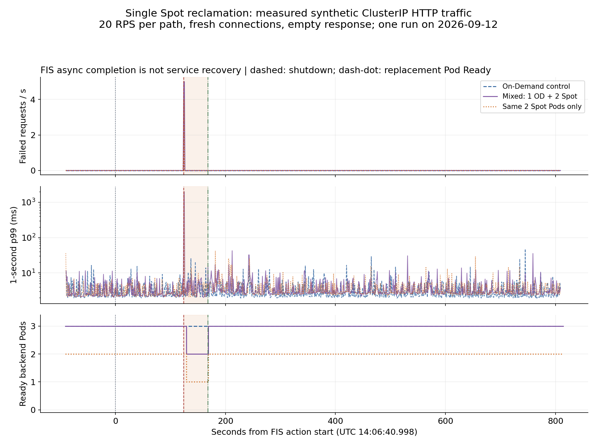

# Experimentos de Spot en producción de EKS y evaluación de resultados

> **Última actualización**: 14 de septiembre de 2026
> **Estado de medición**: MEDICIÓN PARCIAL (carga estable, drenaje, una interrupción de instancia Spot, bloqueo de PDB y una transición explícita a On-Demand). La sección 7 presenta resultados y registros sin procesar.
> **Alcance**: cargas de trabajo tolerantes a interrupciones en EKS Auto Mode, Karpenter autoadministrado o grupos de nodos administrados de EKS

Evalúa la adopción de Spot según si **los SLO del servicio y la corrección de los datos resisten la interrupción o retirada de capacidad del nodo**; después considera los ahorros. Mide una referencia On-Demand y compara la disponibilidad y el costo efectivo de una configuración mixta con carga equivalente. Los números y duraciones propuestos en las secciones 1–6 son **ejemplos de diseño de experimentos**. La sección 7 identifica por separado las mediciones reales; ninguna de las dos constituye una garantía de AWS.

El diseño complementario es **más CPU al iniciar → reducir CPU en el mismo Pod después de inicializar → conservar QoS Guaranteed**. Busca acortar la inicialización del Pod de reemplazo y mantener coherentes los ajustes de recursos en estado estable. Consulta la [configuración de recursos por fase](#phase-aware-resizing) y el [experimento combinado E10](#e10-startup-resizing). Las mediciones E0–E9 existentes no validaron esta configuración.

El [informe original del experimento y la asignación de cargas de trabajo](#phase-aware-workloads) enlaza el documento suministrado del controlador Go y describe su alcance para Deployment, StatefulSet, DaemonSet y Argo Rollouts.

La decisión actual es **DETENER la expansión a producción: corregir errores durante la interrupción/transición, compatibilidad de versiones y gestión de interrupciones**. Estas mediciones HTTP sintéticas diagnostican la configuración instalada; no demuestran una operación ininterrumpida de un servicio de negocio ni una configuración con versiones compatibles.

## 1. Comportamiento y límites que hay que verificar

| Tema | Comportamiento o restricción documentados | Evidencia del experimento |
|---|---|---|
| Aviso de Spot | Los avisos de terminación/detención de EC2 normalmente llegan dos minutos antes de la interrupción, según el mejor esfuerzo. La hibernación comienza de inmediato. [S1] | Latencia de entrega del evento y comportamiento sin un aviso procesado |
| Tiempo de apagado del Pod | La ventana de dos minutos no está reservada para la aplicación. La detección, expulsión, hooks y propagación del LB consumen tiempo. Algunos Pods de MNG pueden no recibir una señal de terminación. [S2] | Tiempo real entre SIGTERM y salida, salidas forzadas, solicitudes fallidas |
| PDB | Un PodDisruptionBudget limita las interrupciones voluntarias mediante la API Eviction. No puede impedir que se pierda una instancia ni controlar la concurrencia de actualizaciones graduales de Deployment. [S3] | Evalúa por separado el drenaje voluntario y la pérdida forzada del nodo |
| Capacidad de reemplazo | Que el nodo esté Ready y que la aplicación atienda tráfico son hitos distintos. [S2], [S4] | Nodo Ready → descarga de imagen → Pod Ready → destino LB en buen estado → recuperación del SLO |
| Proporción de Spot | La prioridad de NodePool y los tipos de capacidad permitidos no garantizan una proporción fija. [S5] | Mide por separado las proporciones de nodos, vCPU, Pods y solicitudes |

### Rutas según el administrador de cómputo

| Administrador de cómputo | Etiqueta de capacidad | Gestión de interrupciones | Recuperación On-Demand |
|---|---|---|---|
| EKS Auto Mode | `karpenter.sh/capacity-type: spot` / `on-demand` | Observa las funciones administradas, eventos de Kubernetes y NodeClaims. No copies en Auto Mode el procedimiento de instalación de Karpenter OSS. [S6] | Verifica que las restricciones de NodePool y Pod permitan On-Demand |
| Karpenter autoadministrado | `karpenter.sh/capacity-type: spot` / `on-demand` | Verifica EventBridge → SQS → `--interruption-queue` de Karpenter, IAM, eventos y registros del controlador. Una recomendación de rebalanceo se gestiona de forma distinta a un aviso de interrupción. [S4] | Permite `spot` y `on-demand` en NodePool y en selectores, afinidad y tolerations compatibles de los Pods. [S5] |
| Grupo de nodos administrado de EKS (MNG) | `eks.amazonaws.com/capacityType: SPOT` / `ON_DEMAND` | Verifica Capacity Rebalancing administrado y los ajustes reales del ASG. El drenaje no siempre espera a que haya un reemplazo Ready. [S2] | Un MNG de Spot solo admite Spot. Prueba un MNG On-Demand separado, configuración de Cluster Autoscaler y elegibilidad de los Pods. [S2] |

Un presupuesto de interrupción de NodePool de `0` no impide que EC2 retire capacidad Spot. Registra por separado la consolidación/deriva voluntaria de Karpenter y las interrupciones. [S4] Instalar un Node Termination Handler aparte en Auto Mode no es un requisito previo para estos experimentos.

## 2. Entorno y grupos de comparación

Empieza en un **clúster de prueba designado** con el mismo artefacto de despliegue, red y ruta de balanceador de carga que producción. No uses por defecto un clúster de producción existente. Mantén el generador de carga y los recolectores de telemetría fuera de los nodos objetivo de la interrupción.

### Congela este registro antes de cada ejecución

| Campo | Registro |
|---|---|
| Identidad de ejecución | ID de ejecución, responsable, inicio/fin UTC, SHA de Git de configuración, ID de experimento FIS |
| Plataforma | Alias de cuenta AWS y región, clúster de prueba, versión de Kubernetes/plataforma, versión de Auto Mode o Karpenter/CA |
| Nodos | AMI/SO, arquitectura, tipos de instancia y AZ, configuración de NodePool/MNG, límites, cuotas, margen de IP de subred |
| Aplicación | Digest de imagen, réplicas, requests/limits, HPA, PDB, ubicación, hooks de apagado, reintentos/timeouts |
| Tráfico | Endpoint y operación, tamaño de carga, tasa/concurrencia de solicitudes, keep-alive, política de reintentos, semilla de datos |
| Telemetría | Intervalo de recopilación, consultas de panel/registros, registros sin procesar del cliente, sincronización del reloj, ubicación de retención |
| Costos | Duración de uso real y base de tarifa por nodo, tratamiento de descuentos por compromiso, asignación de costos compartidos |

No incluyas en los resultados públicos ID reales de cuenta, endpoints internos ni datos de clientes; conserva la trazabilidad en evidencia con acceso controlado. Usa la misma arquitectura de imagen en todos los grupos. Con MNG y Cluster Autoscaler, agrupa tipos de instancia con tamaños de vCPU/memoria similares. Evita confundir los efectos de Spot con cambios de arquitectura o tamaño de instancia. [S2]

### Grupos de comparación

| Grupo | Configuración | Propósito |
|---|---|---|
| A | Solo On-Demand | Referencia de errores, latencia, rendimiento y costo con carga equivalente |
| B | Capacidad mínima de servicio On-Demand más expansión Spot | Candidato para producción; compara continuidad y costo |
| C | Solo Spot | Expone riesgos de interrupción y capacidad; no es una recomendación de producción |

Una configuración B de ejemplo es un **Deployment solo On-Demand con 3 réplicas más un Deployment solo Spot con 3 réplicas**, servidos por un Service común. Da a cada Deployment un selector distinto y no superpuesto; comparte solo la etiqueta del Service. Esto no implica una proporción del 50 % de nodos, costo ni solicitudes.

Mantén este experimento de proporción fija separado de una prueba de fallback con un **Deployment que prefiere Spot pero también permite On-Demand**. Los selectores solo Spot impiden que los Pods se muevan a On-Demand aunque haya nodos disponibles. Permitir ambos tipos de capacidad en un NodePool no reserva una capacidad mínima de On-Demand en ejecución. [S5]

Dimensiona el mínimo On-Demand en función de los requisitos de supervivencia, no de un porcentaje arbitrario:

```text
Required surviving replicas = ceil(required degraded-mode RPS / per-Pod RPS meeting SLO)
Surviving replicas after failure = all replicas - replicas on reclaimed nodes
Requirement: surviving replicas >= required surviving replicas
```

Por ejemplo, **suponiendo** que cada Pod sostiene 100 RPS dentro del SLO y la demanda en modo degradado es de 300 RPS, deben sobrevivir al menos 3 réplicas. Este cálculo supone suficiente CPU, memoria, conexiones y capacidad aguas abajo; no demuestra que 3 réplicas basten en un sistema real. Si la falla de una AZ forma parte del escenario, excluye también la capacidad On-Demand de la AZ fallida.

Al principio, mantén constantes los ajustes de HPA y consolidación voluntaria; después restaura los ajustes de producción para una prueba de interacción independiente. Captura la ubicación real de los Pods: distribución topológica por nombre de host/AZ, `DoNotSchedule`, `minDomains` y restricciones de zona de PV pueden impedir el reemplazo. [S8]

### Más CPU al iniciar y conservación de QoS Guaranteed {#phase-aware-resizing}

Aplica al camino de reemplazo de Spot el prototipo de MAP y reducción de CPU por fase de la [sección 1.36 de la hoja de ruta de Kubernetes](../eks/12-kubernetes-version-roadmap.md#_4-8-kubernetes-1-36-haru-april-2026). **El cambio de recursos in situ a nivel de contenedor llegó a GA en 1.35**; **MutatingAdmissionPolicy (MAP) llegó a GA en 1.36**. MAP usa CEL dentro del servidor de API como alternativa a un webhook de admisión mutante. Este ejemplo no despliega un servidor de webhook externo. [S14], [S16]

| Fase | Acción responsable | Condiciones que se deben conservar |
|---|---|---|
| Creación del Pod nuevo | La plantilla de carga de trabajo define iguales la solicitud y el límite de CPU inicial y de memoria. MAP inyecta entradas `resizePolicy` ausentes en los Pods que optaron por participar | `Guaranteed` desde la creación; conserva las políticas de cambio de tamaño explícitas ya existentes |
| Inicialización de la aplicación | Usa el presupuesto mayor de CPU de inicio. Confirma la inicialización con un `startupProbe` real | Que esté `Running` no basta; comprueba readiness y readiness del LB por separado |
| Solicitud de reducción de CPU | Un resizer independiente modifica mediante PATCH la solicitud y el límite de CPU usando `pods/resize` | Política de CPU `NotRequired`, memoria sin cambios, mismo UID de Pod y mismo contenedor |
| Funcionamiento estable | Comprueba los valores de CPU/memoria aplicados por kubelet y `qosClass`; luego mide SLO con carga representativa | Mantén `Guaranteed` después de reducir; distingue aceptación de API, aplicación real y calidad del servicio |

En este ejemplo, la **plantilla de carga de trabajo** define la CPU de inicio. MAP inyecta los valores predeterminados de `resizePolicy`; no supervisa la finalización del calentamiento ni reduce los Pods en ejecución. Un controlador independiente se encarga de la reducción después del inicio.

La «duración de inicio» objetivo aquí es la **fase de inicialización o calentamiento de la aplicación que consume mucha CPU**. Este diseño no cambia el tamaño de `initContainers` regulares ya completados. El tiempo dominado por descargas de imágenes, arranque de nodo, esperas de E/S externas o un simple `sleep` no se reducirá proporcionalmente solo por cambiar los ajustes de CPU. El ejemplo `sleep` BusyBox de la hoja de ruta ilustra transiciones de estado; no es una prueba comparativa de rendimiento de inicio.

Estos **perfiles ilustrativos de comparación** usan los valores de la hoja de ruta. Cada perfil mantiene iguales en `64Mi` la solicitud y el límite de memoria del contenedor. Mide el inicio, carga máxima y uso de memoria de la aplicación real antes de elegir los recursos.

| Perfil | Solicitud=límite de CPU al iniciar | Solicitud=límite de CPU estable | Propósito |
|---|---|---|---|
| G-steady | `50m` | `50m` | Referencia de CPU fija pequeña |
| G-phase | `200m` | `50m` | Más CPU para inicialización y luego reducción al terminar |
| G-high | `200m` | `200m` | Control de CPU fija mayor para inicio y rendimiento estable |

**Este diseño no empieza como Burstable para convertirse luego en Guaranteed.** La clase QoS del Pod se determina al crearlo y no puede cambiar mediante un cambio de tamaño. En esta configuración a nivel de contenedor, establece cada solicitud de CPU y memoria requerida igual a su límite positivo correspondiente en contenedores de aplicación, sidecar e init. Cambia juntos la solicitud y el límite de CPU al reducir. Tener valores de CPU iguales no cumple por sí solo los requisitos Guaranteed si difieren los valores de memoria. [S14], [S15]

También se aplica el contrato del prototipo existente:

- Define un único `WATCH_NAMESPACE` y un `MIN_STEADY_CPU` revisado. El binding MAP selecciona namespaces con la etiqueta `map-demo: "true"`; la plantilla del Pod necesita la etiqueta `resize.example.com/managed: "true"` y la anotación `resize.example.com/enabled: "true"`. Estos selectores no sustituyen un límite de autorización.
- Usa `resize.example.com/trigger: StartupProbePassed` y verifica que cada contenedor regular objetivo tenga un `startupProbe` real y `status.containerStatuses[].started=true`. Ni `started` por sí solo ni un retraso fijo demuestran que terminó el calentamiento. [S17]
- Haz coincidir los nombres de contenedor en `resize.example.com/steady-resources` con los nombres reales. Para `http`, el nombre de contenedor del ejemplo Spot actual, el valor solo de CPU es `{"http":{"requests":{"cpu":"50m"},"limits":{"cpu":"50m"}}}`. Añadir solo esta anotación no instala MAP ni el resizer, ni aumenta la CPU de inicio.
- Selecciona explícitamente un SO Linux para el Pod y nodos Linux, y usa recursos a nivel de contenedor. El prototipo actual rechaza presupuestos a nivel de Pod, cambios de memoria, aumentos de tamaño, políticas de CPU que requieren reinicio, un cambio de tamaño en curso o recursos observados que no coinciden. No se aplica a contenedores init regulares ni efímeros. Comprueba las restricciones de cambio de tamaño en los nodos seleccionados, incluidas políticas estáticas de CPU/Memory Manager. [S14]
- Reserva **margen de capacidad para el inicio** que permita programar Pods nuevos con solicitudes de CPU mayores. Un Pod queda Pending si su solicitud actual no cabe, aunque luego se planee reducirla. El prototipo existente no restablece la CPU de inicio cuando se reinicia un contenedor dentro del mismo Pod; prueba ese caso por separado. Un Pod nuevo que sustituya capacidad Spot retirada vuelve a pasar por la plantilla y la ruta de admisión.

Conservar Guaranteed mantiene la configuración de recursos y las condiciones de QoS, pero **los SLO de la aplicación deben demostrar que la calidad de servicio es aceptable**. Un límite de CPU estable pequeño puede causar throttling y latencia; superar un límite de memoria puede provocar OOM. Guaranteed no evita la interrupción de un nodo Spot. Primero define quién administra los ajustes de recursos entre HPA, VPA, GitOps y el resizer. En E7, verifica el efecto de cambiar las solicitudes de CPU en el denominador que usa HPA basado en utilización de CPU. [S1], [S14], [S15]

### Informe original del experimento y asignación de cargas de trabajo {#phase-aware-workloads}

> **Fuente adjunta:** [Cambio automático de tamaño por fase con un controlador Go: Deployment / StatefulSet / DaemonSet / Argo Rollouts][N1]. Este documento de Notion incluye código Go, Dockerfile, manifiestos RBAC/despliegue y las observaciones EKS reportadas. Puede que se requieran permisos para compartir Notion.

La idea central de la fuente es usar **presupuestos distintos de CPU al inicio y en estado estable y conservar Guaranteed durante todo el proceso**. Cuando se aplica la reducción, solicitudes menores pueden dejar espacio para más Pods, mientras el límite estable de CPU conserva un tope de uso. La fuente describe la mitigación de vecinos ruidosos y un empaquetado más eficiente como beneficios de diseño que hay que evaluar; la tabla de CPU/QoS siguiente no mide mejoras de rendimiento, densidad de nodos ni ahorro de costos.

El punto común de entrada es el **Pod, no el tipo de carga de trabajo**. Los Pods de Deployment y Rollout normalmente tienen un ReplicaSet como propietario controlador inmediato; StatefulSet y DaemonSet también crean Pods. Las rutas de propiedad siguientes identifican cohortes del experimento; no requieren código de resizer distinto para cada tipo de controlador padre.

| Carga de trabajo | Ruta de propiedad del Pod | Evidencia que presenta la fuente |
|---|---|---|
| Deployment | `Deployment → ReplicaSet → Pod` | Las secciones 6.2–6.3 informan registros de cambio automático de tamaño y valores anteriores/posteriores para dos Pods |
| StatefulSet | `StatefulSet → Pod` | Las secciones 6.2–6.3 informan registros de cambio automático de tamaño y valores anteriores/posteriores |
| DaemonSet | `DaemonSet → Pod` | Las secciones 6.2–6.3 informan registros de cambio automático de tamaño y valores anteriores/posteriores |
| Argo Rollouts | `Rollout → ReplicaSet → Pod` | La sección 4.1 ofrece un ejemplo directo de `spec.template` y un argumento estructural de aplicabilidad; no aparece en la tabla de mediciones de la sección 6.3 |

Para las plantillas de Pod escritas directamente en la fuente, aplica los ajustes comunes a `spec.template` de cada recurso: anotaciones en `spec.template.metadata.annotations`, y recursos iniciales, startupProbe y resizePolicy en `spec.template.spec.containers[]` objetivo. La fuente distingue políticas escritas explícitamente de la inyección de MAP. **Cambiar solo el tipo de un manifiesto Deployment no basta.** Conserva los ajustes específicos de cada carga, incluidos serviceName/Service, almacenamiento y políticas de orden de StatefulSet, ubicación de DaemonSet y estrategia de Rollout.

Los siguientes son **valores anteriores/posteriores reportados por la fuente**. Su entorno declarado es EKS `1.36.1`, containerd `2.2.3` y AL2023 con cgroup v2 en arm64/Graviton. Resumen el informe de experimento suministrado; no se volvieron a ejecutar para actualizar esta documentación.

| Carga reportada | Solicitud=límite de CPU | Solicitud=límite de memoria | QoS | restartCount / containerID |
|---|---|---|---|---|
| Dos Pods Deployment | `200m → 50m` | Permanece en `64Mi` | `Guaranteed → Guaranteed` | `0 → 0` / sin cambios |
| Pod StatefulSet | `200m → 50m` | Permanece en `64Mi` | `Guaranteed → Guaranteed` | `0 → 0` / sin cambios |
| Pod DaemonSet | `200m → 50m` | Permanece en `64Mi` | `Guaranteed → Guaranteed` | `0 → 0` / sin cambios |

Distingue la **aplicabilidad estructural** de la **validación observada** para Argo Rollouts. La introducción de la fuente menciona los cuatro tipos, pero su tabla detallada contiene los tres anteriores; su argumento sobre Argo se basa en la estructura compartida de propiedad del Pod. Una etiqueta de registro `ReplicaSet` por sí sola no distingue Deployment de Rollout ni identifica una prueba Rollout completada. Registra la cadena de propiedad estable/canary real y valida por separado la promoción, aborto/reversión, tráfico/métricas de Analysis y el efecto de cambiar las solicitudes de CPU.

El watch de todo el clúster, la marca `resized` y `sync.Map` de la fuente pertenecen a esa implementación anterior. **Conserva el alcance por namespace, etiqueta de administración, piso de CPU, startupProbe real, pruebas de UID/resourceVersion y cola de reintentos del prototipo actual de la hoja de ruta** en vez de sustituir la especificación de despliegue actual por el código anterior. El containerID/restartCount sin cambios no demuestra por sí solo la aplicación en cgroup ni que no se perdieran solicitudes: mantén separados el informe de la fuente, las observaciones reales de recursos/SLO y la prueba Spot combinada E10 aún no ejecutada.

## 3. Experimentos y criterios de aceptación

**Protocolo común de ejemplo**: 10 minutos separados de calentamiento, 15 minutos de carga estable, inyección/recuperación y 15 minutos tras la recuperación. Empieza con al menos cinco ejecuciones independientes por escenario de fallo y varía la hora y el tipo de instancia objetivo. Esta cantidad de muestras no demuestra fiabilidad de producción.

**SLO de ejemplo**: tasa de error de solicitudes de como máximo 0.1 %, p99 de como máximo 500 ms en ventanas de un minuto, recuperación en 120 segundos y cero pérdida de trabajo confirmado. Sustituye esto por el SLO y presupuesto de error acordados por el servicio antes de probar. Cuenta timeouts, fallos de conexión y contenido de respuesta no válido como fallos además de errores HTTP. Informa por separado de los intentos sin procesar y del éxito de la operación de usuario tras reintentos.

| ID | Hipótesis y estímulo | Procedimiento | Observación y decisión |
|---|---|---|---|
| E0 | B cumple el mismo SLO que A sin fallos | Carga representativa equivalente en A/B/C; excluye el calentamiento | Errores, distribución de latencia, rendimiento satisfactorio real, proporción Spot real |
| E1 | El drenaje y el apagado de aplicación funcionan | Drena un nodo de prueba mediante la API Eviction; restaura después | Espera del PDB, hooks de apagado, finalización de trabajo en curso. **No sustituye probar la interrupción de Spot** |
| E2 | Una interrupción de Spot conserva el SLO | Interrumpe una instancia Spot real usando el procedimiento FIS siguiente | Aviso→drenaje→reemplazo→recuperación del servicio, fallos, terminación forzada |
| E3 | Recuperación concurrente conserva la capacidad de supervivencia | Después de que E2 pase, apunta explícitamente a dos instancias Spot de la misma AZ/tipo | Indisponibilidad concurrente máxima, bloqueo del PDB, supervivientes, pérdida. N/A si no existen esos destinos |
| E4 | On-Demand restablece el servicio si Spot no está disponible | Primero prueba un cambio de Deployment solo On-Demand; prueba por separado los errores de capacidad de abajo | Evalúa por separado el ejercicio de transición y el fallback automático ante errores de capacidad |
| E5 | La recuperación funciona sin gestión de avisos | En infraestructura de prueba dedicada, interrumpe la gestión de avisos o termina abruptamente la VM Spot designada en ejecuciones separadas | Separa esto de las pruebas normales de aviso; demoras de detección/reprogramación y corrección del trabajo sin señales |
| E6 | Las restricciones y un apagado lento exponen fallos | Cambia una condición por ejecución: PDB bloqueante, preStop largo, afinidad solo Spot o restricción AZ | Detecta el fallo esperado; diagnostica, corrige ajustes de producción y repite |
| E7 | Escalado y recuperación pueden superponerse | Restaura los ajustes de producción de HPA/CA/Karpenter; ejecuta E2 durante demanda máxima representativa | Pods pendientes, cuotas/IP, descarga de imagen, tiempo hasta que la nueva capacidad cumpla el SLO |
| E8 | El trabajo reintentado conserva la corrección | Usa un conjunto fijo de ID de trabajos de prueba y ejecuta E2 durante el procesamiento | Reconcilia resultados enviados/confirmados/durables; distingue ejecución duplicada de efectos duplicados |
| E9 | La mejora de costo persiste | Alterna períodos A/B comparables u observa carga equivalente durante suficiente tiempo | Costo por operación satisfactoria, incluidos reintentos, capacidad duplicada y sobrecarga; sin regresión de rendimiento |
| E10 | Más CPU al iniciar acorta la inicialización del Pod de reemplazo y conserva calidad al reducir | Compara G-steady/G-phase/G-high con la misma ubicación, aplicación y carga; luego repite E2 | Tiempo de inicio, aplicación real del cambio, QoS Guaranteed conservado, reinicios, throttling y SLO de solicitudes |

E3 prueba **interrupciones simultáneas de instancias Spot**. No reproduce una interrupción completa de AZ que afecte a redes, almacenamiento y capacidad On-Demand.

### E4: distinguir un ejercicio de transición de un error de capacidad

Cambiar un NodePool a solo On-Demand prueba configuración, programación e inicio de la aplicación. **No verifica el fallback automático cuando EC2 devuelve capacidad Spot insuficiente**.

Para provocar errores de capacidad de forma controlada, comprueba si la acción AWS FIS de capacidad insuficiente de EC2 API o ASG corresponde a la ruta de aprovisionamiento; usa la [referencia oficial de acciones][S9] y el resultado actual de `get-action`. Las llamadas Fleet de Karpenter, ASG de un MNG y Auto Mode administrado por AWS son rutas distintas. Limita la inyección al rol/ASG y AZ de prueba dedicados, y verifica que no bloquee también la ruta de aprovisionamiento On-Demand.

Si no hay un método reproducible de inyección que cubra la ruta real, deja el **fallback automático SIN VERIFICAR**. Los fallos naturales de capacidad pueden aportar evidencia adicional. Restringir tipos de instancia/AZ no garantiza que ocurra una escasez.

### E10: verifica juntos un inicio más corto y la calidad en estado estable {#e10-startup-resizing}

Primero mantén constante la configuración A o B y cambia solo el perfil de CPU. Iguala imagen de aplicación, entrada, réplicas, memoria estable, tipo de instancia, AZ y condiciones de caché de imágenes; usa una inicialización que realmente trabaje con CPU. Compara carga normal entre perfiles de CPU y luego repite la misma prueba de interrupción E2. Comprueba por separado las interacciones del autoescalador E7.

| Evaluación | Evidencia requerida |
|---|---|
| Inicialización más corta | Tiempos separados de inicio/fin de inicialización de la aplicación, inicio de contenedor, éxito de startupProbe y Ready/LB. Compara distribuciones entre ejecuciones sin confundir inicialización con el arranque del nodo o descargas de imagen |
| Aplicación del cambio de tamaño | Guarda juntos `spec.containers[].resources` deseados, `status.containerStatuses[].resources` informados por kubelet, generación/generación observada y `PodResizePending`/`PodResizeInProgress` |
| Continuidad de ejecución y QoS | Requests/limits de CPU y memoria antes/después, `qosClass=Guaranteed`, containerID y restartCount para el mismo UID de Pod. Estos datos por sí solos no demuestran cero solicitudes perdidas |
| Calidad en estado estable | Después de la reducción, errores, p99, rendimiento, throttling de CPU, OOM, cambios de readiness y corrección del trabajo cumplen los SLO existentes con carga representativa y máxima |
| Reemplazo y contención de recursos | Pods pendientes, nodos extra y capacidad de inicio durante creación simultánea de Pods; reinicios dentro del mismo Pod; fallos del controlador, cambios Deferred/Infeasible y rutas de recuperación |

Un PATCH de cambio de tamaño satisfactorio demuestra **aceptación de la solicitud**. Inspecciona `PodResizePending` con `Deferred` o `Infeasible`, `PodResizeInProgress` y los recursos realmente informados. No registres valores no aplicados como resultados en estado estable. Lo siguiente es una **instantánea de solo lectura** de un Pod propio; no sustituye la observación repetida. [S14]

```bash
set -euo pipefail
: "${KUBE_CONTEXT:?}"; : "${NAMESPACE:?}"; : "${POD_NAME:?}"
kubectl --context "$KUBE_CONTEXT" --request-timeout=15s \
  -n "$NAMESPACE" get pod "$POD_NAME" -o json |
  jq '{
    capturedAt:(now|todateiso8601),
    uid:.metadata.uid,generation:.metadata.generation,
    observedGeneration:.status.observedGeneration,qosClass:.status.qosClass,
    desired:[.spec.containers[] | {name,resources}],
    reported:[.status.containerStatuses[]? |
      {name,started,ready,runningStartedAt:.state.running.startedAt,
       resources,restartCount,containerID}],
    resizeConditions:[.status.conditions[]? |
      select(.type=="PodResizePending" or .type=="PodResizeInProgress")]
  }'
```

Evalúa por separado la **mejora de inicialización G-phase**, la **aplicación real de la reducción de CPU**, la **conservación de los SLO después de reducir** y los **criterios del servicio durante una interrupción Spot**. Registra cualquier elemento no medido; el nombre de la clase QoS por sí solo no demuestra «ausencia de problemas de calidad». Esta guía aún no ha medido los efectos de aumentar la CPU inicial y reducirla después.

## 4. Reproduce E2: interrumpe una instancia Spot mediante AWS FIS

### Requisitos previos

Herramientas necesarias: Bash, AWS CLI, kubectl y jq.

1. Identifica el clúster de prueba y el NodePool/MNG dedicado al experimento. Inspecciona **todos los Pods** del nodo de destino y excluye cargas de negocio y controladores compartidos. Haz inventario de los DaemonSets necesarios del nodo y su sobrecarga de recursos.
2. Prepara un rol de ejecución FIS revisado y una alarma de detención de CloudWatch que observe errores/latencia reales del servicio. Limita las acciones a las instancias/etiquetas de experimento designadas; verifica la relación de confianza `fis.amazonaws.com`, restricciones `SourceAccount`/`SourceArn` y el alcance de `iam:PassRole` del llamador. [S10]
3. Verifica que la alarma reciba métricas reales y esté en `OK`. Prueba su transición antes de inyectar el fallo y registra umbrales, períodos de evaluación y comportamiento ante datos ausentes.
4. Inicia registros de carga del cliente con marcas horarias UTC y observación de Kubernetes/controlador/LB **antes de la inyección**.

Define las siguientes entradas de shell solo después de identificar el destino de prueba:

```bash
export SPOT_PROFILE=''
export SPOT_REGION=''
export SPOT_CLUSTER=''
export SPOT_NODE=''
export SPOT_INSTANCE_ID=''
export SPOT_RUN_ID=''
export SPOT_FIS_ROLE_ARN=''
export SPOT_STOP_ALARM_ARN=''
```

Usa un kubeconfig dedicado para que el contexto actual predeterminado de la estación de trabajo permanezca intacto. Correlaciona ARN del clúster, ciclo de vida de EC2, providerID y Pods mediante las siguientes consultas de solo lectura. Una etiqueta de nodo no demuestra por sí sola que la capacidad EC2 sea Spot.

```bash
set -euo pipefail
: "${SPOT_PROFILE:?}" "${SPOT_REGION:?}" "${SPOT_CLUSTER:?}"
: "${SPOT_NODE:?}" "${SPOT_INSTANCE_ID:?}" "${SPOT_RUN_ID:?}"
: "${SPOT_FIS_ROLE_ARN:?}" "${SPOT_STOP_ALARM_ARN:?}"
umask 077
SPOT_RESULT_DIR=$(mktemp -d "$PWD/eks-spot-run.XXXXXX")
SPOT_KUBECONFIG="$SPOT_RESULT_DIR/kubeconfig"
spot_aws() { aws --profile "$SPOT_PROFILE" --region "$SPOT_REGION" --output json "$@"; }
spot_kubectl() { kubectl --kubeconfig "$SPOT_KUBECONFIG" "$@"; }

spot_aws eks update-kubeconfig --name "$SPOT_CLUSTER" \
  --kubeconfig "$SPOT_KUBECONFIG" --alias "$SPOT_CLUSTER"
spot_aws sts get-caller-identity > "$SPOT_RESULT_DIR/caller.json"
spot_aws eks describe-cluster --name "$SPOT_CLUSTER" \
  > "$SPOT_RESULT_DIR/cluster.json"
spot_kubectl get node "$SPOT_NODE" -o json \
  > "$SPOT_RESULT_DIR/node-before.json"
spot_kubectl get pods -A --field-selector "spec.nodeName=$SPOT_NODE" -o json \
  > "$SPOT_RESULT_DIR/pods-on-target.json"
spot_aws ec2 describe-instances --instance-ids "$SPOT_INSTANCE_ID" \
  > "$SPOT_RESULT_DIR/instance-before.json"

jq -e --arg id "$SPOT_INSTANCE_ID" \
  '.spec.providerID | endswith("/" + $id)' \
  "$SPOT_RESULT_DIR/node-before.json"
jq -e '[.Reservations[].Instances[]] |
  length == 1 and .[0].InstanceLifecycle == "spot" and .[0].State.Name == "running"' \
  "$SPOT_RESULT_DIR/instance-before.json"
```

Confirma que la cuenta, región y clúster de `caller.json` y `cluster.json` coincidan con el entorno de prueba designado y que el nodo esté dedicado al experimento. Guarda el siguiente JSON como `$SPOT_RESULT_DIR/fis-template.example.json`. Antes de ejecutarlos, los comandos reemplazan los ARN de ejemplo con los valores verificados. Conserva **un ARN de recurso explícito y COUNT(1)**.

```json
{
  "description": "E2: interrupt one isolated EKS Spot test node",
  "roleArn": "arn:aws:iam::111122223333:role/eks-spot-test-fis",
  "targets": {
    "oneSpotNode": {
      "resourceType": "aws:ec2:spot-instance",
      "resourceArns": ["arn:aws:ec2:ap-northeast-2:111122223333:instance/i-0123456789abcdef0"],
      "selectionMode": "COUNT(1)"
    }
  },
  "actions": {
    "interrupt": {
      "actionId": "aws:ec2:send-spot-instance-interruptions",
      "parameters": {"durationBeforeInterruption": "PT2M"},
      "targets": {"SpotInstances": "oneSpotNode"}
    }
  },
  "stopConditions": [
    {
      "source": "aws:cloudwatch:alarm",
      "value": "arn:aws:cloudwatch:ap-northeast-2:111122223333:alarm:eks-spot-test-slo"
    }
  ]
}
```

Esta acción FIS interrumpe realmente la instancia. También emite una recomendación de rebalanceo al inicio, así que E2 no aísla por sí solo la gestión de avisos de interrupción. No interpretes `durationBeforeInterruption` como un período de gracia de la aplicación; registra las marcas horarias reales de eventos. [S7], [S9]

Vuelve a leer la plantilla y verifica el destino antes de iniciarla. No supongas que una alarma de detención o `stop-experiment` cancela una interrupción ya solicitada ni restaura una instancia terminada. Detener nuevas inyecciones y restaurar el servicio son operaciones separadas. [S11]

```bash
SPOT_ACCOUNT_ID=$(jq -r '.Account' "$SPOT_RESULT_DIR/caller.json")
SPOT_PARTITION=$(jq -r '.Arn | split(":")[1]' "$SPOT_RESULT_DIR/caller.json")
SPOT_INSTANCE_ARN="arn:$SPOT_PARTITION:ec2:$SPOT_REGION:$SPOT_ACCOUNT_ID:instance/$SPOT_INSTANCE_ID"
jq --arg instance "$SPOT_INSTANCE_ARN" \
  --arg role "$SPOT_FIS_ROLE_ARN" --arg alarm "$SPOT_STOP_ALARM_ARN" \
  '.roleArn = $role |
   .targets.oneSpotNode.resourceArns = [$instance] |
   .stopConditions[0].value = $alarm' \
  "$SPOT_RESULT_DIR/fis-template.example.json" > "$SPOT_RESULT_DIR/fis-template.json"

SPOT_TEMPLATE_ID=$(spot_aws fis create-experiment-template \
  --cli-input-json "file://$SPOT_RESULT_DIR/fis-template.json" \
  --query experimentTemplate.id --output text)
spot_aws fis get-experiment-template --id "$SPOT_TEMPLATE_ID" \
  > "$SPOT_RESULT_DIR/template-resolved.json"

# Run after target review and telemetry startup: the test instance is reclaimed.
SPOT_EXPERIMENT_ID=$(spot_aws fis start-experiment \
  --experiment-template-id "$SPOT_TEMPLATE_ID" \
  --tags "RunId=$SPOT_RUN_ID" \
  --query experiment.id --output text)
spot_aws fis get-experiment --id "$SPOT_EXPERIMENT_ID" \
  > "$SPOT_RESULT_DIR/experiment-start.json"
spot_aws fis list-experiment-resolved-targets \
  --experiment-id "$SPOT_EXPERIMENT_ID" \
  > "$SPOT_RESULT_DIR/targets.json"
```

Consulta `get-experiment` hasta que el experimento llegue a un estado terminal y confirma que el destino resuelto sea exactamente la instancia prevista. `completed` significa que terminó la acción de fallo, **no que el servicio haya cumplido su SLO**. No marques como válida una ejecución `failed`, `stopped` o sin destino. [S7]

## 5. Mediciones y registros de resultados

### Cronología de observación

| Hora | Evidencia |
|---|---|
| T0 | Inicio de la acción FIS y destino real resuelto |
| T1 | `time` del evento EventBridge, horas de recepción/procesamiento del observador. Registra por separado la hora aproximada de interrupción desde IMDS `spot/instance-action` o una fuente identificada del controlador solo si está disponible |
| T2 | Cordon/taint, inicio de expulsión, registros de SIGTERM/salida del Pod |
| T3 | Cambios de estado de EC2 destino, creación de instancia de reemplazo, Node Ready |
| T4 | Pod de reemplazo Ready, estado de EndpointSlice, destino LB en buen estado |
| T5 | Inicio de cinco minutos continuos que cumplen criterios acordados de errores, latencia y rendimiento |

Informa del tiempo de recuperación desde **T0 hasta T5** y, por separado, desde la primera infracción del SLO hasta la recuperación. Si el servicio mantuvo sus criterios durante toda la ejecución, el tiempo de inactividad del servicio es cero; informa por separado el tiempo de reemplazo de nodo/Pod. La instrumentación ausente no equivale a recuperación en cero segundos.

El evento EventBridge no contiene un campo aparte para la hora programada de interrupción. IMDS aporta una hora aproximada; márcala como no disponible si no se puede recopilar. No exijas acceso al nodo de Auto Mode solo para completar este campo. Etiqueta las horas inferidas como estimaciones y registra en T3 los cambios reales de estado de EC2. [S1]

Conserva JSON de Node/Pod, eventos, PDB, EndpointSlice y configuración NodePool/MNG antes, durante y después de la inyección. Una sola consulta al terminar no basta porque los eventos caducan y la telemetría puede llegar tarde. Añade métricas del controlador/SQS para Karpenter autoadministrado, actividades del ASG para MNG y eventos administrados disponibles en Auto Mode.

No evalúes el éxito solo con métricas 5xx del LB. Incluye reinicios de conexiones del cliente, timeouts, fallos DNS y validación de respuestas; identifica los fallos ocultos por reintentos. Calcula p99 a partir de muestras sin procesar o histogramas combinados para cada ventana de observación; **no promedies varios valores p99 para obtener un p99 general**.

### Estado del experimento

Consulta las mediciones en la sección 7 y los datos sin procesar. NO EJECUTADO o SIN VERIFICAR no significa aprobado. Las mediciones cubren solicitudes HTTP sintéticas; no se probaron la pérdida de datos de negocio ni los efectos duplicados.

| Experimento | Alcance real | Estado |
|---|---|---|
| E0 | 120 segundos de carga estable en tres rutas de observación | Una ejecución; 2 400 éxitos por ruta |
| E1 | Drenar un nodo Spot dedicado; observar durante 180 segundos | Una ejecución; 8 fallos en ruta mixta |
| E2 | Recuperar una instancia Spot mediante FIS; observar durante 900 segundos | Una ejecución; 10 fallos en ruta mixta |
| E3 | Recuperación concurrente | NO EJECUTADO |
| E4 | Cambiar selectores de Pod a On-Demand; observar durante 240 segundos | Una ejecución. El fallback automático ante errores reales de capacidad sigue SIN VERIFICAR |
| E5 | Pérdida abrupta o fallo de entrega de aviso | NO EJECUTADO |
| E6 | Rechazar expulsión con PDB `minAvailable: 2` y luego volver a 1 | Parcial. Variantes de hook de apagado y restricción AZ NO EJECUTADAS |
| E7 | Carga máxima e interacción con HPA | NO EJECUTADO |
| E8 | Corrección del trabajo de negocio | NO EJECUTADO |
| E9 | Consultar precios por hora de instancia | Solo captura de precios; facturas reales y costo por operación satisfactoria NO MEDIDOS |
| E10 | Prueba Spot combinada de más CPU inicial, reducción y QoS Guaranteed conservada | NO EJECUTADA. El prototipo de la hoja de ruta y el informe histórico son evidencia aparte de las mediciones Spot de esta guía |

Relaciona cada ejecución: `hipótesis → inyección confirmada → observación → veredicto → causa → corrección → ID de repetición`. Conserva ejecuciones fallidas y excluidas. Informa cada ejecución, mediana y peor caso; declara avisos no recibidos, fallos de recopilación y generadores de carga saturados.

### Cálculo de costos

```text
Effective cost =
  actual Spot/On-Demand usage cost
  + additional capacity consumed by replacement overlap and retries
  + allocated EBS, LB, transfer, telemetry, EKS/Auto Mode costs

Cost per successful operation = effective cost / unique successful operations passing correctness checks
Savings = 1 - (B cost per successful operation / A cost per successful operation)
```

**No cuentes dos veces** la capacidad de reemplazo o reintento que ya se incluye en los cargos reales de EC2. La segunda línea recuerda la atribución para evitar omisiones. Indica cómo asignas los costos EKS fijos/compartidos e informa los cargos del experimento FIS por separado de los costos operativos recurrentes.

Etiqueta como **estimaciones** las extrapolaciones de una ejecución corta a un mes. Un descuento Spot por sí solo no equivale a un ahorro efectivo. Aplica la misma base contable a los descuentos reales de Savings Plans/RI y compromisos no usados del grupo A, y verifica los importes con exportaciones de facturación específicas de región y período. [S12]

## 6. Adopción y reversión

### Decisión

| Decisión | Criterios |
|---|---|
| Listo para adoptar | Pasan los escenarios obligatorios acordados, hay evidencia de carga representativa y corrección, mejora el costo y pasa el ejercicio de recuperación On-Demand |
| Adopción condicional | Limitaciones explícitas, carga/proporción Spot acotada, período de evaluación y responsable designado para el canary |
| Detener la expansión | Faltan experimentos/evidencia necesarios, se infringen SLO, hay trabajo perdido/efectos duplicados, capacidad de recuperación insuficiente o fallback automático sin verificar |

Empieza con API sin estado que use estado persistente externo y workers con reintentos/idempotencia verificados. No extiendas la misma conclusión a cargas que dependan de quórum, estado local o apagado garantizado y gradual sin pruebas de replicación/recuperación independientes. Conserva capacidad de supervivencia para control del clúster y funciones de observabilidad.

Un ejemplo de despliegue gradual es **prueba → canary de un servicio → expansión dentro del ámbito validado**. En cada etapa vuelve a comprobar las proporciones reales de vCPU Spot, Pods y tráfico y el efecto en el presupuesto de error. No hay una respuesta predeterminada como «70 % Spot en todas partes».

### Procedimiento de reversión

1. Detén nuevas inyecciones de fallos y expansión Spot. Solicita `stop-experiment` para un experimento FIS en ejecución y continúa observando los efectos de interrupciones ya programadas.
2. Aplica al origen GitOps la configuración On-Demand probada. Define claramente quién es dueño del cambio para que la reconciliación no lo sobrescriba con un parche manual.
3. Comprueba límites On-Demand, margen de IP de subred y restricciones de Pods; amplía el Deployment de reemplazo. Verifica Pod Ready, estado del destino LB y SLO del servicio.
4. Cuando exista capacidad de supervivencia, reduce gradualmente el Deployment solo Spot. Cambiar únicamente los tipos permitidos de un NodePool no reubica de inmediato los Pods existentes.
5. Vuelve a comprobar errores, latencia y corrección del trabajo; conserva la evidencia. No vuelvas a ampliar Spot hasta que la corrección y las pruebas hayan pasado.

### Limpieza

Exporta primero la evidencia a almacenamiento duradero con acceso controlado. Compara manifiestos antes/después y restaura ajustes de HPA, PDB, programación y gestión de interrupciones. Descordona los nodos E1 supervivientes cuando corresponda. Elimina solo plantillas FIS, alarmas, cargas de prueba y nodos dedicados creados para este experimento. Ajusta primero la capacidad deseada para que los administradores de nodos no vuelvan a crear recursos, y comprueba cargos restantes de EBS/LB. `/tmp` no es un almacén duradero de evidencia.

## 7. Mediciones del 12 de septiembre de 2026

### Entorno e interpretación

Se crearon un namespace dedicado, NodePools y EC2NodeClass en un clúster de pruebas EKS existente. FIS apuntó a una instancia Spot recién creada. La configuración existente del Pod de Karpenter era idéntica antes y después de la prueba. Se eliminaron los recursos del experimento y se verificó su retirada después de exportar la evidencia.

| Elemento | Configuración real |
|---|---|
| Plataforma | EKS 1.36 / kubelet `1.36.3-eks-cb19647`, Karpenter `1.4.0` |
| Nodos | arm64 `c6g.large`, ID AZ observado `apne2-az1`, inicialmente 1 nodo On-Demand + 2 Spot |
| Flexibilidad frente a ubicación | Se permitían cuatro tipos de instancia y dos AZ; todos los nodos iniciales quedaron en un solo tipo y AZ |
| Aplicación | Fortio `1.69.4`, digest de imagen fijado, solicitudes del Pod `50m` / `64Mi`, gracia de terminación de 30 segundos, readiness cada 2 segundos |
| Ubicación | Anti-afinidad por nombre de host para los dos Pods Spot; PDB `minAvailable: 1` |
| Solicitudes | 20 RPS por ruta, GET HTTP `/`, cuerpo de respuesta de cero bytes, conexión nueva por solicitud, sin reintentos |
| Medición | Sondeo Python 3.12 en un Pod On-Demand dedicado, JSONL por solicitud, observación de Kubernetes cada ~5 segundos, cola de observación EventBridge independiente |
| Alarma de detención | Observaba errores de ruta mixta por encima de 5 % o datos ausentes, períodos de 10 s, 2 de 2 puntos de datos. Separada del criterio de aceptación de ejemplo de 0.1 % |

**Estos datos no validan el cambio de tamaño por fases.** Los tres Deployments de la [plantilla de despliegue inicial publicada](https://github.com/Atom-oh/kubernetes-docs/blob/main/examples/eks/spot-production/results/2026-09-12/resources.template.json) tienen solicitudes CPU/memoria `50m`/`64Mi` y límites `500m`/`256Mi`. Esos ajustes no cumplen por sí mismos los requisitos Guaranteed. La plantilla no incluye activación de cambio por fase, `resizePolicy` ni `startupProbe`; las mediciones publicadas carecen de evidencia anterior/posterior de recursos reales, QoS y rendimiento de calentamiento comparativo. No trates esta plantilla inicial como observación del estado real del Pod después de la admisión. E10 requiere otra ejecución.

**Esto no valida una configuración con versiones compatibles.** La matriz de compatibilidad oficial consultada exige Karpenter **1.13 o posterior** para Kubernetes 1.36. La versión instalada 1.4.0 está por debajo de ese mínimo. No se midió el efecto de una actualización. [S13]

Karpenter no tenía configurada una cola de interrupciones. La cola nueva era una **cola de observación** y no estaba conectada a Karpenter. No generalices estos resultados a Karpenter con gestión de interrupciones configurada.

El control On-Demand tenía tres Pods; la ruta mixta tenía uno On-Demand y dos Spot. La ruta de observación Spot seleccionaba los mismos dos Pods Spot que la ruta mixta. Los Pods de control, el Pod mixto estable y el sondeo compartían un nodo On-Demand, así que no son grupos independientes de comparación de costo o rendimiento. El nombre de archivo sin procesar `spot-only` de E4 identifica el Service que se migra; después de la transición selecciona Pods On-Demand.

### Resultados de solicitudes

Cada escenario se ejecutó **una vez**. Se enviaron todas las solicitudes previstas y no hubo saltos del generador en ninguna ruta. Los fallos incluyen errores de conexión y timeouts de socket además de errores HTTP. p99 usa el rango más cercano sobre latencias sin procesar completadas, incluidas las solicitudes fallidas.

| Prueba / ruta | Solicitudes | Fallos | Tasa de error total | p99 total | Peor tasa de error en 60 s |
|---|---:|---:|---:|---:|---:|
| E0 / control On-Demand | 2 400 | 0 | 0% | 3.41 ms | 0% |
| E0 / Mixta | 2 400 | 0 | 0% | 4.90 ms | 0% |
| E0 / ruta de observación Spot | 2 400 | 0 | 0% | 3.91 ms | 0% |
| E1 / control On-Demand | 3 600 | 0 | 0% | 5.93 ms | 0% |
| E1 / Mixta | 3 600 | 8 | 0.2222% | 3.30 ms | 0.5833% |
| E1 / ruta de observación Spot | 3 600 | 1 | 0.0278% | 5.11 ms | 0.0833% |
| E2 / control On-Demand | 18 000 | 0 | 0% | 5.17 ms | 0% |
| E2 / Mixta | 18 000 | 10 | 0.0556% | 5.63 ms | 0.8333% |
| E2 / ruta de observación Spot | 18 000 | 5 | 0.0278% | 5.09 ms | 0.4167% |
| E4 / control On-Demand | 4 800 | 0 | 0% | 5.60 ms | 0% |
| E4 / Mixta | 4 800 | 9 | 0.1875% | 6.20 ms | 0.5833% |
| E4 / cohorte en migración | 4 800 | 16 | 0.3333% | 6.99 ms | 1.3333% |

La peor tasa de error en 60 segundos usa **ventanas completas observadas de 60 segundos que avanzan de segundo en segundo**; se excluyen las ventanas parciales finales. La ruta mixta de E2 tuvo una tasa de error total de 0.0556 % y p99 de 5.63 ms, pero su peor tasa de error en 60 segundos fue 0.8333 %, superior al criterio de ejemplo de diseño del 0.1 % escrito antes de la prueba. Era un criterio de diagnóstico, no un SLO acordado para el servicio de negocio.

E1 y E4 también tuvieron solicitudes fallidas. Un drenaje o rollout completado no demuestra una transición sin errores. El intervalo entre el inicio de la primera solicitud fallida y el fin de la última **no es ni tiempo de inactividad continuo ni tiempo de recuperación del servicio**. Los registros sin procesar conservan todos los fallos, incluidos los que ocurrieron en otros momentos.



La gráfica cubre toda la ventana de observación de E2. La latencia usa eje logarítmico, con unas 20 muestras por segundo. No equipares p99 de un segundo con p99 total. El sombreado abarca desde el apagado reportado del nodo hasta que el Pod de reemplazo quedó Ready; no representa todo el tiempo de inactividad del servicio.

### Cronología de interrupción

| Observación | Hora UTC | Evidencia |
|---|---|---|
| Comienza la acción FIS | 14:06:40.998 | `startTime` de FIS |
| Aviso de interrupción | 14:06:41 | `time` del evento EventBridge |
| FIS `completed` | 14:06:41.755 | `endTime` de FIS, distinto de la recuperación del servicio |
| kubelet informa el apagado / termina el Pod original | 14:08:45 | `KubeletNotReady`, `TerminationByKubelet` |
| Se crea NodeClaim de reemplazo | 14:08:48.212 | Registro del controlador Karpenter |
| Nodo de reemplazo Ready | 14:09:23 | Condición del nodo |
| Pod de reemplazo Ready | 14:09:29 | Condición del Pod |

El destino siguió siendo programable en observaciones anteriores a la interrupción, después de entregar el aviso. Su NodeClaim de reemplazo se creó tras apagarse el nodo. **El Pod de reemplazo quedó Ready 44 segundos después del apagado reportado**. Esto no es el tiempo de recuperación del servicio ni 44 segundos de inactividad continua. El estado de kubelet confirmó la terminación del Pod; no se instrumentó por separado la recepción de SIGTERM por la aplicación. Ten en cuenta los intervalos de sondeo de API y las marcas horarias de eventos con precisión de un segundo.

### Transición, precios y decisión

La transición explícita a On-Demand completó su rollout en **47.05 segundos**. Las etiquetas reales de nodo confirmaron que ambos Pods en migración usaban capacidad On-Demand. No se inyectó ningún error de capacidad EC2, por lo que el **fallback automático sigue sin verificarse**.

Una consulta de precios del 12-09-2026 a las 14:08:41 UTC devolvió **$0.077 por hora de instancia** para el precio público Linux On-Demand `c6g.large` y **$0.0248 por hora de instancia** para Spot en la AZ observada. La diferencia de precio unitario es **67.79 %**, no una factura real ni un ahorro de carga de trabajo. Compara también EBS, EKS, FIS, telemetría, compromisos, reintentos, capacidad de reemplazo y requisitos equivalentes de disponibilidad.

Antes de ampliar el uso en producción:

1. Alinea Karpenter con la matriz de compatibilidad de Kubernetes y valida CRD, IAM y ruta de actualización.
2. Configura la cola real de interrupciones de Karpenter, EventBridge y ruta IAM y luego repite las pruebas de interrupción. Que reciba el evento una cola de observación no basta.
3. Prueba apagado de la aplicación, propagación de readiness, política de reintentos del cliente y ruta del LB externo frente a los SLO de solicitudes.
4. Verifica la capacidad On-Demand superviviente, ubicación por AZ, fallback real ante errores de capacidad y interrupciones simultáneas.
5. Obtén carga de negocio representativa, comprobaciones de corrección, ejecuciones repetidas en distintos horarios y evidencia de costo efectivo.

Se eliminaron el namespace del experimento, dos NodePools, EC2NodeClass, nuevo perfil de instancia, plantilla/rol FIS, alarma, regla EventBridge y cola SQS. **Se verificó que no quedaran instancias EC2 activas del experimento, volúmenes EBS restantes ni recursos Kubernetes.** Los registros históricos de ejecución FIS y datos métricos permanecen sujetos a la retención del servicio AWS.

Están disponibles [herramientas y pruebas de medición](https://github.com/Atom-oh/kubernetes-docs/tree/main/examples/eks/spot-production) y [registros de solicitudes, resúmenes y cronologías sin procesar](https://github.com/Atom-oh/kubernetes-docs/tree/main/examples/eks/spot-production/results/2026-09-12). La evidencia pública omite identificadores de cuenta, nodos y red; los originales detallados de infraestructura se conservan por separado.

## 8. Guías relacionadas y fuentes

- [Estrategias de escalado](./06-scaling-strategies.md)
- [Hoja de ruta de versiones Kubernetes: MAP y cambio de CPU por fase](../eks/12-kubernetes-version-roadmap.md#_4-8-kubernetes-1-36-haru-april-2026)
- [Fuente Go de cambio de tamaño por fase: mapeo de cuatro cargas e informe de resultados (Notion)][N1]
- [Planificación de capacidad para eventos](./12-event-capacity-planning.md)
- [Administración de costos FinOps](./13-finops-cost-platform.md)
- [Guía de resolución de problemas](./16-troubleshooting-playbook.md)
- [Cuestionario de esta guía](../quizzes/ops/17-spot-production-experiments-quiz.md)

La documentación oficial respalda afirmaciones de comportamiento del servicio; no demuestra que este repositorio haya ejecutado un experimento. Enlaces S1–S13 existentes revisados: 12-09-2026. Enlaces S14–S17 añadidos y revisados: 14-09-2026.

[N1] es el informe de implementación/experimento suministrado y leído el 14-09-2026, no una especificación oficial de Kubernetes ni una nueva medición de Spot.

[S1]: https://docs.aws.amazon.com/AWSEC2/latest/UserGuide/spot-instance-termination-notices.html
[S2]: https://docs.aws.amazon.com/eks/latest/userguide/managed-node-groups.html
[S3]: https://kubernetes.io/docs/concepts/workloads/pods/disruptions/
[S4]: https://karpenter.sh/docs/concepts/disruption/
[S5]: https://karpenter.sh/docs/concepts/nodepools/
[S6]: https://docs.aws.amazon.com/eks/latest/userguide/automode.html
[S7]: https://docs.aws.amazon.com/fis/latest/userguide/fis-tutorial-spot-interruptions.html
[S8]: https://kubernetes.io/docs/concepts/scheduling-eviction/topology-spread-constraints/
[S9]: https://docs.aws.amazon.com/fis/latest/userguide/fis-actions-reference.html
[S10]: https://docs.aws.amazon.com/fis/latest/userguide/getting-started-iam-service-role.html
[S11]: https://docs.aws.amazon.com/fis/latest/userguide/stop-experiment.html
[S12]: https://docs.aws.amazon.com/cur/latest/userguide/what-is-cur.html

[S13]: https://karpenter.sh/docs/upgrading/compatibility/
[S14]: https://kubernetes.io/docs/tasks/configure-pod-container/resize-container-resources/
[S15]: https://kubernetes.io/docs/concepts/workloads/pods/pod-qos/
[S16]: https://kubernetes.io/docs/reference/access-authn-authz/mutating-admission-policy/
[S17]: https://kubernetes.io/docs/concepts/configuration/liveness-readiness-startup-probes/
[N1]: https://app.notion.com/p/3748907d4b01818cb232f89082536537
