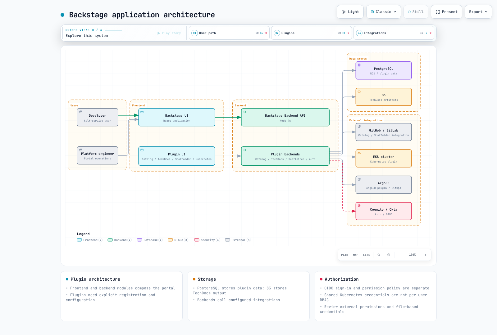
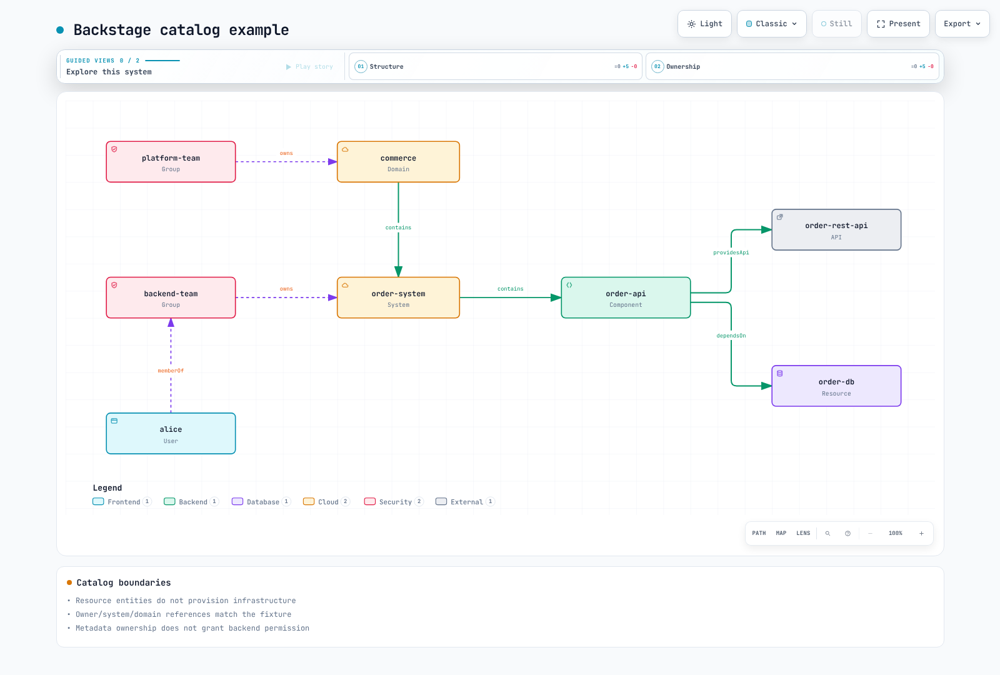
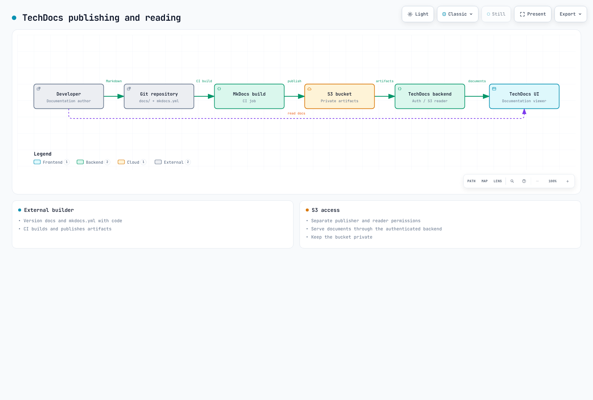
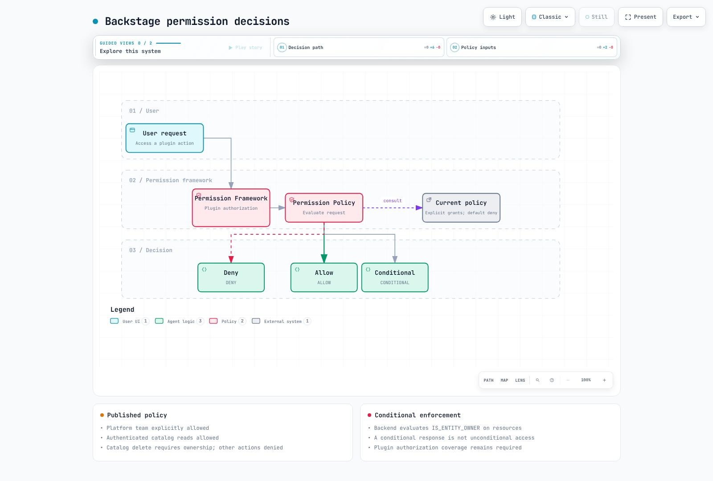

# Backstage como portal interno para desarrolladores

> **Última actualización**: 16 de octubre de 2026 · Backstage 1.54.7 / chart de Helm 2.10.2

## Función y alcance de adopción

Backstage es un framework de portal para desarrolladores de código abierto, creado en Spotify y publicado bajo la licencia Apache 2.0. La CNCF lo clasifica como Incubating. Un portal puede ser la parte visible para los usuarios de una plataforma interna de desarrollo (IDP); no sustituye toda la automatización de infraestructura, entrega, políticas u operaciones.

El Catálogo de software modela la propiedad, las API y las relaciones entre recursos. Las plantillas de software ejecutan acciones configuradas sobre esqueletos preparados. TechDocs se ocupa de compilar, publicar y consultar la documentación. Search requiere componentes recolectores y backends de indexación configurados. Tener el código y la documentación en el mismo lugar no mantiene automáticamente el contenido actualizado.

Al comparar Port, Cortex, Humanitec, OpsLevel u otros productos, evalúa el alojamiento actual, los límites de los datos, las API de extensión y los costes de personal, suscripción e infraestructura. Evita usar cifras de plugins o adopción sin verificar, rankings universales o afirmaciones de que Backstage solo genera costes de infraestructura. Los términos de licencia y los costes operativos son cuestiones distintas.

## Arquitectura y plugins

Los frontends React y los backends Node.js combinan los plugins de catálogo, scaffolder, autenticación y TechDocs. Instala y registra los módulos necesarios. Los plugins no proporcionan por sí mismos despliegue independiente ni aislamiento de seguridad. Elige la EntityPage heredada o las nuevas API de extensión del frontend según la arquitectura de la aplicación.



[Diagrama interactivo](https://www.atomai.click/kubernetes-docs/archmaps/en-platform-engineering-06-backstage-idp-0.html)

## Creación de la aplicación, compilaciones y versiones

Las versiones de Backstage, las versiones individuales de los paquetes npm, las versiones del chart de Helm y las revisiones de imágenes personalizadas son valores distintos. La versión 1.54.7 requiere Node.js 22 o 24; el Dockerfile anterior con Node 20 no es el valor predeterminado actual.

El paquete create-app inspeccionado es la versión 0.9.1. Después de generar la aplicación, revisa su lockfile, packageManager y la estructura del frontend y el backend. Estos comandos describen el flujo de compilación de la aplicación; durante esta auditoría no se compiló una aplicación Backstage completa.

```bash
npx @backstage/create-app@0.9.1
# In the generated app, using its supported Node/Yarn versions:
yarn install --immutable
yarn tsc
yarn build:backend
```

Revisa el archivo packages/backend/Dockerfile generado. La plantilla actual extrae skeleton.tar.gz, instala las dependencias de producción, extrae bundle.tar.gz y ejecuta packages/backend. Limitarse a copiar dist y ejecutar node packages/backend/dist no coincide con ese formato del bundle.

Haz coincidir las versiones principales de Node del host y del contenedor, así como las ABI de los módulos nativos, y verifica las imágenes de sistema operativo y arquitectura. No crees un segundo usuario con UID 1000 que entre en conflicto con el usuario node de la imagen. Prepara por separado los permisos de ECR y publicación de imágenes y sus digests; no incluyas credenciales en imágenes, argumentos de compilación ni variables de entorno. Con compilaciones externas de TechDocs, las imágenes lectoras no necesitan ejecutar las herramientas de generación de documentación.

## Configuración de EKS con archivos de credenciales

Lo siguiente es un ejemplo de configuración. Sustituye example.invalid y los valores aprobados de organización, bucket y cliente OIDC. Esto no demuestra que exista una conexión a PostgreSQL, un proveedor de identidad, GitHub o S3.

Prepara backstage-credentials mediante un flujo aprobado del proveedor o ESO y móntalo como archivos. El cargador real de Backstage resuelve $file y elimina los saltos de línea finales. Alinea las rutas de configuración y montaje, y verifica cuándo cada plugin vuelve a leer los valores rotados. Los montajes SubPath y la configuración leída solo al iniciar pueden requerir nuevos despliegues.

Este ejemplo divide una sola base de datos PostgreSQL en esquemas para los plugins. ensureExists y ensureSchemaExists están deshabilitados, por lo que los esquemas o bases de datos deben prepararse de antemano. Los esquemas a los que se accede con las mismas credenciales no son límites de seguridad independientes. Revisa los permisos de migración y calcula las conexiones agregadas del pool para **plugins × réplicas**. Valida la CA de RDS y mantén habilitada la verificación TLS.

```yaml
app:
  title: Example Developer Portal
  baseUrl: https://backstage.example.com
backend:
  baseUrl: https://backstage.example.com
  listen:
    port: 7007
  cors:
    origin: https://backstage.example.com
    credentials: true
  database:
    client: pg
    pluginDivisionMode: schema
    ensureExists: false
    ensureSchemaExists: false
    connection:
      host: backstage-db.example.invalid
      port: 5432
      database: backstage
      user: backstage
      password:
        $file: /var/run/backstage-secrets/postgres-password
      ssl:
        rejectUnauthorized: true
        ca:
          $file: /var/run/backstage-public/rds-ca.pem
    knexConfig:
      pool:
        min: 0
        max: 10
  auditor:
    severityLogLevelMappings:
      low: debug
      medium: info
      high: warn
      critical: error
auth:
  environment: production
  session:
    secret:
      $file: /var/run/backstage-secrets/auth-session-secret
  providers:
    oidc:
      production:
        metadataUrl: https://issuer.example.invalid/.well-known/openid-configuration
        clientId: replace-with-approved-client-id
        clientSecret:
          $file: /var/run/backstage-secrets/oidc-client-secret
        additionalScopes: [profile, email]
        signIn:
          resolvers:
            - resolver: emailMatchingUserEntityProfileEmail
permission:
  enabled: true
integrations:
  github:
    - host: github.com
      token:
        $file: /var/run/backstage-secrets/github-token
catalog:
  providers:
    github:
      approvedOrg:
        organization: replace-approved-org
        catalogPath: /catalog-info.yaml
        filters:
          branch: main
          repository: "^approved-.*$"
        schedule:
          frequency: {minutes: 30}
          timeout: {minutes: 3}
  rules:
    - allow: [Component, API, Resource, System, Domain, Group, User, Template, Location]
techdocs:
  builder: external
  publisher:
    type: awsS3
    awsS3:
      bucketName: replace-approved-techdocs-bucket
      region: us-west-2
```

El backend también admite la autenticación IAM de RDS, pero requiere el paquete signer, rds-db:connect, la configuración del usuario de la base de datos y TLS. No combines automáticamente ese flujo con el ejemplo basado en un archivo de contraseña.

## Configuración de Helm y alta disponibilidad

Compila una imagen que incluya la aplicación Backstage configurada. La imagen example.invalid que aparece a continuación es un marcador de posición. Prepara primero la ServiceAccount, el Secret de credenciales, el ConfigMap con la CA de RDS y el ConfigMap de app-config. De forma predeterminada no se crea un Ingress público; el acceso interno aprobado o protegido por CloudFront, la autenticación, TLS y los controles de red siguen siendo requisitos operativos.

```yaml
fullnameOverride: backstage
backstage:
  image:
    registry: example.invalid
    repository: backstage
    tag: replace-with-reviewed-app-revision
  replicas: 3
  resources:
    requests:
      cpu: 250m
      memory: 512Mi
    limits:
      cpu: "1"
      memory: 1Gi
  extraEnvVarsSecrets: []
  extraAppConfig:
    - filename: app-config.production.yaml
      configMapRef: backstage-app-config
  extraVolumeMounts:
    - name: credentials
      mountPath: /var/run/backstage-secrets
      readOnly: true
    - name: public-config
      mountPath: /var/run/backstage-public
      readOnly: true
  extraVolumes:
    - name: credentials
      secret:
        secretName: backstage-credentials
    - name: public-config
      configMap:
        name: backstage-public-config
  readinessProbe:
    httpGet:
      path: /.backstage/health/v1/readiness
      port: 7007
  livenessProbe:
    httpGet:
      path: /.backstage/health/v1/liveness
      port: 7007
  strategy:
    type: RollingUpdate
    rollingUpdate:
      maxUnavailable: 0
      maxSurge: 1
serviceAccount:
  create: false
  name: backstage
  automountServiceAccountToken: false
postgresql:
  enabled: false
ingress:
  enabled: false
```

examples/platform/backstage/app-config-configmap.yaml guarda esa configuración en data.app-config.production.yaml. Coincide con el nombre de archivo y configMapRef de extraAppConfig, y contiene referencias a archivos en lugar de valores secretos.

```bash
helm template backstage backstage/backstage   --version 2.10.2 --namespace backstage   -f examples/platform/backstage/helm-values.yaml
```

Registra primero el repositorio oficial backstage.github.io/charts. Esta auditoría descargó y renderizó ese chart localmente. serviceAccount es un valor de nivel superior del chart, no backstage.serviceAccount. El valor anterior backstage.podDisruptionBudget no crea un PDB en la versión 2.10.2 del chart; prepara este recurso por separado.

```yaml
apiVersion: policy/v1
kind: PodDisruptionBudget
metadata:
  name: backstage
  namespace: backstage
spec:
  minAvailable: 2
  selector:
    matchLabels:
      app.kubernetes.io/name: backstage
      app.kubernetes.io/instance: backstage
```

Las rutas actuales de salud son /.backstage/health/v1/readiness y liveness. Haz coincidir las comprobaciones de salud del balanceador de carga con el backend real. Tres réplicas o un PDB por sí solos no garantizan la distribución entre zonas de disponibilidad, la alta disponibilidad de la base de datos ni la ausencia de interrupciones. Verifica las reglas de topología, el estado compartido de la base de datos y las sesiones, las tareas en segundo plano y las migraciones de actualización.

## Inicio de sesión OIDC e identidad

Registra el módulo del proveedor OIDC del backend y configura el inicio de sesión en el frontend. metadataUrl debe identificar el descubrimiento de un emisor de confianza para el pool de Cognito o el emisor de Okta seleccionado. El proveedor actual utiliza additionalScopes para solicitar ámbitos adicionales.

emailMatchingUserEntityProfileEmail es un resolver de ejemplo que usa el correo electrónico del perfil de un usuario del catálogo. Revisa la verificación del emisor y del correo, los límites de inscripción y los correos duplicados; no asignes claims externos arbitrarios a administradores del catálogo. Mantén deshabilitado dangerouslyAllowSignInWithoutUserInCatalog. Evita registrar tanto el proveedor integrado como un módulo con un resolver personalizado bajo el mismo ID de proveedor.

## Catálogo de software

Estas ocho entidades cubren siete tipos, con referencias resolubles a owner, system y domain. Declara las dependencias de los recursos Resource mediante Component.dependsOn. No supongas que un campo inventado dependencyOf crea automáticamente relaciones en el backend. Registrar una entidad Resource no aprovisiona infraestructura de AWS.



[Diagrama interactivo](https://www.atomai.click/kubernetes-docs/archmaps/en-platform-engineering-06-backstage-idp-1.html)

```yaml
apiVersion: backstage.io/v1alpha1
kind: Domain
metadata:
  name: commerce
spec:
  owner: group:default/platform-team
---
apiVersion: backstage.io/v1alpha1
kind: System
metadata:
  name: order-system
spec:
  owner: group:default/backend-team
  domain: commerce
---
apiVersion: backstage.io/v1alpha1
kind: Component
metadata:
  name: order-api
  annotations:
    backstage.io/techdocs-ref: dir:.
    backstage.io/kubernetes-id: order-api
    backstage.io/kubernetes-namespace: production
    github.com/project-slug: replace-approved-org/order-api
    argocd/app-name: order-api
spec:
  type: service
  lifecycle: production
  owner: group:default/backend-team
  system: order-system
  providesApis:
  - order-rest-api
  dependsOn:
  - resource:default/order-db
---
apiVersion: backstage.io/v1alpha1
kind: API
metadata:
  name: order-rest-api
spec:
  type: openapi
  lifecycle: production
  owner: group:default/backend-team
  system: order-system
  definition: "openapi: 3.0.3\ninfo:\n  title: Order API\n  version: 1.0.0\npaths:\n\
    \  /orders:\n    get:\n      responses:\n        \"200\":\n          description:\
    \ Orders returned\n"
---
apiVersion: backstage.io/v1alpha1
kind: Resource
metadata:
  name: order-db
spec:
  type: database
  owner: group:default/backend-team
  system: order-system
---
apiVersion: backstage.io/v1alpha1
kind: Group
metadata:
  name: platform-team
spec:
  type: team
  children: []
---
apiVersion: backstage.io/v1alpha1
kind: Group
metadata:
  name: backend-team
spec:
  type: team
  children: []
  members:
  - alice
---
apiVersion: backstage.io/v1alpha1
kind: User
metadata:
  name: alice
spec:
  profile:
    displayName: Alice
    email: alice@example.com
  memberOf:
  - backend-team
```

El descubrimiento de GitHub requiere credenciales de integración y el módulo catalog-backend-module-github. Configura catalogPath, los filtros de ramas y repositorios y la programación para la organización real. Restringe las fuentes de confianza; no des por seguro que se pueda importar cualquier repositorio o Location arbitrario. Las ubicaciones de archivos deben coincidir con las rutas del contenedor; una cadena glob por sí sola no registra nada.

## Plantillas de software y GitOps

Este es un **esqueleto pequeño completo solo para los archivos del catálogo y TechDocs**. No se presenta como un microservicio plenamente implementado con runtime, Dockerfile, Helm y CI. Un flujo de desarrollo estándar para runtime necesita código fuente específico del lenguaje, pruebas, compilación de imágenes, charts, valores por entorno y pipelines reales. Añadir una casilla no aprovisiona una base de datos ni un HPA.

```yaml
apiVersion: scaffolder.backstage.io/v1beta3
kind: Template
metadata:
  name: reviewed-documentation-starter
  title: Reviewed documentation starter
  description: Creates a catalog and TechDocs skeleton; it does not deploy an application.
spec:
  owner: group:default/platform-team
  type: documentation
  parameters:
    - title: Service metadata
      required: [name, description, owner, repoUrl]
      properties:
        name:
          type: string
          pattern: "^[a-z][a-z0-9-]{1,38}[a-z0-9]$"
        description:
          type: string
          maxLength: 200
        owner:
          type: string
          enum: [group:default/backend-team, group:default/platform-team]
        repoUrl:
          type: string
          ui:field: RepoUrlPicker
          ui:options:
            allowedHosts: [github.com]
            allowedOwners: [replace-approved-org]
  steps:
    - id: fetch
      name: Render the complete documentation skeleton
      action: fetch:template
      input:
        url: ./skeleton
        values:
          name: ${{ parameters.name }}
          description: ${{ parameters.description }}
          owner: ${{ parameters.owner }}
    - id: publish
      name: Create the approved repository
      action: publish:github
      input:
        repoUrl: ${{ parameters.repoUrl }}
        allowedHosts: [github.com]
        repoVisibility: private
        defaultBranch: main
        description: ${{ parameters.description }}
    - id: register
      name: Register the published catalog entity
      action: catalog:register
      input:
        repoContentsUrl: ${{ steps.publish.output.repoContentsUrl }}
        catalogInfoPath: /catalog-info.yaml
  output:
    links:
      - title: Repository
        url: ${{ steps.publish.output.remoteUrl }}
      - title: Catalog
        entityRef: ${{ steps.register.output.entityRef }}
```

El directorio de la plantilla o esqueleto contiene catalog-info.yaml, mkdocs.yml y docs/index.md. Los valores de description y owner codificados en formato dump conservan cadenas YAML, incluidas las comillas y los saltos de línea probados. Las referencias de entidad de OwnerPicker no son slugs de equipos de GitHub; no concedas permisos de colaborador mediante una sustitución de cadenas ingenua. Las restricciones de RepoUrlPicker son comportamiento de la interfaz, no sustituyen las comprobaciones de acciones del backend ni el alcance de las credenciales de GitHub.

publish:github requiere el módulo de acciones de GitHub. Inspecciona las acciones registradas y sus esquemas de entrada reales. Este ejemplo registra la entidad después de publicar el repositorio. En un flujo de infraestructura publish:github:pull-request, no registres de inmediato un archivo de la rama main que no existirá hasta que se integre el PR; realiza el descubrimiento y el registro después.

ACK/kro DatabaseClaim no es un tipo integrado. Prepara un RGD/CRD validado, un controlador y sus permisos, usando los ejemplos actuales de [ACK](02-ack.md), [kro](03-kro.md) e [integración](05-example-corp-app.md). Las referencias de entidades del catálogo contienen ':' y '/', por lo que no se pueden copiar literalmente como valores de etiquetas de Kubernetes.

@roadiehq/scaffolder-backend-argocd 1.8.1 proporciona argocd:create-resources. Requiere appName, argoInstance, namespace, repoUrl y path; projectName y labelValue son opcionales. namespace es el destino del despliegue, y el esquema de esta acción no incluye la antigua entrada revision. Registra su módulo de backend y token, y restringe los permisos de AppProject, destino y repositorio. Aquí no se creó ningún repositorio ni se hizo ninguna llamada a la API de ArgoCD.

Distingue las expresiones Nunjucks de Backstage de las expresiones de GitHub en los esqueletos de workflows. La CI anterior intentaba ejecutar git push con contents:read y podía provocar commits propios repetidos. Propón digests de imágenes revisados mediante un PR de GitOps independiente, con autenticación apropiada, protección de ramas y comprobaciones de integración.

## TechDocs y S3

Con compiladores externos, la CI compila y publica, mientras el backend de Backstage lee de S3. Separa los roles IAM de lector y publicador; no concedas PutObject ni DeleteObject a los lectores en runtime de forma predeterminada. Habilita las cuatro opciones de bloqueo de acceso público de S3 y configura la política y los permisos de la clave KMS cuando corresponda. Los nombres de campo de ACK son blockPublicACLs e ignorePublicACLs.



[Diagrama interactivo](https://www.atomai.click/kubernetes-docs/archmaps/en-platform-engineering-06-backstage-idp-2.html)

TechDocs todavía admite credentials.roleArn, pero lo marca como obsoleto. Este ejemplo lo omite y utiliza credenciales preparadas de identidad de carga de trabajo o del SDK; usa la configuración de cuenta y proveedor de AWS cuando sea necesario. Haz coincidir bucketRootPath en el lector y el publicador, y verifica con la CLI real las claves de entidad namespace/kind/name.

El esqueleto pequeño se compiló con MkDocs y techdocs-core en modo estricto; esto no significa que se haya compilado la documentación de cada servicio. La CI de publicación necesita ramas y eventos de confianza, id-token:write, una relación de confianza OIDC restringida y permisos de publicador. Durante esta auditoría no se subió nada a S3.

## Plugins de Kubernetes, ArgoCD y costes

El plugin de Kubernetes necesita registro en frontend y backend, un endpoint y una CA reales, autenticación y RBAC. No copies en variables de entorno tokens impresos de ServiceAccount de larga duración. La autenticación de AWS para EKS requiere identidad de carga de trabajo, acceso al rol de destino y a EKS, y autorización de Kubernetes; x-k8s-aws-id debe coincidir con el nombre real del clúster.

Las credenciales de clúster del lado del servidor pueden compartirse entre usuarios de Backstage. Los localizadores multiTenant y los selectores namespace/id del catálogo no son límites de autorización. Revisa el alcance de los datos por usuario, la cobertura de permisos del backend y el RBAC del clúster. Haz coincidir las etiquetas de las cargas de trabajo con las anotaciones del catálogo. Para los registros de Pods se necesita autorización sobre pods/log y configurar la funcionalidad correspondiente. Enumerar customResources de KEDA/Karpenter no genera una interfaz de escalado dedicada; usa los campos de estado reales del CRD.

Los plugins de interfaz de ArgoCD y las acciones del scaffolder tienen paquetes, registro y permisos separados. El paquete de interfaz de Roadie inspeccionado es la versión 2.12.5. Los antiguos nombres de los paquetes @kubecost/backstage-plugin y de su backend devolvieron errores 404 en npm. No los mantengas como comandos instalables; elige una integración mantenida o un adaptador de API de costes verificado. Evalúa la semántica de asignación y de precios por separado de las tarjetas de la interfaz.

## Framework de permisos

permission.enabled:true no instala una política de equipo. Registra este módulo en el backend sin registrar a la vez una política que permita todo. Usa las interfaces actuales PolicyQueryUser y AuthService/UserInfoService, no user.info, que está obsoleta, ni la forma anterior user.identity.

Este ejemplo permite explícitamente acciones a administradores de confianza del platform-team, lecturas autenticadas del catálogo y eliminaciones del catálogo condicionadas por la propiedad; deniega las demás acciones. No es una lista de permitidos completa para todo el portal: añade deliberadamente las acciones necesarias. Protege las fuentes de Group/User para impedir que los usuarios se concedan privilegios superiores.



[Diagrama interactivo](https://www.atomai.click/kubernetes-docs/archmaps/en-platform-engineering-06-backstage-idp-3.html)

```typescript
import {
  AuthorizeResult,
  isPermission,
  type PolicyDecision,
} from '@backstage/plugin-permission-common';
import type {
  PermissionPolicy,
  PolicyQuery,
  PolicyQueryUser,
} from '@backstage/plugin-permission-node';
import {
  catalogEntityDeletePermission,
  catalogEntityReadPermission,
} from '@backstage/plugin-catalog-common/alpha';
import {
  coreServices,
  createBackendModule,
  type AuthService,
  type UserInfoService,
} from '@backstage/backend-plugin-api';
import { policyExtensionPoint } from '@backstage/plugin-permission-node/alpha';

export class TeamPolicy implements PermissionPolicy {
  constructor(
    private readonly userInfo: UserInfoService,
    private readonly auth: Pick<AuthService, 'isPrincipal'>,
  ) {}

  async handle(
    request: PolicyQuery,
    user?: PolicyQueryUser,
  ): Promise<PolicyDecision> {
    if (!user || !this.auth.isPrincipal(user.credentials, 'user')) {
      return { result: AuthorizeResult.DENY };
    }
    const { ownershipEntityRefs } = await this.userInfo.getUserInfo(
      user.credentials,
    );
    if (ownershipEntityRefs.includes('group:default/platform-team')) {
      return { result: AuthorizeResult.ALLOW };
    }
    if (isPermission(request.permission, catalogEntityReadPermission)) {
      return { result: AuthorizeResult.ALLOW };
    }
    if (
      isPermission(request.permission, catalogEntityDeletePermission) &&
      ownershipEntityRefs.length > 0
    ) {
      return {
        result: AuthorizeResult.CONDITIONAL,
        pluginId: 'catalog',
        resourceType: 'catalog-entity',
        conditions: {
          resourceType: 'catalog-entity',
          rule: 'IS_ENTITY_OWNER',
          params: { claims: ownershipEntityRefs },
        },
      };
    }
    // Add explicit grants for required plugin actions after reviewing their scope.
    return { result: AuthorizeResult.DENY };
  }
}

export const teamPolicyModule = createBackendModule({
  pluginId: 'permission',
  moduleId: 'reviewed-team-policy',
  register(reg) {
    reg.registerInit({
      deps: {
        policy: policyExtensionPoint,
        userInfo: coreServices.userInfo,
        auth: coreServices.auth,
      },
      async init({ policy, userInfo, auth }) {
        policy.setPolicy(new TeamPolicy(userInfo, auth));
      },
    });
  },
});
```

El backend del catálogo debe aplicar las decisiones CONDITIONAL a relaciones reales entre entidades. La eliminación del catálogo es independiente de los permisos para modificar GitHub o desplegar mediante ArgoCD. No generalices esto como «los propietarios pueden realizar cualquier actualización». Los ocho casos de política utilizaron servicios de identidad simulados; no probaron OIDC real ni el evaluador de propiedad del catálogo.

## Auditoría, recuperación y actualizaciones

El servicio actual Auditor del core registra eventos mediante rootLogger de forma predeterminada y admite backend.auditor.severityLogLevelMappings. Los antiguos ajustes backend.audit y backend.events.modules awsCloudWatch no configuran automáticamente la recopilación de auditoría. Comprueba qué eventos emiten realmente los plugins y luego reenvía los registros mediante un pipeline independiente. Evita incluir credenciales o datos personales en los metadatos de eventos.

Planifica snapshots y PITR de PostgreSQL, versionado, replicación y ciclo de vida de TechDocs, fuentes de configuración y catálogo, y recuperación del proveedor de secretos según los requisitos reales de RPO/RTO. Los esquemas en una base de datos compartida, las réplicas de Aurora o la replicación de S3 por sí solas no proporcionan aislamiento completo, copias de seguridad ni conmutación por error automática. La restauración de Aurora también requiere instancias, redes y validar el cambio de endpoint.

Para actualizar, revisa las notas de versión y la compatibilidad de plugins; después valida versions:bump, lockfiles, tipos y pruebas, imágenes y migraciones de la base de datos en staging. No supongas que existe un comando genérico backstage-cli db:migrate; sigue el ciclo de vida de migración del plugin o backend. Restaurar una imagen antigua no restaura automáticamente los esquemas de la base de datos.

## Alcance de la verificación

Se leyeron ambas guías originales (2.279 líneas en coreano y 2.226 en inglés), sus cuestionarios de 143 líneas y 118 bloques de código únicos. Las comprobaciones incluyeron renderizar el chart oficial, cinco inclusiones reales de archivos mediante el cargador, ocho entidades del catálogo y una entrada no válida, TypeScript y ocho casos de política, dos casos de cadenas de plantillas y una compilación pequeña de TechDocs.

No se probó una aplicación o imagen completa de Backstage, PostgreSQL, OIDC, las API de GitHub, ArgoCD, Kubernetes o AWS, una acción real de plantilla, un despliegue ni pruebas de carga o alta disponibilidad. Los marcadores de posición y los requisitos operativos se indican de forma explícita.

- [Backstage 1.54.7](https://github.com/backstage/backstage/tree/v1.54.7)
- [Chart de Helm 2.10.2](https://github.com/backstage/charts/releases/tag/backstage-2.10.2)
- [Configuración](https://backstage.io/docs/conf/writing/)
- [Autenticación de Kubernetes](https://backstage.io/docs/features/kubernetes/authentication/)
- [Política de permisos](https://backstage.io/docs/permissions/writing-a-policy/)
- [Auditor](https://backstage.io/docs/backend-system/core-services/auditor/)
- [TechDocs](https://backstage.io/docs/features/techdocs/configuration/)
- [Proyecto de la CNCF](https://www.cncf.io/projects/backstage/)

[Cuestionario de Backstage](../quizzes/platform-engineering/06-backstage-idp-quiz.md)
