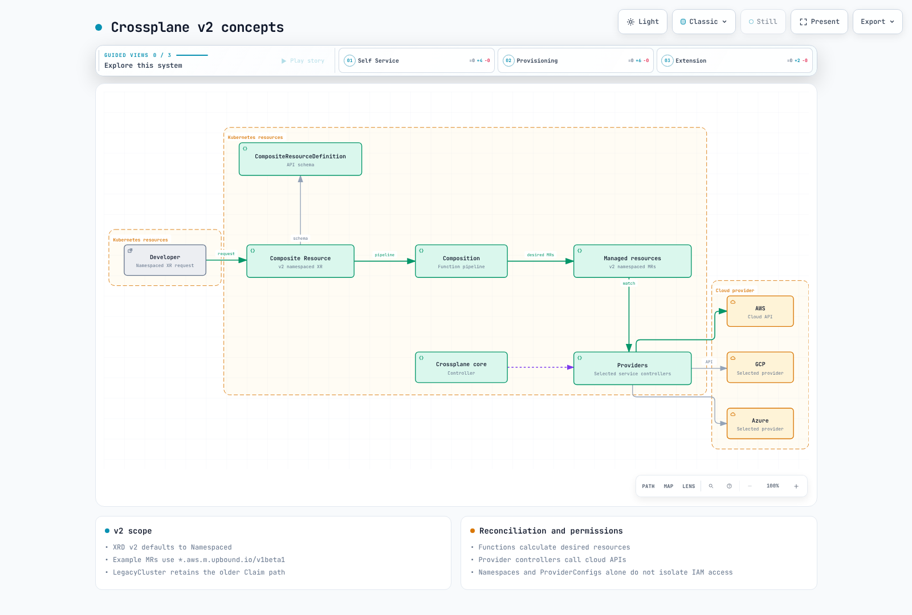
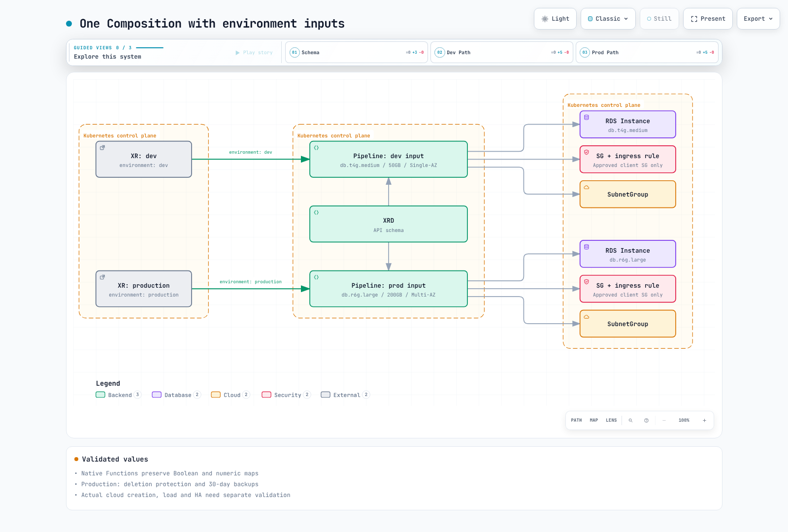
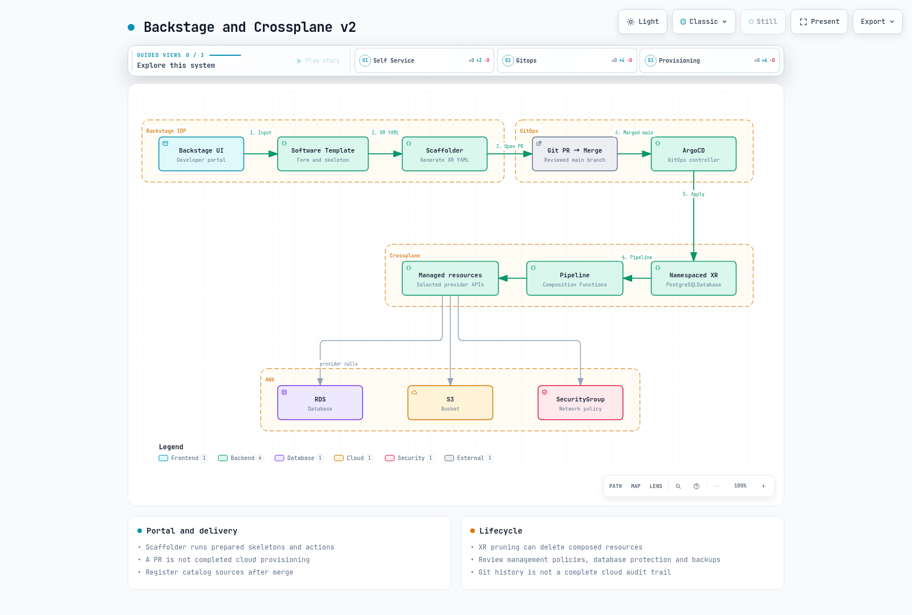

# Crossplane

> **Última actualización**: 16 de octubre de 2026 · Crossplane 2.4.2 / proveedor de AWS 2.9.0

## Conceptos y cambios en v2

Crossplane reconcilia recursos de infraestructura y de aplicaciones mediante las API y los controladores de Kubernetes. Se incorporó a CNCF el 25 de junio de 2020, pasó al nivel Incubating el 14 de septiembre de 2021 y alcanzó el nivel Graduated el 28 de octubre de 2025. Se han corregido las fechas contradictorias de graduación de 2023 y 2024.

| Componente | Función y ámbito actual |
| --- | --- |
| Provider | Instala CRD y controladores como paquete. Seleccione paquetes de AWS específicos de cada servicio; un paquete no tiene por qué cubrir todas las API de AWS. |
| Managed Resource (MR) | API del proveedor que gestiona un recurso externo. Los ejemplos de v2 de este documento tienen ámbito de namespace. |
| Composite Resource (XR) | Instancia de una API de plataforma. XRD v2 utiliza Namespaced de forma predeterminada. |
| XRD | Define los esquemas y el ámbito de los XR; distinga LegacyCluster en v1 de Namespaced en v2. |
| Composition | Define un pipeline de Functions que calcula los recursos deseados y el estado a partir de las entradas del XR. |
| Claim | Interfaz con ámbito de namespace para los XR heredados con ámbito de clúster; no es una capa obligatoria para los nuevos XR con ámbito de namespace. |



[Diagrama interactivo](https://www.atomai.click/kubernetes-docs/archmaps/en-platform-engineering-07-crossplane-0.html)

Los XRD de v1 existentes pueden seguir utilizando Claims de LegacyCluster, y los MR heredados con ámbito de clúster siguen siendo compatibles. No se limite a cambiar la versión del núcleo conservando Compositions en modo Resources, ControllerConfig o la publicación de conexiones nativa del XR, que se han eliminado. La guía oficial de migración a v2 describe la preparación desde la versión 1.20.

Terraform también utiliza un estado deseado declarativo y puede automatizar plan/apply en CI. La diferencia principal es el flujo de ejecución frente a la reconciliación continua de los controladores. El comportamiento de Crossplane sigue dependiendo de managementPolicies, los campos compatibles, los errores y las cuotas; no corrige inmediatamente todos los casos de desviación del estado.

## Núcleo, proveedores y permisos

La versión del chart de Helm revisado es 2.4.2. Este comando lo inspecciona sin conexión, sin instalarlo en un clúster.

```bash
helm repo add crossplane-stable https://charts.crossplane.io/stable
helm repo update
helm template crossplane crossplane-stable/crossplane   --version 2.4.2 --namespace crossplane-system   --set metrics.enabled=true
```

El valor predeterminado actual de provider.defaultActivations es ["*"]. Revise los MRD, las ManagedResourceActivationPolicies y el ámbito de los servicios instalados al decidir qué API activar. Tener Providers instalados no demuestra que la autenticación en AWS funcione ni que los recursos estén listos.

El rol de IAM que aparece a continuación es un marcador de posición. Restrinja la relación de confianza al emisor de EKS, la audiencia y el sujeto de la ServiceAccount exactos, y delimite las acciones y los recursos de cada servicio. Añadir RequestedRegion a s3:*/rds:*/ec2:*/iam:* no convierte esa política en una política de mínimo privilegio. Los Providers de RDS y EC2 necesitan sus propias configuraciones de ejecución e identidad revisadas.

```yaml
apiVersion: pkg.crossplane.io/v1beta1
kind: DeploymentRuntimeConfig
metadata:
  name: provider-aws-s3-reviewed
spec:
  deploymentTemplate:
    spec:
      selector: {}
      template:
        spec:
          containers:
          - name: package-runtime
            resources:
              requests:
                cpu: 100m
                memory: 256Mi
              limits:
                cpu: 500m
                memory: 512Mi
            ports:
            - name: metrics
              containerPort: 8080
        metadata:
          labels:
            app: provider-aws-s3-reviewed
  serviceAccountTemplate:
    metadata:
      name: provider-aws-s3-reviewed
      annotations:
        eks.amazonaws.com/role-arn: arn:aws:iam::123456789012:role/ReplaceApprovedS3ProviderRole
---
apiVersion: pkg.crossplane.io/v1
kind: Provider
metadata:
  name: provider-aws-s3
spec:
  package: xpkg.crossplane.io/crossplane-contrib/provider-aws-s3:v2.9.0
  packagePullPolicy: IfNotPresent
  revisionActivationPolicy: Manual
  revisionHistoryLimit: 2
  runtimeConfigRef:
    name: provider-aws-s3-reviewed
```

No configure varios Providers para que gestionen la misma ServiceAccount de nombre fijo. packagePullPolicy controla la descarga; revisionActivationPolicy controla la activación. Con Manual, inspeccione las ProviderRevisions y active explícitamente la versión revisada cuando sea necesario.

Los manifiestos de S3 de la versión 2.9.0 estaban disponibles en los registros comunitarios y de Upbound, pero sus digests eran distintos. Una cadena de versión idéntica no implica que los artefactos sean idénticos. Fije la distribución elegida, el registro o digest y las expectativas de soporte.

Este ejemplo utiliza un ProviderConfig con ámbito de namespace y con IRSA. El esquema 2.9.0 también admite PodIdentity, que requiere configurar realmente su asociación, SDK y entorno de ejecución. Los ProviderConfigs por namespace, por sí solos, no separan los permisos de AWS; restrinja la escritura de la configuración, las referencias y los límites de asunción de roles.

```yaml
apiVersion: aws.m.upbound.io/v1beta1
kind: ProviderConfig
metadata:
  name: team-aws
  namespace: team-alpha
spec:
  credentials:
    source: IRSA
```


[Diagrama interactivo](https://www.atomai.click/kubernetes-docs/archmaps/en-platform-engineering-07-crossplane-1.html)

## Ejemplo de S3 con ámbito de namespace

Los ejemplos utilizan API *.aws.m.upbound.io con ámbito de namespace, distintas de las API heredadas *.aws.upbound.io con ámbito de clúster. providerConfigRef incluye kind/name. managementPolicies excluye Delete para conservar los recursos externos; estas API con ámbito de namespace no exponen el antiguo campo deletionPolicy.

Prepare primero el nombre real del bucket, la región y la identidad. Excluir Delete sigue permitiendo actualizaciones; conservar recursos no constituye una estrategia de copia de seguridad ni de limpieza para reducir costes.

```yaml
apiVersion: s3.aws.m.upbound.io/v1beta1
kind: Bucket
metadata:
  name: app-data
  namespace: team-alpha
  annotations:
    crossplane.io/external-name: replace-with-globally-unique-bucket
spec:
  managementPolicies:
  - Observe
  - Create
  - Update
  - LateInitialize
  forProvider:
    region: us-west-2
    forceDestroy: false
    tags:
      Environment: Development
  providerConfigRef:
    kind: ProviderConfig
    name: team-aws
```

```yaml
apiVersion: s3.aws.m.upbound.io/v1beta1
kind: BucketPublicAccessBlock
metadata:
  name: app-data-public-access
  namespace: team-alpha
spec:
  managementPolicies:
  - Observe
  - Create
  - Update
  - LateInitialize
  forProvider:
    region: us-west-2
    bucketRef:
      name: app-data
    blockPublicAcls: true
    blockPublicPolicy: true
    ignorePublicAcls: true
    restrictPublicBuckets: true
  providerConfigRef:
    kind: ProviderConfig
    name: team-aws
```

```yaml
apiVersion: s3.aws.m.upbound.io/v1beta1
kind: BucketVersioning
metadata:
  name: app-data-versioning
  namespace: team-alpha
spec:
  managementPolicies:
  - Observe
  - Create
  - Update
  - LateInitialize
  forProvider:
    region: us-west-2
    bucketRef:
      name: app-data
    versioningConfiguration:
      status: Enabled
  providerConfigRef:
    kind: ProviderConfig
    name: team-aws
```

```yaml
apiVersion: s3.aws.m.upbound.io/v1beta1
kind: BucketServerSideEncryptionConfiguration
metadata:
  name: app-data-encryption
  namespace: team-alpha
spec:
  managementPolicies:
  - Observe
  - Create
  - Update
  - LateInitialize
  forProvider:
    region: us-west-2
    bucketRef:
      name: app-data
    rule:
    - applyServerSideEncryptionByDefault:
        sseAlgorithm: AES256
  providerConfigRef:
    kind: ProviderConfig
    name: team-aws
```

Las cuatro opciones de Block Public Access están activadas. En esta versión, versioningConfiguration y applyServerSideEncryptionByDefault son objetos, no las antiguas estructuras de arrays. Tenga también en cuenta los objetos y las versiones del bucket, así como forceDestroy=false, al planificar su eliminación.

## API de plataforma para PostgreSQL

Este ejemplo utiliza una VPC aprobada, subredes privadas en distintas zonas de disponibilidad, un SecurityGroup de cliente y un Secret de contraseña. El aprovisionamiento de la red y de la base de datos no constituye una única transacción. Si gestiona por separado los MR de VPC y Subnet, valide conjuntamente los CIDR, las rutas, la salida de red, el DNS y las zonas de disponibilidad.

Cree el nuevo XR directamente en su namespace. Valide dbName por separado en lugar de intentar eliminar los guiones del nombre de metadata con una transformación Regexp incorrecta. Este ejemplo restringe el nombre del ProviderConfig a team-aws.

```yaml
apiVersion: apiextensions.crossplane.io/v2
kind: CompositeResourceDefinition
metadata:
  name: postgresqldatabases.platform.example.com
spec:
  scope: Namespaced
  group: platform.example.com
  names:
    kind: PostgreSQLDatabase
    plural: postgresqldatabases
  versions:
  - name: v1alpha1
    served: true
    referenceable: true
    schema:
      openAPIV3Schema:
        type: object
        required:
        - spec
        properties:
          spec:
            type: object
            required:
            - parameters
            properties:
              parameters:
                type: object
                required:
                - environment
                - dbName
                - vpcID
                - subnetIDs
                - clientSecurityGroupID
                - passwordSecretName
                properties:
                  storageGB:
                    type: integer
                    minimum: 20
                    maximum: 1000
                    default: 50
                  environment:
                    type: string
                    enum:
                    - dev
                    - production
                  dbName:
                    type: string
                    pattern: ^[a-z][a-z0-9]{0,62}$
                  vpcID:
                    type: string
                  subnetIDs:
                    type: array
                    minItems: 2
                    items:
                      type: string
                  clientSecurityGroupID:
                    type: string
                  passwordSecretName:
                    type: string
                  providerConfigName:
                    type: string
                    default: team-aws
                    enum:
                    - team-aws
          status:
            type: object
            properties:
              endpoint:
                type: string
              port:
                type: integer
```

Distinga las versiones served de las referenceable; no marque varias versiones como referenceable. Las comprobaciones reales de xrd convert con la CLI produjeron un CRD para Namespaced y dos CRD de XR/Claim para LegacyCluster+claimNames. La conversión no equivale a instalar en el clúster ni a migrar datos.

### Pipeline de Functions

```yaml
apiVersion: pkg.crossplane.io/v1
kind: Function
metadata:
  name: function-patch-and-transform
spec:
  package: xpkg.crossplane.io/crossplane-contrib/function-patch-and-transform:v0.10.10
---
apiVersion: pkg.crossplane.io/v1
kind: Function
metadata:
  name: function-auto-ready
spec:
  package: xpkg.crossplane.io/crossplane-contrib/function-auto-ready:v0.7.0
```

```yaml
apiVersion: apiextensions.crossplane.io/v1
kind: Composition
metadata:
  name: postgresql-aws-reviewed
spec:
  compositeTypeRef:
    apiVersion: platform.example.com/v1alpha1
    kind: PostgreSQLDatabase
  mode: Pipeline
  pipeline:
  - step: patch-and-transform
    functionRef:
      name: function-patch-and-transform
    input:
      apiVersion: pt.fn.crossplane.io/v1beta1
      kind: Resources
      resources:
      - name: securityGroup
        base:
          apiVersion: ec2.aws.m.upbound.io/v1beta1
          kind: SecurityGroup
          spec:
            managementPolicies:
            - Observe
            - Create
            - Update
            - LateInitialize
            forProvider:
              region: us-west-2
              description: Application database security group
            providerConfigRef:
              kind: ProviderConfig
              name: team-aws
        patches:
        - &id001
          type: FromCompositeFieldPath
          fromFieldPath: spec.parameters.providerConfigName
          toFieldPath: spec.providerConfigRef.name
          policy:
            fromFieldPath: Required
        - &id002
          type: FromCompositeFieldPath
          fromFieldPath: spec.parameters.environment
          toFieldPath: spec.forProvider.tags.Environment
          policy:
            fromFieldPath: Required
        - type: FromCompositeFieldPath
          fromFieldPath: spec.parameters.vpcID
          toFieldPath: spec.forProvider.vpcId
          policy:
            fromFieldPath: Required
      - name: securityGroupRule
        base:
          apiVersion: ec2.aws.m.upbound.io/v1beta1
          kind: SecurityGroupRule
          spec:
            managementPolicies:
            - Observe
            - Create
            - Update
            - LateInitialize
            forProvider:
              region: us-west-2
              type: ingress
              protocol: tcp
              fromPort: 5432
              toPort: 5432
              securityGroupIdSelector:
                matchControllerRef: true
            providerConfigRef:
              kind: ProviderConfig
              name: team-aws
        patches:
        - type: FromCompositeFieldPath
          fromFieldPath: spec.parameters.providerConfigName
          toFieldPath: spec.providerConfigRef.name
          policy:
            fromFieldPath: Required
        - type: FromCompositeFieldPath
          fromFieldPath: spec.parameters.clientSecurityGroupID
          toFieldPath: spec.forProvider.sourceSecurityGroupId
          policy:
            fromFieldPath: Required
      - name: subnetGroup
        base:
          apiVersion: rds.aws.m.upbound.io/v1beta1
          kind: SubnetGroup
          spec:
            managementPolicies:
            - Observe
            - Create
            - Update
            - LateInitialize
            forProvider:
              region: us-west-2
              description: Approved private database subnets
            providerConfigRef:
              kind: ProviderConfig
              name: team-aws
        patches:
        - *id001
        - *id002
        - type: FromCompositeFieldPath
          fromFieldPath: spec.parameters.subnetIDs
          toFieldPath: spec.forProvider.subnetIds
          policy:
            fromFieldPath: Required
      - name: database
        base:
          apiVersion: rds.aws.m.upbound.io/v1beta1
          kind: Instance
          spec:
            managementPolicies:
            - Observe
            - Create
            - Update
            - LateInitialize
            forProvider:
              region: us-west-2
              engine: postgres
              engineVersion: '17.10'
              username: dbadmin
              storageType: gp3
              storageEncrypted: true
              publiclyAccessible: false
              skipFinalSnapshot: false
              dbSubnetGroupNameSelector:
                matchControllerRef: true
              vpcSecurityGroupIdSelector:
                matchControllerRef: true
              passwordSecretRef:
                name: replace-secret
                key: password
              port: 5432
            providerConfigRef:
              kind: ProviderConfig
              name: team-aws
        patches:
        - *id001
        - *id002
        - type: FromCompositeFieldPath
          fromFieldPath: spec.parameters.dbName
          toFieldPath: spec.forProvider.dbName
          policy:
            fromFieldPath: Required
        - type: FromCompositeFieldPath
          fromFieldPath: spec.parameters.storageGB
          toFieldPath: spec.forProvider.allocatedStorage
          policy:
            fromFieldPath: Required
        - type: FromCompositeFieldPath
          fromFieldPath: spec.parameters.passwordSecretName
          toFieldPath: spec.forProvider.passwordSecretRef.name
          policy:
            fromFieldPath: Required
        - type: FromCompositeFieldPath
          fromFieldPath: spec.parameters.environment
          toFieldPath: spec.forProvider.instanceClass
          policy:
            fromFieldPath: Required
          transforms:
          - type: map
            map:
              dev: db.t4g.medium
              production: db.r6g.large
        - type: FromCompositeFieldPath
          fromFieldPath: spec.parameters.environment
          toFieldPath: spec.forProvider.multiAz
          policy:
            fromFieldPath: Required
          transforms:
          - type: map
            map:
              dev: false
              production: true
        - type: FromCompositeFieldPath
          fromFieldPath: spec.parameters.environment
          toFieldPath: spec.forProvider.deletionProtection
          policy:
            fromFieldPath: Required
          transforms:
          - type: map
            map:
              dev: false
              production: true
        - type: FromCompositeFieldPath
          fromFieldPath: spec.parameters.environment
          toFieldPath: spec.forProvider.backupRetentionPeriod
          policy:
            fromFieldPath: Required
          transforms:
          - type: map
            map:
              dev: 7
              production: 30
        - type: FromCompositeFieldPath
          fromFieldPath: metadata.name
          toFieldPath: spec.forProvider.finalSnapshotIdentifier
          policy:
            fromFieldPath: Required
          transforms:
          - type: string
            string:
              type: Format
              fmt: '%s-final-review-before-delete'
        - type: FromCompositeFieldPath
          fromFieldPath: metadata.name
          toFieldPath: spec.writeConnectionSecretToRef.name
          policy:
            fromFieldPath: Required
          transforms:
          - type: string
            string:
              type: Format
              fmt: '%s-mr-connection'
        - type: ToCompositeFieldPath
          fromFieldPath: status.atProvider.address
          toFieldPath: status.endpoint
          policy:
            fromFieldPath: Optional
        - type: ToCompositeFieldPath
          fromFieldPath: status.atProvider.port
          toFieldPath: status.port
          policy:
            fromFieldPath: Optional
        connectionDetails:
        - name: endpoint
          type: FromFieldPath
          fromFieldPath: status.atProvider.address
        - name: username
          type: FromFieldPath
          fromFieldPath: spec.forProvider.username
  - step: readiness
    functionRef:
      name: function-auto-ready
```

El pipeline calcula un SecurityGroup, una regla de entrada, un SubnetGroup y una Instance de RDS. Los selectores matchControllerRef utilizan la propiedad común del XR, no parches incorrectos de etiquetas metadata.uid. La entrada permite el SG de cliente aprobado en lugar de todo el CIDR de la VPC.

Los mapas de entorno conservan los tipos booleanos y numéricos. Las ejecuciones nativas de Functions confirmaron db.r6g.large para producción, Multi-AZ/deletionProtection=true y una retención de copias de seguridad de 30 días. Valide la disponibilidad del motor 17.10 y de la clase de instancia, así como los límites de almacenamiento, en la región real de AWS.

passwordSecretRef apunta a un Secret preparado rds-master-password/password en el mismo namespace. No incluya contraseñas reales en la documentación, en argumentos de la CLI ni en variables de entorno. Este ejemplo no activa a la vez autoGeneratePassword ni las contraseñas maestras gestionadas por RDS.



[Diagrama interactivo](https://www.atomai.click/kubernetes-docs/archmaps/en-platform-engineering-07-crossplane-2.html)

### Entradas de desarrollo y producción

```yaml
apiVersion: platform.example.com/v1alpha1
kind: PostgreSQLDatabase
metadata:
  name: orders-db
  namespace: team-alpha
spec:
  crossplane:
    compositionRef:
      name: postgresql-aws-reviewed
  parameters:
    environment: dev
    dbName: orders
    storageGB: 50
    vpcID: vpc-0123456789abcdef0
    subnetIDs:
    - subnet-0123456789abcdef0
    - subnet-0123456789abcdef1
    clientSecurityGroupID: sg-0123456789abcdef0
    passwordSecretName: rds-master-password
    providerConfigName: team-aws
```

```yaml
apiVersion: platform.example.com/v1alpha1
kind: PostgreSQLDatabase
metadata:
  name: orders-db
  namespace: team-alpha
spec:
  crossplane:
    compositionRef:
      name: postgresql-aws-reviewed
  parameters:
    environment: production
    dbName: orders
    storageGB: 200
    vpcID: vpc-0123456789abcdef0
    subnetIDs:
    - subnet-0123456789abcdef0
    - subnet-0123456789abcdef1
    clientSecurityGroupID: sg-0123456789abcdef0
    passwordSecretName: rds-master-password
    providerConfigName: team-aws
```

Estos archivos son entradas alternativas para el mismo XR con el mismo nombre. Para entornos simultáneos, utilice namespaces, nombres y políticas reales distintos. spec.crossplane.compositionRef es el campo de gestión de v2, a diferencia de spec.compositionRef del Claim heredado.

## Secrets de conexión y disponibilidad

La publicación de conexiones del XR integrada en el núcleo se eliminó en v2. Se conserva writeConnectionSecretToRef del MR; estos MR con ámbito de namespace solo especifican su nombre. P&T 0.10.10 puede agregar connectionDetails en un Secret compuesto.

Este ejemplo solo coloca la dirección observada de RDS y el nombre de usuario en orders-db-connection. No afirma que la contraseña se incluya automáticamente. Las aplicaciones deben montar como archivos los Secrets del endpoint y de la contraseña preparada, y gestionar la rotación, TLS y los reintentos. Base64 no es cifrado.

Para enviar datos a un Secrets Manager externo, evalúe el soporte adecuado de PushSecret o del proveedor. ExternalSecret normalmente importa valores externos a Kubernetes; el ejemplo original con la dirección inversa era incorrecto.


[Diagrama interactivo](https://www.atomai.click/kubernetes-docs/archmaps/en-platform-engineering-07-crossplane-3.html)

El renderizado de recursos nuevos produjo Ready=False. Con observaciones sintéticas de Ready=True y de la dirección, se rellenaron el estado del XR y el Secret compuesto. Las fechas, los nombres y el estado renderizados son resultados de una simulación, no registros reales de aprovisionamiento en AWS. Un renderizado correcto no equivale a que el servicio esté listo.

## Adopción, eliminación y actualizaciones

No añada external-name y active inmediatamente la creación, actualización y eliminación completas de recursos existentes. Primero inspeccione el comportamiento Observe compatible, los identificadores, la región y la propiedad; después amplíe la gestión tras revisar los campos deseados. Distinga initProvider de forProvider, que se reconcilia.

Para conservar estos MR con ámbito de namespace, excluya Delete de managementPolicies. Distinga este mecanismo del antiguo deletionPolicy: Orphan y verifique la compatibilidad de la política y del proveedor. deletionProtection de RDS, las instantáneas finales y las copias de seguridad son capas independientes. Revise finalSnapshotIdentifier para evitar colisiones antes de cualquier eliminación real.

Eliminar un XR puede eliminar los MR y los Secrets compuestos, conservando a la vez los recursos de AWS cuyas políticas excluyan Delete. Planifique las credenciales, las copias de seguridad y la posterior responsabilidad de gestión de las bases de datos conservadas. Verifique las API actuales Usage/ClusterUsage de protection.crossplane.io y sus ámbitos, en lugar de utilizar por defecto el antiguo Usage en versión alfa.

Fije de forma independiente las versiones del núcleo, los proveedores y las Functions, y valide los cambios de revisiones, CRD e IAM. Cambiar una Composition activa a grupos de API con ámbito de namespace puede recrear los recursos; utilice nuevas Compositions y una migración planificada. No prometa ausencia de interrupciones sin instantáneas, restauración y verificación de datos.

## Observabilidad y reconciliación

El proveedor de AWS revisado utiliza de forma predeterminada --poll=10m y --sync=1h, con variación aleatoria del intervalo de sondeo. Su --max-reconcile-rate se utiliza para configurar tanto la tasa global como la concurrencia, por lo que no es simplemente una cantidad fija de reconciliaciones concurrentes. Son ajustes del entorno de ejecución, no forman parte del ejemplo de ProviderConfig con IRSA.

Este ejemplo conecta las etiquetas reales de los Pods del núcleo y de los proveedores con sus puertos de métricas. Active metrics.enabled en el chart del núcleo y prepare por separado Prometheus Operator y la recopilación de métricas.

```yaml
apiVersion: monitoring.coreos.com/v1
kind: PodMonitor
metadata:
  name: crossplane
  namespace: crossplane-system
spec:
  jobLabel: app
  selector:
    matchLabels:
      app: crossplane
  podMetricsEndpoints:
  - port: metrics
    interval: 30s
---
apiVersion: monitoring.coreos.com/v1
kind: PodMonitor
metadata:
  name: provider-aws-s3
  namespace: crossplane-system
spec:
  jobLabel: app
  selector:
    matchLabels:
      app: provider-aws-s3-reviewed
  podMetricsEndpoints:
  - port: metrics
    interval: 30s
```

Evite fijar en los selectores etiquetas basadas en nombres de ProviderRevision que cambian. kube_customresource_status_condition no es una métrica automática de Crossplane; necesita una configuración, como las métricas de recursos personalizados de kube-state-metrics. Verifique los nombres y las etiquetas reales antes de utilizar rate/increase para contadores y cuantiles de histogramas agrupados correctamente.

## ACK, Backstage y GitOps

Los recursos de ACK también tienen ámbito de namespace y se pueden componer con herramientas como kro. Las afirmaciones de que ACK solo proporciona CR con ámbito de clúster o de que es un proyecto de CNCF eran incorrectas. Los namespaces de Crossplane no sustituyen a IAM ni a los controles de creación y modificación de ProviderConfig y Composition. Asigne un único responsable de modificar cada recurso externo entre ACK, Terraform y Crossplane.

Utilice plantillas skeleton y acciones de Backstage preparadas para crear el YAML del XR, un PR de GitOps revisado y la reconciliación de ArgoCD. Abrir un PR no crea una base de datos, y los archivos de catálogo de la rama main que todavía no se han fusionado aún no pueden registrarse. El historial de Git y los registros de auditoría de las API de la nube son independientes. Revise la eliminación de recursos por ArgoCD junto con la política de eliminación o conservación de recursos externos.



[Diagrama interactivo](https://www.atomai.click/kubernetes-docs/archmaps/en-platform-engineering-07-crossplane-4.html)

## Alcance de la verificación

Se leyeron las guías originales de 1958 líneas en coreano y 1827 líneas en inglés, los dos cuestionarios de 143 líneas, 83 bloques delimitados de código únicos y los bloques adicionales con sangría. Se verificaron los binarios oficiales de la CLI y del núcleo 2.4.0, así como el código fuente de P&T 0.10.10 y auto-ready 0.7.0.

Las Functions ejecutadas realmente en localhost y el motor de renderizado del núcleo procesaron los casos de desarrollo, producción y estado observado. La biblioteca de validación del servidor de API de la CLI comprobó los MR, XR, DRC y Providers; el Secret del núcleo se comprobó por separado frente al OpenAPI oficial de Kubernetes. Se rechazaron nombres de base de datos, opciones de proveedor y entradas de almacenamiento no válidos. Después se detuvieron los procesos de Functions.

No se ejecutaron recursos de AWS o Kubernetes, autenticación real de RDS, red o IAM, copias de seguridad o restauraciones, pruebas de alta disponibilidad o de carga, ni recopilación de métricas con Prometheus. Los resultados locales no se presentan como un despliegue satisfactorio en producción.

- [Crossplane 2.4](https://docs.crossplane.io/v2.4/)
- [Actualización a v2](https://docs.crossplane.io/latest/guides/upgrade-to-crossplane-v2/)
- [Detalles de conexión](https://docs.crossplane.io/v2.4/guides/connection-details-composition/)
- [Proveedor de AWS 2.9.0](https://github.com/crossplane-contrib/provider-upjet-aws/tree/v2.9.0)
- [Patch and Transform 0.10.10](https://github.com/crossplane-contrib/function-patch-and-transform/tree/v0.10.10)
- [CNCF](https://www.cncf.io/projects/crossplane/)

[Cuestionario de Crossplane](../quizzes/platform-engineering/07-crossplane-quiz.md)
