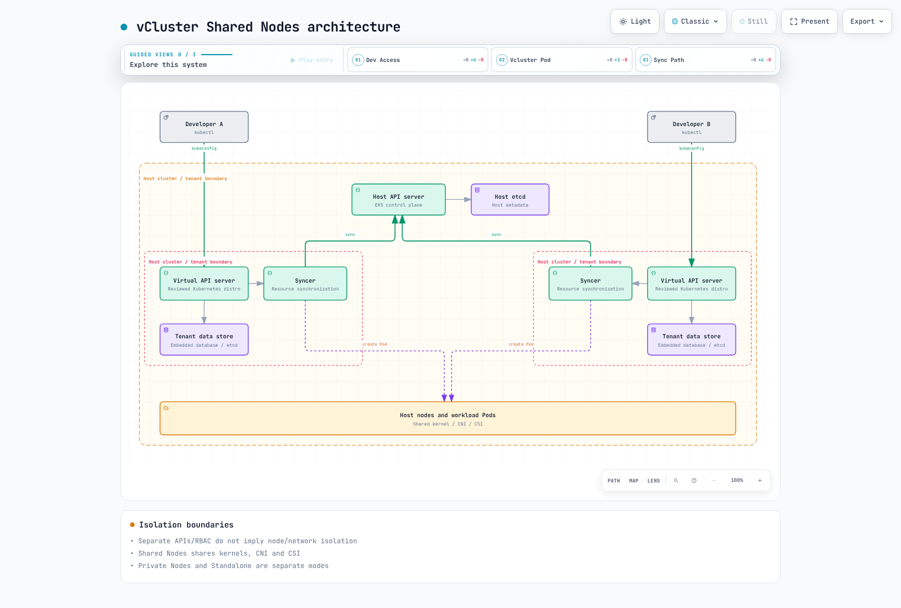
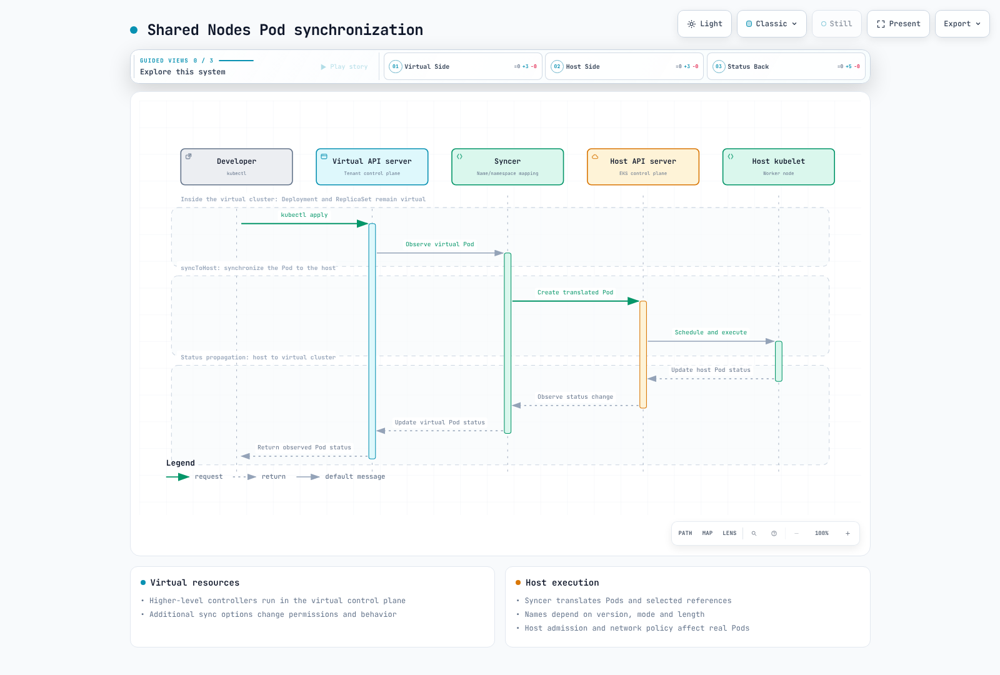

# vCluster

> **Última actualización**: 16 de octubre de 2026 · Versión de referencia revisada: vCluster 0.37.3

## Conceptos y límites de aislamiento

vCluster puede ofrecer a los inquilinos API de Kubernetes, controladores y almacenes de datos independientes. En este ejemplo de **Shared Nodes**, las cargas de trabajo se ejecutan en nodos del clúster host y comparten kernel, CNI, CSI y capacidad. Separar las API y RBAC no garantiza un aislamiento completo del hardware, la red ni el rendimiento.

| Modo | Límites que se deben evaluar |
| --- | --- |
| Namespace | Comparte el servidor de API, los recursos del clúster y los nodos; requiere RBAC, cuotas y políticas de red. |
| vCluster con Shared Nodes | Separa las API de los inquilinos, pero comparte los nodos donde se ejecutan las cargas, CNI y CSI. |
| Dedicated/Private Nodes | Verifique la ubicación de los nodos y los límites reales de CNI/CSI de Private Nodes. |
| Standalone | Otro modo de despliegue, sobre infraestructura sin un clúster host con plano de control. |
| Clúster de Kubernetes independiente | El aislamiento aún depende de las cuentas, VPC, administradores y hardware compartidos. |

El repositorio público usa Apache 2.0. Compruebe por separado las imágenes de distribución, las funciones de Platform, el soporte y los derechos de uso. No se pudo confirmar en la página oficial del proyecto la afirmación original «CNCF Sandbox desde noviembre de 2024», por lo que se eliminó. La conformidad con Kubernetes es distinta de la pertenencia de un proyecto a CNCF.

No prometa crear clústeres en menos de 30 segundos, una sobrecarga de 100–200 MiB, cientos de clústeres ni ahorros del 60–70 %. Mida el perfil real, la carga de la API del host, los PVC, las descargas de imágenes, las cargas de trabajo y el modelo de facturación.



[Diagrama interactivo](https://www.atomai.click/kubernetes-docs/archmaps/en-platform-engineering-08-vcluster-10.html)

## Versión actual y configuración de referencia

Al 16 de octubre de 2026, el endpoint más reciente de GitHub devuelve la versión estable 0.37.3, publicada el 5 de octubre de 2026. Por eso este ejemplo usa CLI/chart 0.37.3 y la imagen verificada ghcr.io/loft-sh/kubernetes:v1.36.3. La ejecución de la imagen y la compatibilidad completa en tiempo de ejecución siguen siendo comprobaciones independientes.

El esquema actual ya no contiene los antiguos parámetros de distribución k3s/k0s. Distinga la configuración de k8s, el almacén de datos subyacente y las versiones exactas. La imagen predeterminada del chart es vcluster-pro; su nombre por sí solo no determina la licencia del código fuente ni los derechos de uso gratuito.

Este perfil de Shared Nodes utiliza una réplica, una base de datos integrada y un PVC. Los operadores deben preparar almacenamiento gp3/CSI, cuotas, identidades y políticas del host.

```yaml
controlPlane:
  distro:
    k8s:
      enabled: true
      image:
        tag: v1.36.3
  backingStore:
    database:
      embedded:
        enabled: true
  statefulSet:
    highAvailability:
      replicas: 1
    resources:
      requests:
        cpu: 200m
        memory: 512Mi
        ephemeral-storage: 1Gi
      limits:
        cpu: "2"
        memory: 4Gi
        ephemeral-storage: 10Gi
    persistence:
      volumeClaim:
        enabled: true
        storageClass: gp3
        size: 10Gi
        retentionPolicy: Retain
  service:
    spec:
      type: ClusterIP
  ingress:
    enabled: false
sync:
  fromHost:
    nodes:
      enabled: false
    storageClasses:
      enabled: true
  toHost:
    pods:
      enabled: true
    services:
      enabled: true
    configMaps:
      enabled: true
      all: false
    secrets:
      enabled: true
      all: false
    persistentVolumeClaims:
      enabled: true
    ingresses:
      enabled: false
    serviceAccounts:
      enabled: false
    networkPolicies:
      enabled: false
privateNodes:
  enabled: false
policies:
  podSecurityStandard: restricted
telemetry:
  enabled: false
```

El perfil superó las comprobaciones reales de esquema y Helm. Sin embargo, Helm también genera una combinación de base de datos integrada y tres réplicas que el código en tiempo de ejecución rechaza. La alta disponibilidad requiere un almacén compatible, quórum, almacenamiento y validación de recuperación; aumentar las réplicas por sí solo no basta.

Las claves como configMaps, serviceAccounts y persistentVolumeClaims distinguen entre mayúsculas y minúsculas. Los valores predeterminados automáticos de StorageClass/CSI dependen del modo de despliegue, así que no se sincronizan de forma universal. Este perfil deshabilita explícitamente la sincronización de Ingress, ServiceAccount y NetworkPolicy.



[Diagrama interactivo](https://www.atomai.click/kubernetes-docs/archmaps/en-platform-engineering-08-vcluster-11.html)

Distinga los controladores virtuales de Deployment/ReplicaSet de los Pods reales del host. La traducción de nombres y etiquetas del Syncer depende del modo, la longitud y la versión; no adivine nombres en relaciones de confianza de IRSA ni en scripts operativos. La visibilidad mediante fromHost.nodes no impone automáticamente el aislamiento de los nodos donde se ejecutan las cargas.

## Instalación y acceso

Seleccione los artefactos de CLI para el sistema operativo y la arquitectura correctos, y verifique las sumas de comprobación oficiales. Estos comandos de ejemplo pueden afectar a un clúster real; compruebe HOST_CONTEXT y el namespace antes de usarlos. Durante esta auditoría no se ejecutó ninguna operación de creación, eliminación ni snapshot.

```bash
helm repo add loft-sh https://charts.loft.sh
helm repo update
helm template team-alpha loft-sh/vcluster   --version 0.37.3 --namespace vcluster-team-alpha   -f examples/platform/vcluster/vcluster.yaml

# After the reviewed host prerequisites are ready:
vcluster create team-alpha --driver helm --context HOST_CONTEXT   --namespace vcluster-team-alpha --chart-version 0.37.3   --values examples/platform/vcluster/vcluster.yaml --connect=false

# Keep the forwarding lifetime tied to the child command:
vcluster connect team-alpha --driver helm --context HOST_CONTEXT   --namespace vcluster-team-alpha --background-proxy=false --   kubectl get namespaces
```

connect gestiona la vía de acceso y el kubeconfig. Las antiguas opciones --update-current/--kube-config son alias obsoletos, no flags eliminados. --print puede mostrar credenciales; guárdelas en archivos de acceso restringido, no en chats, registros ni PR.

Los kubeconfigs externos reutilizables necesitan un endpoint de API accesible, SAN/CA de certificado coincidentes y una caducidad adecuada de las credenciales. Guardar una dirección de reenvío localhost no mantiene el acceso después de detener el reenvío. Los proxies en segundo plano pueden necesitar Docker y otra imagen. Use ServiceAccounts individuales con privilegios mínimos y revise --token-expiration en vez de compartir credenciales de administrador.

Use --context HOST_CONTEXT para las operaciones del host, de modo que la eliminación de namespaces o las copias de seguridad no apunten accidentalmente a contextos de inquilinos. Para aprovisionar entornos de formación en paralelo, recopile todos los códigos de salida en lugar de informar que todo está listo si hubo fallos.

## Almacenamiento, Ingress e IAM en EKS

Con Shared Nodes, los PVC se sincronizan con el host y el CSI del host gestiona los volúmenes. Revise conjuntamente StorageClass, volumeBindingMode, topología, política de recuperación y retención. El perfil actual usa statefulSet.persistence.volumeClaim.storageClass/size.

La sincronización de Ingress requiere un LBC/IngressClass real en el host, referencias a Services, TLS, grupos de seguridad y vías de acceso aprobadas. Replicar en un inquilino el Service del webhook del LBC del host no establece la integración con ALB. Coloque las anotaciones de Service bajo controlPlane.service.annotations; service.spec.annotations no es un campo de Kubernetes ServiceSpec.

Cuando la sincronización de ServiceAccount está deshabilitada, se aplica el comportamiento de ServiceAccount de las cargas del host; si está habilitada, verifique la traducción y la sincronización reales. Copiar solo las anotaciones de los Pods virtuales no configura IRSA. Compruebe el ServiceAccount del host, el emisor, sujeto y audiencia del token, la relación de confianza del rol y la inyección. Restrinja las anotaciones de roles IAM controladas por los inquilinos.

## Aislamiento y gobernanza

```yaml
apiVersion: v1
kind: Namespace
metadata:
  name: vcluster-team-alpha
  labels:
    platform.example.com/tenant: team-alpha
    pod-security.kubernetes.io/enforce: baseline
    pod-security.kubernetes.io/enforce-version: v1.36
---
apiVersion: v1
kind: ResourceQuota
metadata:
  name: vcluster-budget
  namespace: vcluster-team-alpha
spec:
  hard:
    requests.cpu: "8"
    requests.memory: 16Gi
    limits.cpu: "16"
    limits.memory: 32Gi
    requests.ephemeral-storage: 20Gi
    limits.ephemeral-storage: 80Gi
    pods: "50"
    services: "20"
    services.loadbalancers: "0"
    services.nodeports: "0"
    persistentvolumeclaims: "10"
    requests.storage: 100Gi
---
apiVersion: v1
kind: LimitRange
metadata:
  name: workload-defaults
  namespace: vcluster-team-alpha
spec:
  limits:
    - type: Container
      defaultRequest:
        cpu: 100m
        memory: 128Mi
        ephemeral-storage: 128Mi
      default:
        cpu: "1"
        memory: 512Mi
        ephemeral-storage: 1Gi
```

LimitRange también establece valores predeterminados de solicitudes/límites de ephemeral-storage para los contenedores regulares y de inicialización que no los especifiquen. Un Pod sin este límite puede eludir la aplicación de la cuota de ephemeral-storage; inspeccione los Pods finales de los inquilinos ya traducidos y los contenedores de inicialización del plano de control. Estos valores de ejemplo sirven para contabilizar cuotas, no para reservar capacidad ni garantizar rendimiento.

El chart genera el Syncer del plano de control con UID 0. Aplicar restricted a ciegas al namespace del host puede hacer que se rechace el plano de control. La admisión baseline del host y policies.podSecurityStandard: restricted del perfil se aplican a capas distintas: Pods del host frente a validación de cargas virtuales. Compruebe los Pods traducidos con la política real del host.

Los presupuestos de cuotas incluyen el plano de control, CoreDNS, las cargas de los inquilinos y el almacenamiento. Las cuotas no reservan capacidad de nodos ni garantizan rendimiento. Inspeccione los Roles/ClusterRoles generados y el acceso a Secrets; no conceda a los inquilinos permisos arbitrarios para modificar Secrets/Roles del host.

Si lo desea, genere las políticas de red del chart con estos valores.

```yaml
policies:
  networkPolicy:
    enabled: true
    workload:
      publicEgress:
        enabled: false
```

La renderización real deshabilitó la salida pública de las cargas, pero conservó amplios permisos de salida del plano de control en puertos como 443/8443/6443. Esto no se presenta como un bloqueo completo de la API del host. Los permisos de NetworkPolicy son aditivos; añadir una política «deny» independiente no puede reducir un permiso existente.

El Syncer necesita acceso a la API del host. Aplicar la misma política de denegación de salida al plano de control puede detener la sincronización. Verifique DNS, las IP de los endpoints/DNAT y las rutas necesarias hacia las aplicaciones, bases de datos y registros, además del comportamiento del CNI. Para la denegación predeterminada y sus excepciones, use una clasificación confiable de plano de control y cargas de trabajo.


[Diagrama interactivo](https://www.atomai.click/kubernetes-docs/archmaps/en-platform-engineering-08-vcluster-12.html)

## Pausa, suspensión, eliminación y snapshots

La pausa de la CLI actual reduce las réplicas del plano de control virtual y elimina las cargas de trabajo, que se vuelven a crear al reanudar. Los PVC y los Services tienen comportamientos de retención independientes. No es una operación de suspensión que conserve la memoria de los Pods ni una copia de seguridad de los datos. Distinga la pausa manual de las condiciones de suspensión/reactivación automáticas.

Estas opciones del ciclo de vida son opcionales. Verifique primero los derechos de uso del producto, los controladores y el comportamiento de las cargas de trabajo. Aquí no se habilita la eliminación automática.

```yaml
# Optional configuration: verify product entitlement and workload behavior first.
sleep:
  auto:
    afterInactivity: 30m
    schedule: "0 20 * * 1-5"
    timezone: Etc/UTC
    wakeup:
      schedule: "0 8 * * 1-5"
# No automatic deletion is enabled by this example.
deletion:
  prevent: true
```

La configuración actual utiliza rutas como sleep.auto y deletion.auto. Los antiguos campos inventados management.loft.sh/VirtualCluster no forman parte del contrato de configuración actual. Una etiqueta o anotación TTL por sí sola no inicia ninguna eliminación; use una política real de controlador y revise la propiedad de los recursos, las cargas activas y las copias de seguridad.

La eliminación de un namespace puede quitar los PVC y las cargas restantes. Distinga vcluster delete, Helm uninstall y la eliminación de una Application de ArgoCD, incluida la retención de PVC, la recuperación de PV y los recursos externos. Los parámetros de prevención de eliminación no necesariamente impiden que un administrador del host elimine el namespace directamente.

snapshot create envía una solicitud asíncrona. Que la solicitud tenga éxito no significa que el snapshot esté listo ni que la restauración se haya realizado correctamente. El nombre de un PV no es un ID de volumen EBS; para EBS, verifique spec.csi.driver y volumeHandle. Los snapshots de bases de datos activas requieren coherencia, puesta en reposo y pruebas de restauración.

El chart 0.37 rechaza deploy.volumeSnapshotController, pero vuelve a admitir la sincronización conjunta volumeSnapshots/volumeSnapshotContents. Los comentarios obsoletos del esquema no se consideraron prueba de que se hubiera eliminado toda la sincronización de snapshots. Prepare los controladores y las clases de snapshots de CSI, configure ambas opciones y pruebe la restauración por separado. Las exportaciones de Secrets en texto plano no constituyen una estrategia completa de copias de seguridad.


[Diagrama interactivo](https://www.atomai.click/kubernetes-docs/archmaps/en-platform-engineering-08-vcluster-14.html)

## Backstage, ArgoCD y entornos efímeros

El desarrollo de equipos, CI, las vistas previas, la formación y SaaS tienen requisitos distintos de confianza, rendimiento y ciclo de vida. No dé por sentado que las cargas de desarrollo toleran cualquier interrupción Spot ni que los inquilinos de SaaS no pueden afectarse entre sí.

Para CI, configure la identidad del host, eventos y ramas de confianza, y permisos OIDC. No exponga las credenciales del host a código no confiable de forks. Use un namespace y contexto explícitos durante la creación, conexión, pruebas y limpieza, y haga que la duración del reenvío dependa de las pruebas. Los trabajos de limpieza independientes también necesitan herramientas e identidad; compruebe todos los códigos de salida.

Este ApplicationSet incluye el sourceRef de $values que faltaba anteriormente. Guarde gitops-config.yaml como vclusters/team-alpha/config.yaml y el vcluster.yaml revisado junto a ese archivo. Sustituya los repositorios y los permisos de AppProject/destino por valores aprobados.

```yaml
apiVersion: argoproj.io/v1alpha1
kind: ApplicationSet
metadata:
  name: reviewed-vclusters
  namespace: argocd
spec:
  goTemplate: true
  goTemplateOptions: ["missingkey=error"]
  generators:
    - git:
        repoURL: https://github.com/REPLACE_APPROVED_ORG/platform-config
        revision: main
        files:
          - path: vclusters/*/config.yaml
  syncPolicy:
    preserveResourcesOnDeletion: true
  template:
    metadata:
      name: "vcluster-{{ .name }}"
    spec:
      project: vcluster-tenants
      sources:
        - repoURL: https://charts.loft.sh
          chart: vcluster
          targetRevision: "0.37.3"
          helm:
            releaseName: "{{ .name }}"
            valueFiles:
              - "$values/vclusters/{{ .name }}/vcluster.yaml"
        - repoURL: https://github.com/REPLACE_APPROVED_ORG/platform-config
          targetRevision: main
          ref: values
      destination:
        server: https://kubernetes.default.svc
        namespace: "{{ .namespace }}"
      syncPolicy:
        automated:
          selfHeal: true
          prune: false
        syncOptions: [CreateNamespace=true]
```

preserveResourcesOnDeletion y prune:false son decisiones deliberadas para que quitar la configuración no se interprete como una eliminación inmediata de datos. Lleve un registro de la propiedad y los costos de los recursos retenidos y mantenga un proceso de desmantelamiento independiente. Una acción debug:log de Backstage no implementa la aprobación ni la espera de una implementación.


[Diagrama interactivo](https://www.atomai.click/kubernetes-docs/archmaps/en-platform-engineering-08-vcluster-13.html)

## Observabilidad, recursos y costos

No genere alertas automáticamente por un StatefulSet pausado deliberadamente con cero réplicas deseadas. Una única expresión absent() agregada puede pasar por alto un clúster con fallos mientras otro sigue sano. Use las etiquetas reales de job/namespace/pod/container, los endpoints de métricas y un inventario del estado deseado. El contenedor del chart se llama syncer; no invente métricas vcluster_syncer_*.

Las solicitudes de recursos no son uso real ni facturas. No se pueden sumar CPU 1 y 250m, ni memoria 1Gi y 512Mi, como simples cadenas numéricas. examples/platform/vcluster/usage usa PodRequests de Kubernetes para gestionar unidades, contenedores de inicialización, sobrecarga y solicitudes a nivel de Pod.

```bash
# Run inside examples/platform/vcluster/usage with the pinned Go dependencies:
kubectl --context HOST_CONTEXT get pods -n vcluster-team-alpha -o json | go run .
```

La herramienta suma las solicitudes definidas en spec de Pods no terminales; no suma RSS/CPU reales, estado de redimensionamiento ni costos de PVC. Se probaron tres casos sintéticos; esta herramienta no consultó ningún clúster activo.

Reducir el tiempo activo de 168 a 50 horas no reduce proporcionalmente los costos de nodos, EBS, balanceadores de carga y licencias. Compare las facturas con el escalado real de nodos, el almacenamiento retenido, los compromisos y la capacidad mínima. Las etiquetas de Kubernetes no se convierten automáticamente en etiquetas de asignación de costos de AWS.

No indique a usuarios de EKS que redimensionen directamente las réplicas o instancias administradas del servidor de API/etcd. Revise los ajustes y cuotas admitidos para el plano administrado, además de la carga de solicitudes. Fije las combinaciones de chart/CLI/Kubernetes/almacén, valide las copias de seguridad y el entorno de pruebas, y tenga en cuenta que puede haber nombres de releases de Helm idénticos en namespaces distintos.

## Comprobaciones realizadas

Se leyeron las guías coreana de 1.998 líneas e inglesa de 2.171 líneas, ambos cuestionarios de 143 líneas y 106 bloques de código únicos. Se verificaron el esquema de la versión 0.37.0, los perfiles de Helm, la renderización de ciclo de vida y políticas de red, las sumas de comprobación oficiales y el índice de imágenes, y la contabilización de recursos de Kubernetes. Se registraron las diferencias entre la validación del esquema y la validación en tiempo de ejecución.

Dos intentos con la versión 0.36.1 de inspeccionar flags de conexión obsoletos consultaron el clúster existente en modo de solo lectura y fallaron con errores Unauthorized. No se modificaron recursos; las comprobaciones posteriores con 0.37 se limitaron a la versión/ayuda/código fuente y a charts sin conexión. No se validaron la creación de vCluster, la ejecución de imágenes, la suspensión, eliminación, creación o restauración de snapshots, el aislamiento de red, la autenticación IAM, la carga ni los ahorros de costos.

- [vCluster 0.37.3](https://github.com/loft-sh/vcluster/releases/tag/v0.37.3)
- [Configuración versionada](https://github.com/loft-sh/vcluster/blob/v0.37.3/config/values.yaml)
- [Esquema versionado](https://github.com/loft-sh/vcluster/blob/v0.37.3/chart/values.schema.json)
- [Arquitectura](https://www.vcluster.com/docs/vcluster/introduction/architecture)
- [Configuración de suspensión](https://www.vcluster.com/docs/vcluster/configure/vcluster-yaml/sleep)

[Backstage](06-backstage-idp.md) · [Crossplane](07-crossplane.md)

[Cuestionario de vCluster](../quizzes/platform-engineering/08-vcluster-quiz.md)
