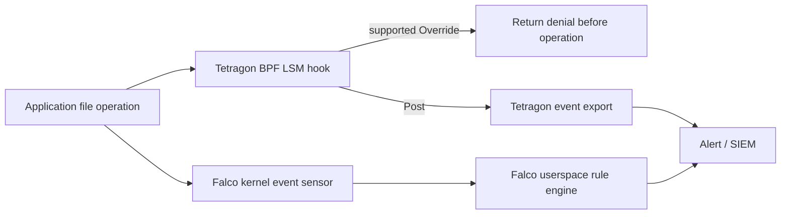

# Cuestionario sobre fundamentos de eBPF

> **Versiones compatibles**: Requisitos de kernel, BTF y helpers específicos de cada función; consulta las matrices de compatibilidad de la herramienta y de Kubernetes
> **Última actualización**: 11 de septiembre de 2026

Este cuestionario evalúa tu comprensión general de eBPF (extended Berkeley Packet Filter), desde conceptos básicos hasta sus aplicaciones en entornos Kubernetes.

## Preguntas de opción múltiple

1. ¿Qué NO comprueba el verificador de eBPF?
   - A) Que no haya bucles infinitos
   - B) Que no haya acceso a memoria fuera de límites
   - C) Velocidad de ejecución del programa
   - D) Que no se usen variables sin inicializar

<details>
<summary>Ver respuesta</summary>

**Respuesta: C) Velocidad de ejecución del programa**

**Explicación:**
El verificador de eBPF comprueba que el flujo de control y la terminación estén acotados (incluidos los bucles acotados compatibles), que no haya accesos a memoria fuera de límites ni uso de variables sin inicializar, que las llamadas a funciones auxiliares (helpers) sean correctas y que la ejecución del programa pueda terminar. La velocidad de ejecución no es un criterio de verificación.

</details>

2. ¿Qué valor de retorno de un programa XDP (eXpress Data Path) envía el paquete de vuelta a la misma NIC?
   - A) XDP_DROP
   - B) XDP_PASS
   - C) XDP_TX
   - D) XDP_REDIRECT

<details>
<summary>Ver respuesta</summary>

**Respuesta: C) XDP_TX**

**Explicación:**
Los valores de retorno de un programa XDP tienen los siguientes significados:
- `XDP_DROP`: Descartar paquete
- `XDP_PASS`: Pasar a la pila del kernel
- `XDP_TX`: Devolver el paquete a la misma NIC
- `XDP_REDIRECT`: Reenviar a otra interfaz
- `XDP_ABORTED`: Manejo de errores

XDP_TX se usa cuando quieres enviar el paquete de vuelta a la interfaz de red que lo recibió.

</details>

3. ¿Cuál NO es una función principal de los mapas eBPF?
   - A) Compartir datos entre el kernel y el espacio de usuario
   - B) Almacenamiento de estado
   - C) Compilar programas eBPF
   - D) Transmisión de datos de eventos

<details>
<summary>Ver respuesta</summary>

**Respuesta: C) Compilar programas eBPF**

**Explicación:**
Los mapas eBPF son estructuras de datos utilizadas para compartir datos entre el kernel y el espacio de usuario y para almacenar estado. Los mapas se usan para la transmisión de datos de eventos (PERF_EVENT_ARRAY, RINGBUF), almacenamiento clave-valor (HASH), recopilación de estadísticas (PERCPU_ARRAY) y más. La compilación de programas eBPF la realizan Clang/LLVM y no es una función de los mapas.

</details>

4. ¿Cuál es la principal ventaja que proporciona eBPF cuando Cilium reemplaza a kube-proxy?
   - A) Rendimiento O(n) proporcional al número de servicios
   - B) Requiere evaluación de reglas iptables
   - C) Búsqueda promedio en tiempo constante en un mapa hash, sin recorrer linealmente las reglas de Service
   - D) Usa Netfilter

<details>
<summary>Ver respuesta</summary>

**Respuesta: C) Búsqueda promedio en tiempo constante en un mapa hash, sin recorrer linealmente las reglas de Service**

**Explicación:**
El recorrido lineal de las reglas de iptables para un Service nuevo puede crecer con la cantidad de reglas; los flujos ya establecidos pueden usar conntrack. Cilium evita ese recorrido mediante mapas, cuya complejidad depende del tipo de mapa. La búsqueda en un mapa hash suele ser constante en promedio; la latencia, el uso de CPU y el caudal de extremo a extremo también dependen de la carga, el tipo de mapa, la contención y la configuración.

</details>

5. ¿Cuál es el propósito principal de bpftrace?
   - A) Compilar programas eBPF a C
   - B) Cargar módulos del kernel
   - C) Trazado de alto nivel al estilo DTrace
   - D) Construir imágenes de contenedor

<details>
<summary>Ver respuesta</summary>

**Respuesta: C) Trazado de alto nivel al estilo DTrace**

**Explicación:**
bpftrace es un lenguaje de trazado de alto nivel al estilo DTrace que te permite trazar el sistema con comandos simples de una sola línea. Por ejemplo, puedes realizar fácilmente tareas como contar llamadas al sistema, medir los bytes leídos por proceso, trazar aperturas de archivos y rastrear conexiones TCP.

</details>

6. En TracingPolicy de Tetragon, ¿qué acción termina inmediatamente un proceso cuando se detecta acceso malicioso a archivos?
   - A) action: Block
   - B) action: Sigkill
   - C) action: Deny
   - D) action: Terminate

<details>
<summary>Ver respuesta</summary>

**Respuesta: B) action: Sigkill**

**Explicación:**
En TracingPolicy de Tetragon, `action: Sigkill` en `matchActions` termina el proceso con una señal SIGKILL cuando ocurre un evento que coincide con la política. La guía de aplicación de políticas advierte que SIGKILL no siempre impide que se complete la operación que activó el evento. Si es necesario denegar la operación misma, usa un mecanismo Override/LSM compatible.

</details>

7. ¿Qué NO es una característica principal de Hubble?
   - A) Observación de flujos de red
   - B) Seguimiento de consultas DNS
   - C) Compilar programas eBPF
   - D) Monitoreo de decisiones de políticas

<details>
<summary>Ver respuesta</summary>

**Respuesta: C) Compilar programas eBPF**

**Explicación:**
Hubble es una plataforma de observabilidad de red integrada en Cilium que recopila y monitorea flujos de red, consultas DNS, solicitudes HTTP, decisiones de política y más. Hubble es una herramienta de observabilidad y no proporciona funcionalidad de compilación de programas eBPF.

</details>

8. ¿Qué problema resuelve CO-RE (Compile Once, Run Everywhere)?
   - A) Mejorar la velocidad de ejecución de los programas eBPF
   - B) Portabilidad entre diferentes versiones del kernel
   - C) Reducir el uso de memoria
   - D) Reducir la latencia de red

<details>
<summary>Ver respuesta</summary>

**Respuesta: B) Portabilidad entre diferentes versiones del kernel**

**Explicación:**
CO-RE usa libbpf y BTF (BPF Type Format) para que los programas eBPF compilados una vez puedan ejecutarse en distintas versiones del kernel compatibles. Reduce la dependencia de los encabezados del kernel y gestiona automáticamente la reubicación de estructuras. CO-RE no proporciona helpers o hooks ausentes ni garantiza un comportamiento compatible del kernel.

</details>

9. ¿Qué detecta Falco usando eBPF?
   - A) Uso de ancho de banda de red
   - B) Comportamiento anómalo en tiempo de ejecución
   - C) Capacidad del disco
   - D) Temperatura de la CPU

<details>
<summary>Ver respuesta</summary>

**Respuesta: B) Comportamiento anómalo en tiempo de ejecución**

**Explicación:**
Falco es un proyecto CNCF que usa eBPF para detectar comportamiento anómalo en tiempo de ejecución. Detecta y alerta sobre amenazas de seguridad como leer archivos sensibles, ejecutar shells en contenedores e intentos de escalada de privilegios con base en reglas.

</details>

10. ¿Cuál es el límite de tamaño de la pila de los programas eBPF?
    - A) 128 bytes
    - B) 256 bytes
    - C) 512 bytes
    - D) 1024 bytes

<details>
<summary>Ver respuesta</summary>

**Respuesta: C) 512 bytes**

**Explicación:**
Los programas eBPF tienen un límite de tamaño de pila de 512 bytes. Para sortear este límite, necesitas usar mapas como PERCPU_ARRAY para asignar búferes más grandes. Este límite existe para garantizar la seguridad del kernel.

</details>

## Preguntas de respuesta corta

11. ¿Cómo se llama el compilador que convierte bytecode eBPF en código máquina nativo?

<details>
<summary>Ver respuesta</summary>

**Respuesta: Compilador JIT (compilador Just-In-Time)**

**Explicación:**
El compilador JIT convierte bytecode eBPF en código máquina nativo y aplica optimizaciones específicas de la arquitectura. La afirmación original de que mejora el rendimiento entre 4 y 5 veces no es una medición ni una garantía universal en esta guía. Cuando se puede configurar, bpf_jit_enable=1 lo habilita; en kernels con CONFIG_BPF_JIT_ALWAYS_ON puede estar siempre activado.

</details>

12. ¿Cómo se llama el tipo de programa eBPF que traza dinámicamente llamadas a funciones del kernel?

<details>
<summary>Ver respuesta</summary>

**Respuesta: Kprobes (o Kprobe)**

**Explicación:**
Kprobes es un tipo de programa eBPF que traza dinámicamente llamadas a funciones del kernel. A diferencia de Uprobes, que traza funciones del espacio de usuario, Kprobes traza funciones dentro del kernel. Por ejemplo, puedes trazar la función `tcp_connect` para recopilar información de conexiones TCP.

</details>

13. ¿Cómo se llama la plataforma de observabilidad de red integrada en Cilium?

<details>
<summary>Ver respuesta</summary>

**Respuesta: Hubble**

**Explicación:**
Hubble es una plataforma de observabilidad de red integrada en Cilium que recopila datos del plano de datos de eBPF, incluidos flujos de red, consultas DNS, solicitudes HTTP y decisiones de política. Puedes observar el tráfico de red del clúster en tiempo real mediante Hubble CLI, Hubble UI y Hubble Relay.

</details>

14. ¿Qué capability dedicada se introdujo en Linux 5.8 para operaciones eBPF privilegiadas?

<details>
<summary>Ver respuesta</summary>

**Respuesta: CAP_BPF**

**Explicación:**
CAP_BPF autoriza operaciones eBPF privilegiadas; CAP_SYS_ADMIN sigue siendo una vía de compatibilidad, y los kernels más nuevos pueden admitir tokens eBPF delegados. También se aplican los controles específicos del programa o hook y la política de seguridad del host. En versiones anteriores se requería `CAP_SYS_ADMIN`. Además, `CAP_PERFMON` se necesita para adjuntarse a eventos de monitoreo de rendimiento, y `CAP_NET_ADMIN` para adjuntar programas XDP/TC.

</details>

15. ¿Qué exportador de energía de CNCF usó históricamente eBPF y se reescribió en la versión 0.10.0 para usar datos de recursos y energía del host en /proc y /sys?

<details>
<summary>Ver respuesta</summary>

**Respuesta: Kepler (Kubernetes-based Efficient Power Level Exporter)**

**Explicación:**
Kepler 0.10 y versiones posteriores ya no requieren CAP_BPF. Atribuye la potencia y la energía de los nodos usando datos de recursos del host y sensores de hardware. Entre los ejemplos actuales están kepler_container_cpu_joules_total y kepler_pod_cpu_watts; la compatibilidad con hardware y GPU experimental varía. Las métricas y las instrucciones de despliegue de la versión 0.9 difieren.

</details>

## Preguntas prácticas

16. Escribe los comandos para usar bpftool para listar los programas eBPF cargados actualmente en el sistema y consultar información detallada sobre un programa específico.

<details>
<summary>Ver respuesta</summary>

**Respuesta:**
```bash
# List loaded eBPF programs
sudo bpftool prog list

# Query detailed information for a specific program (ID: 123)
sudo bpftool prog show id 123

# Dump program bytecode
sudo bpftool prog dump xlated id 123

# Dump JIT compiled code
sudo bpftool prog dump jited id 123
```

**Explicación:**
`bpftool prog list` muestra una lista de todos los programas eBPF cargados actualmente. Puedes comprobar el ID, tipo, nombre, ubicación de adjunción, etc. de cada programa. Usa `bpftool prog show id <ID>` para consultar información detallada sobre un programa específico, y `dump xlated` y `dump jited` para ver el bytecode y el código nativo compilado con JIT.

</details>

17. Escribe un comando bpftrace de una sola línea para trazar en tiempo real las conexiones TCP que ocurren desde todos los procesos del sistema.

<details>
<summary>Ver respuesta</summary>

**Respuesta:**
```bash
# TCP connection tracing (Method 1: using kprobe)
sudo bpftrace -e 'kprobe:tcp_connect { printf("%s (PID: %d) connecting...\n", comm, pid); }'

# TCP connection tracing (Method 2: using tracepoint, more detailed info)
sudo bpftrace -e '
tracepoint:sock:inet_sock_set_state /args.protocol == 6 && args.newstate == 1/ {
    if (args.family == 2) {
        printf("IPv4 %s:%d -> %s:%d established\n", ntop(args.saddr), args.sport, ntop(args.daddr), args.dport);
    } else if (args.family == 10) {
        printf("IPv6 %s:%d -> %s:%d established\n", ntop(args.saddr_v6), args.sport, ntop(args.daddr_v6), args.dport);
    }
}'

# Count TCP connections by process
sudo bpftrace -e 'kprobe:tcp_connect { @[comm] = count(); }'
```

**Explicación:**
bpftrace es un lenguaje de trazado de alto nivel al estilo DTrace que permite observar el sistema con comandos sencillos de una sola línea. `kprobe:tcp_connect` se activa cuando se llama a la función `tcp_connect` del kernel. `comm` representa el nombre del proceso y `pid`, su ID. El ejemplo sock:inet_sock_set_state observa conexiones establecidas, incluidas las pasivas; el contexto de ejecución no permite atribuirlas de forma fiable al proceso que las inició. Los ejemplos con kprobe cuentan intentos de conexión, no garantizan que el enlace de TCP se complete.

</details>

18. Escribe el comando para usar Hubble CLI para observar únicamente paquetes descartados de un namespace específico.

<details>
<summary>Ver respuesta</summary>

**Respuesta:**
```bash
# Observe dropped packets in a specific namespace
hubble observe --namespace production --verdict DROPPED

# Observe dropped packets with real-time streaming
hubble observe --namespace production --verdict DROPPED -f

# Output detailed information of dropped packets in JSON format
hubble observe --namespace production --verdict DROPPED -o json

# Observe dropped packets from a specific Pod
hubble observe --from-pod production/frontend --verdict DROPPED
```

**Explicación:**
Hubble es una herramienta de observabilidad de red integrada en Cilium. La opción `--namespace` filtra por un namespace específico, y `--verdict DROPPED` filtra solo paquetes descartados. La opción `-f` proporciona transmisión en tiempo real, y `-o json` proporciona salida en formato JSON. Analizar paquetes descartados ayuda a diagnosticar problemas de políticas de red o errores de configuración.

</details>

## Preguntas avanzadas

19. Explica las tres ventajas principales que tiene eBPF sobre los módulos del kernel, y describe específicamente qué beneficios proporciona cada una en entornos Kubernetes.

<details>
<summary>Ver respuesta</summary>

**Respuesta:**

Ventajas principales de eBPF sobre los módulos del kernel y sus beneficios en entornos Kubernetes:

**1. Comprobaciones de seguridad (dentro del modelo del verificador)**
- **Ventaja**: Antes de cargar un programa, el verificador de eBPF comprueba, entre otras cosas, que no haya bucles infinitos, accesos a memoria no válidos ni variables sin inicializar, para evitar caídas del kernel.
- **Beneficio en Kubernetes**: Estas comprobaciones reducen el riesgo de las herramientas CNI y de seguridad cuando se prueban las versiones y configuraciones compatibles. No garantizan que los errores del kernel, los helpers o el compilador JIT, las políticas defectuosas o una carga excesiva no puedan afectar al host.

**2. Portabilidad (reubicación de tipos con CO-RE)**
- **Ventaja**: Usando CO-RE (Compile Once, Run Everywhere) y BTF, los programas eBPF compilados una vez pueden ejecutarse en varias versiones del kernel. No se necesita recompilación para cada versión del kernel.
- **Beneficio en Kubernetes**: Las mismas soluciones de red y seguridad se pueden desplegar en entornos de nodos heterogéneos (nodos con diferentes versiones del kernel). Los problemas de compatibilidad se reducen considerablemente durante actualizaciones del clúster o la incorporación de nodos.

**3. Carga dinámica (carga/descarga de programas sin reinicio)**
- **Ventaja**: Los programas eBPF pueden cargarse y descargarse dinámicamente sin reiniciar el sistema. La funcionalidad se puede agregar o cambiar en tiempo de ejecución.
- **Beneficio en Kubernetes**: Las políticas de red, las reglas de seguridad y configuraciones de observabilidad se pueden aplicar inmediatamente sin reiniciar nodos. Los cambios en Cilium NetworkPolicy o Tetragon TracingPolicy se reflejan en tiempo real, lo que permite mejoras de seguridad sin interrupción operativa.

**Ventajas adicionales:**
- **Rendimiento**: La compilación JIT proporciona rendimiento a nivel de código nativo, lo que permite búsquedas de Service O(1) al reemplazar kube-proxy.
- **Facilidad de desarrollo**: Desarrollar con eBPF es relativamente más sencillo que crear módulos del kernel, lo que permite desarrollar y desplegar funcionalidades con rapidez.

</details>

20. Diseña un enfoque para detectar y bloquear el acceso a archivos sensibles dentro de contenedores usando una solución de seguridad basada en eBPF (Tetragon o Falco) en un clúster de Kubernetes. Incluye ejemplos de TracingPolicy o reglas Falco en tu explicación.

<details>
<summary>Ver respuesta</summary>

**Respuesta:**

**Diseño de seguridad para acceso a archivos sensibles basado en eBPF**

**1. Definición de requisitos de seguridad**
- Objetivos de detección: `/etc/shadow`, `/etc/passwd`, `/etc/sudoers`, `/var/run/secrets/` (Kubernetes secrets)
- Enfoque de respuesta: alerta en la detección, terminación del proceso para casos graves

**2. Implementación de TracingPolicy de Tetragon**

```yaml
apiVersion: cilium.io/v1alpha1
kind: TracingPolicyNamespaced
metadata:
  name: sensitive-file-protection
  namespace: ebpf-lab
spec:
  kprobes:
  - call: security_file_open
    syscall: false
    args:
    - index: 0
      type: file
    selectors:
    - matchArgs:
      - index: 0
        operator: Prefix
        values:
        - /var/run/secrets/kubernetes.io/
      matchActions:
      - action: Post
    - matchArgs:
      - index: 0
        operator: Prefix
        values:
        - /etc/shadow
        - /etc/sudoers
      matchActions:
      - action: Post
  podSelector:
    matchLabels:
      app: ebpf-demo
```

La primera política solo observa mediante la acción Post. Primero crea el namespace ebpf-lab y un Pod de prueba con la etiqueta app=ebpf-demo. TracingPolicyNamespaced limita el alcance a namespaces de Kubernetes; matchNamespaces filtra, en cambio, por inodos de namespaces de Linux.

La siguiente política de prueba opcional deniega la operación y requiere CONFIG_BPF_LSM, un LSM de BPF activo y compatibilidad con LSM Override en la combinación de Tetragon y kernel elegida. Antes de aplicarla, verifica el comportamiento permitido y denegado y prueba cómo revertirla. No es una política global de producción validada. SIGKILL por sí solo no siempre impide que se complete la operación que activó el evento.

```yaml
apiVersion: cilium.io/v1alpha1
kind: TracingPolicyNamespaced
metadata:
  name: sensitive-file-deny
  namespace: ebpf-lab
spec:
  podSelector:
    matchLabels:
      app: ebpf-demo
  lsmhooks:
  - hook: file_open
    args:
    - index: 0
      type: file
    selectors:
    - matchArgs:
      - index: 0
        operator: Equal
        values:
        - /etc/shadow
        - /etc/sudoers
      matchActions:
      - action: Override
        argError: -13
```

**3. Implementación de reglas de Falco**

```yaml
# Save locally as ebpf-lab-rules.yaml; the Helm chart mounts it under /etc/falco/rules.d.
- rule: eBPF lab read Kubernetes secrets
  desc: Detect reading of Kubernetes secret files in containers
  condition: >
    open_read and
    container and
    (fd.name startswith /var/run/secrets/kubernetes.io/ or
     fd.name startswith /etc/shadow or
     fd.name startswith /etc/sudoers) and
    not proc.name in (kubelet, containerd)
  output: >
    Sensitive file access detected
    (file=%fd.name user=%user.name process=%proc.name
     container=%container.name namespace=%k8s.ns.name
     pod=%k8s.pod.name)
  priority: WARNING
  tags: [security, filesystem]

- rule: eBPF lab write sensitive files
  desc: Detect writing to sensitive system files
  condition: >
    open_write and
    container and
    fd.name in (/etc/passwd, /etc/shadow, /etc/sudoers)
  output: >
    Attempt to modify sensitive file
    (file=%fd.name user=%user.name process=%proc.name
     container=%container.name)
  priority: CRITICAL
  tags: [security, filesystem]
```

**4. Implementación: despliegue y monitoreo**

```bash
# Install Tetragon and apply policy
helm repo add cilium https://helm.cilium.io
: "${TETRAGON_CHART_VERSION:?Select a compatible reviewed chart version}"
helm install tetragon cilium/tetragon -n kube-system --version "$TETRAGON_CHART_VERSION"
# Apply observation first; keep optional denial in a separate reviewed file.
kubectl apply -f sensitive-file-protection.yaml

# Monitor events
kubectl logs -n kube-system -l app.kubernetes.io/name=tetragon \
  -c export-stdout -f | tetra getevents -o compact

# Install Falco (eBPF driver)
helm repo add falcosecurity https://falcosecurity.github.io/charts
# Save the following Falco rule examples as ./ebpf-lab-rules.yaml before installation.
: "${FALCO_CHART_VERSION:?Select a compatible reviewed chart version}"
helm install falco falcosecurity/falco --version "$FALCO_CHART_VERSION" \
  --namespace falco --create-namespace \
  --set driver.kind=modern_ebpf \
  --set-file 'customRules.ebpf-lab-rules\.yaml=./ebpf-lab-rules.yaml'

# Check Falco alerts
kubectl logs -n falco -l app.kubernetes.io/name=falco -f
```

**5. Explicación de la arquitectura**



Este diseño aprovecha la visibilidad a nivel de kernel de eBPF para detectar y responder al acceso a archivos sensibles en tiempo real sin modificar las aplicaciones.

</details>

---

[Volver a los materiales de aprendizaje](../../basics/05-ebpf-fundamentals.md) | [Siguiente cuestionario: Tecnología de contenedores](./03-container-technology-quiz.md)
> Los ejemplos de Falco dependen de las macros open_read/open_write/spawned_process/container del conjunto de reglas predeterminado. Carga el archivo adicional mediante la configuración customRules/falco.rules_files del chart instalado. Falco detecta y genera alertas; estas reglas no deniegan el acceso. Los metadatos de contenedores y Kubernetes pueden llegar con retraso, y las lecturas legítimas de tokens de ServiceAccount también coinciden; prueba las excepciones adecuadas.

## Referencias de verificación

- https://www.kernel.org/doc/html/latest/admin-guide/sysctl/kernel.html
- https://www.kernel.org/doc/html/latest/admin-guide/sysctl/net.html
- https://github.com/torvalds/linux/blob/master/include/linux/bpf.h
- https://github.com/torvalds/linux/blob/master/include/linux/filter.h
- https://github.com/torvalds/linux/blob/master/include/uapi/linux/bpf.h
- https://github.com/torvalds/linux/blob/master/kernel/bpf/syscall.c
- https://docs.kernel.org/bpf/prog_lsm.html
- https://docs.kernel.org/userspace-api/seccomp_filter.html
- https://github.com/torvalds/linux/blob/master/include/trace/events/sock.h
- https://github.com/bpftrace/bpftrace/blob/v0.27.0/docs/language.md
- https://github.com/bpftrace/bpftrace/blob/v0.27.0/docs/stdlib.md
- https://packages.debian.org/trixie/arm64/bpfcc-tools/filelist
- https://github.com/iovisor/bcc/blob/master/tools/tcpconnlat.py
- https://github.com/iovisor/bcc/blob/master/tools/gethostlatency.py
- https://github.com/libbpf/bpftool/blob/main/docs/bpftool-map.rst
- https://github.com/cilium/cilium/blob/v1.20.1/Documentation/network/kubernetes/kubeproxy-free.rst
- https://github.com/cilium/cilium/blob/v1.20.1/Documentation/network/lb-ipam.rst
- https://github.com/cilium/cilium/blob/v1.20.1/install/kubernetes/cilium/values.yaml
- https://github.com/cilium/cilium/blob/v1.20.1/hubble/cmd/observe/observe.go
- https://github.com/cilium/cilium/blob/v1.20.1/hubble/pkg/printer/printer_test.go
- https://github.com/cilium/tetragon/blob/main/docs/content/en/docs/concepts/enforcement/_index.md
- https://github.com/cilium/tetragon/blob/main/docs/content/en/docs/concepts/tracing-policy/selectors.md
- https://github.com/cilium/tetragon/blob/main/pkg/k8s/apis/cilium.io/v1alpha1/tracing_policy_types.go
- https://github.com/cilium/tetragon/blob/main/cmd/tetra/getevents/getevents.go
- https://github.com/cilium/tetragon/blob/main/examples/tracingpolicy/lsm_file_open.yaml
- https://github.com/cilium/tetragon/blob/main/install/kubernetes/tetragon/crds-yaml/cilium.io_tracingpoliciesnamespaced.yaml
- https://github.com/sustainable-computing-io/kepler/blob/main/README.md
- https://github.com/sustainable-computing-io/kepler/blob/main/docs/user/metrics.md
- https://github.com/coroot/helm-charts/blob/main/charts/coroot/Chart.yaml
- https://github.com/coroot/helm-charts/blob/main/charts/operator/Chart.yaml
- https://github.com/coroot/helm-charts/blob/main/charts/coroot-ce/Chart.yaml
- https://docs.px.dev/reference/pxl/udf/quantiles/
- https://github.com/pixie-io/pixie/blob/main/src/pixie_cli/pkg/cmd/run.go
- https://github.com/pixie-io/pixie/blob/main/src/pxl_scripts/px/http_data/data.pxl
- https://falco.org/docs/reference/rules/supported-fields/
- https://github.com/falcosecurity/charts/blob/master/charts/falco/values.yaml
- https://github.com/falcosecurity/rules/blob/main/rules/falco_rules.yaml
