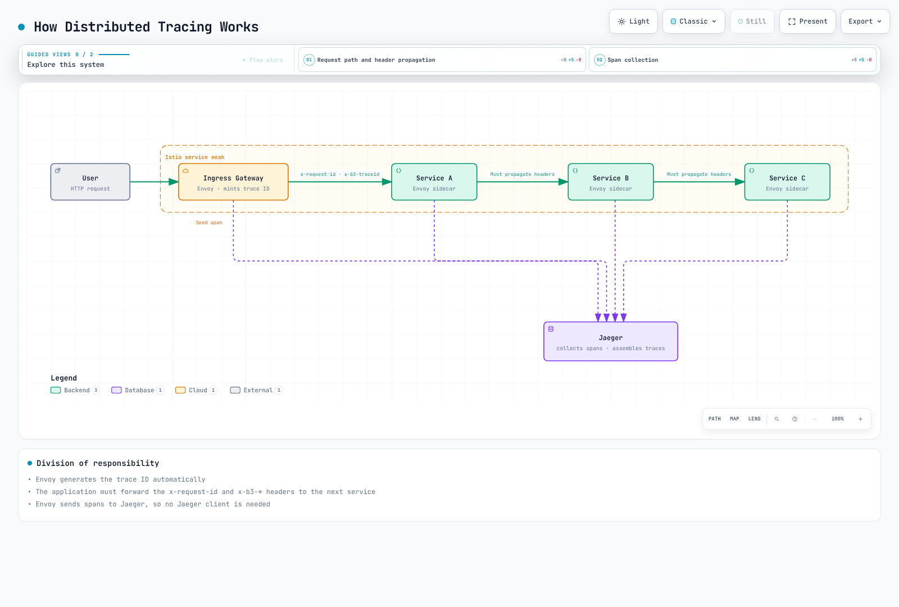

# Cuestionario sobre observabilidad

> **Última actualización**: 12 de octubre de 2026
>
> **Versiones**: Istio 1.31, compatible con Kubernetes 1.32–1.37.
> Consulta los capítulos sobre instalación y paneles para conocer los límites de compatibilidad con EKS y Kiali.

Este cuestionario abarca la telemetría configurada de sidecars/waypoints. Cada ejemplo resuelto es independiente y supone que existen los backends, los espacios de nombres, los permisos y el tráfico indicados. Las comprobaciones de YAML/API/consultas no son pruebas de producción ni de un clúster en vivo; ztunnel L4, los sidecars nativos y las implementaciones de alta disponibilidad requieren su configuración de recopilación específica.

## Preguntas de opción múltiple (1-5)

### Pregunta 1: Métricas de Prometheus

¿Cuál **no es un nombre o una familia de métricas de servicio estándar de Istio**?

A. istio\_requests\_total (recuento total de solicitudes)\
B. istio\_request\_duration\_milliseconds (latencia de las solicitudes)\
C. istio\_request\_bytes (tamaño de las solicitudes)\
D. istio\_pod\_cpu\_usage (uso de CPU del Pod)

<details>

<summary>Mostrar respuesta</summary>

**Respuesta: D**

Las métricas de servicio estándar de Istio describen el tráfico; Envoy también expone estadísticas internas del proxy. Prometheus obtiene el uso de CPU de los contenedores de kubelet/cAdvisor (o de la canalización de recursos del entorno de ejecución). Metrics Server sirve métricas de recursos para el autoescalado y `kubectl top`; kube-state-metrics expone el estado de los objetos y las solicitudes/límites configurados, no el consumo de CPU medido.

**Explicación:**

**Métricas recopiladas por Istio:**

1. **istio\_requests\_total (A - O)**

```promql
# Request rate by service (per second)
sum(rate(istio_requests_total{reporter="destination"}[5m])) by (destination_service_name, destination_service_namespace)
```

2. **istio\_request\_duration\_milliseconds (B - O)**

```promql
# P95 latency
histogram_quantile(0.95,
  sum(rate(istio_request_duration_milliseconds_bucket{reporter="destination"}[5m])) by (le)
)
```

3. **istio\_request\_bytes (C - O)**

```promql
# Request body byte rate (bytes/second), not mean request size
sum(rate(istio_request_bytes_sum{reporter="destination"}[5m])) by (destination_service_name, destination_service_namespace)
```

4. **istio\_pod\_cpu\_usage (D - X)**

* No es una métrica de Istio
* Métrica de Kubernetes: `container_cpu_usage_seconds_total`
* Recopila métricas de kubelet/cAdvisor; kube-state-metrics resulta útil al comparar el uso con los límites configurados

**Categorías de métricas de Istio:**

| Categoría     | Métrica de ejemplo                            | Descripción                          |
| ------------ | --------------------------------------------- | ----------------------------- |
| **Request**  | istio\_requests\_total                        | Recuento de solicitudes, códigos de respuesta |
| **Duration** | istio\_request\_duration\_milliseconds        | Distribución de latencias          |
| **Size**     | istio\_request\_bytes, istio\_response\_bytes | Tamaño del tráfico                  |
| **TCP**      | istio\_tcp\_connections\_opened\_total        | Conexiones TCP               |

**Ejemplos de señales de oro:**

```promql
# 1. Latency
histogram_quantile(0.95,
  sum(rate(
    istio_request_duration_milliseconds_bucket{reporter="destination",
      destination_service_name="reviews", destination_service_namespace="default"
    }[5m]
  )) by (le)
)

# 2. Traffic
sum(rate(
  istio_requests_total{reporter="destination",
    destination_service_name="reviews", destination_service_namespace="default"
  }[5m]
))

# 3. Errors (error rate)
sum(rate(
  istio_requests_total{reporter="destination",
    destination_service_name="reviews", destination_service_namespace="default",
    response_code=~"5.."
  }[5m]
))
/
sum(rate(
  istio_requests_total{reporter="destination",
    destination_service_name="reviews", destination_service_namespace="default"
  }[5m]
))

# 4. Saturation - Uses Kubernetes metrics
sum(rate(
  container_cpu_usage_seconds_total{
    namespace="default", container="istio-proxy", pod=~"reviews-.*"
  }[5m]
))
```

**Comprobación de métricas:**

```bash
# Check metrics via Envoy Admin API
istioctl x envoy-stats <pod-name>.default --output prom

# Check in Prometheus
kubectl port-forward -n istio-system svc/prometheus 9090:9090
# Query at http://localhost:9090
```

**Referencia:**

* [Métricas](../../../service-mesh/istio/observability/01-metrics.md)

</details>

***

### Pregunta 2: Rastreo distribuido

Con un proveedor/backend de rastreo operativo, ¿qué responsabilidad de la aplicación se requiere para unir los spans del proxy entre llamadas a servicios?

A. La aplicación debe generar los ID de traza\
B. La aplicación debe propagar los encabezados HTTP\
C. Se debe instalar el cliente de Jaeger en todos los servicios\
D. Envoy se encarga automáticamente de todo

<details>

<summary>Mostrar respuesta</summary>

**Respuesta: B**

Los proxies configurados pueden generar spans e ID de traza, pero la aplicación debe propagar el contexto de traza a sus llamadas salientes. Un SDK debe insertar el contexto activo, por lo que los ID de los spans secundarios pueden cambiar mientras el ID de traza permanece igual. Las aplicaciones transparentes que no tienen spans propios pueden reenviar los encabezados de propagación seleccionados.

**Explicación:**

**Cómo funciona el rastreo distribuido:**



[🔍 Ver diagrama interactivo](https://www.atomai.click/kubernetes-docs/archmaps/en-quizzes-service-mesh-istio-observability-0.html)

El diagrama ilustra la propagación B3 hacia un backend Jaeger configurado. También se admiten la propagación W3C y un OpenTelemetry Collector intermedio; las aplicaciones instrumentadas insertan el contexto de su span activo en lugar de copiar todos los encabezados sin cambios.

**Encabezados HTTP que se deben propagar:**

```text
W3C: traceparent, tracestate
B3 (if configured): b3 OR x-b3-traceid, x-b3-spanid, x-b3-parentspanid, x-b3-sampled
Istio correlation: x-request-id
B3 debug flag: x-b3-flags (do not force debug sampling on ordinary traffic)
```

**Ejemplos de código de aplicación:**

```python
# Python Flask example
from flask import Flask, request
import requests

app = Flask(__name__)

@app.route('/api/users')
def get_users():
    # 1. Extract received headers
    headers = {}
    for header in ['x-request-id', 'traceparent', 'tracestate', 'b3', 'x-b3-traceid', 'x-b3-spanid',
                   'x-b3-parentspanid', 'x-b3-sampled', 'x-b3-flags']:
        if header in request.headers:
            headers[header] = request.headers[header]

    # 2. Propagate headers when calling next service
    response = requests.get(
        'http://user-service/users',
        headers=headers, timeout=3  # Selected propagation format
    )

    response.raise_for_status()
    return response.json()
```

```javascript
// Node.js Express example
const express = require('express');
const axios = require('axios');
const app = express();

app.get('/api/users', async (req, res) => {
  // 1. Extract received headers
  const tracingHeaders = {};
  ['x-request-id', 'traceparent', 'tracestate', 'b3', 'x-b3-traceid', 'x-b3-spanid',
   'x-b3-parentspanid', 'x-b3-sampled', 'x-b3-flags'].forEach(header => {
    if (req.headers[header]) {
      tracingHeaders[header] = req.headers[header];
    }
  });

  // 2. Propagate headers when calling next service
  try {
    const response = await axios.get('http://user-service/users', {
      headers: tracingHeaders, timeout: 3000
    });
    res.json(response.data);
  } catch (error) {
    res.status(502).json({error: 'Downstream request failed'});
  }
});
```

**Análisis de cada opción:**

* **A (X)**: Envoy genera automáticamente los ID de traza
* **B (O)**: La aplicación debe propagar los encabezados HTTP (requisito)
* **C (X)**: No se necesita el cliente de Jaeger; Envoy envía los spans
* **D (X)**: Envoy crea/envía los spans, pero la propagación de encabezados es responsabilidad de la aplicación

**Configuración de muestreo:**

Esto supone el proveedor `otel-tracing` del capítulo sobre rastreo. `1.0` significa 1 %, no 100 %; la configuración del proveedor/exportador y la propagación del contexto son requisitos independientes.

```yaml
apiVersion: telemetry.istio.io/v1
kind: Telemetry
metadata:
  name: tracing-sample
  namespace: default
spec:
  tracing:
  - providers:
    - name: otel-tracing
    randomSamplingPercentage: 1.0
```

**Acceso a Jaeger:**

```bash
kubectl port-forward -n observability svc/jaeger-query 16686:16686
```

**Referencia:**

* [Rastreo distribuido](../../../service-mesh/istio/observability/02-tracing.md)

</details>

***

### Pregunta 3: Visualización con Kiali

¿Qué función **NO** ofrece Kiali?

A. Visualización de la topología de servicios\
B. Análisis del flujo de tráfico\
C. Ejecución automática de despliegues Canary\
D. Validación de la configuración de Istio

<details>

<summary>Mostrar respuesta</summary>

**Respuesta: C**

Kiali es una **herramienta de observación y análisis**, mientras que la ejecución de despliegues se gestiona con herramientas como **Argo Rollouts**.

**Explicación:**

**Funciones principales de Kiali:**

**1. Visualización de la topología de servicios (A - O)**

```bash
# Open Kiali dashboard
istioctl dashboard kiali

# Features:
# - Real-time service connection display
# - Traffic flow direction display
# - Service status (healthy/error)
# - Response time display
```

**Ejemplo de vista de grafo:**

```
Frontend → Backend → Database
   ↓
External API

Color codes:
- Green: Normal
- Red: Error
- Gray: No traffic
```

**2. Análisis del flujo de tráfico (B - O)**

Kiali muestra:

* Recuento de solicitudes (RPS)
* Tasa de errores (%)
* Latencia P50/P95/P99
* Recuento de conexiones TCP

**3. Ejecución automática de despliegues Canary (C - X)**

* Kiali puede mostrar el tráfico y, con los permisos adecuados, editar la configuración de Istio o usar asistentes de tráfico
* No sustituye a un controlador automatizado de entrega progresiva
* Ejecución de despliegues: Argo Rollouts, Flagger

**4. Validación de la configuración de Istio (D - O)**

Ejemplos del [catálogo de validaciones de Kiali](https://kiali.io/docs/features/validations/):

- VirtualService: subconjunto no definido (`KIA1107`).
- DestinationRule: definiciones superpuestas de host/subconjunto (`KIA0201`).
- AuthorizationPolicy: espacio de nombres referenciado no encontrado (`KIA0101`) o principal no asociado a un ServiceAccount de una carga de trabajo descubierta (`KIA0106`).

Las comprobaciones dependen de la versión de Kiali, el ámbito de descubrimiento y los permisos de acceso. Inspecciona el código/mensaje real y la política efectiva del proxy; Kiali no demuestra que haya conflictos entre políticas arbitrarias ni que todos los certificados y las rutas en tiempo de ejecución funcionen.

**Instalación de Kiali:**

Sigue el [capítulo sobre paneles](../../../service-mesh/istio/observability/04-dashboards.md) para consultar el operador fijado, la autenticación y los límites de compatibilidad actuales. Kiali se instala por separado; los complementos de ejemplo son demostraciones y una instalación con Helm sin configuración del backend/RBAC no es una instalación de producción.

**Menús principales de Kiali:**

```
1. Overview: Service summary by Namespace
2. Graph: Service topology
3. Applications: Application list
4. Workloads: Deployment, StatefulSet, etc.
5. Services: Kubernetes Service
6. Istio Config: VirtualService, DestinationRule, etc.
```

**Kiali frente a otras herramientas:**

| Herramienta | Función | Entrega progresiva automatizada |
| ----------------- | ----------------------------------- | -------------------- |
| **Kiali**         | Visualización, análisis y validación | No                   |
| **Argo Rollouts** | Entrega progresiva                | Sí                  |
| **Flagger**       | Despliegue Canary automático         | Sí                  |
| **Grafana**       | Panel de métricas                   | No                   |
| **Jaeger**        | Rastreo distribuido                 | No                   |

**Ejemplo de uso práctico:**

```bash
# 1. Check service topology in Kiali
istioctl dashboard kiali

# 2. Detect anomalies in Graph view
#    - reviews service error rate 5%
#    - productpage → reviews latency increase

# 3. Check details in Workload view
#    - Check reviews-v2 Pod logs
#    - Check Envoy metrics

# 4. Validate configuration in Istio Config view
#    - Found typo in VirtualService
#    - Fix and redeploy
```

**Referencia:**

* [Visualización](../../../service-mesh/istio/observability/04-dashboards.md)
* [Documentación oficial de Kiali](https://kiali.io/docs/)

</details>

***

### Pregunta 4: Configuración de los registros de acceso

¿Cómo se configura la salida de los registros de acceso en **formato JSON** en Istio?

A. Establecer `meshConfig.accessLogEncoding` en JSON en IstioOperator\
B. Modificar directamente el ConfigMap de Envoy\
C. Añadir una anotación a cada Pod\
D. Convertir a JSON mediante una consulta de Prometheus

<details>

<summary>Mostrar respuesta</summary>

**Respuesta: A**

A es un método válido de MeshConfig: usa `accessLogEncoding: JSON` y habilita el registro en una entrada para `istioctl install -f`. No se trata de un recurso de operador dentro del clúster. Otro método admitido consiste en un proveedor `envoyFileAccessLog.logFormat.labels` personalizado, descrito en el capítulo sobre registros.

**Explicación:**

**Configuración de los registros de acceso en formato JSON:**

```yaml
apiVersion: install.istio.io/v1alpha1
kind: IstioOperator
spec:
  meshConfig:
    # Enable Access Log
    accessLogFile: /dev/stdout

    # Output in JSON format
    accessLogEncoding: JSON

    # Define custom JSON format
    accessLogFormat: |
      {
        "log_type": "access",
        "start_time": "%START_TIME%",
        "method": "%REQ(:METHOD)%",
        "path": "%REQ_WITHOUT_QUERY(X-ENVOY-ORIGINAL-PATH?:PATH)%",
        "protocol": "%PROTOCOL%",
        "response_code": "%RESPONSE_CODE%",
        "response_flags": "%RESPONSE_FLAGS%",
        "bytes_received": "%BYTES_RECEIVED%",
        "bytes_sent": "%BYTES_SENT%",
        "duration": "%DURATION%",
        "upstream_service_time": "%RESP(X-ENVOY-UPSTREAM-SERVICE-TIME)%",
        "x_forwarded_for": "%REQ(X-FORWARDED-FOR)%",
        "user_agent": "%REQ(USER-AGENT)%",
        "request_id": "%REQ(X-REQUEST-ID)%",
        "authority": "%REQ(:AUTHORITY)%",
        "upstream_host": "%UPSTREAM_HOST%",
        "upstream_cluster": "%UPSTREAM_CLUSTER%",
        "upstream_local_address": "%UPSTREAM_LOCAL_ADDRESS%",
        "downstream_local_address": "%DOWNSTREAM_LOCAL_ADDRESS%",
        "downstream_remote_address": "%DOWNSTREAM_REMOTE_ADDRESS%",
        "requested_server_name": "%REQUESTED_SERVER_NAME%",
        "route_name": "%ROUTE_NAME%"
      }
```

**Ejemplo de salida:**

```json
{
  "log_type": "access",
  "start_time": "2025-01-20T10:30:00.123Z",
  "method": "GET",
  "path": "/api/users",
  "protocol": "HTTP/1.1",
  "response_code": 200,
  "response_flags": "-",
  "bytes_received": 0,
  "bytes_sent": 1234,
  "duration": 42,
  "upstream_service_time": "40",
  "x_forwarded_for": "192.168.1.100",
  "user_agent": "Mozilla/5.0",
  "request_id": "abc-123-def",
  "authority": "example.com",
  "upstream_host": "10.0.1.20:8080",
  "upstream_cluster": "outbound|8080||backend.default.svc.cluster.local",
  "upstream_local_address": "10.0.1.10:54321",
  "downstream_local_address": "10.0.1.10:8080",
  "downstream_remote_address": "10.0.1.5:12345",
  "requested_server_name": "-",
  "route_name": "default"
}
```

**Configuración por espacio de nombres:**

Para esta alternativa, primero define `mesh-json` como se indica en el capítulo sobre registros. Telemetry selecciona el proveedor/ámbito; por sí mismo no cambia el formato de un proveedor.

```yaml
apiVersion: telemetry.istio.io/v1
kind: Telemetry
metadata:
  name: access-logging
  namespace: production
spec:
  accessLogging:
  - providers:
    - name: mesh-json
    # Select the already-defined JSON provider
```

**Variables de formato de Envoy:**

```text
# Key variables:
%START_TIME%: Request start time
%REQ(HEADER)%: Request header
%RESP(HEADER)%: Response header
%RESPONSE_CODE%: HTTP response code
%DURATION%: Total duration (ms)
%BYTES_RECEIVED%: Bytes received
%BYTES_SENT%: Bytes sent
%UPSTREAM_HOST%: Upstream server address
%DOWNSTREAM_REMOTE_ADDRESS%: Client address
```

**Integración con CloudWatch Logs:**

Esto es solo un fragmento de salida para un agente Fluent Bit ya implementado, con etiquetas de entrada coincidentes, análisis CRI/JSON, credenciales de IAM y montajes de registros. Un ConfigMap por sí solo no recopila registros. EKS Fargate necesita la configuración de enrutador de registros compatible.

```yaml
apiVersion: v1
kind: ConfigMap
metadata:
  name: fluent-bit-config
  namespace: istio-system
data:
  output.conf: |
    [OUTPUT]
        Name cloudwatch_logs
        Match *
        region us-east-1
        log_group_name /aws/eks/istio/access-logs
        log_stream_prefix istio-
        auto_create_group true
```

**Comprobación de los registros:**

```bash
# Check Pod's Access Log
kubectl logs <pod-name> -c istio-proxy

# Real-time monitoring
kubectl logs -f <pod-name> -c istio-proxy | jq -R 'fromjson?'

# Filter specific response codes
kubectl logs <pod-name> -c istio-proxy | \
  jq -R 'fromjson? | select((.response_code | tonumber?) == 500)'
```

**Formato TEXT frente a formato JSON:**

| Elemento        | TEXT         | JSON            |
| --------------- | ------------ | --------------- |
| **Legibilidad** | Alta (personas) | Baja (personas)     |
| **Análisis**    | Difícil    | Fácil (máquinas)  |
| **Tamaño**        | Pequeño        | Grande           |
| **Estructura**   | Sin estructurar | Estructurado      |
| **Consultas**    | Difíciles    | Fáciles (jq, etc.) |

**Ejemplo de formato TEXT:**

```
[2025-01-20T10:30:00.123Z] "GET /api/users HTTP/1.1" 200 - "-" "-" 0 1234 42 40 "192.168.1.100" "Mozilla/5.0" "abc-123-def" "example.com" "10.0.1.20:8080" outbound|8080||backend.default.svc.cluster.local 10.0.1.10:54321 10.0.1.10:8080 10.0.1.5:12345 - default
```

**Referencia:**

* [Registro](../../../service-mesh/istio/observability/03-logging.md)
* [Formato de registros de acceso de Envoy](https://www.envoyproxy.io/docs/envoy/latest/configuration/observability/access_log/usage)

</details>

***

### Pregunta 5: Paneles de Grafana

¿Qué panel **no** forma parte del conjunto de paneles de Grafana publicados por Istio?

A. Panel de servicio de Istio\
B. Panel de carga de trabajo de Istio\
C. Panel de rendimiento de Istio\
D. Panel de costos de Istio

<details>

<summary>Mostrar respuesta</summary>

**Respuesta: D**

D. Istio publica paneles de tráfico y del plano de control, pero Grafana es un complemento independiente; instalar Istio no instala automáticamente estos paneles.

**Explicación:**

El catálogo de la versión 1.31 incluye Service7636, Workload7630, Mesh7639, Performance11829, Control Plane7645, Wasm13277 y Ztunnel21306. Performance se centra en el uso de recursos/datos; los paneles de xDS/webhook pertenecen principalmente a Control Plane. Mesh incluye el tráfico global y las versiones de los componentes, no todos los paneles de latencia mencionados anteriormente. Selecciona la revisión que corresponda a la versión de Istio instalada.

No se pueden calcular los costos multiplicando `istio_requests_total` por un precio por GB transferido: las solicitudes no son bytes y `source_cluster`/`destination_cluster` identifican clústeres, no zonas de disponibilidad. La memoria del proxy es uso, no una factura. Para calcular el costo de red se necesitan mediciones de bytes facturables y las reglas reales de ubicación/servicio de origen y destino; para asignar costos de recursos se necesitan los precios de los nodos, el tiempo y un modelo explícito de asignación. Contrasta las estimaciones con los datos de facturación/CUR de AWS y los precios aplicables en lugar de afirmar que existe una fórmula fija.

Consulta el [capítulo sobre paneles](../../../service-mesh/istio/observability/04-dashboards.md) para ver las revisiones verificadas del catálogo y ejemplos completos de JSON/provisionamiento personalizado. Los ConfigMaps y las etiquetas por sí solos no instalan un cargador de paneles ni resuelven las entradas de fuentes de datos.

</details>

***

## Preguntas de respuesta breve (6-10)

### Pregunta 6: Supervisión de las señales de oro

Explica cómo supervisar las **señales de oro** de Google SRE (latencia, tráfico, errores y saturación) con Istio y Prometheus. Incluye **consultas de Prometheus** y **reglas de alertas** para cada señal.

<details>

<summary>Mostrar respuesta</summary>

Usa un único reporter para cada cálculo por salto de servicio y conserva el espacio de nombres del servicio (además del clúster cuando corresponda). Las métricas de destino miden las solicitudes recibidas por el servicio; se necesitan métricas de origen para los fallos anteriores que nunca llegan a él. HTTP5xx es solo una definición de error; los fallos de gRPC requieren `grpc_response_status` y reglas de SLI específicas de la aplicación. La latencia siguiente se expresa en milisegundos y las tasas, por segundo:

```promql
histogram_quantile(0.95, sum by (destination_service_name, destination_service_namespace, le) (rate(istio_request_duration_milliseconds_bucket{reporter="destination"}[5m])))

histogram_quantile(0.99, sum by (destination_service_name, destination_service_namespace, le) (rate(istio_request_duration_milliseconds_bucket{reporter="destination"}[5m])))

sum by (destination_service_name, destination_service_namespace) (rate(istio_requests_total{reporter="destination"}[5m]))

sum by (destination_service_name, destination_service_namespace) (rate(istio_requests_total{reporter="destination",response_code=~"5.."}[5m])) / sum by (destination_service_name, destination_service_namespace) (rate(istio_requests_total{reporter="destination"}[5m]))
```

En una implementación clásica de sidecars en un solo clúster, las proporciones uso/límite requieren kubelet/cAdvisor y kube-state-metrics. Excluye los límites ausentes o iguales a cero. En los sidecars nativos, los límites declarados pueden aparecer en series de recursos de contenedores de inicialización; confirma la familia de métricas real antes de usar estas expresiones:

```promql
sum by (namespace, pod, container) (rate(container_cpu_usage_seconds_total{container="istio-proxy"}[5m])) / on (namespace, pod, container) (max by (namespace, pod, container) (kube_pod_container_resource_limits{container="istio-proxy",resource="cpu",unit="core"}) > 0)

max by (namespace, pod, container) (container_memory_working_set_bytes{container="istio-proxy"}) / on (namespace, pod, container) (max by (namespace, pod, container) (kube_pod_container_resource_limits{container="istio-proxy",resource="memory",unit="byte"}) > 0)

envoy_cluster_upstream_cx_active
envoy_cluster_upstream_rq_pending_active
envoy_cluster_circuit_breakers_default_cx_open
```

La métrica `_cx_open` es un indicador de estado 0/1; dividir las conexiones activas por ella no da la utilización. Inspecciona los límites de circuit breaker configurados cuando necesites proporciones de capacidad. La tasa de CPU está expresada en núcleos antes de la división; el conjunto de trabajo de memoria, en bytes. Para desglosar por método, primero añade una etiqueta `request_method` acotada en Telemetry.

El PrometheusRule siguiente debe estar seleccionado por el Prometheus Operator instalado. Los umbrales y las ventanas de comparación son ilustrativos; la estacionalidad del tráfico, la ausencia de datos, los fallos de recopilación y una condición de volumen mínimo requieren un tratamiento específico para cada entorno. Una ventana anterior de una hora no es una línea de referencia normal aprendida.

```yaml
apiVersion: monitoring.coreos.com/v1
kind: PrometheusRule
metadata:
  name: istio-golden-signals
  namespace: monitoring
spec:
  groups:
  - name: golden-signals
    rules:
    - alert: HighLatency
      expr: histogram_quantile(0.95, sum by (destination_service_name, destination_service_namespace,
        le) (rate(istio_request_duration_milliseconds_bucket{reporter="destination"}[5m]))) > 500
      for: 5m
      labels:
        severity: warning
      annotations:
        summary: P95 request duration exceeds500ms
    - alert: TrafficSpike
      expr: sum by (destination_service_name, destination_service_namespace) (rate(istio_requests_total{reporter="destination"}[5m]))
        > 2 * sum by (destination_service_name, destination_service_namespace) (rate(istio_requests_total{reporter="destination"}[1h]
        offset 1h))
      for: 5m
      labels:
        severity: warning
      annotations:
        summary: Traffic exceeds the previous comparison window
    - alert: HighErrorRate
      expr: sum by (destination_service_name, destination_service_namespace) (rate(istio_requests_total{reporter="destination",response_code=~"5.."}[5m]))
        / sum by (destination_service_name, destination_service_namespace) (rate(istio_requests_total{reporter="destination"}[5m]))
        > 0.01
      for: 5m
      labels:
        severity: warning
      annotations:
        summary: HTTP5xx fraction exceeds1%
    - alert: HighEnvoyCPU
      expr: sum by (namespace, pod, container) (rate(container_cpu_usage_seconds_total{container="istio-proxy"}[5m]))
        / on (namespace, pod, container) (max by (namespace, pod, container) (kube_pod_container_resource_limits{container="istio-proxy",resource="cpu",unit="core"})
        > 0) > 0.8
      for: 5m
      labels:
        severity: warning
      annotations:
        summary: Proxy CPU consumption exceeds80% of its configured limit
    - alert: HighEnvoyMemory
      expr: max by (namespace, pod, container) (container_memory_working_set_bytes{container="istio-proxy"})
        / on (namespace, pod, container) (max by (namespace, pod, container) (kube_pod_container_resource_limits{container="istio-proxy",resource="memory",unit="byte"})
        > 0) > 0.8
      for: 5m
      labels:
        severity: warning
      annotations:
        summary: Proxy working set exceeds80% of its configured limit
    - alert: ConnectionBreakerAtCapacity
      expr: envoy_cluster_circuit_breakers_default_cx_open == 1
      for: 5m
      labels:
        severity: warning
      annotations:
        summary: Connection breaker at capacity
```

Crea paneles separados para la tasa de solicitudes, la fracción de errores, la latencia y las unidades de recursos con la [plantilla de panel verificada](../../../service-mesh/istio/observability/04-dashboards.md). No combines núcleos de CPU y bytes de memoria en una misma escala sin etiquetas.

</details>

***

### Pregunta 7: Cómo encontrar cuellos de botella de rendimiento con Jaeger

Explica cómo usar Jaeger, la herramienta de rastreo distribuido, para encontrar **cuellos de botella de rendimiento** en una arquitectura de microservicios. Incluye **métodos de análisis de trazas** y **situaciones prácticas de depuración**.

<details>

<summary>Mostrar respuesta</summary>

Empieza con la [configuración de rastreo Jaeger2/OTLP](../../../service-mesh/istio/observability/02-tracing.md), un proveedor de Telemetry configurado y la propagación del contexto de la aplicación. No des por sentado que un complemento antiguo de Jaeger o un puerto de Zipkin, ni un valor de muestreo por sí solo, implementan el rastreo. Los spans de aplicación/base de datos requieren instrumentación mediante SDK o agente; los spans del proxy no pueden revelar el funcionamiento interno de una consulta a la base de datos.

1. Localiza el servicio y el intervalo de tiempo afectados con una consulta de latencia de Prometheus limitada al espacio de nombres; después, busca en Jaeger trazas representativas, tanto lentas como normales. Una consulta de histograma de Prometheus devuelve estadísticas agregadas, no ID de traza.
2. Sigue la ruta crítica y distingue la duración del padre del tiempo exclusivo. Un span padre largo incluye a sus hijos; no es automáticamente la causa.
3. Compara errores, reintentos, esperas de conexión, ejecución de consultas y paralelismo. La temporización de las trazas, el muestreo y los spans ausentes limitan las conclusiones.

```promql
histogram_quantile(0.99, sum by (destination_service_name, destination_service_namespace, le) (rate(istio_request_duration_milliseconds_bucket{reporter="destination"}[5m]))) > 2000
```

```bash
kubectl port-forward -n observability svc/jaeger-query 16686:16686
```

Estas son situaciones hipotéticas de depuración, no resultados de pruebas de rendimiento ni respuestas literales de la API de Jaeger:

| Observación | Qué comprobar | Respuesta adecuada |
|---|---|---|
|Solicitud de 2,1 s, con una operación instrumentada de base de datos de 1,8 s|Separar la espera del pool, el tiempo de consulta, los bloqueos y la latencia de red; comprobar el plan de ejecución de la base de datos|Corregir la causa medida. Un ConfigMap llamado `redis.conf` no añade almacenamiento en caché a la aplicación|
|Solicitud de ~10 s con tiempo de espera agotado del pool de conexiones|Inspeccionar el pool de clientes de base de datos de la aplicación, la concurrencia y la capacidad de la base de datos|Ajustar el pool de la aplicación/base de datos y corregir las fugas; una DestinationRule de Envoy no configura el pool de la aplicación, y los ajustes del pool HTTP no ajustan PostgreSQL|
|Llamadas independientes de 2 s + 2 s + 1 s que se ejecutan secuencialmente|Confirmar las dependencias, los límites de carga y el contexto de rastreo|Paralelizar solo las operaciones de E/S independientes con clientes asíncronos reales o hilos limitados; el tiempo previsto puede acercarse al de la llamada más larga más la sobrecarga, pero no se garantizan 2 s|

Para las devoluciones de llamada de E/S síncronas existentes, este fragmento para Python 3.9+ conserva el orden de retorno y utiliza hilos de trabajo. La aplicación debe proporcionar las devoluciones de llamada y aplicar sus propios tiempos de espera; cancelar la tarea que espera no detiene un hilo que ya esté en ejecución:

```python
import asyncio

async def get_user_data(user_id):
    # Application-owned synchronous I/O functions; each must enforce its timeout.
    profile, orders, recommendations = await asyncio.gather(
        asyncio.to_thread(call_backend_a, user_id),
        asyncio.to_thread(call_backend_b, user_id),
        asyncio.to_thread(call_backend_c, user_id),
    )
    return merge(profile, orders, recommendations)
```

Los tiempos de espera limitan la espera; no reparan una base de datos lenta y los reintentos pueden amplificar la carga. Al mostrar un tiempo de espera de VirtualService, incluye el destino real de la ruta y usa reintentos solo después de tener en cuenta la idempotencia y la carga. Los mapas de dependencias persistentes de Jaeger pueden requerir agregación adicional; un diagrama de secuencia de una sola traza y un mapa global de dependencias son vistas distintas. Valida una posible solución con tráfico y métricas/trazas repetidos, no solo con una traza aparentemente favorable.

</details>

***

### Pregunta 8: Resolución de problemas de la malla de servicios con Kiali

Explica cómo diagnosticar y resolver **problemas habituales** (errores de configuración, anomalías de tráfico y conflictos de políticas de seguridad) en la malla de servicios de Istio con Kiali.

<details>

<summary>Mostrar respuesta</summary>

Usa las comprobaciones de configuración de Kiali, el tráfico observado, los registros de los pods y las trazas como pruebas; después, verifica la configuración efectiva del proxy. El capítulo sobre paneles documenta los requisitos previos de versión/autenticación. No inventes una advertencia de Kiali a partir de la forma de un grafo ni interpretes un icono verde como garantía de funcionamiento en tiempo de ejecución.

| Síntoma | Interpretación correcta y comprobaciones |
|---|---|
|Falta un servicio/subconjunto|En `default`, `reviews` y `reviews.default.svc.cluster.local` resuelven al mismo host. Acortar el nombre no crea un Service inexistente. KIA1107 identifica un subconjunto no definido; comprueba el Service/EndpointSlice, DestinationRule y las etiquetas reales de los pods|
|Las etiquetas del subconjunto no coinciden|El valor de la etiqueta `1.0` no es intrínsecamente incorrecto; haz coincidir las etiquetas de Deployment previstas con el subconjunto. Al escribir DestinationRules completas, incluye los metadatos, el host y los separadores de documentos|
|Se observa un reparto 90/10 en lugar del 50/50 configurado|Comprueba los pesos efectivos, las reglas coincidentes, la afinidad de conexión, los reintentos, el estado de los endpoints/expulsiones y el intervalo de tiempo. Que haya menos réplicas listas no redefine los pesos de los subconjuntos de VirtualService ni garantiza un reparto posterior de 50/50|
|Ciclo A↔B|Un grafo bidireccional no demuestra que haya llamadas recursivas, interbloqueos ni una alerta automática de Kiali. Usa una traza para identificar un ciclo no deseado real antes de rediseñar la aplicación|
|HTTP 403|Inspecciona la política aplicada por el proxy, la identidad y los detalles de la respuesta. Una AuthorizationPolicy con `spec` vacío es una política ALLOW sin reglas coincidentes; otra ALLOW puede aportar una excepción. No anula un DENY|
|Fallo de mTLS|PeerAuthentication describe al receptor. Comprueba la configuración TLS del emisor, la política del receptor, la inscripción, el certificado/la confianza y el protocolo del puerto para la dirección concreta. Los distintos modos del receptor no son automáticamente un conflicto; aplicar STRICT en todas partes es una decisión de migración, no una solución genérica|

Una línea base de denegación predeterminada y limitada al ámbito correspondiente, con una excepción para frontend, es válida si mTLS proporciona el principal de frontend indicado y ningún CUSTOM/DENY anterior rechaza la solicitud:

```yaml
apiVersion: security.istio.io/v1
kind: AuthorizationPolicy
metadata:
  name: backend-default-deny
  namespace: default
spec:
  selector:
    matchLabels:
      app: backend
---
apiVersion: security.istio.io/v1
kind: AuthorizationPolicy
metadata:
  name: backend-allow-frontend
  namespace: default
spec:
  selector:
    matchLabels:
      app: backend
  action: ALLOW
  rules:
  - from:
    - source:
        principals:
        - cluster.local/ns/default/sa/frontend
```

```bash
kubectl get service reviews -n default
kubectl get endpointslice -n default -l kubernetes.io/service-name=reviews
kubectl get pods -n default -l app=reviews --show-labels
istioctl analyze -n default
istioctl proxy-config clusters <source-pod> -n default --fqdn reviews.default.svc.cluster.local -o json
istioctl x authz check <backend-pod>.default
```

La animación del tráfico resume un intervalo seleccionado; no es una inspección de paquetes precisa al nivel de bytes. Si la hipótesis falla, repite el ciclo de diagnóstico/configuración/prueba en lugar de reiniciar las cargas de trabajo a ciegas.


[🔍 Ver diagrama interactivo](https://www.atomai.click/kubernetes-docs/archmaps/en-quizzes-service-mesh-istio-observability-1.html)

</details>

***

### Pregunta 9: Configuración de una pila de observabilidad para producción

Explica cómo implementar la pila de observabilidad de Istio (Prometheus, Grafana, Jaeger y Kiali) en un clúster de Kubernetes de producción con configuración de **alta disponibilidad (HA)**. Incluye estrategias de **almacenamiento persistente**, **escalado** y **copias de seguridad**.

<details>

<summary>Mostrar respuesta</summary>

Una pila de HA para producción requiere diseño y verificación específicos del entorno. Lo siguiente cubre los requisitos principales; no es un conjunto de implementación probado en producción. Fija versiones compatibles de Kubernetes/Istio/operador/chart/backend, revisa los valores reales del chart que se utilizarán y valida el comportamiento ante fallos y las restauraciones antes del despliegue. El [capítulo sobre paneles](../../../service-mesh/istio/observability/04-dashboards.md) documenta la brecha actual de compatibilidad de Kiali; no deduzcas la compatibilidad a partir de las versiones más recientes.

| Componente | Requisitos de estado y HA |
|---|---|
|Prometheus|Ejecuta réplicas independientes con un PVC por réplica, etiquetas de clúster compartidas por las réplicas de ese clúster y etiquetas de réplica distintas (las demás etiquetas deben coincidir para la deduplicación). Distribúyelas entre dominios de fallo y dimensiona la retención según el volumen de ingesta observado. Un balanceador de carga no combina sus historiales|
|Thanos|Los sidecars exponen StoreAPI y, opcionalmente, cargan bloques; Query descubre endpoints StoreAPI reales y deduplica la etiqueta de réplica configurada. Store Gateway lee el almacenamiento de objetos; Compactor se encarga de la compactación/retención de bloques con la propiedad adecuada de escritor único/partición|
|Grafana|Dos réplicas requieren una base de datos PostgreSQL/MySQL compartida de alta disponibilidad, configuración coherente del aprovisionamiento/complementos/secretos y un balanceador de carga. Dos réplicas que comparten SQLite o un único volumen EBS ReadWriteOnce entre nodos no constituyen alta disponibilidad de Grafana|
|Alertmanager|Las réplicas necesitan configuración de pares/deduplicación de notificaciones, estado persistente y credenciales de receptores protegidas; incluir un webhook de Slack en los valores del chart no constituye un diseño completo de secretos/notificaciones|
|Jaeger2/collector|Usa réplicas sin estado de query/collector con un backend duradero compatible y su propia configuración de HA/TLS/credenciales. Los samplers de cola necesitan afinidad de ID de traza; varias réplicas detrás de un Service aleatorio no reciben trazas completas|
|Kiali|Usa un operador/servidor compatible, comportamiento coherente de configuración compartida/secreto de sesión y ubicación apropiada de los pods. Protege las API de backend y los permisos de espacio de nombres de los usuarios. La estrategia de token es para un solo clúster; si lo necesitas, elige la autenticación documentada para varios clústeres|

**Almacenamiento y conexión con el almacén de objetos**:

- Mantén el almacenamiento persistente local de Prometheus incluso si usas almacenamiento de objetos: es posible que los datos recientes del head/WAL aún no se hayan cargado. Para las cargas de sidecar, sigue los requisitos de duración de bloques/compactación local de la versión de Thanos instalada.
- Deben existir el bucket S3, el endpoint regional, el cifrado, la retención y los permisos de IAM. Asocia el ServiceAccount que contiene las credenciales a los pods que realmente ejecutan sidecar/Store/Compactor. Un comentario YAML que diga «IRSA» no crea credenciales. La configuración actual de S3 de Thanos puede usar `aws_sdk_auth: true` con la cadena de credenciales de AWS SDK compatible.
- En los valores actuales de kube-prometheus-stack, un Secret de almacenamiento de objetos existente se selecciona en `prometheus.prometheusSpec.thanos.objectStorageConfig.existingSecret`, con el nombre/clave reales. Montar la clave `thanos.yaml` no crea un archivo llamado `objstore.yaml`. Verifica las rutas de archivo, los puertos de Service gRPC con nombre y los destinos DNS-SRV.
- La configuración actual de Thanos Query usa `--endpoint` y `--query.replica-label` para configurar los endpoints/la deduplicación. No reutilices un ejemplo antiguo de `--store` sin comprobar la versión elegida. Es posible que Kiali también necesite la configuración documentada de `thanos_proxy` para consultar un backend compatible con Prometheus.
- Cada Deployment/StatefulSet necesita selectores/etiquetas de pod coincidentes y Services; los recursos originales incompletos no podían formar una topología StoreAPI operativa. En EKS, el estado respaldado por EBS requiere la configuración compatible de EC2/CSI; Fargate no monta EBS ni ejecuta DaemonSets arbitrarios.

**Configuración, copias de seguridad y verificación**:

1. Configura los selectores de monitores/reglas y los destinos de recopilación reales. En kube-prometheus-stack, `alertmanager.config` está al mismo nivel que `alertmanager.alertmanagerSpec`; verifica el esquema de la versión fijada del chart. Guarda las contraseñas/webhooks en referencias a Secret compatibles.
2. Haz copias de seguridad de la base de datos/configuración de Grafana, los paneles/complementos aprovisionados, el estado de Prometheus según sea necesario y el almacenamiento de Jaeger mediante procedimientos coherentes con las aplicaciones. La retención del almacenamiento de objetos por sí sola no es una estrategia de restauración para todos los componentes.
3. Los manifiestos de Velero para PVC/PV por sí solos no demuestran que se hayan capturado los datos del volumen. Configura la ruta compatible de instantáneas CSI/traslado de datos o la copia de seguridad del sistema de archivos, las clases de instantáneas/complementos, las credenciales y los recursos necesarios para restaurar las cargas de trabajo. Inspecciona el estado de las copias de seguridad y realiza restauraciones aisladas.
4. Un Job de copia de seguridad debe tener una imagen probada que incluya las herramientas necesarias, la URL de origen correcta, una identidad de ámbito limitado, el bucket de destino y la gestión de fallos. La antigua imagen de AWS CLI y el CronJob S3 que suponía el uso de curl+jq no eran una solución de copia de seguridad verificada.
5. Supervisa los fallos de receptores/exportadores, el encolado, la salud de la recopilación y las métricas reales de capacidad de los PVC. `prometheus_tsdb_storage_blocks_bytes_total` no es un denominador válido de capacidad. Una pila no puede informar de forma fiable de su propia interrupción total; usa una señal de actividad/observador independiente y trata la ausencia de series/sin datos por separado de `up == 0`.
6. Prueba la pérdida de una réplica/nodo/zona, la interrupción del almacenamiento, los fallos de backend/autenticación, los despliegues y la restauración. Los PDB ayudan con las interrupciones planificadas; no proporcionan alta disponibilidad de bases de datos ni de zonas. Registra el RPO/RTO y la capacidad observada en lugar de afirmar que se cumplen basándose en el número de réplicas.

Consulta [Grafana HA](https://grafana.com/docs/grafana/latest/setup-grafana/set-up-for-high-availability/), [Thanos Sidecar](https://thanos.io/tip/components/sidecar.md/), [Thanos Query](https://thanos.io/tip/components/query.md/), [almacenamiento de Thanos](https://thanos.io/tip/thanos/storage.md/) y [copia de seguridad CSI de Velero](https://velero.io/docs/main/csi/).

</details>

***

### Pregunta 10: Métricas personalizadas y creación de paneles

Explica cómo recopilar **métricas de negocio** (por ejemplo, recuento de pedidos y tasa de pagos correctos) que vayan más allá de las métricas predeterminadas recopiladas por Envoy de Istio, y cómo crear un panel personalizado de Grafana.

<details>

<summary>Mostrar respuesta</summary>

Define el evento de negocio y el límite de recuento antes de elegir las métricas. Envoy conoce las solicitudes, pero no sabe si un pedido se creó de forma duradera o si un pago se liquidó. Los siguientes **fragmentos de integración cuentan los intentos de procesamiento completados**, no los pedidos únicos ni los ingresos contables. La aplicación debe proporcionar sus funciones de procesamiento/contrato de errores, idempotencia y validación. Para obtener una métrica real de pagos correctos, instrumenta los resultados de pago en el punto de pago y calcula una proporción a partir de contadores de resultados; un Gauge sin mantenimiento no es una tasa de éxito.

Usa etiquetas acotadas de categoría/estado, un Counter para los intentos y Histograms para importes/duraciones no negativos. Registra la duración en `finally` para incluir los fallos. No etiquetes las métricas con ID de pedido, ID de usuario o URL sin procesar. Estos ejemplos usan un solo proceso; la agregación entre varios workers requiere la configuración compatible de la biblioteca cliente.

**Python/Flask** (la aplicación proporciona `process_order` y `PaymentException`):

```python
from flask import Flask, request, jsonify, Response
from prometheus_client import Counter, Histogram, generate_latest, CONTENT_TYPE_LATEST
import time

# Integration fragment: your application supplies process_order and PaymentException.
# process_order returns a validated nonnegative USD amount and category after processing.
app = Flask(__name__)
CATEGORIES = {"books", "electronics", "other"}
STATUSES = ("success", "payment_failed", "error")
orders_total = Counter("orders_total", "Completed order-processing attempts", ["status", "product_category"])
order_amount = Histogram("order_amount_dollars", "Observed amounts of successful attempts in USD",
                         buckets=[10, 50, 100, 500, 1000, 5000])
order_duration = Histogram("order_processing_duration_seconds", "Order attempt duration, including failures",
                           buckets=[0.1, 0.5, 1.0, 2.0, 5.0])
for status in STATUSES:
    for category in CATEGORIES:
        orders_total.labels(status=status, product_category=category).inc(0)

@app.post("/api/orders")
def create_order():
    payload = request.get_json()
    started = time.perf_counter()
    try:
        order = process_order(payload)
        category = order["category"] if order["category"] in CATEGORIES else "other"
        orders_total.labels(status="success", product_category=category).inc()
        order_amount.observe(order["amount"])
        return jsonify(order), 201
    except PaymentException:
        orders_total.labels(status="payment_failed", product_category="other").inc()
        return jsonify({"error": "Payment failed"}), 400
    except Exception:
        orders_total.labels(status="error", product_category="other").inc()
        return jsonify({"error": "Order processing failed"}), 500
    finally:
        order_duration.observe(time.perf_counter() - started)

@app.get("/metrics")
def metrics():
    return Response(generate_latest(), content_type=CONTENT_TYPE_LATEST)

# Use the application's server lifecycle. Do not treat a Flask development server
# or process-local counters as a production accounting system.
```

**Node.js/Express**: el paquete mantenido es `@prometheus-io/client` (API de ejemplo verificada con 0.16.1 en Node 22). `prom-client` está obsoleto y se recomienda este paquete en su lugar; los proyectos existentes deben revisar el registro de cambios de migración. Configura el middleware JSON y espera el resultado de `register.metrics()`:

```javascript
const express = require('express');
const client = require('@prometheus-io/client'); // Example verified with 0.16.1, Node 22
const app = express();
app.use(express.json());
const register = new client.Registry();
const categories = new Set(['books', 'electronics', 'other']);
const ordersTotal = new client.Counter({
  name: 'orders_total', help: 'Completed order-processing attempts',
  labelNames: ['status', 'product_category'], registers: [register]
});
const orderAmount = new client.Histogram({
  name: 'order_amount_dollars', help: 'Observed successful attempt amounts in USD',
  buckets: [10, 50, 100, 500, 1000, 5000], registers: [register]
});
const orderDuration = new client.Histogram({
  name: 'order_processing_duration_seconds', help: 'Order attempt duration, including failures',
  buckets: [0.1, 0.5, 1, 2, 5], registers: [register]
});
for (const status of ['success', 'payment_failed', 'error']) {
  for (const product_category of categories) ordersTotal.inc({status, product_category}, 0);
}
// The application supplies async processOrder with validated amount/category output.
app.post('/api/orders', async (req, res) => {
  const end = orderDuration.startTimer();
  try {
    const order = await processOrder(req.body);
    const product_category = categories.has(order.category) ? order.category : 'other';
    ordersTotal.inc({status: 'success', product_category});
    orderAmount.observe(order.amount);
    res.status(201).json(order);
  } catch (error) {
    const status = error.code === 'PAYMENT_FAILED' ? 'payment_failed' : 'error';
    ordersTotal.inc({status, product_category: 'other'});
    res.status(status === 'payment_failed' ? 400 : 500).json({error: 'Order processing failed'});
  } finally {
    end();
  }
});
app.get('/metrics', async (req, res) => {
  try {
    res.set('Content-Type', register.contentType);
    res.end(await register.metrics());
  } catch (error) {
    res.status(500).end();
  }
});
// Integrate app.listen/shutdown with the application's server lifecycle.
```

**Recopilación de Kubernetes**: este laboratorio con sidecar usa el endpoint combinado de Istio, por lo que no supone que una recopilación de métricas en texto sin cifrar de la aplicación vaya a superar mTLS STRICT. Combina estas etiquetas/anotaciones con el Deployment real de `order-service` en `default`; su imagen debe contener la aplicación y exponer `/metrics` en el puerto 8080. La malla debe tener habilitada la combinación de métricas de Prometheus. El endpoint del agente 15020 usa texto sin cifrar, así que limita el acceso de red. Si un scraper existente ya recopila estas métricas de negocio, no añadas un monitor duplicado.

```yaml
spec:
  template:
    metadata:
      labels:
        app: order-service
      annotations:
        prometheus.io/scrape: 'true'
        prometheus.io/path: /metrics
        prometheus.io/port: '8080'
        prometheus.istio.io/merge-metrics: 'true'
```

```yaml
apiVersion: v1
kind: Service
metadata:
  name: order-service
  namespace: default
  labels:
    app: order-service
spec:
  selector:
    app: order-service
  ports:
  - name: http
    port: 8080
    targetPort: 8080
  - name: merged-metrics
    port: 15020
    targetPort: 15020
---
apiVersion: monitoring.coreos.com/v1
kind: ServiceMonitor
metadata:
  name: order-service-metrics
  namespace: istio-system
spec:
  namespaceSelector:
    matchNames:
    - default
  selector:
    matchLabels:
      app: order-service
  targetLabels:
  - app
  endpoints:
  - port: merged-metrics
    path: /stats/prometheus
    interval: 30s
    metricRelabelings:
    - sourceLabels:
      - __name__
      regex: orders_total|order_amount_dollars_(bucket|sum|count)|order_processing_duration_seconds_(bucket|sum|count)
      action: keep
```

El recurso Prometheus debe seleccionar el ServiceMonitor en `istio-system`; este descubre el Service en `default`. Conservar solo las familias de métricas de negocio evita duplicar las métricas del proxy que ya se recopilan en otro lugar. `targetLabels` añade explícitamente la etiqueta `app` del Service. Este es un ejemplo con sidecar; la recopilación con ambient/TLS directo requiere un diseño propio compatible.

**Consultas** (en orden: recuento de intentos en el intervalo, intentos por segundo, fracción de intentos correctos, P95 de importes observados, P99 de duración, tasa por categoría y fracción de fallos de pago entre los intentos de pedido):

```promql
sum(increase(orders_total{namespace="default",app="order-service"}[5m]))

sum(rate(orders_total{namespace="default",app="order-service"}[5m]))

sum(rate(orders_total{namespace="default",app="order-service",status="success"}[5m])) / sum(rate(orders_total{namespace="default",app="order-service"}[5m]))

histogram_quantile(0.95, sum by (le) (rate(order_amount_dollars_bucket{namespace="default",app="order-service"}[5m])))

histogram_quantile(0.99, sum by (le) (rate(order_processing_duration_seconds_bucket{namespace="default",app="order-service"}[5m])))

sum by (product_category) (rate(orders_total{namespace="default",app="order-service"}[5m]))

sum(rate(orders_total{namespace="default",app="order-service",status="payment_failed"}[5m])) / sum(rate(orders_total{namespace="default",app="order-service"}[5m]))
```

`increase` estima el total del intervalo; `rate` expresa la tasa por segundo. Los reinicios de procesos, los reintentos y las recopilaciones omitidas implican que los contadores operativos/sumas de importes no son un libro contable. Para conocer los pedidos únicos confirmados o los ingresos, concilia con el sistema de negocio duradero en lugar de suponer que la telemetría ofrece procesamiento exactamente una vez.

**Grafana**: este objeto de panel completo espera el UID de fuente de datos `prometheus` y las etiquetas del monitor anterior. Guárdalo sin envoltorio de API y usa el [aprovisionamiento documentado de archivos de panel](../../../service-mesh/istio/observability/04-dashboards.md). Una etiqueta de ConfigMap por sí sola no configura un proveedor.

```json
{
  "uid": "order-business-metrics",
  "title": "Order Processing Operational Metrics",
  "timezone": "browser",
  "panels": [
    {
      "id": 1,
      "title": "Completed Attempts per Minute",
      "type": "timeseries",
      "datasource": {
        "type": "prometheus",
        "uid": "prometheus"
      },
      "targets": [
        {
          "expr": "sum(rate(orders_total{namespace=\"default\",app=\"order-service\"}[5m])) * 60",
          "refId": "A"
        }
      ],
      "gridPos": {
        "x": 0,
        "y": 0,
        "w": 12,
        "h": 8
      }
    },
    {
      "id": 2,
      "title": "Attempt Success Fraction",
      "type": "gauge",
      "datasource": {
        "type": "prometheus",
        "uid": "prometheus"
      },
      "targets": [
        {
          "expr": "sum(rate(orders_total{namespace=\"default\",app=\"order-service\",status=\"success\"}[5m])) / sum(rate(orders_total{namespace=\"default\",app=\"order-service\"}[5m]))",
          "refId": "A"
        }
      ],
      "gridPos": {
        "x": 12,
        "y": 0,
        "w": 12,
        "h": 8
      },
      "fieldConfig": {
        "defaults": {
          "unit": "percentunit"
        }
      }
    },
    {
      "id": 3,
      "title": "Processing P95",
      "type": "timeseries",
      "datasource": {
        "type": "prometheus",
        "uid": "prometheus"
      },
      "targets": [
        {
          "expr": "histogram_quantile(0.95, sum by (le) (rate(order_processing_duration_seconds_bucket{namespace=\"default\",app=\"order-service\"}[5m])))",
          "refId": "A"
        }
      ],
      "gridPos": {
        "x": 0,
        "y": 8,
        "w": 12,
        "h": 8
      },
      "fieldConfig": {
        "defaults": {
          "unit": "s"
        }
      }
    },
    {
      "id": 4,
      "title": "Observed Successful Attempt Amount (Last Hour)",
      "type": "stat",
      "datasource": {
        "type": "prometheus",
        "uid": "prometheus"
      },
      "targets": [
        {
          "expr": "sum(increase(order_amount_dollars_sum{namespace=\"default\",app=\"order-service\"}[1h]))",
          "refId": "A"
        }
      ],
      "gridPos": {
        "x": 12,
        "y": 8,
        "w": 12,
        "h": 8
      },
      "fieldConfig": {
        "defaults": {
          "unit": "currencyUSD"
        }
      }
    }
  ],
  "time": {
    "from": "now-1h",
    "to": "now"
  },
  "refresh": "30s"
}
```

**Alertas**: selecciona esta regla con el Prometheus Operator instalado. El umbral mínimo de tráfico evita generar una alerta de proporción cuando no hay tráfico; la ausencia/fallo de recopilación requiere una señal independiente. Los umbrales son ejemplos, no garantías de SLO de negocio.

```yaml
apiVersion: monitoring.coreos.com/v1
kind: PrometheusRule
metadata:
  name: business-metrics-alerts
  namespace: istio-system
spec:
  groups:
  - name: business-metrics
    rules:
    - alert: LowOrderAttemptSuccessFraction
      expr: (sum(rate(orders_total{namespace="default",app="order-service",status="success"}[5m])) / sum(rate(orders_total{namespace="default",app="order-service"}[5m]))
        < 0.95) and (sum(rate(orders_total{namespace="default",app="order-service"}[5m])) > 0.1)
      for: 5m
      labels:
        severity: warning
      annotations:
        summary: Order-processing attempt success fraction below95%
    - alert: SlowOrderProcessing
      expr: histogram_quantile(0.95, sum by (le) (rate(order_processing_duration_seconds_bucket{namespace="default",app="order-service"}[5m])))
        > 2
      for: 5m
      labels:
        severity: warning
      annotations:
        summary: P95 processing attempt duration exceeds2s
```

Consulta la documentación de [Python client](https://prometheus.github.io/client_python/) y [JavaScript client](https://github.com/prometheus/client_js) para obtener información sobre tipos de métricas, exposición y modelos de procesos.

</details>

***

## Cálculo de la puntuación

* Opción múltiple 1-5: 10 puntos cada una (total: 50 puntos)
* Respuesta breve 6-10: 10 puntos cada una (total: 50 puntos)
* **Total: 100 puntos**

**Criterios de evaluación:**

* 90-100 puntos: Comprensión excelente de estos temas
* 80-89 puntos: Buena comprensión; la validación del despliegue es un aspecto aparte
* 70-79 puntos: Nivel promedio (se recomienda seguir aprendiendo)
* 60-69 puntos: Por debajo del promedio (es necesario repasar los conceptos básicos)
* 0-59 puntos: Es necesario volver a aprender

## Recursos de aprendizaje

* [Métricas](../../../service-mesh/istio/observability/01-metrics.md)
* [Rastreo distribuido](../../../service-mesh/istio/observability/02-tracing.md)
* [Registro](../../../service-mesh/istio/observability/03-logging.md)
* [Visualización](../../../service-mesh/istio/observability/04-dashboards.md)
