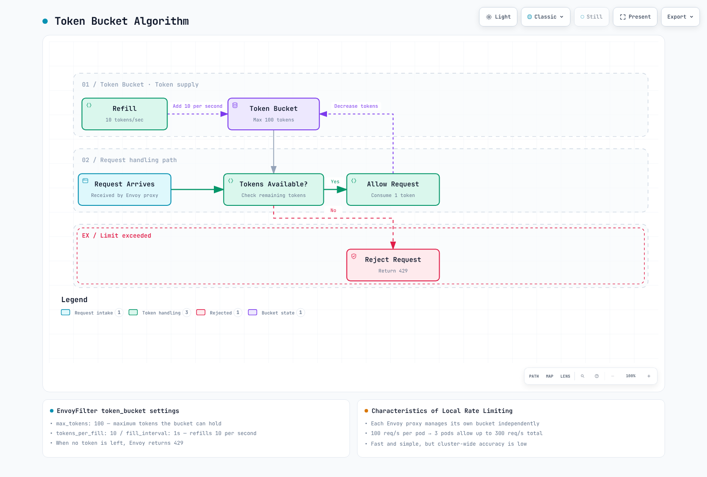

# Cuestionario de resiliencia

> **Última actualización**: October 12, 2026
>
> **Versiones**: Istio 1.31, que admite Kubernetes 1.32–1.37.
> Consulte el capítulo de instalación para conocer la compatibilidad con EKS.

Este cuestionario evalúa su comprensión de las características de resiliencia de Istio.

Cada ejemplo es independiente y asume que existen los Services, las etiquetas, los namespaces y las cargas de trabajo sidecar HTTP8080 indicados. Los valores son ilustrativos; las comprobaciones de esquema/consulta sin conexión no son pruebas de producción/carga. Los ejemplos de localidad usan `localityLbSetting`, no la API independiente `zoneAwareLbSetting`.

## Preguntas de opción múltiple (1-5)

### Pregunta 1: Conceptos básicos de Outlier Detection

¿Cuál de las siguientes opciones **NO** es un propósito principal de Outlier Detection?

A. Detectar automáticamente instancias con comportamiento anómalo\
B. Expulsarlas temporalmente cuando lo permitan el umbral de fallos configurado y el límite de expulsiones\
C. Eliminar permanentemente las instancias retiradas\
D. Hacer que un host expulsado temporalmente vuelva a ser elegible después de su período de expulsión

<details>

<summary>Mostrar respuesta</summary>

**Respuesta: C**

Outlier Detection **no elimina instancias**, sino que las retira temporalmente del grupo de tráfico.

**Explicación:**

**Cómo funciona Outlier Detection:**


**Características principales:**

1. **Detección automática**: Cuenta fallos HTTP/de transporte consecutivos que cumplen los criterios configurados
2. **Expulsión automática**: Retira temporalmente del grupo de tráfico cuando se supera el umbral
3. **Reincorporación**: La expulsión vence; esto no envía una sonda activa ni prueba la recuperación
4. **Medida temporal**: Solo bloquea el tráfico sin eliminar instancias

**Por qué la opción C es incorrecta:**

* Outlier Detection es un patrón Circuit Breaker
* **Expulsa temporalmente** las instancias sin eliminarlas
* El tráfico posterior exitoso confirma la recuperación; los fallos repetidos pueden activar expulsiones más prolongadas

**Referencia:**

* [Outlier Detection](../../../service-mesh/istio/resilience/01-outlier-detection.md)

</details>

***

### Pregunta 2: Comparación de tipos de Rate Limiting

¿Qué afirmación compara correctamente Local Rate Limiting y Global Rate Limiting?

A. Local Rate Limiting tiene mayor precisión\
B. Global Rate Limiting tiene un rendimiento más rápido\
C. Local Rate Limiting limita las solicitudes de forma independiente en cada proxy Envoy\
D. Global Rate Limiting funciona sin servicios externos

<details>

<summary>Mostrar respuesta</summary>

**Respuesta: C**

Local Rate Limiting limita las solicitudes **de forma independiente en cada proxy Envoy**.

**Explicación:**

**Comparación entre Local y Global Rate Limiting:**

| Característica  | Local Rate Limiting | Global Rate Limiting             |
| --------------- | ------------------- | -------------------------------- |
| **Ámbito de cuota** | Bucket local configurado | Dominio/descripción y ventana compartidos |
| **Rendimiento** | Muy rápido           | Ligeramente más lento                  |
| **Complejidad**  | Baja                 | Alta (requiere un servicio externo) |
| **Caso de uso**    | Protección general  | Cuando se necesita una limitación precisa  |

**Características de Local Rate Limiting:**

```yaml
apiVersion: networking.istio.io/v1alpha3
kind: EnvoyFilter
metadata:
  name: local-ratelimit
  namespace: default
spec:
  workloadSelector:
    labels:
      app: myapp
  configPatches:
  - applyTo: HTTP_FILTER
    match:
      context: SIDECAR_INBOUND
      listener:
        portNumber: 8080
        filterChain:
          filter:
            name: envoy.filters.network.http_connection_manager
            subFilter:
              name: envoy.filters.http.router
    patch:
      operation: INSERT_BEFORE
      value:
        name: envoy.filters.http.local_ratelimit
        typed_config:
          '@type': type.googleapis.com/envoy.extensions.filters.http.local_ratelimit.v3.LocalRateLimit
          stat_prefix: http_local_rate_limiter
          token_bucket:
            max_tokens: 100
            tokens_per_fill: 10
            fill_interval: 1s
          filter_enabled:
            default_value:
              numerator: 100
              denominator: HUNDRED
          filter_enforced:
            default_value:
              numerator: 100
              denominator: HUNDRED
```

El bucket mostrado comienza con100 tokens y se rellena con10/s. Tres réplicas pueden sostener aproximadamente30/s en conjunto con una distribución de carga adecuada, con asignaciones de ráfaga independientes; no es un límite compartido de30/s.

**Características de Global Rate Limiting:**

```yaml
# Configured shared descriptor quota:100 per backend second-window
# Actual enforcement depends on the shared backend, window and failure policy
# Requires an actual gRPC rate-limit service plus shared counter storage such as Redis
```

**Algoritmo Token Bucket:**



[🔍 Ver diagrama interactivo](https://www.atomai.click/kubernetes-docs/archmaps/en-quizzes-service-mesh-istio-resilience-1.html)

**Referencia:**

* [Rate Limiting](../../../service-mesh/istio/resilience/02-rate-limiting.md)

</details>

***

### Pregunta 3: Beneficios de Zone Aware Routing

¿Cuál **NO** es un beneficio de usar Zone Aware Routing?

A. Menor latencia mediante comunicación dentro de la misma AZ\
B. Ahorro en costos de transferencia de datos entre AZ\
C. Mejora garantizada de la disponibilidad al colocar cada réplica de Service en una AZ\
D. Failover a endpoints sanos accesibles cuando existen la política y la capacidad adecuadas

<details>

<summary>Mostrar respuesta</summary>

**Respuesta: C**

C no es una garantía. La localidad es relativa a cada llamador; puede concentrar el tráfico de un llamador en su zona local. Mover cada réplica a una AZ crea un dominio de fallo compartido y puede sobrecargar esa zona.

**Explicación:**

**Comportamiento correcto de Zone Aware Routing:**


**Beneficios reales de Zone Aware Routing:**

El enrutamiento dentro de la misma zona puede reducir el componente de red de la latencia y los bytes facturables entre zonas, pero la latencia, los precios y los ahorros exactos dependen de la implementación. Una ponderación80/10/10 significa que el tráfico normal se envía a las tres zonas sanas; las porciones de10% no son failover en espera. Las otras zonas necesitan endpoints reales y accesibles, y capacidad disponible.

**Ejemplo de configuración de DestinationRule:**

```yaml
apiVersion: networking.istio.io/v1
kind: DestinationRule
metadata:
  name: myapp
  namespace: default
spec:
  host: myapp
  trafficPolicy:
    loadBalancer:
      localityLbSetting:
        enabled: true
        distribute:
        - from: us-east-1/us-east-1a/*
          to:
            us-east-1/us-east-1a/*: 80
            us-east-1/us-east-1b/*: 10
            us-east-1/us-east-1c/*: 10
    outlierDetection:
      consecutive5xxErrors: 5
      interval: 30s
      baseEjectionTime: 30s
      maxEjectionPercent: 50
      minHealthPercent: 0
```

**Referencia:**

* [Zone Aware Routing](../../../service-mesh/istio/resilience/03-zone-aware-routing.md)

</details>

***

### Pregunta 4: Parámetros de Outlier Detection

¿Cuál es la condición para expulsar una instancia con la siguiente configuración de Outlier Detection?

```yaml
outlierDetection:
  consecutive5xxErrors: 5
  interval: 30s
  baseEjectionTime: 30s
  maxEjectionPercent: 50
```

A. Cuando se producen errores durante 5 segundos\
B. Cuando 5 fallos 5xx consecutivos que cumplen los criterios alcanzan el umbral, sujeto al límite de expulsiones\
C. Cuando la tasa de errores supera el 50% durante 30 segundos\
D. Expulsar incondicionalmente cada 30 segundos

<details>

<summary>Mostrar respuesta</summary>

**Respuesta: B**

B identifica el desencadenante. Cinco fallos consecutivos que cumplen los criterios pueden activar una expulsión en línea; `interval` es un intervalo de barrido periódico y `maxEjectionPercent` puede impedir la aplicación. Una respuesta exitosa lenta por sí sola no es un valor atípico de latencia.

**Explicación:**

**Parámetros principales de Outlier Detection:**

| Parámetro              | Descripción                 | Predeterminado | Rango de ejemplo |
| ---------------------- | --------------------------- | ------- | ----------- |
| **consecutive5xxErrors**  | Umbral de errores consecutivos | 5       | 3-10        |
| **interval**           | Intervalo de análisis           | 10s     | 10s-60s     |
| **baseEjectionTime**   | Tiempo mínimo de expulsión       | 30s     | 30s-300s    |
| **maxEjectionPercent** | Proporción máxima de expulsión      | 10%     | 10%-50%     |

**Explicación detallada de los parámetros:**

**consecutive5xxErrors**

```yaml
# Sensitive service (fast detection)
consecutive5xxErrors: 3

# General service
---
consecutive5xxErrors: 5

# Lenient setting (prevent false positives)
---
consecutive5xxErrors: 10
```

**interval**

```yaml
# Fast detection (high load)
interval: 10s

# Typical case
---
interval: 30s

# Stable service
---
interval: 60s
```

**baseEjectionTime**

```yaml
# Quick recovery attempt
baseEjectionTime: 30s

# Typical case
---
baseEjectionTime: 60s

# Cautious recovery
---
baseEjectionTime: 300s
```

**maxEjectionPercent**

```yaml
# Conservative (stability priority)
maxEjectionPercent: 10

# Balanced setting
---
maxEjectionPercent: 30

# Aggressive (performance priority)
---
maxEjectionPercent: 50
```

**Ejemplo completo de DestinationRule:**

```yaml
apiVersion: networking.istio.io/v1
kind: DestinationRule
metadata:
  name: reviews-outlier
  namespace: default
spec:
  host: reviews
  trafficPolicy:
    outlierDetection:
      consecutive5xxErrors: 5
      interval: 30s
      baseEjectionTime: 30s
      maxEjectionPercent: 50
      minHealthPercent: 0
```

**Ejemplo de funcionamiento:**

Un éxito restablece la secuencia consecutiva relevante. Cuando un host alcanza el umbral puede ser expulsado si el límite lo permite; se vuelve elegible después de su duración real de expulsión. Las expulsiones repetidas aumentan esa duración con un multiplicador/límite de Envoy. `minHealthPercent` es un umbral de pánico/fail-open, no una fracción garantizada de Pods sanos;0 deshabilita ese umbral.

**Referencia:**

* [Outlier Detection](../../../service-mesh/istio/resilience/01-outlier-detection.md)

</details>

***

### Pregunta 5: Algoritmo Token Bucket

Con un token por solicitud y demanda sostenida, ¿cuál es la tasa de admisión a largo plazo limitada por el relleno después de la ráfaga inicial?

```yaml
token_bucket:
  max_tokens: 100
  tokens_per_fill: 10
  fill_interval: 1s
```

A. 10 req/s\
B. 100 req/s\
C. 110 req/s\
D. 1000 req/s

<details>

<summary>Mostrar respuesta</summary>

**Respuesta: A**

Con `tokens_per_fill: 10` y `fill_interval: 1s`, **se agregan 10 tokens por segundo**, por lo que el promedio es **10 req/s**.

**Explicación:**

**Parámetros del algoritmo Token Bucket:**

* **max\_tokens**: Máximo de tokens que se pueden almacenar en el bucket (asignación de ráfaga)
* **tokens\_per\_fill**: Tokens que se agregan por fill\_interval (**rendimiento promedio**)
* **fill\_interval**: Intervalo de adición de tokens

**Método de cálculo:**

```
Average request rate = tokens_per_fill / fill_interval
                     = 10 / 1s
                     = 10 req/s

Burst throughput = max_tokens
                 = 100 req (for a brief moment)
```

**Comportamiento a lo largo del tiempo:**

```
T=0: 100 tokens in bucket (initial state)
     Can admit up to100 immediate requests if the bucket is full; backend concurrency is separate

T=0.1s: Bucket empty (0 tokens)
        Additional requests rejected

T=1s: 10 tokens added (Refill)
      Can handle 10 requests

T=2s: 10 tokens added
      Can handle 10 requests

Average: 10 req/s (sustainable throughput)
Burst allowance:100 requests from a full bucket, not a sustained req/s rate
```

**Ejemplos prácticos de configuración:**

```yaml
# Scenario 1: General API endpoint
token_bucket:
  max_tokens: 100        # Allow burst of 100
  tokens_per_fill: 10    # Average 10 req/s
  fill_interval: 1s

# Scenario 2: High-performance API
---
token_bucket:
  max_tokens: 1000       # Allow burst of 1000
  tokens_per_fill: 100   # Average 100 req/s
  fill_interval: 1s

# Scenario 3: Limited resource
---
token_bucket:
  max_tokens: 10         # Only 10 burst
  tokens_per_fill: 1     # Average 1 req/s
  fill_interval: 1s
```

**Ejemplo completo de EnvoyFilter:**

```yaml
apiVersion: networking.istio.io/v1alpha3
kind: EnvoyFilter
metadata:
  name: local-ratelimit
  namespace: default
spec:
  workloadSelector:
    labels:
      app: myapp
  configPatches:
  - applyTo: HTTP_FILTER
    match:
      context: SIDECAR_INBOUND
      listener:
        portNumber: 8080
        filterChain:
          filter:
            name: envoy.filters.network.http_connection_manager
            subFilter:
              name: envoy.filters.http.router
    patch:
      operation: INSERT_BEFORE
      value:
        name: envoy.filters.http.local_ratelimit
        typed_config:
          '@type': type.googleapis.com/envoy.extensions.filters.http.local_ratelimit.v3.LocalRateLimit
          stat_prefix: http_local_rate_limiter
          token_bucket:
            max_tokens: 100
            tokens_per_fill: 10
            fill_interval: 1s
          filter_enabled:
            default_value:
              numerator: 100
              denominator: HUNDRED
          filter_enforced:
            default_value:
              numerator: 100
              denominator: HUNDRED
```

**Referencia:**

* [Rate Limiting](../../../service-mesh/istio/resilience/02-rate-limiting.md)

</details>

***

## Preguntas de respuesta corta (6-10)

### Pregunta 6: Implementación de Outlier Detection

Un `product-service` que se ejecuta en producción se vuelve lento de forma intermitente y experimenta timeouts. Desea implementar Outlier Detection para expulsar automáticamente las instancias problemáticas. Escriba un DestinationRule que cumpla los siguientes requisitos:

**Requisitos:**

* Expulsar después de 3 errores consecutivos
* Usar un barrido periódico de20 segundos; los fallos consecutivos se pueden detectar en línea
* Establecer la duración inicial base de expulsión en60 segundos
* Permitir la expulsión de un máximo de 30%
* Detectar también los errores gateway 502, 503, 504

<details>

<summary>Mostrar respuesta</summary>

Las respuestas lentas por sí solas no son un criterio de valor atípico. El ejemplo separa los errores HTTP de los fallos de transporte observados localmente; debe existir un timeout de ruta/cliente real para que se observen los timeouts.

```yaml
apiVersion: networking.istio.io/v1
kind: DestinationRule
metadata:
  name: product-service-outlier
  namespace: production
spec:
  host: product-service
  trafficPolicy:
    outlierDetection:
      consecutive5xxErrors: 3
      splitExternalLocalOriginErrors: true
      consecutiveLocalOriginFailures: 3
      interval: 20s
      baseEjectionTime: 60s
      maxEjectionPercent: 30
      minHealthPercent: 0
      consecutiveGatewayErrors: 3
```

El subconjunto gateway502/503/504 ya está incluido en5xx. Umbrales iguales de3 son redundantes pero válidos; umbrales gateway más bajos expulsarían antes por ese subconjunto. `interval: 20s` no retrasa la detección de errores consecutivos. `baseEjectionTime: 60s` es la duración mínima inicial, no una sonda de estado activa. El límite de30% limita las expulsiones, pero no puede mantener sanos los endpoints restantes. `minHealthPercent: 70` habilitaría el comportamiento de pánico por debajo de su umbral, no preservaría70% de capacidad sana. Los campos `enforcing*` no admitidos son elementos internos de Envoy, no de esta API DestinationRule.

Un ejemplo de diez hosts puede alcanzar el límite después de tres expulsiones, pero el tamaño del grupo descubierto, el redondeo y el estado actual importan; inspeccione los contadores reales de aplicado/detectado/desbordamiento. Un host que regresa debe recibir tráfico exitoso para demostrar su recuperación.

```bash
istioctl proxy-config clusters <caller-pod> -n production --fqdn product-service.production.svc.cluster.local -o json
istioctl x envoy-stats <caller-pod> -n production --output prom | grep outlier_detection
```

```promql
envoy_cluster_outlier_detection_ejections_active{namespace="production"}
rate(envoy_cluster_outlier_detection_ejections_enforced_total{namespace="production"}[5m])
```

Habilite las estadísticas/recopilación opcionales como se indica en el [capítulo sobre valores atípicos](../../../service-mesh/istio/resilience/01-outlier-detection.md). Ajuste los umbrales a partir de los errores medidos y la capacidad disponible; no se sobreentiende un valor universal de «producción».

</details>

***

### Pregunta 7: Aplicación de Local Rate Limiting

Una aplicación con sidecar inyectado denominada `api-gateway` está recibiendo tráfico HTTP excesivo. Desea aplicar Local Rate Limiting para limitar cada proxy Envoy a 50 solicitudes por segundo con una ráfaga de hasta 200. Escriba el EnvoyFilter.

Requisitos adicionales:

* Agregar el encabezado `X-RateLimit-Limit` cuando se aplique el límite de tasa
* Incluir el encabezado `Retry-After: 1` en las respuestas 429

<details>

<summary>Mostrar respuesta</summary>

Suponga que `api-gateway` es una aplicación con un sidecar inyectado en HTTP8080 en `production`. Esto protege las solicitudes HTTP seleccionadas después de que llegan a Envoy; no es una protección completa contra DDoS ni contra conexiones/TLS. Para un gateway de entrada de Istio real, use su namespace/selector y el contexto `GATEWAY` como se indica en el capítulo sobre límites de tasa.

```yaml
apiVersion: networking.istio.io/v1alpha3
kind: EnvoyFilter
metadata:
  name: api-gateway-ratelimit
  namespace: production
spec:
  workloadSelector:
    labels:
      app: api-gateway
  configPatches:
  - applyTo: HTTP_FILTER
    match:
      context: SIDECAR_INBOUND
      listener:
        portNumber: 8080
        filterChain:
          filter:
            name: envoy.filters.network.http_connection_manager
            subFilter:
              name: envoy.filters.http.router
    patch:
      operation: INSERT_BEFORE
      value:
        name: envoy.filters.http.local_ratelimit
        typed_config:
          '@type': type.googleapis.com/envoy.extensions.filters.http.local_ratelimit.v3.LocalRateLimit
          stat_prefix: http_local_rate_limiter
          token_bucket:
            max_tokens: 200
            tokens_per_fill: 50
            fill_interval: 1s
          filter_enabled:
            default_value:
              numerator: 100
              denominator: HUNDRED
          filter_enforced:
            default_value:
              numerator: 100
              denominator: HUNDRED
          response_headers_to_add:
          - append_action: OVERWRITE_IF_EXISTS_OR_ADD
            header:
              key: X-RateLimit-Limit
              value: '50'
          - append_action: OVERWRITE_IF_EXISTS_OR_ADD
            header:
              key: X-Local-Rate-Limit
              value: 'true'
          - append_action: OVERWRITE_IF_EXISTS_OR_ADD
            header:
              key: Retry-After
              value: '1'
```

El bucket lleno admite hasta200 solicitudes inmediatamente y luego se rellena con50 tokens/s. Con100 solicitudes/s sostenidas después de agotarse, se pueden admitir aproximadamente50/s, suponiendo un token por solicitud y sin otros límites. Una demanda uniforme de40/s puede caber, pero un promedio de40/s por sí solo no garantiza que se acepte cada ráfaga. La admisión no garantiza el éxito del procesamiento de backend.

El filtro usa HTTP429 de forma predeterminada y agrega estos encabezados solo a sus respuestas de límite de tasa aplicadas. Una respuesta200 normal no recibe estos encabezados de esta configuración. `Retry-After: 1` es un retraso aconsejado, no una reserva ni una garantía de éxito un segundo después. Este ejemplo no crea metadatos dinámicos `tokens_remaining`, por lo que se omite un encabezado Remaining inventado.

```http
HTTP/1.1 429 Too Many Requests
X-RateLimit-Limit: 50
X-Local-Rate-Limit: true
Retry-After: 1
```

Para buckets con prefijos de ruta distintos, use esta **alternativa**, no un segundo filtro superpuesto. El generador explícito de descriptores es compatible con la API Envoy fijada con Istio1.31. Las rutas ausentes/sin coincidencia usan el bucket predeterminado limitado; la coincidencia de prefijo incluye rutas más largas que comienzan con el texto proporcionado.

```yaml
apiVersion: networking.istio.io/v1alpha3
kind: EnvoyFilter
metadata:
  name: path-based-ratelimit
  namespace: production
spec:
  workloadSelector:
    labels:
      app: api-gateway
  configPatches:
  - applyTo: HTTP_FILTER
    match:
      context: SIDECAR_INBOUND
      listener:
        portNumber: 8080
        filterChain:
          filter:
            name: envoy.filters.network.http_connection_manager
            subFilter:
              name: envoy.filters.http.router
    patch:
      operation: INSERT_BEFORE
      value:
        name: envoy.filters.http.local_ratelimit
        typed_config:
          '@type': type.googleapis.com/envoy.extensions.filters.http.local_ratelimit.v3.LocalRateLimit
          stat_prefix: http_local_rate_limiter
          token_bucket:
            max_tokens: 30
            tokens_per_fill: 10
            fill_interval: 1s
          filter_enabled:
            default_value:
              numerator: 100
              denominator: HUNDRED
          filter_enforced:
            default_value:
              numerator: 100
              denominator: HUNDRED
          always_consume_default_token_bucket: false
          descriptors:
          - entries:
            - key: header_match
              value: /api/login
            token_bucket:
              max_tokens: 30
              tokens_per_fill: 10
              fill_interval: 1s
          - entries:
            - key: header_match
              value: /api/search
            token_bucket:
              max_tokens: 300
              tokens_per_fill: 100
              fill_interval: 1s
          rate_limits:
          - actions:
            - header_value_match:
                descriptor_value: /api/login
                headers:
                - name: :path
                  string_match:
                    prefix: /api/login
          - actions:
            - header_value_match:
                descriptor_value: /api/search
                headers:
                - name: :path
                  string_match:
                    prefix: /api/search
```

```promql
sum by (pod) (rate({__name__=~"envoy_.*http_local_rate_limit_enforced",namespace="production"}[5m]))
```

Consulte [rate limiting](../../../service-mesh/istio/resilience/02-rate-limiting.md) para la recopilación de estadísticas opcionales, los requisitos de servicio global/Redis y el manejo de identidades de confianza.

</details>

***

### Pregunta 8: Configuración de Zone Aware Routing

Su clúster de AWS EKS está distribuido en 3 AZ (us-east-1a, us-east-1b, us-east-1c). Desea configurar Zone Aware Routing para `order-service` a fin de reducir los costos de transferencia de datos entre AZ.

**Requisitos:**

* Enviar el 70% del tráfico a Pods de la misma AZ
* Distribuir 15% a cada una de las otras AZ
* Explicar una alternativa independiente de failover por prioridad y las limitaciones de una interrupción completa de AZ
* Explicar por qué minHealthPercent50 no es una garantía de estar50% sano ni un interruptor de activación de localidad

<details>

<summary>Mostrar respuesta</summary>

Estos requisitos mezclan distribución ponderada, failover por prioridad y una garantía de capacidad sana. No se pueden expresar todos combinando campos en una política de localidad. Use la siguiente política de distribución para el tráfico normal70/15/15; `minHealthPercent` no es un interruptor que active la localidad solo cuando la mitad de los Pods están sanos.

```yaml
apiVersion: networking.istio.io/v1
kind: DestinationRule
metadata:
  name: order-service-locality
  namespace: production
spec:
  host: order-service
  trafficPolicy:
    loadBalancer:
      localityLbSetting:
        enabled: true
        distribute:
        - from: us-east-1/us-east-1a/*
          to:
            us-east-1/us-east-1a/*: 70
            us-east-1/us-east-1b/*: 15
            us-east-1/us-east-1c/*: 15
        - from: us-east-1/us-east-1b/*
          to:
            us-east-1/us-east-1a/*: 15
            us-east-1/us-east-1b/*: 70
            us-east-1/us-east-1c/*: 15
        - from: us-east-1/us-east-1c/*
          to:
            us-east-1/us-east-1a/*: 15
            us-east-1/us-east-1b/*: 15
            us-east-1/us-east-1c/*: 70
    outlierDetection:
      consecutive5xxErrors: 5
      splitExternalLocalOriginErrors: true
      consecutiveLocalOriginFailures: 5
      interval: 30s
      baseEjectionTime: 30s
      maxEjectionPercent: 50
      minHealthPercent: 0
```

Para prioridad y desbordamiento de zona local, aplique en su lugar esta **alternativa**, no ambas políticas. `localityLbSetting.failover` acepta nombres de región, no rutas `region/zone`. `distribute` y los modos de prioridad son mutuamente excluyentes en esta API.

```yaml
apiVersion: networking.istio.io/v1
kind: DestinationRule
metadata:
  name: order-service-failover
  namespace: production
spec:
  host: order-service
  trafficPolicy:
    loadBalancer:
      localityLbSetting:
        enabled: true
        failoverPriority:
        - topology.kubernetes.io/region
        - topology.kubernetes.io/zone
    outlierDetection:
      consecutive5xxErrors: 5
      splitExternalLocalOriginErrors: true
      consecutiveLocalOriginFailures: 5
      interval: 30s
      baseEjectionTime: 30s
      maxEjectionPercent: 100
      minHealthPercent: 0
```

Una interrupción completa de zona también afecta al cliente de esa zona: se necesita un cliente o punto de entrada superviviente/recreado en otro lugar. La capacidad restante de endpoints sanos, la detección, la reutilización de conexiones y la accesibilidad de red determinan el failover; la política no promete100% a zoneB ni una recuperación instantánea. `minHealthPercent: 0` deshabilita el uso en pánico de hosts no sanos, y un límite de100% permite que se expulsen todos los endpoints si todos fallan. Ninguno crea capacidad sana.

Use el [capítulo sobre zonas](../../../service-mesh/istio/resilience/03-zone-aware-routing.md) para las comprobaciones de topología Node→Pod, `topologySpreadConstraints` coincidentes, los grupos de nodos de EKS y los diagnósticos de EDS. No asigne manualmente etiquetas de topología cloud solo para que un ejemplo coincida. Las métricas estándar de Istio no contienen `source_cluster_zone`/`destination_cluster_zone`; las consultas por zona requieren enriquecimiento verificado, independiente del enrutamiento.

**Aritmética de costos ilustrativa**: suponga1TB decimal=1000GB, un cargo efectivo de$0.01 por GB facturable, una fracción de referencia entre zonas de2/3 y una fracción posterior de0.30. Esta es una suposición simplificada, no una cotización de precios de AWS, un ahorro medido ni una factura de red completa.

| Tráfico mensual | Antes | Después | Ahorro mensual | Ahorro anual |
|---|---:|---:|---:|---:|
|1TB|$6.67|$3.00|$3.67|$44.00|
|100TB|$666.67|$300.00|$366.67|$4,400.00|

La reducción modelada es55%. Calcule a partir de fracciones exactas y redondee únicamente la moneda mostrada; el ahorro anual no debe multiplicar un ahorro mensual$367 redondeado prematuramente. Las direcciones facturables reales, los volúmenes de bytes, la región y los cargos de procesamiento de Service necesitan evidencia de facturación/flujo.

```bash
kubectl get nodes -L topology.kubernetes.io/region,topology.kubernetes.io/zone
istioctl proxy-config bootstrap <caller-pod> -n production -o json
istioctl proxy-config all <caller-pod> -n production -o json
```

</details>

***

### Pregunta 9: Estrategia de resiliencia combinada

`payment-service` es un Service crítico que llama a API de pago externas. Implemente la siguiente estrategia de resiliencia combinada:

1. **Outlier Detection**: Expulsar la instancia después de 3 errores consecutivos
2. **Retry**: Permitir hasta3 reintentos en502/503/504 para lecturas idempotentes verificadas; deshabilitar explícitamente los reintentos de escritura
3. **Timeout**: Timeout de 5 segundos por solicitud
4. **Circuit Breaker**: Explicar por qué «bloquear todo el Service por encima de50% de errores» no es el breaker de pool de esta API; mostrar en su lugar límites de concurrencia admitidos

Escriba el DestinationRule y el VirtualService.

<details>

<summary>Mostrar respuesta</summary>

Un DestinationRule no puede implementar «bloquear globalmente este Service por encima de50% de errores» mediante los campos de tasa de éxito enumerados. Esos campos no son compatibles aquí, y la desviación estadística no es un umbral fijo de porcentaje de errores. Los circuit breakers de pool restringen las conexiones/solicitudes simultáneas por clúster upstream de proxy llamador; Outlier Detection cambia la elegibilidad del host. Un breaker de proporción de errores coordinado para todo el Service necesitaría un mecanismo de aplicación/controlador diseñado por separado.

Esta respuesta se aplica a **caller→payment-service HTTP8080**. La llamada API de pago saliente del Service necesita su propia política de destino y visibilidad TLS como se describe en el [capítulo sobre valores atípicos](../../../service-mesh/istio/resilience/01-outlier-detection.md). Los reintentos de mesh no pueden proporcionar idempotencia de pagos.

```yaml
apiVersion: networking.istio.io/v1
kind: DestinationRule
metadata:
  name: payment-service-resilience
  namespace: production
spec:
  host: payment-service
  trafficPolicy:
    connectionPool:
      tcp:
        maxConnections: 100
        connectTimeout: 1s
      http:
        http1MaxPendingRequests: 50
        http2MaxRequests: 100
        maxRequestsPerConnection: 0
        maxRetries: 3
    outlierDetection:
      consecutive5xxErrors: 3
      splitExternalLocalOriginErrors: true
      consecutiveLocalOriginFailures: 3
      interval: 10s
      baseEjectionTime: 30s
      maxEjectionPercent: 50
      minHealthPercent: 0
---
apiVersion: networking.istio.io/v1
kind: VirtualService
metadata:
  name: payment-service-retry
  namespace: production
spec:
  hosts:
  - payment-service
  http:
  - name: writes-no-retry
    match:
    - method:
        regex: ^(POST|PUT|PATCH|DELETE)$
    route:
    - destination:
        host: payment-service
        port:
          number: 8080
    timeout: 5s
    retries:
      attempts: 0
  - name: idempotent-reads
    match:
    - method:
        regex: ^(GET|HEAD|OPTIONS)$
    route:
    - destination:
        host: payment-service
        port:
          number: 8080
    timeout: 5s
    retries:
      attempts: 3
      perTryTimeout: 2s
      retryOn: gateway-error,connect-failure,refused-stream
  - name: other-methods-no-retry
    route:
    - destination:
        host: payment-service
        port:
          number: 8080
    timeout: 5s
    retries:
      attempts: 0
```

Las reglas explícitas de escritura/respaldo deshabilitan los reintentos heredados de mesh. Reintente solo las lecturas coincidentes cuya semántica de aplicación sea segura de repetir. `gateway-error` cubre502/503/504; no se agregan condiciones amplias de restablecimiento/5xx/4xx a las escrituras de pago. Un error de transporte no establece si se confirmó un pago.

`attempts: 3` significa hasta tres reintentos **después** del intento inicial. Cuatro intentos completos de2s más el backoff no caben dentro de5s, por lo que el presupuesto total de ruta se detiene antes; los plazos de la aplicación también deben cubrir carga/streaming y trabajo downstream. Esto no es una cronología exacta de fallos ni una promesa de un estado HTTP final concreto.

`maxRetries: 3` limita los reintentos simultáneos pendientes de ese proxy/clúster, no los reintentos por solicitud. `http2MaxRequests` también se aplica a HTTP/1.1. `maxRequestsPerConnection: 0` permite la reutilización sin ese límite de recuento de solicitudes. El desbordamiento de solicitudes pendientes/activas puede rechazar solicitudes HTTP, mientras que alcanzar un límite de conexión puede primero provocar cola. Ninguna de estas configuraciones es un circuit global de50% de errores.

| Observación | Interpretación correcta |
|---|---|
|Una lectura segura obtiene502 y luego tiene éxito en un reintento|Un reintento puede ayudar; puede volver a visitar un host y no se garantiza que tenga éxito|
|Un host alcanza su umbral de fallos|Ese llamador puede expulsarlo si el límite lo permite; otros llamadores mantienen su propio estado|
|Todos los endpoints fallan|Puede no quedar ningún destino sano; un temporizador de expulsión no repara el Service ni implementa una prueba coordinada de semiapertura|

```promql
sum(rate(envoy_cluster_upstream_rq_retry{namespace="production"}[5m]))
envoy_cluster_circuit_breakers_default_rq_pending_open{namespace="production"}
sum(rate(envoy_cluster_outlier_detection_ejections_enforced_total{namespace="production"}[5m]))
sum(rate(istio_requests_total{reporter="source",destination_service_name="payment-service",destination_service_namespace="production",response_flags=~".*UT.*"}[5m]))
```

La serie `_open` es un gauge0/1, no un contador que se deba pasar a `rate`. Delimite las etiquetas del clúster Envoy y habilite las estadísticas pertinentes. Consulte [retry/timeout](../../../service-mesh/istio/traffic-management/05-retry-timeout.md) y [circuit breaking](../../../service-mesh/istio/traffic-management/07-circuit-breaker.md) para conocer compromisos operativos seguros.

</details>

***

### Pregunta 10: Optimización de rendimiento y reducción de costos

En un entorno de microservicios a gran escala, los costos mensuales de red son $5,000. Desarrolle una estrategia integral para optimizar el rendimiento y reducir los costos mediante las características de resiliencia de Istio.

**Situación actual:**

* 100 Services distribuidos uniformemente en 3 AZ
* Tráfico mensual: 500TB
* Tiempo de respuesta promedio: 150ms
* Tasa de errores: 3%

**Objetivos:**

* Reducción del 50% en costos entre AZ
* Tiempo de respuesta promedio inferior a 100ms
* Tasa de errores inferior a 1%

<details>

<summary>Mostrar respuesta</summary>

Trate los100 Services proporcionados,500TB/mes, la factura de$5,000, la latencia de150ms y los errores de3% como una **referencia hipotética**, no como resultados medidos de esta auditoría. Primero identifique los componentes de tráfico facturables y el límite SLI orientado al usuario. La latencia del salto de proxy no es automáticamente la latencia de solicitud de extremo a extremo.

**1. Consolidar una política de destino por Service revisado**

El ejemplo representativo de `api-service` combina límites de pool, ponderación de localidad y Outlier Detection admitido en un DestinationRule. No aplique varias reglas wildcard en conflicto ni enrute todos los Services a un backend genérico. Dimensione los valores según cada llamador y destino; la muestra no es un valor predeterminado de producción.

```yaml
apiVersion: networking.istio.io/v1
kind: DestinationRule
metadata:
  name: api-service-resilience
  namespace: production
spec:
  host: api-service
  trafficPolicy:
    connectionPool:
      tcp:
        maxConnections: 100
        connectTimeout: 1s
      http:
        http1MaxPendingRequests: 50
        http2MaxRequests: 100
        maxRequestsPerConnection: 0
        maxRetries: 3
    loadBalancer:
      localityLbSetting:
        enabled: true
        distribute:
        - from: us-east-1/us-east-1a/*
          to:
            us-east-1/us-east-1a/*: 80
            us-east-1/us-east-1b/*: 10
            us-east-1/us-east-1c/*: 10
        - from: us-east-1/us-east-1b/*
          to:
            us-east-1/us-east-1a/*: 10
            us-east-1/us-east-1b/*: 80
            us-east-1/us-east-1c/*: 10
        - from: us-east-1/us-east-1c/*
          to:
            us-east-1/us-east-1a/*: 10
            us-east-1/us-east-1b/*: 10
            us-east-1/us-east-1c/*: 80
    outlierDetection:
      consecutive5xxErrors: 3
      splitExternalLocalOriginErrors: true
      consecutiveLocalOriginFailures: 3
      interval: 10s
      baseEjectionTime: 60s
      maxEjectionPercent: 30
      minHealthPercent: 0
      consecutiveGatewayErrors: 2
---
apiVersion: networking.istio.io/v1
kind: VirtualService
metadata:
  name: api-service-routing
  namespace: production
spec:
  hosts:
  - api-service
  http:
  - name: writes-no-retry
    match:
    - method:
        regex: ^(POST|PUT|PATCH|DELETE)$
    route:
    - destination:
        host: api-service
        port:
          number: 8080
    timeout: 3s
    retries:
      attempts: 0
  - name: idempotent-reads
    match:
    - method:
        regex: ^(GET|HEAD|OPTIONS)$
    route:
    - destination:
        host: api-service
        port:
          number: 8080
    timeout: 3s
    retries:
      attempts: 2
      perTryTimeout: 1s
      retryOn: gateway-error,connect-failure,refused-stream
  - name: other-methods-no-retry
    route:
    - destination:
        host: api-service
        port:
          number: 8080
    timeout: 3s
    retries:
      attempts: 0
```

**2. Límites de tasa como controles de admisión medidos**

Estos son buckets independientes por proxy en HTTP8080 en `production`. Verifique las etiquetas de nivel y la capacidad; una etiqueta «critical» por sí sola no justifica una tasa determinada. No imponen una cuota de Service/cuenta compartida ni sustituyen la protección de borde.

```yaml
apiVersion: networking.istio.io/v1alpha3
kind: EnvoyFilter
metadata:
  name: critical-service-ratelimit
  namespace: production
spec:
  workloadSelector:
    labels:
      tier: critical
  configPatches:
  - applyTo: HTTP_FILTER
    match:
      context: SIDECAR_INBOUND
      listener:
        portNumber: 8080
        filterChain:
          filter:
            name: envoy.filters.network.http_connection_manager
            subFilter:
              name: envoy.filters.http.router
    patch:
      operation: INSERT_BEFORE
      value:
        name: envoy.filters.http.local_ratelimit
        typed_config:
          '@type': type.googleapis.com/envoy.extensions.filters.http.local_ratelimit.v3.LocalRateLimit
          stat_prefix: http_local_rate_limiter
          token_bucket:
            max_tokens: 500
            tokens_per_fill: 100
            fill_interval: 1s
          filter_enabled:
            default_value:
              numerator: 100
              denominator: HUNDRED
          filter_enforced:
            default_value:
              numerator: 100
              denominator: HUNDRED
---
apiVersion: networking.istio.io/v1alpha3
kind: EnvoyFilter
metadata:
  name: standard-service-ratelimit
  namespace: production
spec:
  workloadSelector:
    labels:
      tier: standard
  configPatches:
  - applyTo: HTTP_FILTER
    match:
      context: SIDECAR_INBOUND
      listener:
        portNumber: 8080
        filterChain:
          filter:
            name: envoy.filters.network.http_connection_manager
            subFilter:
              name: envoy.filters.http.router
    patch:
      operation: INSERT_BEFORE
      value:
        name: envoy.filters.http.local_ratelimit
        typed_config:
          '@type': type.googleapis.com/envoy.extensions.filters.http.local_ratelimit.v3.LocalRateLimit
          stat_prefix: http_local_rate_limiter
          token_bucket:
            max_tokens: 200
            tokens_per_fill: 50
            fill_interval: 1s
          filter_enabled:
            default_value:
              numerator: 100
              denominator: HUNDRED
          filter_enforced:
            default_value:
              numerator: 100
              denominator: HUNDRED
```

**3. Separar un modelo ilustrativo de una factura real**

Suponga500TB decimales=500,000GB, una fracción de referencia entre AZ de2/3, una fracción posterior de0.20 y un **valor efectivo supuesto** de$0.015 por GB facturable. El componente variable modelado es:

| Modelo | Cálculo | Importe mensual |
|---|---|---:|
|Antes|500,000 × 2/3 × 0.015|$5,000|
|Después|500,000 × 0.20 × 0.015|$1,500|
|Diferencia|5,000 − 1,500|$3,500 (70%)|

Esto coincide con la referencia completa de$5,000 solo si toda la factura es este componente variable. Las facturas de red reales pueden incluir otras direcciones, procesamiento de balanceador de carga/NAT, transferencia de Internet/región y costos fijos. Las ponderaciones de solicitudes no tienen por qué ser iguales a las fracciones de bytes cuando difieren los tamaños de solicitud/respuesta. Valide los ahorros modelados frente a los datos de flujo/CUR facturables y los precios actuales; no prometa un ahorro de70% en la factura total.

Para latencias de red ilustrativas de un salto de0.3ms dentro de la misma AZ y1.5ms entre AZ, una referencia equitativa de tres zonas da0.3×1/3+1.5×2/3=1.10ms;80/20 da0.54ms. Este cambio de componente de0.56ms no puede establecer una mejora de extremo a extremo de150ms→100ms. Rastree la ruta crítica real, las esperas de base de datos/pool, el trabajo de la aplicación y la amplificación de reintentos.

**4. Validar cambios por etapas**

| Etapa ilustrativa | Evidencia necesaria antes de ampliar el alcance |
|---|---|
|Semanas1–2: topología/localidad|Asignación real de Node/Pod/EDS, capacidad zonal, distribución de solicitudes y bytes facturables, comportamiento ante fallos|
|Semanas3–4: límites de outlier/pool|Expulsiones aplicadas, endpoints restantes, desbordamiento, latencia y causas de errores de la aplicación|
|Semanas5–6: límites de tasa|Sobrecarga genuina rechazada sin rechazar solicitudes legítimas de forma inaceptable; observar el comportamiento de reintento del cliente|

El calendario es ilustrativo. Defina criterios de rollback/detención y mida después de cada cambio. Outlier Detection puede eliminar capacidad o exponer un fallo subyacente; no garantiza errores por debajo de1%. Un timeout modificado puede producir más fallos en lugar de hacer el trabajo más rápido.

**5. Usar métricas con tipo y ámbito correctos**

Las siguientes consultas por Service diagnostican el Service representativo. Mida el SLI orientado al usuario por separado. La latencia media usa la suma/recuento del histograma, no P50; las expulsiones activas son un gauge, mientras que los eventos de expulsión aplicados son un contador.

```promql
# Per-service mean request duration, milliseconds
sum(rate(istio_request_duration_milliseconds_sum{reporter="destination",destination_service_name="api-service",destination_service_namespace="production"}[5m])) /
sum(rate(istio_request_duration_milliseconds_count{reporter="destination",destination_service_name="api-service",destination_service_namespace="production"}[5m]))

# Per-service HTTP5xx percentage (define gRPC/application failures separately)
100 * sum(rate(istio_requests_total{reporter="destination",destination_service_name="api-service",destination_service_namespace="production",response_code=~"5.."}[5m])) /
sum(rate(istio_requests_total{reporter="destination",destination_service_name="api-service",destination_service_namespace="production"}[5m]))

envoy_cluster_outlier_detection_ejections_active{namespace="production"}
sum(rate(envoy_cluster_outlier_detection_ejections_enforced_total{namespace="production"}[5m]))
sum by (pod) (rate({__name__=~"envoy_.*http_local_rate_limit_enforced",namespace="production"}[5m]))
```

Habilite las estadísticas opcionales y gestione la ausencia de tráfico/fallos de recopilación. Una consulta entre AZ requiere enriquecimiento de zona real; `source_cluster_zone!=destination_cluster_zone` no es PromQL válido. Consulte el [capítulo sobre zonas](../../../service-mesh/istio/resilience/03-zone-aware-routing.md) para consultas condicionales con ámbito explícito.

**Los objetivos aún deben medirse**: costo entre AZ−50%, latencia media orientada al usuario≤100ms y errores<1% son criterios de aceptación, no resultados previstos. La ubicación de caché puede reducir la distancia, pero no aumenta por sí sola la tasa de aciertos. Evalúe los requisitos de características/capacidad de ambient antes de comparar la sobrecarga; no se ha establecido un ahorro genérico de30–50%. Un HPA sobre un Deployment multizona no escala de forma independiente cada zona; el escalado zonal independiente necesita un diseño explícito de carga de trabajo/controlador.

Referencias: [Outlier detection](../../../service-mesh/istio/resilience/01-outlier-detection.md), [rate limiting](../../../service-mesh/istio/resilience/02-rate-limiting.md), [optimización de costos de red de EKS](https://docs.aws.amazon.com/eks/latest/best-practices/cost-opt-networking.html).

</details>

***

## Cálculo de puntuación

* Opción múltiple 1-5: 10 puntos cada una (50 puntos en total)
* Respuesta corta 6-10: 10 puntos cada una (50 puntos en total)
* **Total: 100 puntos**

**Criterios de evaluación:**

* 90-100 puntos: Excelente (experto en Istio Resilience)
* 80-89 puntos: Buena comprensión; la validación de la implementación es independiente
* 70-79 puntos: Promedio (se recomienda estudio adicional)
* 60-69 puntos: Por debajo del promedio (se necesita revisión de conceptos básicos)
* 0-59 puntos: Necesita volver a estudiar

## Recursos de aprendizaje

* [Outlier Detection](../../../service-mesh/istio/resilience/01-outlier-detection.md)
* [Rate Limiting](../../../service-mesh/istio/resilience/02-rate-limiting.md)
* [Zone Aware Routing](../../../service-mesh/istio/resilience/03-zone-aware-routing.md)
