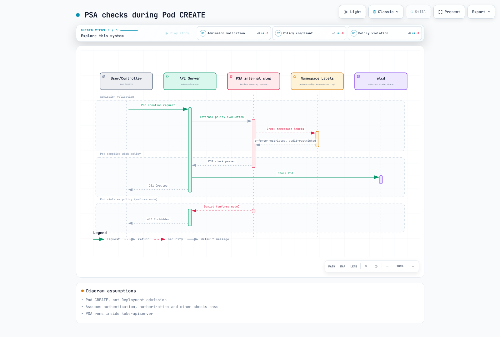

# Estándares de seguridad de Pod (PSS)

> **Línea base de validación**: Biblioteca PSA de Kubernetes `k8s.io/pod-security-admission` v0.36.2; política PSS de ejemplo v1.35
> **Última actualización**: 12 de octubre de 2026

Los estándares de seguridad de Pod (PSS) son un marco de políticas estandarizado para la seguridad de Pod en Kubernetes. Este documento abarca conceptos de PSS, métodos de configuración e implementación en entornos EKS.

PSS define políticas; PSA es la implementación de admisión integrada que las aplica. Esta guía presupone **Pods de Linux normales sin espacios de nombres de usuario**, salvo que se indique lo contrario. La evaluación local de las políticas oficiales de Kubernetes y las comprobaciones de esquema/comandos son distintas del despliegue: no se probó ningún clúster en vivo, EKS ni ejecución de contenedor. El ejemplo `v1.35` es una definición de política fijada, no una afirmación sobre la última versión compatible con Kubernetes/EKS. El significado de `latest` cambia cuando se actualiza el servidor de API.

## Tabla de contenido

1. [Evolución de PSP a PSS](#evolution-from-psp-to-pss)
2. [Controlador de Pod Security Admission (PSA)](#pod-security-admission-psa-controller)
3. [Niveles de seguridad](#security-levels)
4. [Modos de aplicación](#enforcement-modes)
5. [Configuración a nivel del espacio de nombres](#namespace-level-configuration)
6. [Migración de PSP a PSS](#migration-from-psp-to-pss)
7. [Valores predeterminados y configuración de EKS](#eks-defaults-and-configuration)
8. [Detalles del perfil de seguridad](#security-profile-details)
9. [Configuración de exenciones](#exemptions-configuration)
10. [Prácticas recomendadas para la adopción gradual](#best-practices-for-gradual-adoption)

---

## Evolución de PSP a PSS {#evolution-from-psp-to-pss}

### Historia de PodSecurityPolicy (PSP)

PodSecurityPolicy (PSP) se introdujo en Kubernetes 1.3 como un mecanismo de seguridad de Pod. Sin embargo, quedó obsoleto en Kubernetes 1.21 y se eliminó por completo en 1.25 debido a los siguientes problemas:

```
┌─────────────────────────────────────────────────────────────────┐
│                    Key Issues with PSP                           │
├─────────────────────────────────────────────────────────────────┤
│ 1. Complex RBAC binding requirements                             │
│ 2. Implicit policy application (unclear which policy applies)    │
│ 3. User vs workload permission confusion                         │
│ 4. No warn/audit rollout modes                                               │
│ 5. Limited audit capabilities                                    │
└─────────────────────────────────────────────────────────────────┘
```

### Introducción de PSS

Los estándares de seguridad de Pod (PSS) y Pod Security Admission (PSA) se introdujeron como alfa en Kubernetes 1.22, pasaron a beta en 1.23 y alcanzaron GA (disponibilidad general) en 1.25.


[🔍 Ver diagrama interactivo](https://www.atomai.click/kubernetes-docs/archmaps/en-security-03-pod-security-standards-0.html)

> Interpretación del diagrama: PSA alcanzó GA en 1.25; 1.28 no es un hito de estabilización independiente.

### Comparación entre PSP y PSS

| Característica | PodSecurityPolicy (PSP) | Estándares de seguridad de Pod (PSS) |
|---------|------------------------|------------------------------|
| **Activación** | Plugin de admisión anterior | Definiciones de PSS aplicadas por el plugin PSA integrado |
| **Definición de política** | Recursos PSP personalizados | Tres perfiles predefinidos |
| **Vinculación de políticas** | Vinculación RBAC compleja | Etiquetas simples de espacio de nombres |
| **Ámbito** | En todo el clúster o espacio de nombres | Nivel de espacio de nombres |
| **Vista previa de políticas** | Sin modos warn/audit estilo PSA; el dry-run de API es independiente | Modos warn/audit más dry-run de API |
| **Auditoría** | Limitada | Soporte de auditoría integrado |
| **Flexibilidad** | Alta (control detallado) | Media (perfiles estandarizados) |
| **Complejidad** | Alta | Baja |

---

## Controlador de Pod Security Admission (PSA) {#pod-security-admission-psa-controller}

### Arquitectura de PSA

PSA se ejecuta **dentro del servidor de API durante la admisión de validación**, después de la admisión de mutación. También se aplican la autenticación, autorización, validación de esquema y otras comprobaciones de admisión. No es un webhook externo, y el diagrama no debe implicar un orden universal entre PSA y todos los demás validadores.

```text
Request → authentication / authorization → mutating admission
        → validating admission (PSA + other checks) → persistence if accepted
```

### Cómo funciona PSA



[🔍 Ver diagrama interactivo](https://www.atomai.click/kubernetes-docs/archmaps/en-security-03-pod-security-standards-1.html)

> Alcance del diagrama: PSA es interno al servidor de API. Un Pod CREATE correcto solo persiste después de que se superen todas las comprobaciones aplicables; la aprobación de PSA por sí sola no garantiza 201 Created.

### Verificación del estado de PSA

PSA pasó a beta y se habilitó de forma predeterminada en Kubernetes 1.23, y luego alcanzó GA en 1.25. La ausencia de una marca explícita `--enable-admission-plugins=PodSecurity` no significa que esté deshabilitado. Inspeccione la configuración del servidor de API autogestionado para detectar una deshabilitación explícita; EKS no expone esa configuración. Las métricas muestran evaluaciones, no una configuración de la puerta de funcionalidades. El acceso a `/metrics` necesita autorización y una serie sin uso puede estar ausente.

```bash
kubectl --context "$PSS_CONTEXT" get namespace "$PSS_NAMESPACE" -o yaml
kubectl --context "$PSS_CONTEXT" get --raw /metrics
```

Utilice los controles de dry-run de Pod positivos/negativos de abajo para probar la ruta de admisión real. Nunca infiera cumplimiento a partir únicamente de un dry-run correcto de Deployment.

---

## Niveles de seguridad {#security-levels}

PSS define tres niveles de seguridad (perfiles). Cada nivel aplica restricciones de seguridad progresivamente más estrictas.

### 1. Privileged

Este perfil no añade restricciones de PSS. No habilita automáticamente privilegios de contenedor ni omite RBAC, la validación de API u otras políticas de admisión.

```yaml
# Privileged profile: PSS imposes no controls; API/RBAC/other policies still apply
# Use cases: System daemons, CNI plugins, monitoring agents

apiVersion: v1
kind: Pod
metadata:
  name: privileged-pod
  namespace: pss-privileged-lab
spec:
  hostNetwork: true      # Allowed
  hostPID: true          # Allowed
  hostIPC: true          # Allowed
  containers:
  - name: privileged-container
    image: nginx
    securityContext:
      privileged: true   # Allowed
      runAsUser: 0    # Allowed
```

**El nivel Privileged permite:**
- Espacios de nombres de red, PID e IPC del host
- Contenedores privilegiados
- Todas las capacidades
- Montajes HostPath
- Cualquier ID de usuario/grupo

### 2. Baseline

Aplica restricciones mínimas para impedir escalaciones de privilegios conocidas. Adecuado para la mayoría de las cargas de trabajo generales.

```yaml
# Baseline level: Prevents known privilege escalations
# Use cases: General applications, web servers, API servers

apiVersion: v1
kind: Pod
metadata:
  name: baseline-pod
spec:
  containers:
  - name: app
    image: nginx
    securityContext:
      # The following are prohibited in Baseline:
      # privileged: true        ❌
      # allowPrivilegeEscalation is not constrained by Baseline

      # The following are allowed in Baseline:
      runAsNonRoot: false      # ✓ (allowed but not recommended)
      readOnlyRootFilesystem: false  # ✓ (allowed)
    ports:
    - containerPort: 80
```

**Restricciones del nivel Baseline:**

| Campo | Restricción |
|-------|------------|
| HostProcess | Se prohíben los contenedores Windows HostProcess |
| Espacios de nombres del host | Se prohíben hostNetwork, hostPID y hostIPC |
| Contenedores privilegiados | Se prohíbe privileged: true |
| capacidades | Las adiciones explícitas se limitan a la lista de permitidos de Baseline indicada; `NET_RAW` no está en ella |
| Volúmenes HostPath | Se prohíben los volúmenes hostPath |
| Puertos de host | El PSA integrado permite sin establecer/0; no tiene una lista personalizada de puertos permitidos |
| AppArmor | Sin establecer o RuntimeDefault/Localhost; las anotaciones heredadas usan runtime/default o localhost/* |
| SELinux | Solo valores de tipo restringidos; se prohíbe establecer usuario/rol |
| Tipo de montaje de /proc | Solo se permite el valor predeterminado |
| Seccomp | Se permite sin establecer; si se especifica, RuntimeDefault o Localhost (no Unconfined) |
| Sysctls | Solo la lista explícita de sysctl permitidos de la versión de PSS; no todos los sysctl seguros de kubelet |

### 3. Restricted

La política más restrictiva que aplica las prácticas recomendadas de endurecimiento de seguridad de Pod. Adecuada para cargas de trabajo sensibles a la seguridad.

```yaml
apiVersion: v1
kind: Pod
metadata:
  name: restricted-pod
spec:
  automountServiceAccountToken: false
  securityContext:
    runAsNonRoot: true
    runAsUser: 101
    runAsGroup: 101
    fsGroup: 101
    seccompProfile:
      type: RuntimeDefault
  containers:
  - name: app
    image: ghcr.io/nginx/nginx-unprivileged@sha256:442753882674b49ae2c1de83ed67896131c0777f56df5005e356e62bc3f7e7ce
    securityContext:
      allowPrivilegeEscalation: false
      readOnlyRootFilesystem: true
      capabilities:
        drop: [ALL]
    ports:
    - containerPort: 8080
    resources:
      requests:
        cpu: 50m
        memory: 64Mi
      limits:
        cpu: 500m
        memory: 128Mi
    volumeMounts:
    - name: tmp
      mountPath: /tmp
  volumes:
  - name: tmp
    emptyDir: {}
```

**Restricciones adicionales del nivel Restricted:**

| Campo | Restricción |
|-------|------------|
| Tipos de volumen | Solo se permiten configMap, csi, downwardAPI, emptyDir, ephemeral, persistentVolumeClaim, projected y secret |
| Escalación de privilegios | Se requiere allowPrivilegeEscalation: false |
| Ejecución como usuario sin privilegios de root | Se requiere runAsNonRoot: true |
| Usuario no root explícito | Se prohíbe runAsUser: 0 explícito (v1.23+); el campo puede omitirse |
| Seccomp | Se requiere RuntimeDefault o Localhost |
| Capacidades | Debe eliminar todas las capacidades; solo se puede añadir NET_BIND_SERVICE |


Cuando corresponda, los controles se aplican a los contenedores normales, init y efímeros. Los valores de runAsNonRoot y seccomp establecidos a nivel de Pod pueden heredarse; una anulación de contenedor que entre en conflicto no cumple la política. La política v1.34+ también prohíbe un `host` no vacío en sondas HTTP/TCP y ganchos del ciclo de vida. En v1.35, `hostUsers: false` relaja las comprobaciones de ejecución sin privilegios de root; Baseline también relaja la restricción sobre `procMount`, pero Restricted sigue prohibiendo `Unmasked`. Esto requiere soporte real de espacios de nombres de usuario, no solo una etiqueta. Las flexibilizaciones específicas de Windows para escalación de privilegios, seccomp y capacidades de Linux son independientes de este ejemplo de Linux.

### Tabla comparativa de niveles de seguridad

```
┌──────────────────────────────────────────────────────────────────────────┐
│                     Security Level Comparison                             │
├──────────────────────────────────────────────────────────────────────────┤
│                                                                          │
│  Restriction  ━━━━━━━━━━━━━━━━━━━━━━━━━━━━━━━━━━━━━━━━━━━━━━━━━━━▶       │
│               Low                                           High          │
│                                                                          │
│  ┌──────────────┐    ┌──────────────┐    ┌──────────────┐               │
│  │  Privileged  │    │   Baseline   │    │  Restricted  │               │
│  │              │    │              │    │              │               │
│  │ No           │    │ Prevent      │    │ Security     │               │
│  │ restrictions │    │ known        │    │ best         │               │
│  │              │    │ escalations  │    │ practices    │               │
│  │              │    │              │    │              │               │
│  │ Use cases:   │    │ Use cases:   │    │ Use cases:   │               │
│  │ - CNI        │    │ - General    │    │ - Financial  │               │
│  │ - CSI        │    │   apps       │    │   apps       │               │
│  │ - Monitoring │    │ - Web        │    │ - Healthcare │               │
│  │              │    │   servers    │    │ - Multi-     │               │
│  │              │    │ - API        │    │   tenant     │               │
│  └──────────────┘    └──────────────┘    └──────────────┘               │
│                                                                          │
└──────────────────────────────────────────────────────────────────────────┘
```

---

## Modos de aplicación {#enforcement-modes}

PSA proporciona tres modos de aplicación. Estos modos se pueden usar de forma independiente o conjunta.

### 1. enforce

Rechaza la creación de Pods que incumplen y las actualizaciones de Pod pertinentes. Las plantillas de cargas de trabajo reciben comprobaciones warn/audit; la aplicación se produce en los Pods resultantes. Volver a etiquetar un espacio de nombres no expulsa los Pods que ya se están ejecutando.

```yaml
# enforce mode: Block Pod creation on violation
apiVersion: v1
kind: Namespace
metadata:
  name: production
  labels:
    pod-security.kubernetes.io/enforce: restricted
    pod-security.kubernetes.io/enforce-version: v1.35
```

**Extracto ilustrativo de respuesta (no es una ejecución registrada de clúster):**
```text
# Attempting to create a policy-violating Pod
$ kubectl apply --dry-run=server -f privileged-pod.yaml -n production
Error from server (Forbidden): error when creating "privileged-pod.yaml":
pods "privileged-pod" is forbidden: violates PodSecurity "restricted:v1.35":
privileged (container "app" must not set securityContext.privileged=true),
allowPrivilegeEscalation != false (container "app" must set
securityContext.allowPrivilegeEscalation=false)
```

### 2. audit

Añade anotaciones de infracciones a los eventos de auditoría; este modo no rechaza por sí mismo la solicitud. La configuración de la política de auditoría/entrega de registros determina si esos eventos se conservan. Otros modos y comprobaciones de admisión aún pueden rechazarla.

```yaml
# audit mode: Record violations in audit logs
apiVersion: v1
kind: Namespace
metadata:
  name: staging
  labels:
    pod-security.kubernetes.io/audit: restricted
    pod-security.kubernetes.io/audit-version: v1.35
```

**Extracto sintético de evento de auditoría (no es un evento capturado completo):**
```json
{
  "kind": "Event",
  "apiVersion": "audit.k8s.io/v1",
  "level": "Metadata",
  "auditID": "00000000-0000-4000-8000-000000000001",
  "stage": "ResponseComplete",
  "requestURI": "/api/v1/namespaces/staging/pods",
  "verb": "create",
  "user": {
    "username": "developer@example.com"
  },
  "objectRef": {
    "resource": "pods",
    "namespace": "staging",
    "name": "my-pod"
  },
  "annotations": {
    "pod-security.kubernetes.io/audit-violations": "privileged (container \"app\" must not set securityContext.privileged=true)"
  }
}
```

### 3. warn

Devuelve advertencias visibles para el cliente sin rechazar por sí mismo la solicitud; enforce u otras comprobaciones de admisión aún pueden rechazarla.

```yaml
# warn mode: Display warning messages on violation
apiVersion: v1
kind: Namespace
metadata:
  name: development
  labels:
    pod-security.kubernetes.io/warn: restricted
    pod-security.kubernetes.io/warn-version: v1.35
```

**Extracto de advertencia ilustrativo (no es una ejecución registrada):**
```text
$ kubectl apply --dry-run=server -f non-compliant-pod.yaml -n development
Warning: would violate PodSecurity "restricted:v1.35":
allowPrivilegeEscalation != false (container "app" must set
securityContext.allowPrivilegeEscalation=false),
unrestricted capabilities (container "app" must set
securityContext.capabilities.drop=["ALL"])
pod/my-pod created (server dry run)
```

### Estrategia de combinación de modos

La etapa inicial Privileged es solo para un espacio de nombres sin una política existente más fuerte. Nunca reduzca la aplicación Baseline/Restricted para seguir este diagrama.

En entornos de producción, se recomienda combinar varios modos:

```yaml
# Recommended configuration: Use mode combinations
apiVersion: v1
kind: Namespace
metadata:
  name: app-namespace
  labels:
    # Current enforcement level
    pod-security.kubernetes.io/enforce: baseline
    pod-security.kubernetes.io/enforce-version: v1.35
    # Audit next level
    pod-security.kubernetes.io/audit: restricted
    pod-security.kubernetes.io/audit-version: v1.35
    # Warn next level
    pod-security.kubernetes.io/warn: restricted
    pod-security.kubernetes.io/warn-version: v1.35
```

```
┌─────────────────────────────────────────────────────────────────┐
│                    Mode Combination Strategy                      │
├─────────────────────────────────────────────────────────────────┤
│                                                                 │
│  Phase 1: Assess Current State                                   │
│  ┌─────────────────────────────────────────────────────────┐   │
│  │ enforce: privileged                                      │   │
│  │ audit: baseline                                          │   │
│  │ warn: baseline                                           │   │
│  └─────────────────────────────────────────────────────────┘   │
│                           │                                     │
│                           ▼                                     │
│  Phase 2: Gradual Hardening                                      │
│  ┌─────────────────────────────────────────────────────────┐   │
│  │ enforce: baseline                                        │   │
│  │ audit: restricted                                        │   │
│  │ warn: restricted                                         │   │
│  └─────────────────────────────────────────────────────────┘   │
│                           │                                     │
│                           ▼                                     │
│  Phase 3: Final Goal                                             │
│  ┌─────────────────────────────────────────────────────────┐   │
│  │ enforce: restricted                                      │   │
│  │ audit: restricted                                        │   │
│  │ warn: restricted                                         │   │
│  └─────────────────────────────────────────────────────────┘   │
│                                                                 │
└─────────────────────────────────────────────────────────────────┘
```

---

## Configuración a nivel de espacio de nombres {#namespace-level-configuration}

### Configuración básica de etiquetas

PSS se configura mediante etiquetas de espacio de nombres:

```yaml
apiVersion: v1
kind: Namespace
metadata:
  name: secure-namespace
  labels:
    # Format: pod-security.kubernetes.io/<MODE>: <LEVEL>
    pod-security.kubernetes.io/enforce: restricted
    pod-security.kubernetes.io/enforce-version: v1.35
    pod-security.kubernetes.io/audit: restricted
    pod-security.kubernetes.io/audit-version: v1.35
    pod-security.kubernetes.io/warn: restricted
    pod-security.kubernetes.io/warn-version: v1.35
```

### Especificación de versión

Puede usar definiciones de PSS de una versión específica de Kubernetes:

```yaml
apiVersion: v1
kind: Namespace
metadata:
  name: versioned-namespace
  labels:
    # Use PSS definitions from a specific version
    pod-security.kubernetes.io/enforce: restricted
    pod-security.kubernetes.io/enforce-version: v1.35  # Specific version

    # Using 'latest' applies PSS from current cluster version
    # pod-security.kubernetes.io/enforce-version: latest
```

### Ejemplos de configuración específicos del entorno

```yaml
---
# Development environment: Relaxed policy
apiVersion: v1
kind: Namespace
metadata:
  name: development
  labels:
    environment: development
    pod-security.kubernetes.io/enforce: baseline
    pod-security.kubernetes.io/warn: restricted
---
# Staging environment: Intermediate policy
apiVersion: v1
kind: Namespace
metadata:
  name: staging
  labels:
    environment: staging
    pod-security.kubernetes.io/enforce: baseline
    pod-security.kubernetes.io/audit: restricted
    pod-security.kubernetes.io/warn: restricted
---
# Production environment: Strict policy
apiVersion: v1
kind: Namespace
metadata:
  name: production
  labels:
    environment: production
    pod-security.kubernetes.io/enforce: restricted
    pod-security.kubernetes.io/audit: restricted
    pod-security.kubernetes.io/warn: restricted
```

### Adición de etiquetas a espacios de nombres existentes

```bash
# Add labels using kubectl
kubectl label namespace my-namespace \
  pod-security.kubernetes.io/enforce=restricted \
  pod-security.kubernetes.io/enforce-version=v1.35 \
  pod-security.kubernetes.io/audit=restricted \
  pod-security.kubernetes.io/warn=restricted

# Verify labels
kubectl get namespace my-namespace -o yaml | grep pod-security
```

---

## Migración de PSP a PSS {#migration-from-psp-to-pss}

### Descripción general de la migración

La migración de PSP a PSS debe planificarse cuidadosamente y realizarse por etapas.


[🔍 Ver diagrama interactivo](https://www.atomai.click/kubernetes-docs/archmaps/en-security-03-pod-security-standards-2.html)

> Alcance del diagrama: el análisis/eliminación de PSP es histórico. Nunca reduzca una política enforce existente más fuerte para observación; readOnlyRootFilesystem es recomendable, no obligatorio para Restricted.

### Paso 1: Analizar PSP actual

**Solo procedimiento histórico:** los comandos/recursos PSP siguientes se aplican a clústeres antiguos que todavía exponían `policy/v1beta1` (hasta Kubernetes 1.24) o a manifiestos guardados. No aplique este PSP a un clúster actual. También inventaríe los campos que PSP rellenaba o mutaba previamente de forma predeterminada; PSA no los rellena.

```bash
# List current PSPs
kubectl get psp

# Get PSP details
kubectl get psp <psp-name> -o yaml

# Check Pods with PSP applied
kubectl get pods --all-namespaces -o jsonpath='{range .items[*]}{.metadata.namespace}/{.metadata.name}: {.metadata.annotations.kubernetes\.io/psp}{"\n"}{end}'
```

### Paso 2: Asignar PSP a perfiles PSS

```yaml
# Example: Existing PSP
apiVersion: policy/v1beta1
kind: PodSecurityPolicy
metadata:
  name: restricted-psp
spec:
  privileged: false
  allowPrivilegeEscalation: false
  requiredDropCapabilities:
    - ALL
  volumes:
    - 'configMap'
    - 'emptyDir'
    - 'projected'
    - 'secret'
    - 'downwardAPI'
    - 'persistentVolumeClaim'
  hostNetwork: false
  hostIPC: false
  hostPID: false
  runAsUser:
    rule: MustRunAsNonRoot
  seLinux:
    rule: RunAsAny
  fsGroup:
    rule: RunAsAny
  supplementalGroups:
    rule: RunAsAny
```

**Resultado de la asignación:** Restricted es un objetivo candidato, no una política equivalente. Este PSP carece del control seccomp requerido y permite configuraciones SELinux que PSS puede rechazar. Compare cada control y cada Pod resultante; tres campos seleccionados no pueden establecer equivalencia.

### Tabla de asignación de PSP a PSS

| Requisito de la carga de trabajo | Perfil PSS candidato | Revisión necesaria |
|---|---|---|
| Espacios de nombres de host, contenedor privilegiado o hostPath | Privileged | Aísle la excepción y aplique controles adicionales |
| No se necesita acceso al host, pero sí un proceso con privilegios de root | Baseline | Compruebe todos los controles de Baseline, incluidas capacidades y seccomp |
| Ejecución sin privilegios de root, sin escalación de privilegios y con eliminación de ALL | Restricted | Compruebe también volúmenes, seccomp, anulaciones y controles específicos de versión |

### Paso 3: Validar en un entorno de prueba

```bash
# Create test namespace
kubectl create namespace pss-test

# Apply restricted in warn mode
kubectl label namespace pss-test \
  pod-security.kubernetes.io/warn=restricted \
  pod-security.kubernetes.io/warn-version=v1.35

# Test existing workload deployment
kubectl apply -f my-deployment.yaml -n pss-test

# Check warnings and modify workloads
```

### Paso 4: Aplicación gradual

```yaml
# Staged migration namespace configuration
apiVersion: v1
kind: Namespace
metadata:
  name: migrating-namespace
  labels:
    # Phase 1: New namespace without a previous stronger enforce policy
    pod-security.kubernetes.io/enforce: privileged
    pod-security.kubernetes.io/audit: baseline
    pod-security.kubernetes.io/warn: baseline

    # Phase 2: Apply baseline, monitor restricted
    # pod-security.kubernetes.io/enforce: baseline
    # pod-security.kubernetes.io/audit: restricted
    # pod-security.kubernetes.io/warn: restricted

    # Phase 3: Final restricted enforcement
    # pod-security.kubernetes.io/enforce: restricted
```

### Paso 5: Modificar cargas de trabajo

Antes: un Pod `nginx` simple sin contexto de seguridad falla las comprobaciones de Restricted. Añadir únicamente `runAsNonRoot` es insuficiente: el usuario configurado en la imagen, el proceso que escucha y las rutas con permiso de escritura también deben ser compatibles. El Pod corregido utiliza la imagen sin privilegios publicada por el proyecto Nginx (UID/GID 101), el puerto 8080 y `/tmp` grabable con un sistema de archivos raíz de solo lectura.

```yaml
apiVersion: v1
kind: Pod
metadata:
  name: new-pod
spec:
  automountServiceAccountToken: false
  securityContext:
    runAsNonRoot: true
    runAsUser: 101
    runAsGroup: 101
    fsGroup: 101
    seccompProfile:
      type: RuntimeDefault
  containers:
  - name: app
    image: ghcr.io/nginx/nginx-unprivileged@sha256:442753882674b49ae2c1de83ed67896131c0777f56df5005e356e62bc3f7e7ce
    securityContext:
      allowPrivilegeEscalation: false
      readOnlyRootFilesystem: true
      capabilities:
        drop: [ALL]
    ports:
    - containerPort: 8080
    resources:
      requests:
        cpu: 50m
        memory: 64Mi
      limits:
        cpu: 500m
        memory: 128Mi
    volumeMounts:
    - name: tmp
      mountPath: /tmp
  volumes:
  - name: tmp
    emptyDir: {}
```

### Script de automatización de la migración

Esto apunta deliberadamente a **un espacio de nombres revisado**, añade solo etiquetas warn/audit previamente ausentes, conserva enforce y usa la versión del recurso observada para rechazar una edición simultánea. Es una mutación real del espacio de nombres al ejecutarse; inspeccione primero el objetivo. Las etiquetas existentes provocan un fallo para comparación manual en lugar de una reducción automática. Las advertencias aparecen en solicitudes posteriores, no como un escaneo retrospectivo de todos los Pods en ejecución.

```python
#!/usr/bin/env python3
# add-pss-observation.py CONTEXT NAMESPACE
import json, subprocess, sys

if len(sys.argv) != 3:
    raise SystemExit("Usage: add-pss-observation.py CONTEXT NAMESPACE")
context, namespace = sys.argv[1:]
if namespace in {"kube-system", "kube-public", "kube-node-lease"}:
    raise SystemExit("Refusing system namespace; review its workload requirements separately")
base = ["kubectl", "--context", context, "--request-timeout=30s"]
obj = json.loads(subprocess.run(
    base + ["get", "namespace", namespace, "-o", "json"],
    check=True, text=True, capture_output=True).stdout)
labels = obj["metadata"].get("labels", {})
new = {
    "pod-security.kubernetes.io/warn": "restricted",
    "pod-security.kubernetes.io/warn-version": "v1.35",
    "pod-security.kubernetes.io/audit": "restricted",
    "pod-security.kubernetes.io/audit-version": "v1.35",
}
if any(key in labels for key in new):
    raise SystemExit("Existing observation policy: review it; do not overwrite automatically")
subprocess.run(base + [
    "label", "namespace", namespace,
    "--resource-version=" + obj["metadata"]["resourceVersion"],
] + [key + "=" + value for key, value in new.items()], check=True)
```

---

## Valores predeterminados y configuración de EKS {#eks-defaults-and-configuration}

### Configuración predeterminada de PSA en EKS

AWS documenta PSA como habilitado de forma predeterminada desde EKS 1.23, con valores predeterminados de clúster `privileged/latest` para todos los modos y sin exenciones estáticas. Esos valores permisivos no son una política de endurecimiento de cargas de trabajo. Las etiquetas de espacio de nombres creadas por herramientas de plataforma o administradores pueden anular los valores predeterminados; inspeccione el espacio de nombres real en lugar de asumir que todos los espacios de nombres no tienen etiquetas.

```bash
kubectl --context "$PSS_CONTEXT" get namespace "$PSS_NAMESPACE" -o yaml
```

### Configuración de PSS en EKS

```yaml
# Apply PSS to EKS namespace
apiVersion: v1
kind: Namespace
metadata:
  name: eks-app-namespace
  labels:
    # Example rollout choice, not a universal AWS requirement
    pod-security.kubernetes.io/enforce: baseline
    pod-security.kubernetes.io/enforce-version: v1.35
    pod-security.kubernetes.io/audit: restricted
    pod-security.kubernetes.io/warn: restricted

    # EKS-related labels
    app.kubernetes.io/managed-by: eks
```

### Consideraciones sobre el espacio de nombres del sistema de EKS

Un agente con acceso al host no puede satisfacer Baseline, pero eso no significa que cada Pod en `kube-system` necesite privilegios completos. Revise la versión exacta del complemento y la especificación de Pod renderizada. Evite una sobrescritura general que deshabilite warn/audit para un espacio de nombres de sistema completo. Cuando sea posible, aísle de las aplicaciones normales los agentes aprobados que necesitan acceso al host y restrinja quién puede realizar despliegues allí. Lo siguiente es un espacio de nombres de ejemplo dedicado, no una instrucción para volver a etiquetar espacios de nombres de sistema existentes.

```yaml
apiVersion: v1
kind: Namespace
metadata:
  name: host-agents
  labels:
    pod-security.kubernetes.io/enforce: privileged
    pod-security.kubernetes.io/audit: restricted
    pod-security.kubernetes.io/audit-version: v1.35
    pod-security.kubernetes.io/warn: restricted
    pod-security.kubernetes.io/warn-version: v1.35
```

### Complementos de EKS y compatibilidad con PSS

| Componente / despliegue típico | Punto de revisión de PSS |
|---|---|
| VPC CNI `aws-node`, kube-proxy | Las operaciones de red de host o de nodo privilegiadas pueden exceder Baseline |
| DaemonSets de nodo EBS/EFS CSI | Los montajes de host pueden exceder Baseline; los Pods de controlador tienen necesidades diferentes |
| CloudWatch Agent / Fluent Bit a nivel de nodo | El acceso a los registros y al sistema de archivos del host depende de la configuración real |
| CoreDNS, AWS Load Balancer Controller, Cluster Autoscaler | Evalúe la especificación renderizada frente a Baseline/Restricted; el nombre de un componente por sí solo no demuestra cumplimiento |

Los componentes de nodo integrados de EKS Auto Mode difieren de los complementos autogestionados. Esta tabla es una ayuda de revisión, no una matriz de compatibilidad probada ni un requisito para instalar todos los complementos enumerados.

### Ejemplo de Terraform para EKS

Este fragmento gestiona un espacio de nombres de aplicación. Configure y revise por separado el proveedor de Kubernetes y su contexto de destino; no se ejecutó ninguna inicialización de proveedor, plan ni apply. Adopte/importe un espacio de nombres existente mediante su propietario en lugar de crear una propiedad Terraform/GitOps en competencia. La política se fija deliberadamente y no se cambian etiquetas de espacios de nombres de sistema.

```hcl
# Provider authentication/context and ownership must be configured separately.
resource "kubernetes_namespace_v1" "app" {
  metadata {
    name = "my-app"
    labels = {
      "pod-security.kubernetes.io/enforce"         = "restricted"
      "pod-security.kubernetes.io/enforce-version" = "v1.35"
      "pod-security.kubernetes.io/audit"           = "restricted"
      "pod-security.kubernetes.io/audit-version"   = "v1.35"
      "pod-security.kubernetes.io/warn"            = "restricted"
      "pod-security.kubernetes.io/warn-version"    = "v1.35"
      "environment"                              = "production"
    }
  }
}
```

---

## Detalles del perfil de seguridad {#security-profile-details}

### Detalles del perfil Privileged

El perfil Privileged no impone restricciones de PSS; la validación de API, RBAC y otras comprobaciones de admisión siguen vigentes. El siguiente ejemplo de ejecución como root en el host sirve únicamente para analizar la política; no se recomienda desplegarlo como carga de trabajo.

```yaml
# All options allowed in Privileged profile
apiVersion: v1
kind: Pod
metadata:
  name: privileged-example
spec:
  hostNetwork: true
  hostPID: true
  hostIPC: true
  containers:
  - name: privileged-container
    image: nginx
    securityContext:
      privileged: true
      allowPrivilegeEscalation: true
      runAsUser: 0
      capabilities:
        add:
          - ALL
    volumeMounts:
    - name: host-root
      mountPath: /host
  volumes:
  - name: host-root
    hostPath:
      path: /
      type: Directory
```

### Detalles del perfil Baseline

```yaml
# Baseline profile restrictions (v1.35)
#
# Prohibited fields and values:
#
# spec.hostNetwork: true prohibited
# spec.hostPID: true prohibited
# spec.hostIPC: true prohibited
#
# spec.containers[*].securityContext.privileged: true prohibited
# spec.initContainers[*].securityContext.privileged: true prohibited
# spec.ephemeralContainers[*].securityContext.privileged: true prohibited
#
# spec.containers[*].securityContext.capabilities.add restricted
#   - Allowed: NET_BIND_SERVICE (only this in Restricted)
#   - Additionally allowed in Baseline: AUDIT_WRITE, CHOWN, DAC_OVERRIDE,
#     FOWNER, FSETID, KILL, MKNOD, NET_BIND_SERVICE,
#     SETFCAP, SETGID, SETPCAP, SETUID, SYS_CHROOT
#
# spec.volumes[*].hostPath prohibited
#
# spec.containers[*].ports[*].hostPort prohibited (except 0)
#
# spec.securityContext.appArmorProfile.type restricted
#   - Allowed: profile omitted, or type RuntimeDefault/Localhost
#   - Prohibited: Unconfined
#
# spec.securityContext.seLinuxOptions.type restricted
#   - Prohibited: Custom types (container_t etc. allowed)
#
# spec.securityContext.seccompProfile.type restricted
#   - Prohibited: Unconfined
#
# spec.securityContext.sysctls restricted
#   - Only the explicit versioned PSS sysctl allowlist

apiVersion: v1
kind: Pod
metadata:
  name: baseline-compliant
spec:
  automountServiceAccountToken: false
  containers:
  - name: app
    image: ghcr.io/nginx/nginx-unprivileged@sha256:442753882674b49ae2c1de83ed67896131c0777f56df5005e356e62bc3f7e7ce
    ports:
    - containerPort: 8080
    securityContext:
      capabilities:
        drop: [ALL]
```

### Detalles del perfil Restricted

Restricted añade a Baseline su lista de permitidos de volúmenes, ejecución no root, seccomp explícito, sin escalación de privilegios y la eliminación de todas las capacidades. `NET_BIND_SERVICE` es la única adición permitida, pero esta aplicación, que escucha en el puerto 8080, no la necesita. `readOnlyRootFilesystem` es un endurecimiento recomendado, no un requisito de PSS. El valor de `containerPort` es solo metadato; no reconfigura Nginx.

```yaml
apiVersion: v1
kind: Pod
metadata:
  name: restricted-compliant
spec:
  automountServiceAccountToken: false
  securityContext:
    runAsNonRoot: true
    runAsUser: 101
    runAsGroup: 101
    fsGroup: 101
    seccompProfile:
      type: RuntimeDefault
  containers:
  - name: app
    image: ghcr.io/nginx/nginx-unprivileged@sha256:442753882674b49ae2c1de83ed67896131c0777f56df5005e356e62bc3f7e7ce
    securityContext:
      allowPrivilegeEscalation: false
      readOnlyRootFilesystem: true
      capabilities:
        drop: [ALL]
    ports:
    - containerPort: 8080
    resources:
      requests:
        cpu: 50m
        memory: 64Mi
      limits:
        cpu: 500m
        memory: 128Mi
    volumeMounts:
    - name: tmp
      mountPath: /tmp
  volumes:
  - name: tmp
    emptyDir: {}
```

### Ejemplo completo de Nginx compatible con Restricted

El digest se comprobó con los metadatos OCI publicados por el proyecto para Linux amd64/arm64 (Nginx 1.30.4, usuario 101); no se extrajeron capas de imagen ni se ejecutó ningún contenedor. El proyecto documenta el puerto 8080, `/tmp/nginx.pid` y rutas temporales bajo `/tmp`. El ConfigMap siguiente proporciona el puerto de escucha y el endpoint de comprobación de estado correspondientes. Créelo en el mismo espacio de nombres antes del Deployment. Valide el inicio/la disponibilidad en su entorno aprobado antes del despliegue.

```yaml
apiVersion: apps/v1
kind: Deployment
metadata:
  name: nginx-restricted
  namespace: production
spec:
  replicas: 3
  selector:
    matchLabels:
      app: nginx
  template:
    metadata:
      labels:
        app: nginx
    spec:
      automountServiceAccountToken: false
      securityContext:
        runAsNonRoot: true
        runAsUser: 101  # nginx user
        runAsGroup: 101
        fsGroup: 101
        seccompProfile:
          type: RuntimeDefault
      containers:
      - name: nginx
        image: ghcr.io/nginx/nginx-unprivileged@sha256:442753882674b49ae2c1de83ed67896131c0777f56df5005e356e62bc3f7e7ce
        securityContext:
          allowPrivilegeEscalation: false
          readOnlyRootFilesystem: true
          runAsNonRoot: true
          runAsUser: 101
          capabilities:
            drop:
              - ALL
        ports:
        - containerPort: 8080
        resources:
          limits:
            cpu: 100m
            memory: 128Mi
          requests:
            cpu: 50m
            memory: 64Mi
        volumeMounts:
        - name: tmp
          mountPath: /tmp
        - name: config
          mountPath: /etc/nginx/conf.d
          readOnly: true
        livenessProbe:
          httpGet:
            path: /healthz
            port: 8080
          initialDelaySeconds: 5
          periodSeconds: 10
        readinessProbe:
          httpGet:
            path: /healthz
            port: 8080
          initialDelaySeconds: 5
          periodSeconds: 5
      volumes:
      - name: tmp
        emptyDir: {}
      - name: config
        configMap:
          name: nginx-config
---
apiVersion: v1
kind: ConfigMap
metadata:
  name: nginx-config
  namespace: production
data:
  default.conf: |
    server {
        listen 8080;
        server_name localhost;

        location / {
            root /usr/share/nginx/html;
            index index.html;
        }

        location /healthz {
            return 200 'OK';
            add_header Content-Type text/plain;
        }
    }
```

---

## Configuración de exenciones {#exemptions-configuration}

### Configuración de exenciones a nivel de clúster

Los servidores de API autogestionados pueden cargar esta configuración mediante `--admission-control-config-file`. El ejemplo mantiene vacía cada lista de exenciones. Las exenciones omiten **todos los modos de PSA**. `usernames` coincide con el nombre exacto del usuario autenticado que realiza la solicitud, no con un grupo, un comodín ni la cuenta de servicio que usará el futuro Pod. Eximir una cuenta de controlador omitiría las comprobaciones para los Pods que crea en nombre de muchos usuarios. Los nombres de espacio de nombres y RuntimeClass también coinciden exactamente. Configure una excepción solo después de restringir por separado quién puede utilizarla.

```yaml
# Self-managed API server configuration; not an EKS control-plane setting
apiVersion: apiserver.config.k8s.io/v1
kind: AdmissionConfiguration
plugins:
- name: PodSecurity
  configuration:
    apiVersion: pod-security.admission.config.k8s.io/v1
    kind: PodSecurityConfiguration
    defaults:
      enforce: baseline
      enforce-version: v1.35
      audit: restricted
      audit-version: v1.35
      warn: restricted
      warn-version: v1.35
    exemptions:
      usernames: []
      runtimeClasses: []
      namespaces: []
```

### Configuración de exenciones en EKS

EKS no permite editar AdmissionConfiguration del servidor de API administrado. El espacio de nombres `enforce: privileged` es un perfil permisivo, **no una exención estática**: warn/audit aún pueden evaluar las solicitudes. Restrinja los permisos de escritura/despliegue del espacio de nombres y separe los agentes con acceso al host de las aplicaciones normales. Por ejemplo, node-exporter configurado con hostNetwork/hostPID/hostPath no puede superar Baseline; establecer Baseline no vuelve seguros ni permitidos esos accesos al host.

```yaml
apiVersion: v1
kind: Namespace
metadata:
  name: host-agents
  labels:
    pod-security.kubernetes.io/enforce: privileged
    pod-security.kubernetes.io/audit: restricted
    pod-security.kubernetes.io/audit-version: v1.35
    pod-security.kubernetes.io/warn: restricted
    pod-security.kubernetes.io/warn-version: v1.35
```

### Exenciones basadas en RuntimeClass

Un RuntimeClass selecciona un controlador de tiempo de ejecución CRI ya configurado. Crear el recurso no instala gVisor/Kata ni concede una excepción de PSA. Todos los nodos objetivo deben admitir el controlador (o usar restricciones de programación adecuadas). Esta definición por sí sola deja PSA plenamente aplicable:

```yaml
apiVersion: node.k8s.io/v1
kind: RuntimeClass
metadata:
  name: gvisor
handler: runsc
```

Solo una exención `runtimeClasses: ["gvisor"]` configurada por separado en un servidor de API autogestionado omite PSA. Cualquier solicitud a la que se permita seleccionar esa clase podría entonces omitir PSA; el aislamiento del entorno de ejecución no reemplaza la autorización de admisión. Esta configuración del plano de control administrado no está disponible en EKS.

### Exenciones detalladas con Kyverno

Kyverno no puede convertir una denegación de PSA en una aprobación. Si un agente que necesita acceso al host requiere una excepción, primero diseñe el perfil PSA y los permisos de despliegue del espacio de nombres, y luego añada una política de aplicación independiente con una excepción de alcance limitado. Una exclusión de solo HostPath no excluye las comprobaciones hostNetwork/hostPID; hacer coincidir únicamente una etiqueta de imagen o una etiqueta de Pod mutable no es autorización.

Consulte [Gestión de políticas de Kyverno](./01-kyverno-policy-management.md) para las API de políticas revisadas y los límites de versión/obsolescencia. No copie una `ClusterPolicy` heredada con `validationFailureAction: enforce` en minúsculas; no es un valor válido, y ClusterPolicy está obsoleto en Kyverno 1.19. Un reemplazo debe probarse tanto con las cargas de trabajo normales como con las de excepción.

---

## Prácticas recomendadas para la adopción gradual {#best-practices-for-gradual-adoption}

### Paso 1: Analizar el estado actual

Obtenga una vista previa de un cambio a **enforce**, no a warn: solo un cambio de nivel/versión de enforce activa la comprobación de Pods existentes. Este dry-run del servidor no guarda etiquetas ni expulsa Pods. Si la política enforce efectiva no cambia, no se activa un nuevo escaneo. El escaneo se realiza según el mejor esfuerzo y puede limitar/deduplicar advertencias; el silencio no es una auditoría completa de cargas de trabajo. Los fallos de comando/autenticación siguen siendo fallos.

```bash
#!/usr/bin/env bash
# preview-pss.sh: no namespace mutation
set -euo pipefail
: "${PSS_CONTEXT:?Set the approved test context}"
: "${PSS_NAMESPACE:?Set one namespace to inspect}"
kubectl --context "$PSS_CONTEXT" --request-timeout=30s \
  get namespace "$PSS_NAMESPACE" -o yaml
kubectl --context "$PSS_CONTEXT" --request-timeout=30s \
  label namespace "$PSS_NAMESPACE" \
  pod-security.kubernetes.io/enforce=restricted \
  pod-security.kubernetes.io/enforce-version=v1.35 \
  --overwrite --dry-run=server
```

### Paso 2: Estrategia de despliegue gradual

Los intervalos de días son una planificación ilustrativa, no duraciones de migración medidas. Use un inventario explícito de espacios de nombres, nunca reduzca una política existente más fuerte y avance solo después de probar Pods de reemplazo y la capacidad de reversión.

```yaml
# Gradual rollout using GitOps

# Phase 1: Monitoring (Day 1-7)
# - Apply warn: baseline to all namespaces
# - Collect and analyze violations

# Phase 2: Development Environment (Day 8-14)
# - Apply enforce: baseline to development namespaces
# - Apply warn: baseline to staging namespaces

# Phase 3: Staging Environment (Day 15-21)
# - Apply enforce: baseline to staging namespaces
# - Apply warn: baseline to production namespaces

# Phase 4: Production Environment (Day 22-28)
# - Apply enforce: baseline to production namespaces
# - Apply warn: restricted to all environments

# Phase 5: Restricted Hardening (Day 29+)
# - Apply enforce: restricted as default for new namespaces
# - Gradually migrate existing namespaces
```

### Paso 3: Configurar supervisión y alertas

Estas reglas requieren CRD de Prometheus Operator, un selector que incluya esta PrometheusRule y una consulta autorizada de las métricas del servidor de API que exponga `pod_security_evaluations_total`. El PSA integrado no es un webhook llamado `pod-security-webhook`. Las etiquetas de evaluación incluyen decision, policy_level, policy_version, mode, request_operation, resource y subresource; **no hay etiqueta de espacio de nombres**. Correlacione los eventos de auditoría conservados para obtener detalles de espacio de nombres/solicitud. Las métricas ausentes no prueban que haya cero infracciones; una denegación en modo audit significa una evaluación con infracción, no necesariamente una solicitud de API rechazada.

```yaml
apiVersion: monitoring.coreos.com/v1
kind: PrometheusRule
metadata:
  name: pss-violations
  namespace: monitoring
spec:
  groups:
  - name: pod-security-standards
    rules:
    - alert: PSSViolationDetected
      expr: |
        sum by (policy_level, policy_version, mode) (
          increase(pod_security_evaluations_total{mode="enforce",decision="deny"}[5m])
        ) > 0
      labels:
        severity: warning
      annotations:
        summary: "PSA denied a Pod request"
        description: "Policy {{ $labels.policy_level }}:{{ $labels.policy_version }}. Correlate audit logs for namespace and request identity."
    - alert: PSSAuditViolation
      expr: |
        sum by (policy_level, policy_version, mode) (
          increase(pod_security_evaluations_total{mode="audit",decision="deny"}[5m])
        ) > 10
      for: 5m
      labels:
        severity: info
      annotations:
        summary: "PSA audit violations increasing"
        description: "{{ $value }} violating evaluations over five minutes; not a count of unique Pods."
```

### Paso 4: Comprobaciones de cumplimiento automatizadas

Guarde esto como `check-pss.py` en el proyecto propietario de las cargas de trabajo. Requisitos previos: Python 3 con PyYAML, un kubectl compatible, credenciales de clúster aprobadas, un servidor de API de Kubernetes compatible con la política v1.35 y un espacio de nombres de prueba existente que aplique explícitamente `restricted:v1.35`. La persona que llama necesita autorización de lectura de espacio de nombres y creación de Pod, incluso para el dry-run del servidor. No exponga credenciales de clúster a código no confiable de solicitud de cambios.

```python
#!/usr/bin/env python3
# check-pss.py CONTEXT NAMESPACE pod.yaml [pod2.yaml ...]
# Requires Python 3 + PyYAML and a preconfigured, authorized kubectl.
import copy, json, subprocess, sys
from pathlib import Path
import yaml

if len(sys.argv) < 4:
    raise SystemExit("Usage: check-pss.py CONTEXT NAMESPACE pod.yaml [...]")
context, namespace, *files = sys.argv[1:]
pods = []
for filename in files:
    docs = list(yaml.safe_load_all(Path(filename).read_text()))
    if not docs or any(not isinstance(p, dict) for p in docs):
        raise SystemExit(f"{filename}: empty/non-object YAML")
    for pod in docs:
        if (pod.get("apiVersion"), pod.get("kind")) != ("v1", "Pod"):
            raise SystemExit(f"{filename}: only explicit v1 Pod test inputs are supported")
        meta = pod.setdefault("metadata", {})
        if meta.get("namespace", namespace) != namespace:
            raise SystemExit(f"{filename}: namespace mismatch")
        meta["namespace"] = namespace
        pods.append(pod)
base = ["kubectl", "--context", context, "--request-timeout=30s"]
ns = json.loads(subprocess.run(
    base + ["get", "namespace", namespace, "-o", "json"],
    check=True, text=True, capture_output=True).stdout)
labels = ns["metadata"].get("labels", {})
if (labels.get("pod-security.kubernetes.io/enforce"),
    labels.get("pod-security.kubernetes.io/enforce-version")) != ("restricted", "v1.35"):
    raise SystemExit("Test namespace must explicitly enforce restricted:v1.35")

def dry_run(pod):
    return subprocess.run(
        base + ["create", "--dry-run=server", "--validate=strict",
                "--namespace", namespace, "-f", "-"],
        input=json.dumps(pod), text=True, capture_output=True)

control = {
    "apiVersion": "v1", "kind": "Pod",
    "metadata": {"generateName": "pss-control-", "namespace": namespace},
    "spec": {
        "automountServiceAccountToken": False,
        "securityContext": {"runAsNonRoot": True, "runAsUser": 65532,
                            "seccompProfile": {"type": "RuntimeDefault"}},
        "containers": [{"name": "probe", "image": "registry.k8s.io/pause:3.10",
                        "securityContext": {"allowPrivilegeEscalation": False,
                                            "capabilities": {"drop": ["ALL"]}}}],
    },
}
good = dry_run(control)
if good.returncode:
    raise SystemExit("Positive control failed; no compliance result:\n" + good.stderr)
bad = copy.deepcopy(control)
bad["spec"]["hostPID"] = True
denied = dry_run(bad)
if denied.returncode == 0 or 'violates PodSecurity "restricted:v1.35"' not in denied.stderr:
    raise SystemExit("Negative control did not confirm PSA rejection:\n" + denied.stderr)
for pod in pods:
    result = dry_run(pod)
    if result.returncode:
        raise SystemExit("Pod dry-run failed:\n" + result.stderr)
print(f"{len(pods)} explicit Pod inputs passed server dry-run in {namespace}")
```

```bash
python3 check-pss.py "$PSS_CONTEXT" "$PSS_NAMESPACE" ./pss-inputs/web-pod.yaml
```

La lista explícita de entradas debe cubrir la plantilla de Pod de cada carga de trabajo, incluidos los contenedores init. Este ejemplo rechaza Deployments, archivos vacíos, espacios de nombres erróneos, fallos de consulta, aplicación ausente y una ruta de control negativo exenta/inactiva. La extracción de plantillas, los webhooks de mutación, la programación, el inicio de imagen y el comportamiento futuro en tiempo de ejecución necesitan comprobaciones independientes. El control negativo debe ser rechazado por PSA; cualquier otro error no es concluyente y hace fallar la comprobación. Una exención diferente seleccionada por un Pod candidato (por ejemplo, una RuntimeClass exenta) también debe prohibirse o probarse por separado por el propietario del clúster de prueba.

### Paso 5: Documentación y formación

```markdown
# Pod Security Standards Guidelines

## Checklist for Developers

### When Writing Restricted-Level Pods:

- [ ] Set `spec.securityContext.runAsNonRoot: true`
- [ ] Set `spec.securityContext.seccompProfile.type: RuntimeDefault`
- [ ] Set `allowPrivilegeEscalation: false` on all containers
- [ ] Set `capabilities.drop: ["ALL"]` on all containers
- [ ] Set `readOnlyRootFilesystem: true` (recommended)
- [ ] Use unprivileged images (e.g., nginxinc/nginx-unprivileged)
- [ ] Mount emptyDir for writable paths

### Common Problem Solutions:

1. **nginx fails to bind port 80**
   → Add `NET_BIND_SERVICE` capability or use port 8080

2. **File write failures**
   → Mount emptyDir volumes to required paths

3. **Process runs as root**
   → Use unprivileged base image or add USER directive in Dockerfile
```

---

## Solución de problemas

### Errores y soluciones comunes

#### 1. Error de "allowPrivilegeEscalation != false"

Extracto de error ilustrativo; el YAML es una **corrección parcial de la especificación de Pod**, no un manifiesto independiente. Conserve la imagen/configuración de contenedor existente. Aplique los controles pertinentes por contenedor también a los contenedores init y efímeros.

```text
allowPrivilegeEscalation != false
```

```yaml
spec:
  containers:
  - name: app
    securityContext:
      allowPrivilegeEscalation: false
```

#### 2. Error de "unrestricted capabilities"

Extracto de error ilustrativo; el YAML es una **corrección parcial de la especificación de Pod**, no un manifiesto independiente. Conserve la imagen/configuración de contenedor existente. Aplique los controles pertinentes por contenedor también a los contenedores init y efímeros.

```text
unrestricted capabilities
```

```yaml
spec:
  containers:
  - name: app
    securityContext:
      capabilities:
        drop: [ALL]
```

#### 3. Error de "runAsNonRoot != true"

Extracto de error ilustrativo; el YAML es una **corrección parcial de la especificación de Pod**, no un manifiesto independiente. Conserve la imagen/configuración de contenedor existente. Aplique los controles pertinentes por contenedor también a los contenedores init y efímeros.

```text
runAsNonRoot != true
```

```yaml
spec:
  securityContext:
    runAsNonRoot: true
    runAsUser: 101
```

#### 4. Error de "seccompProfile"

Extracto de error ilustrativo; el YAML es una **corrección parcial de la especificación de Pod**, no un manifiesto independiente. Conserve la imagen/configuración de contenedor existente. Aplique los controles pertinentes por contenedor también a los contenedores init y efímeros.

```text
seccompProfile must be RuntimeDefault or Localhost
```

```yaml
spec:
  securityContext:
    seccompProfile:
      type: RuntimeDefault
```

### Herramientas de comprobación de infracciones de PSS

Polaris, kube-score y Trivy proporcionan comprobaciones estáticas adicionales, no un sustituto exacto de la política PSA versionada del clúster, las exenciones y las mutaciones. Instale una versión revisada y consulte su ayuda de CLI. Un dry-run correcto del servidor se limita a esa solicitud, identidad, espacio de nombres y momento; use los controles explícitos de Pod anteriores.

```bash
# Dry-run check with kubectl
kubectl apply -f my-pod.yaml --dry-run=server

# Check with Polaris
polaris audit --audit-path ./k8s/ --format pretty

# Check with kube-score
kube-score score my-deployment.yaml

# Configuration check with Trivy
trivy config ./k8s/
```

---

## Resumen

Los estándares de seguridad de Pod (PSS) proporcionan un enfoque estandarizado para gestionar la seguridad de Pod en Kubernetes:

1. **Tres niveles de seguridad**: Privileged (todos los privilegios), Baseline (impedir escalaciones conocidas), Restricted (mínimo privilegio)
2. **Tres modos de aplicación**: enforce (bloquear), audit (registrar), warn (advertencia)
3. **Etiquetas de espacio de nombres**: no existe vinculación de uso estilo PSP; RBAC aún debe restringir las etiquetas de espacio de nombres y la creación de cargas de trabajo
4. **Soporte para adopción gradual**: migración segura mediante los modos warn/audit

### Recomendaciones

- Habilite PSS desde el inicio para clústeres nuevos
- Comience con el modo warn para clústeres existentes y endurezca gradualmente
- Aplique al menos el nivel Baseline en entornos de producción
- Aplique el nivel Restricted a cargas de trabajo sensibles

---

## Referencias

- [Documentación oficial de estándares de seguridad de Pod de Kubernetes](https://kubernetes.io/docs/concepts/security/pod-security-standards/)
- [Documentación oficial de Pod Security Admission](https://kubernetes.io/docs/concepts/security/pod-security-admission/)
- [Guía de prácticas recomendadas de EKS - Seguridad de Pod](https://docs.aws.amazon.com/eks/latest/best-practices/pod-security.html)
- [Guía de migración de PSP a PSS](https://kubernetes.io/docs/tasks/configure-pod-container/migrate-from-psp/)

- [Vista previa de etiquetas de espacio de nombres de PSA y comprobaciones de Pods existentes](https://kubernetes.io/docs/tasks/configure-pod-container/enforce-standards-namespace-labels/)
- [Configuración y exenciones de PSA](https://kubernetes.io/docs/tasks/configure-pod-container/enforce-standards-admission-controller/)
- [Imagen Nginx sin privilegios y rutas grabables](https://github.com/nginx/docker-nginx-unprivileged)
