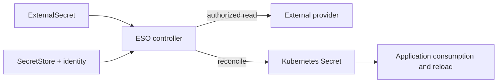
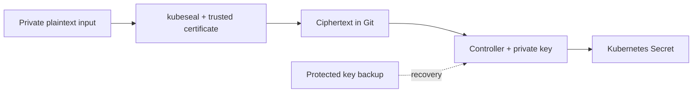

# Gestión de Secrets

> **Última actualización**: 13 de septiembre de 2026

Este capítulo explica las responsabilidades y los requisitos de integración de los Secrets nativos, ESO, los almacenes de AWS, Sealed Secrets, Vault y SOPS. Utilice los [archivos de ejemplo completos](https://github.com/Atom-oh/kubernetes-docs/tree/main/examples/security/secrets-management). En la revisión documentada no se instalaron componentes en un clúster ni en AWS, ni se rotaron credenciales reales.

## Índice

- [Secrets nativos de Kubernetes](#kubernetes-native-secrets)
- [Límites de cifrado, actualizaciones y auditoría](#encryption-updates-and-audit-boundaries)
- [External Secrets Operator (ESO)](#external-secrets-operator-eso)
- [PushSecret (sincronización inversa)](#pushsecret-reverse-sync)
- [Integración de AWS Secrets Manager](#aws-secrets-manager-integration)
- [Integración de AWS Systems Manager Parameter Store](#aws-systems-manager-parameter-store-integration)
- [Sealed Secrets](#sealed-secrets)
- [Integración de HashiCorp Vault](#hashicorp-vault-integration)
- [Vault CSI Driver y Argo CD Vault Plugin](#vault-csi-driver-and-argo-cd-vault-plugin)
- [SOPS (Secrets OPerationS)](#sops-secrets-operations)
- [EKS Pod Identity e IRSA](#eks-pod-identity-and-irsa)
- [Comparación de herramientas](#tool-comparison)
- [Prácticas recomendadas](#best-practices)
- [Resumen](#summary)
- [Referencias](#references)

## Secrets nativos de Kubernetes {#kubernetes-native-secrets}

### Descripción general de Secret

Un Secret es un objeto de la API con controles de acceso y reglas de almacenamiento y uso. Su representación JSON/YAML en `data` utiliza Base64: codificar no equivale a cifrar. `stringData` admite texto sin cifrar que se incorpora a `data`; no ofrece una protección mayor y no funciona bien con server-side apply. Evite incluir credenciales reales en manifiestos versionados, en el historial del shell o en los registros.

### Tipos de Secret

| Tipo | Propósito |
|---|---|
| `Opaque` | Valores definidos por la aplicación |
| `kubernetes.io/service-account-token` | Token heredado de larga duración creado explícitamente; prefiera TokenRequest/tokens proyectados de corta duración |
| `kubernetes.io/dockerconfigjson` | Credenciales de registro |
| `kubernetes.io/basic-auth` / `kubernetes.io/ssh-auth` | Datos de autenticación básica o SSH |
| `kubernetes.io/tls` | Certificado y clave privada |

### Creación de Secrets

Utilice archivos protegidos y especifique el namespace. Sustituya las rutas por archivos obtenidos mediante el procedimiento de gestión de credenciales aprobado. Estos comandos no muestran el Secret resultante, pero quien los ejecuta necesita los permisos adecuados en Kubernetes.

```bash
kubectl -n production create secret generic db-credentials   --from-file=username=/secure/input/username   --from-file=password=/secure/input/password   --from-file=host=/secure/input/host
kubectl -n production create secret generic ssh-key   --type=kubernetes.io/ssh-auth   --from-file=ssh-privatekey=/secure/input/id_rsa
kubectl -n production create secret tls app-tls   --cert=/secure/input/tls.crt --key=/secure/input/tls.key
kubectl -n production create secret generic regcred   --type=kubernetes.io/dockerconfigjson   --from-file=.dockerconfigjson=/secure/input/docker-config.json
```

Las opciones con valores literales resultan cómodas para **datos de prueba no sensibles**. Sin embargo, las contraseñas reales incluidas como argumentos pueden quedar en el historial o ser visibles al inspeccionar los procesos.

### Uso de Secrets

`secretKeyRef` selecciona una clave y `envFrom.secretRef` importa todas las claves. Las variables de entorno no cambian en un contenedor que ya está en ejecución. Los volúmenes de Secret montados suelen recibir las actualizaciones después de un tiempo, pero los montajes `subPath` no las reciben. La aplicación debe volver a abrir o recargar los archivos cuando corresponda; sincronizar los datos no recarga la aplicación.

El siguiente manifiesto permite que el grupo de una aplicación ejecutada sin root lea los archivos. La imagen indicada es un marcador que debe sustituirse; no se ejecutó durante la revisión documentada. El ServiceAccount de la aplicación no necesita permiso `get` sobre Secrets solo para leer un Secret montado, porque kubelet realiza el montaje. Aun así, poder crear Pods puede dar acceso indirecto a los Secrets del namespace.

```yaml
# Replace the image with a reviewed application that reads /etc/app-secrets.
# This Pod is a manifest example; it was not started.
apiVersion: v1
kind: Pod
metadata:
  name: secret-file-consumer
  namespace: production
spec:
  automountServiceAccountToken: false
  securityContext:
    runAsNonRoot: true
    runAsUser: 10001
    runAsGroup: 10001
    fsGroup: 10001
    seccompProfile:
      type: RuntimeDefault
  containers:
    - name: app
      image: registry.example.com/team/app:replace-with-reviewed-tag
      securityContext:
        allowPrivilegeEscalation: false
        readOnlyRootFilesystem: true
        capabilities:
          drop: [ALL]
      volumeMounts:
        - name: secrets
          mountPath: /etc/app-secrets
          readOnly: true
  volumes:
    - name: secrets
      secret:
        secretName: db-credentials
        defaultMode: 0440
        items:
          - key: username
            path: username
          - key: password
            path: password
          - key: host
            path: host
```

## Límites de cifrado, actualizaciones y auditoría {#encryption-updates-and-audit-boundaries}

### Limitaciones de Secrets

- En Kubernetes autogestionado, debe configurar adecuadamente el cifrado en reposo. **EKS 1.28+ cifra de forma predeterminada todos los datos de la API de Kubernetes mediante cifrado de envolvente con una clave KMS propiedad de AWS**; también permite utilizar una clave administrada por el cliente.
- El cifrado en reposo no impide el acceso de un lector autorizado de la API, de una aplicación comprometida ni de una identidad autorizada para crear un Pod que consuma el Secret.
- `immutable: true` fija los **datos** del Secret, pero no todos sus metadatos, y no puede revertirse para permitir modificaciones. Utilice otro nombre de Secret y despliegue el cambio de forma controlada, en lugar de eliminar una dependencia en uso.
- Rotar las credenciales en el proveedor, actualizar el Secret, propagar los archivos y recargar la aplicación son operaciones distintas.
- La auditoría de la API puede registrar el acceso a Secrets. Proteja sus destinos y evite registrar el contenido de las solicitudes y respuestas de Secret. Leer un archivo montado no genera un evento de auditoría de la API por cada lectura de la aplicación.

### Configuración de cifrado de etcd

El archivo `EncryptionConfiguration` corresponde a un **servidor de API autogestionado**; no puede instalarlo en el plano de control administrado de EKS. Si configura varios proveedores, el primero cifra las nuevas escrituras y los posteriores permiten descifrar los datos existentes. `identity` permite leer datos sin cifrar. Evite colocarlo primero por error, porque las nuevas escrituras quedarían sin cifrar.

Para integrar KMS v2 en un clúster autogestionado, configure el socket real del plugin, su disponibilidad y el ciclo de vida de las claves según la documentación de Kubernetes. El ejemplo anterior mezclaba AES-CBC, una caché propia de KMS v1 y una etiqueta de EKS; no constituía un procedimiento de instalación para EKS. Activar el cifrado no vuelve a escribir automáticamente todos los objetos ya almacenados. Siga un procedimiento de copia de seguridad, migración y verificación.


## External Secrets Operator (ESO) {#external-secrets-operator-eso}

### Descripción general de ESO

ESO sincroniza valores externos con Secrets de Kubernetes. Los recursos Store describen cómo acceder al proveedor; el controlador realiza las llamadas. Un SecretStore no es un proxy que se ejecute de forma independiente.



### Instalación de ESO

La versión de referencia fijada para el chart y la aplicación es **2.10.0**. El requisito de versión de Kubernetes declarado en Helm no demuestra la compatibilidad de todas las combinaciones de EKS y sus complementos.

```bash
helm repo add external-secrets https://charts.external-secrets.io
helm repo update external-secrets
helm upgrade --install external-secrets external-secrets/external-secrets   --version 2.10.0 --namespace external-secrets --create-namespace   --values eso-values.yaml
```

Los valores suministrados desactivan de forma predeterminada la reconciliación de PushSecret. El RBAC del chart concede permisos al controlador. Limitar los stores a namespaces no convierte, por sí solo, un controlador que abarca todo el clúster en una barrera de aislamiento entre inquilinos.

### Configuración de SecretStore

El conjunto completo de recursos siguiente utiliza IRSA. Cree primero el rol de IAM y su política de confianza. El ServiceAccount referenciado está en **production**, en el mismo namespace que el SecretStore. En un ClusterSecretStore debe indicar explícitamente el namespace en `serviceAccountRef` y restringir qué namespaces pueden utilizar el store compartido.

### Definición de ExternalSecret

Los ejemplos actuales de SecretStore y ExternalSecret utilizan `external-secrets.io/v1`. La política de actualización predeterminada es `Periodic`: un `refreshInterval` positivo programa la reconciliación, pero los errores del proveedor y los reintentos con espera impiden garantizar un plazo de entrega. `OnChange` y `CreatedOnce` se activan por causas distintas. `creationPolicy: Owner` afecta a las referencias de propietario de Kubernetes. `deletionPolicy: Retain` determina cómo se trata la eliminación en el proveedor; no protege frente a cualquier eliminación del ExternalSecret.

Seleccionar explícitamente las claves reduce la exposición accidental. `dataFrom.extract` permite importar todas las propiedades cuando ese sea el objetivo. Las plantillas deben aplicar el escape adecuado a los valores estructurados: insertar directamente una contraseña en una URL de PostgreSQL puede romper su sintaxis. Es preferible utilizar campos separados y dejar que la aplicación construya la conexión.

```yaml
apiVersion: v1
kind: Namespace
metadata:
  name: production
---
apiVersion: v1
kind: ServiceAccount
metadata:
  name: external-secrets-reader
  namespace: production
  annotations:
    eks.amazonaws.com/role-arn: arn:aws:iam::123456789012:role/production-secret-reader
---
apiVersion: external-secrets.io/v1
kind: SecretStore
metadata:
  name: aws-secretsmanager
  namespace: production
spec:
  provider:
    aws:
      service: SecretsManager
      region: ap-northeast-2
      auth:
        jwt:
          serviceAccountRef:
            name: external-secrets-reader
---
apiVersion: external-secrets.io/v1
kind: ExternalSecret
metadata:
  name: database-credentials
  namespace: production
spec:
  refreshPolicy: Periodic
  refreshInterval: 1h
  secretStoreRef:
    name: aws-secretsmanager
    kind: SecretStore
  target:
    name: db-credentials
    creationPolicy: Owner
    deletionPolicy: Retain
  data:
    - secretKey: username
      remoteRef:
        key: production/database
        property: username
    - secretKey: password
      remoteRef:
        key: production/database
        property: password
    - secretKey: host
      remoteRef:
        key: production/database
        property: host
```

## PushSecret (sincronización inversa) {#pushsecret-reverse-sync}

PushSecret permite escribir en el proveedor a partir de datos locales; es una función independiente del ejemplo de solo lectura anterior. En la versión **2.10.0**, su API sigue siendo `external-secrets.io/v1alpha1`. Compruebe el CRD instalado antes de cambiar todos los recursos de ESO a v1.

Antes de activarlo, utilice una identidad de escritura independiente y defina las claves remotas permitidas, `updatePolicy` y `deletionPolicy`. De lo contrario, una escritura local en Kubernetes podría sobrescribir una credencial utilizada por otros sistemas. Evite sincronizar en ambos sentidos la misma clave, porque puede producirse un bucle. Los permisos de lectura del store no conceden permiso para escribir en el proveedor.


## Integración de AWS Secrets Manager {#aws-secrets-manager-integration}

### Configuración de IRSA

El archivo `irsa-trust.json` vincula el emisor OIDC exacto del clúster, `aud` y el valor subject `system:serviceaccount:production:external-secrets-reader`. Sustituya la cuenta y el ID OIDC del ejemplo y cree el proveedor OIDC de IAM antes de utilizarlo.

`aws-reader-policy.json` permite leer un secreto concreto de Secrets Manager y un parámetro concreto de SSM. Los seis caracteres `?` corresponden al sufijo que el servicio añade al ARN del secreto; utilice el ARN real cuando lo tenga. La política no concede `ListSecrets`, búsquedas con comodines, escritura de credenciales ni rotación. Para una clave KMS administrada por el cliente, se necesitan permisos de descifrado debidamente restringidos **y** una política de la clave KMS compatible.

### Creación de Secrets en AWS Secrets Manager

Guarde los datos de las credenciales en archivos privados. Las siguientes operaciones son ejemplos para el operador; no se ejecutaron en AWS durante la revisión documentada:

```bash
aws secretsmanager create-secret --region ap-northeast-2   --name production/database --secret-string file:///secure/input/database.json
aws secretsmanager put-secret-value --region ap-northeast-2   --secret-id production/database --secret-string file:///secure/input/database-next.json
```

Actualizar la contraseña almacenada no cambia por sí solo la contraseña de la base de datos. Secrets Manager admite integraciones de rotación administrada y rotación mediante Lambda. Esta última requiere una función de rotación compatible, permisos, conectividad de red y lógica para actualizar la credencial de destino. Incluir un ARN y una programación de 30 días en un comando no configura todo ese proceso.

### Ejemplo completo de AWS ESO

Utilice el conjunto de recursos anterior con las políticas de confianza y lectura correspondientes. Espere a que SecretStore y ExternalSecret estén listos, sin mostrar los valores resultantes:

```bash
kubectl -n production wait secretstore/aws-secretsmanager   --for=condition=Ready --timeout=120s
kubectl -n production wait externalsecret/database-credentials   --for=condition=Ready --timeout=120s
```

Que la sincronización inicial termine correctamente no demuestra que funcionarán las rotaciones y recargas posteriores. Compruebe la versión del proveedor, el estado de reconciliación y la autenticación de la aplicación mediante una prueba aprobada. La aplicación que consume un Secret nativo no necesita heredar el rol de ESO.

```json
{
  "Version": "2012-10-17",
  "Statement": [
    {
      "Sid": "ReadOneSecret",
      "Effect": "Allow",
      "Action": ["secretsmanager:GetSecretValue", "secretsmanager:DescribeSecret"],
      "Resource": "arn:aws:secretsmanager:ap-northeast-2:123456789012:secret:production/database-??????",
      "Condition": {"StringEquals": {"aws:RequestedRegion": "ap-northeast-2"}}
    },
    {
      "Sid": "ReadOneParameter",
      "Effect": "Allow",
      "Action": ["ssm:GetParameter", "ssm:GetParameters"],
      "Resource": "arn:aws:ssm:ap-northeast-2:123456789012:parameter/production/api/key",
      "Condition": {"StringEquals": {"aws:RequestedRegion": "ap-northeast-2"}}
    }
  ]
}
```

## Integración de AWS Systems Manager Parameter Store {#aws-systems-manager-parameter-store-integration}

### Configuración de Parameter Store

Utilice `SecureString` y la clave KMS elegida. Pasar a la CLI un archivo privado mediante `--cli-input-json file:///secure/input/parameter.json` evita incluir el valor en los argumentos. El archivo debe contener los valores reales de `Name`, `Value` y `Type`, junto con las opciones de sobrescritura y clave previstas. No utilice `get-parameter --with-decryption` para comprobar el estado de forma habitual: devuelve el valor sin cifrar.

Los permisos de KMS son distintos para la clave administrada por AWS `aws/ssm` y para una clave administrada por el cliente. Deben ser coherentes la autorización de Parameter Store, la de KMS y la jerarquía de rutas. Permitir lecturas recursivas sobre una ruta amplia puede exponer los parámetros que contiene.

### Configuración de ESO Parameter Store

El ejemplo reutiliza el ServiceAccount creado explícitamente en production. La política de lectura incluye el parámetro indicado. Tener permisos de Secrets Manager no concede por sí solo acceso a SSM.

```yaml
apiVersion: external-secrets.io/v1
kind: SecretStore
metadata:
  name: aws-parameter-store
  namespace: production
spec:
  provider:
    aws:
      service: ParameterStore
      region: ap-northeast-2
      auth:
        jwt:
          serviceAccountRef:
            name: external-secrets-reader
---
apiVersion: external-secrets.io/v1
kind: ExternalSecret
metadata:
  name: ssm-parameters
  namespace: production
spec:
  refreshPolicy: Periodic
  refreshInterval: 1h
  secretStoreRef:
    name: aws-parameter-store
    kind: SecretStore
  target:
    name: app-config
    creationPolicy: Owner
    deletionPolicy: Retain
  data:
    - secretKey: api-key
      remoteRef:
        key: /production/api/key
```

## Sealed Secrets {#sealed-secrets}

### Descripción general de Sealed Secrets

El certificado público permite cifrar. Cualquier persona que disponga de la clave privada correspondiente puede descifrar, incluido un operador autorizado de copias de seguridad o recuperación; esa capacidad no es exclusiva del controlador. Los nombres y otros metadatos siguen siendo visibles. Si se compromete una clave antigua, también puede quedar expuesto el contenido cifrado conservado en el historial de Git.



### Instalación de Sealed Secrets

Utilice el chart **2.20.0** y el controlador y la CLI **0.40.0**. Durante la revisión documentada, el índice antiguo `bitnami-labs.github.io/sealed-secrets` devolvió 404.

```bash
helm repo add sealed-secrets https://bitnami.github.io/sealed-secrets
helm repo update sealed-secrets
helm upgrade --install sealed-secrets sealed-secrets/sealed-secrets   --version 2.20.0 --namespace kube-system   --set-string fullnameOverride=sealed-secrets-controller
```

Elija la versión de la CLI correspondiente al sistema operativo y la arquitectura, y verifique su suma de comprobación publicada antes de instalarla. En la revisión documentada se probó localmente el comportamiento de la CLI y de la criptografía en Linux arm64.

### Creación de SealedSecrets

Obtenga el certificado del contexto autenticado del clúster previsto y verifique su procedencia. Cifrar con un certificado sustituido por uno perteneciente a un atacante no protege los datos frente a ese atacante.

```bash
kubeseal --fetch-cert --controller-name=sealed-secrets-controller   --controller-namespace=kube-system > sealed-secrets-pub.pem
kubectl -n production create secret generic app-sealed   --from-file=password=/secure/input/password --dry-run=client -o json   | kubeseal --cert sealed-secrets-pub.pem --scope strict --format yaml   > sealed-secret.yaml
```

Ejecute las cadenas de comandos con `set -o pipefail`. Escriba el resultado en un archivo temporal privado antes de reemplazar el artefacto de confianza y compruebe que la operación terminó correctamente antes de incorporarlo a Git.

### YAML de SealedSecret

Utilice el SealedSecret real generado con `bitnami.com/v1alpha1`. Las cadenas que terminan en `...` son ejemplos ilustrativos y no pueden descifrarse. Mantenga coherentes los nombres y namespaces de los metadatos y de la plantilla.

### Configuración de ámbito

`strict` vincula el contenido al namespace y al nombre. `namespace-wide` permite cambiar el nombre dentro del mismo namespace, y `cluster-wide` permite utilizarlo en otros namespaces. Amplíe el ámbito solo cuando quiera permitir ese acceso. Cada comando de cifrado debe recibir el certificado, la entrada y la salida: `kubeseal --scope` por sí solo no completa el proceso.

### Rotación de claves

Las claves de sellado se renuevan según la programación del controlador, cada 30 días de forma predeterminada; las anteriores se conservan para descifrar. Esto no rota la contraseña de la aplicación. Proteja las copias de **todas las claves de sellado históricas necesarias**, con permisos de archivo restringidos y almacenamiento fuera de Git. `kubeseal --re-encrypt` utiliza el controlador y la clave actual. Volver a cifrar no borra el contenido cifrado antiguo del historial de Git ni revoca una credencial que ya se haya filtrado. Pruebe la recuperación antes de depender de una copia de seguridad.


## Integración de HashiCorp Vault {#hashicorp-vault-integration}

### Arquitectura de Vault

Los motores de secretos, la autenticación y los dispositivos de auditoría de Vault son funciones independientes. Agent Injector, el proveedor de Vault para CSI y Argo CD Vault Plugin acceden a Vault con identidades y mecanismos de entrega distintos. AVP genera manifiestos en el repo-server de Argo CD; no monta Secrets en los Pods durante la ejecución.

### Instalación de Vault (Helm)

El chart **0.34.1** utiliza Vault 2.0.4 de forma predeterminada. Este ejemplo fija explícitamente la versión **2.1.0** tanto para la imagen del servidor como para la del Agent inyectado. También activa TLS, en lugar de conservar la configuración de desarrollo del chart, que lo desactiva.

```bash
helm repo add hashicorp https://helm.releases.hashicorp.com
helm repo update hashicorp
helm upgrade --install vault hashicorp/vault --version 0.34.1   --namespace vault --create-namespace --values vault-values.yaml
```

Los valores constituyen una **configuración de referencia para generar y revisar manifiestos**; todavía faltan los requisitos de una instalación lista para producción. Antes de utilizarla, prepare `vault-server-tls` con clave, certificado y CA, y SAN que coincidan con los endpoints de Service y Pod; una StorageClass gp3 funcional; la ubicación y los recursos; el acceso de red; la inicialización y el desbloqueo (unseal); la incorporación a Raft; y las copias de seguridad y la recuperación. Tener tres Pods no demuestra que exista un quórum funcional de tres miembros. `auditStorage` solo monta almacenamiento: configure por separado un dispositivo de auditoría de Vault.

El modo de desarrollo facilita la inicialización y el desbloqueo, y debe limitarse a una prueba local aislada. En la revisión documentada se utilizó dev-TLS en la interfaz loopback únicamente para probar la generación de plantillas JSON; no se validaron la alta disponibilidad ni la autenticación de Kubernetes.

### Configuración de autenticación de Kubernetes

Cuando Vault se ejecuta en Kubernetes, las versiones compatibles pueden volver a leer el token local proyectado que utilizan para TokenReview. No copie un token de corta duración en `token_reviewer_jwt` suponiendo que se renovará indefinidamente. El ServiceAccount de Vault necesita los permisos de TokenReview previstos, habitualmente mediante la vinculación revisada `system:auth-delegator`.

Cree una política limitada a la ruta exacta, vincule `production/app-sa` y utilice `audience=vault` con el token proyectado del ejemplo. Configure el servidor de API real y la CA de confianza. Debe habilitar previamente el montaje KV v2, introducir los datos en su ruta y autenticar al operador; el ejemplo no realiza estos pasos automáticamente.

```hcl
path "secret/data/production/config" {
  capabilities = ["read"]
}
```

### Vault Agent Injector

Genere JSON estructurado en lugar de instrucciones `export` del shell. Una contraseña con comillas, saltos de línea o `$()` debe tratarse como un dato. Además, `/bin/sh` no siempre admite el comando `source`. El ejemplo utiliza para Agent un token con una audiencia específica y no proporciona a la aplicación el token predeterminado de la API.

La aplicación debe interpretar `/vault/secrets/config.json` y volver a cargarlo cuando corresponda. Generar un archivo con valores KV estáticos actualizados no recarga automáticamente la aplicación. Las concesiones dinámicas (leases) tienen sus propios plazos de renovación y vencimiento.

```yaml
# Requires a configured Vault Kubernetes auth role, KV v2 path and trusted CA.
# The application must parse JSON and reopen the file on refresh.
apiVersion: v1
kind: ServiceAccount
metadata:
  name: app-sa
  namespace: production
---
apiVersion: apps/v1
kind: Deployment
metadata:
  name: secret-json-consumer
  namespace: production
spec:
  replicas: 1
  selector:
    matchLabels:
      app: secret-json-consumer
  template:
    metadata:
      labels:
        app: secret-json-consumer
      annotations:
        vault.hashicorp.com/agent-inject: "true"
        vault.hashicorp.com/role: app-role
        vault.hashicorp.com/agent-service-account-token-volume-name: vault-token
        vault.hashicorp.com/tls-secret: vault-client-ca
        vault.hashicorp.com/ca-cert: /vault/tls/ca.crt
        vault.hashicorp.com/agent-inject-secret-config.json: secret/data/production/config
        vault.hashicorp.com/agent-inject-template-config.json: |
          {{- with secret "secret/data/production/config" -}}
          {{ .Data.data | toJSON }}
          {{- end }}
    spec:
      serviceAccountName: app-sa
      automountServiceAccountToken: false
      volumes:
        - name: vault-token
          projected:
            sources:
              - serviceAccountToken:
                  path: token
                  audience: vault
                  expirationSeconds: 3600
      containers:
        - name: app
          image: registry.example.com/team/app:replace-with-reviewed-tag
```

## Vault CSI Driver y Argo CD Vault Plugin {#vault-csi-driver-and-argo-cd-vault-plugin}

### Vault CSI Driver

Instale tanto Secrets Store CSI Driver como el proveedor de Vault. Activar únicamente la opción `csi` del chart de Vault no instala todas las dependencias. El proveedor utiliza una SecretProviderClass y la identidad del Pod que consume los datos.

Use HTTPS con una CA de confianza. `vaultCACertPath` es una ruta de archivo **dentro del Pod del
proveedor**, por lo que debe montar la CA allí; una ruta que existe solo en el Pod de aplicación no
es suficiente. Configure de forma coherente `audience`, el montaje de autenticación y el rol. No
omita la verificación TLS para hacer funcionar un ejemplo.

La sincronización opcional mediante `secretObjects` requiere activar esa función en el driver y disponer de un Pod que monte el volumen. Para la rotación también se necesitan la función correspondiente del driver y una estrategia de recarga de la aplicación. Las variables de entorno obtenidas del Secret sincronizado siguen sin actualizarse en los contenedores en ejecución. AWS ASCP/CSI es otra opción: evalúe por separado las plataformas e identidades que admite.

### ArgoCD Vault Plugin (AVP)

El mecanismo antiguo `argocd-cm.configManagementPlugins` está obsoleto en las versiones actuales de Argo CD. Configure un **sidecar CMP** en el repo-server y coloque `argocd-plugin.yaml` en `/home/argocd/cmp-server/config/plugin.yaml` dentro de ese sidecar. El documento utiliza el formato de ConfigManagementPlugin, pero **no es un CRD de Kubernetes**.

La imagen debe incluir AVP **1.18.1** y sus dependencias. Para seleccionar esa versión del plugin, indique `argocd-vault-plugin-v1.18.1` en la fuente de la Application. Configure la autenticación en Vault y la CA del sidecar, el descubrimiento o la selección explícita del plugin, los sockets compartidos y un directorio temporal aislado conforme a la guía de Argo CD.

AVP resuelve marcadores como `<password>` al generar los manifiestos. Los valores descifrados pasan por la generación, la caché y la API de Argo CD. Restrinja el acceso a repositorios y aplicaciones y evite que los mensajes de depuración expongan los manifiestos.


## SOPS (Secrets OPerationS) {#sops-secrets-operations}

### Descripción general de SOPS

SOPS cifra los valores de los archivos con claves de datos protegidas por las identidades age, PGP o KMS configuradas. Tener acceso a Git no concede el derecho a descifrar. Las versiones probadas en la revisión documentada son **SOPS 3.13.3 / age 1.3.2**.

### Instalación y configuración de SOPS

Instale binarios cuya suma de comprobación haya verificado para su sistema operativo y arquitectura. Genere la identidad de age fuera del repositorio, con permisos restrictivos, y copie únicamente su destinatario público en `.sops.yaml`. No incluya `AGE-SECRET-KEY-...` en Git.

```bash
umask 077
age-keygen -o /secure/keys/docs-age.key
age-keygen -y /secure/keys/docs-age.key
```

Para un YAML de Kubernetes, `encrypted_regex: '^(data|stringData)$'` conserva los metadatos del recurso. Las reglas de creación utilizan la **primera regla cuya ruta coincide**. La clave de configuración es `kms`, no `aws_kms`. Elija patrones que no se solapen y pruebe la ruta de entrada que recibe SOPS, no solo el nombre del archivo al que redirige la salida.

Copie `sops-config.example.yaml` a `.sops.yaml`, reemplace su destinatario público y use esa
configuración explícitamente cuando se ejecute fuera de su directorio.

```yaml
# Copy to .sops.yaml and replace the public age recipient before encryption.
# The private age identity stays outside the repository.
creation_rules:
  - path_regex: '(^|/)app-secret(\.enc)?\.yaml$'
    encrypted_regex: '^(data|stringData)$'
    age: REPLACE_WITH_YOUR_PUBLIC_AGE_RECIPIENT
```

### Cifrado de Secrets con SOPS

Después de configurar el destinatario, cifre un archivo de entrada protegido y compruebe localmente que puede recuperar el contenido mediante descifrado, sin mostrar los valores:

```bash
sops encrypt /secure/input/app-secret.yaml > app-secret.enc.yaml
SOPS_AGE_KEY_FILE=/secure/keys/docs-age.key   sops decrypt app-secret.enc.yaml > /secure/output/app-secret.yaml
SOPS_AGE_KEY_FILE=/secure/keys/docs-age.key sops edit app-secret.enc.yaml
```

`SOPS_AGE_KEY_FILE` contiene una ruta, no la clave privada. Restrinja los permisos y escriba las salidas de forma atómica; de lo contrario, un fallo del comando puede dejar el archivo de destino incompleto. Proteja también los archivos temporales y las copias de seguridad del editor.

### Formato de archivo cifrado

Conserve los metadatos `sops` y el MAC generados. Las formas abreviadas `ENC[...data:...]` no constituyen archivos válidos para desplegar. Compruebe que los valores estén cifrados y que los metadatos previstos sigan siendo legibles. El descifrado debe validar la integridad: no desactive la comprobación del MAC para ignorar una corrupción.

### Integración de FluxCD SOPS

Prepare el Secret `flux-system/sops-age` a partir del archivo de identidad privada; el nombre de la clave debe terminar en `.agekey`. La Kustomization siguiente referencia ese Secret y un GitRepository ya configurado. Los permisos de Kubernetes y RBAC y la autorización de Flux para descifrar siguen delimitando quién puede acceder a los datos.

```yaml
# Create flux-system/sops-age from a private age.agekey file separately.
# Never put an actual AGE-SECRET-KEY value in a tracked manifest.
apiVersion: kustomize.toolkit.fluxcd.io/v1
kind: Kustomization
metadata:
  name: app
  namespace: flux-system
spec:
  interval: 10m
  path: ./k8s
  prune: true
  sourceRef:
    kind: GitRepository
    name: my-repo
  decryption:
    provider: sops
    secretRef:
      name: sops-age
```

### AWS KMS con SOPS

Utilice ARN válidos de claves KMS y políticas de identidad y de clave con permisos restringidos. Varios destinatarios suelen ofrecer formas alternativas de descifrar; no exigen automáticamente la autorización de todas las claves. Los grupos de claves con umbral son una función independiente. `sops updatekeys` cambia los destinatarios y `sops rotate` rota la clave de datos del archivo. Ninguno cambia la credencial de la aplicación o de la base de datos almacenada en él.


## EKS Pod Identity e IRSA {#eks-pod-identity-and-irsa}

### IRSA (IAM Roles for Service Accounts)

IRSA utiliza el proveedor OIDC del clúster y una política de confianza del rol. El SDK intercambia el token proyectado por **credenciales temporales de AWS**; las llamadas siguen utilizando credenciales. Use un SDK compatible y su cadena de credenciales predeterminada, y vincule el namespace y el ServiceAccount exactos. Las credenciales de variables de entorno o las estáticas pueden tener prioridad.

### EKS Pod Identity (nueva)

Pod Identity requiere la entidad principal de servicio `pods.eks.amazonaws.com`, los permisos `sts:AssumeRole`/`sts:TagSession`, un SDK y una plataforma compatibles y una asociación. Usted sigue siendo responsable de administrar los roles de IAM. EKS Auto Mode ya integra el agente; compruebe esto antes de instalar otro. Verifique la compatibilidad vigente de Fargate, Windows, los nodos híbridos y las demás plataformas antes de elegir Pod Identity.

Para ESO, asocie al rol el ServiceAccount del **controlador**. `SecretStore.auth.jwt.serviceAccountRef` no permite asumir la identidad de otro ServiceAccount asociado a Pod Identity. Por eso, el store alternativo siguiente omite `auth`. No lo combine con el ejemplo de IRSA esperando conservar la misma separación de identidades por store.

### Comparación de IRSA y Pod Identity

| Aspecto | IRSA | EKS Pod Identity |
|---|---|---|
| Confianza | Emisor OIDC del clúster, audiencia y valor subject | Entidad principal de servicio EKS y condiciones o etiquetas de sesión configuradas |
| Vinculación | Anotación del ServiceAccount | Asociación de EKS para el clúster, namespace y ServiceAccount exactos |
| Credenciales | Credenciales temporales de STS | Credenciales temporales entregadas mediante el agente y el SDK compatibles |
| Selección | Compatibilidad de la plataforma y modelo de confianza y operación existente | Compatibilidad de la plataforma, asociaciones y modelo de operación |

Que el clúster sea más reciente o más antiguo no basta, por sí solo, para elegir una opción.

```yaml
# Alternative to IRSA. Associate the actual ESO controller ServiceAccount
# external-secrets/external-secrets-controller with a constrained Pod Identity role.
# This store intentionally has no auth.jwt.serviceAccountRef.
apiVersion: external-secrets.io/v1
kind: SecretStore
metadata:
  name: aws-controller-identity
  namespace: production
spec:
  provider:
    aws:
      service: SecretsManager
      region: ap-northeast-2
```

## Comparación de herramientas {#tool-comparison}

### Tabla de comparación de herramientas de gestión de Secrets

| Herramienta | Responsabilidad | Limitación principal |
|---|---|---|
| Secret nativo | Objeto con el que Kubernetes entrega los datos | Proteger la API, RBAC, el almacenamiento y el uso por la aplicación |
| ESO | Sincronizar valores externos con Secrets | Sincronizar no rota las credenciales del proveedor ni recarga la aplicación |
| Sealed Secrets | Cifrar con clave pública para guardar en Git | Proteger las claves privadas y sus copias; renovarlas no rota las credenciales |
| Vault | Motores de secretos, identidad, leases y auditoría configurada | Administrar TLS, almacenamiento y quórum, unseal, políticas y dispositivos de auditoría |
| SOPS | Cifrar archivos y gestionar destinatarios y claves de datos | Proteger las identidades que descifran y el procesamiento de datos sin cifrar |

### Recomendaciones por caso de uso

Elija según el origen autorizado de los datos, las necesidades de rotación y recarga, las plataformas compatibles, la capacidad operativa del equipo, la recuperación ante desastres y el coste. Git puede contener referencias de ESO sin los valores, o contenido cifrado mediante SealedSecret o SOPS. Ninguna herramienta garantiza por sí sola el cumplimiento normativo ni hace que todos los usos queden auditados automáticamente.


## Prácticas recomendadas {#best-practices}

### 1. Creación y almacenamiento de Secrets

Mantenga los valores reales y las claves privadas fuera de Git, de los argumentos de comandos y de la salida de compilación. Revise los artefactos cifrados para detectar texto sin cifrar introducido por error y destinatarios no previstos.

### 2. Principio de mínimo privilegio

Quien lea la API puede utilizar un Role limitado a `get` sobre Secrets concretos. Una aplicación no necesita ese Role solo para leer los archivos de su volumen montado. Restrinja también la creación de Pods, el acceso mediante exec o depuración, la administración de controladores y el acceso al proveedor externo. La separación por namespaces debe apoyarse en estos límites efectivos de autorización.

### 3. Rotación de Secret

Pruebe el proceso completo: cambie la credencial de destino, publique la versión en el proveedor, sincronice los datos, actualice los archivos o reinicie cuando sea necesario, recargue la aplicación, verifique la autenticación y revoque de forma segura la credencial anterior. Disponer de un temporizador no demuestra que todo el proceso funcione.

### 4. Auditoría y monitorización

Los eventos de llamadas al sistema de Falco no incluyen automáticamente los campos de auditoría de la API de Kubernetes. Para aplicar reglas de auditoría de Kubernetes, necesita una fuente o un plugin adecuados y un mecanismo de entrega de los eventos. El ejemplo antiguo con `kevt` y una lista con comodines no configuraba todo eso. Utilice un flujo de auditoría probado que defina las identidades permitidas, distinga los accesos rechazados de los correctos y proteja las salidas. Que una cadena termine en `*` dentro de una lista `in` no la convierte automáticamente en una coincidencia de prefijo. No considere que todos los ServiceAccounts de kube-system están autorizados a leer Secrets.

### 5. Separación de entornos

Separe desarrollo y producción mediante rutas distintas en el proveedor, roles con permisos restringidos, stores de namespace y responsables operativos. Cambiar únicamente el nombre de un recurso no proporciona aislamiento.

## Resumen {#summary}

Los Secrets nativos son objetos de entrega válidos para producción cuando se controlan su acceso, almacenamiento, uso y ciclo de vida. Los almacenes externos y las herramientas de cifrado resuelven necesidades adicionales, pero siguen siendo necesarias las medidas de seguridad de Kubernetes y de la aplicación.

### Recomendaciones clave

Defina el origen autorizado de los datos, aplique el mínimo privilegio, proteja las claves, verifique la recuperación y observe el proceso de rotación y recarga. Las pruebas de validación local y las pruebas de un despliegue en producción se documentan por separado.


## Referencias {#references}

- [Kubernetes Secrets](https://kubernetes.io/docs/concepts/configuration/secret/)
- [EKS default envelope encryption](https://docs.aws.amazon.com/eks/latest/userguide/envelope-encryption.html)
- [ESO AWS authentication](https://external-secrets.io/latest/provider/aws-access/)
- [ESO ExternalSecret refresh policies](https://external-secrets.io/latest/api/externalsecret/)
- [Sealed Secrets 0.40.0](https://github.com/bitnami/sealed-secrets/tree/v0.40.0)
- [Vault Kubernetes authentication](https://developer.hashicorp.com/vault/docs/auth/kubernetes)
- [Vault injector annotations](https://developer.hashicorp.com/vault/docs/deploy/kubernetes/injector/annotations)
- [Vault CSI configuration](https://developer.hashicorp.com/vault/docs/deploy/kubernetes/csi/configurations)
- [Argo CD CMP sidecars](https://argo-cd.readthedocs.io/en/stable/operator-manual/config-management-plugins/)
- [SOPS configuration](https://getsops.io/docs/usage/identities/config-file/)
- [Flux SOPS decryption](https://fluxcd.io/flux/components/kustomize/kustomizations/#decryption)
- [EKS Pod Identity](https://docs.aws.amazon.com/eks/latest/userguide/pod-identities.html)
