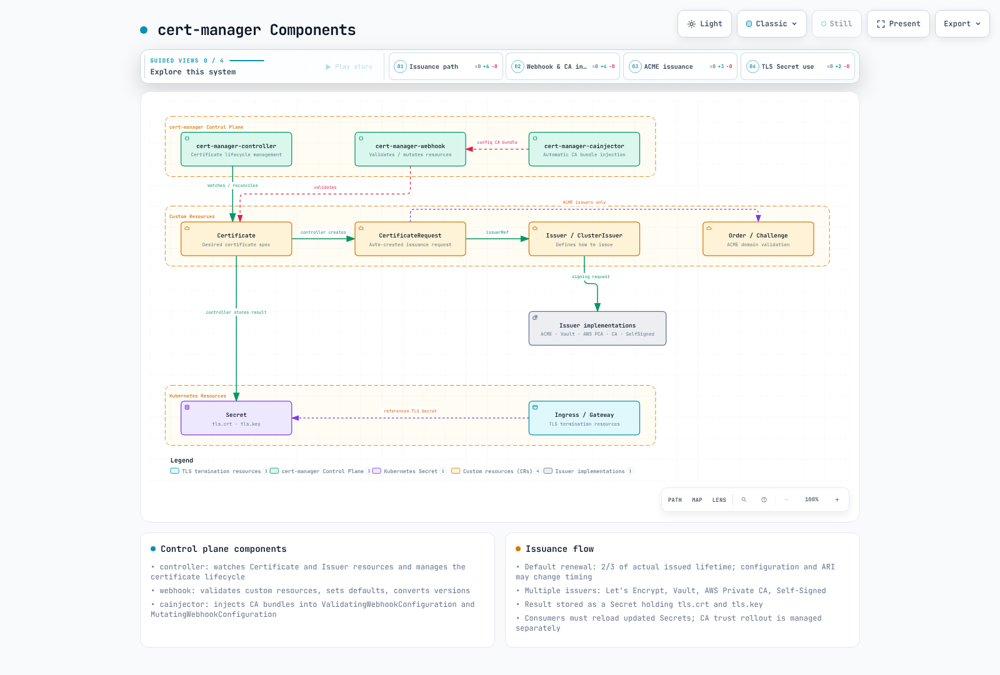
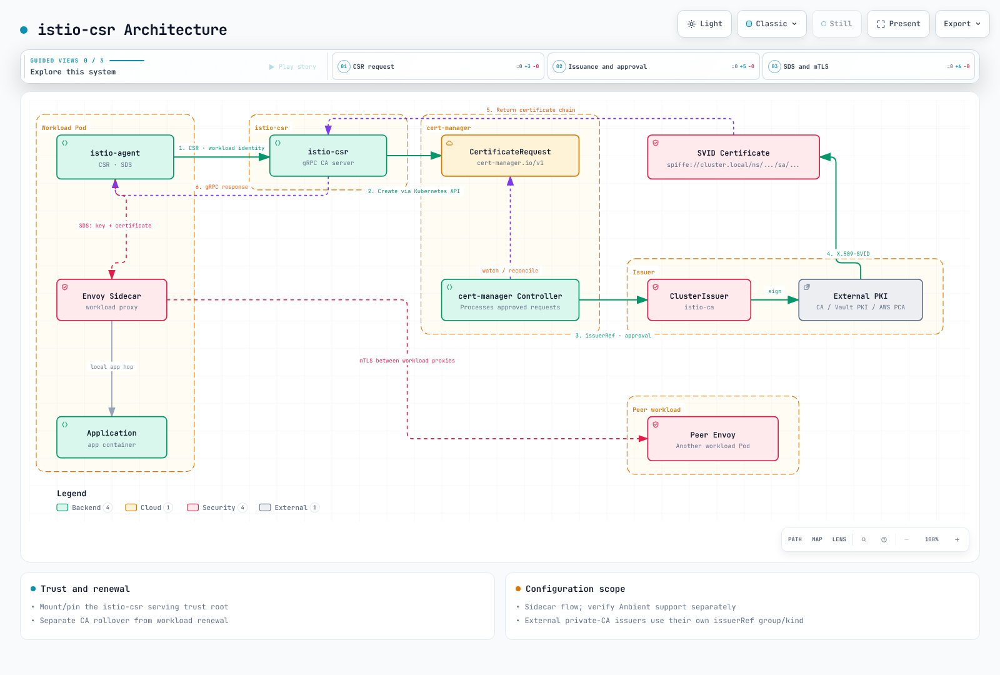

# Gestión de certificados con cert-manager

> **Última actualización**: October 12, 2026
> **Base de validación**: cert-manager 1.21.2, cmctl 2.5.0, trust-manager 0.25.0, istio-csr 0.17.0, aws-privateca-issuer 1.9.2, ACK ACM 1.8.1. El rango de Kubernetes compatible/probado publicado por cert-manager 1.21 es 1.33–1.36; Kubernetes 1.37 está fuera de ese rango, por lo que esta guía no afirma compatibilidad con él.

cert-manager administra la emisión y renovación de certificados como recursos de Kubernetes. **La distribución de confianza de CA, la recarga de aplicaciones, la revocación y las operaciones CRL/OCSP siguen siendo responsabilidades independientes.** Los ejemplos se verificaron con esquemas, configuración y bibliotecas locales; no son evidencia de emisión por una CA externa ni de despliegue de AWS/Kubernetes. Una prueba local efímera independiente de Vault 2.1.0 utilizó una CA sintética para dieciséis casos de aceptación/rechazo de emisión/firma de CSR.

<span id="what-cert-manager-solves"></span>
<span id="project-status"></span>
<span id="why-certificate-lifecycle-automation-matters"></span>
<span id="overview-1"></span>

## Descripción general

cert-manager se incorporó a CNCF el 10 de noviembre de 2020, pasó a Incubating el 19 de septiembre de 2022 y **Graduated el 29 de septiembre de 2024**. Graduated no garantiza la seguridad ni la disponibilidad de un despliegue concreto.

| Aspecto del ciclo de vida | Responsabilidad |
|---|---|
| Emisión | Autenticación del Issuer, aprobación del solicitante, política de SAN/uso/duración |
| Renovación | Duración realmente emitida, ARI/renewBefore, reintentos y alertas |
| Rotación de claves | Acceso a Secret, recarga del consumidor, orden de sustitución de CA |
| Confianza | Qué raíces/intermedios confía cada namespace/proceso |
| Revocación | Procedimiento de revocación de CA y publicación/consumo de CRL/OCSP |

No use la antigua tabla de instalación y compatibilidad 1.16.2 como guía de soporte actual. La versión 1.16 llegó a EOL en junio de 2025. Planifique las actualizaciones mediante las notas de versiones intermedias y los cambios de CRD.

<span id="component-overview"></span>
<span id="component-responsibilities"></span>
<span id="certificate-issuance-flow"></span>

## Arquitectura



[Ver diagrama interactivo](https://www.atomai.click/kubernetes-docs/archmaps/en-security-10-cert-manager-0.html)

El controller reconcilia Certificates y crea CertificateRequests; los controllers de Issuer gestionan la emisión. El webhook valida/asigna valores predeterminados/convierte recursos personalizados, y cainjector administra paquetes de CA en configuraciones de API/webhook compatibles. Los Issuers CA/SelfSigned no son necesariamente servicios externos.

<span id="prerequisites"></span>
<span id="installation-with-helm-recommended"></span>
<span id="production-helm-values"></span>
<span id="installation-with-kubectl"></span>
<span id="verify-installation"></span>

## Instalación

Compruebe las versiones compatibles de Kubernetes, los permisos de Helm/cluster, los CRD de Gateway API y un controller de Gateway real, y los CRD opcionales de Prometheus Operator. Si los CRD de Gateway API se instalan después del inicio del controller, compruebe los requisitos de reinicio/detección.

```bash
helm repo add jetstack https://charts.jetstack.io
helm repo update jetstack
helm upgrade --install cert-manager jetstack/cert-manager \
  --version v1.21.2 --namespace cert-manager --create-namespace \
  --values cert-manager-values.yaml
kubectl get pods -n cert-manager
cmctl check api
```

```yaml
crds:
  enabled: true
  keep: true
replicaCount: 2
podDisruptionBudget:
  enabled: true
  minAvailable: 1
config:
  apiVersion: controller.config.cert-manager.io/v1alpha1
  kind: ControllerConfiguration
  gatewayAPI:
    enabled: true
prometheus:
  enabled: true
  servicemonitor:
    enabled: true
webhook:
  replicaCount: 2
  timeoutSeconds: 10
  podDisruptionBudget:
    enabled: true
    minAvailable: 1
cainjector:
  replicaCount: 2
  podDisruptionBudget:
    enabled: true
    minAvailable: 1
```

Este perfil habilita ServiceMonitor y Gateway API, por lo que sus CRD/controllers ya deben existir. Deshabilite esas opciones para una instalación mínima sin estas dependencias. Las réplicas/PDB no sustituyen la distribución de nodos/AZ ni la conectividad de API. La configuración actual usa config.gatewayAPI.enabled; el campo más antiguo enableGatewayAPI sigue siendo aceptado, pero está en desuso en el decodificador 1.21.2.

Compruebe la retención de CRD y la propiedad real de la desinstalación. Eliminar un CRD puede eliminar sus recursos personalizados; no es un paso rutinario de resolución de problemas de actualización.

<span id="custom-resource-definitions-crds"></span>
<span id="certificate-resource"></span>
<span id="issuer-vs-clusterissuer"></span>
<span id="certificaterequest-resource"></span>

## Conceptos básicos


[Ver diagrama interactivo](https://www.atomai.click/kubernetes-docs/archmaps/en-security-10-cert-manager-1.html)

| Recurso | Ámbito y propósito |
|---|---|
| Certificate | Certificado deseado y Secret de salida dentro de un namespace |
| Issuer | Configuración de emisión referenciada dentro de su namespace |
| ClusterIssuer | Configuración de emisión referenciada entre namespaces |
| CertificateRequest | CSR, issuerRef y estado de aprobación/denegación |
| Order/Challenge | Recursos de pedido/validación utilizados por la ruta ACME |

Los Secrets de credenciales/CA de ClusterIssuer se encuentran en el namespace de recursos de cluster del controller, de forma predeterminada cert-manager. Los Secrets de Issuer se encuentran en el namespace de Issuer. El permiso para crear un Certificate no restringe por sí mismo los SAN ni issuerRef.

### Certificate y renovación

```yaml
apiVersion: cert-manager.io/v1
kind: Certificate
metadata:
  name: app-tls
  namespace: demo-app
spec:
  secretName: app-tls
  dnsNames: [app.example.com]
  duration: 2160h
  renewBeforePercentage: 33
  privateKey:
    algorithm: ECDSA
    size: 256
    encoding: PKCS8
    rotationPolicy: Always
  usages: [server auth]
  issuerRef:
    name: lab-ca
    kind: ClusterIssuer
    group: cert-manager.io
```

La duración solicitada puede diferir de la que emite la CA. La renovación predeterminada ocurre **a los dos tercios de la duración real de X.509**, no a un número fijo de 15/30 días antes de la expiración. renewBeforePercentage deriva el margen de la duración real. Elija renewBefore o percentage, no ambos; duration es de al menos 1 hora y el margen de renovación efectivo debe ser de al menos 5 minutos y menor que duration.

La política/ventanas de renovación de la versión 1.21.2 y las rutas ARI compatibles pueden afectar la sincronización. renewal.policy:Disabled deshabilita la renovación automática. Inspeccione status.renewalTime, los valores reales notBefore/notAfter y las alertas de fallo. Desde 1.18, privateKey.rotationPolicy tiene Always como valor predeterminado. Actualizar un Secret de clave/certificado no garantiza la recarga de una aplicación.

### CertificateRequest y claves privadas

Las solicitudes directas requieren una CSR PEM real; no aplique ejemplos de base64 truncados. cmctl create certificaterequest **crea una solicitud en un cluster** y no es un comando de validación sin conexión. Restrinja los permisos de cmctl approve/deny por separado. Esta auditoría utilizó la biblioteca PKI de cert-manager para generar y verificar únicamente una clave/CSR local sintética.

<span id="selfsigned-issuer-development-testing"></span>
<span id="ca-issuer-internal-pki"></span>
<span id="acme-let-s-encrypt"></span>
<span id="acme-challenge-types"></span>
<span id="http-01-solver"></span>
<span id="dns-01-solver-with-route53-and-irsa"></span>
<span id="aws-private-ca-issuer"></span>
<span id="hashicorp-vault-pki"></span>

## Tipos de Issuer

### Bootstrap de SelfSigned y CA

El [ejemplo completo de bootstrap](https://github.com/Atom-oh/kubernetes-docs/blob/main/examples/security/cert-manager/bootstrap.yaml) crea una raíz y una hoja de laboratorio dedicadas. La raíz usa explícitamente renovación Disabled y rotación de clave Never para evitar el **reemplazo no planificado de la ancla de confianza**. La custodia de la raíz de producción, las CA sin conexión, la separación de intermedios, la auditoría y la revocación requieren un diseño independiente.

```yaml
apiVersion: v1
kind: Namespace
metadata:
  name: cert-manager
  labels:
    trust-bundle: enabled
---
apiVersion: v1
kind: Namespace
metadata:
  name: demo-app
  labels:
    trust-bundle: enabled
    cert-manager-http01: enabled
---
apiVersion: cert-manager.io/v1
kind: Issuer
metadata:
  name: bootstrap
  namespace: cert-manager
spec:
  selfSigned: {}
---
apiVersion: cert-manager.io/v1
kind: Certificate
metadata:
  name: lab-root
  namespace: cert-manager
spec:
  secretName: lab-root
  isCA: true
  commonName: Documentation Lab Root
  subject:
    organizations: [Documentation Lab]
  duration: 8760h
  renewal:
    policy: Disabled
  privateKey:
    algorithm: ECDSA
    size: 256
    encoding: PKCS8
    rotationPolicy: Never
  usages: [cert sign, crl sign]
  issuerRef:
    name: bootstrap
    kind: Issuer
    group: cert-manager.io
---
apiVersion: cert-manager.io/v1
kind: ClusterIssuer
metadata:
  name: lab-ca
spec:
  ca:
    secretName: lab-root
---
apiVersion: cert-manager.io/v1
kind: Certificate
metadata:
  name: app-tls
  namespace: demo-app
spec:
  secretName: app-tls
  dnsNames: [app.example.com]
  duration: 2160h
  renewBeforePercentage: 33
  privateKey:
    algorithm: ECDSA
    size: 256
    encoding: PKCS8
    rotationPolicy: Always
  usages: [server auth]
  issuerRef:
    name: lab-ca
    kind: ClusterIssuer
    group: cert-manager.io
```

El Issuer CA utiliza un Secret que contiene una clave privada/certificado de CA. Reemplazar ese Secret no vuelve a emitir inmediatamente todas las hojas ni actualiza cada almacén de confianza de clientes. Los Issuers CA pueden incluir URL de CRL/OCSP, pero no generan ni mantienen CRL/respuestas OCSP. Aplique una política que impida que las hojas sobrevivan a su CA.

### ACME: HTTP-01 y DNS-01


[Ver diagrama interactivo](https://www.atomai.click/kubernetes-docs/archmaps/en-security-10-cert-manager-2.html)

HTTP-01 necesita acceso al nombre de host en el puerto 80 y no admite comodines. DNS-01 utiliza permisos DNS TXT para la validación de comodines. Las autorizaciones reutilizadas y el flujo de prevalidación de ACM significan que no necesariamente se crea un nuevo Challenge para cada solicitud.

No recomiende el ingress-nginx de la comunidad, cuyo mantenimiento terminó en marzo de 2026, como valor predeterminado para una instalación nueva. El [ejemplo HTTP-01 Gateway](https://github.com/Atom-oh/kubernetes-docs/blob/main/examples/security/cert-manager/public-staging.yaml) presupone un Envoy Gateway instalado y su GatewayClass envoy-gateway. Compruebe la clase real y alinee la etiqueta cert-manager-http01:enabled del namespace del solver con allowedRoutes. El shimming de certificados de Gateway no instala un controller de Gateway ni implementa su recarga TLS.

El [Issuer de Route53](https://github.com/Atom-oh/kubernetes-docs/blob/main/examples/security/cert-manager/route53-issuer.yaml) y la [política IAM](https://github.com/Atom-oh/kubernetes-docs/blob/main/examples/security/cert-manager/route53-policy.json) especifican un hostedZoneID y limitan los cambios a nombres TXT de Challenge. Especificar la zona evita requerir acceso global a ListHostedZonesByName. Compruebe las credenciales del controller mediante IRSA o Pod Identity compatible, y cualquier cadena de roles entre cuentas. La selección de namespace y dnsZones no sustituyen la autorización IAM.

```yaml
apiVersion: cert-manager.io/v1
kind: ClusterIssuer
metadata:
  name: public-dns01
spec:
  acme:
    server: https://acme-staging-v02.api.letsencrypt.org/directory
    email: pki-admin@example.com
    privateKeySecretRef:
      name: public-dns01-account
    solvers:
      - selector:
          dnsZones: [example.com]
        dns01:
          route53:
            region: ap-northeast-2
            hostedZoneID: Z1234567890ABC
```

El entorno de staging de Let’s Encrypt tiene límites de tasa y raíces en las que los navegadores de producción no confían. Las cuentas ACME son específicas de cada entorno. Los correos electrónicos de notificación de expiración terminaron en 2025; el campo email no reemplaza el monitoreo de expiración. Siga Retry-After y la política de recarga correspondiente para las respuestas 429, en lugar de volver a intentarlo siempre después de una hora. Las renovaciones ARI y las nuevas emisiones tienen un tratamiento de límite de tasa diferente.

### AWS Private CA

El controller externo aws-privateca-issuer necesita permisos de emisión/lectura delimitados al CA-ARN y una identidad de carga de trabajo EKS. Las acciones documentadas son acm-pca:DescribeCertificateAuthority, acm-pca:GetCertificate y acm-pca:IssueCertificate; restrinja su Resource al ARN de CA previsto. Reemplace el ARN real de CA en el [ejemplo](https://github.com/Atom-oh/kubernetes-docs/blob/main/examples/security/cert-manager/pca-issuer.yaml) y valide el modo de CA, plantilla, algoritmo, usos y duración solicitada. Compruebe por separado los límites y precios de CA de corta duración. No omita las comprobaciones de aprobación con disableApprovedCheck.

```bash
helm repo add awspca https://cert-manager.github.io/aws-privateca-issuer
helm upgrade --install aws-pca-issuer awspca/aws-privateca-issuer \
  --version v1.9.2 --namespace cert-manager
```

### Vault PKI

El [ejemplo de RBAC de Issuer/token](https://github.com/Atom-oh/kubernetes-docs/blob/main/examples/security/cert-manager/vault-issuer.yaml) limita la creación de tokens a demo-app/vault-issuer. Proporcione el Secret de CA TLS del servidor Vault por separado. El [script de rol/política PKI](https://github.com/Atom-oh/kubernetes-docs/blob/main/examples/security/cert-manager/vault-setup.sh) presupone montajes PKI/Kubernetes-auth existentes, una identidad Vault aprobada y acceso TokenReview configurado.

Limite los SAN en el rol Vault y vincule la audiencia vault://demo-app/vault-pki a este Issuer. Los JWT de revisor, las audiencias de API Kubernetes y el acceso OIDC dependen de dónde se ejecute Vault. No omita los problemas de conectividad con tls-skip-verify ni con una política predeterminada amplia de Vault.

<span id="tls-termination-comparison"></span>
<span id="alb-ingress-with-acm-vs-cert-manager"></span>
<span id="nlb-with-tls-termination-at-ingress-controller"></span>
<span id="gateway-api-integration"></span>

El rol DNS establece explícitamente allow_ip_sans=false y allow_localhost=false. allowed_domains no restringe los SAN de IP, y localhost tiene un valor predeterminado permisivo independiente. Un POST de vault write restablece los campos de rol omitidos a los valores predeterminados; vuelva a leer el rol completo y pruebe las solicitudes DNS permitidas y las de IP/localhost rechazadas después de aplicarlo.

## Patrones de integración de EKS

| Ruta | Terminación TLS y ubicación de la clave |
|---|---|
| Listener TLS de ALB/NLB con ACM | El balanceador de carga AWS utiliza un ARN de ACM |
| NLB TCP con Gateway/Pod | El backend termina TLS mediante un Secret de Kubernetes |
| Listener HTTPS de Gateway | El controller de Gateway hace referencia a un Secret TLS del mismo namespace |
| Certificado público exportable de ACM | Clave/certificado exportado explícitamente utilizado por cargas de trabajo administradas por el cliente |

ALB no lee directamente un Secret de Kubernetes de cert-manager como certificado de listener; la relación de importación/exportación y ARN de ACM son pasos independientes. El [ejemplo de ALB](https://github.com/Atom-oh/kubernetes-docs/blob/main/examples/security/cert-manager/alb-acm-ingress.yaml) requiere un ARN de ACM real y un Service backend. El [ejemplo NLB TCP](https://github.com/Atom-oh/kubernetes-docs/blob/main/examples/security/cert-manager/nlb-tcp-service.yaml) pasa TLS al puerto backend 8443, que debe servir TLS realmente.

```yaml
apiVersion: gateway.networking.k8s.io/v1
kind: Gateway
metadata:
  name: app-gateway
  namespace: demo-app
  annotations:
    cert-manager.io/cluster-issuer: lab-ca
spec:
  gatewayClassName: envoy-gateway
  listeners:
    - name: https
      hostname: app.example.com
      protocol: HTTPS
      port: 443
      tls:
        mode: Terminate
        certificateRefs:
          - group: ""
            kind: Secret
            name: app-gateway-tls
      allowedRoutes:
        namespaces:
          from: Same
---
apiVersion: gateway.networking.k8s.io/v1
kind: HTTPRoute
metadata:
  name: app
  namespace: demo-app
spec:
  parentRefs:
    - name: app-gateway
  hostnames: [app.example.com]
  rules:
    - backendRefs:
        - name: app
          port: 8080
```

Este Gateway utiliza lab-ca, en el que los navegadores comunes no confían. La emisión pública real necesita una ruta y un controller de Issuer/validación de dominio aprobados. Compruebe los nombres de GatewayClass y el ámbito/tipo de certificateRefs; evite que dos controllers sean propietarios del mismo Secret.

<span id="july-2026-update-acm-now-supports-the-acme-protocol"></span>
<span id="supported-certificate-types"></span>
<span id="applicable-scenarios"></span>
<span id="example-defining-a-certificate-via-ack"></span>
<span id="comparison-with-cert-manager"></span>

<span id="aws-native-alternative-acm--ack"></span>

## Alternativa nativa de AWS: ACM + ACK

### ACM RequestCertificate y exportación ACK

ACK ACM es en sí mismo un controller de código abierto instalado y operado. El [ejemplo](https://github.com/Atom-oh/kubernetes-docs/blob/main/examples/security/cert-manager/ack-acm.yaml) 1.8.1 configura explícitamente options.export:ENABLED, exportTo y el Secret de salida. Definir solamente una solicitud de emisión no crea un Secret TLS. En el CRD 1.8.1 (sin cambios en v1.10.0), validationMethod aparece únicamente en los campos domainValidations de status de solo lectura, no en spec; no lo copie en una solicitud a partir de ejemplos antiguos.

```yaml
apiVersion: v1
kind: Secret
metadata:
  name: exported-public-tls
  namespace: demo-app
type: kubernetes.io/tls
data:
  tls.crt: ""
  tls.key: ""
---
apiVersion: acm.services.k8s.aws/v1alpha1
kind: Certificate
metadata:
  name: exportable-public-tls
  namespace: demo-app
spec:
  domainName: app.example.com
  keyAlgorithm: RSA_2048
  options:
    export: ENABLED
  exportTo:
    namespace: demo-app
    name: exported-public-tls
    key: tls.crt
```

La validación de dominio es independiente. Route53 ACK puede administrar el CNAME proporcionado por ACM, pero instalar el controller ACM no valida automáticamente cada proveedor DNS. Evalúe los precios de certificados exportables, los límites de IAM/RBAC/namespace del controller y el acceso al Secret de clave privada. La identidad mTLS de Private-CA/SPIFFE necesita su propio diseño de Issuer/confianza.

### ACM ACME: EAB y dominios prevalidados

Anunciado el 6 de julio de 2026, ACM ACME emite certificados públicos de 45 días. Un administrador PKI prepara la validación de endpoint/dominio y las credenciales EAB asociadas con un rol IAM, y luego registra clientes. **Cambiar solamente la URL del servidor es insuficiente.** Almacene la clave HMAC de forma segura y proporcione la entrada Secret/hmac de acm-eab en el namespace de recursos de cluster de cert-manager.

```yaml
apiVersion: cert-manager.io/v1
kind: ClusterIssuer
metadata:
  name: acm-acme
spec:
  acme:
    server: https://acm-acme-enroll.ap-northeast-2.api.aws/REPLACE_ENDPOINT_ID/directory
    email: pki-admin@example.com
    privateKeySecretRef:
      name: acm-acme-account
    externalAccountBinding:
      keyID: REPLACE_EAB_KEY_ID
      keySecretRef:
        name: acm-eab
        key: hmac
```

El valor de Secret referenciado por externalAccountBinding debe contener la clave HMAC codificada en base64url; la codificación de datos de Kubernetes Secret es una capa independiente. Conserve un valor de proveedor ya codificado en lugar de codificarlo dos veces. Consulte la [configuración de ACME EAB](https://cert-manager.io/docs/configuration/acme/).

El ID de endpoint y el keyID de EAB son marcadores de posición. Los dominios deben estar prevalidados en el endpoint. El cliente ACME genera/mantiene la clave privada y administra la renovación. Que aparezca un ARN en el inventario ACM no hace que este certificado sea utilizable directamente con las integraciones administradas de ALB/CloudFront/API Gateway. ExportCertificate, RenewCertificate y RevokeCertificate no se aplican a esta ruta de emisión; el cliente ACME es propietario de su ciclo de vida. Distinga RequestCertificate para servicios integrados con AWS.

<span id="istio-with-istio-csr"></span>
<span id="installing-istio-csr"></span>
<span id="configuring-istio-to-use-istio-csr"></span>
<span id="linkerd-trust-anchor-management"></span>

## Integración de Service Mesh



[Ver diagrama interactivo](https://www.atomai.click/kubernetes-docs/archmaps/en-security-10-cert-manager-3.html)

### Istio e istio-csr

En el flujo de sidecar, istio-agent crea la CSR e istio-csr envía una CertificateRequest. El agente entrega el material de clave/certificado a Envoy mediante SDS; los proxies de carga de trabajo establecen mTLS. El salto de aplicación dentro del mismo Pod no es mTLS automáticamente.

Los [valores de istio-csr](https://github.com/Atom-oh/kubernetes-docs/blob/main/examples/security/cert-manager/istio-csr-values.yaml) configuran un volumen/montaje ConfigMap real para rootCAFile. Cree el paquete de confianza de la aplicación en cert-manager y espere primero la preparación del Issuer. Una ruta de archivo por sí sola o un PEM vacío en meshConfig es insuficiente. Use la configuración de CA externa actual de Helm/istioctl de Istio; no mezcle la ruta istio-csr con el modo Kubernetes CSR RA. Evalúe por separado la compatibilidad con Ambient.

```bash
helm upgrade --install cert-manager-istio-csr jetstack/cert-manager-istio-csr \
  --version v0.17.0 --namespace cert-manager --values istio-csr-values.yaml
```

### Linkerd y trust-manager

El [ejemplo de identidad Linkerd](https://github.com/Atom-oh/kubernetes-docs/blob/main/examples/security/cert-manager/linkerd-identity.yaml) prepara el Secret de Issuer y el ConfigMap de paquete raíz. El chart de plano de control 2026.9.1 fijado hace referencia a linkerd-identity-issuer y linkerd-identity-trust-roots.

```yaml
identity:
  externalCA: true
  issuer:
    scheme: kubernetes.io/tls
```

Esto conecta el plano de control a un Secret de Issuer renovado externamente, en lugar de copiar una clave una vez durante la instalación. La sustitución de la raíz requiere la superposición de raíces antiguas/nuevas, la renovación de las cargas de trabajo y la recarga de confianza. La raíz de laboratorio del ejemplo se administra manualmente con la renovación automática deshabilitada.

<span id="installing-trust-manager"></span>
<span id="bundle-resource"></span>
<span id="using-trust-bundles-in-applications"></span>

## trust-manager

El chart predeterminado de trust-manager 0.25.0 procesa Bundle trust.cert-manager.io/v1alpha1. Un CRD adicional en el repositorio no cambia por sí solo la API instalada predeterminada. Los Secrets/ConfigMaps de origen se leen desde el namespace de confianza configurado.

```yaml
apiVersion: trust.cert-manager.io/v1alpha1
kind: Bundle
metadata:
  name: application-trust
spec:
  sources:
    - secret:
        name: lab-root
        key: tls.crt
  target:
    configMap:
      key: ca-bundle.pem
    namespaceSelector:
      matchLabels:
        trust-bundle: enabled
```

El campo PEM en línea es inLine, no inlineString. Minimice las raíces de confianza públicas/privadas y seleccione explícitamente los namespaces de destino. Los destinos Secret requieren habilitación/RBAC independientes; el ejemplo utiliza ConfigMaps. Un paquete de confianza distribuye anclas de confianza, no claves privadas.

El [Deployment de consumidor](https://github.com/Atom-oh/kubernetes-docs/blob/main/examples/security/cert-manager/trust-consumer.yaml) monta un directorio. Los cambios de ConfigMap no se propagan mediante un montaje de archivo subPath. Incluso la proyección de directorio no recarga el contexto TLS almacenado en caché de un proceso; pruebe si la aplicación utiliza realmente SSL_CERT_FILE o su almacén de confianza configurado.

<span id="prometheus-metrics"></span>
<span id="key-metrics"></span>
<span id="prometheusrule-for-alerting"></span>
<span id="certificate-readiness-check"></span>
<span id="common-errors-and-solutions"></span>
<span id="cmctl-cli-tool"></span>

## Monitoreo y solución de problemas

Inspeccione los valores de selector y puerto/targetPort en el ServiceMonitor del chart instalado. El perfil 1.21.2 apunta a http-metrics para controller/cainjector/webhook. No invente un nombre de puerto tcp-prometheus-servicemonitor.

```yaml
groups:
  - name: cert-manager
    rules:
      - alert: CertificateNotReady
        expr: certmanager_certificate_ready_status{condition="True"} == 0
        for: 10m
        labels:
          severity: critical
      - alert: CertificateExpiringSoon
        expr: (certmanager_certificate_expiration_timestamp_seconds - time() < 604800) and (certmanager_certificate_expiration_timestamp_seconds - time() > 86400)
        for: 30m
        labels:
          severity: warning
      - alert: CertificateExpiryCritical
        expr: (certmanager_certificate_expiration_timestamp_seconds - time() <= 86400) and (certmanager_certificate_expiration_timestamp_seconds - time() > 0)
        for: 10m
        labels:
          severity: critical
      - alert: CertificateExpired
        expr: (certmanager_certificate_expiration_timestamp_seconds > 0) and (certmanager_certificate_expiration_timestamp_seconds <= time())
        for: 5m
        labels:
          severity: critical
```

Las métricas de preparación incluyen series True/False/Unknown; un ==0 sin filtrar puede activarse en certificados saludables. Estas reglas superaron 5 casos / 20 aserciones que cubren certificados saludables, NotReady, expiración de advertencia, expiración crítica y certificados expirados. La ausencia de scrape/métrica necesita alertas independientes.

```bash
kubectl get certificates,certificaterequests -A
kubectl get orders,challenges -A
kubectl describe certificate app-tls -n demo-app
cmctl status certificate app-tls -n demo-app
# These change resources; check permissions and impact first.
cmctl renew app-tls -n demo-app
```

Seleccionar resolvers DNS recursivos no aumenta el tiempo de espera de propagación. Inspeccione DNS de horizonte dividido, CAA, autorización TXT, CNAME, rutas HTTP y los motivos de Challenge. Investigue la conectividad/autenticación/enrutamiento de webhook antes de ajustar timeoutSeconds del chart (1–30 segundos); no hay un indicador genérico webhook-timeout que aplicar a ciegas.

<span id="renewal-buffer-configuration"></span>
<span id="backup-ca-strategy"></span>
<span id="multi-tenant-issuer-strategy"></span>
<span id="rbac-configuration"></span>
<span id="private-key-rotation"></span>

## Prácticas recomendadas

- El [Role de namespace](https://github.com/Atom-oh/kubernetes-docs/blob/main/examples/security/cert-manager/certificate-requester-rbac.yaml) administra Certificates sin otorgar a los desarrolladores lecturas de Secret en todo el cluster. Las restricciones de SAN/issuerRef/secretName requieren una política de admisión/aprobación independiente.
- Separe la aprobación de CertificateRequest del acceso a credenciales de CA. Compruebe el comportamiento predeterminado del controller de aprobación y configure una política de emisión como approver-policy cuando sea necesario.
- Las copias de seguridad de claves de CA requieren cifrado, control de acceso y pruebas de restauración; no vuelque YAML de Secret en texto sin formato en directorios normales. Base64 no es cifrado.
- Una CA privada no es una alternativa automática para una CA pública: valide la confianza del cliente, nombres, usos, acceso a claves y tiempo de recuperación.
- Las anotaciones/etiquetas de secretTemplate son metadatos; no activan por sí mismas la sincronización de secretos externos.
- Pruebe por separado la renovación, sustitución de CA, recarga del consumidor y revocación. El éxito de Schema/Helm no demuestra una emisión correcta.

<span id="table-of-contents"></span>
<span id="key-concepts-summary"></span>
<span id="issuer-selection-guide"></span>
<span id="official-references"></span>
<span id="version-compatibility-matrix"></span>

## Resumen y referencias

Las comprobaciones locales incluyen esquemas Helm/CRD fijados, decodificación de configuración de controller, 6 casos de renovación, generación/comprobación de firma de CSR reales, 5 casos Prometheus / 20 aserciones, 24 casos de navegador de diagramas y dieciséis casos sintéticos de emisión/firma de CSR en Vault local efímero. No se ejecutó ninguna emisión de CA/ACME externa, creación de recursos AWS, inicio de sesión de Vault desplegado, instalación de mesh ni mTLS en tiempo de ejecución.

- [versiones de cert-manager](https://cert-manager.io/docs/releases/)
- [versión 1.21.2 de cert-manager](https://github.com/cert-manager/cert-manager/releases/tag/v1.21.2)
- [historia del proyecto CNCF](https://www.cncf.io/projects/cert-manager/)
- [Renovación y rotación de certificados](https://cert-manager.io/docs/usage/certificate/)
- [Limitaciones de Issuer CA](https://cert-manager.io/docs/configuration/ca/)
- [Issuer Vault](https://cert-manager.io/docs/configuration/vault/)
- [Integración de Issuer de Gateway API](https://cert-manager.io/docs/usage/gateway/)
- [trust-manager](https://cert-manager.io/docs/trust/trust-manager/)
- [istio-csr](https://cert-manager.io/docs/usage/istio-csr/)
- [Rotación automática de certificados de Linkerd](https://linkerd.io/2-edge/tasks/automatically-rotating-control-plane-tls-credentials/)
- [Exportación de ACM Kubernetes](https://docs.aws.amazon.com/acm/latest/userguide/exportable-certificates-kubernetes.html)
- [ACM ACME](https://docs.aws.amazon.com/acm/latest/userguide/acm-acme.html)
- [Lanzamiento de ACM ACME](https://aws.amazon.com/about-aws/whats-new/2026/07/aws-certificate-manager-acme/)
- [Issuer AWS Private CA](https://github.com/cert-manager/aws-privateca-issuer/tree/v1.9.2)
- [Límites de tasa de Let’s Encrypt](https://letsencrypt.org/docs/rate-limits/)
- [Entorno de staging](https://letsencrypt.org/docs/staging-environment/)
- [Correos de expiración retirados](https://letsencrypt.org/2025/01/22/ending-expiration-emails/)
- [Retiro de Ingress NGINX](https://kubernetes.io/blog/2025/11/11/ingress-nginx-retirement/)
