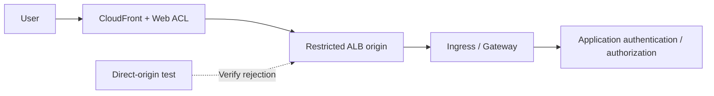

# WAF, perímetro y seguridad de API con protección del origen

> **Base de la revisión**: documentación oficial de AWS WAF, CloudFront y ALB. Las características y los límites de inspección se distinguen según el recurso asociado.
> **Última actualización**: 19 de octubre de 2026

El objetivo es demostrar que las solicitudes protegidas atraviesan WAF, que se comprenden los límites y las excepciones de inspección, y que la aplicación procesa las solicitudes de forma segura. Los criterios de aplicación, origen y operación que figuran a continuación son propuestas de diseño.

## 1. Separar WAF, NGFW y autorización de la aplicación

AWS WAF inspecciona las solicitudes a los recursos compatibles asociados, incluidos CloudFront, ALB y las **API REST** de API Gateway. No des por sentado que la misma asociación directa funciona para las API HTTP/WebSocket de API Gateway o para NLB. Las ACL de CloudFront usan el ámbito `CLOUDFRONT` y el punto de enlace de la API `us-east-1`; ALB y otros recursos regionales usan el ámbito `REGIONAL` en la región del recurso. [S09]

Distingue las capacidades de NGFW de VM-Series/FortiGate de las ofertas de WAF independientes de Palo Alto/Fortinet. La autorización de la aplicación sigue siendo otra capa. Comprueba en la aplicación el acceso a objetos de otros clientes, los límites comerciales, el procesamiento duplicado de pagos y los permisos de las herramientas de LLM.

| Flujo | Control principal | Verificación pendiente |
|---|---|---|
| HTTP(S) público | WAF asociado a CloudFront/ALB | Origen directo, límites del cuerpo, excepciones y autorización de la aplicación |
| Sesión IP que conserva TLS | Ruta de NGFW y descifrado seleccionado | Visibilidad real de la carga útil y exenciones |
| Webhook de admisión interno | Restricciones de acceso, admisión y RBAC | Accesibilidad desde los Pod y privilegios del controlador |
| Carga/gRPC/WebSocket | Ruta compatible y tratamiento específico de la aplicación | Cobertura más allá de la solicitud inicial y procesamiento de archivos |

El CVE del webhook de admisión de ingress-nginx afecta a un webhook accesible desde la red de los Pod; pruébalo por separado de la cobertura de WAF para URL públicas. [S01]

## 2. Diseñar la protección del origen según la ruta de la solicitud



Este es un diseño lógico. Documenta si se usa solo CloudFront WAF o si el ALB también recibe una ACL regional. Evalúa el registro, los falsos positivos y los costos antes de elegir la doble inspección.

### Opción A: Origen en un ALB público

Combina controles según el ejemplo de AWS para restringir el acceso de CloudFront al ALB. [S16]

1. Revisa la lista de prefijos administrada de CloudFront orientada al origen en el grupo de seguridad del ALB.
2. Combina un encabezado personalizado del origen de CloudFront con una condición de encabezado en el listener del ALB.
3. Diseña la acción predeterminada del listener para rechazar las solicitudes que no sigan la ruta aprobada.
4. Gestiona HTTPS al origen, la rotación del secreto del encabezado y los permisos de lectura de la configuración.
5. Prueba los nombres DNS del ALB, los dominios alternativos, las direcciones, los listeners, otros balanceadores de carga y los NodePort.

**Los rangos de direcciones de CloudFront no identifican tu distribución.** El encabezado permite distinguirla de otras rutas de CloudFront, pero su valor es un secreto compartido cuya eficacia disminuye si se divulga. No incluyas valores reales en el código fuente, las capturas de pantalla ni los registros habituales. Que una aplicación confíe en un encabezado reenviado no equivale a que un listener restrinja el acceso al origen. [S16]

### Opción B: Origen de VPC de CloudFront

Los orígenes de VPC de CloudFront pueden entregar contenido a orígenes compatibles en subredes privadas de VPC. El requisito de asociar un Internet Gateway no exige que el origen tenga una IP pública. Comprueba las restricciones actuales de región, recursos y protocolos, las direcciones de las subredes y la configuración del grupo de seguridad administrado por el servicio. La compatibilidad de NLB como origen es independiente de la asociación directa de WAF con NLB. [S17]

#### Actualización de octubre de 2026: compatibilidad con doble pila para orígenes de VPC

Según el [anuncio del 15 de octubre de 2026](https://aws.amazon.com/about-aws/whats-new/2026/10/cloudfront-vpc-origin-dualstack/), los orígenes de VPC de CloudFront ahora admiten doble pila. Antes, la conexión al origen de VPC solo admitía IPv4, lo que obligaba a trasladar el origen a una subred pública para ofrecer IPv6; ahora puedes mantener el origen en una subred privada y configurar la entrega IPv6 hacia él. Está disponible en las regiones comerciales donde se admiten los orígenes de VPC, y las comprobaciones de acceso directo al origen indicadas anteriormente siguen siendo aplicables después de una migración a doble pila.

Para cualquiera de las opciones, revisa otros Service públicos, NodePort y puntos de enlace de administración que expongan la misma aplicación. Etiquetar un origen como privado no completa el inventario de rutas de entrada.

## 3. Orden de las reglas y acciones terminales

AWS WAF evalúa primero las prioridades con menor valor numérico. `Allow` y `Block` terminan la evaluación; `Count` la continúa. `CAPTCHA` y `Challenge` no son terminales cuando hay tokens válidos, y sí lo son cuando no hay un token aceptable. La acción predeterminada de la ACL se aplica cuando ninguna regla terminal decide qué hacer con la solicitud. [S10]

| Problema | Consecuencia | Propuesta de diseño |
|---|---|---|
| `Allow` general al principio | No se evalúan las reglas administradas ni las de límite de velocidad posteriores | Limita el permiso y revisa el orden |
| Eximir a un grupo entero | Se pueden eliminar otras protecciones | Registra cada regla, ruta, método, responsable y fecha de vencimiento |
| Tratar `Count` como si bloqueara | Las solicitudes solo se supervisan | Inspecciona la acción, las anulaciones y los resultados efectivos |
| Usar Challenge en todas las API | Problemas de compatibilidad con clientes automatizados | Prueba por separado las API para navegadores y las API para máquinas |

La selección y las actualizaciones de reglas administradas requieren control de cambios. Evalúa los grupos de referencia pertinentes, los de entradas maliciosas conocidas y los de SQLi frente al tráfico legítimo, y comprueba si se admite fijar versiones y recibir notificaciones de cambios. El nombre de un grupo no demuestra que detecte todos los ataques.

## 4. Límites de inspección del cuerpo de la solicitud y límites por exceso de tamaño

| Recurso asociado | Tamaño de inspección del cuerpo de AWS WAF |
|---|---|
| ALB, AppSync | Fijo: 8 KB |
| CloudFront, API Gateway, Cognito, App Runner, Verified Access, Bedrock AgentCore Gateway | 16 KB de forma predeterminada; configurable hasta 64 KB cuando se admite |
| Solicitudes gRPC | AWS documenta que las reglas de inspección del cuerpo no se aplican |

Estos son límites de inspección, no límites de carga ni límites de la solicitud completa. Aumentar el límite requiere revisar la compatibilidad y el costo. La condición de tamaño propia de una regla administrada es distinta de la configuración del tamaño de inspección de la ACL. [S11]

Cuando el cuerpo, los encabezados o las cookies superan los límites de inspección, importa cómo se trata el exceso de tamaño en la sentencia. [S12]

- `CONTINUE`: Evalúa la parte disponible que se ha inspeccionado.
- `MATCH`: Trata el exceso de tamaño como una coincidencia para esa sentencia.
- `NO_MATCH`: Trata el exceso de tamaño como una no coincidencia para esa sentencia.

**`MATCH` no es una instrucción `Block`.** El comportamiento final depende de la acción y de las sentencias circundantes, como `NOT`. Una acción de permiso terminal anterior también puede impedir que se ejecute una regla posterior que bloquearía el exceso de tamaño. [S10] [S12]

Valida en la aplicación el tamaño total del cuerpo, el esquema, el tipo de contenido, la descompresión, el procesamiento de archivos y la autorización. Considera rutas independientes para cargas grandes y una inspección posterior basada en el almacenamiento. Compara solicitudes JSON/multipart benignas a ambos lados del umbral y los datos posteriores al prefijo inspeccionado. No hacen falta cargas útiles de ataque para establecer los límites y las rutas.

## 5. IP del cliente y reglas basadas en la velocidad

Las direcciones del par de conexión y del cliente reenviadas pueden diferir a lo largo de CloudFront→ALB→Ingress→aplicación. Define los proxies de confianza y las rutas de origen antes de usar la configuración de IP reenviada. Las sentencias de coincidencia geográfica, coincidencia de ASN y límite de velocidad usan la primera dirección. La sentencia de coincidencia de conjunto de IP usa la posición configurada `FIRST`, `LAST` o `ANY`; `ANY` comprueba hasta 10 direcciones y, si hay más, usa las últimas 10. [S13]

Si falta el encabezado, la sentencia directa no coincide y no se recurre al tratamiento de valores mal formados. Una sentencia envolvente `NOT` puede invertir la no coincidencia y convertirla en coincidencia, así que prueba el árbol completo de sentencias además de la configuración de IP reenviada. [S13]

Controles propuestos contra el abuso de API:

| Solicitud | Comprobaciones de agregación/aplicación | Casos de prueba |
|---|---|---|
| Inicio de sesión/restablecimiento de contraseña | IP del cliente, política de cuentas de la aplicación, alcance de ruta/método | NAT compartida, reintentos legítimos y cuentas desconocidas |
| Búsqueda/API costosas | Agregación personalizada compatible y cuotas de la aplicación | Costo de las consultas, emisión/rotación de tokens y tipos de cliente |
| Rastreo/bots | Tokens de navegador, reglas de bots compatibles y comprobaciones de la aplicación | SDK, clientes móviles y de accesibilidad |
| Carga/pago | Autorización, tamaño, idempotencia y límites comerciales | Envíos duplicados y reintentos tras un fallo |

Las reglas de límite de velocidad usan un seguimiento aproximado, no cuotas exactas de solicitudes por segundo. Los periodos de evaluación compatibles son 60, 120, 300 y 600 segundos. Cambiar los límites, los periodos, la agregación o el alcance restablece los contadores y puede pausar la aplicación de las reglas durante un máximo de un minuto. Si usas tokens o encabezados arbitrarios como claves, prueba la variación de claves controlada por el atacante y los valores ausentes. [S14] [S37] [S43]

## 6. Validar el registro y la política ante fallos

Revisa `terminatingRuleId`, `action`, `nonTerminatingMatchingRules`, los resultados internos de las reglas administradas, las etiquetas, `ruleMatchDetails`, `oversizeFields`, la ruta, el método y el ID de solicitud. Las coincidencias de tipo Count no se pueden encontrar únicamente mediante la regla terminal. Usa las [definiciones oficiales de los campos][S36].

Limita los datos personales, los tokens y los encabezados de autenticación. **El enmascaramiento de registros no protege automáticamente las muestras de solicitudes ni la recopilación de Security Lake.** Revisa por separado las muestras y la protección de datos, e inspecciona los datos recopilados. Supervisar los retrasos o la ausencia de eventos junto con los registros de la aplicación es una propuesta operativa. [S15]

`waf.fail_open.enabled` de ALB controla si se reenvían las solicitudes a los destinos cuando no se pueden enviar a WAF; su valor predeterminado es `false`. Lee los atributos efectivos y documenta el comportamiento esperado de permitir o denegar. La asociación por sí sola no demuestra que todo fallo de WAF bloquee las solicitudes. Antes de verificar otros ajustes propuestos para fallos, confirma primero los atributos oficiales vigentes del recurso. [S18]

## 7. Verificación y despliegue seguros

Este JSON es **una regla dentro de una Web ACL**, no una ACL completa, una asociación ni un comando de despliegue. Cuenta un encabezado único en solicitudes de prueba aprobadas para comprobar la ruta y el registro.

```json
{
  "Name": "DocumentedCanaryCount",
  "Priority": 0,
  "Statement": {
    "ByteMatchStatement": {
      "SearchString": "security-review",
      "FieldToMatch": { "SingleHeader": { "Name": "x-doc-waf-canary" } },
      "TextTransformations": [{ "Priority": 0, "Type": "NONE" }],
      "PositionalConstraint": "EXACTLY"
    }
  },
  "Action": { "Count": {} },
  "VisibilityConfig": {
    "SampledRequestsEnabled": false,
    "CloudWatchMetricsEnabled": true,
    "MetricName": "DocumentedCanaryCount"
  }
}
```

Coordina la prioridad y los nombres de las métricas con la ACL existente. Esto no valida la detección de solicitudes maliciosas ni los falsos positivos. En un entorno de pruebas, continúa con una prueba canaria de bloqueo de alcance limitado y benigno, y verifica que la solicitud no llegue a la aplicación; evalúa las reglas de protección reales reproduciendo tráfico comercial. Registra los cambios de Count a Block, la fecha de vencimiento de las excepciones y los responsables de la reversión.

| Verificación | Resultado esperado y evidencia que se conserva |
|---|---|
| Clientes legítimos de API comerciales/automatizados | Éxito, tasa de errores, p95 y resultados de tokens/Challenge |
| Prueba canaria Count/Block | Resultado no terminal frente a terminal; correlación entre WAF y la aplicación |
| Origen directo/otra distribución | Rechazo en el límite configurado del origen |
| Solicitudes alrededor del umbral del cuerpo/cargas grandes | Comportamiento ante el exceso de tamaño y validación de la entrada completa por la aplicación |
| Encabezado reenviado ausente/suplantado | Límite de confianza y aplicabilidad de la regla |
| NAT compartida/claves distribuidas/actualizaciones de reglas de límite de velocidad | Impacto en usuarios legítimos, límites aproximados y restablecimiento |
| Eliminación de ACL/excepciones/fallo de WAF | Detección de cambios y comportamiento ante fallos documentado |

Esta actualización de la documentación no desplegó WAF ni dispositivos, no reprodujo ataques ni midió el rendimiento del tráfico.

## Continúa aprendiendo

- [Defensa en profundidad y respuesta a incidentes](./13-defense-in-depth-incident-response.md)
- [NGFW de Palo Alto y Fortinet](./15-ngfw-paloalto-fortinet.md)
- [GWLB y GENEVE](./16-gwlb-geneve-inspection.md)
- [Cuestionario del capítulo](../quizzes/security/14-waf-edge-api-security-quiz.md)

## Referencias y base de investigación

Fuentes primarias consultadas el 15 de octubre de 2026. Antes de realizar cambios, vuelve a comprobar los avisos y las restricciones del producto o la rama seleccionados.

- [S01: Kubernetes: CVE-2025-1974][S01]
- [S09: AWS WAF: asociación de una ACL web][S09]
- [S10: AWS WAF: acción de regla][S10]
- [S11: AWS WAF: tamaños de inspección del cuerpo][S11]
- [S12: AWS WAF: componentes de solicitud que superan el tamaño permitido][S12]
- [S13: AWS WAF: direcciones IP reenviadas][S13]
- [S14: AWS WAF: reglas basadas en la velocidad][S14]
- [S15: AWS WAF: registro][S15]
- [S16: CloudFront: restricción del acceso a orígenes ALB][S16]
- [S17: CloudFront: orígenes de VPC][S17]
- [S18: ALB: atributos][S18]
- [S36: AWS WAF: campos de registro][S36]
- [S37: AWS WAF: periodo de evaluación de la velocidad][S37]
- [S43: AWS WAF: consideraciones sobre las reglas de límite de velocidad][S43]

[S01]: https://kubernetes.io/blog/2025/03/24/ingress-nginx-cve-2025-1974/
[S09]: https://docs.aws.amazon.com/waf/latest/developerguide/web-acl-associating-aws-resource.html
[S10]: https://docs.aws.amazon.com/waf/latest/developerguide/waf-rule-action.html
[S11]: https://docs.aws.amazon.com/waf/latest/developerguide/web-acl-setting-body-inspection-limit.html
[S12]: https://docs.aws.amazon.com/waf/latest/developerguide/waf-oversize-request-components.html
[S13]: https://docs.aws.amazon.com/waf/latest/developerguide/waf-rule-statement-forwarded-ip-address.html
[S14]: https://docs.aws.amazon.com/waf/latest/developerguide/waf-rule-statement-type-rate-based.html
[S15]: https://docs.aws.amazon.com/waf/latest/developerguide/logging.html
[S16]: https://docs.aws.amazon.com/AmazonCloudFront/latest/DeveloperGuide/restrict-access-to-load-balancer.html
[S17]: https://docs.aws.amazon.com/AmazonCloudFront/latest/DeveloperGuide/private-content-vpc-origins.html
[S18]: https://docs.aws.amazon.com/elasticloadbalancing/latest/application/application-load-balancers.html
[S36]: https://docs.aws.amazon.com/waf/latest/developerguide/logging-fields.html
[S37]: https://docs.aws.amazon.com/waf/latest/developerguide/waf-rule-statement-type-rate-based-high-level-settings.html
[S43]: https://docs.aws.amazon.com/waf/latest/developerguide/waf-rule-statement-type-rate-based-caveats.html
