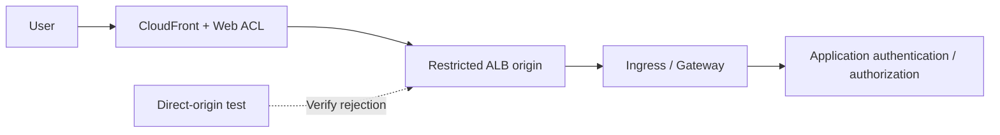

# WAF, seguridad de borde y API con protección del origen

> **Base de revisión**: documentación oficial de AWS WAF, CloudFront y ALB. Las funciones y los límites de inspección se distinguen según el recurso asociado.
> **Última actualización**: 15 de octubre de 2026

El objetivo es demostrar que las solicitudes protegidas pasan por WAF, que se entienden los límites y las excepciones de inspección, y que la aplicación procesa las solicitudes de forma segura. Los criterios de aplicación, origen y operación que se indican a continuación son propuestas de diseño.

## 1. Separar WAF, NGFW y autorización de aplicación

AWS WAF inspecciona solicitudes dirigidas a los recursos compatibles asociados, incluidos CloudFront, ALB y las **API REST** de API Gateway. No dé por sentado que la misma asociación directa funciona con las API HTTP/WebSocket de API Gateway o NLB. Las ACL de CloudFront usan el alcance `CLOUDFRONT` y el endpoint de API `us-east-1`; ALB y otros recursos regionales usan el alcance `REGIONAL` en la región del recurso. [S09]

Distinga las capacidades de NGFW de VM-Series/FortiGate de las ofertas independientes de WAF de Palo Alto/Fortinet. La autorización de la aplicación es otra capa. Compruebe en la aplicación el acceso a objetos de otros clientes, los límites de negocio, el procesamiento duplicado de pagos y los permisos de herramientas de LLM.

| Flujo | Control principal | Verificación pendiente |
|---|---|---|
| HTTP(S) público | WAF asociado a CloudFront/ALB | Origen directo, límites del cuerpo, excepciones y autorización de aplicación |
| Sesión IP con TLS intacto | Ruta NGFW y descifrado seleccionado | Visibilidad real de la carga útil y exenciones |
| Webhook de admisión interno | Restricciones de acceso, admisión y RBAC | Acceso desde los Pods y privilegios del controlador |
| Carga, gRPC/WebSocket | Ruta compatible y tratamiento específico de la aplicación | Cobertura más allá de la solicitud inicial y procesamiento de archivos |

La CVE de admisión de ingress-nginx afecta a un webhook accesible desde la red de Pods; pruébelo por separado de la cobertura de WAF de URL públicas. [S01]

## 2. Diseñar la protección del origen según la ruta de solicitud



Este es un diseño lógico. Documente si se utiliza solo WAF de CloudFront o si ALB también recibe una ACL regional. Evalúe los registros, los falsos positivos y los costos antes de elegir la inspección doble.

### Opción A: origen ALB público

Combine controles según el ejemplo de AWS para restringir el acceso desde CloudFront a orígenes ALB. [S16]

1. Revise la lista de prefijos administrada de CloudFront para las conexiones al origen en el grupo de seguridad de ALB.
2. Combine un encabezado personalizado de origen de CloudFront con una condición de encabezado del listener de ALB.
3. Diseñe la acción predeterminada del listener para que rechace solicitudes fuera de la ruta aprobada.
4. Administre HTTPS de origen, la rotación del secreto del encabezado y los permisos de lectura de configuración.
5. Pruebe nombres DNS de ALB, dominios alternativos, direcciones, listeners, otros balanceadores de carga y NodePorts.

**Los rangos de direcciones de CloudFront no identifican su distribución.** El encabezado distingue la ruta de otras rutas de CloudFront, pero su valor es un secreto compartido que pierde eficacia cuando se divulga. Mantenga los valores reales fuera del código fuente, las capturas de pantalla y los registros normales. Una aplicación que confía en un encabezado reenviado no equivale a un listener que restringe el acceso al origen. [S16]

### Opción B: origen VPC de CloudFront

Los orígenes VPC de CloudFront pueden entregar tráfico a orígenes compatibles en subredes privadas de VPC. El requisito de asociar un Internet Gateway no exige una IP pública en el origen. Compruebe las restricciones actuales de región, recurso y protocolo, las direcciones de la subred y la configuración del grupo de seguridad administrado por el servicio. La compatibilidad de NLB como origen es distinta de la asociación directa de WAF a NLB. [S17]

Para cualquiera de las opciones, revise otros servicios públicos, NodePorts y endpoints de administración que expongan la misma aplicación. Etiquetar un origen como privado no completa el inventario de rutas de entrada.

## 3. Orden de reglas y acciones de terminación

AWS WAF evalúa primero las prioridades numéricas más bajas. `Allow` y `Block` terminan la evaluación; `Count` continúa. `CAPTCHA` y `Challenge` no terminan la evaluación cuando hay tokens válidos, y sí la terminan si no hay un token aceptable. La acción predeterminada de la ACL se aplica cuando ninguna regla ha tomado una decisión de terminación. [S10]

| Error frecuente | Consecuencia | Propuesta de diseño |
|---|---|---|
| `Allow` amplio y temprano | No se evalúan las reglas administradas o basadas en tasas posteriores | Restrinja el permiso y revise el orden |
| Eximir un grupo entero | Se pueden eliminar otras protecciones | Registre la regla, ruta, método, propietario y vencimiento individuales |
| Tratar `Count` como bloqueo | Las solicitudes solo se supervisan | Inspeccione la acción, las anulaciones y los resultados efectivos |
| Usar Challenge en todas las API | Problemas de compatibilidad con clientes automatizados | Pruebe por separado las API de navegador y de máquina |

La selección y las actualizaciones de reglas administradas requieren control de cambios. Evalúe los grupos pertinentes de línea base, entradas maliciosas conocidas e inyección SQL con tráfico legítimo, y compruebe la compatibilidad con la fijación de versiones y las notificaciones de cambios. El nombre de un grupo no demuestra que detecte todos los ataques.

## 4. Límites de inspección del cuerpo y solicitudes demasiado grandes

| Recurso asociado | Tamaño de inspección del cuerpo de AWS WAF |
|---|---|
| ALB, AppSync | Fijo en 8 KB |
| CloudFront, API Gateway, Cognito, App Runner, Verified Access, Bedrock AgentCore Gateway | 16 KB de forma predeterminada, configurable hasta 64 KB si es compatible |
| Solicitudes gRPC | AWS documenta que las reglas de inspección del cuerpo no se aplican |

Estos son límites de inspección, no límites de carga ni del tamaño de la solicitud completa. Si aumenta el límite, revise la compatibilidad y los costos. La condición de tamaño propia de una regla administrada es distinta de la configuración del tamaño de inspección de la ACL. [S11]

Cuando los cuerpos, encabezados o cookies superan los límites de inspección, importa el tratamiento de solicitudes demasiado grandes de la instrucción. [S12]

- `CONTINUE`: evaluar la parte disponible que se haya inspeccionado.
- `MATCH`: considerar que la solicitud demasiado grande coincide con esa instrucción.
- `NO_MATCH`: considerar que la solicitud demasiado grande no coincide con esa instrucción.

**`MATCH` no es una orden `Block`.** El comportamiento final depende de la acción y de las instrucciones circundantes, como `NOT`. Además, un permiso de terminación anterior puede impedir que se ejecute una regla posterior de bloqueo de solicitudes demasiado grandes. [S10] [S12]

Valide en la aplicación el tamaño total del cuerpo, el esquema, el tipo de contenido, la descompresión, el manejo de archivos y la autorización. Considere rutas independientes para cargas grandes y una inspección posterior basada en almacenamiento. Compare solicitudes JSON/multipart benignas alrededor del umbral y los datos que quedan después del prefijo inspeccionado. No hacen falta cargas maliciosas para establecer los límites y las rutas.

## 5. IP del cliente y reglas basadas en tasas

La dirección IP del extremo que establece la conexión y las direcciones IP del cliente incluidas en encabezados reenviados pueden diferir a lo largo de CloudFront→ALB→Ingress→aplicación. Defina los proxies de confianza y las rutas de origen antes de usar la configuración de IP reenviada. Las instrucciones de coincidencia geográfica, de ASN y las basadas en tasas utilizan la primera dirección. La instrucción de coincidencia con un conjunto de IP utiliza la posición configurada `FIRST`, `LAST` o `ANY`; `ANY` comprueba hasta 10 direcciones y, si hay más, usa las 10 últimas. [S13]

Si falta un encabezado, la instrucción directa no coincide y no se activa la alternativa para valores malformados. Una instrucción `NOT` que lo envuelva puede invertir «no coincide» y convertirlo en «coincide», así que pruebe el árbol completo de instrucciones además del ajuste de IP reenviada. [S13]

Controles propuestos contra el abuso de API:

| Solicitud | Comprobaciones de agregación/aplicación | Casos de prueba |
|---|---|---|
| Inicio de sesión/restablecimiento de contraseña | IP del cliente, política de cuenta de la aplicación, alcance de ruta/método | NAT compartida, reintentos legítimos y cuentas desconocidas |
| Búsqueda/API costosa | Agregación personalizada compatible y cuotas de aplicación | Costo de consulta, emisión/rotación de tokens y tipos de clientes |
| Rastreo/bots | Tokens de navegador, reglas de bots compatibles y comprobaciones de aplicación | SDK, clientes móviles y de accesibilidad |
| Carga/pago | Autorización, tamaño, idempotencia y límites de negocio | Envío duplicado y reintento después de un fallo |

Las reglas basadas en tasas realizan un seguimiento aproximado; no imponen cuotas exactas de solicitudes por segundo. Las ventanas de evaluación compatibles son de 60, 120, 300 y 600 segundos. Cambiar los límites, las ventanas, la agregación o el alcance restablece los contadores y puede interrumpir la aplicación de la regla durante un máximo de un minuto. Si se usan tokens o encabezados arbitrarios como claves, pruebe variaciones de clave controladas por un atacante y valores ausentes. [S14] [S37] [S43]

## 6. Validar los registros y la política ante fallos

Revise `terminatingRuleId`, `action`, `nonTerminatingMatchingRules`, los resultados internos de reglas administradas, las etiquetas, `ruleMatchDetails`, `oversizeFields`, la ruta, el método y el ID de solicitud. No se pueden encontrar coincidencias `Count` mirando únicamente la regla de terminación. Use las [definiciones oficiales de campos][S36].

Limite los datos personales, los tokens y los encabezados de autenticación. **El enmascaramiento de registros no protege automáticamente el muestreo de solicitudes ni la recopilación de Security Lake.** Revise por separado el muestreo/la protección de datos e inspeccione los datos recopilados. Supervisar los retrasos/la ausencia de eventos junto con los registros de la aplicación es una propuesta operativa. [S15]

El atributo `waf.fail_open.enabled` de ALB controla si se reenvía a los destinos cuando no se pueden enviar las solicitudes a WAF; su valor predeterminado es `false`. Lea los atributos efectivos y documente el comportamiento esperado de permitir/denegar. La asociación por sí sola no demuestra que todo fallo de WAF bloquee las solicitudes. Antes de usar otros ajustes propuestos para gestionar fallos, verifíquelos con los atributos oficiales actuales del recurso. [S18]

## 7. Verificación e implementación seguras

Este JSON representa **una regla dentro de una ACL web**, no una ACL completa, una asociación ni un comando de implementación. Cuenta un encabezado único en solicitudes de prueba aprobadas para verificar la ruta y el registro.

```json
{
  "Name": "DocumentedCanaryCount",
  "Priority": 0,
  "Statement": {
    "ByteMatchStatement": {
      "SearchString": "security-review",
      "FieldToMatch": { "SingleHeader": { "Name": "x-doc-waf-canary" } },
      "TextTransformations": [{ "Priority": 0, "Type": "NONE" }],
      "PositionalConstraint": "EXACTLY"
    }
  },
  "Action": { "Count": {} },
  "VisibilityConfig": {
    "SampledRequestsEnabled": false,
    "CloudWatchMetricsEnabled": true,
    "MetricName": "DocumentedCanaryCount"
  }
}
```

Coordine la prioridad y los nombres de las métricas con la ACL existente. Esto no valida la detección de solicitudes maliciosas ni los falsos positivos. En preproducción, continúe con un canario `Block` benigno y de alcance limitado, y compruebe que no llega a la aplicación; evalúe las reglas de protección reales reproduciendo tráfico de negocio. Registre los cambios de Count a Block, el vencimiento de las excepciones y los responsables de reversión.

| Verificación | Resultado esperado y evidencia que se conserva |
|---|---|
| Clientes legítimos de API de negocio/automatizados | Éxito, tasa de errores, p95 y resultados de token/Challenge |
| Canario Count/Block | Resultado no terminal frente a terminal; correlación de WAF/aplicación |
| Origen directo/otra distribución | Rechazo en el límite de origen configurado |
| Solicitudes alrededor del límite de cuerpo/cargas grandes | Comportamiento para solicitudes grandes y validación de la entrada completa en la aplicación |
| Encabezado reenviado ausente/falsificado | Límite de confianza y aplicabilidad de la regla |
| NAT compartida/claves distribuidas/actualizaciones de regla de velocidad | Impacto en usuarios legítimos, límites aproximados y reinicio |
| Eliminación de ACL/excepciones/fallo de WAF | Detección del cambio y comportamiento documentado ante fallos |

Esta actualización de documentación no implementó WAF ni dispositivos, reprodujo ataques ni midió el rendimiento del tráfico.

## Seguir aprendiendo

- [Defensa en profundidad y respuesta a incidentes](./13-defense-in-depth-incident-response.md)
- [NGFW de Palo Alto y Fortinet](./15-ngfw-paloalto-fortinet.md)
- [GWLB y GENEVE](./16-gwlb-geneve-inspection.md)
- [Cuestionario del capítulo](../quizzes/security/14-waf-edge-api-security-quiz.md)

## Referencias y base de investigación

Fuentes primarias consultadas el 15-10-2026. Antes de hacer cambios, vuelva a comprobar los avisos y las restricciones de la rama/producto seleccionados.

- [S01: Kubernetes: CVE-2025-1974][S01]
- [S09: AWS WAF: asociar una web ACL][S09]
- [S10: AWS WAF: acción de una regla][S10]
- [S11: AWS WAF: tamaños de inspección del cuerpo][S11]
- [S12: AWS WAF: componentes de solicitud demasiado grandes][S12]
- [S13: AWS WAF: direcciones IP reenviadas][S13]
- [S14: AWS WAF: reglas basadas en tasas][S14]
- [S15: AWS WAF: registro][S15]
- [S16: CloudFront: restringir el acceso a orígenes ALB][S16]
- [S17: CloudFront: orígenes VPC][S17]
- [S18: ALB: atributos][S18]
- [S36: AWS WAF: campos de registro][S36]
- [S37: AWS WAF: ventana de evaluación para reglas basadas en tasas][S37]
- [S43: AWS WAF: precauciones sobre las reglas basadas en tasas][S43]

[S01]: https://kubernetes.io/blog/2025/03/24/ingress-nginx-cve-2025-1974/
[S09]: https://docs.aws.amazon.com/waf/latest/developerguide/web-acl-associating-aws-resource.html
[S10]: https://docs.aws.amazon.com/waf/latest/developerguide/waf-rule-action.html
[S11]: https://docs.aws.amazon.com/waf/latest/developerguide/web-acl-setting-body-inspection-limit.html
[S12]: https://docs.aws.amazon.com/waf/latest/developerguide/waf-oversize-request-components.html
[S13]: https://docs.aws.amazon.com/waf/latest/developerguide/waf-rule-statement-forwarded-ip-address.html
[S14]: https://docs.aws.amazon.com/waf/latest/developerguide/waf-rule-statement-type-rate-based.html
[S15]: https://docs.aws.amazon.com/waf/latest/developerguide/logging.html
[S16]: https://docs.aws.amazon.com/AmazonCloudFront/latest/DeveloperGuide/restrict-access-to-load-balancer.html
[S17]: https://docs.aws.amazon.com/AmazonCloudFront/latest/DeveloperGuide/private-content-vpc-origins.html
[S18]: https://docs.aws.amazon.com/elasticloadbalancing/latest/application/application-load-balancers.html
[S36]: https://docs.aws.amazon.com/waf/latest/developerguide/logging-fields.html
[S37]: https://docs.aws.amazon.com/waf/latest/developerguide/waf-rule-statement-type-rate-based-high-level-settings.html
[S43]: https://docs.aws.amazon.com/waf/latest/developerguide/waf-rule-statement-type-rate-based-caveats.html
