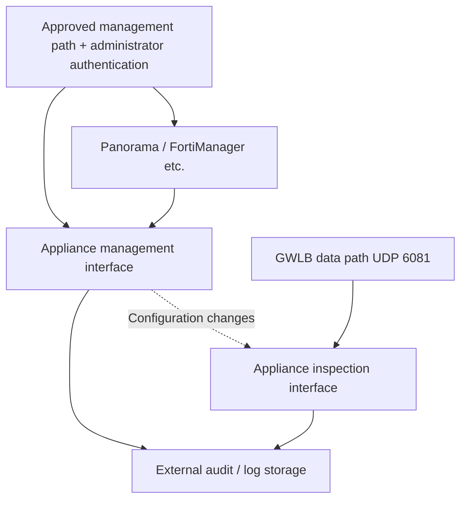

# Diseño y operación de NGFW de Palo Alto y Fortinet en AWS/EKS

> **Base de la revisión**: Guías oficiales de integración de VM-Series/FortiGate-VM con AWS GWLB y avisos de seguridad de los proveedores. Revise los ejemplos en función de la rama y el modo de implementación compatibles que haya elegido.
> **Última actualización**: 15 de octubre de 2026

Un NGFW aplica políticas configuradas a las sesiones que lo atraviesan. Añadir un dispositivo no garantiza que se inspeccione el tráfico de todas las VPC o Pods. Este capítulo compara los requisitos de integración, la administración, TLS, las sesiones y la capacidad, y continúa con la [validación de la ruta de GWLB](./16-gwlb-geneve-inspection.md).

## 1. Elegir el modelo de implementación

| Modelo | Estructura | Datos para la prueba de concepto |
|---|---|---|
| Inspección distribuida | Rutas y dispositivos en las VPC de las cargas de trabajo | Rutas locales, separación por zona de disponibilidad y coherencia de políticas entre flotas |
| Inspección central | Tráfico seleccionado de varias VPC a través de TGW/VPC de inspección | Simetría, modo appliance de TGW, NAT y excepciones |
| Inserción de GWLB | GWLBE envía el tráfico a una flota compatible con GENEVE | Encapsulación, estado, reasignación de flujos y políticas de los dispositivos |
| Servicio administrado por el proveedor | Implementación administrada de NGFW compatible | Enrutamiento, políticas, registros y responsabilidades de cuenta propios del producto |

La inspección central cubre el tráfico enrutado a TGW. Verifique por separado la conectividad local a la VPC, al nodo y cualquier otra. Los endpoints de GWLB y el modo appliance de TGW no inspeccionan nada si no hay un dispositivo. [S24] [S29] [S30]

VM-Series es distinto de Palo Alto Cloud NGFW; FortiGate-VM es distinto de FortiWeb. Haga coincidir la compatibilidad, las funciones y los avisos con el producto real. La exclusión de Cloud NGFW en CVE-2026-0322 solo se aplica a ese aviso. [S03]

## 2. Integración de GWLB específica del proveedor

| Elemento de revisión | Palo Alto VM-Series | Fortinet FortiGate-VM |
|---|---|---|
| Integración | Integración de PAN-OS con GWLB, plantillas del proveedor o configuración manual | Interfaces GENEVE y guías de implementación en una o varias zonas de disponibilidad |
| Ruta de datos | Desencapsulación seguida del procesamiento de interfaz/zona/política de seguridad | Desencapsulación seguida del procesamiento de interfaz/política |
| Encapsulación | UDP 6081 y versión/modo compatibles | UDP 6081, configuración GENEVE del nodo GWLB y gestión de TLV de AWS [S42] |
| Requisitos previos de políticas | Interfaces, zonas, reglas de permiso y perfiles de seguridad | Interfaces GENEVE, políticas de firewall y perfiles UTM/de seguridad |
| Administración | Estructura de Panorama/administración aplicable y auditorías de cambios | Estructura de FortiManager/FortiAnalyzer aplicable y auditorías de cambios |
| Fallos/escalado | Registro y baja de destinos de GWLB, y gestión de sesiones/configuración del dispositivo | Registro y baja de destinos de GWLB, y gestión de sesiones/configuración del dispositivo |

Fuentes: [descripción general de VM-Series][S19], [configuración manual][S20], [habilitación de la integración][S21], [configuración de interfaces de Fortinet][S22] y [guía de implementación de FortiGate][S23]. AWS define por separado el formato GENEVE TLV de GWLB y la clase de opción `0x0108` en su [documentación de grupos de destino][S42]. La guía de Fortinet 7.0.0 citada describe el mecanismo de implementación; **no es una versión de producción recomendada**. Compruebe la guía, PSIRT y la imagen de la rama realmente seleccionada y compatible.

### Palo Alto: integración, interfaces y política de zona predeterminada

Haga coincidir la compatibilidad de la integración con GWLB con las interfaces, zonas, comprobaciones de estado y políticas reales. La guía de habilitación describe el intercambio de interfaces de administración/datos y la activación de la inspección con GWLB. Una versión que ofrece la función mínima no equivale a un parche seguro actual ni a una recomendación de versión para producción. [S21]

La guía manual indica que no se pueden usar comprobaciones de estado HTTP y recomienda HTTPS/TCP, pero más adelante incluye una frase que habilita HTTP en el paso del perfil de administración. **No convierta esa ambigüedad en una configuración automática.** Verifique los protocolos y las respuestas admitidos en la versión y plantilla elegidas, y consulte al proveedor. Que la comprobación de estado tenga éxito no demuestra que las firmas, las licencias o las políticas de inspección funcionen. [S20]

AWS también documenta que la comprobación de estado HTTPS falla con destinos compatibles únicamente con TLS 1.3; el endpoint de estado debe admitir una versión anterior, como TLS 1.2. Este requisito de estado es independiente de la compatibilidad de TLS de la aplicación inspeccionada. [S26]

La misma guía indica que el tráfico de GWLB se considera intrazona y que la regla intrazona predeterminada permite todo el tráfico. Revise la acción predeterminada y los perfiles aplicados para denegar el tráfico que no esté sujeto a las políticas previstas. Habilitar las interfaces por sí solo no completa la política de bloqueo. [S20]

### Fortinet: validar conjuntamente interfaces y políticas

La guía de configuración posterior a la implementación de Fortinet utiliza como par GENEVE la dirección IPv4 de la interfaz GWLB de la misma zona de disponibilidad y configura el tráfico de salida para que vuelva por la interfaz GENEVE receptora. No la sustituya por una dirección de administración o de aplicación. Compruebe los metadatos de encapsulación requeridos y la compatibilidad del modo elegido en la documentación de implementación. [S22] [S23]

Una interfaz GENEVE sin las políticas previstas de permiso/denegación y los perfiles de inspección no basta. Un diseño HA aparte con FGCP y destinos GWLB independientes son construcciones distintas. Seleccione un modo compatible del proveedor para HA/compartición de sesiones y valídelo.

## 3. Proteger el plano de administración del dispositivo

Esta es una división lógica de responsabilidades; el número real de ENI/subredes depende de la plantilla del proveedor elegida.

Criterios propuestos para la administración:

- Restrinja HTTPS, SSH y las API del dispositivo o del administrador a las rutas y fuentes de administración aprobadas.
- Administre cuentas individuales, privilegios mínimos, MFA compatible y una cuenta de recuperación separada.
- Audite los cambios administrativos/de configuración de tokens de automatización, SSO y administración central.
- Compruebe las IP públicas, EIP, listeners, puertos alternativos y otras ENI para detectar exposición real.
- Conserve externamente registros y revisiones de configuración y verifique la sincronización horaria.
- Haga un inventario de las ramas compatibles, las correcciones rápidas, las firmas y la compatibilidad del administrador.

Los avisos de PAN-OS recomiendan restringir la administración a direcciones internas de confianza. La RCE de 2026 incluye atacantes autenticados, así que revise tanto las restricciones de origen como la autenticación del administrador. [S03] [S04]

La guía de implementación manual asigna una EIP a la ENI de administración. Considérelo un paso de ejemplo, no un requisito de exposición predeterminado: antes de adoptarlo en producción, reconcilie el acceso real con la restricción de fuentes internas de confianza de los avisos. [S20] [S03] [S04]

El incidente de SSO de FortiCloud incluyó inicios de sesión entre cuentas y cambios de administrador/VPN. La corrección oficial excluye de ese problema los IdP SAML de terceros y FortiAuthenticator; no generalice el caso a todos los mecanismos SSO. [S05] [S06]

## 4. Visibilidad de TLS

| Punto de inspección | Visibilidad predeterminada | Revisión de inspección de carga útil |
|---|---|---|
| NGFW antes de la terminación HTTPS | Paquetes, conexiones y metadatos TLS expuestos | Descifrado compatible, claves/certificados y compatibilidad del cliente |
| CloudFront/ALB asociado con WAF | Partes de la solicitud que el recurso proporciona a WAF | Límites del cuerpo/gRPC/tamaño excesivo |
| NGFW en la ruta ALB→Pod con nuevo cifrado | Conexión TLS en ese segmento | Descifrado independiente o inspección en la capa del endpoint |
| Segmento mTLS de la malla | Metadatos observables del par/transporte | Confianza y autorización de la malla y ubicación de inspección compatible |

GWLB encapsula mediante GENEVE, no termina TLS. GENEVE por sí mismo no cifra. La inspección TLS de Network Firewall también requiere una configuración independiente de políticas/certificados. Que el tráfico atraviese un dispositivo y que se descifre correctamente son hechos distintos. [S24] [S31] [S35]

Una prueba de concepto de descifrado debe abarcar versiones/cifrados TLS, HTTP/2, gRPC, WebSocket, mTLS, fijación de certificados, confianza en la CA del cliente y excepciones regulatorias. Registre controles compensatorios para las excepciones. Un ajuste llamado «inspección SSL» no demuestra que se haya inspeccionado toda la carga útil cifrada.

Un grupo de destino HTTPS de ALB no demuestra que se valide la confianza en el certificado del backend. AWS indica que ALB no valida los certificados de destino; diseñe por separado las comprobaciones de identidad del servidor que sean necesarias. [S38]

## 5. NAT, direcciones originales y atribución a Pods

Correlacione estas observaciones para cada sesión:

| Segmento | Datos que se deben registrar |
|---|---|
| Aplicación/Pod | Carga de trabajo/espacio de nombres, ID de solicitud, direcciones de Pod/nodo y hora |
| Nodo/CNI | Comportamiento/modo de SNAT y NetworkPolicy efectiva |
| Dispositivo | Tupla de cinco elementos observada, política/perfil, acción y resultado del descifrado |
| NAT/externo | Dirección traducida, destino, respuestas y reintentos |
| TGW/GWLBE | Asociación, zona de disponibilidad, tabla de rutas e identidad del endpoint |

Después de aplicar SNAT en el nodo, el dispositivo puede ver la dirección del nodo en lugar de la dirección del Pod. Para el tráfico de salida IPv4 del CNI de VPC predeterminado fuera de los CIDR de la VPC, EKS documenta la traducción a la dirección principal del nodo; compruebe la configuración real de external-SNAT, del sistema operativo y del enrutamiento, sin tratarlo como un comportamiento universal. [S44]

Incluso las direcciones de Pod que se conservan pueden cambiar cuando se sustituyen los Pods. Distinga las políticas de IP de las políticas basadas en etiquetas/identidad de Kubernetes y correlacione los datos con las observaciones de CNI/IPAM. [S33]

Las solicitudes y respuestas que llegan a dispositivos distintos o con tuplas incompatibles pueden interrumpir la inspección con estado. Valide conjuntamente la persistencia, la ubicación de NAT, el modo appliance de TGW y el modo de implementación seleccionado. El modo appliance de TGW requiere persistencia por tupla de cinco elementos; no admite modos de dos o tres elementos. No añada SNAT arbitrario a un diseño GWLB transparente. [S25] [S29] [S30]

## 6. Sesiones, escalado, licencias y capacidad

GWLB selecciona destinos, comprueba su estado y conmuta los flujos; no replica automáticamente el estado entre dispositivos independientes. Pruebe las **sesiones existentes y las nuevas** al añadir o quitar destinos, durante `rebalance`, un reinicio y la pérdida de una zona de disponibilidad. Si necesita HA o compartir sesiones, compruebe el modo compatible del proveedor y las condiciones de fallo. [S25]

Plan de medición propuesto:

| Medición | Condiciones que se deben mantener constantes |
|---|---|
| Rendimiento/paquetes por segundo | Tamaño de paquete, proporción bidireccional, paquetes pequeños y cuerpos grandes |
| Tasa de conexiones/sesiones simultáneas | TCP/UDP, keepalive y gRPC/WebSocket de larga duración |
| Rendimiento con inspección habilitada | Perfiles reales de IPS, malware, URL, registro y descifrado TLS |
| p50/p95/p99/errores | Aplicación, dispositivo, ruta TGW/zona de disponibilidad y referencia |
| Pérdida de N-1/zona de disponibilidad | Capacidad restante de instancias/licencias, CPU/memoria y preparación de políticas |
| Mantenimiento/escalado | Preparación del registro, drenaje, implementación de políticas/firmas e interrupción de sesiones |

Los valores de las hojas de datos no constituyen una comparación controlada entre proveedores. Registre los límites de puertos, CPU, criptografía y licencia/suscripción. El coste total incluye EC2/EBS/licencias del dispositivo, GWLB/GWLBE, TGW, NAT, transferencia entre zonas de disponibilidad, registros y operaciones; calcule cada uno según la región real. Esta investigación no incluye cotizaciones ni mediciones de rendimiento.

## 7. Aplicar parches y eliminar el compromiso

| Estado | Comprobaciones necesarias |
|---|---|
| Afectación determinada | Producto, rama, corrección rápida, funciones, exposición y revisión del aviso |
| Parche completado | Versión corregida realmente implementada y compatibilidad del administrador/plantilla/firmas |
| Compromiso eliminado | Cambios en administrador/VPN/sistema/configuración y uso de credenciales relacionadas |
| Recuperación demostrada | Funciones de inspección y negocio, administración restringida, sesiones nuevas/existentes y registros externos |

El análisis de Fortinet de 2025 describe la persistencia del acceso después de aplicar parches anteriores a SSL-VPN. El análisis de SSO de 2026 recomienda auditar/restaurar la configuración y rotar credenciales cuando se confirma un compromiso. Tener una versión actual por sí solo no completa la erradicación. [S07] [S05]

Para aquel problema histórico de enlace simbólico, Fortinet indicó las versiones 7.6.2, 7.4.7, 7.2.11, 7.0.17 y 6.4.16 como versiones que eliminan el enlace al actualizar, pero aun así exige revisar la configuración. Son referencias históricas para remediación, no recomendaciones de versión para 2026. [S07]

Las tablas de versiones corregidas y fechas estimadas de PAN-OS pueden cambiar según la rama. En vez de convertir una versión estática de este capítulo en una instrucción de implementación, vuelva a comprobar el aviso al realizar el cambio. [S03]

## 8. Criterios de aceptación de la prueba de concepto

Estos son criterios comunes propuestos; compare facilidad de uso, costes operativos y rendimiento después de superar las comprobaciones obligatorias.

1. La imagen, la licencia, la rama y la integración oficial compatibles coinciden.
2. Se observa el acceso de administración restringido y los cambios administrativos/de configuración.
3. Se pueden correlacionar las tuplas de solicitud/respuesta y los perfiles aplicados en las sesiones permitidas y denegadas.
4. Se explican el alcance/excepciones del descifrado y la compatibilidad con clientes legítimos.
5. Se prueban el estado en que todos los destinos dejan de estar disponibles, el fallo de un destino único, la pérdida de una zona de disponibilidad, la reducción de capacidad y la actualización con sesiones antiguas/nuevas.
6. Se miden la capacidad N-1 y los SLO de latencia/errores de la aplicación.
7. La revisión de avisos, la aplicación de parches, la erradicación y la reversión tienen responsables y evidencias asignados.

## Seguir aprendiendo

- [Inspección de GWLB y GENEVE](./16-gwlb-geneve-inspection.md)
- [WAF y protección del origen](./14-waf-edge-api-security.md)
- [Respuesta a incidentes](./13-defense-in-depth-incident-response.md)
- [Cuestionario del capítulo](../quizzes/security/15-ngfw-paloalto-fortinet-quiz.md)

## Referencias y base de la investigación

Fuentes principales consultadas el 15 de octubre de 2026. Antes de hacer cambios, vuelva a comprobar los avisos y las restricciones del producto y la rama seleccionados.

- [S03: Palo Alto: CVE-2026-0322][S03]
- [S04: Palo Alto: CVE-2025-0108][S04]
- [S05: Fortinet: análisis del abuso de SSO en FortiOS][S05]
- [S06: CISA: catálogo de vulnerabilidades explotadas conocidas][S06]
- [S07: Fortinet: análisis de la actividad de actores de amenazas][S07]
- [S19: VM-Series: integración con GWLB][S19]
- [S20: VM-Series: integración manual con GWLB][S20]
- [S21: VM-Series: habilitar la integración con GWLB][S21]
- [S22: FortiGate: configuración posterior a la implementación de GWLB][S22]
- [S23: FortiGate: inspección de seguridad con integración de GWLB][S23]
- [S24: AWS: Gateway Load Balancers][S24]
- [S25: GWLB de AWS: atributos de grupos de destino][S25]
- [S26: GWLB de AWS: comprobaciones de estado][S26]
- [S29: AWS: inspección centralizada con GWLB y TGW][S29]
- [S30: AWS: escenarios de NAT Gateway][S30]
- [S31: RFC 8926: GENEVE][S31]
- [S33: EKS: seguridad de red][S33]
- [S35: AWS Network Firewall: configuraciones de inspección TLS][S35]
- [S38: ALB: grupos de destino][S38]
- [S42: GWLB de AWS: grupos de destino][S42]
- [S44: EKS: acceso a Internet saliente y SNAT][S44]

[S03]: https://security.paloaltonetworks.com/CVE-2026-0322
[S04]: https://security.paloaltonetworks.com/CVE-2025-0108
[S05]: https://www.fortinet.com/blog/psirt-blogs/analysis-of-sso-abuse-on-fortios
[S06]: https://www.cisa.gov/sites/default/files/feeds/known_exploited_vulnerabilities.json
[S07]: https://www.fortinet.com/blog/psirt-blogs/analysis-of-threat-actor-activity
[S19]: https://docs.paloaltonetworks.com/vm-series/deployment/public-cloud/set-up-the-vm-series-firewall-on-aws/vm-series-integration-with-gateway-load-balancer
[S20]: https://docs.paloaltonetworks.com/vm-series/deployment/public-cloud/set-up-the-vm-series-firewall-on-aws/vm-series-integration-with-gateway-load-balancer/manually-integrate-the-vm-series-with-a-gateway-load-balancer
[S21]: https://docs.paloaltonetworks.com/vm-series/deployment/public-cloud/set-up-the-vm-series-firewall-on-aws/vm-series-integration-with-gateway-load-balancer/enabling-vm-series-integration-with-a-gwlb
[S22]: https://docs.fortinet.com/document/fortigate-public-cloud/7.0.0/aws-administration-guide/337773/post-deployment-configuration
[S23]: https://docs.fortinet.com/document/fortigate-public-cloud/7.0.0/aws-administration-guide/571235/security-inspection-with-gateway-load-balancer-integration
[S24]: https://docs.aws.amazon.com/elasticloadbalancing/latest/gateway/gateway-load-balancers.html
[S25]: https://docs.aws.amazon.com/elasticloadbalancing/latest/gateway/edit-target-group-attributes.html
[S26]: https://docs.aws.amazon.com/elasticloadbalancing/latest/gateway/health-checks.html
[S29]: https://aws.amazon.com/blogs/networking-and-content-delivery/centralized-inspection-architecture-with-aws-gateway-load-balancer-and-aws-transit-gateway/
[S30]: https://docs.aws.amazon.com/vpc/latest/userguide/nat-gateway-scenarios.html
[S31]: https://www.rfc-editor.org/info/rfc8926/
[S33]: https://docs.aws.amazon.com/eks/latest/best-practices/network-security.html
[S35]: https://docs.aws.amazon.com/network-firewall/latest/developerguide/tls-inspection-configurations.html
[S38]: https://docs.aws.amazon.com/elasticloadbalancing/latest/application/load-balancer-target-groups.html
[S42]: https://docs.aws.amazon.com/elasticloadbalancing/latest/gateway/target-groups.html
[S44]: https://docs.aws.amazon.com/eks/latest/userguide/external-snat.html
