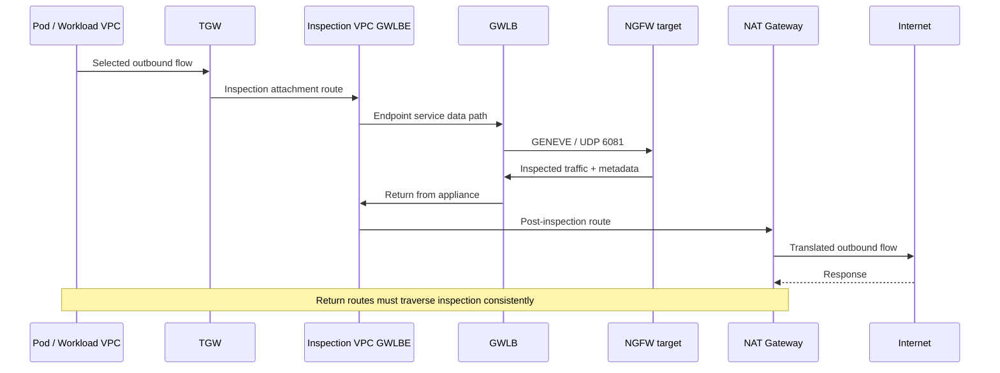

# GWLB y GENEVE: rutas de inspección simétricas y validación de fallos

> **Base de revisión**: documentación oficial de AWS sobre Gateway Load Balancer, PrivateLink, TGW y NAT, RFC 8926 y guías de integración de proveedores.
> **Última actualización**: 15 de octubre de 2026

GWLB distribuye los flujos IP originales a dispositivos de seguridad compatibles con GENEVE. GWLBE es un destino de ruta en la VPC consumidora; las políticas de inspección residen en los dispositivos. Esta guía continúa la [selección de Palo Alto/Fortinet](./15-ngfw-paloalto-fortinet.md) con la verificación de rutas, sesiones y fallos. Las tablas de rutas y los criterios de aceptación son ejemplos de diseño, no IaC completo ni resultados de un despliegue. [S24] [S27]

## 1. Componentes y responsabilidades

| Componente | Función | Comprobación |
|---|---|---|
| GWLB | Entrega flujos IP a los destinos | Zonas de disponibilidad, grupos de destino, persistencia y conmutación por error |
| Grupo de destino GENEVE | Registro, estado y atributos de los dispositivos | Puerto GENEVE 6081 y destinos IP/de instancia compatibles |
| Dispositivo | Desencapsula, inspecciona y vuelve a encapsular | Políticas, sesiones, licencias, metadatos y MTU |
| Servicio de endpoints | Expone el GWLB del proveedor a las VPC consumidoras | Principales permitidos, aceptación y propiedad |
| GWLBE | Destino de ruta zonal en la VPC consumidora | Subred, AZ, estado y rutas |
| Modo de dispositivo de TGW | Una ENI del attachment de inspección por AZ para cada flujo, usada en ambas direcciones | Configuración efectiva del attachment de la VPC de inspección |

Los permisos/aceptación del servicio de endpoints gobiernan el establecimiento de la conexión, no la autorización de aplicaciones ni las políticas del dispositivo. Compare las zonas físicas entre cuentas usando los **ID de AZ**, no los nombres de AZ específicos de cada cuenta. Consulte los [requisitos de PrivateLink][S27].

GWLB no recibe un grupo de seguridad como un ALB. **GWLBE tampoco admite grupos de seguridad.** Los parámetros de grupo de seguridad de las API de ELB se aplican a ALB/NLB, y los parámetros de grupo de seguridad de los endpoints se aplican a los endpoints de interfaz. Revise las ENI del dispositivo/carga de trabajo, las NACL, las rutas y las políticas. [S39] [S40]

## 2. GENEVE es un transporte de inspección, no cifrado

```text
Outer IP
  └─ UDP destination port 6081
      └─ GENEVE header + options / AWS metadata
          └─ Original encapsulated traffic
```

RFC 8926 define las cabeceras GENEVE, el VNI, las opciones de longitud variable y el transporte UDP. AWS GWLB usa metadatos TLV con la clase de opción `0x0108`; los dispositivos deben procesar los pares TLV y GWLB utiliza esos metadatos para seleccionar el GWLBE de retorno. Conserve los metadatos requeridos mediante la integración compatible. La compatibilidad general con GENEVE no demuestra por sí sola la compatibilidad con GWLB. [S31] [S42] [S29]

GENEVE no cifra las cargas útiles como TLS/IPsec. El overlay de Cilium y la encapsulación de GWLB tienen objetivos y rutas distintos, aunque usen el mismo puerto. Para inspeccionar cargas útiles TLS, el dispositivo necesita descifrarlas o se requieren controles en el punto de terminación. [S31] [S24]

## 3. Flujo lógico de salida zonal

Esta secuencia muestra **una dirección** de la salida centralizada. TGW, GWLBE, el dispositivo y NAT seleccionan las rutas reales según la AZ; las respuestas deben recorrer una ruta de inspección coherente para la sesión.



Las tablas de rutas de las subredes de attachment de TGW, endpoints y NAT tienen funciones distintas. Enviar la ruta predeterminada de todas las subredes a GWLBE puede devolver a inspección el tráfico que ya fue inspeccionado y crear un bucle. Revise conjuntamente la integración de inspección de TGW y NAT de AWS. [S29] [S30]

## 4. Revisión de rutas de inspección centralizada

Este es un patrón de salida centralizada IPv4 e inspección entre VPC. Revise los CIDR, las AZ, los ID de endpoints/attachments, la precedencia de prefijos y las rutas existentes reales. La conectividad de las VPC consumidoras no demuestra que se inspeccionen todas las direcciones.

| Ubicación | Destino seleccionado | Siguiente salto/finalidad de ejemplo |
|---|---|---|
| Subred de carga de trabajo del spoke | Otros CIDR de spokes/ruta externa predeterminada | TGW |
| Tabla de TGW asociada a los spokes | Tráfico inspeccionado de spokes/externo | Attachment de la VPC de inspección |
| Subred del attachment de TGW en la VPC de inspección | Destinos inspeccionados | GWLBE en la AZ seleccionada |
| Subred de GWLBE | CIDR de spokes | TGW |
| Subred de GWLBE | `0.0.0.0/0` externo | NAT Gateway en esa AZ |
| Subred de NAT | `0.0.0.0/0` externo | Internet Gateway |
| Subred de NAT | CIDR de spokes para el retorno | GWLBE de inspección |
| Tabla de TGW asociada al attachment de inspección | CIDR de spokes | Attachment de spoke correcto, no otra vez el attachment de inspección |

Las solicitudes se inspeccionan antes de NAT; las respuestas atraviesan la inspección después de la traducción inversa y regresan por TGW. Si se omite la ruta de retorno de la subred de NAT, puede quedar inspeccionada una sola dirección o interrumpirse las sesiones con estado. Al mover NAT hay que volver a revisar las tuplas y rutas. [S29] [S30]

Verifique el modo de dispositivo de TGW en el attachment central de inspección. Selecciona de forma coherente una ENI/AZ del attachment de inspección para ambas direcciones de un flujo, reemplaza la preferencia predeterminada de TGW por la AZ de origen y permite el enrutamiento entre AZ. No replica las sesiones del firewall. Valídelo por separado de la selección de destinos de GWLB. [S29] [S25] [S32]

### La entrada desde Internet requiere un diseño independiente

Para insertar inspección en la entrada, revise conjuntamente las rutas asociadas al borde de IGW, las rutas de las subredes protegidas, las rutas de las subredes de GWLBE y las rutas de retorno. Un diagrama sin orden de ALB/IGW/GWLBE no es suficiente. AWS documenta restricciones de tablas de rutas de gateway para IGW/VGW. Trace las conexiones de frontend/backend del proxy ALB como flujos independientes. [S28]

## 5. Rutas fuera de la inspección centralizada

| Ruta | Motivo para validarla por separado | Control complementario propuesto |
|---|---|---|
| Tráfico entre Pods del mismo nodo | Puede no llegar nunca a VPC/TGW | CNI, NetworkPolicy y autorización del servicio |
| VPC local/otra subred | El prefijo local es más específico que la ruta predeterminada | Diseño de rutas locales compatible o controles de CNI/SG |
| Peering/otro attachment de TGW | Puede utilizar otra ruta | Rutas efectivas e inventario de conexiones |
| PrivateLink/endpoints de gateway | Distintos de la salida pública predeterminada | IAM, políticas del endpoint/recurso y autorización de aplicaciones |
| IPv6/NAT64/proxy | No queda cubierto únicamente por IPv4 `0.0.0.0/0` | Compatibilidad del servicio/dispositivo y rutas `::/0` |
| Administración/estado | Finalidad distinta del tráfico de datos inspeccionado | Orígenes restringidos y registros |

En ciertas condiciones, las rutas locales de VPC se pueden redirigir a dispositivos; no es correcto afirmar que sea «imposible» ni que se centralice «automáticamente». Verifique el tipo de ruta, los destinos admitidos y las restricciones de CIDR. [S28]

Las direcciones de Pods/nodos de EKS, SNAT de CNI y los modos de Security Groups for Pods afectan la visibilidad y las rutas. Las políticas de Pod y las rutas de inspección de VPC son configuraciones distintas. [S33] [S34] [S44]

## 6. Persistencia y tiempo de espera por inactividad

La persistencia predeterminada es de **cinco tuplas**: direcciones de origen/destino, puertos de origen/destino y protocolo. Las alternativas compatibles usan el **par de direcciones/protocolo de tres tuplas** o el **par de direcciones de dos tuplas**, pero **estos modos no son compatibles cuando está habilitado el modo de dispositivo de TGW**. Este patrón central usa persistencia de cinco tuplas. Los modos con menos tuplas pueden concentrar la carga; revise sus restricciones de despliegue y capacidad. [S25]

El tiempo de espera TCP por inactividad predeterminado es 350 segundos y puede cambiarse a entre 60 y 6000 segundos con persistencia de cinco tuplas. El tiempo de espera UDP es fijo, de 120 segundos. No dé por hecho que la personalización TCP funciona con modos de dos/tres tuplas. Inspeccione por separado `TcpEstablishedTimeout` del dispositivo, NAT, la aplicación, TGW y la ENI de destino; un tiempo de seguimiento menor en la ENI puede causar descartes mientras GWLB todavía considera activa la conexión. [S24]

Después de vencer el tiempo de espera TCP por inactividad, un SYN nuevo inicia un flujo nuevo y los paquetes de datos de la conexión anterior se descartan. Un paquete UDP después del vencimiento puede formar un flujo nuevo. Los tiempos de espera más largos no equivalen a compartir estado entre dispositivos. Pruebe keepalive, reanudación tras inactividad, gRPC/WebSocket de larga duración y UDP. [S24]

## 7. Estado, conmutación por error y fail-open

| Estado/configuración | Comportamiento documentado de AWS | Comprobación operativa |
|---|---|---|
| Un destino en mal estado | Los flujos nuevos utilizan los destinos sanos disponibles | Comportamiento configurado para los flujos existentes |
| `target_failover.on_unhealthy=no_rebalance` | Los flujos existentes permanecen asignados | Posibles descartes silenciosos en el destino no sano |
| `target_failover.on_unhealthy=rebalance` | Se redistribuyen los flujos existentes | Pérdida de sesión en dispositivos independientes |
| Cancelación del registro | El comportamiento depende de `on_deregistration` | Drenaje, reducción de escala y actualizaciones |
| Todos los destinos en mal estado | GWLB selecciona al azar un destino no sano por flujo y lo conserva hasta un reset/vencimiento; AWS documenta que el tráfico se descarta hasta que el destino vuelva a estar sano | Verifique el resultado documentado; que una prueba de fallo exclusivo de estado siga reenviando es una hipótesis de PoC |
| No hay destinos registrados | No hay destino para los flujos nuevos; verifique los descartes | Recuperación de un grupo vacío; distinga los flujos existentes que aún se drenan |

`target_failover.on_unhealthy` y `target_failover.on_deregistration` deben tener el mismo valor. El valor predeterminado es `no_rebalance`. Las comprobaciones de estado admiten TCP, HTTP y HTTPS; haga coincidir el protocolo, el puerto y la ruta con el dispositivo. [S25] [S26]

La documentación actual también proporciona `send_tcp_reset.on_unhealthy.enabled` y `send_tcp_reset.on_deregistration.enabled`. De forma predeterminada son `false`, se aplican solo a TCP y requieren persistencia de cinco tuplas (`stickiness.enabled=false`) junto con `no_rebalance`. No se pueden habilitar con `rebalance` ni con persistencia de menos tuplas. Pruebe la reconexión, los reintentos y la duplicación de operaciones de negocio tras un RST; esto no migra sesiones sin interrupción. Revise el tiempo de drenaje al cancelar el registro. [S25]

**GWLB no omite directamente los dispositivos cuando todos los destinos están en mal estado.** AWS documenta la selección aleatoria de un destino por flujo y los descartes del tráfico hasta que el destino elegido vuelva a estar sano. Las decisiones son independientes por zona; si está deshabilitado el balanceo entre zonas, revise los destinos aptos de cada AZ. El balanceo entre zonas amplía el conjunto de destinos aptos, sin dejar de ser relevantes la semántica para flujos existentes/nuevos. [S26]

El blog de despliegue antiguo usa «modo fail-open» para describir que los flujos existentes permanecen en destinos fallidos. Ese término no es una garantía de disponibilidad ni una función de omisión directa; distíngalo de la configuración fail-open local del dispositivo. Que el tráfico siga pasando durante un fallo exclusivo de estado es algo que habría que experimentar, no la expectativa de recuperación documentada. [S32] [S25] [S26]

El balanceo entre zonas puede usar destinos sanos de otra AZ, pero no replica estado ni repara un endpoint zonal. Revise los costos entre AZ, la capacidad y las interrupciones de sesión. Pruebe por separado la pérdida de GWLBE/AZ y la pérdida de un destino. Dé prioridad a los atributos actuales del grupo de destino frente a afirmaciones antiguas de blogs de despliegue según las cuales GWLB nunca envía RST. [S24] [S25] [S27] [S32]

## 8. MTU, fragmentos, NACL y rutas de estado

AWS documenta un tamaño máximo de paquete de 8500 bytes y 68 bytes de sobrecarga de GENEVE. GWLB no proporciona fragmentación ni Path MTU Discovery en nombre de la ruta. Una MTU de carga de trabajo grande no demuestra que se admita lo mismo a través de TGW, NAT y los dispositivos. [S24] [S32]

Revise:

- La MTU de extremo a extremo, el margen de la interfaz GENEVE del dispositivo y el tratamiento de MSS de TCP.
- Paquetes grandes, datagramas UDP, TLS/HTTP2, cargas y fragmentos.
- UDP 6081 externo frente a los protocolos de carga útil interna en SG, NACL y políticas del dispositivo.
- La alcanzabilidad/respuesta del puerto de estado y una prueba canaria de inspección real.
- Los puertos de solicitud/retorno y las tuplas externas reales a través de NACL sin estado.
- Los requisitos actuales de IPv6, encapsulación e ICMP/ICMPv6 según el producto.

Un puerto abierto o un destino sano por sí solos no demuestran que haya inspección. [S26] [S32]

## 9. Comprobaciones de solo lectura en un entorno aprobado

Estos ejemplos de AWS CLI son de solo lectura. Asigne las variables específicas de la tarea a recursos propios e indique la región explícitamente. No se ejecutaron durante esta investigación.

```bash
aws elbv2 describe-load-balancer-attributes \
  --region "$INSPECTION_REGION" --load-balancer-arn "$INSPECTION_GWLB_ARN"

aws elbv2 describe-target-group-attributes \
  --region "$INSPECTION_REGION" --target-group-arn "$INSPECTION_TARGET_GROUP_ARN"

aws elbv2 describe-target-health \
  --region "$INSPECTION_REGION" --target-group-arn "$INSPECTION_TARGET_GROUP_ARN"

aws ec2 describe-vpc-endpoints \
  --region "$INSPECTION_REGION" --vpc-endpoint-ids "$INSPECTION_ENDPOINT_ID"

aws ec2 describe-route-tables \
  --region "$INSPECTION_REGION" --route-table-ids "$INSPECTION_ROUTE_TABLE_ID"

aws ec2 describe-transit-gateway-vpc-attachments \
  --region "$INSPECTION_REGION" \
  --transit-gateway-attachment-ids "$INSPECTION_TGW_ATTACHMENT_ID"
```

Compare los atributos de balanceo entre zonas, persistencia/conmutación por error de destinos, estado, estado/AZ de endpoints, rutas/asociaciones y `ApplianceModeSupport` del attachment. Las asociaciones de tablas de rutas de TGW, la propagación y las rutas efectivas necesitan consultas adicionales; estos seis comandos por sí solos no demuestran simetría.

## 10. Experimentos de fallos y criterios de aceptación

Ejecute el siguiente plan en un entorno aislado y aprobado.

| Experimento | Observaciones requeridas |
|---|---|
| Canary benigno permitido/denegado | Tuplas de cinco elementos de solicitud/respuesta, destino, política/perfil y resultado de la aplicación |
| Fallo del estado de un destino | Sesiones antiguas/nuevas y `no_rebalance` frente a `rebalance` |
| Todos los destinos no sanos | Entrega a destinos no sanos, inspección/errores; no suponga que se omiten directamente |
| Grupo vacío | Descartes de flujos nuevos frente al drenaje de los existentes, detección y recuperación |
| Función TCP RST | Restricciones de cinco tuplas/no-rebalance, reconexión y reintentos |
| Pérdida de AZ/ruta de endpoint | Fallo de endpoint frente a destino, conmutación por error y recuperación |
| Reducción de escala/actualización continua | Drenaje, interrupciones, disponibilidad y coherencia de políticas |
| Cambios de NAT/ruta | Traducción antes/después, rutas de retorno y bucles |
| MTU/inactividad/IPv6 | Paquetes grandes, sesiones de larga duración y rutas compatibles |
| Rutas fuera de la inspección centralizada | Rutas locales, endpoints, peering y Pods con controles complementarios |

La aceptación debe combinar **SLO de negocio, inspección/bloqueo observado, comportamiento de sesiones antiguas/nuevas, capacidad N-1, rutas documentadas de omisión y responsables de reversión/recuperación**. Esta actualización no desplegó infraestructura, inyectó fallos ni midió el rendimiento.

## Continúe aprendiendo

- [NGFW de Palo Alto y Fortinet](./15-ngfw-paloalto-fortinet.md)
- [WAF y protección del origen](./14-waf-edge-api-security.md)
- [Defensa en profundidad basada en incidentes](./13-defense-in-depth-incident-response.md)
- [Cuestionario del capítulo](../quizzes/security/16-gwlb-geneve-inspection-quiz.md)

## Referencias y base de investigación

Fuentes primarias consultadas el 15-10-2026. Antes de realizar cambios, vuelva a comprobar los avisos y las restricciones del producto/rama seleccionados.

- [S24: AWS: Gateway Load Balancers][S24]
- [S25: AWS GWLB: atributos del grupo de destino][S25]
- [S26: AWS GWLB: comprobaciones de estado][S26]
- [S27: AWS PrivateLink: endpoints de Gateway Load Balancer][S27]
- [S28: AWS VPC: opciones de tablas de rutas][S28]
- [S29: AWS: inspección centralizada con GWLB y TGW][S29]
- [S30: AWS: escenarios de NAT Gateway][S30]
- [S31: RFC 8926: GENEVE][S31]
- [S32: AWS: prácticas recomendadas de despliegue de GWLB][S32]
- [S33: EKS: seguridad de red][S33]
- [S34: Kubernetes: Network Policies][S34]
- [S39: API de AWS ELB: parámetros de CreateLoadBalancer][S39]
- [S40: API de AWS EC2: parámetros de CreateVpcEndpoint][S40]
- [S42: AWS GWLB: grupos de destino][S42]
- [S44: EKS: acceso a Internet saliente y SNAT][S44]

[S24]: https://docs.aws.amazon.com/elasticloadbalancing/latest/gateway/gateway-load-balancers.html
[S25]: https://docs.aws.amazon.com/elasticloadbalancing/latest/gateway/edit-target-group-attributes.html
[S26]: https://docs.aws.amazon.com/elasticloadbalancing/latest/gateway/health-checks.html
[S27]: https://docs.aws.amazon.com/vpc/latest/privatelink/gateway-load-balancer-endpoints.html
[S28]: https://docs.aws.amazon.com/vpc/latest/userguide/route-table-options.html
[S29]: https://aws.amazon.com/blogs/networking-and-content-delivery/centralized-inspection-architecture-with-aws-gateway-load-balancer-and-aws-transit-gateway/
[S30]: https://docs.aws.amazon.com/vpc/latest/userguide/nat-gateway-scenarios.html
[S31]: https://www.rfc-editor.org/info/rfc8926/
[S32]: https://aws.amazon.com/blogs/networking-and-content-delivery/best-practices-for-deploying-gateway-load-balancer/
[S33]: https://docs.aws.amazon.com/eks/latest/best-practices/network-security.html
[S34]: https://kubernetes.io/docs/concepts/services-networking/network-policies/
[S39]: https://docs.aws.amazon.com/elasticloadbalancing/latest/APIReference/API_CreateLoadBalancer.html
[S40]: https://docs.aws.amazon.com/AWSEC2/latest/APIReference/API_CreateVpcEndpoint.html
[S42]: https://docs.aws.amazon.com/elasticloadbalancing/latest/gateway/target-groups.html
[S44]: https://docs.aws.amazon.com/eks/latest/userguide/external-snat.html
