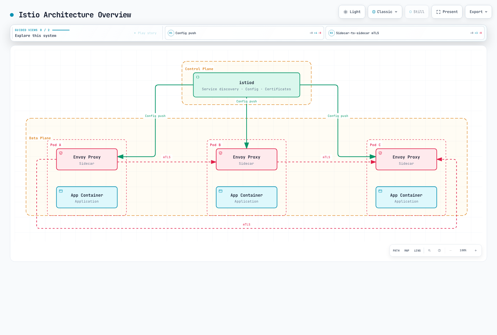

# Istio

> **Última actualización**: October 12, 2026 · guía de Istio 1.31

Esta descripción general mantiene utilizable la URL del capítulo anterior. El [índice de documentación de Istio](istio/README.md) y la [guía de instalación](istio/01-installation.md) mantenidos contienen los procedimientos detallados y la matriz de compatibilidad; utilícelos para la configuración actual.

## Tabla de contenido

- [Introducción](#introduction)
- [Características principales](#key-features)
- [Descripción general de la arquitectura](#architecture-overview)
- [Documentación detallada](#detailed-documentation)
- [Inicio rápido](#quick-start)
- [Recursos de aprendizaje](#learning-resources)

## Introducción

Istio es una plataforma de service mesh de código abierto para aplicaciones de microservicios. Un service mesh es una capa de infraestructura que gestiona la comunicación entre servicios, lo que permite el control y la observación de esa comunicación a nivel de infraestructura. La propagación de trace-context de la aplicación, el apagado controlado y la idempotencia de negocio aún requieren la participación de la aplicación.

### ¿Qué es un Service Mesh?

Un service mesh proporciona las siguientes capacidades principales:

1. **Gestión de tráfico**: Controla el flujo de tráfico entre servicios
2. **Seguridad**: Cifrado y autenticación de la comunicación entre servicios
3. **Observabilidad**: Visibilidad de la comunicación entre servicios

### Beneficios principales de Istio

- **Independencia de plataforma**: Funciona en diversos entornos (Kubernetes, VM, etc.)
- **Integración transparente**: Se pueden añadir muchos controles de red sin cambiar la lógica de negocio de la aplicación
- **mTLS de workload**: Identidad administrada y protección de transporte en las rutas del mesh inscritas; verifique la aplicación y las excepciones
- **Gestión avanzada de tráfico**: Enrutamiento, balanceo de carga, inyección de fallos, etc.
- **Métricas detalladas**: Métricas detalladas de la comunicación entre servicios
- **Aplicación de políticas**: Control de acceso y rate limiting local/global configurado explícitamente

## Características principales

### 1. Gestión de tráfico

Istio proporciona potentes capacidades de gestión de tráfico:

- **Gateways**: Enrutan el tráfico externo; distinga los recursos Istio Gateway de Kubernetes Gateway API
- **VirtualService / HTTPRoute**: Configure el enrutamiento mediante la API compatible con el data plane y el controlador seleccionados
- **DestinationRule**: Configure el balanceo de carga y los connection pools
- **División de tráfico**: Compatibilidad con despliegues Canary y pruebas A/B
- **Integración con Argo Rollouts**: Entrega progresiva con análisis y manejo de fallos configurados por separado

### 2. Seguridad

Características de seguridad integrales:

- **mTLS**: Autenticación de identidad y cifrado para el transporte de workload inscrito
- **Authorization Policy**: Control de acceso detallado
- **Request Authentication**: Validación de JWT; use AuthorizationPolicy cuando se requiera la presencia de un JWT
- **Peer Authentication**: Política de mTLS de workload entrante

### 3. Observabilidad

Telemetría e integraciones de backend, configuradas para el modo seleccionado:

- **Métricas**: Integración con Prometheus
- **Trazado distribuido**: Proveedor/backend de trazado configurado, como OpenTelemetry con Jaeger; las aplicaciones propagan el contexto
- **Logging**: Access logs y logging estructurado
- **Visualización**: Dashboard de Kiali

### 4. Resiliencia

Patrones de resiliencia de servicios:

- **Circuit Breaker**: Límites de connection/request-pool; no garantiza protección contra sobrecarga
- **Retry**: Presupuestos explícitos para operaciones seguras para reintentos; deshabilite los reintentos de escritura ambiguos
- **Timeout**: Configuración de timeout de solicitudes
- **Outlier Detection**: Excluye las instancias no saludables
- **Rate Limiting**: Token buckets locales configurados o un servicio global de rate limiting

## Descripción general de la arquitectura

Istio consta de un **Control Plane** y un **Data Plane**. El siguiente diagrama muestra la forma sidecar, no la topología ambient.



[🔍 Ver diagrama interactivo](https://www.atomai.click/kubernetes-docs/archmaps/en-service-mesh-02-istio-0.html)

### Control Plane (istiod)

istiod es el componente de control central de Istio y proporciona:

- **Service Discovery**: Mantiene el registro de servicios del mesh
- **Gestión de configuración**: Observa la configuración, la traduce y distribuye la configuración del proxy; Kubernetes conserva los recursos de API
- **Gestión de certificados**: Gestiona las solicitudes y la rotación de certificados de workload con la CA configurada

### Data Plane: Sidecar y Ambient

En el modo sidecar, Envoy se ejecuta junto a cada Pod de aplicación inscrito:

- **Enrutamiento de tráfico**: Controla el tráfico entre servicios
- **Balanceo de carga**: Distribuye el tráfico entre las instancias de servicio
- **Seguridad**: Cifrado y autenticación mTLS
- **Observabilidad**: Recopila métricas, logs y trazas

Ambient utiliza ztunnel a nivel de nodo para el transporte L4 y waypoints opcionales de Envoy para las características L7 compatibles. No inyecta un Envoy en cada Pod de aplicación. La compatibilidad de características, la asociación de políticas y el uso de recursos difieren según el modo; de esta topología no se deduce ni un porcentaje fijo de ahorro de recursos ni una superioridad de rendimiento universal. Consulte [Modo Ambient](istio/advanced/01-ambient-mode.md).

## Documentación detallada

Los enlaces siguientes son un mapa de aprendizaje hacia el subárbol mantenido. Su índice incluye temas adicionales y añadidos recientemente.

### 📚 Documentación básica

| Documento | Descripción |
|----------|-------------|
| [Guía de instalación](istio/01-installation.md) | Instalación de Istio y configuración inicial |
| [Conceptos principales](istio/02-basic-concepts.md) | Conceptos básicos y terminología de Istio |
| [Componentes](istio/03-architecture.md) | Arquitectura y componentes de Istio |

### 🚦 Gestión de tráfico

| Documento | Descripción |
|----------|-------------|
| [Gateway & VirtualService](istio/traffic-management/01-gateway-virtualservice.md) | Configuración de Gateway de Ingress/Egress |
| [Enrutamiento](istio/traffic-management/02-routing.md) | Reglas de enrutamiento de VirtualService |
| [DestinationRule](istio/traffic-management/03-destination-rule.md) | Políticas de tráfico de Service |
| [División de tráfico](istio/traffic-management/04-traffic-splitting.md) | Despliegue Canary y pruebas A/B |
| [Timeout y Retry](istio/traffic-management/05-retry-timeout.md) | Políticas de timeout y retry |
| [Balanceo de carga](istio/traffic-management/06-load-balancing.md) | Diversas estrategias de balanceo de carga |
| [Circuit Breaker](istio/traffic-management/07-circuit-breaker.md) | Implementación del patrón Circuit Breaker |
| [Inyección de fallos](istio/traffic-management/08-fault-injection.md) | Ingeniería del caos |
| [Duplicación de tráfico](istio/traffic-management/09-traffic-mirror.md) | Duplicación de tráfico y pruebas de sombra |
| [Afinidad de sesión](istio/traffic-management/10-session-affinity.md) | Configuración de afinidad de sesión |

### 🔐 Seguridad

| Documento | Descripción |
|----------|-------------|
| [mTLS](istio/security/01-mtls.md) | Configuración de mTLS entre servicios |
| [Authorization Policy](istio/security/03-authorization.md) | Políticas de control de acceso |
| [Request Authentication](istio/security/02-authentication.md) | Autenticación basada en JWT |
| [Peer Authentication](istio/security/01-mtls.md) | Autenticación entre servicios |

### 📊 Observabilidad

| Documento | Descripción |
|----------|-------------|
| [Métricas](istio/observability/01-metrics.md) | Recopilación de métricas de Prometheus |
| [Trazado distribuido](istio/observability/02-tracing.md) | Integración con Jaeger/Zipkin |
| [Logging](istio/observability/03-logging.md) | Access logs y logging estructurado |
| [Visualización](istio/observability/04-dashboards.md) | Dashboards de Kiali y Grafana |

### 💪 Resiliencia

| Documento | Descripción |
|----------|-------------|
| [Outlier Detection](istio/resilience/01-outlier-detection.md) | Detección de instancias no saludables |
| [Rate Limiting](istio/resilience/02-rate-limiting.md) | Rate limiting local y global |
| [Zone Aware Routing](istio/resilience/03-zone-aware-routing.md) | Enrutamiento consciente de la localidad |

### 🚀 Temas avanzados

| Documento | Descripción |
|----------|-------------|
| [Modo Ambient](istio/advanced/01-ambient-mode.md) | Service mesh sin sidecar |
| [Multi-cluster](istio/advanced/02-multi-cluster.md) | Configuración de mesh multi-cluster |
| [EnvoyFilter](istio/advanced/03-envoy-filter.md) | Personalización de Envoy |
| [Captura y caché de DNS](istio/advanced/04-dns-cache.md) | Captura, resolución de DNS y comportamiento medido de la caché |
| [gRPC](istio/advanced/05-grpc.md) | Compatibilidad con el protocolo gRPC |
| [WebSocket](istio/advanced/06-websocket.md) | Compatibilidad con conexiones WebSocket |
| [Sidecar Injection](istio/advanced/07-sidecar-injection.md) | Mecanismo de inyección de sidecar |
| [Argo Rollouts](istio/advanced/08-argo-rollouts.md) | Integración de entrega progresiva |

### ✅ Prácticas recomendadas

| Documento | Descripción |
|----------|-------------|
| [Prácticas recomendadas](istio/best-practices.md) | Lista de verificación y recomendaciones de producción |

## Inicio rápido

1. Compruebe la intersección exacta de compatibilidad de Istio/Kubernetes/EKS en la [guía de instalación](istio/01-installation.md). Un requisito previo genérico de “Kubernetes 1.28+” no es suficiente para una versión actual de Istio.
2. Elija sidecar o ambient y siga el CLI/chart fijado, el namespace aislado y los requisitos previos de la plataforma de esa guía. No descargue un CLI latest no especificado para después cambiar a un directorio de una versión antigua.
3. Utilice el procedimiento Bookinfo de versión correspondiente y las instrucciones de Gateway de la guía mantenida. El perfil predeterminado no proporciona automáticamente un Deployment de ingress gateway, y un objeto de configuración Gateway por sí solo no crea el gateway/LoadBalancer requerido por todas las instalaciones.
4. Verifique la dirección real del gateway, el puerto de Service, el estado de la ruta y la respuesta HTTP. Un load balancer puede publicar una IP o un hostname; no suponga un campo de hostname exclusivo de AWS ni un nombre de puerto concreto.
5. Instale o configure los [backends de observabilidad](istio/observability/README.md) elegidos antes de utilizar comandos de dashboard. Prometheus, Grafana, Kiali y el almacenamiento de trazado no se instalan automáticamente con el perfil predeterminado de Istio.

Verificación básica después de completar ese procedimiento:

```bash
istioctl version
istioctl analyze -A
istioctl proxy-status
```

El estado del proxy es solo una entrada de diagnóstico. La inscripción en ambient y ztunnel necesitan sus propias comprobaciones, y un resultado limpio del analizador no es una prueba de tráfico de extremo a extremo.

## Recursos de aprendizaje

### Documentación oficial

- [Documentación oficial de Istio](https://istio.io/latest/docs/)
- [Repositorio GitHub de Istio](https://github.com/istio/istio)
- [Documentación de Envoy Proxy](https://www.envoyproxy.io/docs/envoy/latest/)

### AWS y comunidad

- [Istio en Amazon EKS](https://istio.io/latest/docs/setup/platform-setup/amazon-eks/)
- [Guía de integración de AWS mantenida](istio/04-aws-integration.md)
- [Aviso sobre el ciclo de vida de AWS App Mesh](https://docs.aws.amazon.com/app-mesh/latest/userguide/what-is-app-mesh.html): AWS finalizó el soporte el 30 de septiembre de 2026. Evalúe los requisitos de migración; esto no es una recomendación para nuevos despliegues.
- [Comunidad, canales y grupos de trabajo de Istio](https://istio.io/latest/get-involved/)

### Recursos adicionales

- [Patrones de Service Mesh (O'Reilly)](https://www.oreilly.com/library/view/service-mesh-patterns/9781492086444/)
- [Istio in Action (Manning)](https://www.manning.com/books/istio-in-action)
- [Guía de optimización del rendimiento de Istio](https://istio.io/latest/docs/ops/deployment/performance-and-scalability/)

## Cuestionario

Para comprobar sus conocimientos de Istio, pruebe el [Cuestionario de Istio](../quizzes/service-mesh/02-istio-quiz.md).

El cuestionario cubre los siguientes temas:

- Conceptos básicos de service mesh
- Arquitectura de Istio
- Gestión de tráfico (despliegue Canary)
- Seguridad (mTLS)
- Gateway e Ingress
- Herramientas de observabilidad
- Modos sidecar y ambient
- Rate Limiting
- Enrutamiento por localidad
- Integración con Amazon EKS

---

**Próximos pasos**: Consulte la [Guía de instalación](istio/01-installation.md) para instalar Istio y aprenda conceptos básicos en [Conceptos principales](istio/02-basic-concepts.md).
