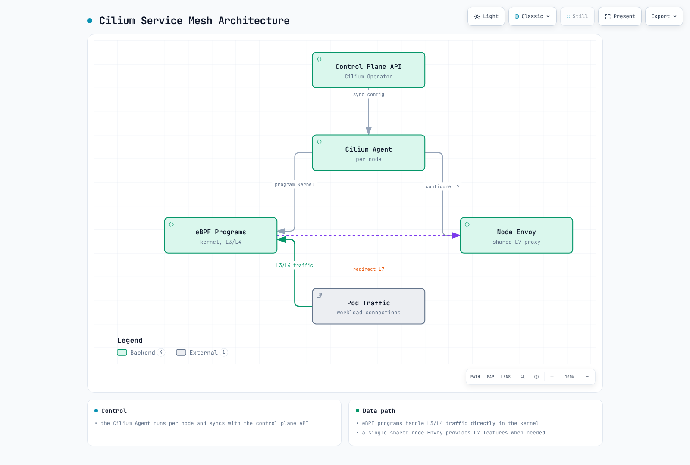
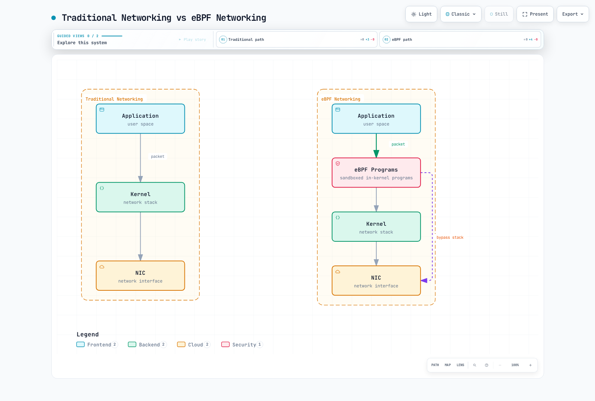
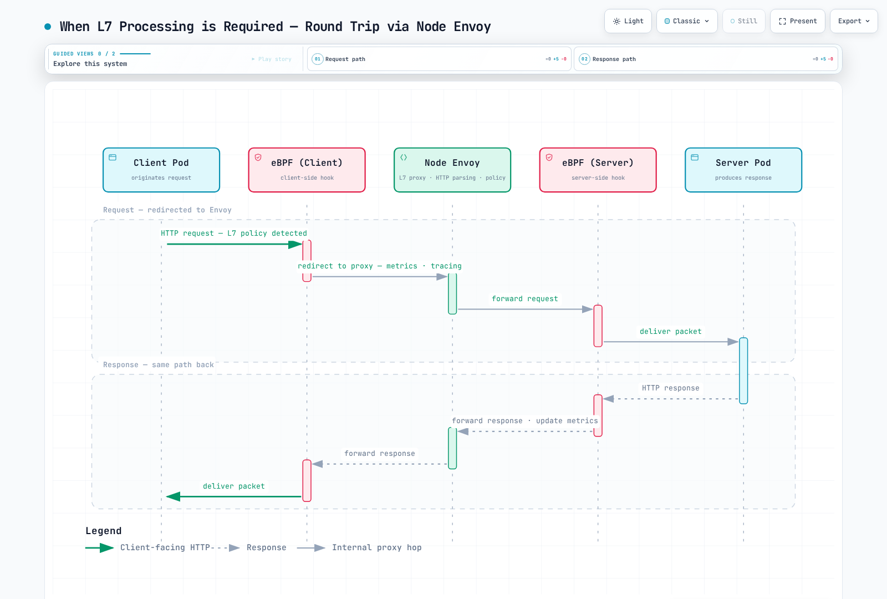

# Arquitectura de Cilium Service Mesh

> **Base de revisión**: Cilium 1.20.3, 16 de octubre de 2026. Su matriz general de pruebas de Kubernetes cubre las versiones 1.33–1.36; la matriz de CI publicada para EKS cubre las versiones 1.33–1.35. Los requisitos de la plataforma, el kernel y el modo de instalación se evalúan por separado; consulte la [descripción general](./README.md).

## Descripción general

Cilium combina un datapath eBPF de L3/L4 con Envoy para HTTP y otros procesos L7 compatibles. Envoy puede ejecutarse como un proceso gestionado por el agente o en un DaemonSet `cilium-envoy` independiente. Compartir proxies cambia los límites de despliegue y de fallo; no garantiza un ahorro concreto de memoria ni un resultado determinado de latencia.

## Arquitectura general



[🔍 Ver diagrama interactivo](https://www.atomai.click/kubernetes-docs/archmaps/en-service-mesh-cilium-service-mesh-01-architecture-0.html)

El recuadro superior agrupa funciones del plano de control. **El servidor de API de Kubernetes y Cilium Operator son componentes distintos**; Operator es un Deployment encargado de tareas para todo el clúster, no un agente por nodo ni un sustituto del servidor de API.

| Componente | Responsabilidad |
|---|---|
| Cilium Agent | Gestiona los endpoints locales, los programas y mapas eBPF, las políticas y la configuración de Envoy |
| Cilium Operator | Realiza tareas para todo el clúster, como la recolección de identidades no utilizadas, el registro de CRD y la asignación de IP en los modos IPAM aplicables |
| Envoy | Gestiona el tráfico L7 redirigido; un DaemonSet independiente permite administrar el ciclo de vida del proxy por separado |
| API de Kubernetes | Almacena los recursos deseados e informa a los controladores sobre el estado de las cargas de trabajo y los servicios |
| Hubble | Observa los eventos compatibles del datapath y de los proxies; Relay y la interfaz de usuario son componentes adicionales cuando se habilitan |

## Datapath eBPF

### Programas y puntos de enganche

Los programas eBPF se ejecutan en puntos de enganche definidos del kernel después de su verificación. Pueden aplicar filtrado y redirección de paquetes, y traducir servicios sin añadir un salto por un proxy en espacio de usuario a cada paquete L3/L4.



[🔍 Ver diagrama interactivo](https://www.atomai.click/kubernetes-docs/archmaps/en-service-mesh-cilium-service-mesh-01-architecture-1.html)

La flecha de bypass representa una posible optimización; no garantiza que Cilium omita todas las capas de red de Linux. Siguen siendo relevantes la pila de sockets del Pod, el modo de enrutamiento, las capacidades del kernel y los requisitos de integración.

| Punto de enganche o ruta | Uso y salvedad en Cilium |
|---|---|
| TC/TCX y datapath del endpoint | Aplican políticas a nivel de paquete, reenvían tráfico y gestionan servicios; el mecanismo de conexión depende del modo de datapath y del kernel |
| Puntos de enganche de sockets cgroup | Traducen servicios a nivel de socket, por ejemplo en `connect()` de TCP; esto difiere del balanceo de carga TC a nivel de paquete |
| XDP | Permite procesamiento temprano opcional, como la aceleración de NodePort o LoadBalancer en dispositivos compatibles; no se habilita para todas las rutas por el mero hecho de instalar Cilium |
| veth/netkit | Son opciones alternativas de dispositivo y datapath para endpoints, con requisitos propios; no definen una secuencia universal de puntos de enganche |

### Seguimiento de conexiones y políticas

Cilium almacena el estado de las conexiones en mapas BPF. Esto permite gestionar estado, reconocer respuestas y mantener metadatos de NAT y de redirección a proxies. **No significa** que el primer paquete almacene para siempre una decisión de autorización que se aplique a todos los siguientes: el datapath de endpoints publicado comprueba la política tanto para `CT_NEW` como para `CT_ESTABLISHED` en la dirección que inicia la conexión, con excepciones explícitas. El tráfico de respuesta o relacionado que se reconoce sigue la gestión de retorno con estado. Las actualizaciones de políticas, las redirecciones a proxies y las rutas optimizadas deben evaluarse en la configuración real.

La tabla siguiente es conceptual; no representa una estructura de C ni una ABI de mapa:

| Información del mapa | Propósito |
|---|---|
| Clave de tupla CT y valor del estado de conexión | Identificar un flujo y su dirección, y conservar su estado, duración y metadatos de traducción |
| Mapas de frontend y backend de servicios | Traducir direcciones, puertos y protocolos de Service a entradas de backend |
| Mapa de políticas | Representar las políticas compiladas de identidad, dirección, puerto y protocolo, junto con metadatos relacionados de proxy y autenticación |
| Caché de IP | Asociar direcciones y prefijos con identidades de seguridad e información de enrutamiento |

Consulte las definiciones BPF publicadas al leer mapas sin procesar. Las claves, los valores, el orden de bytes y la disposición difieren entre IPv4 e IPv6; no es seguro interpretar datos con una estructura inventada `ct_entry` que incluya tanto la tupla como el estado.

### Reemplazo de kube-proxy {#kube-proxy-replacement}

El fragmento siguiente corresponde a un **modo de instalación**, no a un procedimiento de migración. Sustituya el host y el puerto de API por un endpoint accesible antes de que esté disponible la traducción de servicios. El puerto 6443 es ilustrativo; los endpoints de la API de EKS suelen usar HTTPS en el puerto 443. Conserve la configuración IPAM, de enrutamiento y de CNI elegida para la plataforma.

```yaml
kubeProxyReplacement: true
k8sServiceHost: <reachable-api-server-host>
k8sServicePort: 6443
loadBalancer:
  algorithm: maglev
```

`loadBalancer.algorithm: maglev` proporciona selección consistente de backends para el tráfico externo norte-sur aplicable. En este modo, las conexiones este-oeste a servicios de Cilium a nivel de socket no utilizan Maglev. `Service.spec.sessionAffinity: ClientIP` de Kubernetes es una función distinta; Maglev no es persistencia basada en cookies ni garantiza que se conserven las conexiones con un backend que se haya eliminado.

| Tema | Distinción arquitectónica |
|---|---|
| Traducción de servicios | Las implementaciones de kube-proxy incluyen iptables y nftables; Cilium usa BPF y, cuando se habilita, traducción a nivel de socket |
| Estado de conexión | conntrack de Linux y los mapas BPF CT de Cilium son mecanismos distintos |
| DSR | `loadBalancer.mode: dsr` permite que los backends respondan directamente usando la dirección del servicio; hay que comprobar las combinaciones compatibles de despacho y enrutamiento, el MTU y la red de la nube |
| Rendimiento | Las propiedades algorítmicas de búsqueda, por sí solas, no determinan la latencia de solicitudes completas, el rendimiento ni el consumo de CPU |

En Cilium 1.20.3, el despacho de opciones DSR requiere enrutamiento nativo; el despacho Geneve es compatible con enrutamiento nativo o túnel Geneve, mientras que el enrutamiento por túnel VXLAN no es una combinación DSR compatible. Las comprobaciones de origen y destino de AWS también pueden afectar a DSR. No añada `mode: dsr` a una instalación arbitraria de EKS sin revisar los [requisitos específicos del modo](https://github.com/cilium/cilium/blob/v1.20.3/Documentation/network/kubernetes/kubeproxy-free.rst).

## Proxy Envoy compartido

### Despliegue y configuración de recursos

Esta superposición de Helm habilita el DaemonSet independiente de Envoy y la gestión directa de CEC para una instalación de Cilium ya planificada. Combínela con los valores revisados de la instalación. Las cifras de recursos son solicitudes y límites de ejemplo, no mediciones de benchmarks ni tamaños universales.

```yaml
l7Proxy: true
envoyConfig:
  enabled: true
envoy:
  enabled: true
  resources:
    requests:
      cpu: 100m
      memory: 256Mi
    limits:
      cpu: 2000m
      memory: 2Gi
```

```bash
kubectl -n kube-system get daemonset cilium cilium-envoy
kubectl -n kube-system get deployment cilium-operator
kubectl -n kube-system get pods -l k8s-app=cilium -o wide
```

La cantidad deseada y el número de instancias listas dependen de los nodos que cumplan los requisitos. El modo de Envoy integrado tiene otro ciclo de vida de proceso y no necesita este DaemonSet independiente.

### Flujo de procesamiento L7

Una política de red HTTP L7 redirige el tráfico pertinente al proxy de aplicación de políticas. El balanceo de servicios CEC, Ingress y Gateway API también pueden incluir Envoy en la ruta. Por eso, afirmar que «solo el tráfico con una política de red L7 usa Envoy» es demasiado restrictivo.



[🔍 Ver diagrama interactivo](https://www.atomai.click/kubernetes-docs/archmaps/en-service-mesh-cilium-service-mesh-01-architecture-12.html)

Este diagrama ilustra una política de **salida**. Una política de entrada se aplica en el lado receptor; ambas se pueden configurar. Una respuesta HTTP con proxy atraviesa la conexión establecida del proxy; no se toma otra decisión arbitraria para redirigir o evitar cada respuesta. Para inspeccionar campos HTTP en cargas útiles de aplicación cifradas con TLS, se necesita la configuración TLS/L7 compatible correspondiente.

### Propiedad de la configuración

Mantenga la configuración del agente generada por Helm a través de los valores de la instalación. Sustituir `cilium-config` por un ConfigMap breve escrito a mano puede omitir ajustes necesarios de la plataforma.

Los comandos siguientes inspeccionan una versión instalada y un agente; primero configure `CILIUM_POD` como se indica en la sección de identidad:

```bash
helm get values cilium -n kube-system -a
kubectl -n kube-system get configmap cilium-config -o yaml
kubectl -n kube-system logs "$CILIUM_POD" -c cilium-agent --since=10m
```

El chart 1.20.3 utiliza `envoy.connectTimeoutSeconds`, `envoy.clusterMaxConnections`, `envoy.clusterMaxPendingRequests` y `envoy.clusterMaxRequests`. Claves como `envoy.connectTimeout`, `maxConnectionsPerHost`, `envoy.cluster.*` y `envoy.proxy.protocol.*` no implementan esos controles. La configuración de HTTP/2 y TLS corresponde a las API compatibles de los controladores o de Envoy, no a opciones de Helm inventadas.

## Modelo de CRD

| Recurso | Alcance y función |
|---|---|
| `CiliumNetworkPolicy` | Política de endpoints con ámbito de espacio de nombres, que incluye reglas L7 compatibles |
| `CiliumClusterwideNetworkPolicy` | Política de endpoints con ámbito de clúster; los selectores siguen determinando qué endpoints se ven afectados |
| `CiliumEnvoyConfig` (CEC) | Recursos Envoy de bajo nivel y redirección de servicios con ámbito de espacio de nombres |
| `CiliumClusterwideEnvoyConfig` (CCEC) | Configuración Envoy de ámbito de clúster; los servicios individuales siguen identificándose explícitamente |
| `CiliumEndpoint` | Estado del endpoint con ámbito de espacio de nombres, mantenido por Cilium |
| `CiliumIdentity` | Asignación con ámbito de clúster de una identidad de seguridad a un conjunto de etiquetas |

No todos estos recursos «se resuelven en CiliumEndpoint». Las tareas habituales de entrada y enrutamiento pueden usar recursos compatibles de Gateway API; la gestión directa de CEC/CCEC es una opción de nivel más bajo que requiere experiencia con Envoy.

### CiliumEnvoyConfig

Este ejemplo presupone que ya existe el **Service gestionado por Cilium `default/my-service`, con un puerto frontend 8080 y backends HTTP listos**. Redirige ese frontend a un Listener, usa una RouteConfiguration de RDS y define el Cluster de EDS al que se hace referencia. Las cargas de trabajo y el Service mencionados son requisitos previos; este ejemplo no los crea.

```yaml
apiVersion: cilium.io/v2
kind: CiliumEnvoyConfig
metadata:
  name: http-filter
  namespace: default
spec:
  services:
  - name: my-service
    namespace: default
    ports:
    - 8080
    listener: http-listener
  resources:
  - '@type': type.googleapis.com/envoy.config.listener.v3.Listener
    name: http-listener
    filter_chains:
    - filters:
      - name: envoy.filters.network.http_connection_manager
        typed_config:
          '@type': type.googleapis.com/envoy.extensions.filters.network.http_connection_manager.v3.HttpConnectionManager
          stat_prefix: my-service
          rds:
            route_config_name: http-route
          http_filters:
          - name: envoy.filters.http.router
            typed_config:
              '@type': type.googleapis.com/envoy.extensions.filters.http.router.v3.Router
  - '@type': type.googleapis.com/envoy.config.route.v3.RouteConfiguration
    name: http-route
    virtual_hosts:
    - name: my-service
      domains:
      - '*'
      routes:
      - match:
          prefix: /
        route:
          cluster: default/my-service
  - '@type': type.googleapis.com/envoy.config.cluster.v3.Cluster
    name: default/my-service
    connect_timeout: 5s
    type: EDS
    lb_policy: ROUND_ROBIN
```

La entrada `services` también habilita la sincronización de backends mediante EDS. `backendServices` sirve para añadir otros servicios backend cuyo propio tráfico frontend no deba redirigirse. El espacio de nombres del Service frontend de un CEC debe coincidir con el espacio de nombres del propio CEC. La dirección omitida del Listener es intencional: Cilium asigna el puerto del proxy e incorpora sus fuentes xDS. Este recurso pertenece a Cilium; no es un archivo bootstrap independiente de Envoy.

### CiliumClusterwideEnvoyConfig

Este ejemplo independiente tiene como objetivo un **servicio existente `default/rate-limited-service:8080`**. Aplica un token bucket local con una ráfaga inicial de 1.000 solicitudes y una reposición de 100 tokens por segundo. Habilita y aplica explícitamente el filtro al 100 % de las solicitudes.

```yaml
apiVersion: cilium.io/v2
kind: CiliumClusterwideEnvoyConfig
metadata:
  name: local-rate-limit
spec:
  services:
  - name: rate-limited-service
    namespace: default
    ports:
    - 8080
    listener: http-listener
  resources:
  - '@type': type.googleapis.com/envoy.config.listener.v3.Listener
    name: http-listener
    filter_chains:
    - filters:
      - name: envoy.filters.network.http_connection_manager
        typed_config:
          '@type': type.googleapis.com/envoy.extensions.filters.network.http_connection_manager.v3.HttpConnectionManager
          stat_prefix: rate-limited-service
          rds:
            route_config_name: http-route
          http_filters:
          - name: envoy.filters.http.local_ratelimit
            typed_config:
              '@type': type.googleapis.com/envoy.extensions.filters.http.local_ratelimit.v3.LocalRateLimit
              stat_prefix: http_local_rate_limiter
              token_bucket:
                max_tokens: 1000
                tokens_per_fill: 100
                fill_interval: 1s
              filter_enabled:
                default_value:
                  numerator: 100
                  denominator: HUNDRED
              filter_enforced:
                default_value:
                  numerator: 100
                  denominator: HUNDRED
              local_rate_limit_per_downstream_connection: false
          - name: envoy.filters.http.router
            typed_config:
              '@type': type.googleapis.com/envoy.extensions.filters.http.router.v3.Router
  - '@type': type.googleapis.com/envoy.config.route.v3.RouteConfiguration
    name: http-route
    virtual_hosts:
    - name: rate-limited-service
      domains:
      - '*'
      routes:
      - match:
          prefix: /
        route:
          cluster: default/rate-limited-service
  - '@type': type.googleapis.com/envoy.config.cluster.v3.Cluster
    name: default/rate-limited-service
    connect_timeout: 5s
    type: EDS
    lb_policy: ROUND_ROBIN
```

El alcance de clúster de CCEC no convierte `"*"` en un comodín de servicios o espacios de nombres. Si se omite `nodeSelector`, esta configuración se distribuye a todos los nodos aplicables; eso no selecciona todos los servicios.

El bucket anterior se comparte entre los hilos de trabajo **dentro de cada proceso Envoy**, no entre todos los proxies del clúster. El límite agregado depende de cómo se distribuye el tráfico y de cuántos procesos participan. No es una cuota global de clúster. Por defecto, tanto `filter_enabled` como `filter_enforced` tienen un valor de 0 %; añadir solo un bucket no basta.

Kubernetes conserva los campos desconocidos dentro de `spec.resources`; que `kubectl apply` termine correctamente no demuestra que Envoy haya aceptado los recursos. Inspeccione las advertencias y errores del agente, la aceptación de xDS y las solicitudes reales. Evite conflictos entre recursos CEC directos y la configuración que gestionan los controladores Ingress/Gateway.

### CiliumNetworkPolicy con reglas HTTP

Esta política selecciona `app=backend` en `default`, permite las operaciones HTTP enumeradas desde `app=frontend` en el mismo espacio de nombres y permite el tráfico saliente a la base de datos y DNS. Presupone que los endpoints de CoreDNS en `kube-system` tienen la etiqueta `k8s-app=kube-dns`; NodeLocal DNS y otras configuraciones de resolución necesitan su propia regla de salida verificada.

```yaml
apiVersion: cilium.io/v2
kind: CiliumNetworkPolicy
metadata:
  name: l7-policy
  namespace: default
spec:
  endpointSelector:
    matchLabels:
      k8s:app: backend
  ingress:
  - fromEndpoints:
    - matchLabels:
        k8s:app: frontend
        k8s:io.kubernetes.pod.namespace: default
    toPorts:
    - ports:
      - port: '8080'
        protocol: TCP
      rules:
        http:
        - method: ^GET$
          path: ^/api/v1/.*$
          headers:
          - X-Request-ID
        - method: ^POST$
          path: ^/api/v1/users$
        - method: ^DELETE$
          path: ^/api/v1/users/[0-9]+$
  egress:
  - toEndpoints:
    - matchLabels:
        k8s:app: database
        k8s:io.kubernetes.pod.namespace: default
    toPorts:
    - ports:
      - port: '5432'
        protocol: TCP
  - toEndpoints:
    - matchLabels:
        k8s:k8s-app: kube-dns
        k8s:io.kubernetes.pod.namespace: kube-system
    toPorts:
    - ports:
      - port: '53'
        protocol: UDP
      - port: '53'
        protocol: TCP
```

`headers` es una lista de cadenas. `"X-Request-ID"` requiere que la cabecera esté presente; no demuestra identidad ni autorización. `headerMatches` es la API estructurada independiente para valores exactos y secretos. Las reglas HTTP son alternativas, de modo que el requisito de cabecera anterior solo se aplica a GET; para las escrituras sigue siendo necesaria la autenticación y autorización de la aplicación.

Las secciones de entrada y salida habilitan el comportamiento predeterminado de denegación correspondiente para los endpoints seleccionados, sujeto a las autorizaciones concedidas por otras políticas aplicables. Esto no define la política completa de dependencias de una aplicación: los chequeos de estado, los servicios externos y los demás clientes deben modelarse por separado.

## Agente, identidad y SPIFFE

### Responsabilidades del agente


[🔍 Ver diagrama interactivo](https://www.atomai.click/kubernetes-docs/archmaps/en-service-mesh-cilium-service-mesh-01-architecture-7.html)

Los grupos describen responsabilidades, no flujos de eventos exclusivos: la observabilidad puede exponer eventos de varios componentes del datapath y del proxy. Las responsabilidades del Operator para todo el clúster siguen siendo independientes.

### Identidades de seguridad

Cilium asigna una identidad de seguridad numérica a cada conjunto de etiquetas que define una identidad. Los Pods con el mismo conjunto pueden compartir una identidad. Las etiquetas del espacio de nombres y de la cuenta de servicio pueden contribuir a ella, pero el número no es un hash calculado por el usuario ni un identificador permanente por Pod. Cilium mantiene la relación entre direcciones e identidades a medida que cambian los endpoints.

Inspeccione la identidad asignada; no cree un objeto `CiliumIdentity` con un ID supuesto:

```bash
kubectl -n default get ciliumendpoints
kubectl get ciliumidentities
CILIUM_POD='<agent-pod-on-the-node-being-inspected>'
kubectl -n kube-system exec "$CILIUM_POD" -c cilium-agent -- cilium-dbg identity list
kubectl -n kube-system exec "$CILIUM_POD" -c cilium-agent -- cilium-dbg status --verbose
```

Por ejemplo, los ID reservados 1, 2, 3 y 4 corresponden, respectivamente, a `host`, `world`, `unmanaged` y `health`. Los despliegues dual-stack también tienen identidades distintas para cada familia `world`. Los ID asignados a cargas de trabajo dependen del entorno y no deben copiarse como constantes fijas de políticas.

### Integración con SPIRE y límites de seguridad

La autenticación mutua fuera de banda en beta de Cilium usa los agentes de Cilium para obtener y verificar identidades en nombre de las identidades de seguridad de Cilium. Con el dominio de confianza predeterminado, el ID es:

```text
spiffe://spiffe.cilium/identity/<numeric-security-identity>
```

Esto difiere de la ruta de espacio de nombres/cuenta de servicio de Istio. Cambiar `authentication.mutual.spire.trustDomain` modifica la parte del dominio de confianza.

```yaml
authentication:
  enabled: true
  mutual:
    spire:
      enabled: true
      trustDomain: spiffe.cilium
      agentSocketPath: /run/spire/sockets/agent/agent.sock
      install:
        enabled: true
        server:
          dataStorage:
            enabled: true
            size: 1Gi
```

Esta superposición opcional requiere un StorageClass/PV adecuado para el almacenamiento persistente de SPIRE y una política de autenticación explícita para el tráfico seleccionado. Habilitar SPIRE por sí solo no exige autenticación mutua en todas las conexiones.

El intercambio de autenticación ocurre fuera de banda. **El cifrado del tráfico de aplicación es una configuración independiente de WireGuard/IPsec**, con limitaciones propias de plataforma y de ruta. Cilium documenta esta función de autenticación mutua como beta/incompleta, incluidas las limitaciones de ClusterMesh e interoperabilidad con mTLS externo; no debe describirse como equivalente a mTLS de sidecar aplicado universalmente.

### Cifrado ztunnel en beta por separado

Cilium 1.20.3 también ofrece una [beta independiente de cifrado transparente con ztunnel](https://github.com/cilium/cilium/blob/v1.20.3/Documentation/security/network/encryption-ztunnel.rst), que se selecciona con `encryption.type: ztunnel`. Proporciona mTLS de cargas de trabajo TCP mediante la inscripción de espacios de nombres; ambos extremos deben estar inscritos. Excluye ClusterMesh y los Pods que usan la red del host, y la guía publicada advierte que las políticas L4 habituales no funcionan por esta ruta, salvo cuando se dirigen al puerto HBONE 15008. Esta es una opción de despliegue distinta, con requisitos propios de CA e inicio de configuración.

El ejemplo de identidad SPIFFE numérica anterior corresponde a la autenticación fuera de banda. La integración de ztunnel utiliza un modelo independiente de identidad de carga de trabajo por espacio de nombres/cuenta de servicio y usa de forma predeterminada la opción de CA interna de Cilium; SPIRE no es obligatorio con esa opción predeterminada.

## Flujo de paquetes por escenario

### Pods en el mismo nodo


[🔍 Ver diagrama interactivo](https://www.atomai.click/kubernetes-docs/archmaps/en-service-mesh-cilium-service-mesh-01-architecture-10.html)

Esta es una ruta rápida veth simplificada. Si se cumplen sus requisitos, el enrutamiento BPF del host puede evitar la pila **del host** superior y los hooks de netfilter; la pila de protocolos del Pod sigue existiendo. El enrutamiento heredado del host, netkit, la redirección a proxies y las integraciones modifican la ruta. Las funciones que dependen de los hooks de netfilter del host requieren especial atención; este diagrama no garantiza una latencia universal de 0,1 ms.

### Pods en nodos diferentes

Con el enrutamiento por túnel, el nodo emisor encapsula el tráfico en VXLAN o Geneve y el receptor lo desencapsula. El enrutamiento nativo usa rutas de la red subyacente a las direcciones de los Pods sin esa encapsulación superpuesta. La conectividad entre nodos, el enrutamiento de PodCIDR, el MTU, las reglas de firewall y el cifrado opcional determinan si la ruta funciona.

### Política HTTP o proxy de servicios

La política aplicable de entrada/salida o el frontend de un servicio puede redirigir el tráfico a Envoy. El proxy analiza el protocolo compatible y reenvía una solicitud permitida o enrutada; las respuestas vuelven por la conexión establecida. Esto no significa que todos los flujos deban pasar tanto por Envoy en el lado cliente como por Envoy en el lado servidor.

## Comparación con Istio

| Aspecto | Cilium Service Mesh | Modo sidecar de Istio |
|---|---|---|
| Ubicación del proxy | Envoy gestionado por el agente o un Envoy de nodo compartido e independiente para el tráfico L7 aplicable | Envoy junto a las cargas de trabajo inscritas |
| Datapath L3/L4 | Redes y políticas eBPF, con rutas del kernel que dependen del modo | Captura del tráfico de las cargas de trabajo y procesamiento Envoy dentro del ámbito de la malla |
| Configuración L7 | CNP, Gateway API/controladores compatibles o CEC/CCEC directos | Gateway API y las API de tráfico y seguridad de Istio |
| Autenticación y cifrado | Autenticación mutua fuera de banda, además de WireGuard/IPsec; beta independiente de mTLS con ztunnel | mTLS de cargas de trabajo mediante Envoy |
| Contabilización de recursos | Incluya los agentes, mapas BPF, Envoy, Operator y Hubble/SPIRE opcionales | Incluya los sidecars, el plano de control y los gateways/servicios de telemetría opcionales |

Istio también ofrece el modo ambient con ztunnel y proxies waypoint opcionales; una comparación limitada a sidecars no abarca todas las arquitecturas de Istio. Compare cargas de trabajo, tráfico, seguridad y observabilidad equivalentes, y registre las versiones, la cantidad de nodos, las tasas de solicitudes y los percentiles de latencia. No se aportaron benchmarks reproducibles para las cifras anteriores de 50 MB por Pod, 100 MB por nodo o totales fijos de milisegundos; no las use para dimensionar recursos.

## Consideraciones de escalabilidad

### Capacidad de los mapas BPF

La capacidad de los mapas depende de los flujos simultáneos, las identidades, los servicios/backends y la memoria de cada nodo, no solo de la cantidad de nodos del clúster. Los valores explícitos de Helm siguientes ilustran controles de mapas; no son una recomendación para todos los clústeres de 1.000 nodos:

```yaml
bpf:
  ctTcpMax: 524288
  ctAnyMax: 262144
  natMax: 524288
  policyMapMax: 16384
```

Al dimensionar explícitamente CT/NAT, la capacidad de NAT no debe superar dos tercios de la capacidad combinada de CT para TCP y protocolos no TCP; el ejemplo respeta ese límite. En cambio, `bpf.mapDynamicSizeRatio` deriva varias capacidades de mapas a partir de la memoria del nodo: 0.0025 significa el 0,25 % para los mapas afectados, no para toda la pila de Cilium. Los mapas de políticas son por endpoint y requieren una evaluación aparte.

Observe la presión y los errores de asignación antes de ajustar valores. Aumentar o volver a crear mapas puede consumir mucha memoria y alterar el tráfico existente. `cluster.id` pertenece al diseño de identidad del clúster/ClusterMesh, no es un ajuste genérico de rendimiento. No copie ejemplos obsoletos como `sockops-enable` ni el inexistente `hubble-disable`.

### Capacidad de Envoy

Superposición de ejemplo con claves reales del chart:

```yaml
envoy:
  resources:
    requests:
      cpu: 500m
      memory: 512Mi
    limits:
      cpu: 4000m
      memory: 4Gi
  extraArgs:
  - --concurrency 4
  connectTimeoutSeconds: 5
  clusterMaxConnections: 10000
  clusterMaxPendingRequests: 10000
  clusterMaxRequests: 10000
```

Los valores de solicitudes y límites, así como los cuatro workers, son ilustrativos; deben ajustarse a la capacidad de los nodos y a la carga medida. `envoy.extraArgs` pasa la opción de workers al proceso Envoy independiente; `envoy.concurrency` no es un ajuste del chart 1.20.3. La configuración de Envoy gestionado por el agente tiene otro ciclo de vida. Los límites de conexiones y solicitudes pendientes del clúster son controles de disyuntor, no una cuota global de solicitudes para toda la malla. El almacenamiento en búfer por listener pertenece al recurso Envoy correspondiente, no a `envoy.perConnectionBufferLimitBytes`.

## Próximos pasos

- [Gestión del tráfico](./02-traffic-management.md)
- [Seguridad](./03-security.md)
- [Observabilidad](./04-observability.md)
- [Cuestionario de arquitectura](../../quizzes/service-mesh/cilium-service-mesh/architecture.md)

## Referencias

- [Arquitectura de Cilium 1.20.3 y Envoy](https://github.com/cilium/cilium/blob/v1.20.3/Documentation/security/network/proxy/envoy.rst)
- [Reemplazo de kube-proxy, Maglev, DSR y balanceo de carga por socket](https://github.com/cilium/cilium/blob/v1.20.3/Documentation/network/kubernetes/kubeproxy-free.rst)
- [Comprobaciones de políticas del datapath publicado](https://github.com/cilium/cilium/blob/v1.20.3/bpf/bpf_lxc.c)
- [Enrutamiento y encapsulación](https://github.com/cilium/cilium/blob/v1.20.3/Documentation/network/concepts/routing.rst)
- [Opciones y limitaciones de rendimiento de eBPF](https://github.com/cilium/cilium/blob/v1.20.3/Documentation/operations/performance/tuning.rst)
- [Capacidad de mapas BPF](https://github.com/cilium/cilium/blob/v1.20.3/Documentation/network/ebpf/maps.rst)
- [Cilium Operator](https://github.com/cilium/cilium/blob/v1.20.3/Documentation/internals/cilium_operator.rst)
- [Ejemplo de gestión del tráfico Envoy](https://github.com/cilium/cilium/blob/v1.20.3/examples/kubernetes/servicemesh/envoy/envoy-traffic-management-test.yaml)
- [Analizador de recursos CEC](https://github.com/cilium/cilium/blob/v1.20.3/pkg/ciliumenvoyconfig/cec_resource_parser.go)
- [Esquema de CEC](https://github.com/cilium/cilium/blob/v1.20.3/pkg/k8s/apis/cilium.io/client/crds/v2/ciliumenvoyconfigs.yaml)
- [Esquema de CNP](https://github.com/cilium/cilium/blob/v1.20.3/pkg/k8s/apis/cilium.io/client/crds/v2/ciliumnetworkpolicies.yaml)
- [Valores de Helm 1.20.3](https://github.com/cilium/cilium/blob/v1.20.3/install/kubernetes/cilium/values.yaml)
- [Seguridad basada en identidades](https://github.com/cilium/cilium/blob/v1.20.3/Documentation/security/network/identity.rst)
- [Construcción del ID SPIFFE](https://github.com/cilium/cilium/blob/v1.20.3/pkg/auth/spire/certificate_provider.go)
- [Estado y limitaciones de la autenticación mutua](https://github.com/cilium/cilium/blob/v1.20.3/Documentation/network/servicemesh/mutual-authentication/mutual-authentication.rst)
- [API de limitación local de velocidad de Envoy 1.38.6](https://github.com/envoyproxy/envoy/blob/v1.38.6/api/envoy/extensions/filters/http/local_ratelimit/v3/local_rate_limit.proto)
