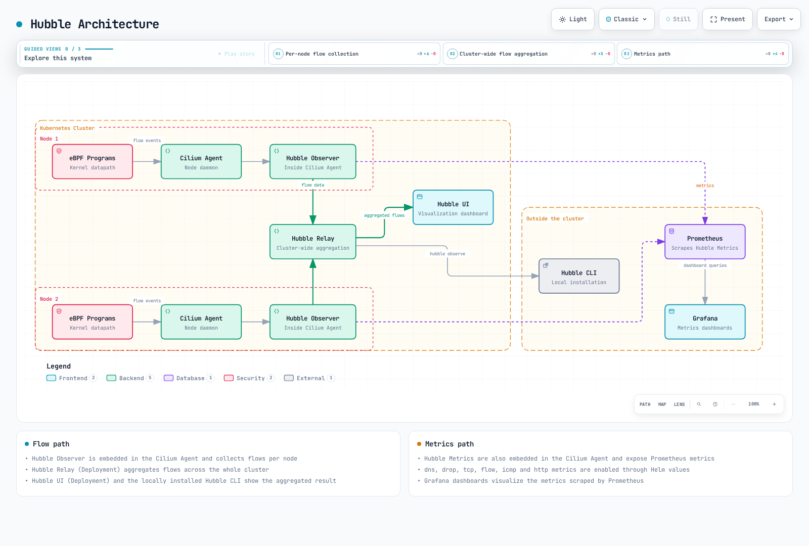
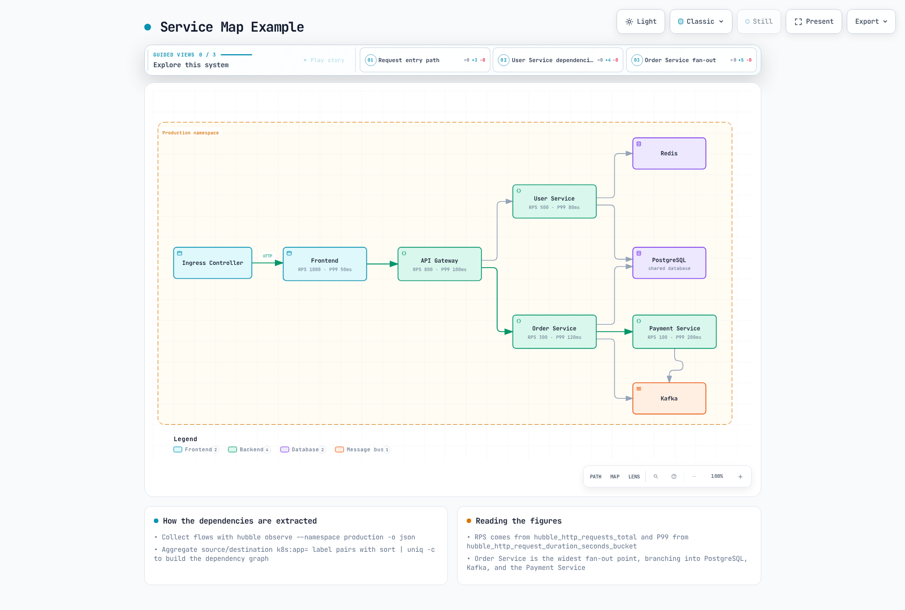
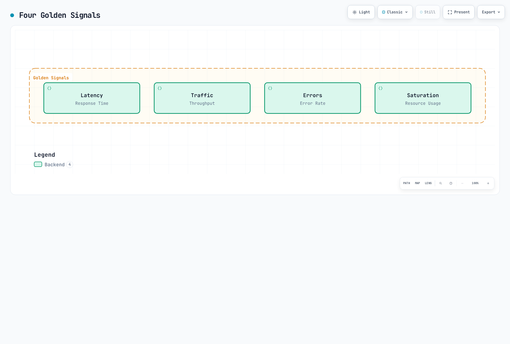

# Observabilidad del service mesh de Cilium

> **Última actualización**: 16 de octubre de 2026 · Cilium/chart 1.20.3 · Hubble CLI 1.20.2 · Collector Contrib 0.162.0 · Loki 3.7.8. Consulte la [introducción](./README.md) para conocer los requisitos de Kubernetes/EKS y de la plataforma.

## Descripción general

Hubble muestra observaciones del tráfico gestionado por Cilium. Los eventos L3/L4 proceden del plano de datos; para observar HTTP también se necesita una ruta compatible de proxy y política L7. Habilitar Hubble por sí solo no descifra cualquier tráfico TLS de las aplicaciones, no descubre todas las dependencias ni genera trazas distribuidas de aplicaciones.

Los ejemplos presuponen que las cargas de trabajo de `production` están preparadas y que Cilium está instalado correctamente. Al interpretar lo que puede observarse, tenga en cuenta las limitaciones de cifrado y ztunnel descritas en el [capítulo de seguridad](./03-security.md).

## Arquitectura Hubble



[🔍 Ver diagrama interactivo](https://www.atomai.click/kubernetes-docs/archmaps/en-service-mesh-cilium-service-mesh-04-observability-0.html)

La figura agrupa los componentes. Cuando está configurado, Envoy también proporciona eventos L7; eBPF no es la única fuente de observaciones HTTP. Prometheus recopila las métricas por separado de la API de flujos de Relay.

| Componente | Función |
|---|---|
| Observador del agente Cilium | Almacena y sirve un historial de flujos acotado por nodo |
| Hubble Relay | Agrega observaciones de los servidores Hubble conectados |
| Hubble UI | Muestra las relaciones y los detalles del tráfico observado |
| Hubble CLI | Consulta la API o lee registros JSON exportados |
| Gestores de métricas Hubble | Convierten observaciones compatibles en métricas de Prometheus |

El búfer de observaciones no es un almacén de registros a largo plazo. Los búferes llenos, los nodos ausentes, los errores del exportador y la pérdida de eventos deben interpretarse por separado del estado de salud de las aplicaciones.

## Instalación y configuración

### Mediante Helm

Combine esta superposición con los valores revisados de la instalación de Cilium 1.20.3. Expone las métricas y habilita Relay y la interfaz de usuario para acceder mediante reenvío de puertos. No instala Prometheus, Grafana, Collector ni Loki:

```yaml
prometheus:
  enabled: true
hubble:
  enabled: true
  relay:
    enabled: true
    replicas: 1
    resources:
      requests:
        cpu: 100m
        memory: 128Mi
      limits:
        cpu: 1000m
        memory: 1024Mi
  ui:
    enabled: true
    replicas: 1
    ingress:
      enabled: false
  metrics:
    enabled:
    - dns
    - drop
    - tcp
    - flow
    - icmp
    - port-distribution
    - httpV2:labelsContext=source_namespace,source_workload,destination_namespace,destination_workload
  tls:
    enabled: true
    auto:
      enabled: true
      method: cronJob
      certValidityDuration: 365
      schedule: 0 0 1 */4 *
```

Las cantidades de recursos son ejemplos, no resultados de dimensionamiento. Algunos cambios en la configuración del agente requieren un despliegue controlado; antes de aplicarlos, inspeccione los manifiestos generados y el procedimiento de instalación.

El mTLS entre el servidor Hubble y Relay protege el transporte de las observaciones. El ingreso a la interfaz, la API de Relay para clientes, los endpoints de métricas y el tráfico de las aplicaciones tienen configuraciones de TLS y autenticación independientes. Si la interfaz es accesible públicamente, establezca un control de acceso adecuado: un Secret TLS por sí solo no autentica a los usuarios.

Esta superposición elige la renovación de certificados mediante `cronJob`. El período de validez predeterminado del chart seleccionado es de 365 días; la guía de TLS también incluye ejemplos configurados explícitamente para 1095 días. `method: helm` puede generar certificados, pero no programa su renovación. Compruebe los trabajos de certificados, su vencimiento y la cadena de confianza. Hubble admite la recarga de certificados, pero esta no sustituye la operación del proceso de renovación.

### Instalar Hubble CLI

Este ejemplo para Unix fija la versión, selecciona Linux o macOS y las arquitecturas amd64 o arm64, y se detiene si falla la descarga o la verificación del checksum:

```bash
set -eu
HUBBLE_VERSION=v1.20.2
case "$(uname -s)" in
  Linux) HUBBLE_RELEASE_OS=linux ;;
  Darwin) HUBBLE_RELEASE_OS=darwin ;;
  *) echo "Use the matching release archive for this operating system." >&2; exit 1 ;;
esac
case "$(uname -m)" in
  x86_64|amd64) HUBBLE_RELEASE_ARCH=amd64 ;;
  aarch64|arm64) HUBBLE_RELEASE_ARCH=arm64 ;;
  *) echo "Unsupported architecture for this example." >&2; exit 1 ;;
esac
HUBBLE_ARCHIVE="hubble-${HUBBLE_RELEASE_OS}-${HUBBLE_RELEASE_ARCH}.tar.gz"
HUBBLE_RELEASE_BASE="https://github.com/cilium/hubble/releases/download/${HUBBLE_VERSION}"
curl -fSLO "${HUBBLE_RELEASE_BASE}/${HUBBLE_ARCHIVE}"
curl -fSLO "${HUBBLE_RELEASE_BASE}/${HUBBLE_ARCHIVE}.sha256sum"
if command -v sha256sum >/dev/null 2>&1; then
  sha256sum --check "${HUBBLE_ARCHIVE}.sha256sum"
else
  shasum -a 256 -c "${HUBBLE_ARCHIVE}.sha256sum"
fi
tar -xzf "$HUBBLE_ARCHIVE" hubble
sudo install -m 0755 hubble /usr/local/bin/hubble
hubble version
```

Utilice un directorio de trabajo adecuado para la descarga. La versión oficial también proporciona archivos para Windows amd64/arm64; verifique sus valores SHA-256 publicados y siga el procedimiento de instalación de la plataforma. La disponibilidad de la CLI para una plataforma no implica compatibilidad para ejecutar el plano de datos Linux de Cilium en ese sistema operativo.

### Conectar con Relay

```bash
# Terminal 1
cilium hubble port-forward --port-forward 4245
# Terminal 2
hubble status --server localhost:4245
hubble observe --server localhost:4245 --namespace production --last 100
hubble observe --server localhost:4245 --namespace production --follow
```

Conserve el estado y los errores completos. Encontrar «Hubble» con grep o ver una salida ilustrativa con tres nodos conectados no demuestra que la instalación esté sana.

## Hubble CLI

### Uso y filtros

Por lo general, `hubble observe` devuelve observaciones recientes almacenadas en el búfer; no es un flujo continuo salvo que se use `--follow`. `--last` limita el historial, y Relay puede devolver esa cantidad por cada instancia Hubble conectada.

```bash
hubble observe --pod production/frontend --last 100
hubble observe --from-ip 10.0.1.5 --to-ip 10.0.2.10
hubble observe --to-port 8080
hubble observe --protocol http --http-status '5+'
hubble observe --protocol http --http-status '2+'
hubble observe --http-method POST --http-method PUT
hubble observe --http-path '^/api/v1/users/.*$'
hubble observe --to-label 'k8s:app=backend,k8s:version=v2'
hubble observe --from-namespace production --to-namespace production --from-workload frontend --to-workload backend
hubble observe --to-service production/backend
hubble observe --namespace production --verdict DROPPED --drop-reason-desc POLICY_DENIED
```

Reglas importantes:

- Los nombres de Pod y Service se interpretan como **prefijos**; si se omite el espacio de nombres, se usa `default`.
- Use `--from-ip` y `--to-ip`; las opciones anteriores `--ip-source` y `--ip-destination` no son válidas.
- Para el estado HTTP se admiten códigos exactos y prefijos como `5+`; el rango `500-599` no es válido.
- Los métodos HTTP deben coincidir exactamente. Repita la opción para POST y PUT; `"POST|PUT"` se interpreta como un método literal, no como una expresión regular.
- Los requisitos separados por comas dentro de un selector de etiquetas se combinan con AND; las opciones repetidas del selector son alternativas.
- Los filtros de Service usan metadatos derivados del Service o de ClusterIP. `--from-service frontend` no filtra de forma general todos los Pods que pertenecen a ese Service; para las cargas de trabajo que llaman, use filtros de workload, Pod o etiquetas.
- `--to-service production/backend` debe usarse por sí solo; la CLI rechaza combinar `--to-service` con `--namespace`.

### Formatos y retención

`json` y `jsonpb` son alias del mismo mapeo protobuf JSON. También se admiten `dict`, `compact` y `table`.

```bash
hubble observe --namespace production --last 100 -o json
hubble observe --input-file flows.jsonl --last 100 -o json
hubble observe --since 5m
```

Las marcas de tiempo RFC3339 de `--since` y `--until` solo consultan los datos disponibles. Un búfer en memoria no conserva años de historial; guarde las exportaciones si necesita investigar períodos anteriores.

## Hubble UI

### Mapa de servicios


[🔍 Ver diagrama interactivo](https://www.atomai.click/kubernetes-docs/archmaps/en-service-mesh-cilium-service-mesh-04-observability-1.html)

Las relaciones se basan en el tráfico observado. Es posible que no aparezcan las cargas inactivas, las rutas no compatibles, el tráfico de navegadores o CDN externos y los endpoints sin metadatos. La ausencia de una conexión en el mapa no demuestra que no exista una dependencia.

### Funciones y acceso UI

La interfaz permite filtrar por espacio de nombres y veredicto, consultar detalles de flujos recientes y visualizar el mapa de servicios observados. Los detalles L7 requieren que esté habilitada la visibilidad L7.

```bash
kubectl -n kube-system port-forward --address 127.0.0.1 service/hubble-ui 12000:80
# Open http://localhost:12000
```

## Visibilidad de flujos L7

### HTTP, gRPC y DNS

```bash
hubble observe --protocol http --last 100 -o json |
  jq 'select(.flow.l7.type == "RESPONSE") | .flow.l7.http'
hubble observe --protocol http --last 100 -o json |
  jq 'select(.flow.l7.type == "RESPONSE") |
      select((.flow.l7.latency_ns // "0" | tonumber) > 1000000000)'
hubble observe --protocol dns --last 100 -o json |
  jq 'select(.flow.l7.dns.rcode == 3)'
hubble observe --protocol http --http-path '^/myapp[.]UserService/GetUser$'
hubble observe --port 9092
```

El mapeo JSON representa el valor de 64 bits `latency_ns` como una **cadena**. Conviértalo con `tonumber` antes de compararlo numéricamente; comparar la cadena directamente con un número JSON produce resultados incorrectos al buscar solicitudes lentas.

Los registros de respuesta HTTP incluyen el código de estado; los registros de solicitud pueden no incluirlo todavía. Se puede seleccionar un método gRPC mediante su ruta HTTP, pero un HTTP 200 no implica que la llamada gRPC haya tenido éxito a nivel de aplicación. Cuando sea necesario, recopile por separado los resultados de RPC.

La CLI seleccionada no tiene una opción `--dns-rcode`. Inspeccione en el JSON el código numérico de respuesta DNS; el valor 3 indica NXDOMAIN. El filtro `kafka` de la CLI puede leer datos históricos compatibles, pero no restablece el procesamiento L7 de Kafka que se eliminó en Cilium 1.20. El filtrado del puerto 9092 ofrece observaciones L4, no inspección de temas ni operaciones.

## Métricas Prometheus

### Activar recopilación

Habilite cada gestor una sola vez. Por ejemplo, `dns` emite sus familias de métricas DNS, mientras que `dns:query` añade el contexto del nombre consultado; no habilita un contador de consultas independiente. Si se repiten gestores `dns` o `http` en entradas separadas para consultas, respuestas o duración, se intentará registrar familias de métricas que se solapan.

`httpV2` sustituye al gestor obsoleto `http`; no se pueden habilitar ambos a la vez. El contador `hubble_http_requests_total` usa **eventos de respuesta**, incluye `status` y presenta el contexto de origen y destino en la dirección de la solicitud. No emite la antigua familia `hubble_http_responses_total`.

La superposición base solicita explícitamente etiquetas de contexto de espacio de nombres y carga de trabajo. `destination_service` no es uno de los valores admitidos para `labelsContext`. Configure la recopilación de Prometheus solo después de instalar el controlador y los CRD de Prometheus Operator y de comprobar sus selectores:

```yaml
prometheus:
  serviceMonitor:
    enabled: true
    labels:
      release: prometheus
    relabelings:
    - sourceLabels:
      - __meta_kubernetes_pod_node_name
      targetLabel: node
      action: replace
      replacement: ${1}
    - targetLabel: cluster
      replacement: example-cluster
      action: replace
hubble:
  metrics:
    serviceMonitor:
      enabled: true
      labels:
        release: prometheus
      relabelings:
      - sourceLabels:
        - __meta_kubernetes_pod_node_name
        targetLabel: node
        action: replace
        replacement: ${1}
      - targetLabel: cluster
        replacement: example-cluster
        action: replace
```

Sustituya `example-cluster` por una etiqueta única para este clúster y `release: prometheus` por las etiquetas que coincidan con los selectores de la instalación de Prometheus. Mantenga la regla de reetiquetado de nodos al personalizar la lista. Las reglas siguientes también requieren que coincidan la selección de `ruleSelector` y la del espacio de nombres.

Este reetiquetado añade `cluster` a los destinos de scraping y a las muestras. Definir solo `external_labels` en Prometheus no añade esa etiqueta a las muestras de consultas locales. Compruebe las etiquetas de los destinos reales. Los ejemplos con `job="hubble-metrics"` o `job="cilium-agent"` presuponen los nombres de trabajo habituales derivados de los Service.

### Reglas de grabación y alertas

Prometheus evalúa estas reglas y Alertmanager gestiona el enrutamiento de las notificaciones. Cargue las reglas de grabación antes de usar las consultas y el panel que dependen de ellas.

```yaml
apiVersion: monitoring.coreos.com/v1
kind: PrometheusRule
metadata:
  name: cilium-hubble-observation
  namespace: monitoring
  labels:
    release: prometheus
spec:
  groups:
  - name: cilium.hubble.httpv2
    rules:
    - record: cilium_hubble:http_responses:rate5m
      expr: sum by (cluster, destination_namespace, destination_workload) (rate(hubble_http_requests_total{reporter="server",cluster!="",destination_namespace!="",destination_workload!=""}[5m]))
    - record: cilium_hubble:http_5xx:rate5m
      expr: 'sum by (cluster, destination_namespace, destination_workload) (rate(hubble_http_requests_total{reporter="server",cluster!="",destination_namespace!="",destination_workload!="",status=~"5.."}[5m]))

        or on (cluster, destination_namespace, destination_workload) (0 * cilium_hubble:http_responses:rate5m)'
    - record: cilium_hubble:http_5xx_percent:rate5m
      expr: '(100 * cilium_hubble:http_5xx:rate5m / cilium_hubble:http_responses:rate5m)

        and on (cluster, destination_namespace, destination_workload) (cilium_hubble:http_responses:rate5m
        > 0)'
    - record: cilium_hubble:http_latency_bucket:rate5m
      expr: sum by (le, cluster, destination_namespace, destination_workload) (rate(hubble_http_request_duration_seconds_bucket{reporter="server",cluster!="",destination_namespace!="",destination_workload!=""}[5m]))
    - alert: HighObservedHTTP5xx
      expr: (cilium_hubble:http_5xx_percent:rate5m > 5) and on (cluster, destination_namespace,
        destination_workload) (cilium_hubble:http_responses:rate5m > 1)
      for: 5m
      labels:
        severity: warning
      annotations:
        summary: High observed HTTP 5xx ratio
        description: '{{ $labels.cluster }}/{{ $labels.destination_namespace }}/{{
          $labels.destination_workload }}: {{ $value }}%'
    - alert: HighObservedHTTPP99
      expr: (histogram_quantile(0.99, cilium_hubble:http_latency_bucket:rate5m) >
        1) and on (cluster, destination_namespace, destination_workload) (cilium_hubble:http_responses:rate5m
        > 1)
      for: 5m
      labels:
        severity: warning
      annotations:
        summary: High observed HTTP latency
        description: '{{ $labels.cluster }}/{{ $labels.destination_namespace }}/{{
          $labels.destination_workload }}: {{ $value }}s'
    - alert: HubbleMetricsScrapeFailed
      expr: up{job="hubble-metrics"} == 0
      for: 5m
      labels:
        severity: warning
      annotations:
        summary: Known Hubble metrics target cannot be scraped
    - alert: CiliumBPFMapPressure
      expr: cilium_bpf_map_pressure > 0.9
      for: 5m
      labels:
        severity: warning
      annotations:
        summary: High pressure in an instrumented BPF map
        description: '{{ $labels.cluster }}/{{ $labels.node }} {{ $labels.map_name
          }}: {{ $value }}'
```

El ejemplo elige el **límite de observación del servidor/ingreso**. Las observaciones del cliente/salida pueden describir el mismo intercambio; mezclar ambos límites puede duplicar el recuento. Valide la ruta real del proxy cuando haya varios gateways o políticas L7.

Las series 5xx ausentes solo se tratan como cero cuando existe un total observado que coincide. No se divide un total inactivo para presentar un porcentaje de salud ficticio y las observaciones ausentes siguen ausentes. Esta proporción no abarca todos los fallos TCP, solicitudes denegadas, respuestas perdidas ni errores de aplicación.

Los umbrales, el mínimo de una respuesta por segundo y la duración de cinco minutos son ejemplos que deben adaptarse al presupuesto de error de la carga de trabajo. `up == 0` detecta destinos de scraping conocidos que han fallado; para detectar destinos ausentes hacen falta comprobaciones independientes de inventario y disponibilidad. Las métricas de presión solo abarcan los mapas instrumentados y pueden no aparecer por debajo de su umbral de publicación.

### Consultas principales

Las tres primeras consultas usan las reglas de grabación anteriores. Las unidades y el alcance de observación forman parte del significado de cada métrica.

### Respuestas HTTP observadas por segundo en el servidor

```promql
cilium_hubble:http_responses:rate5m
```

### Porcentaje observado de respuestas HTTP 5xx

```promql
cilium_hubble:http_5xx_percent:rate5m
```

### Percentil 99 de latencia HTTP observada (segundos)

```promql
histogram_quantile(0.99, cilium_hubble:http_latency_bucket:rate5m)
```

### Eventos de descarte de flujos Hubble por segundo

```promql
sum by (cluster, reason) (rate(hubble_drop_total[5m]))
```

### Consultas DNS observadas por segundo

```promql
sum by (cluster) (rate(hubble_dns_queries_total[5m]))
```

### Apariciones de la bandera SYN por segundo

```promql
sum by (cluster) (rate(hubble_tcp_flags_total{flag="SYN"}[5m]))
```

### Eventos de flujo observados por segundo

```promql
sum by (cluster) (rate(hubble_flows_processed_total[5m]))
```

### Bytes reenviados por Cilium por segundo

```promql
sum by (cluster, node, direction) (rate(cilium_forward_bytes_total[5m]))
```

### Éxito de la recopilación de Prometheus

```promql
up{job=~"cilium-agent|hubble-metrics"}
```

### Endpoints administrados

```promql
cilium_endpoint
```

### Políticas cargadas

```promql
cilium_policy
```

### Presión de mapas BPF instrumentados

```promql
cilium_bpf_map_pressure
```

### Entradas de conntrack en la última recolección de basura

```promql
cilium_datapath_conntrack_gc_entries
```

### Redirecciones de proxy instaladas en los endpoints

```promql
cilium_proxy_redirects
```

`hubble_flows_processed_total` cuenta eventos, no bytes. Los eventos descartados que informa Hubble no equivalen a los contadores de paquetes del agente. Los eventos SYN incluyen retransmisiones y no representan una métrica gauge de conexiones activas.

El agente exporta `cilium_endpoint` y `cilium_policy`, no las antiguas métricas `*_count`. `cilium_datapath_conntrack_gc_entries` describe las entradas observadas durante la recolección de basura (GC); `cilium_datapath_conntrack_active` y `cilium_datapath_conntrack_max` no forman una pareja documentada actualmente. `cilium_proxy_redirects` cuenta las redirecciones instaladas, no las solicitudes. Las métricas de presión y capacidad de BPF tienen sus propias etiquetas y forma de publicación; no les asigne denominadores de otras métricas.

## Paneles de Grafana

### Paneles publicados

La versión seleccionada de Cilium incluye archivos JSON de paneles. Revise cada panel frente a las métricas habilitadas y las etiquetas de los destinos: el panel general de Hubble todavía contiene una consulta heredada de respuestas HTTP, mientras que el panel HTTP por carga de trabajo usa datos del tipo HTTPv2 y variables de clúster y carga de trabajo. Revise también los paneles de proporción de éxito cuando no haya una serie de solicitudes correctas.

La antigua lista de identificadores de paneles de v1.12 no es un procedimiento de instalación ajustado a la versión de esta guía. El panel personalizado siguiente utiliza las reglas de grabación corregidas, especifica la fuente de datos y define la disposición y las unidades. Impórtelo en una instancia existente de Grafana y seleccione la fuente de datos de Prometheus correspondiente.

### Ejemplo personalizado

```json
{
  "__inputs": [
    {
      "name": "DS_PROMETHEUS",
      "label": "Prometheus",
      "type": "datasource",
      "pluginId": "prometheus",
      "pluginName": "Prometheus"
    }
  ],
  "id": null,
  "uid": "cilium-hubble-observed",
  "title": "Cilium Hubble Observations",
  "tags": [
    "cilium",
    "hubble"
  ],
  "schemaVersion": 38,
  "version": 1,
  "timezone": "browser",
  "time": {
    "from": "now-1h",
    "to": "now"
  },
  "refresh": "30s",
  "panels": [
    {
      "id": 1,
      "title": "Observed HTTP responses/s",
      "type": "timeseries",
      "gridPos": {
        "x": 0,
        "y": 0,
        "w": 12,
        "h": 8
      },
      "datasource": {
        "type": "prometheus",
        "uid": "${DS_PROMETHEUS}"
      },
      "targets": [
        {
          "refId": "A",
          "expr": "cilium_hubble:http_responses:rate5m",
          "legendFormat": "{{cluster}} / {{destination_namespace}} / {{destination_workload}}"
        }
      ],
      "fieldConfig": {
        "defaults": {
          "unit": "reqps"
        },
        "overrides": []
      }
    },
    {
      "id": 2,
      "title": "Observed HTTP5xx (%)",
      "type": "timeseries",
      "gridPos": {
        "x": 12,
        "y": 0,
        "w": 12,
        "h": 8
      },
      "datasource": {
        "type": "prometheus",
        "uid": "${DS_PROMETHEUS}"
      },
      "targets": [
        {
          "refId": "A",
          "expr": "cilium_hubble:http_5xx_percent:rate5m",
          "legendFormat": "{{cluster}} / {{destination_namespace}} / {{destination_workload}}"
        }
      ],
      "fieldConfig": {
        "defaults": {
          "unit": "percent"
        },
        "overrides": []
      }
    },
    {
      "id": 3,
      "title": "Observed HTTP P99",
      "type": "timeseries",
      "gridPos": {
        "x": 0,
        "y": 8,
        "w": 12,
        "h": 8
      },
      "datasource": {
        "type": "prometheus",
        "uid": "${DS_PROMETHEUS}"
      },
      "targets": [
        {
          "refId": "A",
          "expr": "histogram_quantile(0.99, cilium_hubble:http_latency_bucket:rate5m)",
          "legendFormat": "{{cluster}} / {{destination_namespace}} / {{destination_workload}}"
        }
      ],
      "fieldConfig": {
        "defaults": {
          "unit": "s"
        },
        "overrides": []
      }
    },
    {
      "id": 4,
      "title": "Observed flow drops/s",
      "type": "timeseries",
      "gridPos": {
        "x": 12,
        "y": 8,
        "w": 12,
        "h": 8
      },
      "datasource": {
        "type": "prometheus",
        "uid": "${DS_PROMETHEUS}"
      },
      "targets": [
        {
          "refId": "A",
          "expr": "sum by (cluster, reason) (rate(hubble_drop_total[5m]))",
          "legendFormat": "{{cluster}} / {{reason}}"
        }
      ],
      "fieldConfig": {
        "defaults": {
          "unit": "ops"
        },
        "overrides": []
      }
    }
  ]
}
```

El panel muestra observaciones; no garantiza un SLI integral de extremo a extremo. Si faltan datos, investigue el tráfico, la visibilidad L7 y la recopilación de métricas.

## Mapas de dependencias

### Extracción

Este ejemplo agrupa las **solicitudes HTTP observadas en el límite de ingreso**, conserva la dirección y evita errores cuando faltan metadatos:

```bash
hubble observe --namespace production --protocol http --traffic-direction ingress --last 1000 -o json |
  jq -r 'select(.flow.l7.type == "REQUEST") |
    [.flow.source.namespace,
     (.flow.source.workloads[0].name // .flow.source.pod_name // "unknown"),
     .flow.destination.namespace,
     (.flow.destination.workloads[0].name // .flow.destination.pod_name // "unknown")] |
    @tsv' |
  sort | uniq -c | sort -rn
```

Estos son recuentos de las observaciones seleccionadas; no equivalen automáticamente a tasas de solicitudes ni a un inventario completo de dependencias. Para identificar endpoints desconocidos y dependencias fuera de la ruta observada hace falta más evidencia.

### Ejemplo de mapa



[🔍 Ver diagrama interactivo](https://www.atomai.click/kubernetes-docs/archmaps/en-service-mesh-cilium-service-mesh-04-observability-2.html)

Las cifras de la figura no proceden de mediciones documentadas en esta guía. Úsela para explicar las relaciones, no para elegir capacidad ni umbrales de SLO. Cilium puede observar tráfico L4 hacia Kafka sin ver los temas de Kafka.

## Monitorización de Golden Signals



[🔍 Ver diagrama interactivo](https://www.atomai.click/kubernetes-docs/archmaps/en-service-mesh-cilium-service-mesh-04-observability-3.html)

Defina cada una de estas señales de forma apropiada para el servicio. Aunque disponibilidad no es una de las cuatro señales, también requiere un SLI explícito; la proporción observada de respuestas HTTP 5xx no mide por completo la disponibilidad. Al calcular cuantiles de histogramas, agregue buckets compatibles y conserve `le`; no promedie percentiles calculados por instancia.

## Integración OpenTelemetry

### Exportación de flujos Hubble

El chart admite **exportaciones a archivos** estáticas y dinámicas. Los ajustes antiguos `hubble.export.opentelemetry` y `fileOutput` no configuran un emisor OTLP.

Este ejemplo habilita un exportador dinámico para observaciones relacionadas con `production`, con rotación de archivos acotada y campos seleccionados:

```yaml
hubble:
  export:
    static:
      enabled: false
    dynamic:
      enabled: true
      config:
        createConfigMap: true
        configMapName: cilium-flowlog-config
        content:
        - name: production
          filePath: /var/run/cilium/hubble/events.log
          fileMaxSizeMb: 10
          fileMaxBackups: 5
          fileCompress: false
          includeFilters:
          - source_pod:
            - production/
          - destination_pod:
            - production/
          excludeFilters: []
          fieldMask:
          - time
          - node_name
          - source.namespace
          - source.pod_name
          - source.workloads
          - destination.namespace
          - destination.pod_name
          - destination.workloads
          - IP
          - l4
          - verdict
          - drop_reason_desc
          - l7.type
          - l7.latency_ns
          - l7.http.code
          - l7.http.method
          - l7.http.protocol
          - l7.dns.rcode
```

Los dos filtros de inclusión son alternativas: la observación coincide si el origen o el destino está en ese espacio de nombres. Esta máscara omite las URL y cabeceras HTTP, así como las etiquetas de las cargas de trabajo; añada otros campos de forma deliberada. Una vez habilitada la exportación, los cambios dinámicos se aplican sin reiniciar los agentes. La habilitación inicial y los cambios de instalación sí requieren el despliegue adecuado.

La rotación conserva archivos localmente; no proporciona almacenamiento central duradero. Confirme que el archivo se escribe en el nodo previsto y configure un lector de registros apropiado.

### Configuración Collector

Lo siguiente es una **configuración** de Collector Contrib 0.162.0, no un Deployment. Debe proporcionarse un DaemonSet de Collector en cada nodo con acceso de lectura al directorio de registros correspondiente del host, almacenamiento persistente y escribible para los puntos de control, y `K8S_NODE_NAME` obtenido mediante la API descendente de Kubernetes.

```yaml
extensions:
  file_storage:
    directory: /var/lib/otelcol/file_storage
    create_directory: true
receivers:
  filelog/hubble:
    include:
    - /var/run/cilium/hubble/events*.log
    start_at: end
    storage: file_storage
    operators:
    - type: json_parser
      parse_from: body
      parse_to: body
      timestamp:
        parse_from: body.time
        layout_type: gotime
        layout: 2006-01-02T15:04:05.999999999Z07:00
processors:
  memory_limiter:
    check_interval: 1s
    limit_mib: 128
    spike_limit_mib: 32
  resource/hubble:
    attributes:
    - key: service.name
      value: hubble-flow-logs
      action: upsert
    - key: k8s.node.name
      value: ${env:K8S_NODE_NAME}
      action: upsert
  batch:
    timeout: 5s
exporters:
  otlphttp/loki:
    endpoint: https://logs.example.com/otlp
    headers:
      X-Scope-OrgID: example-tenant
    tls:
      ca_file: /etc/otel/tls/backend-ca.crt
service:
  extensions:
  - file_storage
  pipelines:
    logs:
      receivers:
      - filelog/hubble
      processors:
      - memory_limiter
      - resource/hubble
      - batch
      exporters:
      - otlphttp/loki
```

Sustituya la dirección ilustrativa del backend, el identificador de tenant y la ruta de la CA por el endpoint OTLP de Loki y la configuración de confianza reales. Proporcione la autenticación que requiera el gateway elegido; `X-Scope-OrgID` identifica un tenant, pero no autentica.

El receptor `filelog` analiza el cuerpo JSON y la marca de tiempo. Los puntos de control persistentes de `file_storage` conservan las posiciones de lectura; usar almacenamiento efímero puede cambiar el comportamiento tras un reinicio. Si no hay una posición guardada, `start_at: end` omite el contenido existente. No sirve para reproducirlo ni importarlo.

Loki 3.7.8 recibe registros OTLP/HTTP en `/otlp/v1/logs`; el exportador añade `/v1/logs` a su endpoint base `/otlp`. Loki debe admitir y tener habilitados los metadatos estructurados, además de usar una configuración de almacenamiento compatible. No use el exportador `loki` que se retiró. El atributo de recurso `service.name` se convierte en la etiqueta de Loki `service_name`; el cuerpo estructurado se conserva como contenido del registro.

Los registros de flujos, las métricas de Prometheus y las trazas de aplicaciones son señales distintas:

| Señal | Ruta de esta guía |
|---|---|
| Registros de flujos Hubble | Exportador de archivos → receptor filelog del nodo → backend de registros OTLP/HTTP |
| Métricas de Hubble y del agente | Endpoints de métricas → recopilación de Prometheus |
| Trazas de aplicaciones y Envoy | Instrumentación y canalización/backend de trazas independientes |

La distribución seleccionada tampoco incluye el antiguo exportador `jaeger` de Collector. Las versiones actuales de Jaeger pueden recibir trazas OTLP mediante una canalización de trazas configurada correctamente; enviar registros de flujos a un exportador de trazas no genera trazas distribuidas. La canalización de Collector de este capítulo exporta **solo registros**.

## Resolución de problemas

### Estado y configuración

```bash
cilium status
hubble status --server localhost:4245
kubectl -n kube-system get daemonset cilium
kubectl -n kube-system get deployment hubble-relay hubble-ui
kubectl -n kube-system get configmap cilium-config -o yaml
kubectl -n kube-system get pods -l k8s-app=cilium -o wide
CILIUM_POD='<agent-on-the-node-being-inspected>'
kubectl -n kube-system exec "$CILIUM_POD" -c cilium-agent -- cilium-dbg status --verbose
kubectl -n kube-system exec "$CILIUM_POD" -c cilium-agent -- cilium-dbg bpf ct list global
kubectl -n kube-system logs deployment/hubble-relay --since=10m
```

Use el agente del nodo pertinente. La CLI cliente `cilium` es distinta de la interfaz `cilium-dbg` dentro del agente. Conserve el estado y los errores completos; el resultado de grep no demuestra que el servicio esté listo.

### Sin flujos o métricas

Antes de concluir que el plano de datos está averiado, compruebe que se genera tráfico y revise los filtros y los períodos de retención. Verifique las instancias conectadas y la renovación de TLS. Después, distinga entre estas posibilidades:

- No hay observaciones coincidentes porque el filtro de espacio de nombres, prefijo, dirección o protocolo es incorrecto.
- No hay observaciones HTTP porque no se configuró una ruta de visibilidad L7 compatible o el contenido sigue cifrado.
- Relay o el servidor no está disponible, o no se puede acceder al destino de las métricas.
- La instalación de Prometheus no selecciona el ServiceMonitor o PrometheusRule.
- Faltan etiquetas de contexto o de clúster, o las consultas corresponden a otro gestor de métricas.
- Hay errores de exportación o lectura, huecos por la rotación o retención, o se han perdido observaciones.

No ejecute un bucle ilimitado de pruebas de conectividad solo para llenar el grafo. Genere tráfico controlado para las cargas preparadas y compruebe qué representa cada observación.

## Próximos pasos

- [Ingress y Gateway](./05-ingress-gateway.md)
- [Buenas prácticas](./06-best-practices.md)
- [Cuestionario de observabilidad](../../quizzes/service-mesh/cilium-service-mesh/observability.md)

## Referencias

- [Configuración de Hubble para Cilium 1.20.3](https://github.com/cilium/cilium/blob/v1.20.3/Documentation/observability/hubble/setup.rst)
- [TLS y renovación Hubble](https://github.com/cilium/cilium/blob/v1.20.3/Documentation/observability/hubble/configuration/tls.rst)
- [Exportación Hubble](https://github.com/cilium/cilium/blob/v1.20.3/Documentation/observability/hubble/configuration/export.rst)
- [Hubble CLI](https://github.com/cilium/cilium/blob/v1.20.3/Documentation/observability/hubble/hubble-cli.rst)
- [Versión 1.20.2 de Hubble CLI](https://github.com/cilium/hubble/releases/tag/v1.20.2)
- [Hubble UI](https://github.com/cilium/cilium/blob/v1.20.3/Documentation/observability/hubble/hubble-ui.rst)
- [Definiciones de métricas](https://github.com/cilium/cilium/blob/v1.20.3/Documentation/observability/metrics.rst)
- [Implementación de métricas HTTP](https://github.com/cilium/cilium/blob/v1.20.3/pkg/hubble/metrics/http/handler.go)
- [Etiquetas de contexto](https://github.com/cilium/cilium/blob/v1.20.3/pkg/hubble/metrics/api/context.go)
- [Panel HTTP publicado por carga de trabajo](https://github.com/cilium/cilium/blob/v1.20.3/install/kubernetes/cilium/files/hubble/dashboards/hubble-l7-http-metrics-by-workload.json)
- [Panel general de Hubble publicado](https://github.com/cilium/cilium/blob/v1.20.3/install/kubernetes/cilium/files/hubble/dashboards/hubble-dashboard.json)
- [Receptor filelog de Collector Contrib 0.162.0](https://github.com/open-telemetry/opentelemetry-collector-contrib/blob/v0.162.0/receiver/filelogreceiver/README.md)
- [Ingesta OTLP en Loki 3.7.8](https://github.com/grafana/loki/blob/v3.7.8/docs/sources/send-data/otel/_index.md)
- [Mapeo OTLP y endpoint de Loki 3.7.8](https://github.com/grafana/loki/blob/v3.7.8/docs/sources/shared/otel.md)
- [Parser JSON Collector](https://github.com/open-telemetry/opentelemetry-collector-contrib/blob/v0.162.0/pkg/stanza/docs/operators/json_parser.md)
- [Golden Signals de Google SRE](https://sre.google/sre-book/monitoring-distributed-systems/)
