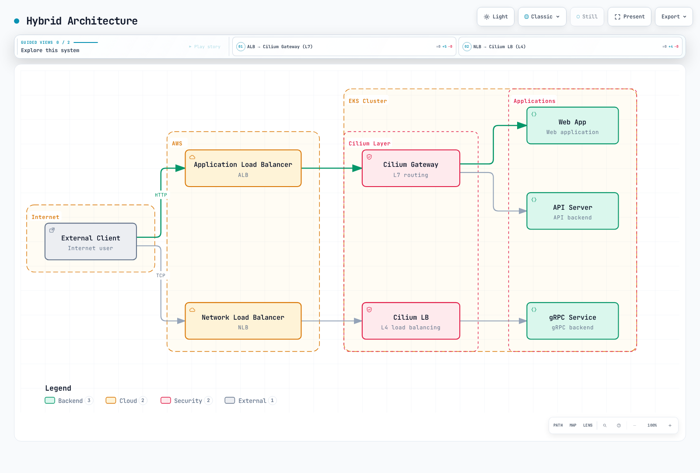

# Ingress y Gateway de Cilium Service Mesh

> **Línea base revisada**: Cilium 1.20.1; Gateway API 1.6.1; AWS Load Balancer Controller 3.5.0.
> **Última revisión**: 11 de septiembre de 2026. Consulte los [requisitos previos de instalación](./README.md) para las matrices de Kubernetes/EKS; una versión más reciente por sí sola no establece compatibilidad.

## Descripción general

Cilium usa recursos de Kubernetes Ingress y Gateway API para configurar su plano de datos. eBPF gestiona el reenvío de Service y redirige el tráfico L7 a Envoy local al nodo. Envoy proporciona enrutamiento HTTP y terminación TLS; las rutas TCP/TLS opacas tienen capacidades diferentes. Los ejemplos siguientes describen puntos de entrada alternativos, no un despliegue completo de aplicación.

## Arquitectura


[🔍 Ver diagrama interactivo](https://www.atomai.click/kubernetes-docs/archmaps/en-service-mesh-cilium-service-mesh-05-ingress-gateway-0.html)

El cuadro Gateway/Ingress representa configuración, no un proceso que recibe paquetes. Para el tráfico L7, la ruta real es balanceador de carga → frontend Service/NodePort → eBPF/TPROXY → Envoy → backend. Cilium aplica una política en el límite externo `world` → `ingress` y de nuevo desde `ingress` al backend. Las políticas deben permitir ambos tramos. La disponibilidad del balanceador de carga en la nube y el registro de destinos son requisitos previos independientes.

## Controlador Ingress de Cilium

### Instalación y habilitación

```yaml
kubeProxyReplacement: true
l7Proxy: true
envoy:
  enabled: true
ingressController:
  enabled: true
  loadbalancerMode: shared
  default: false
  service:
    type: LoadBalancer
```

Estos son valores de **anulación** de Helm para una instalación de Cilium ya planificada. Combínelos con los ajustes de CNI/IPAM específicos de la plataforma y de API server accesible de la guía de instalación. Cambiar el reemplazo de kube-proxy en un clúster en ejecución es una migración, no la activación rutinaria de una característica. Renderice y revise el chart 1.20.1 fijado antes de aplicar cambios.

`ingressController.default` marca la **IngressClass `cilium` como predeterminada**; no configura un backend alternativo. El chart crea la clase `cilium`; `ingressController.ingressClassName` no es un valor compatible. Un `spec.ingressClassName` explícito evita depender del valor predeterminado del clúster.

En el modo compartido, los recursos Ingress gestionados por Cilium usan el Service compartido `cilium-ingress` en el namespace de la versión de Helm (aquí, `kube-system`). Una anotación de modo por Ingress puede elegir el modo dedicado; otros controladores y recursos Gateway API no comparten automáticamente este frontend. Cambiar de modo puede cambiar direcciones e interrumpir conexiones. `LoadBalancer` requiere una implementación que pueda aprovisionarlo/reconciliarlo; use la superposición de EKS siguiente cuando AWS LBC sea propietario del Service.

### Ejemplo de recurso Ingress

```yaml
apiVersion: networking.k8s.io/v1
kind: Ingress
metadata:
  name: app-ingress
  namespace: default
  annotations:
    ingress.cilium.io/loadbalancer-mode: shared
    ingress.cilium.io/tls-passthrough: 'false'
spec:
  ingressClassName: cilium
  tls:
  - hosts:
    - app.example.com
    secretName: app-tls-secret
  rules:
  - host: app.example.com
    http:
      paths:
      - path: /api
        pathType: Prefix
        backend:
          service:
            name: api-service
            port:
              number: 80
      - path: /
        pathType: Prefix
        backend:
          service:
            name: frontend-service
            port:
              number: 80
```

Cree los Services con nombre y endpoints listos en `default`, cada uno exponiendo el puerto 80 del Service. Proporcione `app-tls-secret` con un certificado que cubra `app.example.com` y apunte DNS a este frontend. La sección TLS termina el TLS del cliente en Envoy; el puerto backend mostrado es HTTP de texto sin cifrar. El valor predeterminado `enforceHttps: true` de Cilium redirige HTTP para hosts con TLS habilitado. Esto no establece mTLS de workload a workload.

### Enrutamiento basado en rutas

```yaml
apiVersion: networking.k8s.io/v1
kind: Ingress
metadata:
  name: path-routing
  namespace: default
spec:
  ingressClassName: cilium
  rules:
  - host: api.example.com
    http:
      paths:
      - path: /users
        pathType: Prefix
        backend:
          service:
            name: users-service
            port:
              number: 80
      - path: /orders
        pathType: Prefix
        backend:
          service:
            name: orders-service
            port:
              number: 80
      - path: /products
        pathType: Prefix
        backend:
          service:
            name: products-service
            port:
              number: 80
      - path: /health
        pathType: Exact
        backend:
          service:
            name: health-service
            port:
              number: 80
```

`Prefix` coincide con elementos de ruta: `/users` y `/users/42` coinciden, `/users-old` no. `Exact` coincide solo con `/health`. El orden de Ingress de Cilium es Exact, después ImplementationSpecific/regex y después Prefix, con las coincidencias más largas primero dentro de esos grupos. Gateway API tiene sus propias reglas de precedencia; el orden de la lista YAML no es un mecanismo general de prioridad de enrutamiento.

### Terminación TLS

```yaml
apiVersion: networking.k8s.io/v1
kind: Ingress
metadata:
  name: tls-ingress
  namespace: default
spec:
  ingressClassName: cilium
  tls:
  - hosts:
    - secure.example.com
    secretName: app-tls-secret
  rules:
  - host: secure.example.com
    http:
      paths:
      - path: /
        pathType: Prefix
        backend:
          service:
            name: secure-app
            port:
              number: 80
```

Genere el Secret a partir de **archivos PEM reales**, en lugar de aplicar Base64 de marcador de posición. El mismo Secret usado para ambos ejemplos debe contener un certificado cuyos SAN cubran tanto `app.example.com` como `secure.example.com`; de lo contrario, use Secrets separados. Aprovisione un certificado público de confianza o privado de confianza explícita a través de su PKI y planifique su renovación.

```bash
openssl x509 -in ./tls.crt -noout -dates -ext subjectAltName
kubectl -n default create secret tls app-tls-secret \
  --cert=./tls.crt --key=./tls.key --dry-run=client -o yaml
```

El último comando solo renderiza el Secret. Revíselo y aplíquelo mediante el flujo de trabajo de gestión de secretos elegido; evite escribir la salida de la clave privada en logs compartidos.

### Paso directo de TLS

```yaml
apiVersion: networking.k8s.io/v1
kind: Ingress
metadata:
  name: tls-passthrough
  namespace: default
  annotations:
    ingress.cilium.io/tls-passthrough: 'true'
spec:
  ingressClassName: cilium
  rules:
  - host: backend.example.com
    http:
      paths:
      - path: /
        pathType: Prefix
        backend:
          service:
            name: tls-backend
            port:
              number: 443
```

El backend termina TLS y posee un certificado para `backend.example.com`. Cilium coincide con TLS SNI; el Ingress de paso directo requiere un hostname y la ruta `/`. La reescritura de rutas/cabeceras HTTP no está disponible dentro del tráfico cifrado. El backend ve una conexión nueva desde Envoy/nodo, no la dirección de socket del cliente original, y Envoy no puede insertar cabeceras de reenvío HTTP en este flujo.

## Gateway API

### Habilitación de Gateway API

```yaml
gatewayAPI:
  enabled: true
  gatewayClass:
    create: true
  secretsNamespace:
    create: true
    name: cilium-secrets
    sync: true
```

Instale los **CRD Standard de Gateway API 1.6.1** antes de habilitar el controlador; esta es la versión utilizada por la referencia de instalación de Cilium 1.20.1. Revise las actualizaciones de CRD para todos los controladores que comparten el clúster. No reemplace el archivo completo de valores de Cilium con este fragmento: complementa los requisitos previos de reemplazo de kube-proxy/L7 anteriores.

Las claves compatibles son `gatewayAPI.gatewayClass.create` y `gatewayAPI.secretsNamespace`. `secretNamespace` y `gatewayClassName` en las ubicaciones anteriores se ignoran. Las referencias de certificados todavía nombran Secrets en el namespace del Gateway de forma predeterminada; el namespace de Secret sincronizado del controlador no reubica la referencia del usuario.

### GatewayClass

Con el ajuste de chart anterior, Cilium gestiona el GatewayClass `cilium` con el nombre de controlador `io.cilium/gateway-controller`. Inspecciónelo con `kubectl get gatewayclass cilium -o yaml`; no cree un segundo propietario para el mismo objeto. Un GatewayClass selecciona un controlador y parámetros, no un balanceador de carga físico compartido.

### Gateway

```yaml
apiVersion: gateway.networking.k8s.io/v1
kind: Gateway
metadata:
  name: main-gateway
  namespace: default
spec:
  gatewayClassName: cilium
  listeners:
  - name: http
    protocol: HTTP
    port: 80
    hostname: '*.example.com'
    allowedRoutes:
      namespaces:
        from: Same
  - name: https
    protocol: HTTPS
    port: 443
    hostname: '*.example.com'
    tls:
      mode: Terminate
      certificateRefs:
      - kind: Secret
        name: wildcard-tls
        namespace: default
    allowedRoutes:
      namespaces:
        from: Same
```

Cree `wildcard-tls` en `default` con un certificado para los hostnames del listener antes de usar HTTPS. `*.example.com` no cubre el nombre sin subdominio `example.com` ni nombres más profundos como `a.b.example.com`. Estos listeners terminan HTTP/HTTPS; los ejemplos posteriores de TCP y paso directo TLS usan Gateways separados para mantener claros sus protocolos y su propiedad. Cada Service de Gateway generado puede requerir un balanceador de carga en la nube independiente.

### HTTPRoute

```yaml
apiVersion: gateway.networking.k8s.io/v1
kind: HTTPRoute
metadata:
  name: api-routes
  namespace: default
spec:
  parentRefs:
  - name: main-gateway
    namespace: default
    sectionName: https
  hostnames:
  - api.example.com
  rules:
  - matches:
    - path:
        type: PathPrefix
        value: /v1/users
    backendRefs:
    - name: users-v1
      port: 80
  - matches:
    - path:
        type: PathPrefix
        value: /v2/users
    backendRefs:
    - name: users-v2
      port: 80
  - matches:
    - path:
        type: PathPrefix
        value: /api
      headers:
      - name: X-API-Version
        value: '2'
    backendRefs:
    - name: api-v2
      port: 80
  - matches:
    - path:
        type: PathPrefix
        value: /
    backendRefs:
    - name: api-v1
      port: 80
```

Cada backend es un Service existente en el namespace de la Route con el puerto 80 y endpoints listos. `sectionName: https` limita deliberadamente esta Route al listener HTTPS. Compruebe `Accepted` y `ResolvedRefs` en la entrada correcta de `status.parents`, y las condiciones `Programmed`/`Accepted` de Gateway/listener con `observedGeneration` actual. La configuración aceptada por sí sola no demuestra DNS, confianza del certificado, estado de destino ni accesibilidad de la aplicación.

### División de tráfico basada en pesos

```yaml
apiVersion: gateway.networking.k8s.io/v1
kind: HTTPRoute
metadata:
  name: canary-route
  namespace: default
spec:
  parentRefs:
  - name: main-gateway
    sectionName: https
  hostnames:
  - app.example.com
  rules:
  - matches:
    - path:
        type: PathPrefix
        value: /
    backendRefs:
    - name: app-stable
      port: 80
      weight: 90
    - name: app-canary
      port: 80
      weight: 10
```

Los pesos son probabilidades de selección relativas, no una promesa de que cada grupo de diez solicitudes contenga exactamente nueve solicitudes estables. Las conexiones, los reintentos y el muestreo pueden cambiar los conteos observados. Este ejemplo se adjunta solo a HTTPS y usa un hostname diferente del ejemplo de API.

### Transformación de solicitud/respuesta

```yaml
apiVersion: gateway.networking.k8s.io/v1
kind: HTTPRoute
metadata:
  name: transform-route
  namespace: default
spec:
  parentRefs:
  - name: main-gateway
    sectionName: https
  rules:
  - matches:
    - path:
        type: PathPrefix
        value: /api
    filters:
    - type: RequestHeaderModifier
      requestHeaderModifier:
        set:
        - name: X-Doc-Route
          value: api-v2
        remove:
        - X-Internal-Header
    - type: URLRewrite
      urlRewrite:
        hostname: internal-api.default.svc
        path:
          type: ReplacePrefixMatch
          replacePrefixMatch: /v2/api
    - type: ResponseHeaderModifier
      responseHeaderModifier:
        set:
        - name: X-Doc-Gateway
          value: cilium
    backendRefs:
    - name: api-service
      port: 80
  hostnames:
  - transform.example.com
```

Los valores de las cabeceras son **cadenas literales**. `X-Doc-Route` y `X-Doc-Gateway` son marcadores de diagnóstico, no ID de solicitud generados ni tiempos de respuesta medidos. La reescritura de host usa `URLRewrite.hostname`; no se duplica como una mutación de cabecera `Host`. Estas cabeceras no autentican a quien llama. El manejo de la respuesta `Server` también se ve afectado por la transformación de cabecera server de Envoy del controlador; use un `CiliumGatewayClassConfig` verificado si cambia ese comportamiento.

### Redirección

```yaml
apiVersion: gateway.networking.k8s.io/v1
kind: HTTPRoute
metadata:
  name: redirect-http
  namespace: default
spec:
  parentRefs:
  - name: main-gateway
    sectionName: http
  hostnames:
  - '*.example.com'
  rules:
  - matches:
    - path:
        type: PathPrefix
        value: /
    filters:
    - type: RequestRedirect
      requestRedirect:
        scheme: https
        port: 443
        statusCode: 308
---
apiVersion: gateway.networking.k8s.io/v1
kind: HTTPRoute
metadata:
  name: redirect-path
  namespace: default
spec:
  parentRefs:
  - name: main-gateway
    sectionName: https
  hostnames:
  - old.example.com
  rules:
  - matches:
    - path:
        type: Exact
        value: /old-path
    filters:
    - type: RequestRedirect
      requestRedirect:
        path:
          type: ReplaceFullPath
          replaceFullPath: /new-path
        statusCode: 308
---
apiVersion: gateway.networking.k8s.io/v1
kind: HTTPRoute
metadata:
  name: redirect-host
  namespace: default
spec:
  parentRefs:
  - name: main-gateway
    sectionName: https
  hostnames:
  - old.example.com
  rules:
  - matches:
    - path:
        type: PathPrefix
        value: /legacy
    filters:
    - type: RequestRedirect
      requestRedirect:
        hostname: legacy.example.com
        statusCode: 307
```

La redirección de esquema se adjunta **solo a `http`**, por lo que las solicitudes HTTPS no pueden redirigir indefinidamente a la misma URL. Las otras dos Routes se adjuntan solo a `https` y a un hostname de origen limitado. Una redirección permanente 308 y una redirección temporal 307 conservan el método/cuerpo de la solicitud; 301/302 tienen un comportamiento de cliente diferente y no deben recomendarse universalmente para escrituras. Redirigir una solicitud HTTP inicial no puede deshacer los datos de texto sin cifrar ya enviados por el cliente. RequestRedirect y URLRewrite son filtros diferentes y no se pueden combinar en una regla.

### TCPRoute

```yaml
apiVersion: gateway.networking.k8s.io/v1
kind: Gateway
metadata:
  name: tcp-gateway
  namespace: default
spec:
  gatewayClassName: cilium
  listeners:
  - name: tcp
    protocol: TCP
    port: 9000
    allowedRoutes:
      namespaces:
        from: Same
      kinds:
      - kind: TCPRoute
---
apiVersion: gateway.networking.k8s.io/v1
kind: TCPRoute
metadata:
  name: tcp-route
  namespace: default
spec:
  parentRefs:
  - name: tcp-gateway
    sectionName: tcp
  rules:
  - backendRefs:
    - name: tcp-service
      port: 9000
```

Gateway API 1.6.1 sirve TCPRoute en **v1**; la versión antigua `v1alpha2` no se sirve. TCPRoute reenvía un flujo TCP opaco y no inspecciona las rutas HTTP. TCP puede transportar HTTP o TLS, pero eso no proporciona a esta Route semántica de enrutamiento HTTP ni de terminación TLS. La traducción de Gateway L4 de Cilium 1.20.1 usa backend EndpointSlices; no suponga que la implementación de endpoints del frontend Envoy L7 es idéntica.

### TLSRoute

```yaml
apiVersion: gateway.networking.k8s.io/v1
kind: Gateway
metadata:
  name: tls-gateway
  namespace: default
spec:
  gatewayClassName: cilium
  listeners:
  - name: tls
    protocol: TLS
    port: 443
    hostname: secure.example.com
    tls:
      mode: Passthrough
    allowedRoutes:
      namespaces:
        from: Same
      kinds:
      - kind: TLSRoute
---
apiVersion: gateway.networking.k8s.io/v1
kind: TLSRoute
metadata:
  name: tls-route
  namespace: default
spec:
  parentRefs:
  - name: tls-gateway
    sectionName: tls
  hostnames:
  - secure.example.com
  rules:
  - backendRefs:
    - name: tls-backend
      port: 443
```

TLSRoute también se sirve en **v1** en esta línea base. Requiere un listener `TLS` compatible con `mode: Passthrough`, no el listener de terminación HTTPS anterior. El backend posee el certificado para `secure.example.com`; SNI selecciona el backend mientras el contenido HTTP permanece cifrado. Verifique el Service generado, el estado del listener y la confianza TLS de extremo a extremo.

## Patrones de integración de EKS

### NLB + Cilium Ingress

```yaml
ingressController:
  enabled: true
  loadbalancerMode: shared
  enableProxyProtocol: false
  service:
    type: LoadBalancer
    loadBalancerClass: service.k8s.aws/nlb
    allocateLoadBalancerNodePorts: true
    externalTrafficPolicy: Cluster
    annotations:
      service.beta.kubernetes.io/aws-load-balancer-scheme: internal
      service.beta.kubernetes.io/aws-load-balancer-nlb-target-type: instance
      service.beta.kubernetes.io/aws-load-balancer-attributes: load_balancing.cross_zone.enabled=true
      service.beta.kubernetes.io/aws-load-balancer-healthcheck-protocol: TCP
      service.beta.kubernetes.io/aws-load-balancer-healthcheck-port: traffic-port
```

Este NLB es **interno** por diseño: el único punto de entrada público es CloudFront, que lo alcanza mediante un origen VPC de CloudFront. Su security group debe admitir solo el security group del origen VPC (o la lista de prefijos administrada por CloudFront), nunca un CIDR público.

Esta superposición describe **NLB administrado por AWS LBC → EC2 NodePort → Cilium Ingress Envoy**. Requiere AWS LBC 3.5.0, sus requisitos previos de IAM/subnet/security group, nodos EC2 elegibles, una configuración EKS/CNI compatible con Cilium y NodePorts asignados. No es una receta de instalación de Cilium en EKS Auto Mode ni Fargate. `service.k8s.aws/nlb` selecciona explícitamente AWS LBC; la anotación heredada `aws-load-balancer-type: nlb` no expresa esa propiedad.

Use destinos de instancia para este frontend L7. El Service Ingress compartido de Cilium 1.20.1 tiene un EndpointSlice sintético (`192.192.192.192:9999`, sin referencias a destinos Pod). El resolvedor de destinos IP de AWS LBC requiere referencias a destinos Pod y omite estos endpoints. Simplemente cambiar este Service a `ip` **no** descubre los procesos Envoy locales al nodo. Esto es específico del frontend L7 de Cilium; los Services de workload ordinarios y los EndpointSlices de Gateway L4 actuales son diferentes.

La comprobación de estado TCP verifica la accesibilidad del transporte en el NodePort, no `/healthz` de la aplicación, la validez TLS ni una ruta HTTP específica de host. El balanceo entre zonas usa la anotación actual de atributos de balanceador de carga y necesita revisión de costos/tráfico. No cambie en el lugar la propiedad del controlador ni el tipo de LB de un Service existente suponiendo que es una migración sin tiempo de inactividad.

**Identidad del cliente y protocolo PROXY opcional:** Cilium conserva la fuente visible en su frontend para el procesamiento HTTP de Envoy bajo las políticas de tráfico externo `Cluster` y `Local`. Que esa fuente sea primero el cliente original depende del NLB ascendente y de los atributos del grupo de destino. Los destinos TCP de instancia normalmente conservan la IP del cliente; el protocolo PROXY no es necesario universalmente. Si es necesario para su topología, coordine esta superposición adicional con el ajuste NLB:

```yaml
ingressController:
  enableProxyProtocol: true
  service:
    annotations:
      service.beta.kubernetes.io/aws-load-balancer-proxy-protocol: '*'
```

Esto habilita PPv2 en el NLB y su analizador en Cilium Ingress. Es un despliegue coordinado: habilitar solo un lado interrumpe el tráfico. El analizador requiere una cabecera PROXY, por lo que las sondas HTTP/TLS directas sin una fallan. AWS LBC advierte contra combinar PPv2 con destinos de instancia y `externalTrafficPolicy: Local`; el ejemplo mantiene `Cluster`. Las comprobaciones de estado HTTP/HTTPS también necesitan un analizador compatible. Restrinja el acceso directo a la ruta de proxy de confianza: los metadatos PP y las cabeceras HTTP reenviadas no son identidades autenticadas. `gatewayAPI.enableProxyProtocol` es un ajuste independiente para Gateway API; el indicador de Ingress no lo configura.

### ALB + Cilium

ALB → Cilium Envoy puede componerse, pero los siguientes requisitos previos deben diseñarse y probarse para el entorno real. No existe un atajo `target-type: ip` que funcione de forma general para los EndpointSlices L7 sintéticos descritos anteriormente.

| Límite | Decisión requerida |
|---|---|
| Controlador y namespace | Un ALB Ingress usa `spec.ingressClassName: alb`. Su Service backend debe existir en el **mismo namespace**; el Service compartido `cilium-ingress` normalmente está en `kube-system`, no en `default`. |
| Destinos | Para una ruta basada en nodos, use un Service NodePort planificado explícitamente y `target-type: instance` de ALB; verifique nodos elegibles, asignación de NodePort y security groups. No convierta silenciosamente un Service que ya posee un NLB. |
| TLS | Decida si ALB termina TLS y reenvía HTTP o HTTPS. La asociación de certificados de servidor ACM no es mTLS de cliente. Si ALB reenvía HTTP, las redirecciones HTTPS de Cilium pueden causar un bucle, salvo que se coordine el comportamiento de listener/redirección. |
| Estado | Las comprobaciones de estado de ALB usan su propia cabecera Host, no automáticamente `app.example.com`; una ruta de aplicación específica de host puede devolver 404. Defina y pruebe una ruta/puerto de estado adecuado. |
| Atribución del cliente | Configure el conteo de saltos XFF de confianza de Cilium para la cadena de proxy real, elimine las cabeceras no confiables y evite el acceso directo al backend que omite ALB. |

La muestra anterior hacía referencia al namespace equivocado y a destinos IP, y omitía estas decisiones; se ha reemplazado por estos requisitos de implementación. Esta composición no ha sido desplegada ni probada bajo carga por esta guía.

### Arquitectura híbrida



[🔍 Ver diagrama interactivo](https://www.atomai.click/kubernetes-docs/archmaps/en-service-mesh-cilium-service-mesh-05-ingress-gateway-1.html)

Este es un diagrama de composición lógica, no un manifiesto de despliegue validado. La ruta ALB necesita las decisiones de namespace/destino/TLS/estado/confianza indicadas anteriormente. La ruta L4 de NLB puede transportar un flujo gRPC sin comprender métodos RPC individuales. Agregar Cilium detrás de ALB no elimina los cargos de ALB ni convierte las características de ALB en características nativas de Cilium.

## Gateway multiinquilino

### Gateway por namespace

```yaml
apiVersion: gateway.networking.k8s.io/v1
kind: GatewayClass
metadata:
  name: cilium-shared
spec:
  controllerName: io.cilium/gateway-controller
---
apiVersion: gateway.networking.k8s.io/v1
kind: Gateway
metadata:
  name: team-a-gateway
  namespace: team-a
spec:
  gatewayClassName: cilium-shared
  listeners:
  - name: https
    protocol: HTTPS
    port: 443
    hostname: '*.team-a.example.com'
    tls:
      mode: Terminate
      certificateRefs:
      - kind: Secret
        name: team-a-tls
    allowedRoutes:
      namespaces:
        from: Same
---
apiVersion: gateway.networking.k8s.io/v1
kind: Gateway
metadata:
  name: team-b-gateway
  namespace: team-b
spec:
  gatewayClassName: cilium-shared
  listeners:
  - name: https
    protocol: HTTPS
    port: 443
    hostname: '*.team-b.example.com'
    tls:
      mode: Terminate
      certificateRefs:
      - kind: Secret
        name: team-b-tls
    allowedRoutes:
      namespaces:
        from: Same
```

Cree primero cada namespace y su propio Secret TLS válido. Compartir GatewayClass `cilium-shared` **no** significa que ambos Gateways compartan un Service/balanceador de carga. `from: Same` limita la asociación de Route a cada namespace de Gateway; RBAC debe controlar por separado quién puede cambiar Gateways, Secrets, Routes y etiquetas de namespace.

### Enrutamiento entre namespaces

```yaml
apiVersion: gateway.networking.k8s.io/v1
kind: Gateway
metadata:
  name: shared-gateway
  namespace: gateway-system
spec:
  gatewayClassName: cilium
  listeners:
  - name: https
    protocol: HTTPS
    port: 443
    hostname: '*.example.com'
    allowedRoutes:
      namespaces:
        from: Selector
        selector:
          matchLabels:
            gateway-access: 'true'
    tls:
      mode: Terminate
      certificateRefs:
      - kind: Secret
        name: shared-tls
---
apiVersion: v1
kind: Namespace
metadata:
  name: app-team
  labels:
    gateway-access: 'true'
---
apiVersion: gateway.networking.k8s.io/v1
kind: HTTPRoute
metadata:
  name: app-route
  namespace: app-team
spec:
  parentRefs:
  - name: shared-gateway
    namespace: gateway-system
    sectionName: https
  hostnames:
  - app.example.com
  rules:
  - matches:
    - path:
        type: PathPrefix
        value: /
    backendRefs:
    - name: app-service
      port: 80
```

Cree `gateway-system` y su Secret `shared-tls` que cubra los hostnames permitidos. El selector de namespace autoriza la asociación de Route; no autentica usuarios ni autoriza solicitudes de aplicación. Un administrador debe controlar la etiqueta `gateway-access`.

El backend `app-service` mostrado es local a `app-team`, por lo que no necesita un ReferenceGrant. Si una Route en cambio hace referencia a `backend-team/shared-api`, el namespace backend debe conceder explícitamente esa referencia:

```yaml
apiVersion: gateway.networking.k8s.io/v1
kind: ReferenceGrant
metadata:
  name: allow-app-team
  namespace: backend-team
spec:
  from:
  - group: gateway.networking.k8s.io
    kind: HTTPRoute
    namespace: app-team
  to:
  - group: ''
    kind: Service
    name: shared-api
---
apiVersion: gateway.networking.k8s.io/v1
kind: HTTPRoute
metadata:
  name: shared-api-route
  namespace: app-team
spec:
  parentRefs:
  - name: shared-gateway
    namespace: gateway-system
    sectionName: https
  hostnames:
  - shared-api.example.com
  rules:
  - backendRefs:
    - name: shared-api
      namespace: backend-team
      port: 80
```

Cree `backend-team/shared-api` con el puerto 80 de Service antes de usar esta alternativa. La asociación entre namespaces Route → Gateway usa `allowedRoutes`; las referencias entre namespaces Route → Service backend usan `ReferenceGrant`. Son comprobaciones de permisos distintas. ReferenceGrant v1 se sirve en 1.6.1; v1beta1 también sigue sirviéndose.

## Configuración avanzada de balanceo de carga

### Comprobación de estado de Service

```yaml
apiVersion: cilium.io/v2
kind: CiliumEnvoyConfig
metadata:
  name: health-check-config
  namespace: default
spec:
  services:
  - name: my-service
    namespace: default
    ports:
    - 80
    listener: health-check-config-listener
  resources:
  - '@type': type.googleapis.com/envoy.config.listener.v3.Listener
    name: health-check-config-listener
    filter_chains:
    - filters:
      - name: envoy.filters.network.http_connection_manager
        typed_config:
          '@type': type.googleapis.com/envoy.extensions.filters.network.http_connection_manager.v3.HttpConnectionManager
          stat_prefix: health-check-config
          route_config:
            name: health-check-config-routes
            virtual_hosts:
            - name: app
              domains:
              - '*'
              routes:
              - match:
                  prefix: /
                route:
                  cluster: default/my-service
                  retry_policy:
                    num_retries: 0
          http_filters:
          - name: envoy.filters.http.router
            typed_config:
              '@type': type.googleapis.com/envoy.extensions.filters.http.router.v3.Router
  - '@type': type.googleapis.com/envoy.config.cluster.v3.Cluster
    name: default/my-service
    connect_timeout: 5s
    type: EDS
    health_checks:
    - timeout: 5s
      interval: 10s
      unhealthy_threshold: 3
      healthy_threshold: 2
      http_health_check:
        path: /health
        host: health-check.local
        expected_statuses:
        - start: 200
          end: 300
    outlier_detection:
      consecutive_5xx: 5
      interval: 10s
      base_ejection_time: 30s
      max_ejection_percent: 50
      enforcing_consecutive_5xx: 100
```

Esta es una cadena CEC independiente completa: puerto 80 de Service → Listener con nombre → ruta HTTP → Cluster EDS. Cilium proporciona la configuración de endpoints xDS para el Service referenciado. Cree `default/my-service` con backends listos y no lo asigne también a otro CEC ni a una configuración Ingress/Gateway generada. La personalización CEC no es un mecanismo de parche para recursos propiedad del controlador.

Cada backend debe aceptar realmente `Host: health-check.local` y `/health`. Los rangos de estado de Envoy excluyen el límite superior, por lo que `[200, 300)` cubre todas las respuestas 2xx. Las comprobaciones de estado activas y la detección pasiva de valores atípicos son mecanismos diferentes; los límites de expulsión y el comportamiento de pánico no garantizan que se excluya cada endpoint con fallos. Valídelos según el número de backends y el modelo de fallos.

### Configuración de pool de conexiones

```yaml
apiVersion: cilium.io/v2
kind: CiliumEnvoyConfig
metadata:
  name: connection-pool
  namespace: default
spec:
  services:
  - name: high-traffic-service
    namespace: default
    ports:
    - 80
    listener: connection-pool-listener
  resources:
  - '@type': type.googleapis.com/envoy.config.listener.v3.Listener
    name: connection-pool-listener
    filter_chains:
    - filters:
      - name: envoy.filters.network.http_connection_manager
        typed_config:
          '@type': type.googleapis.com/envoy.extensions.filters.network.http_connection_manager.v3.HttpConnectionManager
          stat_prefix: connection-pool
          route_config:
            name: connection-pool-routes
            virtual_hosts:
            - name: app
              domains:
              - '*'
              routes:
              - match:
                  prefix: /
                route:
                  cluster: default/high-traffic-service
                  retry_policy:
                    num_retries: 0
          http_filters:
          - name: envoy.filters.http.router
            typed_config:
              '@type': type.googleapis.com/envoy.extensions.filters.http.router.v3.Router
  - '@type': type.googleapis.com/envoy.config.cluster.v3.Cluster
    name: default/high-traffic-service
    connect_timeout: 5s
    type: EDS
    typed_extension_protocol_options:
      envoy.extensions.upstreams.http.v3.HttpProtocolOptions:
        '@type': type.googleapis.com/envoy.extensions.upstreams.http.v3.HttpProtocolOptions
        explicit_http_config:
          http2_protocol_options:
            max_concurrent_streams: 1000
            initial_stream_window_size: 65536
            initial_connection_window_size: 1048576
    circuit_breakers:
      thresholds:
      - priority: DEFAULT
        max_connections: 10000
        max_pending_requests: 10000
        max_requests: 10000
        max_retries: 5
```

Cree `default/high-traffic-service` en el puerto 80 cuyos backends admitan explícitamente HTTP/2 de texto sin cifrar (h2c). La opción de protocolo tipada selecciona HTTP/2 ascendente; no es negociación automática de protocolo. `accept_http_10` solo aceptaría HTTP/1.0 y no es un ajuste de pool de conexiones HTTP/1. Para backends HTTP/1 elija en su lugar la configuración explícita HTTP/1 correspondiente.

Los umbrales de circuit breaker son por Cluster/prioridad de Envoy, no cuotas para toda la flota ni recomendaciones de capacidad. `max_retries` limita los reintentos simultáneos; no es la cantidad de reintentos por solicitud. La ruta aquí establece `num_retries: 0`. Aumentar los límites de conexiones/flujos requiere pruebas de recursos y backend; los valores numéricos son ilustrativos.

## Comparación con AWS Load Balancer Controller

| Capacidad | Cilium Ingress/Gateway | AWS Load Balancer Controller 3.5 |
|---|---|---|
| Plano de datos | Reenvío de Service/L4 con eBPF; Envoy para características HTTP/TLS | AWS ALB o NLB |
| Gateway API | Consulte las tablas de características/conformidad fijadas de Cilium | HTTPRoute/GRPCRoute se asignan a ALB; TCPRoute/UDPRoute/TLSRoute se asignan a NLB; no se admite L4/L7 mixto en un Gateway |
| TLS e identidad | Terminación/paso directo TLS de Ingress; el cifrado/autenticación de workload es una [configuración de seguridad](./03-security.md) independiente | Certificados de servidor ACM; mTLS de cliente ALB requiere su modo de autenticación mutua/almacén de confianza |
| Costo | Recursos de nodo/proxy **más cualquier LB en la nube aprovisionado y cargos de red** | ALB/NLB aprovisionado, capacidad/uso y cargos de red |
| Personalización | Características compatibles de Gateway API y CEC administrados por separado; los objetos generados siguen siendo propiedad del controlador | Características de listener/regla/grupo de destino de AWS expuestas a través de API/anotaciones de LBC |
| Rendimiento | Mida la topología real, el cifrado y el workload | Mida el mismo workload y los límites de servicio; no hay una clasificación de latencia universal |

LBC 3.5 documenta Gateway API **1.6.0** como su línea base probada; la referencia de instalación de Cilium usa **1.6.1**. Un clúster que comparte estos CRD necesita pruebas de compatibilidad, no la suposición de que la entrada más reciente del catálogo es compatible con cada controlador.

Elija ALB para las integraciones L7 de AWS requeridas, NLB para el comportamiento de transporte/destino requerido y las características de Cilium según los requisitos de enrutamiento/políticas dentro del clúster. NLB admite actualmente grupos de destino ponderados con pesos **0–999** para flujos nuevos; la exposición del controlador y la semántica de una Route concreta son cuestiones independientes. Los cambios de peso ordinarios conservan las conexiones existentes, pero establecer el peso de un grupo de destino en **0** cierra sus conexiones existentes tras un período corto según la documentación de AWS. No describa esa operación como un drenaje que conserva las conexiones.

La antigua figura de decisión repetía afirmaciones no compatibles sobre costo, latencia, mTLS y Gateway API. La tabla reemplaza esas afirmaciones; no elimina ninguna opción de integración.

## Monitorización

### Métricas de Gateway

```bash
kubectl get gatewayclass cilium -o yaml
kubectl get gateway,httproute,tcproute,tlsroute -A
kubectl -n default describe gateway main-gateway
kubectl -n default get httproute api-routes -o yaml
kubectl -n kube-system exec ds/cilium -- cilium-dbg status --verbose
kubectl -n kube-system exec ds/cilium -- cilium-dbg envoy admin metrics -f downstream_rq
```

### Métricas de Prometheus

Primero habilite y extraiga el endpoint Prometheus de Cilium Envoy mediante la [guía de observabilidad](./04-observability.md). Configure una etiqueta de destino `cluster` estable cuando varios clústeres alimenten un Prometheus. La imagen nativa de Cilium Envoy expone `envoy_http_conn_manager_prefix`, con valores generados como `listener-insecure`, `listener-secure` y variantes específicas de puerto, no un valor fijo `cilium-gateway`. Los prefijos se pueden reutilizar entre Gateways en el mismo Envoy; estos ejemplos describen un **proxy/HCM extraído**, no una contabilidad garantizada por Gateway. Inspeccione las etiquetas reales antes de crear dashboards.

Las tres consultas siguientes muestran la tasa de solicitudes iniciadas, el porcentaje de contadores de respuesta completada clasificados como 5xx y la duración p99 en **segundos**. El numerador 5xx ausente se rellena solo a partir del denominador observado coincidente; el tráfico/la telemetría ausente no se convierte en un cero saludable. El filtro de denominador positivo omite series inactivas. El histograma `downstream_rq_time` de Envoy está en **milisegundos**, de ahí `/ 1000`. Agregue buckets de histograma conservando `le` antes de calcular el cuantil. Los conteos de muestras bajos, las brechas de extracción y los histogramas ausentes todavía requieren monitorización separada.

```promql
sum by (cluster, instance, envoy_http_conn_manager_prefix) (
  rate(envoy_http_downstream_rq_total[5m])
)
```

```promql
100 *
(
  sum by (cluster, instance, envoy_http_conn_manager_prefix) (
    rate(envoy_http_downstream_rq_xx{envoy_response_code_class="5"}[5m])
  )
  or
  0 * sum by (cluster, instance, envoy_http_conn_manager_prefix) (
    rate(envoy_http_downstream_rq_xx[5m])
  )
)
/
(
  sum by (cluster, instance, envoy_http_conn_manager_prefix) (
    rate(envoy_http_downstream_rq_xx[5m])
  ) > 0
)
```

```promql
histogram_quantile(
  0.99,
  sum by (cluster, instance, envoy_http_conn_manager_prefix, le) (
    rate(envoy_http_downstream_rq_time_bucket[5m])
  )
) / 1000
```

## Próximos pasos

- [Mejores prácticas](./06-best-practices.md): Requisitos previos y límites operativos

## Referencias

- [Cilium 1.20.1 Ingress](https://github.com/cilium/cilium/blob/v1.20.1/Documentation/network/servicemesh/ingress.rst)
- [Cilium traffic, source IP and policy](https://github.com/cilium/cilium/blob/v1.20.1/Documentation/network/servicemesh/ingress-reference.rst)
- [Cilium Gateway API installation](https://github.com/cilium/cilium/blob/v1.20.1/Documentation/network/servicemesh/gateway-api/gateway-api.rst)
- [Cilium 1.20.1 Helm values](https://github.com/cilium/cilium/blob/v1.20.1/install/kubernetes/cilium/values.yaml)
- [Gateway API 1.6.1 CRDs](https://github.com/kubernetes-sigs/gateway-api/tree/v1.6.1/config/crd/standard)
- [AWS LBC 3.5 NLB configuration](https://github.com/kubernetes-sigs/aws-load-balancer-controller/blob/v3.5.0/docs/guide/service/nlb.md)
- [AWS LBC 3.5 annotations](https://github.com/kubernetes-sigs/aws-load-balancer-controller/blob/v3.5.0/docs/guide/service/annotations.md)
- [AWS LBC 3.5 Gateway API](https://github.com/kubernetes-sigs/aws-load-balancer-controller/blob/v3.5.0/docs/guide/gateway/gateway.md)
- [NLB target group attributes](https://docs.aws.amazon.com/elasticloadbalancing/latest/network/edit-target-group-attributes.html)
- [NLB listener weights](https://docs.aws.amazon.com/elasticloadbalancing/latest/network/load-balancer-listeners.html)
- [Envoy 1.37 request statistics](https://www.envoyproxy.io/docs/envoy/v1.37.5/configuration/http/http_conn_man/stats)
