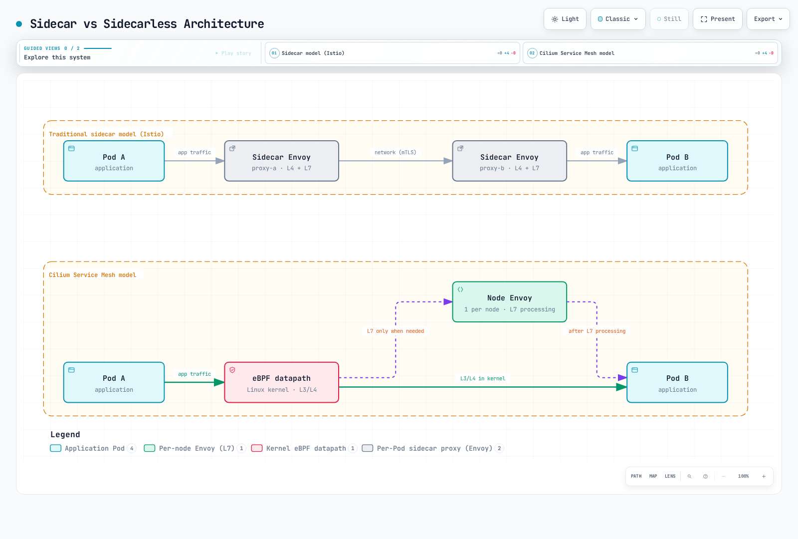

# Descripción general de Cilium Service Mesh

> **Última actualización**: 16 de octubre de 2026 · Cilium/chart 1.20.3 · CLI 0.20.1 · Hubble CLI 1.20.2

Cilium combina las redes de Kubernetes, las políticas y el balanceo con eBPF, y funciones opcionales de proxy en la capa de aplicación. El tráfico L7 seleccionado se procesa mediante la integración de Envoy de Cilium; eliminar los sidecars por aplicación no elimina el proxy, los requisitos del kernel ni los componentes operativos.

## Arquitectura y límites de seguridad



[Ver el diagrama interactivo](https://www.atomai.click/kubernetes-docs/archmaps/en-service-mesh-cilium-service-mesh-readme-0.html)

Envoy puede ejecutarse como un proceso junto con el agente de Cilium o como un DaemonSet `cilium-envoy` administrado por separado. La configuración renderizada normal del chart seleccionado usa el DaemonSet dedicado. La ubicación real y el número de saltos L7 dependen de las funciones y políticas habilitadas; no todo paquete atraviesa Envoy.

| Componente | Función |
|---|---|
| Agente de Cilium | Ruta de datos del nodo, identidades de endpoints y aplicación de políticas |
| Operador de Cilium | IPAM y otras responsabilidades de clúster/controlador para el modo seleccionado |
| Envoy | Aplicación de políticas L7 coincidentes, Ingress y procesamiento de Gateway API |
| Hubble | Observaciones de flujos; los registros L7 requieren la visibilidad de proxy correspondiente |
| Hubble Relay / UI | Componentes adicionales para agregación y visualización |
| SPIRE, si se configura | Infraestructura de identidad para la función beta de autenticación mutua |

### La autenticación mutua no cifra automáticamente el tráfico

Cilium 1.20.3 documenta la **autenticación mutua fuera de banda como beta e incompleta**. Su intercambio de identidad basado en mTLS ocurre fuera de banda entre agentes y corresponde a las identidades de seguridad de Cilium. Esto no encapsula cada conexión de aplicación en el mismo modelo de transporte TLS que un proxy de carga de trabajo de Istio o Linkerd.

WireGuard e IPsec son mecanismos de cifrado independientes, cada uno con sus propios modos y alcance. WireGuard no es TLS, y habilitar SPIRE por sí solo no cifra los datos de aplicación ni activa reglas de autenticación para todos los endpoints. La versión seleccionada también documenta que la autenticación mutua no es compatible con ClusterMesh ni con una solución externa de mTLS para mallas.

Cilium 1.20.3 también ofrece una [beta independiente de cifrado transparente con ztunnel](https://github.com/cilium/cilium/blob/v1.20.3/Documentation/security/network/encryption-ztunnel.rst), que se selecciona con `encryption.type: ztunnel`. Proporciona mTLS TCP para cargas de trabajo con inscripción por espacio de nombres; ambos extremos deben estar inscritos. Excluye ClusterMesh y los Pods con red del host, y la guía publicada advierte que las políticas L4 normales no funcionan por esta ruta, salvo cuando se dirigen al puerto HBONE 15008. Es una opción de despliegue distinta, con requisitos propios de CA y bootstrap.

Antes de adoptar esta opción beta, revise la [guía de seguridad](03-security.md) y el modelo de seguridad y sus limitaciones publicados para esta versión. Considere el enrutamiento, la autenticación, la autorización y el cifrado como requisitos distintos.

Cilium también puede proporcionar el CNI subyacente a un despliegue de Istio. Esa integración de red no hace intercambiables sus mecanismos de autenticación; revise el balanceo de sockets según el modo, la coexistencia de CNI y la titularidad de las políticas L7.

## Comparar capacidades y costos medidos

| Tema | Cilium | Istio | Linkerd |
|---|---|---|---|
| Modelo de plano de datos | eBPF y Envoy compartido para el trabajo L7 seleccionado | Modo sidecar o roles ztunnel/waypoint de ambient | Proxy por Pod, incluida la ubicación como sidecar nativo |
| Redes de Pods | Proporciona un CNI o se encadena con otro, según el modo | Necesita una red de Pods subyacente; su CNI redirige el tráfico de malla | Necesita una red de Pods subyacente; el CNI opcional redirige el tráfico de malla |
| Políticas | Políticas de red de Kubernetes/Cilium y funciones L7 | Autorización y enrutamiento de malla con una capa de políticas de red separada | Autorización Server/route y enrutamiento saliente; no es solo política L4 |
| Gateway API | Controlador optativo y conformidad/funciones documentadas | Funciones de gateway y enrutamiento de malla | Roles admitidos de rutas con padres Service/Server |
| Seguridad | Autenticación fuera de banda con cifrado separado; beta distinta de mTLS con ztunnel y sus restricciones | mTLS de cargas de trabajo más políticas | mTLS de cargas de trabajo más políticas |

Ningún producto tiene una clasificación universal de CPU, memoria o latencia independiente de la carga de trabajo y la configuración. Las antiguas cifras fijas por nodo/Pod y el diagrama de memoria para 100 Pods no eran un benchmark atribuido y omitían componentes, cantidad de nodos y detalles de la carga. Compara el costo incremental medido con la misma línea base e incluye agentes/proxies, controladores, telemetría e infraestructura de identidad.

Cilium puede ser útil cuando su modelo de red y las funciones L7 necesarias encajan en el entorno, especialmente si Cilium ya se opera allí. Evalúa la migración de CNI, la compatibilidad del kernel y la plataforma, el impacto de fallos en nodos compartidos, los requisitos de seguridad y las dependencias de políticas existentes. Ni «sin sidecars» ni «eBPF» demuestran que se alcanzará un objetivo de latencia o costo para cargas financieras o en tiempo real.

Consulta la [comparación mantenida de mallas de servicios](../istio/comparison/01-service-mesh-comparison.md) para conocer límites de capacidades más amplios.

## Requisitos de versión y plataforma

Para la versión seleccionada:

- La lista general de compatibilidad e2e de Kubernetes es **1.33–1.36**. El archivo CI publicado para EKS enumera **1.33–1.35**, con 1.35 como valor predeterminado. Son conjuntos de evidencia distintos; las combinaciones más nuevas o no incluidas para el proveedor requieren una validación separada.
- El requisito permisivo `kubeVersion >=1.21.0-0` del chart no es la matriz de compatibilidad probada, y una versión más nueva de Kubernetes no queda cubierta automáticamente.
- Los hosts requieren Linux AMD64/AArch64 compatible y normalmente el kernel 5.10 o posterior, o un backport equivalente documentado. La redirección L7 y otras funciones avanzadas tienen requisitos adicionales de kernel y módulos.
- La referencia de Gateway API para esta versión de Cilium es **v1.6.3**. Comprueba los CRD obligatorios y opcionales y las notas de actualización de TLSRoute de 1.20 antes de cambiarlos; no sustituyas por la última versión del catálogo sin revisar la compatibilidad.

```bash
cilium version --client
cilium version
cilium status --wait --wait-duration 5m
kubectl -n kube-system get daemonset cilium
# For the dedicated Envoy mode selected below:
kubectl -n kube-system get daemonset cilium-envoy
```

La versión de la CLI y la versión de imagen de Cilium que está en ejecución son datos distintos. Conserva la salida completa de estado y los errores; que `grep` encuentre «Envoy» o «Hubble» no certifica que estén listos. En el modo integrado, puede ser normal que no exista un DaemonSet dedicado de Envoy.

### Opciones de instalación en EKS

| Modo/plataforma | Distinción necesaria |
|---|---|
| Modo AWS ENI de Cilium | Cilium administra IPAM de ENI y el enrutamiento nativo; requiere planificar IAM, rutas e inscripción de nodos/Pods. La referencia general de ENI 1.20.3 documenta IPv6 Beta, mientras que la página de instalación en EKS todavía indica solo IPv4; usa aquí el ejemplo IPv4 y verifica por separado los requisitos y el soporte de IPv6 específicos de la plataforma |
| Encadenamiento de AWS VPC CNI | AWS VPC CNI conserva la responsabilidad de las interfaces y de IPAM; después, Cilium conecta su ruta de datos; deben evaluarse las limitaciones avanzadas de L7/IPsec |
| EKS Fargate | No admite CNI alternativos; se requiere AWS VPC CNI |
| EKS Auto Mode | No admite CNI alternativos ni plugins de políticas de red alternativos |
| EKS Hybrid Nodes | Sigue la guía independiente de AWS para las versiones, configuración y capacidades de Cilium admitidas, no los argumentos de ENI para EC2 |

El soporte de AWS para CNI en nodos EC2 se limita a Amazon VPC CNI; los CNI compatibles alternativos requieren su propio soporte operativo o del proveedor. No deduzcas los límites de soporte de Hybrid Nodes a partir de una tabla genérica de compatibilidad de Cilium.

Una instalación de Helm de una sola línea no es un plan para migrar un clúster existente de AWS VPC CNI. Aborda el acceso inicial a la API, el reemplazo de kube-proxy, la titularidad de CNI, IAM, los taints de readiness de nodos y la recreación de Pods preexistentes que no están administrados mediante un procedimiento probado. Esta revisión no creó clústeres ni reemplazó su CNI.

## Habilitar funciones seleccionadas

Para un despliegue de Cilium que ya esté instalado correctamente, guarda esta superposición de funciones como `cilium-mesh-features.yaml`:

```yaml
l7Proxy: true
envoy:
  enabled: true
hubble:
  enabled: true
  relay:
    enabled: true
  ui:
    enabled: true
```

El indicador L7 admitido es `l7Proxy`; `proxy.enabled` no lo sustituye. La comprobación nativa del chart confirmó que `proxy.enabled:false` deja L7 habilitado, mientras que `l7Proxy:false` lo deshabilita.

```bash
set -euo pipefail
umask 077
helm repo add cilium https://helm.cilium.io/
helm repo update cilium
# Preview only: reviewed-cni-values.yaml must describe the existing intended CNI mode.
helm template cilium cilium/cilium --version 1.20.3 \
  --namespace kube-system --kube-version 1.35.0 \
  -f reviewed-cni-values.yaml -f cilium-mesh-features.yaml \
  > cilium-mesh-rendered.yaml
```

Esto previsualiza una versión de Kubernetes compatible para el ejemplo y combina los valores de CNI revisados de la instalación. Inspecciona el resultado y sigue el procedimiento de actualización admitido para la versión, bajo la responsabilidad del propietario actual. No es una instalación completa de CNI ni una autorización para cambiar el modo de red.

| Capacidad opcional | Requisitos adicionales |
|---|---|
| Gateway API | Reemplazo de kube-proxy, proxy L7, CRD v1.6.3 necesarios y un diseño apropiado de balanceador de carga/red del host |
| Controlador de Ingress | Configuración y modelo de exposición admitidos; no gestiona automáticamente todo el tráfico de malla |
| Métricas de Hubble | Familias de métricas seleccionadas y un colector configurado; Relay/UI no crean Prometheus por sí solos |
| Autenticación mutua | Revisión beta, habilitación explícita, SPIRE/almacenamiento/conectividad, política de autenticación aplicable y evaluación independiente del cifrado |

Para una **evaluación aislada de la autenticación beta**, incluye el indicador de nivel superior que faltaba en el ejemplo anterior:

```yaml
authentication:
  enabled: true
  mutual:
    spire:
      enabled: true
      install:
        enabled: true
```

El chart rechaza la integración con SPIRE si no se establece `authentication.enabled:true`. El servidor SPIRE proporcionado usa almacenamiento persistente de forma predeterminada, así que antes se debe contar con aprovisionamiento adecuado de PVC. Este fragmento no establece seguridad de producción, autenticación entre clústeres ni cifrado del tráfico de aplicación.

## Ejemplo de política L7 y observación

Prepara una aplicación HTTP administrada por Cilium con la etiqueta `app:productpage` en `bookinfo`, y un cliente administrado por Cilium con la etiqueta `app:frontend` en el mismo espacio de nombres. Si usas Bookinfo, despliega todas sus dependencias necesarias; una implementación que solo tenga productpage no constituye la aplicación Bookinfo completa. Usa imágenes verificadas y una configuración de readiness apropiada para la aplicación.

La política siguiente selecciona ese endpoint y permite las combinaciones de cliente, método y ruta que se muestran. No crea ninguno de los dos workloads:

```yaml
apiVersion: cilium.io/v2
kind: CiliumNetworkPolicy
metadata:
  name: productpage-l7
  namespace: bookinfo
spec:
  endpointSelector:
    matchLabels:
      k8s:app: productpage
  ingress:
  - fromEndpoints:
    - matchLabels:
        k8s:app: frontend
        k8s:io.kubernetes.pod.namespace: bookinfo
    toPorts:
    - ports:
      - port: '9080'
        protocol: TCP
      rules:
        http:
        - method: GET
          path: ^/productpage$
        - method: GET
          path: ^/health$
```

Antes de aplicarla mediante el propietario de las políticas, evalúa las demás políticas y el efecto esperado de denegación predeterminada. El ejemplo permite dos rutas, no todos los recursos estáticos ni las dependencias necesarias para el flujo completo del navegador. La autenticación y el cifrado son independientes de esta política de autorización L7.

```bash
# Keep this terminal running; configure the intended kube context first.
cilium hubble port-forward --port-forward 4245

# In another terminal, use the selected Hubble CLI:
hubble status --server localhost:4245
hubble observe --server localhost:4245 --namespace bookinfo --protocol http --follow
# Service-name filters are an alternative to --namespace in this CLI.
hubble observe --server localhost:4245 --to-service bookinfo/productpage
```

La CLI de Hubble seleccionada rechaza combinar `--namespace` con `--to-service`. Usa la observación del espacio de nombres o el prefijo de nombre de servicio con espacio de nombres. Los registros L7 requieren tráfico coincidente real y visibilidad del proxy; los descartes que ocurran antes del proxy pueden requerir una inspección más amplia de flujos o descartes. La ausencia de flujos observados no demuestra que la ruta de la aplicación esté permitida, denegada o en buen estado.

## Estructura documental y referencias

| Guía | Alcance |
|---|---|
| [Arquitectura](01-architecture.md) | Ruta de datos, Envoy y modelo de API |
| [Gestión del tráfico](02-traffic-management.md) | Enrutamiento y balanceo de carga |
| [Seguridad](03-security.md) | Políticas, autenticación y límites de cifrado |
| [Observabilidad](04-observability.md) | Hubble y métricas |
| [Ingress/Gateway](05-ingress-gateway.md) | Tráfico externo y Gateway API |
| [Buenas prácticas](06-best-practices.md) | Operaciones, migración y validación |

- [Compatibilidad publicada de Kubernetes](https://github.com/cilium/cilium/blob/v1.20.3/Documentation/network/kubernetes/compatibility.rst)
- [Requisitos del sistema](https://github.com/cilium/cilium/blob/v1.20.3/Documentation/operations/system_requirements.rst)
- [Redes de Cilium con Istio](https://github.com/cilium/cilium/blob/v1.20.3/Documentation/network/servicemesh/istio.rst)
- [Modos de Envoy](https://github.com/cilium/cilium/blob/v1.20.3/Documentation/security/network/proxy/envoy.rst)
- [Límites de la autenticación mutua](https://github.com/cilium/cilium/blob/v1.20.3/Documentation/network/servicemesh/mutual-authentication/mutual-authentication.rst)
- [Requisitos previos de Gateway API](https://github.com/cilium/cilium/blob/v1.20.3/Documentation/network/servicemesh/gateway-api/installation.rst)
- [Requisitos de ENI en EKS](https://github.com/cilium/cilium/blob/v1.20.3/Documentation/installation/requirements-eks.rst) y [encadenamiento de AWS VPC CNI](https://github.com/cilium/cilium/blob/v1.20.3/Documentation/installation/cni-chaining-aws-cni.rst)
- [CNI alternativos en EKS](https://docs.aws.amazon.com/eks/latest/userguide/alternate-cni-plugins.html) y [CNI de Hybrid Nodes](https://docs.aws.amazon.com/eks/latest/userguide/hybrid-nodes-cni.html)
- [IPAM ENI de Cilium 1.20.3 / IPv6 Beta](https://github.com/cilium/cilium/blob/v1.20.3/Documentation/network/concepts/ipam/eni.rst)
