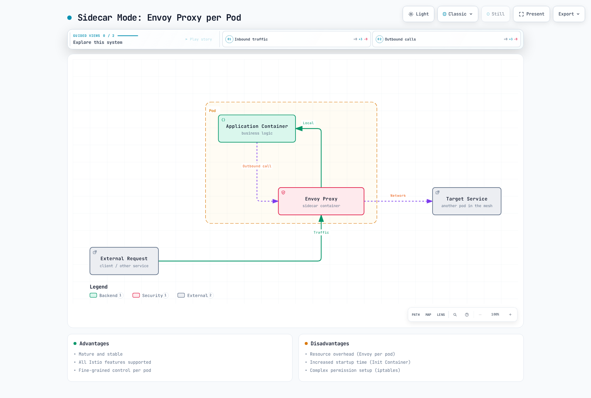
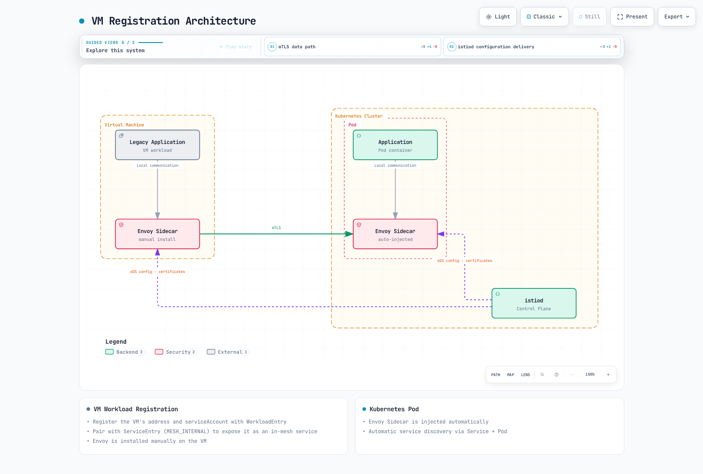

# Conceptos básicos

Este documento explica los conceptos y la arquitectura fundamentales de Istio. Comprenderlos es importante para utilizar Istio de forma eficaz.

## Índice

1. [Contexto e historia](02-basic-concepts.md#background-and-history)
2. [¿Por qué Istio?](02-basic-concepts.md#why-istio)
3. [Arquitectura de Istio](02-basic-concepts.md#istio-architecture)
4. [Modos de despliegue: Sidecar y Ambient](02-basic-concepts.md#deployment-modes-sidecar-vs-ambient)
5. [Recursos principales](02-basic-concepts.md#core-resources)
6. [Conceptos de gestión del tráfico](02-basic-concepts.md#traffic-management-concepts)
7. [Conceptos de seguridad](02-basic-concepts.md#security-concepts)
8. [Conceptos de observabilidad](02-basic-concepts.md#observability-concepts)
9. [Namespaces y Service Mesh](02-basic-concepts.md#namespaces-and-service-mesh)
10. [Próximos pasos](02-basic-concepts.md#next-steps)

## Contexto e historia {#background-and-history}

### El nacimiento de Service Mesh

#### Los desafíos de los microservicios

A principios de la década de 2010, las empresas comenzaron a dividir las aplicaciones monolíticas en microservicios.


[🔍 Ver el diagrama interactivo](https://www.atomai.click/kubernetes-docs/archmaps/en-service-mesh-istio-02-basic-concepts-0.html)

**Nuevos problemas:**

| Problema | Descripción | Impacto |
| --- | --- | --- |
| **Comunicación entre servicios** | Aumentan las llamadas de red | Latencia y propagación de fallos |
| **Observabilidad** | Se necesita trazabilidad distribuida | Depuración difícil |
| **Seguridad** | Autenticación y cifrado entre servicios | Implementar mTLS resulta complejo |
| **Control del tráfico** | Despliegues canary y pruebas A/B | Hay que modificar el código de las aplicaciones |
| **Gestión de fallos** | Circuit breaker y reintentos | Cada servicio debe implementarlos |

#### Primera solución: bibliotecas

**Problemas:**

* Era necesario desarrollar bibliotecas para cada lenguaje (Hystrix para Java, otra biblioteca para Go, etc.).
* Las bibliotecas quedaban estrechamente acopladas al código de la aplicación.
* Las actualizaciones exigían volver a desplegar todos los servicios.
* La gestión de versiones era compleja.


[🔍 Ver el diagrama interactivo](https://www.atomai.click/kubernetes-docs/archmaps/en-service-mesh-istio-02-basic-concepts-1.html)

**Idea de Service Mesh:** trasladar la lógica de red de las aplicaciones a una capa de infraestructura.

### El nacimiento de Envoy Proxy

#### El problema de Lyft

**En 2015, Lyft** afrontaba estos problemas:

* Operaba más de 200 microservicios.
* Utilizaba distintos lenguajes y frameworks (Python, Go, Java, entre otros).
* Los proxies existentes (HAProxy y NGINX) no eran suficientes:
  * Era difícil cambiar dinámicamente la configuración.
  * Faltaba observabilidad.
  * Las funciones avanzadas de enrutamiento eran limitadas.

#### Matt Klein y Envoy

**Matt Klein**, ingeniero de Lyft, publicó Envoy como software de código abierto en 2016.

**Problemas que resolvió Envoy:**


[🔍 Ver el diagrama interactivo](https://www.atomai.click/kubernetes-docs/archmaps/en-service-mesh-istio-02-basic-concepts-2.html)

**Características principales de Envoy:**

1. **Arquitectura fuera de proceso:** funciona como un proceso independiente de la aplicación.
2. **API xDS:** permite actualizar dinámicamente la configuración.
3. **Proxy L7:** admite HTTP/2, gRPC y WebSocket.
4. **Observabilidad:** ofrece métricas detalladas, trazas y registros.
5. **Rendimiento:** está escrito en C++ y ofrece un alto rendimiento.

#### Adopción por la CNCF

**Cronología:**

* **Septiembre de 2016:** Envoy se publicó como código abierto.
* **Septiembre de 2017:** fue aceptado como proyecto de la CNCF (Incubating).
* **Noviembre de 2018:** pasó a ser un proyecto Graduated de la CNCF.

### El nacimiento y la historia de Istio

#### Colaboración entre Google, IBM y Lyft

**En mayo de 2017**, Google, IBM y Lyft colaboraron para anunciar Istio.


[🔍 Ver el diagrama interactivo](https://www.atomai.click/kubernetes-docs/archmaps/en-service-mesh-istio-02-basic-concepts-3.html)

**Aportaciones de cada empresa:**

| Empresa | Aportación principal | Motivo |
| --- | --- | --- |
| **Google** | Diseño del plano de control | Experiencia con Borg y Kubernetes |
| **IBM** | Funciones empresariales | Requisitos de sus clientes empresariales |
| **Lyft** | Envoy Proxy | Proxy probado en producción |

#### Historial de versiones de Istio

**Hitos principales:**


[🔍 Ver el diagrama interactivo](https://www.atomai.click/kubernetes-docs/archmaps/en-service-mesh-istio-02-basic-concepts-4.html)

**Versión 1.5 (marzo de 2020): un punto de inflexión importante**

Arquitectura anterior (Istio 1.4 y versiones anteriores):

```
Separated into individual components:
- Mixer (policy/telemetry)
- Pilot (traffic management)
- Citadel (certificate management)
- Galley (configuration validation)
```

Nueva arquitectura (Istio 1.5 y posteriores):

```
Istiod (consolidated into single binary)
├── Pilot functionality (Service Discovery, Traffic Management)
├── Citadel functionality (Certificate Authority, Identity)
└── Galley functionality (Configuration Validation)

Mixer was deprecated during this transition; telemetry moved into the proxies
```

**Motivos del cambio:**

* Menor complejidad (de 4 componentes a 1).
* Menos sobrecarga en la ruta de telemetría; la mejora real depende de la carga de trabajo.
* Operaciones más sencillas al gestionar un solo proceso.
* Mayor eficiencia en el uso de memoria y CPU.

## ¿Por qué Istio? {#why-istio}

Kubernetes orquesta contenedores, pero tiene limitaciones para gestionar la comunicación compleja entre microservicios. Istio es una solución de Service Mesh que aborda estos problemas.

### Desafíos de los microservicios


[🔍 Ver el diagrama interactivo](https://www.atomai.click/kubernetes-docs/archmaps/en-service-mesh-istio-02-basic-concepts-5.html)

### Valores principales que aporta Istio

#### 1. Gestión del tráfico

**Problema:** se necesita cambiar el tráfico de forma segura al desplegar una nueva versión.

**Solución de Istio:**

```yaml
# Canary deployment without code changes
apiVersion: networking.istio.io/v1
kind: VirtualService
metadata:
  name: reviews
spec:
  hosts:
  - reviews
  http:
  - route:
    - destination:
        host: reviews
        subset: v1
      weight: 90  # Existing version 90%
    - destination:
        host: reviews
        subset: v2
      weight: 10  # New version 10%
```

**Beneficios:**

* No hace falta modificar el código de la aplicación.
* Es posible ajustar en tiempo real la distribución del tráfico.
* Un controlador de despliegues progresivos puede automatizar la reversión; Istio aplica los pesos de enrutamiento.
* Admite pruebas A/B y despliegues Blue/Green.

#### 2. Seguridad

**Problema:** se necesita cifrar y autenticar la comunicación entre servicios.

**Solución de Istio:**

```yaml
# Automatic mTLS enablement
apiVersion: security.istio.io/v1
kind: PeerAuthentication
metadata:
  name: default
  namespace: istio-system
spec:
  mtls:
    mode: STRICT  # Require mTLS on enrolled inbound workloads
```

**Beneficios:**

* Emisión y renovación automáticas de certificados.
* Verificación automática de la identidad de los servicios.
* Control granular de permisos.
* Implementación de una red Zero Trust.

#### 3. Observabilidad

**Problema:** resulta difícil seguir el recorrido de las solicitudes entre decenas de microservicios.

**Solución de Istio:**

* Generación automática de métricas (latencia, tráfico, errores y saturación).
* Trazabilidad distribuida.
* Visualización de la topología de los servicios.

**Beneficios:**

* Identificación automática de cuellos de botella.
* Identificación rápida de la causa raíz de los errores.
* Supervisión del estado de los servicios en tiempo real.

#### 4. Resiliencia

**Problema:** el fallo de un servicio puede propagarse por todo el sistema.

**Solución de Istio:**

```yaml
# Automatic Circuit Breaker configuration
apiVersion: networking.istio.io/v1
kind: DestinationRule
metadata:
  name: reviews
spec:
  host: reviews
  trafficPolicy:
    outlierDetection:
      consecutive5xxErrors: 5
      interval: 30s
      baseEjectionTime: 30s
```

**Beneficios:**

* Aislamiento de fallos mediante circuit breakers.
* Reintentos y tiempos de espera automáticos.
* Retirada automática de instancias no saludables.
* Limitación del tráfico (rate limiting).

### Cuándo utilizar Istio

Las cantidades de servicios indicadas a continuación son ejemplos orientativos; la idoneidad depende de los requisitos de seguridad y operación.

**✅ Casos adecuados para Istio:**

1. **Arquitectura de microservicios**
   * Diez servicios o más.
   * Dependencias complejas entre servicios.
   * Despliegues frecuentes.
2. **Necesidad de gestión avanzada del tráfico**
   * Despliegues canary y pruebas A/B.
   * Control granular del enrutamiento.
   * Replicación del tráfico (Traffic Mirroring).
3. **Requisitos de seguridad estrictos**
   * Cifrado obligatorio entre servicios.
   * Control de acceso granular.
   * Cumplimiento normativo.
4. **Observabilidad y depuración**
   * Seguimiento de problemas complejos entre servicios.
   * Identificación de cuellos de botella de rendimiento.
   * Supervisión de SLO y SLA.

**❌ Casos en los que Istio puede ser excesivo:**

1. **Aplicaciones sencillas**
   * Pocos servicios (menos de cinco).
   * Requisitos simples.
   * Kubernetes Ingress es suficiente.
2. **Recursos limitados**
   * Clúster pequeño.
   * No se puede asumir la sobrecarga de recursos.
   * El consumo de memoria de un sidecar es una carga importante.
3. **Falta de capacidad operativa**
   * Poco tiempo para aprender a operarlo.
   * No hay un equipo de plataforma dedicado.
   * Se prefieren soluciones más sencillas.

### Comparación con alternativas

#### Kubernetes Ingress frente a Istio

| Característica | Kubernetes Ingress | Istio |
| --- | --- | --- |
| **Ámbito** | Del exterior al clúster | Tráfico externo y comunicación interna entre servicios |
| **Enrutamiento** | Básico (ruta y host) | Avanzado (encabezados, cookies, etc.) |
| **mTLS** | Configuración manual | Automático |
| **Observabilidad** | Limitada | Amplia |
| **Complejidad** | Baja | Alta |
| **Caso de uso** | Aplicaciones sencillas | Microservicios |

#### AWS VPC Lattice frente a Istio

Consulta la comparación detallada en el documento [Integración con AWS](04-aws-integration.md#istio-vs-other-solutions-comparison).

**Resumen rápido:**

* **VPC Lattice:** servicio administrado de AWS, sencillo para la comunicación entre distintas VPC y cuentas de AWS.
* **Istio:** solución de código abierto con funciones avanzadas y control granular para cargas de trabajo de Kubernetes y máquinas virtuales.

#### Linkerd frente a Istio

| Propiedad | Istio | Linkerd |
| --- | --- | --- |
| **Complejidad** | Alta | Baja |
| **Funciones** | Muy amplias | Funciones esenciales |
| **Recursos** | Elevados | Reducidos |
| **Curva de aprendizaje** | Pronunciada | Suave |
| **Comunidad** | Amplia | Pequeña |

**Guía de selección:**

* Si necesitas funciones avanzadas y flexibilidad, elige **Istio**.
* Si necesitas una malla sencilla y ligera, elige **Linkerd**.

## Modos de despliegue: Sidecar y Ambient {#deployment-modes-sidecar-vs-ambient}

Istio admite dos modos de despliegue: **Sidecar Mode** y **Ambient Mode**.

### Sidecar Mode (predeterminado)

Inyecta un proxy Envoy como contenedor sidecar en cada pod de la aplicación.



[🔍 Ver el diagrama interactivo](https://www.atomai.click/kubernetes-docs/archmaps/en-service-mesh-istio-02-basic-concepts-6.html)

**Ventajas:**

* Tecnología madura y estable.
* Amplio conjunto de funciones L4/L7; la compatibilidad depende del modo del plano de datos.
* Control granular por pod.

**Desventajas:**

* Sobrecarga de recursos (un Envoy por pod).
* Mayor tiempo de inicio (Init Container).
* Configuración de permisos compleja (iptables).

### Ambient Mode (GA desde Istio 1.24)

Gestiona el tráfico a nivel de nodo sin sidecars.


[🔍 Ver el diagrama interactivo](https://www.atomai.click/kubernetes-docs/archmaps/en-service-mesh-istio-02-basic-concepts-7.html)

**Ventajas:**

* Menor consumo de recursos (una instancia por nodo).
* Inicio rápido de los pods.
* Operaciones más sencillas.
* Permite incorporar gradualmente funciones L7.

**Desventajas:**

* Hay que comprobar la paridad de funciones para la versión y topología elegidas.
* Algunas funciones avanzadas tienen limitaciones.
* El control granular por pod es más difícil.

### Tabla comparativa

| Propiedad | Sidecar Mode | Ambient Mode |
| --- | --- | --- |
| **Uso de recursos** | Alto (por pod) | Bajo (por nodo) |
| **Tiempo de inicio** | Lento (Init Container) | Rápido |
| **Complejidad operativa** | Alta | Baja |
| **Funciones L4** | Admitidas | Admitidas |
| **Funciones L7** | Compatibilidad completa | Opcionales (Waypoint) |
| **Madurez** | Estable | Las funciones principales son GA desde la versión 1.24 |
| **Migración** | — | Es posible migrar desde sidecars existentes |
| **Uso recomendado** | Cuando se necesitan funciones L7 avanzadas | Cuando se prioriza la eficiencia de recursos |

### Guía de selección

**Elige Sidecar Mode si:**

* Necesitas funciones específicas de sidecar, como la integración con máquinas virtuales.
* Necesitas control granular de políticas por pod.
* Priorizas una tecnología probada en producción.

**Elige Ambient Mode si:**

* La eficiencia de recursos es importante.
* Solo necesitas funciones L4 sencillas.
* Planeas añadir gradualmente funciones L7.

Consulta los detalles en [Avanzado: Ambient Mode](advanced/01-ambient-mode.md).

## Arquitectura de Istio {#istio-architecture}

Istio consta de dos componentes principales: el **plano de control** y el **plano de datos**.

| Componente | Descripción |
| --- | --- |
| **Plano de control (istiod)** | Sistema central responsable del descubrimiento de servicios, la distribución de configuración y la gestión de certificados. |
| **Plano de datos (proxy Envoy)** | Envoy en sidecars o ztunnel de Ambient con waypoints opcionales; gestiona el tráfico de la malla. |

Consulta la [documentación de arquitectura](03-architecture.md) para conocer su estructura detallada, el funcionamiento interno y los mecanismos de interceptación del tráfico.

## Recursos principales {#core-resources}

Los ejemplos siguientes utilizan las API de Sidecar. No apliques juntos todos los ejemplos de enrutamiento y políticas que se solapan. Gateway requiere pods de gateway compatibles y un Secret TLS en su namespace. Ambient utiliza el enrutamiento de Gateway API y políticas L7 dirigidas a waypoints; el recurso Sidecar no configura ztunnel.

Istio utiliza definiciones de recursos personalizadas de Kubernetes (CRD) para gestionar la configuración.

<span id="1-virtualservice"></span>

### 1. VirtualService

VirtualService define cómo se enrutan las solicitudes a los servicios.

```yaml
apiVersion: networking.istio.io/v1
kind: VirtualService
metadata:
  name: reviews-route
spec:
  hosts:
  - reviews  # Target service
  http:
  - match:
    - headers:
        end-user:
          exact: jason
    route:
    - destination:
        host: reviews
        subset: v2  # Route specific user to v2
  - route:
    - destination:
        host: reviews
        subset: v1  # Route to v1 by default
```

**Funciones principales:**

* Enrutamiento por ruta, encabezado o parámetro de consulta.
* División del tráfico (canary y pruebas A/B).
* Reintentos, tiempos de espera e inyección de fallos.
* Reescritura de URL y manipulación de encabezados.

### 2. DestinationRule

DestinationRule define subconjuntos de servicios (versiones) y aplica políticas de tráfico.

```yaml
apiVersion: networking.istio.io/v1
kind: DestinationRule
metadata:
  name: reviews-destination
spec:
  host: reviews
  trafficPolicy:
    loadBalancer:
      simple: LEAST_REQUEST  # Load balancing algorithm
    connectionPool:
      tcp:
        maxConnections: 100
      http:
        http1MaxPendingRequests: 50
        maxRequestsPerConnection: 2
    outlierDetection:
      consecutive5xxErrors: 5
      interval: 30s
      baseEjectionTime: 30s
  subsets:
  - name: v1
    labels:
      version: v1
  - name: v2
    labels:
      version: v2
  - name: v3
    labels:
      version: v3
```

**Funciones principales:**

* Definición de versiones del servicio (subconjuntos).
* Algoritmos de balanceo de carga.
* Configuración del conjunto de conexiones.
* Disyuntor del pool de conexiones y detección de valores atípicos.
* Configuración de TLS.

### 3. Gateway

Gateway gestiona el tráfico externo que entra en la malla.

```yaml
apiVersion: networking.istio.io/v1
kind: Gateway
metadata:
  name: bookinfo-gateway
spec:
  selector:
    istio: ingressgateway  # Select Ingress Gateway pod
  servers:
  - port:
      number: 80
      name: http
      protocol: HTTP
    hosts:
    - "bookinfo.example.com"
  - port:
      number: 443
      name: https
      protocol: HTTPS
    tls:
      mode: SIMPLE
      credentialName: bookinfo-credential  # TLS certificate
    hosts:
    - "bookinfo.example.com"
```

**Funciones principales:**

* Definición del punto de entrada del tráfico externo.
* Configuración del host, puerto y protocolo.
* Terminación de TLS.
* Enrutamiento SNI.

### 4. ServiceEntry

ServiceEntry permite utilizar servicios externos a la malla como si fueran internos.

```yaml
apiVersion: networking.istio.io/v1
kind: ServiceEntry
metadata:
  name: external-api
spec:
  hosts:
  - api.external.com
  ports:
  - number: 443
    name: https
    protocol: HTTPS
  location: MESH_EXTERNAL
  resolution: DNS
```

**Funciones principales:**

* Registro de servicios externos.
* Control del tráfico hacia servicios externos.
* Gestión del tráfico de salida.

### 5. PeerAuthentication

PeerAuthentication define las políticas de autenticación entre servicios.

```yaml
apiVersion: security.istio.io/v1
kind: PeerAuthentication
metadata:
  name: default
  namespace: default
spec:
  mtls:
    mode: STRICT  # STRICT, PERMISSIVE, DISABLE
```

### 6. AuthorizationPolicy

AuthorizationPolicy define los permisos de acceso a los servicios.

```yaml
apiVersion: security.istio.io/v1
kind: AuthorizationPolicy
metadata:
  name: allow-ratings
  namespace: default
spec:
  selector:
    matchLabels:
      app: ratings
  action: ALLOW
  rules:
  - from:
    - source:
        principals: ["cluster.local/ns/default/sa/reviews"]
    to:
    - operation:
        methods: ["GET"]
```

## Conceptos de gestión del tráfico {#traffic-management-concepts}

### Flujo de enrutamiento del tráfico

El diagrama muestra las relaciones entre las configuraciones. Gateway, VirtualService y DestinationRule son objetos de API, no saltos de red secuenciales; normalmente, Envoy selecciona los endpoints de los pods a partir de EDS.


[🔍 Ver el diagrama interactivo](https://www.atomai.click/kubernetes-docs/archmaps/en-service-mesh-istio-02-basic-concepts-8.html)

### División del tráfico (despliegue canary)

```yaml
apiVersion: networking.istio.io/v1
kind: VirtualService
metadata:
  name: reviews-canary
spec:
  hosts:
  - reviews
  http:
  - route:
    - destination:
        host: reviews
        subset: v1
      weight: 90  # 90% of traffic
    - destination:
        host: reviews
        subset: v2
      weight: 10  # 10% of traffic (canary)
```

### Circuit breaker

```yaml
apiVersion: networking.istio.io/v1
kind: DestinationRule
metadata:
  name: reviews-circuit-breaker
spec:
  host: reviews
  trafficPolicy:
    connectionPool:
      tcp:
        maxConnections: 100
      http:
        http1MaxPendingRequests: 10
        maxRequestsPerConnection: 2
    outlierDetection:
      consecutive5xxErrors: 5
      interval: 30s
      baseEjectionTime: 30s
      maxEjectionPercent: 50
```

## Conceptos de seguridad {#security-concepts}

### mTLS (TLS mutuo)

Auto mTLS cifra el tráfico entre las cargas de trabajo inscritas en la malla. Configura STRICT para rechazar el tráfico entrante sin cifrar; el tráfico que queda fuera de la malla no se protege automáticamente.


[🔍 Ver el diagrama interactivo](https://www.atomai.click/kubernetes-docs/archmaps/en-service-mesh-istio-02-basic-concepts-9.html)

**Modos de mTLS:**

* **STRICT:** solo se permite mTLS.
* **PERMISSIVE:** se permite mTLS o texto sin cifrar (para la migración).
* **DISABLE:** mTLS está deshabilitado.

Ambient no admite `DISABLE` en PeerAuthentication; STRICT también bloquea el tráfico que evita la malla.

### Autenticación y autorización

```yaml
# JWT Authentication
apiVersion: security.istio.io/v1
kind: RequestAuthentication
metadata:
  name: jwt-auth
spec:
  jwtRules:
  - issuer: "https://accounts.google.com"
    jwksUri: "https://www.googleapis.com/oauth2/v3/certs"
---
# Authorization Policy
apiVersion: security.istio.io/v1
kind: AuthorizationPolicy
metadata:
  name: require-jwt
spec:
  action: DENY
  rules:
  - from:
    - source:
        notRequestPrincipals: ["*"]
```

## Conceptos de observabilidad {#observability-concepts}

Istio expone métricas del proxy; los registros de acceso, los proveedores de trazas y los recolectores requieren configuración. Las aplicaciones deben propagar el contexto de traza. En Ambient, las métricas y trazas L7 requieren un waypoint.

### Métricas generadas automáticamente


[🔍 Ver el diagrama interactivo](https://www.atomai.click/kubernetes-docs/archmaps/en-service-mesh-istio-02-basic-concepts-10.html)

### Métricas principales

| Métrica | Descripción |
| --- | --- |
| `istio_requests_total` | Número total de solicitudes |
| `istio_request_duration_milliseconds` | Latencia de las solicitudes |
| `istio_request_bytes` | Tamaño de las solicitudes |
| `istio_response_bytes` | Tamaño de las respuestas |
| `istio_tcp_connections_opened_total` | Número de conexiones TCP |

### Trazabilidad distribuida

```yaml
# tracing-install.yaml: merge into the existing istioctl installation file
apiVersion: install.istio.io/v1alpha1
kind: IstioOperator
spec:
  meshConfig:
    enableTracing: true
    extensionProviders:
    - name: otel-tracing
      opentelemetry:
        service: opentelemetry-collector.observability.svc.cluster.local
        port: 4317
```

Aplica la configuración de instalación con `istioctl install -f <merged-install-file>` o con los valores equivalentes de Helm. Despliega por separado el collector OTLP indicado. Aplica con kubectl el siguiente recurso Telemetry; el 1 % es solo un ejemplo y debe ajustarse.

```yaml
apiVersion: telemetry.istio.io/v1
kind: Telemetry
metadata:
  name: mesh-tracing
  namespace: istio-system
spec:
  tracing:
  - providers:
    - name: otel-tracing
    randomSamplingPercentage: 1
```

## Namespaces y Service Mesh {#namespaces-and-service-mesh}

### Aislamiento de namespaces

Esta política DENY-all bloquea el tráfico de forma intencionada y completa. Para establecer una política predeterminada de denegación y permitir excepciones seleccionadas, utiliza una política ALLOW sin reglas. DENY tiene prioridad sobre cualquier ALLOW.

```yaml
# Per-namespace mTLS policy
apiVersion: security.istio.io/v1
kind: PeerAuthentication
metadata:
  name: default
  namespace: production
spec:
  mtls:
    mode: STRICT
---
# Per-namespace authorization policy
apiVersion: security.istio.io/v1
kind: AuthorizationPolicy
metadata:
  name: deny-all
  namespace: production
spec:
  action: DENY
  rules:
  - {}
```

### Ámbito de Service Mesh

```bash
# Include only specific namespaces in the mesh
kubectl label namespace default istio-injection=enabled
kubectl label namespace staging istio-injection=enabled

# Exclude specific namespace
kubectl label namespace kube-system istio-injection=disabled
```

### Multi-tenancy

`Sidecar.egress.hosts` limita la configuración del proxy que se importa; no limita el acceso de red. Para aislar tenants, utiliza AuthorizationPolicy y una implementación de NetworkPolicy que aplique las políticas.

```yaml
# Restrict mesh scope with Sidecar resource
apiVersion: networking.istio.io/v1
kind: Sidecar
metadata:
  name: default
  namespace: production
spec:
  egress:
  - hosts:
    - "production/*"  # Import production configuration; not an access-control boundary
    - "istio-system/*"
```

## Registro de cargas de trabajo de VM {#vm-workload-registration}

Istio puede registrar en la Service Mesh no solo pods de Kubernetes, sino también **cargas de trabajo de máquinas virtuales (VM)**. De este modo, las aplicaciones heredadas o los servicios fuera del clúster pueden utilizar las funciones de gestión del tráfico, seguridad y observabilidad de Istio.

### Por qué se necesitan cargas de trabajo de VM


[🔍 Ver el diagrama interactivo](https://www.atomai.click/kubernetes-docs/archmaps/en-service-mesh-istio-02-basic-concepts-11.html)

**Escenarios de uso:**

* Migración gradual de aplicaciones heredadas.
* Inclusión de servidores de bases de datos en la malla.
* Integración de servicios que se encuentran fuera del clúster.
* Configuración de entornos de nube híbrida.

### Arquitectura del registro de VM



[🔍 Ver el diagrama interactivo](https://www.atomai.click/kubernetes-docs/archmaps/en-service-mesh-istio-02-basic-concepts-12.html)

### Recurso WorkloadEntry

Estos son fragmentos de registro. WorkloadEntry por sí solo no instala un proxy ni habilita mTLS: primero sigue la [guía de instalación de VM](https://istio.io/latest/docs/setup/install/virtual-machine/), que abarca WorkloadGroup, la cuenta de servicio, el token de arranque y la CA, el agente y la conectividad de red. Configura la captura DNS o los registros DNS de los nombres de host de ServiceEntry; ServiceEntry no crea registros de CoreDNS.

Las cargas de trabajo de VM se registran mediante el recurso **WorkloadEntry**.

```yaml
apiVersion: networking.istio.io/v1
kind: WorkloadEntry
metadata:
  name: legacy-database
  namespace: default
spec:
  address: 192.168.1.100  # VM IP address
  labels:
    app: mysql
    version: v5.7
  serviceAccount: database-sa
  ports:
    mysql: 3306
```

**Campos principales de WorkloadEntry:**

* `address`: dirección IP de la VM.
* `labels`: etiquetas que coinciden con el selector del servicio.
* `serviceAccount`: cuenta de servicio para la autenticación mTLS.
* `ports`: definición de los puertos expuestos.

### Integración con ServiceEntry

WorkloadEntry se utiliza junto con ServiceEntry para registrar los servicios de VM en la malla.

```yaml
# Define service with ServiceEntry
apiVersion: networking.istio.io/v1
kind: ServiceEntry
metadata:
  name: legacy-database
spec:
  hosts:
  - database.legacy.com
  ports:
  - number: 3306
    name: mysql
    protocol: TCP
  location: MESH_INTERNAL  # Register as internal mesh service
  resolution: STATIC
  workloadSelector:
    labels:
      app: mysql
---
# Register VM instance with WorkloadEntry
apiVersion: networking.istio.io/v1
kind: WorkloadEntry
metadata:
  name: mysql-vm-1
  namespace: default
spec:
  address: 192.168.1.100
  labels:
    app: mysql
    version: v5.7
  serviceAccount: mysql-sa
```

### Comparación del registro de VM con Multi-Cluster

| Característica | Registro de carga de trabajo de VM | Multi-Cluster | Pod de Kubernetes |
| --- | --- | --- | --- |
| **Ubicación de la carga de trabajo** | VM fuera del clúster | Otro clúster de Kubernetes | Dentro del clúster |
| **Instalación de Envoy** | Manual | Automática (sidecar) | Automática (sidecar) |
| **Método de registro** | WorkloadEntry | Descubrimiento de servicios de Kubernetes remoto | Service y Pod |
| **mTLS** | Admitido | Admitido | Admitido |
| **Descubrimiento de servicios** | Manual (se especifica la IP) | Automático | Automático |
| **Escenario de uso** | Aplicaciones heredadas y bases de datos | Multi-cloud y recuperación ante desastres | Aplicaciones cloud-native |
| **Complejidad operativa** | Alta | Media | Baja |

### Ventajas del registro de VM

#### 1. Migración gradual


[🔍 Ver el diagrama interactivo](https://www.atomai.click/kubernetes-docs/archmaps/en-service-mesh-istio-02-basic-concepts-13.html)

**Beneficios:**

* Integrar las aplicaciones existentes en VM en la malla sin modificarlas.
* Migrar a Kubernetes por etapas.
* Mantener políticas coherentes de seguridad y observabilidad durante la migración.

#### 2. Política de seguridad unificada

```yaml
# mTLS policy applied to both VMs and pods
apiVersion: security.istio.io/v1
kind: PeerAuthentication
metadata:
  name: default
  namespace: default
spec:
  mtls:
    mode: STRICT  # Enforce mTLS for both VMs and pods
---
# VM database access control
apiVersion: security.istio.io/v1
kind: AuthorizationPolicy
metadata:
  name: database-access
  namespace: default
spec:
  selector:
    matchLabels:
      app: mysql  # WorkloadEntry label
  action: ALLOW
  rules:
  - from:
    - source:
        principals: ["cluster.local/ns/default/sa/app-sa"]
    to:
    - operation:
        ports: ["3306"]
```

#### 3. Observabilidad coherente

La telemetría de las cargas de trabajo de VM depende del protocolo, igual que la de los pods. El ejemplo de MySQL utiliza TCP y no tiene códigos de respuesta HTTP ni spans de solicitudes HTTP.

```promql
# TCP bytes received per second; verify the actual workload label in your metrics
sum(rate(istio_tcp_received_bytes_total{destination_workload="mysql-vm-1"}[5m]))

# TCP connections opened per second
sum(rate(istio_tcp_connections_opened_total{destination_workload="mysql-vm-1"}[5m]))
```

### Limitaciones del registro de VM

1. **Instalación manual de Envoy:** hay que instalar y configurar manualmente el proxy Envoy en la VM.
2. **Conectividad de red:** se necesita conectividad entre la VM y el clúster de Kubernetes.
3. **Identidad de arranque:** aprovisiona de forma segura la CA raíz y el token de la cuenta de servicio; el agente de Istio obtiene y rota los certificados de carga de trabajo.
4. **Carga operativa:** es necesario gestionar y actualizar la versión de Envoy de la VM.
5. **Limitación del escalado automático:** no hay escalado automático equivalente a Kubernetes HPA.

### Ejemplo práctico

#### Escenario: integración de una base de datos heredada

```yaml
# 1. Define database service with ServiceEntry
apiVersion: networking.istio.io/v1
kind: ServiceEntry
metadata:
  name: legacy-postgres
  namespace: production
spec:
  hosts:
  - postgres.production.svc.cluster.local
  addresses:
  - 240.240.1.10  # Virtual IP
  ports:
  - number: 5432
    name: postgresql
    protocol: TCP
  location: MESH_INTERNAL
  resolution: STATIC
  workloadSelector:
    labels:
      app: postgres
      tier: database
---
# 2. Register VM instance with WorkloadEntry
apiVersion: networking.istio.io/v1
kind: WorkloadEntry
metadata:
  name: postgres-vm-1
  namespace: production
spec:
  address: 10.0.1.100  # Actual VM IP
  labels:
    app: postgres
    tier: database
    version: v13
  serviceAccount: postgres-sa
  ports:
    postgresql: 5432
---
# 3. Access control policy
apiVersion: security.istio.io/v1
kind: AuthorizationPolicy
metadata:
  name: postgres-access-control
  namespace: production
spec:
  selector:
    matchLabels:
      app: postgres
  action: ALLOW
  rules:
  - from:
    - source:
        namespaces: ["production"]
        principals: ["cluster.local/ns/production/sa/api-service"]
    to:
    - operation:
        ports: ["5432"]
```

**Resultado:**

* Los pods de Kubernetes acceden a la base de datos mediante `postgres.production.svc.cluster.local`.
* Se cifra automáticamente con mTLS la comunicación entre la VM y los pods.
* Se aplica la política de control de acceso.
* La base de datos ofrece métricas TCP; para obtener trazas HTTP se necesita una carga de trabajo HTTP y propagación del contexto de traza.

### Resumen de la comparación del registro de cargas de trabajo


[🔍 Ver el diagrama interactivo](https://www.atomai.click/kubernetes-docs/archmaps/en-service-mesh-istio-02-basic-concepts-14.html)

Istio ofrece capacidades flexibles para registrar cargas de trabajo:

* **Pod de Kubernetes:** aplicaciones cloud-native.
* **Multi-Cluster:** nube múltiple, distribución regional y recuperación ante desastres.
* **Máquina virtual:** aplicaciones heredadas, bases de datos y entornos híbridos.

Todas las cargas de trabajo reciben funciones coherentes de seguridad, gestión del tráfico y observabilidad.

## Próximos pasos {#next-steps}

Ahora ya conoces los conceptos básicos de Istio. Aprende a utilizarlos en la práctica con los siguientes documentos:

### Funciones principales

1. [**Gestión del tráfico**](traffic-management/README.md)
   * Uso de Gateway y VirtualService.
   * Definición de DestinationRule y subconjuntos.
   * ServiceEntry y WorkloadEntry (registro de VM).
   * Patrones avanzados de enrutamiento (canary y pruebas A/B).
   * Traffic Mirroring y Shadowing.
2. [**Seguridad**](security/README.md)
   * Configuración de mTLS y PeerAuthentication.
   * Autenticación (RequestAuthentication y JWT).
   * Autorización (AuthorizationPolicy).
   * Gestión de políticas de seguridad.
   * Integración de autenticación externa.
3. [**Observabilidad**](observability/README.md)
   * Recopilación de métricas (Prometheus).
   * Trazabilidad distribuida (Jaeger y Zipkin).
   * Configuración de registros.
   * Visualización de la malla con Kiali.
   * Paneles de Grafana.
4. [**Resiliencia**](resilience/README.md)
   * Patrón circuit breaker.
   * Configuración de reintentos y tiempos de espera.
   * Rate limiting.
   * Detección de valores atípicos.
   * Pruebas de inyección de fallos.

### Temas avanzados

5. [**Temas avanzados**](advanced/README.md)
   * Ambient Mode (malla sin sidecars).
   * Configuración Multi-Cluster.
   * Personalización con EnvoyFilter.
   * DNS Proxy y almacenamiento en caché.
   * Configuración detallada de cargas de trabajo de VM.
   * Desarrollo de plugins WASM.

## Referencias

* [Documentación oficial de Istio: conceptos](https://istio.io/latest/docs/concepts/)
* [Documentación oficial de Istio: gestión del tráfico](https://istio.io/latest/docs/concepts/traffic-management/)
* [Documentación oficial de Istio: seguridad](https://istio.io/latest/docs/concepts/security/)
* [Documentación oficial de Istio: observabilidad](https://istio.io/latest/docs/concepts/observability/)
* [Documentación oficial de Envoy Proxy](https://www.envoyproxy.io/docs/envoy/latest/)
* [DestinationRule](https://istio.io/latest/docs/reference/config/networking/destination-rule/)
* [Sidecar](https://istio.io/latest/docs/reference/config/networking/sidecar/)
* [AuthorizationPolicy](https://istio.io/latest/docs/reference/config/security/authorization-policy/)
* [PeerAuthentication](https://istio.io/latest/docs/reference/config/security/peer_authentication/)
* [Instalación de máquinas virtuales](https://istio.io/latest/docs/setup/install/virtual-machine/)
* [OpenTelemetry](https://istio.io/latest/docs/tasks/observability/distributed-tracing/opentelemetry/)
* [¿Sidecar o Ambient?](https://istio.io/latest/docs/overview/dataplane-modes/)
* [Presentación de istiod: simplificación del plano de control](https://istio.io/latest/blog/2020/istiod/)
* [Proxy de alto rendimiento para el perímetro, el middleware y los servicios nativos de la nube](https://www.cncf.io/projects/envoy/)
