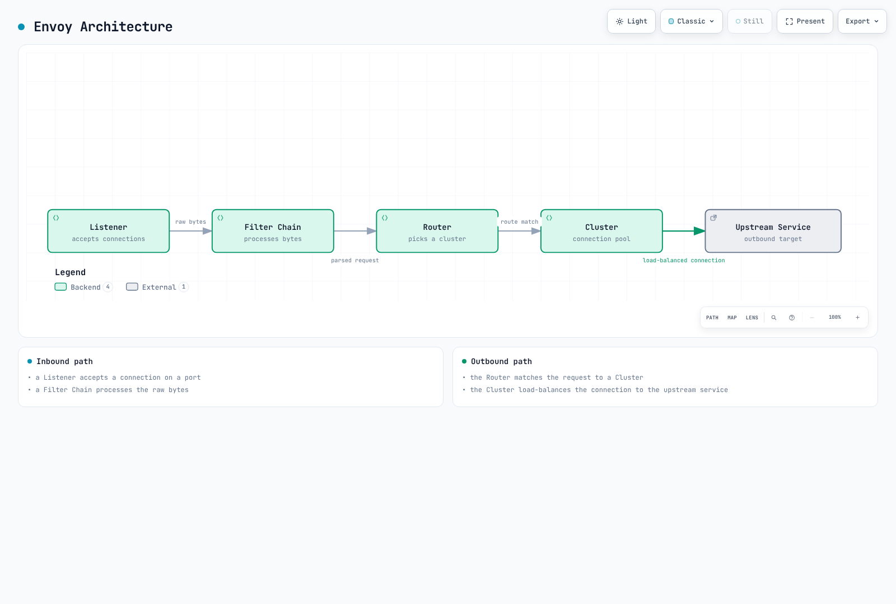
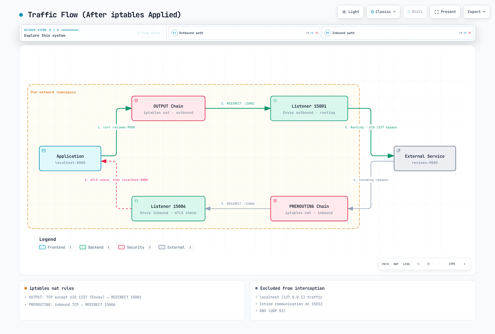
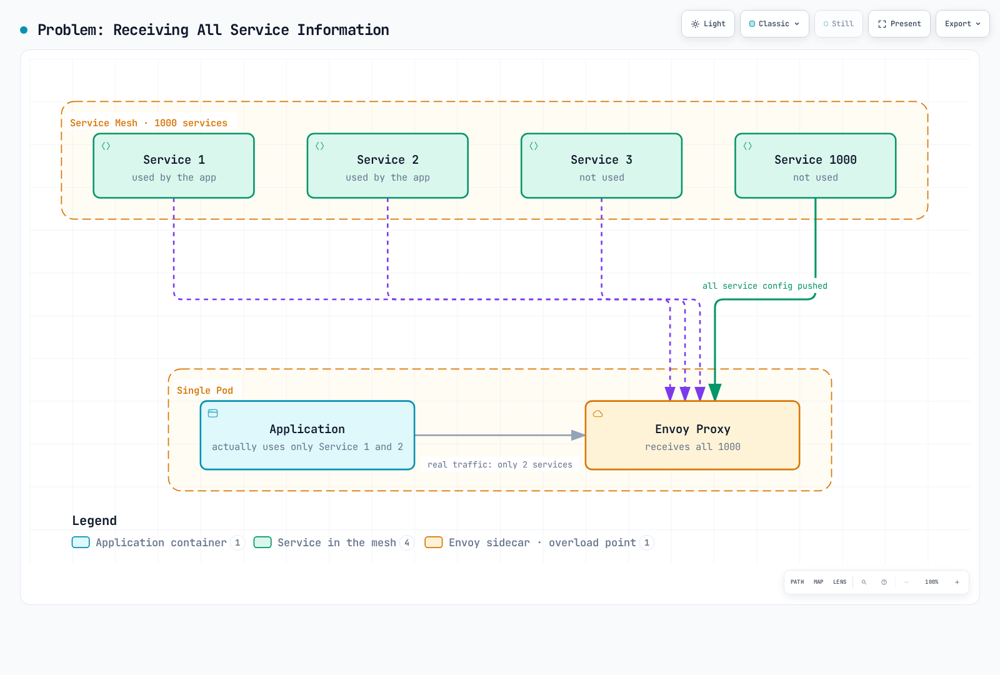

# Arquitectura

> **Versión revisada**: Istio 1.31.0 **Versión de la API**: `networking.istio.io/v1`, `security.istio.io/v1` **Última actualización**: 11 de septiembre de 2026

Este documento explica en profundidad la arquitectura interna y los mecanismos de red de Istio.

**Para consultar los antecedentes y la historia**, véase el documento [Conceptos básicos](02-basic-concepts.md#background-and-history).

**Cambios importantes (Istio 1.5+)**:

* Pilot, Citadel y Galley **ya no son componentes independientes**
* Se integraron en un **único binario** llamado Istiod (`pilot-discovery`)
* Los términos Pilot/Citadel/Galley son **nombres históricos que describen funciones**

## Tabla de contenido

Este capítulo describe principalmente el modo sidecar. Ambient utiliza ztunnel, escrito en Rust, en cada nodo y proxies waypoint opcionales para L7; sus rutas de interceptación y DNS son diferentes. Mixer se retiró y la telemetría pasó a los proxies, en lugar de integrarse en istiod. Los fragmentos JSON y de pods inyectados que aparecen a continuación son esquemáticos, no manifiestos completos listos para desplegar.

1. [Descripción general de la arquitectura de Istio](03-architecture.md#istio-architecture-overview)
2. [Plano de control: Istiod](03-architecture.md#control-plane-istiod)
3. [Plano de datos: Envoy Proxy](03-architecture.md#data-plane-envoy-proxy)
4. [Mecanismo de inyección de sidecar](03-architecture.md#sidecar-injection-mechanism)
5. [iptables e interceptación del tráfico](03-architecture.md#iptables-and-traffic-interception)
6. [Mecanismo de procesamiento DNS](03-architecture.md#dns-processing-mechanism)
7. [Comunicación de la API xDS](03-architecture.md#xds-api-communication)
8. [Optimización con el recurso Sidecar](03-architecture.md#optimization-with-sidecar-resource)

## Descripción general de la arquitectura de Istio {#istio-architecture-overview}

### Estructura general


[🔍 Ver diagrama interactivo](https://www.atomai.click/kubernetes-docs/archmaps/en-service-mesh-istio-03-architecture-0.html)

### Plano de control frente a plano de datos

| Categoría | Plano de control (Istiod) | Plano de datos (Envoy) |
| --------------- | --------------------------------------------- | ------------------------- |
| **Función** | Gestión de políticas y distribución de configuración | Procesamiento real del tráfico |
| **Ubicación** | Pods independientes, normalmente 1-3 | Todos los pods de aplicación |
| **Lenguaje** | Go | C++ |
| **Carga** | Baja | Alta: todo el tráfico |
| **Escalabilidad** | Escalado horizontal (HA) | Automática: 1 por pod |

## Plano de control: Istiod {#control-plane-istiod}

### Estructura interna de Istiod

**Importante**: Desde Istio 1.5, Pilot, Citadel y Galley son **funciones internas de Istiod, no componentes independientes**.


[🔍 Ver diagrama interactivo](https://www.atomai.click/kubernetes-docs/archmaps/en-service-mesh-istio-03-architecture-10.html)

### Funciones principales de Istiod

**Nota**: Las siguientes funciones están integradas en Istiod en Istio 1.31. Los nombres históricos Pilot, Citadel y Galley se utilizan para describirlas.

#### 1. Descubrimiento de servicios (función de Pilot)

```yaml
# Kubernetes Service detection
apiVersion: v1
kind: Service
metadata:
  name: reviews
spec:
  selector:
    app: reviews
  ports:
  - port: 9080
```

Istiod realiza el seguimiento de:

* Services de Kubernetes
* EndpointSlices: direcciones IP de los pods
* Cambios de estado de los pods
* Servicios externos (ServiceEntry)

#### 2. Gestión del tráfico (función de Pilot)

Convierte los CRD de Istio en configuración de Envoy:

```yaml
# VirtualService (user-defined)
apiVersion: networking.istio.io/v1
kind: VirtualService
metadata:
  name: reviews
spec:
  hosts:
  - reviews
  http:
  - route:
    - destination:
        host: reviews
        subset: v1
      weight: 90
    - destination:
        host: reviews
        subset: v2
      weight: 10
```

↓ Istiod los convierte en configuración de Envoy ↓

```json
{
  "match": {"prefix": "/"},
  "route": {
    "weighted_clusters": {
      "clusters": [
        {"name": "outbound|9080|v1|reviews.default.svc.cluster.local", "weight": 90},
        {"name": "outbound|9080|v2|reviews.default.svc.cluster.local", "weight": 10}
      ]
    }
  }
}
```

<span id="3-certificate-management-citadel-functionality"></span>

#### 3. Gestión de certificados (función de Citadel)

El agente de Istio crea la clave y la CSR, se autentica ante istiod y recibe un certificado firmado. Envoy obtiene ese certificado y la clave del agente local mediante SDS. La duración del certificado se puede configurar; la renovación ocurre antes de que expire.

**Formato del ID de SPIFFE**:

```
spiffe://cluster.local/ns/default/sa/reviews
```

#### 4. Validación de configuración (función de Galley)

La validación de admisión comprueba el esquema y las restricciones locales de configuración. La existencia de recursos referenciados se comprueba con `istioctl analyze`; el webhook de admisión no necesariamente rechaza un destino que no existe. Este ejemplo hace referencia a un Gateway inexistente:

```yaml
# invalid-vs.yaml
apiVersion: networking.istio.io/v1
kind: VirtualService
metadata:
  name: invalid
spec:
  hosts:
  - reviews
  gateways:
  - missing-gateway
  http:
  - route:
    - destination:
        host: reviews
```

```bash
istioctl analyze invalid-vs.yaml --use-kube=false
# IST0101: Referenced gateway not found: "missing-gateway"
```

### Estructura del proceso de Istiod

**Implementación real en Istio 1.31**:

```bash
# Inspect the configured binary arguments; no shell in the image is required
kubectl get deployment istiod -n istio-system   -o jsonpath='{.spec.template.spec.containers[?(@.name=="discovery")].args}'
# The discovery container runs pilot-discovery discovery.
```

**Puntos clave**:

* Istiod se ejecuta como un **único binario de Go** llamado `pilot-discovery`
* Pilot, Citadel y Galley son nombres históricos de funciones; no garantizan los nombres actuales de los paquetes
* Todas las funciones se ejecutan como goroutines dentro de un único proceso

**Puertos principales de Istiod**:

| Puerto | Protocolo | Propósito | Función |
| --------- | -------- | ------------------------ | ------------------------- |
| **15010** | gRPC | xDS heredado | Compatibilidad con versiones anteriores |
| **15012** | gRPC | xDS sobre TLS | Endpoint principal de la API xDS |
| **15014** | HTTP | Monitorización del plano de control | Métricas y comprobaciones de estado |
| **15017** | HTTPS | Webhook | Inyección y validación |
| **8080** | HTTP | Depuración | Interfaz de depuración |

### Despliegue de Istiod

**Configuración de alta disponibilidad**:

```yaml
# Merge into the existing istioctl install file; do not replace a managed Deployment
apiVersion: install.istio.io/v1alpha1
kind: IstioOperator
spec:
  components:
    pilot:
      k8s:
        hpaSpec:
          minReplicas: 3
          maxReplicas: 5
        resources:
          requests:
            cpu: 500m
            memory: 2Gi
```

**Uso típico de recursos**:

* CPU: 0.5 - 2 núcleos
* Memoria: 2 - 4 GB
* Puede gestionar miles de servicios y pods

## Plano de datos: Envoy Proxy {#data-plane-envoy-proxy}

### Arquitectura de Envoy



[🔍 Ver diagrama interactivo](https://www.atomai.click/kubernetes-docs/archmaps/en-service-mesh-istio-03-architecture-2.html)

### Componentes principales de Envoy

#### 1. Listeners

**Reciben conexiones en los puertos**:

```json
{
  "name": "0.0.0.0_15001",
  "address": {
    "socket_address": {
      "address": "0.0.0.0",
      "port_value": 15001
    }
  },
  "filter_chains": [...]
}
```

**Listeners predeterminados de Istio**:

* `0.0.0.0:15001`: Todo el tráfico TCP saliente
* `0.0.0.0:15006`: Todo el tráfico TCP entrante
* `0.0.0.0:15021`: Comprobación de estado
* `0.0.0.0:15090`: Métricas de Prometheus

#### 2. Filtros

**Plugins que procesan solicitudes y respuestas**:


[🔍 Ver diagrama interactivo](https://www.atomai.click/kubernetes-docs/archmaps/en-service-mesh-istio-03-architecture-3.html)

#### 3. Clusters

**Grupos lógicos de servicios upstream**:

```json
{
  "name": "outbound|9080|v1|reviews.default.svc.cluster.local",
  "type": "EDS",
  "eds_cluster_config": {
    "service_name": "outbound|9080|v1|reviews.default.svc.cluster.local"
  },
  "circuit_breakers": {...},
  "outlier_detection": {...}
}
```

#### 4. Endpoints

**Lista de direcciones IP reales de los pods**:

```json
{
  "cluster_name": "outbound|9080|v1|reviews",
  "endpoints": [
    {
      "lb_endpoints": [
        {"endpoint": {"address": {"socket_address": {"address": "10.244.1.5", "port_value": 9080}}}},
        {"endpoint": {"address": {"socket_address": {"address": "10.244.2.8", "port_value": 9080}}}}
      ]
    }
  ]
}
```

### Rendimiento de Envoy

Mida el patrón real de tráfico, el tamaño de la configuración y los ajustes de telemetría. El [benchmark oficial](https://istio.io/latest/docs/ops/deployment/performance-and-scalability/) corresponde expresamente a Istio 1.24; no hay una garantía universal de RPS por núcleo, P99 inferior a un milisegundo o consumo de memoria. Dimensione también istiod según el número de servicios y proxies y la frecuencia de los cambios de configuración.

## Mecanismo de inyección de sidecar {#sidecar-injection-mechanism}

### Proceso de inyección


[🔍 Ver diagrama interactivo](https://www.atomai.click/kubernetes-docs/archmaps/en-service-mesh-istio-03-architecture-4.html)

El webhook modifica las solicitudes de creación de Pods, no el Deployment en sí. Los pods existentes deben recrearse después de habilitar la inyección. Con Istio CNI, la configuración de red deja de realizarse en el contenedor de inicialización privilegiado de cada pod; los sidecars nativos también pueden cambiar la estructura del pod generado.

### Configuración original y después de la inyección

**Deployment original**:

```yaml
apiVersion: apps/v1
kind: Deployment
metadata:
  name: reviews
spec:
  selector:
    matchLabels:
      app: reviews
  template:
    metadata:
      labels:
        app: reviews
    spec:
      containers:
      - name: reviews
        image: reviews:v1
        ports:
        - containerPort: 9080
```

**Después de la inyección**:

```yaml
apiVersion: v1
kind: Pod
metadata:
  annotations:
    sidecar.istio.io/status: '{"initContainers":["istio-init"],"containers":["istio-proxy"]}'
spec:
  initContainers:
  - name: istio-init
    image: istio/proxyv2:1.31.0
    command: ['istio-iptables', ...]
    securityContext:
      capabilities:
        add: [NET_ADMIN, NET_RAW]
  containers:
  - name: reviews
    image: reviews:v1
    ports:
    - containerPort: 9080
  - name: istio-proxy
    image: istio/proxyv2:1.31.0
    args: ['proxy', 'sidecar', ...]
```

### Habilitación de la inyección de sidecar

#### Inyección automática (recomendada)

**En el namespace**:

```bash
# Add label to namespace
kubectl label namespace default istio-injection=enabled

# All pods deployed to this namespace will automatically have sidecar injected
kubectl apply -f deployment.yaml
```

**En el Pod** (etiqueta):

```yaml
apiVersion: v1
kind: Pod
metadata:
  name: example-app
  labels:
    sidecar.istio.io/inject: "true"  # Enable injection per pod
spec:
  containers:
  - name: app
    image: myapp:v1
```

#### Inyección manual

Utilice `istioctl kube-inject` para inyectar un sidecar directamente en los archivos YAML.

```bash
# Inject sidecar into YAML file and deploy
istioctl kube-inject -f deployment.yaml | kubectl apply -f -

# Or save to file
istioctl kube-inject -f deployment.yaml -o deployment-injected.yaml
kubectl apply -f deployment-injected.yaml
```

**Casos de uso de la inyección manual**:

* Entornos en los que no se puede usar la inyección automática
* Cuando se necesita control explícito en los pipelines de CI/CD
* Cuando se quiere inspeccionar el YAML inyectado para depurar

## iptables e interceptación del tráfico {#iptables-and-traffic-interception}

### Contenedor istio-init

**Función**: Configura reglas de iptables para redirigir el tráfico de red del pod a Envoy Proxy


[🔍 Ver diagrama interactivo](https://www.atomai.click/kubernetes-docs/archmaps/en-service-mesh-istio-03-architecture-5.html)

### Detalle de las reglas de iptables

**Esquema simplificado de las reglas; no es un script para ejecutar**:

```bash
#!/bin/bash
# istio-iptables script (simplified)

# 1. OUTPUT chain: Application outbound traffic
iptables -t nat -A OUTPUT -p tcp \
  -m owner ! --uid-owner 1337 \
  -j REDIRECT --to-port 15001     # Envoy outbound port

# 2. PREROUTING chain: Inbound traffic to pod
iptables -t nat -A PREROUTING -p tcp \
  -j REDIRECT --to-port 15006     # Envoy inbound port

# 3. Exclusion rules
# - localhost traffic
iptables -t nat -I OUTPUT -d 127.0.0.1/32 -j RETURN

# - Istiod communication (15012)
iptables -t nat -I OUTPUT -p tcp --dport 15012 -j RETURN

# - DNS (53)
iptables -t nat -I OUTPUT -p udp --dport 53 -j RETURN
```

### Flujo de tráfico después de aplicar iptables



[🔍 Ver diagrama interactivo](https://www.atomai.click/kubernetes-docs/archmaps/en-service-mesh-istio-03-architecture-6.html)

### Comprobación de las reglas de iptables

**Comprobación desde el interior del pod**:

Un contenedor istio-proxy habitual puede utilizar una imagen distroless y no disponer de NET_ADMIN. Inspeccione las reglas únicamente mediante una sesión de depuración aprobada en el nodo o en el espacio de nombres de red del pod, con las herramientas y capacidades necesarias. A continuación se muestra una salida ilustrativa de `iptables -t nat -L -n -v`:

```text
# OUTPUT chain
Chain OUTPUT (policy ACCEPT)
target     prot opt source     destination
ISTIO_OUTPUT  tcp  --  0.0.0.0/0  0.0.0.0/0

# ISTIO_OUTPUT detail
Chain ISTIO_OUTPUT (1 references)
RETURN     all  --  0.0.0.0/0  127.0.0.1           # Exclude localhost
RETURN     all  --  0.0.0.0/0  0.0.0.0/0           owner UID match 1337  # Exclude Envoy
REDIRECT   tcp  --  0.0.0.0/0  0.0.0.0/0           redir ports 15001  # Redirect rest

# PREROUTING chain
Chain PREROUTING (policy ACCEPT)
ISTIO_INBOUND  tcp  --  0.0.0.0/0  0.0.0.0/0

# ISTIO_INBOUND detail
Chain ISTIO_INBOUND (1 references)
REDIRECT   tcp  --  0.0.0.0/0  0.0.0.0/0           redir ports 15006
```

### Contenedor de inicialización frente a Istio CNI

Ambas opciones configuran la redirección del tráfico. Istio CNI es un DaemonSet privilegiado en los nodos que se encadena al CNI principal, como AWS VPC CNI; no sustituye ese CNI por una implementación eBPF. Es opcional para los sidecars y obligatorio en modo ambient.

## Mecanismo de procesamiento DNS {#dns-processing-mechanism}

### Funcionamiento básico del DNS de Kubernetes


[🔍 Ver diagrama interactivo](https://www.atomai.click/kubernetes-docs/archmaps/en-service-mesh-istio-03-architecture-7.html)

**/etc/resolv.conf** (dentro del pod):

```bash
nameserver 10.96.0.10  # kube-dns ClusterIP
search default.svc.cluster.local svc.cluster.local cluster.local
options ndots:5
```

### Procesamiento DNS de Envoy

**La resolución DNS de la aplicación y el descubrimiento de endpoints de Envoy son operaciones diferentes**:

La aplicación resuelve primero el nombre del servicio. Después, Envoy utiliza la configuración de enrutamiento y los datos de endpoints de EDS para seleccionar un destino upstream; EDS no sustituye la consulta DNS de la aplicación.

**Ventajas**:

* EDS distribuye endpoints a Envoy; el DNS de la aplicación sigue utilizando el resolver configurado, salvo que la captura DNS responda localmente
* Actualizaciones dinámicas de endpoints
* Enrutamiento avanzado: versiones, pesos, etc.

### Proxy DNS (opcional en modo sidecar)

**Función de proxy DNS incorporada en Istio 1.8+**:

El proxy DNS del sidecar se ejecuta en el agente de Istio y responde a partir de una tabla local de nombres en caché que proporciona istiod. No consulta istiod para cada solicitud DNS. Los nombres desconocidos se envían al resolver indicado en `/etc/resolv.conf`. La captura DNS de ambient está habilitada de forma predeterminada desde Istio 1.25. Incorpore lo siguiente al archivo de instalación y reinicie las cargas de trabajo sidecar afectadas.

```yaml
apiVersion: install.istio.io/v1alpha1
kind: IstioOperator
spec:
  meshConfig:
    defaultConfig:
      proxyMetadata:
        ISTIO_META_DNS_CAPTURE: "true"  # Enable DNS Proxy
```

**Funcionamiento**:

Con la captura DNS habilitada: aplicación → proxy DNS del agente de Istio → tabla local de nombres, o resolver upstream si el nombre es desconocido.

**Reglas de iptables del proxy DNS**:

```bash
# Redirect UDP port 53 to Istio agent DNS proxy
iptables -t nat -A OUTPUT -p udp --dport 53 \
  -m owner ! --uid-owner 1337 \
  -j REDIRECT --to-port 15053
```

## Comunicación de la API xDS {#xds-api-communication}

### Descripción general del protocolo xDS

**xDS**: Significa Discovery Service, el protocolo de configuración dinámica de Envoy.

LDS, RDS, CDS y EDS son tipos lógicos de recursos, normalmente multiplexados sobre un flujo de descubrimiento agregado (ADS). El SDS del sidecar lo proporciona el agente local de Istio, no un quinto flujo directo con istiod.

### Tipos de API xDS

| API | Nombre | Función | Ejemplo |
| ------- | ------------------ | -------------------------- | ----------------- |
| **LDS** | Listener Discovery | Recepción de configuración de puertos | 15001, 15006 |
| **RDS** | Route Discovery | Reglas de enrutamiento HTTP | VirtualService |
| **CDS** | Cluster Discovery | Servicios upstream | DestinationRule |
| **EDS** | Endpoint Discovery | Lista de direcciones IP de pods | Service Endpoints |
| **SDS** | Secret Discovery | Certificados TLS | Certificados mTLS |

### Flujo de comunicación xDS

Al iniciarse, el agente establece la identidad y actúa como intermediario de la conexión de descubrimiento con istiod. Envoy confirma las configuraciones aceptadas; istiod envía actualizaciones cuando cambian la configuración o los endpoints. SDS proporciona los certificados por separado a través del agente local.

### Verificación de la comunicación xDS

**Comprobación con la API de administración de Envoy**:

```bash
# Export via istioctl; no curl or shell is required inside the proxy image
istioctl proxy-config all <pod-name> -n default -o json > config-dump.json
jq '.configs[] | select(."@type" | endswith("ListenersConfigDump")) | .dynamic_listeners' config-dump.json
jq '.configs[] | select(."@type" | endswith("ClustersConfigDump")) | .dynamic_active_clusters' config-dump.json
jq '.configs[] | select(."@type" | endswith("RoutesConfigDump")) | .dynamic_route_configs' config-dump.json
```

**Comprobación con istioctl**:

```bash
# Listener configuration
istioctl proxy-config listeners <pod-name> -n default

# Cluster configuration
istioctl proxy-config clusters <pod-name> -n default

# Endpoint configuration
istioctl proxy-config endpoints <pod-name> -n default

# Route configuration
istioctl proxy-config routes <pod-name> -n default
```

## Optimización con el recurso Sidecar {#optimization-with-sidecar-resource}

### Problema: recibir información de todos los servicios

De forma predeterminada, cada Envoy recibe **información de todos los servicios de la malla**:



[🔍 Ver diagrama interactivo](https://www.atomai.click/kubernetes-docs/archmaps/en-service-mesh-istio-03-architecture-13.html)

**Problemas**:

* Mayor consumo de memoria
* Mayor consumo de CPU para procesar la configuración
* Desperdicio de ancho de banda de red
* Mayor carga en Istiod

### Solución: recurso Sidecar

Utilice el **recurso Sidecar** para limitar la recepción a los servicios necesarios:

```yaml
apiVersion: networking.istio.io/v1
kind: Sidecar
metadata:
  name: default
  namespace: default
spec:
  egress:
  - hosts:
    - "./*"  # All services in same namespace
    - "istio-system/*"  # All services in istio-system
    - "production/reviews.production.svc.cluster.local"  # Only reviews in production namespace
```

La delimitación de la configuración y REGISTRY_ONLY no son cortafuegos de salida. Utilice AuthorizationPolicy y controles de red para el aislamiento. Los recursos Sidecar no configuran los proxies ambient.

### Ejemplos del recurso Sidecar

#### 1. Delimitación de la configuración por namespace

```yaml
apiVersion: networking.istio.io/v1
kind: Sidecar
metadata:
  name: default
  namespace: team-a
spec:
  egress:
  - hosts:
    - "team-a/*"  # Own namespace only
    - "istio-system/*"  # System services
    - "shared/*"  # Shared services
```

#### 2. Importación de servicios específicos

```yaml
apiVersion: networking.istio.io/v1
kind: Sidecar
metadata:
  name: frontend
  namespace: default
spec:
  workloadSelector:
    labels:
      app: frontend
  egress:
  - port:
      number: 443
      name: https
      protocol: HTTPS
    hosts:
    - "external/*"
  - hosts:
    - "default/reviews.default.svc.cluster.local"
    - "default/ratings.default.svc.cluster.local"
    - "default/details.default.svc.cluster.local"
```

#### 3. Detección de destinos no registrados

```yaml
apiVersion: networking.istio.io/v1
kind: Sidecar
metadata:
  name: external-only
  namespace: default
spec:
  workloadSelector:
    labels:
      app: batch-job
  egress:
  - hosts:
    - "./*"  # Same namespace
  outboundTrafficPolicy:
    mode: REGISTRY_ONLY  # Known Kubernetes services and ServiceEntry destinations
```

### Efectos del recurso Sidecar

Importar menos servicios reduce el tamaño de la configuración y puede reducir la memoria del proxy y el trabajo de distribución. El número de clusters también depende de los puertos y subconjuntos; un servicio no siempre equivale a un cluster de Envoy. Mida el efecto: no se garantizan ahorros fijos de memoria ni de tiempo de distribución.

### Integración de DNS y Sidecar

```yaml
apiVersion: networking.istio.io/v1
kind: Sidecar
metadata:
  name: dns-optimized
  namespace: default
spec:
  egress:
  - hosts:
    - "default/reviews.default.svc.cluster.local"
    - "default/ratings.default.svc.cluster.local"
  # Scope imported service configuration
  # DNS capture is configured separately
```

**Resultado**:

* El proxy importa la configuración de los servicios seleccionados; no es una lista de permitidos de DNS
* Los dominios externos, como `google.com`, se reenvían a CoreDNS
* Ahorro de memoria y CPU

## Referencias

### Documentación oficial

* [Arquitectura de Istio](https://istio.io/latest/docs/ops/deployment/architecture/)
* [Envoy Proxy](https://www.envoyproxy.io/docs/envoy/latest/intro/intro)
* [Protocolo xDS](https://www.envoyproxy.io/docs/envoy/latest/api-docs/xds_protocol)
* [SPIFFE](https://spiffe.io/)

### Historia y antecedentes

* [Hitos del proyecto Envoy (CNCF)](https://www.cncf.io/projects/envoy/)
* [Anuncio de Istio: blog de Google Cloud](https://cloud.google.com/blog/products/gcp/istio-service-mesh-for-microservices)
* [Historia de Service Mesh](https://www.nginx.com/blog/what-is-a-service-mesh/)

### Aprendizaje avanzado

* [Descripción general de la arquitectura de Envoy](https://www.envoyproxy.io/docs/envoy/latest/intro/arch_overview/arch_overview)
* [Rendimiento y escalabilidad de Istio](https://istio.io/latest/docs/ops/deployment/performance-and-scalability/)
* [Tutorial de iptables](https://www.frozentux.net/iptables-tutorial/iptables-tutorial.html)

* [Arquitectura](https://istio.io/latest/docs/ops/deployment/architecture/)
* [Proxy DNS](https://istio.io/latest/docs/ops/configuration/traffic-management/dns-proxy/)
* [Instalación del agente de nodo de Istio CNI](https://istio.io/latest/docs/setup/additional-setup/cni/)
* [Seguridad](https://istio.io/latest/docs/concepts/security/)
* [ReferencedResourceNotFound](https://istio.io/latest/docs/reference/config/analysis/ist0101/)
* [Instalación del sidecar](https://istio.io/latest/docs/setup/additional-setup/sidecar-injection/)
* [Sidecar](https://istio.io/latest/docs/reference/config/networking/sidecar/)
* [Delimitación de la configuración](https://istio.io/latest/docs/ops/configuration/mesh/configuration-scoping/)
* [Rendimiento y escalabilidad](https://istio.io/latest/docs/ops/deployment/performance-and-scalability/)
