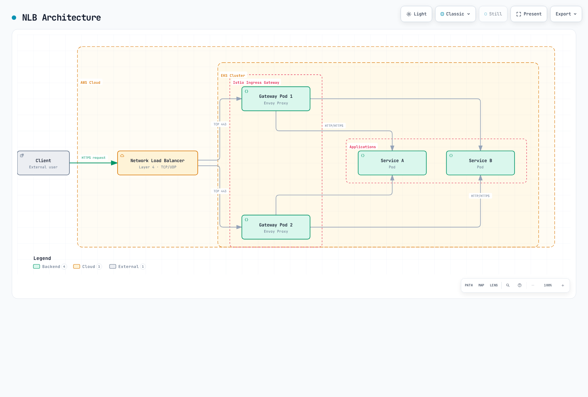
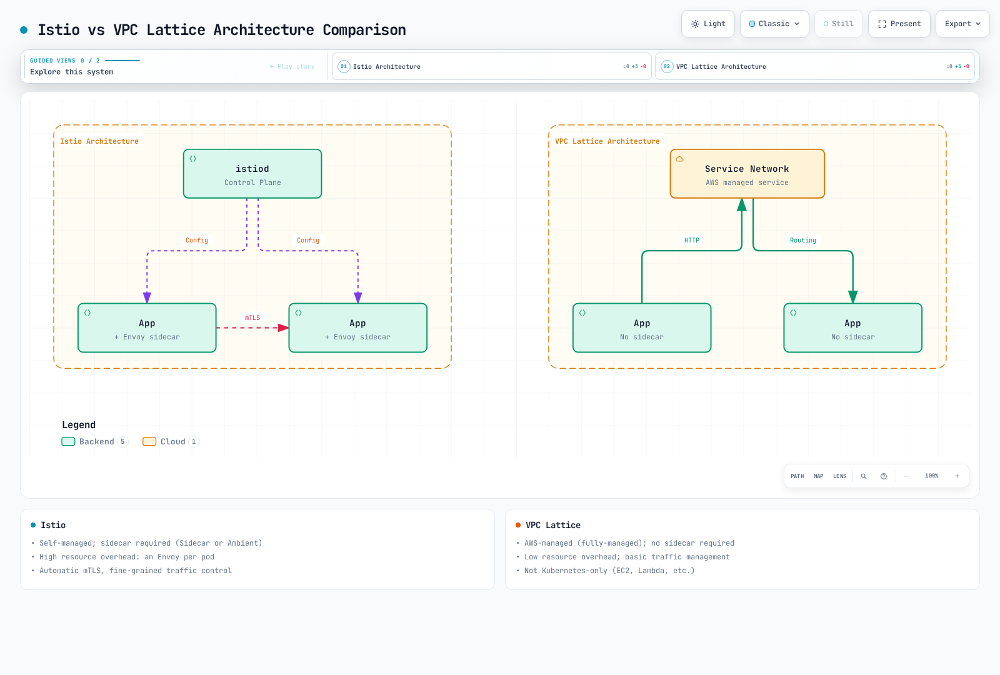

# Integración con AWS

Este documento explica cómo integrar Istio con los servicios de AWS en un entorno de Amazon EKS.

## Índice

Revisado el 11 de septiembre de 2026 para nodos EKS sobre EC2 con Linux y AWS Load Balancer Controller. El paso directo de TLS por NLB, la terminación TLS en ALB y la terminación TLS en NLB descritos a continuación son diseños alternativos. No aplique juntos sus recursos Service y Gateway, que se solapan. Ajuste las etiquetas de los Pods del gateway y los puertos de destino a su instalación, descrita en [Instalación](01-installation.md). Incorpore los cambios de Service a la configuración de Helm o istioctl que lo administra. EKS Auto Mode utiliza su propia integración de balanceadores de carga y las anotaciones que admite; Fargate no puede alojar Istio CNI ni ztunnel.

1. [Integración con balanceadores de carga de AWS](04-aws-integration.md#aws-load-balancer-integration)
2. [Comparación entre Istio y otras soluciones](04-aws-integration.md#istio-vs-other-solutions-comparison)
3. [Optimización específica para EKS](04-aws-integration.md#eks-specific-optimization)
4. [Prácticas recomendadas](04-aws-integration.md#best-practices)

## Integración con balanceadores de carga de AWS {#aws-load-balancer-integration}

Istio Ingress Gateway puede integrarse con un balanceador de carga de AWS para gestionar el tráfico externo.

### Integración con Network Load Balancer (NLB)

NLB es un balanceador de carga de capa 4 (TCP/UDP), adecuado cuando se necesitan alto rendimiento y baja latencia.

#### Arquitectura de NLB



[🔍 Ver el diagrama interactivo](https://www.atomai.click/kubernetes-docs/archmaps/en-service-mesh-istio-04-aws-integration-0.html)

#### Configuración de NLB

**1. Instalar AWS Load Balancer Controller**

```bash
# Create IAM policy
curl -fsSL -o iam_policy.json https://raw.githubusercontent.com/kubernetes-sigs/aws-load-balancer-controller/v3.5.0/docs/install/iam_policy.json

aws iam create-policy \
    --policy-name AWSLoadBalancerControllerIAMPolicy \
    --policy-document file://iam_policy.json

# Associate the cluster OIDC provider once before creating IRSA
eksctl utils associate-iam-oidc-provider --cluster my-cluster --approve

# IRSA setup
eksctl create iamserviceaccount \
  --cluster=my-cluster \
  --namespace=kube-system \
  --name=aws-load-balancer-controller \
  --attach-policy-arn="arn:aws:iam::<AWS_ACCOUNT_ID>:policy/AWSLoadBalancerControllerIAMPolicy" \
  --override-existing-serviceaccounts \
  --approve

# Install controller with Helm
helm repo add eks https://aws.github.io/eks-charts
helm repo update

helm install aws-load-balancer-controller eks/aws-load-balancer-controller \
  -n kube-system \
  --version 3.5.0 \
  --set clusterName=my-cluster \
  --set region=us-west-2 \
  --set vpcId="<VPC_ID>" \
  --set serviceAccount.create=false \
  --set serviceAccount.name=aws-load-balancer-controller
```

**2. Configurar Istio Ingress Gateway con NLB**

```yaml
# istio-ingress-nlb.yaml
apiVersion: v1
kind: Service
metadata:
  name: istio-ingressgateway
  namespace: istio-system
  annotations:
    # NLB configuration
    service.beta.kubernetes.io/aws-load-balancer-type: "external"
    service.beta.kubernetes.io/aws-load-balancer-nlb-target-type: "ip"
    service.beta.kubernetes.io/aws-load-balancer-scheme: "internet-facing"

    # TCP passthrough: TLS terminates at Istio; no ACM TLS listener here

    # Health check configuration
    service.beta.kubernetes.io/aws-load-balancer-healthcheck-protocol: "http"
    service.beta.kubernetes.io/aws-load-balancer-healthcheck-port: "15021"
    service.beta.kubernetes.io/aws-load-balancer-healthcheck-path: "/healthz/ready"

    # Additional configuration
    service.beta.kubernetes.io/aws-load-balancer-attributes: "load_balancing.cross_zone.enabled=true"
spec:
  type: LoadBalancer
  selector:
    app: istio-ingressgateway
    istio: ingressgateway
  ports:
  - name: http2
    port: 80
    protocol: TCP
    targetPort: 8080
  - name: https
    port: 443
    protocol: TCP
    targetPort: 8443
```

**3. Configurar el recurso Gateway**

```yaml
apiVersion: networking.istio.io/v1
kind: Gateway
metadata:
  name: my-gateway
  namespace: istio-system
spec:
  selector:
    istio: ingressgateway
  servers:
  - port:
      number: 443
      name: https
      protocol: HTTPS
    tls:
      mode: SIMPLE
      credentialName: my-tls-secret
    hosts:
    - "myapp.example.com"
  - port:
      number: 80
      name: http
      protocol: HTTP
    hosts:
    - "myapp.example.com"
    tls:
      httpsRedirect: true
```

#### Ventajas de NLB

* **Alto rendimiento**: Gestiona millones de solicitudes por segundo.
* **Baja latencia**: Funciona en la capa 4 para responder con rapidez.
* **IP estática**: Permite asignar Elastic IP.
* **Protocolos compatibles**: TCP, UDP y TLS.
* **Planificación de capacidad**: Mida el uso de conexiones y bytes y compare los precios de la región.

#### Casos de uso de NLB

* WebSocket, gRPC y otras conexiones de larga duración.
* Gestión de millones de solicitudes por segundo.
* Necesidad de una IP estática.
* Terminación TLS en Istio.

### Integración con Application Load Balancer (ALB)

ALB es un balanceador de carga de capa 7 (HTTP/HTTPS), adecuado cuando se necesitan funciones avanzadas de enrutamiento.

#### Arquitectura de ALB

En este ejemplo, el cliente envía HTTPS al ALB. El ALB termina TLS utilizando ACM y reenvía HTTP/1.1 al gateway de Istio; Envoy dirige después el tráfico a la aplicación.

#### Configuración de ALB

**1. Crear un ALB con un recurso Ingress**

```yaml
# istio-ingress-alb.yaml
apiVersion: networking.k8s.io/v1
kind: Ingress
metadata:
  name: istio-ingress
  namespace: istio-system
  annotations:
    # ALB configuration
    alb.ingress.kubernetes.io/scheme: internet-facing
    alb.ingress.kubernetes.io/target-type: ip
    alb.ingress.kubernetes.io/listen-ports: '[{"HTTP": 80}, {"HTTPS": 443}]'
    alb.ingress.kubernetes.io/ssl-redirect: '443'

    # ACM certificate
    alb.ingress.kubernetes.io/certificate-arn: arn:aws:acm:region:account:certificate/cert-id

    # Health check
    alb.ingress.kubernetes.io/healthcheck-protocol: HTTP
    alb.ingress.kubernetes.io/healthcheck-port: '15021'
    alb.ingress.kubernetes.io/healthcheck-path: /healthz/ready
    alb.ingress.kubernetes.io/healthcheck-interval-seconds: '15'
    alb.ingress.kubernetes.io/healthcheck-timeout-seconds: '5'
    alb.ingress.kubernetes.io/success-codes: '200'
    alb.ingress.kubernetes.io/healthy-threshold-count: '2'
    alb.ingress.kubernetes.io/unhealthy-threshold-count: '2'

    # Additional configuration
    alb.ingress.kubernetes.io/load-balancer-attributes: idle_timeout.timeout_seconds=60
    alb.ingress.kubernetes.io/target-group-attributes: deregistration_delay.timeout_seconds=30
spec:
  ingressClassName: alb
  rules:
  - host: "myapp.example.com"
    http:
      paths:
      - path: /
        pathType: Prefix
        backend:
          service:
            name: istio-ingressgateway
            port:
              number: 80
```

Para este diseño con ALB, configure el Service del gateway como ClusterIP, de modo que no aprovisione también un NLB. El ALB termina TLS y, de forma predeterminada, reenvía HTTP/1.1. Utilice este gateway HTTP sin redirección a HTTPS. Añada un VirtualService vinculado a `my-alb-gateway` para definir las rutas de las aplicaciones.

```yaml
apiVersion: networking.istio.io/v1
kind: Gateway
metadata:
  name: my-alb-gateway
  namespace: istio-system
spec:
  selector:
    istio: ingressgateway
  servers:
  - port:
      number: 80
      name: http
      protocol: HTTP
    hosts:
    - "myapp.example.com"
```

**2. Enrutamiento basado en rutas**

```yaml
apiVersion: networking.k8s.io/v1
kind: Ingress
metadata:
  name: istio-ingress-path-based
  namespace: istio-system
  annotations:
    alb.ingress.kubernetes.io/scheme: internet-facing
    alb.ingress.kubernetes.io/target-type: ip
spec:
  ingressClassName: alb
  rules:
  - host: "api.example.com"
    http:
      paths:
      - path: /v1
        pathType: Prefix
        backend:
          service:
            name: istio-ingressgateway
            port:
              number: 80
  - host: "admin.example.com"
    http:
      paths:
      - path: /
        pathType: Prefix
        backend:
          service:
            name: istio-ingressgateway
            port:
              number: 80
```

#### Ventajas de ALB

* **Enrutamiento avanzado**: Según rutas, cabeceras y parámetros de consulta.
* **Integración con WAF**: Mayor seguridad mediante AWS WAF.
* **Integración de autenticación**: Compatible con Cognito y OIDC.
* **Integración con ACM**: Administración automática de certificados.
* **Optimización para contenedores**: Adecuado para ECS y EKS.

#### Casos de uso de ALB

* Tráfico exclusivamente HTTP/HTTPS.
* Enrutamiento basado en rutas.
* Seguridad mediante WAF.
* Varios dominios atendidos por un solo balanceador de carga.

### Comparación entre NLB y ALB

| Propiedad | NLB | ALB |
| ------------------- | -------------------------------------- | ---------------------------------------- |
| **Capa OSI** | Capa 4 (TCP/UDP) | Capa 7 (HTTP/HTTPS) |
| **Capacidad** | Depende del tráfico y de la configuración de capacidad | Depende del tráfico y de la configuración de capacidad |
| **Latencia** | Muy baja | Baja |
| **IP estática** | Compatible (Elastic IP) | No compatible |
| **Terminación TLS** | Paso directo de TCP o listener TLS en NLB | Puede realizarse en ALB |
| **Enrutamiento** | Según IP y puerto | Según ruta, host y cabecera |
| **Integración con WAF** | No disponible | Disponible |
| **Coste** | Uso de NLCU y tarifas regionales | Uso de LCU y tarifas regionales |
| **WebSocket** | Compatibilidad nativa | Compatible |
| **gRPC** | Compatibilidad nativa | Requiere HTTP/2 |
| **Uso recomendado** | Alto rendimiento, WebSocket y gRPC | Enrutamiento HTTP, WAF y autenticación |

## Comparación entre Istio y otras soluciones {#istio-vs-other-solutions-comparison}

### Istio frente a VPC Lattice

VPC Lattice es el servicio administrado de AWS para redes de aplicaciones.

#### Comparación de arquitecturas



[🔍 Ver el diagrama interactivo](https://www.atomai.click/kubernetes-docs/archmaps/en-service-mesh-istio-04-aws-integration-2.html)

#### Comparación de funciones

| Propiedad | Istio | VPC Lattice |
| ---------------------- | ------------------------------------ | --------------------------- |
| **Administración** | Autogestionado | Totalmente administrado por AWS |
| **Sidecar** | Utiliza sidecars en ese modo; no los necesita en ambient | No se necesita |
| **Consumo adicional de recursos** | Depende de la topología con sidecars o ambient | Bajo, sin sidecars |
| **Complejidad** | Alta | Baja |
| **Curva de aprendizaje** | Pronunciada | Suave |
| **Gestión del tráfico** | Muy avanzada, con control detallado | Básica, con funciones suficientes |
| **mTLS** | Identidades y certificados de cargas de trabajo administrados | Administrado por la aplicación mediante paso directo de TLS |
| **Observabilidad** | Amplias métricas y trazas | Métricas básicas |
| **Inyección de fallos** | Compatible | No compatible |
| **Circuit breaker** | Control detallado | No tiene una API de políticas equivalente a la de Istio; las cuotas de servicio son un mecanismo distinto |
| **Limitación de solicitudes** | Local y global | No tiene una API de políticas equivalente a la de Istio; las cuotas de servicio son un mecanismo distinto |
| **Varios clústeres** | Amplia compatibilidad | Conectividad entre VPC |
| **Entre cuentas** | Complejo | Sencillo, con compatibilidad nativa |
| **Coste** | Coste de cómputo (EC2) | Coste por uso del servicio |
| **Dependencia del proveedor** | Ninguna, al ser código abierto | Dependencia de AWS |
| **Solo Kubernetes** | No; también admite máquinas virtuales | No; admite EC2, Lambda y otros destinos |

El paso directo de TLS en VPC Lattice conserva TLS o mTLS de la aplicación, pero ese listener no puede aplicar autenticación basada en identidades de IAM ni utilizar destinos Lambda. Los listeners HTTPS y el paso directo de TLS ofrecen funciones de seguridad diferentes.

#### Cuándo elegir Istio

**Istio es adecuado en los siguientes casos:**

1. **Se necesita un control detallado del tráfico**
   * Despliegues canary, pruebas A/B y duplicación de tráfico.
   * Reglas de enrutamiento complejas, según cabeceras, cookies u otros criterios.
   * Inyección de fallos para ingeniería del caos.
2. **Hay requisitos de seguridad estrictos**
   * Cifrado mTLS automático entre servicios.
   * Políticas de autorización detalladas.
   * Validación de JWT y RBAC.
3. **Se necesita observabilidad avanzada**
   * Métricas detalladas, como latencia P50/P95/P99.
   * Trazado distribuido con Jaeger o Zipkin.
   * Visualización de la topología de servicios con Kiali.
4. **Se utiliza una malla entre varios clústeres**
   * Comunicación entre varios clústeres EKS.
   * Conmutación ante fallos entre clústeres.
   * Balanceo de carga global.
5. **Se busca independencia del proveedor**
   * Posibilidad de migrar a otras nubes o a instalaciones propias.
   * Uso de los estándares de Kubernetes.

**Ejemplo: gestión avanzada del tráfico de Istio**

```yaml
apiVersion: networking.istio.io/v1
kind: VirtualService
metadata:
  name: reviews
spec:
  hosts:
  - reviews
  http:
  # Header-based routing
  - match:
    - headers:
        user-agent:
          regex: ".*Mobile.*"
    route:
    - destination:
        host: reviews
        subset: mobile-v2
  # Canary deployment (10%)
  - match:
    - headers:
        x-canary:
          exact: "true"
    route:
    - destination:
        host: reviews
        subset: v3
      weight: 10
    - destination:
        host: reviews
        subset: v2
      weight: 90
  # Traffic Mirroring
  - route:
    - destination:
        host: reviews
        subset: v2
    mirror:
      host: reviews
      subset: v3
    mirrorPercentage:
      value: 100
```

#### Cuándo elegir VPC Lattice

**VPC Lattice es adecuado en los siguientes casos:**

1. **Se necesita una conexión sencilla entre servicios**
   * Basta con balanceo de carga y enrutamiento básicos.
   * Es importante implementarla con rapidez.
2. **Se busca reducir el trabajo operativo**
   * Se prefieren servicios administrados por AWS.
   * Se quiere evitar la administración de sidecars.
3. **Se necesita comunicación entre VPC o cuentas**
   * Conexión de servicios de varias cuentas de AWS.
   * Comunicación sin interconexión VPC peering.
4. **Hay entornos mixtos**
   * Combinaciones de EKS, EC2 y Lambda.
   * Distintos tipos de cómputo, además de Kubernetes.
5. **Se busca optimizar los costes**
   * Reducción del coste de los recursos de los sidecars.
   * Servicios a pequeña escala.

#### Uso conjunto de Istio y VPC Lattice

Las dos soluciones pueden utilizarse juntas:


[🔍 Ver el diagrama interactivo](https://www.atomai.click/kubernetes-docs/archmaps/en-service-mesh-istio-04-aws-integration-3.html)

**Casos de uso:**

* **Dentro del clúster**: Istio para gestionar el tráfico y la seguridad de forma detallada.
* **Entre clústeres o cuentas**: VPC Lattice para una conexión sencilla.
* **Entornos mixtos**: VPC Lattice para conectar clústeres con Istio a Lambda o EC2.

### Istio frente a Cilium (basado en eBPF)

Cilium es una solución de red y seguridad para Kubernetes basada en eBPF.

#### Comparación de arquitecturas

| Propiedad | Istio | Cilium |
| -------------------- | --------------------------------- | ------------------------------ |
| **Tecnología** | Proxy Envoy (sidecar) | eBPF a nivel del kernel |
| **Objetivo principal** | Malla de servicios | CNI y malla de servicios |
| **Red** | Funciona sobre el CNI de Kubernetes | Proporciona su propio CNI |
| **Rendimiento** | Bueno | Excelente, a nivel del kernel |
| **Uso de recursos** | Alto con sidecars | Bajo, a nivel del kernel |
| **Funciones L7** | Muy completas | Básicas |
| **Observabilidad** | Amplia | Hubble, básica |
| **Curva de aprendizaje** | Pronunciada | Pronunciada |
| **Madurez** | Alta | Media para las funciones de malla de servicios |

#### Comparación de funciones

| Función | Istio | Cilium |
| ---------------------- | ------------------------------- | ----------------------------------- |
| **Políticas de red** | Kubernetes e Istio | Kubernetes y Cilium, con más funciones |
| **Balanceo de carga L7** | Muy detallado | Básico |
| **mTLS** | mTLS automático entre cargas de trabajo | La autenticación mutua y el cifrado con WireGuard o IPsec son mecanismos independientes |
| **Gestión del tráfico** | Muy avanzada | Básica |
| **Observabilidad** | Prometheus, Jaeger y Kiali | Hubble |
| **Rendimiento** | Bueno | Excelente |
| **Varios clústeres** | Amplia compatibilidad | Cluster Mesh |

#### Cuándo elegir cada opción

**Elegir Istio:**

* La gestión del tráfico L7 es un requisito fundamental.
* Se necesitan funciones potentes de malla de servicios.
* Se necesitan herramientas completas de observabilidad y depuración.

**Elegir Cilium:**

* Se está considerando sustituir el CNI.
* La seguridad de red es la principal preocupación.
* La optimización del rendimiento es importante.
* Se quiere utilizar la tecnología eBPF.

**Uso conjunto:**

* Es posible utilizar Cilium como CNI e Istio como malla de servicios.
* Tenga en cuenta el solapamiento de funciones y el aumento de complejidad.

## Optimización específica para EKS {#eks-specific-optimization}

Para cargas ambient que utilizan trunking de interfaces ENI de Pod con VPC CNI y SecurityGroupPolicy, revise los [requisitos de ambient en EKS](https://istio.io/latest/docs/ambient/install/platform-prerequisites/#amazon-elastic-kubernetes-service-eks). La aplicación estricta de los grupos de seguridad de Pod puede impedir las comprobaciones de estado mediante direcciones locales del enlace. Entre las opciones documentadas están el modo de aplicación standard y las comprobaciones exec; evalúe sus consecuencias para las políticas antes de cambiar el modo de CNI.

### Integración de IAM Roles for Service Accounts (IRSA)

EKS Pod Identity es otra opción compatible para obtener credenciales de las API de AWS en nodos sobre EC2. Requiere Pod Identity Agent y SDK de AWS compatibles; no utiliza la anotación de rol de IRSA. Ninguno de los dos mecanismos sustituye la identidad SPIFFE de las cargas de trabajo de Istio.

Configure IRSA para que las cargas de trabajo de Istio accedan de forma segura a los servicios de AWS.

#### Configuración de IRSA

```bash
# 1. Create OIDC provider
eksctl utils associate-iam-oidc-provider \
    --cluster my-cluster \
    --approve

# 2. Create IAM policy
cat <<EOF > app-policy.json
{
    "Version": "2012-10-17",
    "Statement": [
        {
            "Effect": "Allow",
            "Action": [
                "s3:GetObject",
                "s3:ListBucket"
            ],
            "Resource": [
                "arn:aws:s3:::my-bucket",
                "arn:aws:s3:::my-bucket/*"
            ]
        }
    ]
}
EOF

aws iam create-policy \
    --policy-name MyAppS3Policy \
    --policy-document file://app-policy.json

# 3. Link IAM Role to Service Account
eksctl create iamserviceaccount \
    --cluster my-cluster \
    --namespace default \
    --name my-app-sa \
    --role-name my-app-role \
    --attach-policy-arn "arn:aws:iam::<ACCOUNT_ID>:policy/MyAppS3Policy" \
    --approve
```

#### Uso de Istio con IRSA

```yaml
apiVersion: v1
kind: ServiceAccount
metadata:
  name: my-app-sa
  namespace: default
  annotations:
    eks.amazonaws.com/role-arn: arn:aws:iam::<ACCOUNT_ID>:role/my-app-role
---
apiVersion: apps/v1
kind: Deployment
metadata:
  name: my-app
  namespace: default
spec:
  selector:
    matchLabels:
      app: my-app
  template:
    metadata:
      labels:
        app: my-app
    spec:
      serviceAccountName: my-app-sa  # Using IRSA
      containers:
      - name: app
        image: my-app:latest
        env:
        - name: AWS_REGION
          value: us-west-2
```

### Integración con AWS Certificate Manager (ACM)

Cómo utilizar los certificados de ACM con Istio Gateway.

#### Terminación TLS en NLB

```yaml
apiVersion: v1
kind: Service
metadata:
  name: istio-ingressgateway
  namespace: istio-system
  annotations:
    service.beta.kubernetes.io/aws-load-balancer-type: "external"
    service.beta.kubernetes.io/aws-load-balancer-nlb-target-type: "ip"
    service.beta.kubernetes.io/aws-load-balancer-ssl-cert: "arn:aws:acm:region:account:certificate/cert-id"
    service.beta.kubernetes.io/aws-load-balancer-ssl-ports: "443"
    service.beta.kubernetes.io/aws-load-balancer-backend-protocol: "tcp"
spec:
  type: LoadBalancer
  selector:
    istio: ingressgateway
  ports:
  - name: https
    port: 443
    targetPort: 8080
```

Esta variante es independiente: TLS con ACM termina en el NLB y el destino recibe HTTP sin cifrar. Sustituya el Gateway TLS por este listener HTTP en el puerto 443 del Service. Para este backend, no utilice TLS SIMPLE ni redirección a HTTPS.

```yaml
apiVersion: networking.istio.io/v1
kind: Gateway
metadata:
  name: nlb-terminated-gateway
  namespace: istio-system
spec:
  selector:
    istio: ingressgateway
  servers:
  - port:
      number: 443
      name: http-after-nlb
      protocol: HTTP
    hosts:
    - "myapp.example.com"
```

#### Terminación TLS en Istio (ACM Private CA)

```bash
# Generate a private key and CSR locally; clients must trust this private CA
openssl req -new -newkey rsa:2048 -nodes \
  -keyout private-key.pem -out csr.pem \
  -subj '/CN=myapp.example.com' -addext 'subjectAltName=DNS:myapp.example.com'

CA_ARN='arn:aws:acm-pca:region:account:certificate-authority/ca-id'
CERT_ARN=$(aws acm-pca issue-certificate \
  --certificate-authority-arn "$CA_ARN" \
  --csr fileb://csr.pem \
  --signing-algorithm SHA256WITHRSA \
  --validity Value=365,Type=DAYS \
  --query CertificateArn --output text)
aws acm-pca wait certificate-issued \
  --certificate-authority-arn "$CA_ARN" --certificate-arn "$CERT_ARN"
aws acm-pca get-certificate \
  --certificate-authority-arn "$CA_ARN" --certificate-arn "$CERT_ARN" \
  --output json > issued-certificate.json
jq -r '.Certificate + "\n" + .CertificateChain' issued-certificate.json > certificate-chain.pem
kubectl create secret tls my-tls-secret \
  --cert=certificate-chain.pem --key=private-key.pem -n istio-system
```

```yaml
apiVersion: networking.istio.io/v1
kind: Gateway
metadata:
  name: my-gateway
  namespace: istio-system
spec:
  selector:
    istio: ingressgateway
  servers:
  - port:
      number: 443
      name: https
      protocol: HTTPS
    tls:
      mode: SIMPLE
      credentialName: my-tls-secret  # ACM certificate
    hosts:
    - "myapp.example.com"
```

Emitir un certificado no instala ni renueva el Secret. Automatice la renovación y la actualización del Secret; un ARN de ACM no puede utilizarse directamente como `credentialName` de Istio.

### Integración con CloudWatch Container Insights

Implemente una supervisión unificada enviando las métricas de Istio a CloudWatch.

#### Configuración de CloudWatch Agent

```bash
# For EC2-backed EKS; OIDC association is required for this IRSA path
kubectl create namespace amazon-cloudwatch --dry-run=client -o yaml | kubectl apply -f -
eksctl create iamserviceaccount \
  --cluster my-cluster --namespace amazon-cloudwatch --name cwagent-prometheus \
  --attach-policy-arn arn:aws:iam::aws:policy/CloudWatchAgentServerPolicy --approve
curl -fsSL -o prometheus-eks.yaml \
  https://raw.githubusercontent.com/aws-samples/amazon-cloudwatch-container-insights/latest/k8s-deployment-manifest-templates/deployment-mode/service/cwagent-prometheus/prometheus-eks.yaml
# Review/pin this manifest; merge the Istio scrape jobs and EMF declarations below before applying
kubectl apply -f prometheus-eks.yaml
kubectl rollout status deployment/cwagent-prometheus -n amazon-cloudwatch
```

Crear únicamente un namespace y un ServiceAccount no despliega el agente. El manifiesto oficial proporciona el Deployment, el RBAC y los ConfigMaps montados. Conserve la anotación de IRSA si una herramienta de despliegue sustituye los ServiceAccounts. Si ya hay una instalación, actualice la configuración que la administra en lugar de desplegar un segundo recopilador.

#### Recopilación de métricas de Prometheus

```yaml
# prometheus-config.yaml
apiVersion: v1
kind: ConfigMap
metadata:
  name: prometheus-config
  namespace: amazon-cloudwatch
data:
  prometheus.yaml: |
    global:
      scrape_interval: 1m
      scrape_timeout: 10s

    scrape_configs:
    # Istio Control Plane metrics
    - job_name: 'istiod'
      kubernetes_sd_configs:
      - role: pod
        namespaces:
          names:
          - istio-system
      relabel_configs:
      - source_labels: [__meta_kubernetes_pod_label_app, __meta_kubernetes_pod_container_port_name]
        action: keep
        regex: istiod;http-monitoring

    # Envoy sidecar metrics
    - job_name: 'envoy-stats'
      metrics_path: /stats/prometheus
      kubernetes_sd_configs:
      - role: pod
      relabel_configs:
      - source_labels: [__meta_kubernetes_pod_container_port_name]
        action: keep
        regex: '.*-envoy-prom'
```

Incorpore una declaración a `prometheus-cwagentconfig`, dentro de `logs.metrics_collected.prometheus.emf_processor.metric_declaration`. Un ConfigMap para la recopilación no publica por sí solo métricas personalizadas en CloudWatch. Conserve `prometheus_config_path` y los demás ajustes del manifiesto; después, vuelva a desplegar o reinicie el agente. Por ejemplo:

```json
{
  "source_labels": ["job"],
  "label_matcher": "^envoy-stats$",
  "dimensions": [["ClusterName", "job"]],
  "metric_selectors": ["^istio_requests_total$", "^istio_tcp_received_bytes_total$"]
}
```

#### Consultas de CloudWatch Logs Insights

Ejecute estas consultas por separado. Requieren que un recopilador haya enviado los registros de los proxies; recopilar métricas de Prometheus no recopila los registros de acceso. La consulta de latencia presupone JSON estructurado con un campo numérico `request_duration_ms`. Configure ese campo a partir de `%DURATION%` de Envoy o analice primero el formato que utiliza.

```text
# Istio error log analysis
fields @timestamp, @message
| filter @logStream like /istio-proxy/
| filter @message like /error/
| sort @timestamp desc
| limit 100

```

```text
# Request latency analysis
fields @timestamp, request_duration_ms
| filter @logStream like /istio-proxy/
| stats avg(request_duration_ms), max(request_duration_ms), pct(request_duration_ms, 95) by bin(5m)
```

### Ajustes de optimización de EKS

#### 1. Optimización de recursos de los Pods

```yaml
# Envoy sidecar resource optimization
apiVersion: install.istio.io/v1alpha1
kind: IstioOperator
spec:
  meshConfig:
    defaultConfig:
      concurrency: 2  # Envoy worker threads, not a connection-pool limit
      proxyMetadata:
        # EKS optimization
        ISTIO_META_DNS_CAPTURE: "true"
  values:
    global:
      proxy:
        resources:
          requests:
            cpu: 100m
            memory: 128Mi
          limits:
            cpu: 2000m
            memory: 1024Mi
```

#### 2. Consideraciones sobre Cluster Autoscaler

HPA ajusta las réplicas y necesita Metrics Server y solicitudes de recursos; Cluster Autoscaler o Karpenter ajustan los nodos. Configure el HPA existente que administra el chart en lugar de crear otro que compita con él.

```yaml
# Istio Gateway Autoscaling
apiVersion: autoscaling/v2
kind: HorizontalPodAutoscaler
metadata:
  name: istio-ingressgateway
  namespace: istio-system
spec:
  scaleTargetRef:
    apiVersion: apps/v1
    kind: Deployment
    name: istio-ingressgateway
  minReplicas: 2
  maxReplicas: 10
  metrics:
  - type: Resource
    resource:
      name: cpu
      target:
        type: Utilization
        averageUtilization: 80
  - type: Resource
    resource:
      name: memory
      target:
        type: Utilization
        averageUtilization: 80
```

#### 3. Pod Disruption Budget

```yaml
apiVersion: policy/v1
kind: PodDisruptionBudget
metadata:
  name: istio-ingressgateway
  namespace: istio-system
spec:
  minAvailable: 1
  selector:
    matchLabels:
      app: istio-ingressgateway
```

## Prácticas recomendadas {#best-practices}

### 1. Guía de selección del balanceador de carga

**Usar NLB:**

* gRPC, WebSocket y otras conexiones de larga duración.
* Gestión de millones de solicitudes por segundo.
* Necesidad de una IP estática.
* Terminación TLS en Istio.

**Usar ALB:**

* Tráfico exclusivamente HTTP/HTTPS.
* Enrutamiento basado en rutas.
* Necesidad de seguridad con WAF.
* Integración de autenticación con Cognito.

### 2. Ubicación de la terminación TLS

**Terminar TLS en el balanceador de carga:**

* Renovación automática de los certificados de ACM.
* Administración sencilla.
* Menor carga para Istio.

**Terminar TLS en Istio:**

* Necesidad de cifrado de extremo a extremo.
* Control detallado de las políticas TLS.
* Uso de mTLS.

### 3. Optimización de costes

* **Instancias Spot**: Utilizarlas para las cargas de trabajo de Istio Gateway.
* **Instancias Graviton**: Ahorrar costes con instancias basadas en ARM.
* **Límites de recursos**: Establecer límites adecuados para los sidecars.
* **Modo ambient**: Considerarlo para eliminar el consumo adicional de los sidecars.

### 4. Seguridad

* **IRSA**: Acceder a los servicios de AWS mediante roles de IAM.
* **Grupos de seguridad**: Aplicar el principio de mínimo privilegio.
* **mTLS**: Habilitar el cifrado entre servicios.
* **Políticas de red**: Habilitar su aplicación con Amazon VPC CNI, Cilium o Calico y comprobar que la plataforma lo admite.

### 5. Supervisión

* **CloudWatch**: Unificar registros y métricas.
* **X-Ray**: Trazado distribuido.
* **Prometheus y Grafana**: Métricas detalladas.
* **Kiali**: Visualización de la malla de servicios.

## Próximos pasos

Una vez completada la integración con AWS, consulte los siguientes documentos:

1. [**Gestión del tráfico**](traffic-management/README.md): Funciones avanzadas de gestión del tráfico.
2. [**Seguridad**](security/README.md): mTLS, autenticación y autorización.
3. [**Observabilidad**](observability/README.md): Recopilación de métricas, registros y trazas.

## Referencias

* [AWS Load Balancer Controller](https://kubernetes-sigs.github.io/aws-load-balancer-controller/)
* [Prácticas recomendadas de EKS: redes](https://docs.aws.amazon.com/eks/latest/best-practices/networking.html)
* [Documentación de VPC Lattice](https://docs.aws.amazon.com/vpc-lattice/)
* [Documentación de Cilium](https://docs.cilium.io/)
* [AWS Container Insights](https://docs.aws.amazon.com/AmazonCloudWatch/latest/monitoring/ContainerInsights.html)

* [Anotaciones de Service](https://kubernetes-sigs.github.io/aws-load-balancer-controller/latest/guide/service/annotations/)
* [Anotaciones de Ingress](https://kubernetes-sigs.github.io/aws-load-balancer-controller/latest/guide/ingress/annotations/)
* [v3.5.0](https://github.com/kubernetes-sigs/aws-load-balancer-controller/releases/tag/v3.5.0)
* [Metadatos del chart de AWS Load Balancer Controller](https://raw.githubusercontent.com/aws/eks-charts/master/stable/aws-load-balancer-controller/Chart.yaml)
* [Instalar AWS Load Balancer Controller con Helm: Amazon EKS](https://docs.aws.amazon.com/eks/latest/userguide/lbc-helm.html)
* [Listeners TLS de servicios VPC Lattice: Amazon VPC Lattice](https://docs.aws.amazon.com/vpc-lattice/latest/ug/tls-listeners.html)
* [issue-certificate](https://docs.aws.amazon.com/cli/latest/reference/acm-pca/issue-certificate.html)
* [get-certificate](https://docs.aws.amazon.com/cli/latest/reference/acm-pca/get-certificate.html)
* [Configuración de Prometheus para Container Insights](https://docs.aws.amazon.com/AmazonCloudWatch/latest/monitoring/ContainerInsights-Prometheus-Setup.html)
* [Recopilar fuentes adicionales de Prometheus e importar sus métricas: Amazon CloudWatch](https://docs.aws.amazon.com/AmazonCloudWatch/latest/monitoring/ContainerInsights-Prometheus-Setup-configure.html)
* [Cómo EKS Pod Identity concede acceso a los servicios de AWS: Amazon EKS](https://docs.aws.amazon.com/eks/latest/userguide/pod-identities.html)
* [Limitar el tráfico de Pods con políticas de red de Kubernetes: Amazon EKS](https://docs.aws.amazon.com/eks/latest/userguide/cni-network-policy.html)
* [Proxy DNS](https://istio.io/latest/docs/ops/configuration/traffic-management/dns-proxy/)
