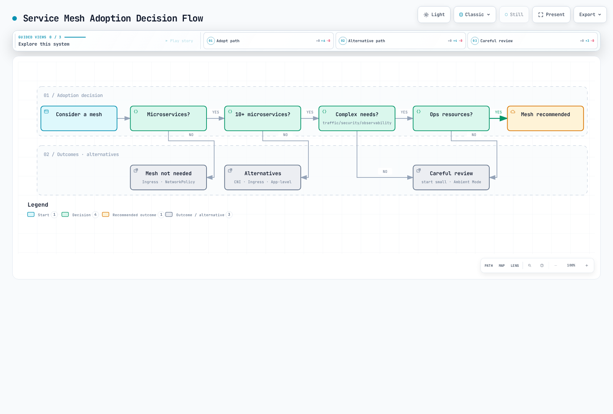
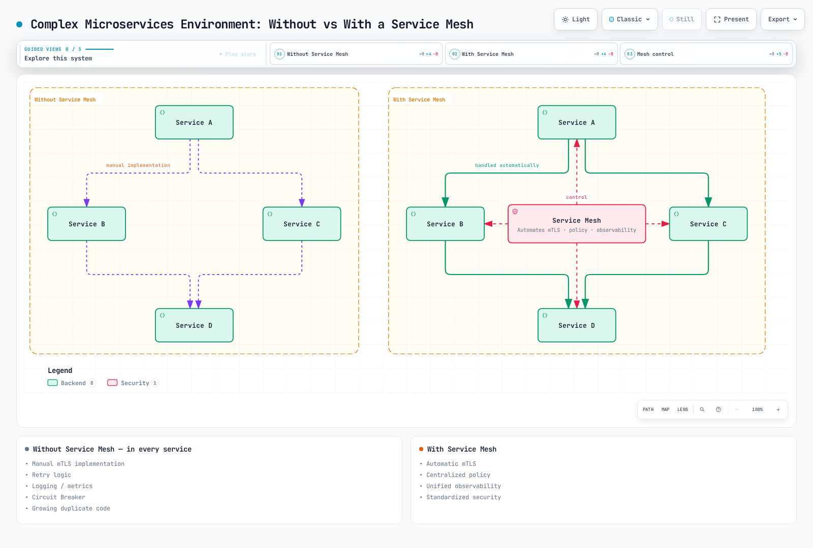
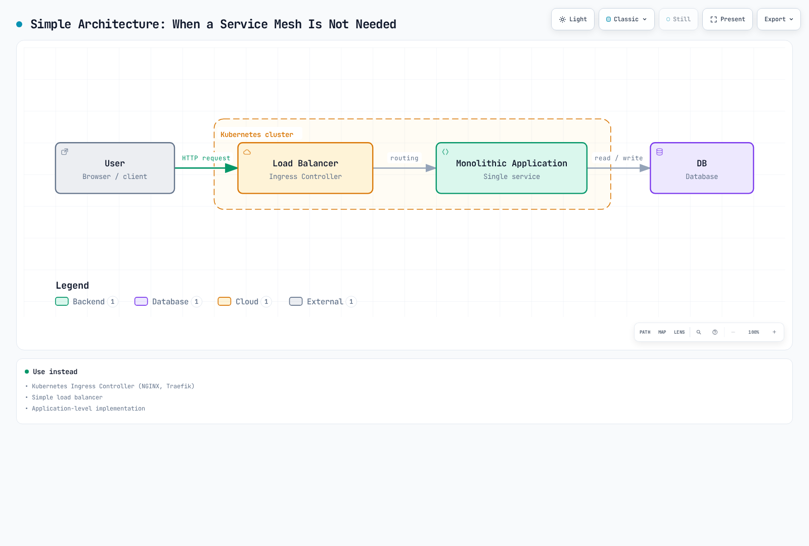
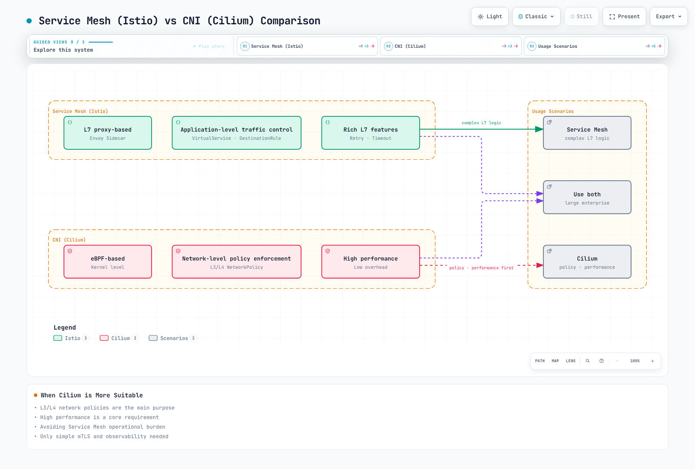
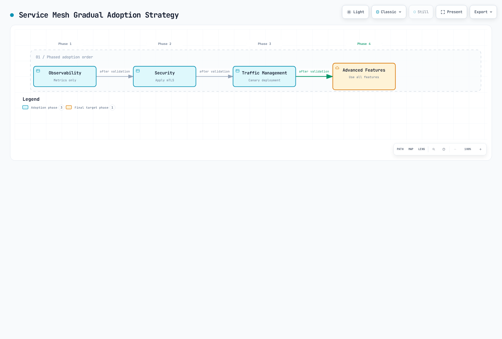
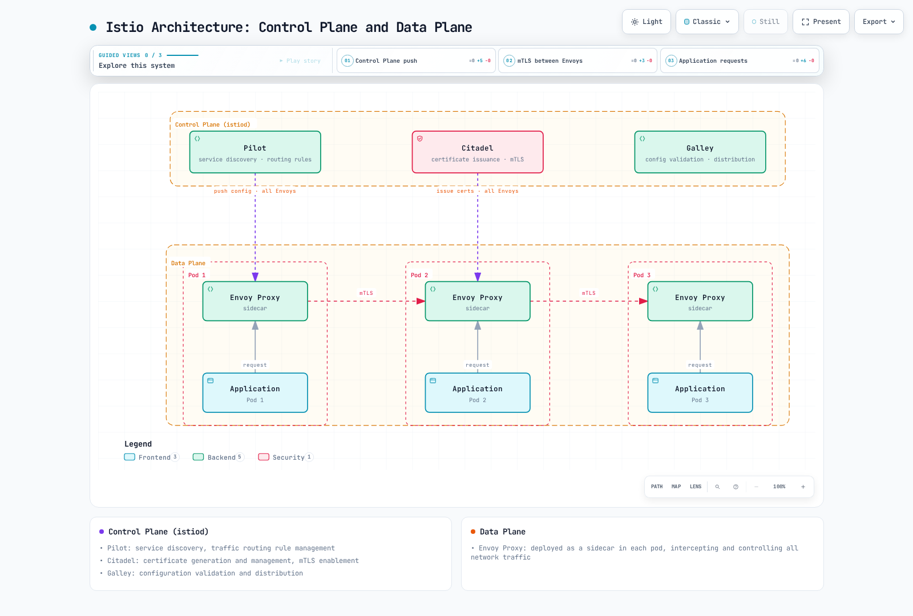

# Istio

> **Última actualización**: 16 de noviembre de 2026

Una guía práctica para utilizar Istio Service Mesh en Amazon EKS.

### Actualización de noviembre de 2026: lanzamiento de Istio 1.32.0

**Istio 1.32.0** alcanzó la disponibilidad general (GA) el 9 de noviembre de 2026 ([notas de la versión](https://istio.io/latest/news/releases/1.32.x/announcing-1.32/), [lanzamiento en GitHub](https://github.com/istio/istio/releases/tag/1.32.0)), tras la publicación de 1.32.0-beta.0 el 22 de octubre y de rc.0 a rc.2 entre el 28 de octubre y el 6 de noviembre. Esa misma semana (el 6 de noviembre), se publicaron las versiones de parche [1.31.4](https://istio.io/news/releases/1.31.x/announcing-1.31.4/) y 1.30.8 para las ramas compatibles. Cuando una nueva versión menor alcanza la disponibilidad general, la política de soporte de Istio acerca las ramas anteriores al fin de su vida útil; por eso, antes de instalar o actualizar, consulta la [matriz de soporte](https://istio.io/latest/docs/releases/supported-releases/) para conocer el rango de versiones de Kubernetes compatible con 1.32 y el estado de cada rama. Los comandos y ejemplos de instalación nueva de esta guía siguen teniendo como objetivo la versión 1.31.

### Actualización de seguridad de octubre de 2026: 1.31.3, 1.30.7 y 1.29.10

El 22 de octubre de 2026 se publicaron versiones de parche de seguridad para [ISTIO-SECURITY-2026-008](https://istio.io/latest/news/security/istio-security-2026-008/) (CVE-2026-111943): **1.31.3**, **1.30.7** y **1.29.10**; esta última es una versión excepcional, ya que 1.29 llegó al fin de su vida útil el 15 de octubre de 2026. El 20 de octubre de 2026 se reveló que las claves privadas de ocho certificados de CA intermedias de eMudhra estaban comprometidas; Envoy, Go y ztunnel no aplican la Transparencia de Certificados, por lo que quien poseyera esas claves podría emitir certificados para cualquier dominio de confianza mediante los paquetes de CA públicos incluidos en las imágenes de Istio. Los parches eliminan las CA intermedias comprometidas de los paquetes de CA de las imágenes, compilan istiod, `istioctl` y `pilot-agent` con Go 1.26.10 en las versiones 1.30/1.31 (que rechaza las cadenas que contienen las claves comprometidas) y actualizan `rustls-webpki` de ztunnel. Las configuraciones que confían en el paquete de CA del sistema podrían verse afectadas; por ejemplo, un `DestinationRule` con `tls.mode: SIMPLE` y sin `caCertificates`, o las solicitudes de obtención de `jwksUri` de `RequestAuthentication`; los certificados mTLS de la propia malla de Istio no se ven afectados. Istio 1.32.0-beta.0 se publicó ese mismo día.

### Revisión de octubre de 2026: versiones compatibles

Istio 1.31.0 está disponible de forma general; su [anuncio de lanzamiento](https://istio.io/latest/news/releases/1.31.x/announcing-1.31/) se publicó el 31 de agosto de 2026. El parche actual es **1.31.3**, publicado el 22 de octubre (consulta la actualización de seguridad de octubre de 2026 anterior). El parche 1.31.2, publicado el 15 de octubre, incluye las correcciones de seguridad de [ISTIO-SECURITY-2026-007](https://istio.io/latest/news/security/istio-security-2026-007/) ([anuncio del lanzamiento](https://istio.io/latest/news/releases/1.31.x/announcing-1.31.2/)). Un parche anterior, 1.31.1, se publicó el 21 de septiembre; su [anuncio del lanzamiento](https://istio.io/latest/news/releases/1.31.x/announcing-1.31.1/) documenta una corrección que evita que una referencia de CA sin resolver de `BackendTLSPolicy` recurra a conexiones de texto sin cifrar con los backends.

Los comandos de instalación nueva de esta guía utilizan la versión 1.31.2. El rango de compatibilidad de Kubernetes publicado para Istio 1.31 es 1.32–1.37; el soporte estándar de EKS cubre actualmente las versiones 1.34–1.37. La intersección entre ambos rangos de soporte estándar es 1.34–1.37; de las versiones con soporte extendido de EKS (1.31–1.33), 1.32 y 1.33 también están dentro del rango de Istio 1.31. Antes de instalar, vuelve a consultar la [matriz de soporte de Istio](https://istio.io/latest/docs/releases/supported-releases/) y el [ciclo de vida de las versiones de EKS](https://docs.aws.amazon.com/eks/latest/userguide/kubernetes-versions.html).

En el momento de esta revisión, Istio 1.30 y 1.29 siguen apareciendo como versiones compatibles en la matriz; allí se indica que la fecha de fin de vida útil de 1.29 es el 12 de octubre de 2026 (prevista). Verifica su estado antes de instalar o actualizar. Las instalaciones existentes en esas ramas necesitan como mínimo la versión 1.30.4 o 1.29.7 para [ISTIO-SECURITY-2026-006](https://istio.io/latest/news/security/istio-security-2026-006/), que aborda vulnerabilidades de Envoy, un comportamiento de apertura ante fallos de BackendTLSPolicy y una denegación de servicio en el plano de control de EnvoyFilter. [ISTIO-SECURITY-2026-007](https://istio.io/latest/news/security/istio-security-2026-007/), publicado el 15 de octubre, afecta a las versiones 1.31.0–1.31.1, 1.30.0–1.30.5 y 1.29.0–1.29.8; las primeras versiones que la matriz enumera como libres de CVE conocidas son 1.31.2, 1.30.6 y 1.29.9. Istio 1.28 ya no tiene soporte. Los Helm Charts de Istio 1.31 utilizan `https://blob.istio.io/istio-release/charts`; el repositorio anterior alojado en Google ya no recibe nuevas versiones.

### Actualización de septiembre de 2026: versiones de parche 1.31.1, 1.30.5 y 1.29.8

El 21 de septiembre de 2026 se publicaron versiones de parche para las tres ramas compatibles: [1.31.1](https://istio.io/latest/news/releases/1.31.x/announcing-1.31.1/), 1.30.5 y 1.29.8. La versión 1.31.1 incluye la corrección de seguridad [GHSA-qm8v-g4f9-qhjx](https://github.com/istio/istio/security/advisories/GHSA-qm8v-g4f9-qhjx) (CVSS 6.8, Moderada): `BackendTLSPolicy` recurre a texto sin cifrar en los proxies sidecar cuando no se resuelve su referencia de CA. Otras correcciones abordan el cambio del backend de iptables autodetectado por el agente de nodos CNI del modo ambient (legacy frente a nft) entre reinicios del agente, el aumento del uso de CPU de istiod en función del número de `AuthorizationPolicies` y una fuga de memoria en el modo ambient multinube al rotar las credenciales de un clúster remoto. Las instalaciones nuevas y las instalaciones existentes de la versión 1.31 deben actualizarse a 1.31.1.

## Tabla de contenido

1. [¿Realmente necesitas una malla de servicios?](#do-you-really-need-a-service-mesh)
2. [Instalación y configuración inicial](01-installation.md)
3. [Conceptos básicos](02-basic-concepts.md)
4. [Arquitectura](03-architecture.md)
5. [Integración con AWS](04-aws-integration.md)
6. [Glosario](glossary.md)
7. [Gestión del tráfico](traffic-management/README.md)
8. [Seguridad](security/README.md)
9. [Observabilidad](observability/README.md)
10. [Resiliencia](resilience/README.md)
11. [Temas avanzados](advanced/README.md)
12. [Solución de problemas](troubleshooting/common-errors.md)
13. [Prácticas recomendadas](best-practices.md)
14. [Comparación de alternativas](comparison/README.md)

## ¿Qué es Istio?

Istio es una plataforma de malla de servicios de código abierto para conectar, proteger, controlar y observar microservicios. Gestiona la comunicación entre servicios en arquitecturas de microservicios complejas y proporciona control del tráfico, seguridad y observabilidad.

### Concepto de malla de servicios

<div align="center"></div>

Una malla de servicios es una capa de infraestructura que gestiona la comunicación entre microservicios. Istio admite sidecars de Envoy y el modo ambient (ztunnel a nivel de nodo más waypoints L7 opcionales). Los proxies gestionan el tráfico incluido en la malla; el tráfico excluido y los protocolos no compatibles quedan fuera de esa cobertura. Esto proporciona las siguientes capacidades sin modificar el código de la aplicación:

* **Enrutamiento del tráfico**: enrutamiento inteligente, balanceo de carga y despliegues canary
* **Seguridad**: mTLS automático, autenticación y autorización
* **Observabilidad**: métricas, registros y trazas distribuidas
* **Resiliencia**: circuit breaking, reintentos y tiempos de espera

### Ejemplos de uso práctico

<p align="center"><br><em>Application without Istio</em></p>

<p align="center"><br><em>Application with Istio - Envoy Proxy deployed as Sidecar to each service</em></p>

Estos diagramas de Bookinfo ilustran el modo sidecar. La inyección automática añade Envoy solo a los Pods recién creados en espacios de nombres o cargas de trabajo que la habilitan; el modo ambient no inyecta un sidecar.

## ¿Realmente necesitas una malla de servicios?

Los umbrales de número de servicios y las puntuaciones de la lista de verificación que aparecen a continuación son elementos para iniciar un debate, no requisitos de Istio. Una malla pequeña también puede justificarse por necesidades de seguridad. Los diagramas de decisión utilizan los mismos umbrales ilustrativos.

Una malla de servicios es una herramienta potente, pero no es adecuada para todas las situaciones. Antes de adoptarla, hay que evaluar cuidadosamente si conviene hacerlo.

### Flujo de decisión



[🔍 Ver el diagrama interactivo](https://www.atomai.click/kubernetes-docs/archmaps/en-service-mesh-istio-overview-0.html)

### Cuándo se necesita una malla de servicios ✅

#### 1. Entorno de microservicios complejo



[🔍 Ver el diagrama interactivo](https://www.atomai.click/kubernetes-docs/archmaps/en-service-mesh-istio-overview-1.html)

**Criterios recomendados**:

* ✅ 10 o más microservicios
* ✅ Comunicación frecuente entre servicios (tráfico este-oeste)
* ✅ Uso de varios lenguajes de programación (poliglotismo)
* ✅ Varios equipos desarrollan servicios de forma independiente

#### 2. Requisitos de seguridad de confianza cero

**La malla de servicios proporciona**:

* Cifrado mTLS automático entre servicios
* Gestión de identidades basada en SPIFFE
* Políticas de autenticación y autorización detalladas
* Tráfico de malla cifrado cuando se exige mTLS; el mTLS automático por sí solo no rechaza los clientes que usan texto sin cifrar

**Difícil de lograr sin alternativas**:

* Duplicación de la lógica de seguridad en cada servicio
* Complejidad de la gestión manual de certificados
* Políticas de seguridad incoherentes

#### 3. Gestión avanzada del tráfico

```yaml
# Canary Deployment (Traffic Distribution)
apiVersion: networking.istio.io/v1
kind: VirtualService
metadata:
  name: reviews
spec:
  hosts:
  - reviews
  http:
  - route:
    - destination:
        host: reviews
        subset: v1
      weight: 90
    - destination:
        host: reviews
        subset: v2
      weight: 10  # Only 10% to new version
```

**Cuándo se necesita**:

* Despliegues canary y pruebas A/B
* Enrutamiento basado en encabezados o rutas
* Replicación del tráfico (pruebas en sombra)
* Inyección de fallos (ingeniería del caos)
* Circuit breaking, reintentos y tiempos de espera

#### 4. Observabilidad unificada

**Ventajas de la malla de servicios**:

* Recopilación automática de métricas sin modificar el código de la aplicación
* Spans de traza generados por el proxy; las aplicaciones deben propagar los encabezados de traza para correlacionar las solicitudes
* Formato de registro unificado
* Visualización de la topología de los servicios (Kiali)

### Cuándo no se necesita una malla de servicios ❌

#### 1. Arquitectura sencilla



[🔍 Ver el diagrama interactivo](https://www.atomai.click/kubernetes-docs/archmaps/en-service-mesh-istio-overview-2.html)

**En su lugar, utiliza**:

* Una Gateway API de Kubernetes mantenida o un controlador Ingress
* Un balanceador de carga sencillo
* Una implementación a nivel de aplicación

#### 2. Pocos microservicios (<10)

**La sobrecarga es mayor**:

* La complejidad operativa de la malla de servicios supera sus beneficios
* Se pueden gestionar manualmente entre 5 y 10 servicios
* NetworkPolicy puede proporcionar aislamiento L3/L4 cuando lo aplica el CNI; no proporciona mTLS ni autorización HTTP

**Alternativa**:

```yaml
# L3/L4 ingress isolation; requires a NetworkPolicy-capable CNI
apiVersion: networking.k8s.io/v1
kind: NetworkPolicy
metadata:
  name: allow-frontend-to-backend
spec:
  podSelector:
    matchLabels:
      app: backend
  ingress:
  - from:
    - podSelector:
        matchLabels:
          app: frontend
```

#### 3. Recursos operativos insuficientes

**Requisitos operativos de la malla de servicios**:

* Experiencia con Istio/Envoy
* Supervisión y gestión del plano de control
* Gestión de actualizaciones y parches
* Capacidad para solucionar problemas (mayor complejidad de depuración)

**Preparación necesaria del equipo**:

* Al menos 1 o 2 especialistas en mallas de servicios
* Aprendizaje continuo y seguimiento de actualizaciones
* Entorno de pruebas suficiente

#### 4. Cuando el rendimiento es extremadamente crítico

**Sobrecarga de la malla de servicios**:

Mide la latencia, la CPU y la memoria con tráfico representativo, configuración del proxy y ajustes de telemetría. La [página oficial sobre rendimiento](https://istio.io/latest/docs/ops/deployment/performance-and-scalability/) registra un benchmark de Istio 1.24; esos resultados históricos no garantizan los resultados de otras versiones o cargas de trabajo.

**Considera alternativas**:

* Modo ambient (proxies L4 compartidos; el ahorro depende del tráfico y del despliegue de waypoints)
* Soluciones basadas en CNI (Cilium)
* Optimización a nivel de aplicación

### Comparación de soluciones alternativas

| Característica             | Malla de servicios                            | CNI (Cilium)    | Controlador Ingress | A nivel de aplicación |
| -------------------------- | --------------------------------------------- | --------------- | ------------------ | --------------------- |
| **Gestión del tráfico L7** | ✅ Compatibilidad completa                     | ⚠️ Limitada     | ⚠️ Solo Ingress    | ✅ Posible             |
| **Automatización de mTLS** | ✅ Compatibilidad completa                     | ⚠️ La autenticación mutua y el cifrado son independientes      | ❌ No compatible       | ❌ Implementación manual |
| **Trazas distribuidas**    | ⚠️ Requiere propagación del contexto de traza  | ❌ No compatible | ❌ No compatible    | ⚠️ Implementación manual |
| **Políticas L3/L4**        | ✅ Compatible                                  | ✅ Compatibilidad completa | ❌ No compatible    | ❌ No compatible       |
| **Complejidad operativa**  | 🔴 Alta                                        | 🟡 Media        | 🟢 Baja            | 🟡 Media              |
| **Sobrecarga de recursos** | <p>🔴 Alta (Sidecar)<br>🟢 Baja (Ambient)</p> | 🟢 Baja         | 🟢 Baja            | 🟢 Ninguna            |
| **Escala adecuada**        | Depende de los requisitos                      | Todas las escalas | Escala pequeña    | Escala pequeña        |

### Solución basada en CNI (Cilium)

Cilium ofrece muchas funciones a **nivel de red** basadas en eBPF:



[🔍 Ver el diagrama interactivo](https://www.atomai.click/kubernetes-docs/archmaps/en-service-mesh-istio-overview-3.html)

**Cuándo Cilium es más adecuado**:

* Las políticas de red L3/L4 son el objetivo principal
* El rendimiento medido con los ajustes de política y cifrado necesarios satisface las necesidades de la carga de trabajo
* Se reutiliza un despliegue existente de Cilium cuyas funciones compatibles satisfacen los requisitos
* Las políticas de red y la observabilidad son necesidades principales; la autenticación mutua fuera de banda de Cilium requiere cifrado independiente mediante WireGuard/IPsec para garantizar la confidencialidad de la carga útil

Cilium 1.20.1 también ofrece una versión beta independiente de [cifrado transparente ztunnel](https://github.com/cilium/cilium/blob/v1.20.1/Documentation/security/network/encryption-ztunnel.rst), que se selecciona mediante `encryption.type: ztunnel`. Proporciona mTLS para cargas de trabajo TCP con incorporación de espacios de nombres; ambos extremos deben estar incorporados. Excluye ClusterMesh y los Pods que utilizan la red del host, y la guía publicada advierte que las políticas L4 habituales no funcionan en esta ruta, salvo cuando se dirigen al puerto HBONE 15008. Se trata de una opción de despliegue distinta, con sus propios requisitos de CA e inicialización.

El diagrama destaca la función del CNI; Cilium también cuenta con funciones L7 de Envoy. El número de componentes y el coste operativo dependen del modo seleccionado.

**Referencia**: [Documentación de Cilium](../../networking/cilium/README.md)

### Lista de verificación para la toma de decisiones

Responde las siguientes preguntas antes de adoptarla:

**Arquitectura**:

* [ ] ¿Tienes 10 o más microservicios?
* [ ] ¿Es compleja la comunicación entre servicios?
* [ ] ¿Se utilizan varios lenguajes de programación?

**Seguridad**:

* [ ] ¿Se necesita un modelo de seguridad de confianza cero?
* [ ] ¿Es obligatorio el cifrado mTLS entre servicios?
* [ ] ¿Se necesita un control de acceso detallado?

**Gestión del tráfico**:

* [ ] ¿Se necesitan despliegues canary y pruebas A/B?
* [ ] ¿Se necesitan reglas de enrutamiento avanzadas?
* [ ] ¿Se necesitan circuit breaking y reintentos para muchos servicios?

**Observabilidad**:

* [ ] ¿Es obligatorio el seguimiento distribuido?
* [ ] ¿Se necesita una recopilación unificada de métricas?
* [ ] ¿Se necesita visualizar la topología de los servicios?

**Operaciones**:

* [ ] ¿Tienes especialistas en mallas de servicios?
* [ ] ¿Puedes gestionar la complejidad operativa?
* [ ] ¿Puedes aceptar la sobrecarga de recursos?

**Resultados**:

* ✅ 10 o más casillas marcadas: se recomienda encarecidamente una malla de servicios
* 🟡 De 5 a 9 casillas marcadas: se necesita una evaluación cuidadosa; empieza con poco (se recomienda el modo ambient)
* ❌ 4 casillas o menos marcadas: considera soluciones alternativas (CNI, Ingress o a nivel de aplicación)

### Estrategia de adopción gradual

Si determinas que necesitas una malla de servicios, adóptala gradualmente:



[🔍 Ver el diagrama interactivo](https://www.atomai.click/kubernetes-docs/archmaps/en-service-mesh-istio-overview-4.html)

**Orden recomendado**:

1. **Proyecto piloto** (1 o 2 espacios de nombres)
2. **Prioriza la observabilidad** (métricas, registros y trazas)
3. **Aplica la seguridad** (mTLS de PERMISSIVE → STRICT)
4. **Gestión del tráfico** (VirtualService, DestinationRule)
5. **Expansión a toda la empresa**

### Funciones principales

1.  **Gestión del tráfico**

    VirtualService selecciona las rutas; DestinationRule define los subconjuntos y las políticas de tráfico de destino.

    * Enrutamiento inteligente y balanceo de carga
    * Pruebas A/B, despliegues canary y despliegues blue/green
    * Control de circuit breaking, reintentos y tiempos de espera
    * Replicación del tráfico e inyección de fallos
2.  **Seguridad**

    <div align="center"></div>

    * Cifrado mTLS automático entre servicios
    * Autenticación y autorización sólidas
    * Políticas detalladas de control de acceso
    * Aislamiento de red y políticas de seguridad
3.  **Observabilidad**

    <div align="center"></div>

    * Métricas del proxy y registros de acceso y trazas configurables
    * Integración con Prometheus, Grafana, Jaeger y Kiali
    * Visualización de la topología de los servicios
    * Supervisión del tráfico en tiempo real
4. **Resiliencia**
   * Patrón de circuit breaker
   * Limitación de la tasa
   * Detección de valores atípicos
   * Enrutamiento con conocimiento de las zonas

### Arquitectura de Istio

<div align="center"></div>

Istio consta de un plano de control y un plano de datos:



[🔍 Ver el diagrama interactivo](https://www.atomai.click/kubernetes-docs/archmaps/en-service-mesh-istio-overview-5.html)

**Plano de control (istiod)**:

* Detección de servicios y configuración de proxies (históricamente, Pilot)
* Autoridad de certificación y gestión de identidades (históricamente, Citadel)
* Validación de la configuración; Galley es un componente independiente retirado, no un servicio actual separado

**Plano de datos**:

* **Modo sidecar**: un Envoy por Pod incorporado
* **Modo ambient**: un ztunnel por nodo para la seguridad L4 y proxies waypoint opcionales para el procesamiento L7

### Ventajas de utilizar Istio en Amazon EKS

1. **Gestión sencilla de microservicios**
   * Gestión del tráfico sin modificar el código de la aplicación
   * Aplicación coherente de políticas mediante configuración declarativa
   * Utiliza la API nativa de Kubernetes
2. **Seguridad mejorada**
   * Cifrado automático entre servicios
   * Acceso a la API de AWS mediante EKS Pod Identity o IRSA; la identidad de las cargas de trabajo de Istio sigue basándose en cuentas de servicio
   * Control detallado de permisos
3. **Observabilidad mejorada**
   * Integración con Amazon CloudWatch
   * Seguimiento distribuido mediante AWS X-Ray
   * Métricas y registros detallados
4. **Integración con los servicios de AWS**
   * Integración con Application Load Balancer (ALB)
   * Integración con AWS Certificate Manager (ACM)
   * Compatible con Amazon EBS CSI Driver

### Primeros pasos

[Guía de Gateway API](https://istio.io/latest/docs/tasks/traffic-management/ingress/gateway-api/)

Si no conoces Istio, lee los documentos en el siguiente orden:

1. [**Instalación y configuración inicial**](01-installation.md): instala Istio en un clúster de EKS
2. [**Conceptos básicos**](02-basic-concepts.md): comprende los conceptos fundamentales de Istio
3. [**Gestión del tráfico**](traffic-management/README.md): aprende sobre Gateway, VirtualService y DestinationRule
4. [**Seguridad**](security/README.md): configura mTLS, autenticación y autorización
5. [**Observabilidad**](observability/README.md): recopila métricas, registros y trazas
6. [**Prácticas recomendadas**](best-practices.md): recomendaciones para entornos de producción

### Ejemplos prácticos

Estos fragmentos de configuración de enrutamiento requieren Services y subconjuntos de DestinationRule correspondientes (`v1`/`v2`); consulta los capítulos sobre gestión del tráfico.

Cada sección incluye ejemplos YAML funcionales. Todos los ejemplos están preparados para copiarse con un clic:

```yaml
# Example VirtualService
apiVersion: networking.istio.io/v1
kind: VirtualService
metadata:
  name: reviews
spec:
  hosts:
  - reviews
  http:
  - route:
    - destination:
        host: reviews
        subset: v1
```

### Referencias

* [Documentación oficial de Istio](https://istio.io/latest/docs/)
* [Istio en GitHub](https://github.com/istio/istio)
* [Orientación sobre Istio para la plataforma EKS](https://istio.io/latest/docs/setup/platform-setup/amazon-eks/)
* [Comunidad de Istio](https://istio.io/latest/get-involved/)


* [Propagación de trazas y encabezados de aplicación](https://istio.io/latest/docs/tasks/observability/distributed-tracing/overview/)
* [Funciones de Kubernetes NetworkPolicy](https://kubernetes.io/docs/concepts/services-networking/network-policies/)
* [Autenticación mutua de Cilium](https://docs.cilium.io/en/stable/network/servicemesh/mutual-authentication/mutual-authentication/)

### Cuestionarios

Para poner a prueba lo aprendido en este capítulo, prueba los siguientes cuestionarios:

* [Cuestionario sobre gestión del tráfico](../../quizzes/service-mesh/istio/traffic-management.md)
* [Cuestionario sobre seguridad](../../quizzes/service-mesh/istio/security.md)
* [Cuestionario sobre observabilidad](../../quizzes/service-mesh/istio/observability.md)
* [Cuestionario sobre resiliencia](../../quizzes/service-mesh/istio/resilience.md)
* [Cuestionario sobre temas avanzados](../../quizzes/service-mesh/istio/advanced.md)
