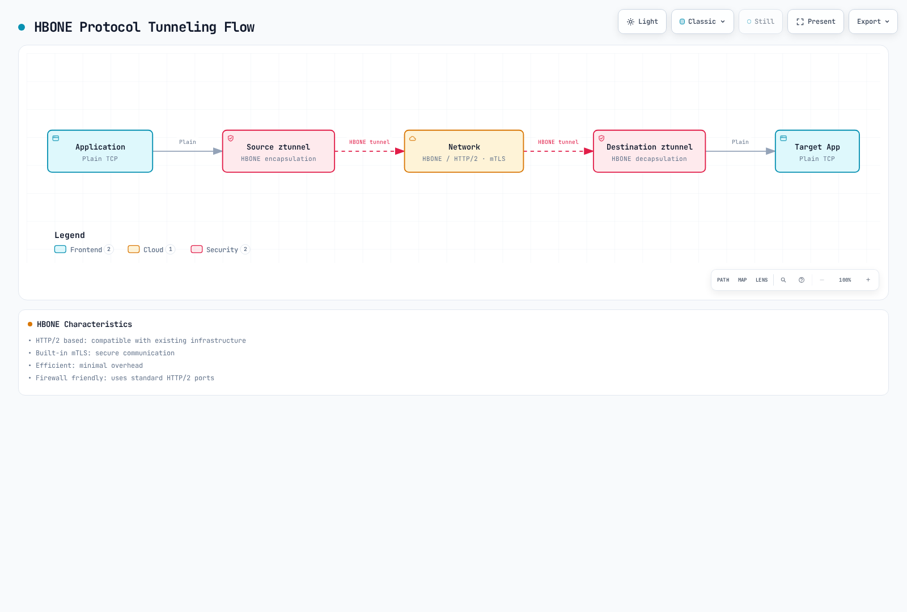

# Ambient Mode

> **Última actualización**: 12 de octubre de 2026 · Istio 1.31. Este laboratorio presupone nodos Linux compatibles, los permisos necesarios para el agente de nodo/CNI y un namespace de demostración nuevo. Esta revisión no ejecutó comandos de despliegue.

Ambient se presentó como una versión preliminar experimental en 2022. Se incluyó por primera vez en Istio 1.18 como Alpha, pasó a Beta en 1.22 y sus funciones principales alcanzaron la disponibilidad general en 1.24. La versión preliminar no era una función de disponibilidad general de la versión principal 1.15. El ahorro de recursos y la seguridad de la migración dependen de la topología, las políticas y el tráfico reales.

## Tabla de contenidos

1. [Descripción general](#overview)
2. [Modo Sidecar frente a Ambient Mode](#sidecar-mode-vs-ambient-mode)
3. [Arquitectura](#architecture)
4. [Instalación y configuración](#installation-and-configuration)
5. [Migración](#migration)
6. [Comparación de rendimiento](#performance-comparison)
7. [Casos de uso](#use-cases)
8. [Solución de problemas](#troubleshooting)

## Descripción general {#overview}


Ambient Mode proporciona funciones de malla de servicios sin inyectar proxies sidecar en los Pods de aplicaciones. Su diseño utiliza una **arquitectura en capas**:

1. **Capa overlay segura (L4)**: mTLS y telemetría básica mediante ztunnel
2. **Capa de procesamiento L7**: gestión avanzada del tráfico mediante un proxy waypoint

### ¿Por qué se necesita Ambient Mode?

Limitaciones del modelo tradicional con sidecars:
- **Consumo elevado de recursos**: cada Pod requiere un proxy Envoy; mida el consumo real del proxy
- **Complejidad operativa**: los reinicios de Pods, la gestión de versiones y las actualizaciones graduales son complejos
- **Coordinación del arranque**: debe coordinarse la disponibilidad del proxy y de la aplicación
- **Funciones innecesarias**: algunas cargas solo necesitan las funciones L4 de la malla

Opciones que ofrece Ambient Mode:
- Proxies de nodo compartidos junto con los waypoints necesarios: mida el consumo total de recursos
- Incorporar Pods que aún no pertenecen a la malla puede evitar su reinicio; retirar un sidecar y cambiar políticas requiere un despliegue controlado
- Adopción gradual: amplíe de L4 a L7 según las necesidades
- El transporte L4 puede ser transparente; siguen siendo necesarios el contexto de tracing y los contratos de timeout e idempotencia de la aplicación

### Conceptos principales

El waypoint opcional de estas figuras se selecciona mediante la configuración y la incorporación del recurso. Ztunnel no analiza cada solicitud HTTP para decidir si debe desviarla a L7. Aun así, deben validarse las conexiones existentes, la disponibilidad de los componentes y las transiciones de políticas.


[🔍 Ver diagrama interactivo](https://www.atomai.click/kubernetes-docs/archmaps/en-service-mesh-istio-advanced-01-ambient-mode-0.html)

### Ventajas de Ambient Mode

1. **Recursos compartidos**: proxies de nodo y las réplicas de waypoint necesarias
2. **Despliegue sencillo**: incorporar Pods sin malla no tiene por qué reiniciarlos; retirar un sidecar sí requiere hacerlo
3. **Transporte L4 transparente**: se mantienen los requisitos de tracing, plazos e idempotencia de la aplicación
4. **Funciones L7 flexibles**: utilice waypoints solo cuando sean necesarios

## Modo Sidecar frente a Ambient Mode {#sidecar-mode-vs-ambient-mode}

### Comparación de arquitectura

#### Modo Sidecar


[🔍 Ver diagrama interactivo](https://www.atomai.click/kubernetes-docs/archmaps/en-service-mesh-istio-advanced-01-ambient-mode-1.html)

**Características**:
- Proxy Envoy inyectado en cada Pod
- Funcionalidades L4/L7 maduras; verifique la versión seleccionada
- Alto uso de recursos
- Se requiere reiniciar el Pod

#### Ambient Mode


[🔍 Ver diagrama interactivo](https://www.atomai.click/kubernetes-docs/archmaps/en-service-mesh-istio-advanced-01-ambient-mode-2.html)

**Características**:
- Un ztunnel por nodo
- Funciones L4 disponibles de forma predeterminada
- Las funciones L7 requieren un waypoint
- Incorporar Pods sin malla no tiene por qué reiniciarlos; retirar un sidecar sí requiere hacerlo

### Tabla de comparación detallada

| Elemento | Modo Sidecar | Ambient Mode |
|------|-------------|--------------|
| **Método de despliegue** | Inyección de un sidecar en el Pod | ztunnel del nodo y waypoint opcional |
| **Cómputo de recursos** | Envoy por Pod y plano de control | ztunnels de los nodos, todas las réplicas de waypoint y plano de control; mida bajo carga |
| **Recreación de Pods** | Necesaria para añadir o retirar un proxy inyectado | Normalmente no es necesaria para incorporar Pods sin malla; sí lo es para retirar un sidecar |
| **Coordinación del arranque** | Ciclo de vida y disponibilidad del proxy y de la aplicación | Captura de tráfico mediante CNI y disponibilidad de ztunnel |
| **Funciones L4** | Compatibles | Compatibles |
| **Funciones L7** | Compatibilidad según la versión | Requieren un waypoint y una API compatible; no todas las extensiones tienen disponibilidad general |
| **mTLS** | Automático | Automático |
| **Telemetría** | Detallada | Básica en L4, detallada en L7 con waypoint |
| **Circuit breaker** | Compatible | Requiere un waypoint |
| **Reintentos y timeouts** | Compatibles | Requieren un waypoint |
| **Modificación de encabezados** | Compatible | Requiere un waypoint |
| **Sobrecarga de rendimiento** | Depende de la carga y la configuración | Depende de la ruta, identidad, waypoint y carga; compare políticas equivalentes |
| **Ámbito operativo** | Ciclo de vida del proxy de cada carga | Ciclo de vida de nodos/CNI y waypoints compartidos |
| **Preparación para producción** | Maduro | Disponibilidad general a partir de Istio 1.24 |

### Comparación de uso de recursos {#resource-usage-comparison}

El cálculo siguiente para 100 Pods es un ejemplo de planificación con valores supuestos, no un benchmark oficial. Incluya todas las réplicas de proxies de nodo y waypoints, y compare requisitos equivalentes de seguridad, telemetría y enrutamiento antes de estimar ahorros de recursos o de facturación.

## Arquitectura {#architecture}


El plano de datos de Ambient Mode consta de dos componentes principales: **ztunnel** y **Waypoint Proxy**.

### ztunnel (Zero Trust Tunnel)


ztunnel es el componente principal de Ambient Mode: un **proxy L4 ligero que se ejecuta en cada nodo**. Se despliega como DaemonSet en nodos Linux compatibles y gestiona el tráfico admitido de las cargas incorporadas a la malla. Su alcance no incluye todo el tráfico de todos los Pods; compruebe la compatibilidad actual de cargas con red del host, cargas excluidas y protocolos de aplicación distintos de TCP.

#### Cómo funciona ztunnel

1. **Captura de tráfico**: intercepta el tráfico de red de los Pods de forma transparente mediante las reglas netfilter/iptables que Istio CNI configura dentro del Pod y la transferencia de su namespace de red
2. **Aplicación de mTLS**: aplica automáticamente cifrado mTLS con identidades basadas en SPIFFE
3. **Balanceo de carga**: distribuye el tráfico L4 entre endpoints
4. **Recopilación de telemetría**: recopila métricas y registros de conexiones
5. **Reenvío**: dirige el tráfico al ztunnel de destino o a un waypoint

**Tecnologías de ztunnel**:
- **Lenguaje**: Rust, con alto rendimiento y bajo consumo de memoria
- **Protocolo**: HBONE (HTTP-Based Overlay Network Environment)
- **Identidad**: identidades SPIFFE de las cargas; CA de Istiod de forma predeterminada e integración independiente para SPIRE
- **CNI**: integración estrecha con el plugin Istio CNI

#### Rol de ztunnel


[🔍 Ver diagrama interactivo](https://www.atomai.click/kubernetes-docs/archmaps/en-service-mesh-istio-advanced-01-ambient-mode-3.html)

**Características de ztunnel**:
- Escrito en Rust (optimizado para rendimiento)
- Desplegado como DaemonSet
- Integrado con el plugin CNI
- Redirección netfilter/iptables en el Pod coordinada con Istio CNI

#### Despliegue de ztunnel

Use la instalación y los charts publicados de ambient. El DaemonSet mínimo original omitía los montajes de token, CA y socket, y configuraba incorrectamente hostNetwork y privileged. El chart 1.31 proporciona capacidades específicas y acceso al namespace dentro del Pod; no establece `hostNetwork: true` ni `privileged: true`. No copie ni reduzca permisos sin considerar la configuración completa del chart y la plataforma.

```bash
# Offline inspection; use the same reviewed values as the actual installation
istioctl manifest generate --set profile=ambient > ambient-rendered.yaml
# Inspect a deployed resource if a mesh already exists
kubectl get daemonset ztunnel -n istio-system -o yaml
```

### Waypoint Proxy


Waypoint es un **proxy opcional para las funciones L7**. Al configurarlo y seleccionar los recursos que lo utilizarán, se incorpora a su ruta de tráfico para ofrecer gestión avanzada.

#### Características principales de Waypoint

1. **Despliegue selectivo**: se utiliza para servicios que necesitan funciones L7, no para todos los servicios
2. **Proxy compartido**: varias cargas comparten un waypoint según la incorporación del namespace, Service o Pod
3. **Basado en Envoy**: utiliza el mismo proxy Envoy que el modelo tradicional con sidecars, con las API L7 compatibles de cada versión
4. **Bajo demanda**: puede añadirse o retirarse dinámicamente durante la ejecución

#### Unidades de despliegue de Waypoint

Un ServiceAccount proporciona identidad de carga de trabajo; etiquetarlo **no** selecciona un waypoint. Use `istio.io/use-waypoint` en un Namespace, Service o Pod, con un Gateway cuyo tipo de tráfico `istio.io/waypoint-for` coincida con el tráfico previsto.

| Recurso incorporado | Ámbito |
|---|---|
|Namespace|Selección predeterminada de waypoint para recursos compatibles del namespace|
|Service|Tráfico hacia ese Service; el tipo predeterminado de waypoint es `service`|
|Pod|Tráfico directo a una carga o IP de Pod con un waypoint de tipo `workload` o `all`|

Las etiquetas de un Deployment por sí solas no etiquetan los Pods existentes; utilice las etiquetas de la plantilla de Pod para incorporar las cargas. Un waypoint de tipo `service` no cubre automáticamente el tráfico directo a IP de Pods.

#### Rol de Waypoint


**Características de Waypoint**:
- Se despliega como Gateway y se selecciona mediante la incorporación de recursos compatibles
- Utiliza un proxy Envoy
- Compruebe el soporte de cada API; los parches arbitrarios de EnvoyFilter no constituyen una API compatible de waypoint
- Se usa de forma selectiva para los servicios que lo necesitan

#### Despliegue de Waypoint

```yaml
apiVersion: gateway.networking.k8s.io/v1
kind: Gateway
metadata:
  name: reviews-waypoint
  namespace: ambient-demo
  labels:
    istio.io/waypoint-for: service
spec:
  gatewayClassName: istio-waypoint
  listeners:
  - name: mesh
    port: 15008
    protocol: HBONE
```

La clase predeterminada `istio-waypoint` utiliza Envoy. La disponibilidad general de las funciones principales de ambient no se extiende a todas las API: la documentación actual considera Alpha el soporte de VirtualService en ambient y prohíbe combinarlo con rutas de Gateway API. Aquí se utiliza HTTPRoute. EnvoyFilter no es una extensión compatible de waypoint. Las políticas L7 protegen el tráfico que llega al waypoint; para exigir que el tráfico lo atraviese, también se necesita el control de autorización de ztunnel documentado y una incorporación correcta con los componentes listos.

### Flujo de tráfico completo

El siguiente diagrama muestra el flujo completo del tráfico en Ambient Mode **sin sidecars**:


[🔍 Ver diagrama interactivo](https://www.atomai.click/kubernetes-docs/archmaps/en-service-mesh-istio-advanced-01-ambient-mode-6.html)

**Análisis de flujo de tráfico**:

1. **Ruta solo L4**, mediante ztunnel:
   - Mida la latencia de la ruta bajo una carga representativa
   - mTLS se aplica automáticamente
   - Telemetría básica
   - Adecuada cuando los requisitos reales se limitan a L4

2. **Ruta L7** (ztunnel + Waypoint):
   - Enrutamiento basado en encabezados
   - Circuit Breaking
   - Retry/Timeout
   - Cuando se necesitan políticas de tráfico complejas

### Protocolo HBONE


**HBONE (HTTP-Based Overlay Network Environment)** es el protocolo de túnel utilizado en Ambient Mode:

- **Basado en HTTP/2**: compatibilidad con infraestructura existente
- **mTLS integrado**: comunicación segura
- **Multiplexación**: los flujos TCP comparten túneles para el mismo par de identidades de origen y destino
- **Políticas de red**: HBONE utiliza normalmente TCP 15008; permita explícitamente la ruta necesaria de la malla



[🔍 Ver diagrama interactivo](https://www.atomai.click/kubernetes-docs/archmaps/en-service-mesh-istio-advanced-01-ambient-mode-7.html)

En esta guía, HBONE transporta flujos TCP. El tráfico UDP de la aplicación no atraviesa ese túnel; la captura y el proxy de DNS son funciones independientes. El flujo local de la aplicación puede permanecer sin cifrar mientras el transporte de la malla entre proxies está cifrado.

## Instalación y configuración {#installation-and-configuration}

El laboratorio requiere nodos Linux compatibles y los DaemonSets de Istio CNI y ztunnel. EKS Fargate no puede ejecutar estos DaemonSets de nodo; utilice nodos EC2 compatibles y revise la plataforma real de nodos y CNI. Los [requisitos previos de la plataforma](https://istio.io/latest/docs/ambient/install/platform-prerequisites/) describen las rutas CNI, los permisos y las sondas de salud. El trunking de ENI de Pods de VPC CNI con SecurityGroupPolicy puede requerir el modo estándar de aplicación de políticas o sondas exec adecuadas; evalúe sus implicaciones para las políticas. GKE, OpenShift, k3s y otras plataformas pueden necesitar parámetros diferentes.

Istio 1.31 es compatible con Kubernetes 1.32–1.37; consulte la [guía de instalación](../01-installation.md) para la compatibilidad con EKS. Gateway API 1.6.0, utilizada más abajo, coincide con la dependencia de Istio 1.31 y su tutorial oficial de ambient. Compruebe la compatibilidad del conjunto de CRD existente; no cambie a una versión anterior un conjunto más reciente y compatible solo para copiar el ejemplo.

### 1. Instalación de Istio (Ambient Mode)

Utilice este comando únicamente para una malla de laboratorio nueva, después de revisar el instalador y los parámetros de la plataforma. Para una malla existente, siga el procedimiento de migración y conserve su método de instalación y sus valores.

```bash
curl -fsSL https://istio.io/downloadIstio -o download-istio.sh
ISTIO_VERSION=1.31.0 sh download-istio.sh
cd istio-1.31.0
export PATH="$PWD/bin:$PATH"

# Fresh cluster without Gateway API; review an existing bundle separately
if ! kubectl get crd gateways.gateway.networking.k8s.io >/dev/null 2>&1; then
  kubectl apply --server-side -f https://github.com/kubernetes-sigs/gateway-api/releases/download/v1.6.0/experimental-install.yaml
fi
kubectl wait --for=condition=Established crd/gateways.gateway.networking.k8s.io --timeout=60s
kubectl get crd httproutes.gateway.networking.k8s.io

# Fresh lab mesh only; include required platform-specific values
istioctl install --set profile=ambient -y
kubectl get pods,daemonsets -n istio-system
```

### 2. Habilitar Ambient Mode y desplegar la aplicación

Utilice un namespace nuevo y desechable sin configuraciones específicas de inyección de sidecars o revisión. Añadir la etiqueta ambient no convierte los Pods existentes con sidecars. El manifiesto completo de Bookinfo de la distribución 1.31 incluye el Service reviews, las etiquetas de versión, los ServiceAccounts y la dependencia ratings que faltaban en el antiguo ejemplo con un único Deployment; utiliza imágenes Bookinfo 1.20.3.

```bash
kubectl create namespace ambient-demo
kubectl label namespace ambient-demo istio.io/dataplane-mode=ambient
kubectl get namespace ambient-demo -L istio-injection,istio.io/rev,istio.io/dataplane-mode
kubectl apply -n ambient-demo -f samples/bookinfo/platform/kube/bookinfo.yaml
kubectl apply -n ambient-demo -f samples/curl/curl.yaml
for deployment in reviews-v1 reviews-v2 ratings-v1 curl; do
  kubectl rollout status "deployment/$deployment" -n ambient-demo --timeout=120s
done
istioctl ztunnel-config workloads --workload-namespace ambient-demo
```

### 3. Desplegar y seleccionar un Waypoint

La CLI actual recibe un nombre de waypoint y un tipo de tráfico, no una opción para incorporar un ServiceAccount. Espere a que el waypoint esté listo y configure explícitamente el Service para utilizarlo.

```bash
istioctl waypoint apply --name reviews-waypoint --for service -n ambient-demo --wait
kubectl label service reviews -n ambient-demo istio.io/use-waypoint=reviews-waypoint --overwrite
kubectl get gateways.gateway.networking.k8s.io reviews-waypoint -n ambient-demo
kubectl get service reviews -n ambient-demo --show-labels
```

### 4. Usar funcionalidades L7

Cree Services backend específicos de cada versión y adjunte un HTTPRoute al Service reviews que utiliza el waypoint. El ejemplo demuestra enrutamiento por GET y encabezado; el encabezado no es una identidad autenticada. No combine el antiguo VirtualService con esta ruta de Gateway API. Las llamadas directas a otro Service o IP de Pod utilizan una ruta independiente.

```yaml
apiVersion: v1
kind: Service
metadata:
  name: reviews-v1
  namespace: ambient-demo
spec:
  selector:
    app: reviews
    version: v1
  ports:
  - name: http
    port: 9080
    targetPort: 9080
---
apiVersion: v1
kind: Service
metadata:
  name: reviews-v2
  namespace: ambient-demo
spec:
  selector:
    app: reviews
    version: v2
  ports:
  - name: http
    port: 9080
    targetPort: 9080
---
apiVersion: gateway.networking.k8s.io/v1
kind: HTTPRoute
metadata:
  name: reviews
  namespace: ambient-demo
spec:
  parentRefs:
  - group: ''
    kind: Service
    name: reviews
    port: 9080
  rules:
  - matches:
    - method: GET
      headers:
      - name: end-user
        type: Exact
        value: jason
    backendRefs:
    - name: reviews-v2
      port: 9080
  - matches:
    - method: GET
    backendRefs:
    - name: reviews-v1
      port: 9080
```

```bash
kubectl describe httproutes.gateway.networking.k8s.io reviews -n ambient-demo
kubectl exec -n ambient-demo deploy/curl -c curl -- \
  curl -sS --max-time 5 -H "end-user: jason" http://reviews:9080/reviews/0
```

Compruebe las condiciones Accepted/ResolvedRefs y el backend seleccionado mediante registros y telemetría. Que HTTP funcione no demuestra por sí solo que se use mTLS ni que el tráfico atraviese obligatoriamente el waypoint. La autorización L7 requiere los `targetRefs` adecuados; exigir el paso por el waypoint también requiere el control de autorización de ztunnel documentado. Consulte la [vinculación de políticas de waypoint](https://istio.io/latest/docs/ambient/usage/l7-features/).

## Migración {#migration}

### De Sidecar Mode a Ambient Mode

La migración requiere desplegar cambios de políticas y cargas de trabajo, no solo cambiar etiquetas. Conserve la revisión instalada, la CA y las relaciones de confianza, los gateways, las opciones CNI y la configuración declarativa de las cargas. Los sidecars existentes tienen prioridad sobre la incorporación a ambient. Prepare el enrutamiento y la autorización L7 compatibles y asegúrese de que los waypoints estén listos antes de retirar sidecars de cargas que necesitan esas políticas.

#### Paso 1: Instalar componentes Ambient

Utilice el método de instalación existente y los valores revisados para añadir soporte de ambient con una versión compatible. No sobrescriba una malla gestionada por Helm con un comando independiente `istioctl install --set profile=ambient`. Renderice la configuración prevista, revise sus diferencias y compruebe los agentes de nodo CNI y ztunnel.

#### Paso 2: Aplicar al namespace de prueba

Esta prueba independiente de ambient despliega el cliente y el servidor de la distribución 1.31. El Service httpbin expone el puerto 8000 y dirige el tráfico al 8080.

```bash
kubectl create namespace test-ambient
kubectl label namespace test-ambient istio.io/dataplane-mode=ambient
kubectl apply -n test-ambient -f samples/curl/curl.yaml
kubectl apply -n test-ambient -f samples/httpbin/httpbin.yaml
kubectl rollout status deployment/curl -n test-ambient --timeout=120s
kubectl rollout status deployment/httpbin -n test-ambient --timeout=120s
kubectl exec -n test-ambient deploy/curl -c curl -- \
  curl -sS --max-time 5 http://httpbin:8000/headers
```

#### Paso 3: Verificación

La columna HBONE de las cargas muestra el transporte previsto. Para verificar el tráfico real, examine las identidades esperadas de origen y destino en los registros de ztunnel del nodo correcto, o las métricas TCP con `connection_security_policy="mutual_tls"`. Que HTTP funcione no demuestra por sí solo que se use mTLS. Incorporar una carga a HBONE no rechaza a todos los clientes que envían tráfico sin cifrar; si es necesario, utilice PeerAuthentication STRICT. Consulte la [verificación de mTLS](https://istio.io/latest/docs/ambient/usage/verify-mtls-enabled/).

```bash
istioctl ztunnel-config workloads --workload-namespace test-ambient
source_pod=$(kubectl get pod -n test-ambient -l app=curl -o jsonpath='{.items[0].metadata.name}')
source_node=$(kubectl get pod "$source_pod" -n test-ambient -o jsonpath='{.spec.nodeName}')
ztunnel_pod=$(kubectl get pod -n istio-system -l app=ztunnel \
  --field-selector "spec.nodeName=$source_node" -o jsonpath='{.items[0].metadata.name}')
kubectl logs "$ztunnel_pod" -n istio-system --since=5m
```

#### Paso 4: Cambiar cargas de trabajo seleccionadas

El siguiente ejemplo presupone un namespace existente e independiente, `migration-demo`, que solo contiene Deployments curl/httpbin revisados, con inyección configurada en el namespace y requisitos exclusivamente L4. Compruebe las configuraciones específicas de inyección en las plantillas de Pod y los proxies inyectados manualmente; estos comandos no los eliminan. Para cargas L7, valide primero la incorporación al waypoint y la adaptación de políticas, incluidos `targetRefs` y cualquier control que exija atravesarlo. Planifique la coexistencia de políticas durante la migración; una política L7 basada en selectores aplicada por ztunnel puede denegar el tráfico en lugar de permitirlo cuando no puede aplicar la política.

```bash
# Reference snapshots, not manifests to blindly reapply with stale server metadata
kubectl get namespace migration-demo -o json > migration-namespace-before.json
kubectl get deployment curl httpbin -n migration-demo -o yaml > migration-workloads-before.yaml

kubectl label namespace migration-demo istio.io/dataplane-mode=ambient --overwrite
kubectl label namespace migration-demo istio-injection- istio.io/rev-
kubectl get namespace migration-demo -L istio-injection,istio.io/rev,istio.io/dataplane-mode
for deployment in curl httpbin; do
  kubectl rollout restart "deployment/$deployment" -n migration-demo
  kubectl rollout status "deployment/$deployment" -n migration-demo --timeout=120s
done

# Check both classic containers and native-sidecar initContainers
kubectl get pods -n migration-demo -o json | jq -r '
  .items[] | [.metadata.name,
    any((.spec.containers + (.spec.initContainers // []))[]; .name == "istio-proxy")] | @tsv'
istioctl ztunnel-config workloads --workload-namespace migration-demo
```

#### Paso 5: Validar la ruta de datos elegida

Repita las pruebas de disponibilidad, conectividad, identidad y políticas para las cargas indicadas. En un grupo de cargas L7, compruebe la incorporación real de Namespace/Service/Pod, el tipo de tráfico y la disponibilidad del Gateway y las rutas y políticas asociadas; no cree un waypoint por ServiceAccount. Defina criterios de detención y reversión específicos para las cargas. Esta secuencia de laboratorio no garantiza una migración sin interrupciones en producción.

### Estrategia de reversión

Restaure el modo de inyección registrado y la configuración original de plantillas de Pod y políticas. El código siguiente solo cubre el caso de inyección por namespace anterior; la revisión original debe seguir existiendo y estar operativa. En un grupo de cargas con waypoints, restaure también sus políticas de incorporación y enrutamiento como parte de la reversión revisada. Elimine únicamente un waypoint concreto creado para ese grupo que ya no tenga referencias, nunca todos los Gateways del namespace.

```bash
original_revision=$(jq -r '.metadata.labels["istio.io/rev"] // ""' migration-namespace-before.json)
original_injection=$(jq -r '.metadata.labels["istio-injection"] // ""' migration-namespace-before.json)

# Restore the recorded namespace-injection mode; do not invent a revision
if [ "$original_injection" = "enabled" ]; then
  kubectl label namespace migration-demo istio-injection=enabled --overwrite
elif [ -n "$original_revision" ]; then
  kubectl label namespace migration-demo "istio.io/rev=$original_revision" --overwrite
else
  echo "No supported namespace-injection mode recorded; restore the original workload configuration." >&2
  exit 1
fi
kubectl label namespace migration-demo istio.io/dataplane-mode-
for deployment in curl httpbin; do
  kubectl rollout restart "deployment/$deployment" -n migration-demo
  kubectl rollout status "deployment/$deployment" -n migration-demo --timeout=120s
done
```

## Comparación de rendimiento {#performance-comparison}

### Resultados de benchmark

La URL eliminada `perf.png` devolvió 404 y no respaldaba la antigua tabla de «benchmark oficial». Ninguna fuente sustentaba sus porcentajes de CPU y memoria por Pod, latencia o throughput. Utilice los [resultados de rendimiento publicados](https://istio.io/latest/docs/ops/deployment/performance-and-scalability/) con sus condiciones originales de versión, carga, payload, hardware y políticas; no presente mediciones históricas como pruebas de la versión actual.

| Medida | Condiciones que deben ser comparables |
|---|---|
|Memoria/CPU|Número de aplicaciones, identidades y conexiones, número de nodos, todas las réplicas de waypoint y políticas equivalentes|
|Latencia P50/P99|Tamaño y tasa de solicitudes, reutilización de conexiones, mTLS, políticas L7, telemetría y condiciones de sobrecarga|
|Throughput|La misma capacidad de aplicación/backend y la misma definición de error|
|Costo|Capacidad aprovisionada, utilización y facturación reales; reducir las solicitudes de recursos o su consumo no reduce por sí solo la factura|

### Cálculo de ahorro de recursos

El cálculo original para 100 Pods se conserva a continuación únicamente como una **estimación de presupuesto basada en supuestos**. Los valores de 50 MB/0.1 CPU y del waypoint son datos de entrada supuestos, no requests/limits recomendados ni costos medidos. En una comparación real, incluya todas las réplicas de waypoint y ztunnel, su ubicación para alta disponibilidad y los recursos del plano de control. Añadir réplicas de waypoint cambia el resultado.

```python
# Hypothetical planning inputs, not measured resource consumption or billing
sidecar_memory = 100 * 50       # MB, decimal
sidecar_cpu = 100 * 0.1        # vCPU
ambient_memory = 10 * 50 + 200  # 10 ztunnels + one assumed waypoint budget
ambient_cpu = 10 * 0.1 + 0.5

memory_saved = sidecar_memory - ambient_memory  # 4300 MB, 86% of assumed baseline
cpu_saved = sidecar_cpu - ambient_cpu           # 8.5 vCPU, 85% of assumed baseline
```

## Casos de uso {#use-cases}

### ¿Cuándo debería elegir Ambient Mode?


**Escenarios recomendados para Ambient Mode**:
- Cientos o más microservicios
- La optimización del costo de recursos es importante
- La mayoría de los servicios solo necesita comunicación simple
- Solo algunos servicios necesitan enrutamiento avanzado
- Minimizar la complejidad operativa

**Escenarios recomendados para Sidecar Mode**:
- Las API/extensiones necesarias o el comportamiento de plataforma solo son compatibles con la configuración Sidecar elegida
- Se necesita una solución madura y comprobada
- Se necesita control detallado por servicio
- Administración independiente de la versión del proxy por Pod

### 1. Cuando solo se necesitan funcionalidades L4

Para cargas TCP existentes y compatibles, incorpore un namespace después de verificar los requisitos de plataforma, políticas y captura de tráfico. Este Namespace no constituye un despliegue completo de base de datos; diseñe por separado su replicación, almacenamiento y alta disponibilidad.

```yaml
apiVersion: v1
kind: Namespace
metadata:
  name: backend
  labels:
    istio.io/dataplane-mode: ambient
```

### 2. Uso selectivo de funcionalidades L7

La demostración selecciona el waypoint reviews, ya listo, en el Service. La incorporación por Namespace y la incorporación directa de cargas son ámbitos independientes y compatibles; una etiqueta de ServiceAccount no selecciona un waypoint.

```bash
kubectl label service reviews -n ambient-demo istio.io/use-waypoint=reviews-waypoint --overwrite
```

Los requisitos L7 no implican automáticamente que se necesiten sidecars: compare las API y extensiones de waypoint compatibles con las necesidades reales de la aplicación. A su vez, la disponibilidad general de las funciones principales no implica paridad en todas las API avanzadas.

### 3. Migración gradual

Primero identifique la inyección y la incorporación de los recursos; después migre un grupo revisado con criterios explícitos de disponibilidad, seguridad y reversión. No etiquete indiscriminadamente todos los namespaces de desarrollo, staging y producción ni dé por hecho que el cambio convierte los sidecars existentes.

```bash
kubectl get namespaces -L istio-injection,istio.io/rev,istio.io/dataplane-mode,istio.io/use-waypoint
```

## Solución de problemas {#troubleshooting}

### ztunnel no funciona

```bash
# Check ztunnel status
kubectl get daemonset -n istio-system ztunnel
kubectl logs -n istio-system -l app=ztunnel

# Check CNI
kubectl get daemonset -n istio-system istio-cni-node
kubectl logs -n istio-system -l k8s-app=istio-cni-node
```

### El tráfico no va a Waypoint

```bash
# Check Waypoint status
kubectl get gateways.gateway.networking.k8s.io -n <namespace>

# Check supported enrollment scopes and Gateway readiness
kubectl get namespace <namespace> -L istio.io/use-waypoint
kubectl get services -n <namespace> -L istio.io/use-waypoint
istioctl waypoint list -n <namespace>
istioctl ztunnel-config services

# Check Envoy configuration
istioctl proxy-config clusters <waypoint-pod> -n <namespace>
```

## Referencias

### Documentación oficial actual

- [Descripción general de Ambient](https://istio.io/latest/docs/ambient/overview/)
- [Primeros pasos](https://istio.io/latest/docs/ambient/getting-started/)
- [Redirección de tráfico dentro del Pod](https://istio.io/latest/docs/ambient/architecture/traffic-redirection/)
- [HBONE](https://istio.io/latest/docs/ambient/architecture/hbone/)
- [Incorporación a un waypoint](https://istio.io/latest/docs/ambient/usage/waypoint/)
- [Soporte de API L7 y vinculación de políticas](https://istio.io/latest/docs/ambient/usage/l7-features/)
- [Metodología y resultados de rendimiento](https://istio.io/latest/docs/ops/deployment/performance-and-scalability/)
- [Código fuente de ztunnel](https://github.com/istio/ztunnel)
- [Comunidad de Istio y acceso a Slack](https://istio.io/latest/get-involved/)

### Introducciones históricas

Estas páginas de 2022 describen la versión preliminar experimental, no la instalación actual ni comandos de selección de waypoint mediante ServiceAccount.

- [Presentación de ambient mesh (2022)](https://istio.io/latest/blog/2022/introducing-ambient-mesh/)
- [Arquitectura de seguridad experimental (2022)](https://istio.io/latest/blog/2022/ambient-security/)
- [Introducción experimental (2022)](https://istio.io/latest/blog/2022/get-started-ambient/)

### Hitos verificados y límites actuales

| Hito | Evidencia |
|---|---|
|Versión preliminar de 2022|Se anunció una implementación experimental; no era una función de la versión principal 1.15|
|1.18 Alpha (2023)|Primera versión de Istio que incluyó ambient|
|1.22 Beta (2024)|Paso a Beta|
|1.24: disponibilidad general de las funciones principales (2024)|Hito de ztunnel, waypoint y API principales; cada función conserva su propio estado de madurez|

La [documentación actual de ambient para varios clusters](https://istio.io/latest/docs/ambient/install/multicluster/) describe soporte **Beta multi-primary, multi-network**. La topología primary/remote no es compatible y los despliegues de una única red no se han probado; los nombres y la configuración de waypoints y el ámbito de los servicios deben coordinarse entre clusters. La antigua hoja de ruta de 1.26/1.27 y las cifras de ahorro empresarial sin fuentes no demuestran soporte ni garantizan una reducción de costos.

## Resumen

Ambient separa el transporte L4 compartido del procesamiento L7 mediante waypoints seleccionados. Puede simplificar la incorporación de cargas sin malla y la gestión del ciclo de vida de los proxies, pero ahorrar recursos, conservar las políticas y mantener la disponibilidad requiere mediciones con políticas equivalentes y un plan de migración validado. Considere las restricciones de Linux, CNI y plataforma, la conectividad TCP 15008 y el estado de madurez de cada API.
