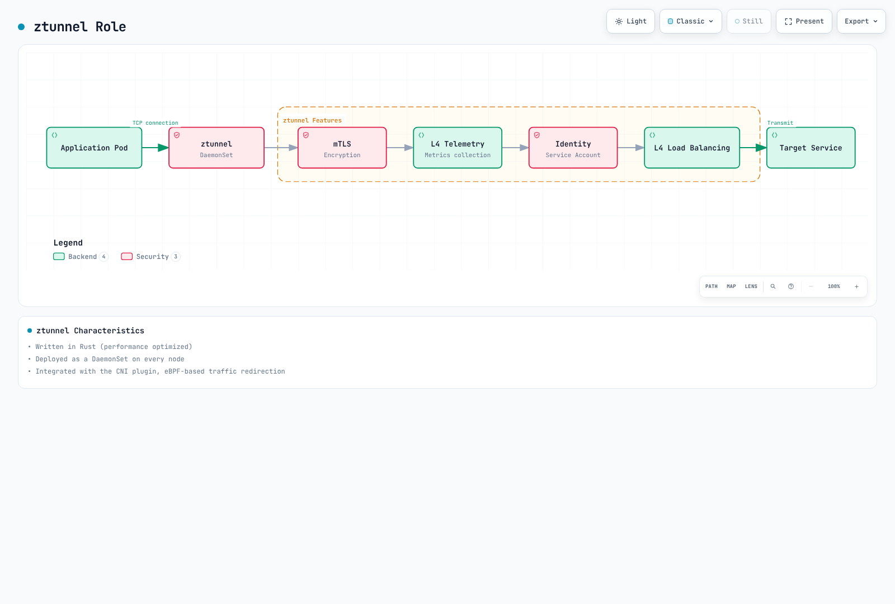

# Ambient Mode

> **Última actualización**: October 12, 2026 · Istio 1.31. Este laboratorio presupone nodos Linux compatibles, permisos de node-agent/CNI y un namespace de demostración nuevo. Esta auditoría no ejecutó comandos de despliegue.

Ambient se presentó como una vista previa experimental en 2022, se distribuyó por primera vez en Istio 1.18 como Alpha, llegó a Beta en 1.22 y al GA básico en 1.24. La vista previa no fue una funcionalidad generalmente disponible de la versión principal 1.15. El ahorro de recursos y la seguridad de la migración dependen de la topología, las políticas y el tráfico reales.

## Tabla de contenidos

1. [Descripción general](#overview)
2. [Modo Sidecar frente a Ambient Mode](#sidecar-mode-vs-ambient-mode)
3. [Arquitectura](#architecture)
4. [Instalación y configuración](#installation-and-configuration)
5. [Migración](#migration)
6. [Comparación de rendimiento](#performance-comparison)
7. [Casos de uso](#use-cases)
8. [Solución de problemas](#troubleshooting)

## Descripción general


Ambient Mode es un nuevo enfoque que proporciona funcionalidad de Service Mesh sin inyectar proxies Sidecar en los Pods de aplicación. Ambient Mode consta de una **arquitectura en capas**:

1. **Capa de superposición segura (L4)**: mTLS y telemetría básica mediante ztunnel
2. **Capa de procesamiento L7**: Administración avanzada del tráfico mediante Waypoint Proxy

### ¿Por qué se necesita Ambient Mode?

Limitaciones del modelo Sidecar tradicional:
- **Alta sobrecarga de recursos**: Cada Pod requiere un proxy Envoy (mida la huella real del proxy)
- **Complejidad operativa**: Los reinicios de Pods, la administración de versiones y las actualizaciones graduales son complejos
- **Coordinación de inicio**: La preparación del proxy y de la aplicación debe coordinarse
- **Funcionalidad excesiva**: Algunas cargas de trabajo solo necesitan funcionalidades de mesh L4

Soluciones de Ambient Mode:
- Proxies de nodo compartidos más los waypoints necesarios: mida el uso total de recursos
- La inscripción puede evitar reiniciar Pods sin mesh; la eliminación de un sidecar y los cambios de políticas necesitan una implementación controlada
- Adopción gradual: Amplíe de L4 a L7 según sea necesario
- El transporte L4 puede ser transparente; el contexto de trazado y los contratos de timeout/idempotencia de la aplicación siguen siendo importantes

### Conceptos principales

El waypoint opcional de estas figuras se selecciona mediante configuración/inscripción. Ztunnel no analiza cada solicitud HTTP y decide si debe realizar un desvío L7. Las conexiones existentes, la preparación y las transiciones de políticas siguen necesitando validación.


[🔍 Ver diagrama interactivo](https://www.atomai.click/kubernetes-docs/archmaps/en-service-mesh-istio-advanced-01-ambient-mode-0.html)

### Ventajas de Ambient Mode

1. **Modelo de recursos compartidos**: Proxies de nodo más las réplicas de waypoint necesarias
2. **Despliegue simple**: La inscripción de Pods sin mesh no necesita reiniciar Pods; eliminar un sidecar sí
3. **Transporte L4 transparente**: Los requisitos de tracing/deadline/idempotencia de la aplicación se mantienen
4. **Funcionalidades L7 flexibles**: Use waypoint solo cuando sea necesario

## Modo Sidecar frente a Ambient Mode

### Comparación de arquitectura

#### Modo Sidecar


[🔍 Ver diagrama interactivo](https://www.atomai.click/kubernetes-docs/archmaps/en-service-mesh-istio-advanced-01-ambient-mode-1.html)

**Características**:
- Proxy Envoy inyectado en cada Pod
- Funcionalidades L4/L7 maduras; verifique la versión seleccionada
- Alto uso de recursos
- Se requiere reiniciar el Pod

#### Ambient Mode


[🔍 Ver diagrama interactivo](https://www.atomai.click/kubernetes-docs/archmaps/en-service-mesh-istio-advanced-01-ambient-mode-2.html)

**Características**:
- Un ztunnel por nodo
- Funcionalidades L4 proporcionadas de forma predeterminada
- Las funcionalidades L7 requieren waypoint
- La inscripción de Pods sin mesh no necesita reiniciar Pods; eliminar un sidecar sí

### Tabla de comparación detallada

| Elemento | Modo Sidecar | Ambient Mode |
|------|-------------|--------------|
| **Método de despliegue** | Inyección de Sidecar en el Pod | ztunnel de nivel de nodo + waypoint opcional |
| **Contabilización de recursos** | Envoy por Pod + plano de control | ztunnels de nodo + todas las réplicas de waypoint + plano de control; mida bajo carga |
| **Recreación de Pod** | Necesaria para agregar/eliminar un proxy inyectado | Normalmente no es necesaria para la inscripción sin mesh; necesaria para eliminar un sidecar |
| **Coordinación de inicio** | Ciclo de vida y preparación de proxy/aplicación | Captura de CNI y preparación de ztunnel |
| **Funcionalidades L4** | Compatible | Compatible |
| **Funcionalidades L7** | Compatibilidad específica de la versión | Se requieren Waypoint y API compatible; no todas las extensiones son GA |
| **mTLS** | Automático | Automático |
| **Telemetría** | Detallada | Básica (L4), detallada (L7 con waypoint) |
| **Circuit Breaker** | Compatible | Requiere Waypoint |
| **Retry/Timeout** | Compatible | Requiere Waypoint |
| **Manipulación de encabezados** | Compatible | Requiere Waypoint |
| **Sobrecarga de rendimiento** | Depende de la carga de trabajo/configuración | Depende de ruta/identidad/waypoint/carga; compare políticas equivalentes |
| **Ámbito operativo** | Ciclo de vida del proxy por carga de trabajo | Ciclo de vida de nodo/CNI y waypoint compartido |
| **Preparación para producción** | Maduro | GA (Istio 1.24+) |

### Comparación de uso de recursos

El cálculo de 100 Pods a continuación es un ejemplo hipotético de planificación, no un benchmark oficial. Cuente todas las réplicas de nodo/waypoint y compare requisitos equivalentes de seguridad, telemetría y enrutamiento antes de estimar ahorros de recursos o facturación.

## Arquitectura


El plano de datos de Ambient Mode consta de dos componentes principales: **ztunnel** y **Waypoint Proxy**.

### ztunnel (Zero Trust Tunnel)


ztunnel es el componente principal de Ambient Mode, un **proxy L4 ligero que se ejecuta en el nivel de nodo**. Se ejecuta como DaemonSet en nodos Linux elegibles y gestiona el tráfico compatible de las cargas de trabajo inscritas. No es todo el tráfico de cada Pod; las cargas de trabajo con host-network/excluidas y los protocolos de aplicación que no son TCP requieren verificar la compatibilidad actual.

#### Cómo funciona ztunnel

1. **Captura de tráfico**: Intercepta de forma transparente el tráfico de red de Pods mediante reglas netfilter/iptables en el Pod de Istio CNI y transferencia de espacio de nombres de red
2. **Aplicación de mTLS**: Aplica automáticamente cifrado mTLS mediante Identity basada en SPIFFE
3. **Balanceo de carga**: Realiza balanceo de carga L4 entre endpoints
4. **Recopilación de telemetría**: Recopila métricas y logs de conexión
5. **Reenvío**: Reenvía tráfico al ztunnel de destino o a Waypoint

**Stack tecnológico de ztunnel**:
- **Lenguaje**: Rust (alto rendimiento, bajo uso de memoria)
- **Protocolo**: HBONE (HTTP-Based Overlay Network Environment)
- **Identidad**: Identidades de carga de trabajo SPIFFE; Istiod CA de forma predeterminada, integración separada para SPIRE
- **CNI**: Integración estrecha con el plugin Istio CNI

#### Rol de ztunnel



[🔍 Ver diagrama interactivo](https://www.atomai.click/kubernetes-docs/archmaps/en-service-mesh-istio-advanced-01-ambient-mode-3.html)

**Características de ztunnel**:
- Escrito en Rust (optimizado para rendimiento)
- Desplegado como DaemonSet
- Integrado con el plugin CNI
- Redirección netfilter/iptables en el Pod coordinada con Istio CNI

#### Despliegue de ztunnel

Use la instalación/charts de ambient publicada. El DaemonSet mínimo original omitía montajes de token/CA/socket y usaba configuraciones hostNetwork/privileged incorrectas. El chart 1.31 proporciona capacidades específicas y acceso al espacio de nombres en el Pod; no establece `hostNetwork: true` ni `privileged: true`. No copie ni reduzca privilegios sin el contexto completo del chart/plataforma.

```bash
# Offline inspection; use the same reviewed values as the actual installation
istioctl manifest generate --set profile=ambient > ambient-rendered.yaml
# Inspect a deployed resource if a mesh already exists
kubectl get daemonset ztunnel -n istio-system -o yaml
```

### Waypoint Proxy


Waypoint es un **proxy opcional que se usa cuando se necesitan funcionalidades L7**. Un waypoint configurado se coloca en la ruta de tráfico de los recursos inscritos para proporcionar funcionalidades avanzadas de administración del tráfico.

#### Características principales de Waypoint

1. **Despliegue selectivo**: Se usa solo para servicios que necesitan funcionalidades L7, no para todos los servicios
2. **Proxy compartido**: Varias cargas de trabajo comparten un único Waypoint (según la inscripción de namespace/Service/Pod)
3. **Basado en Envoy**: Usa el mismo proxy Envoy que Sidecar tradicional, con compatibilidad de API L7 específica de la versión
4. **Bajo demanda**: Se puede agregar/eliminar dinámicamente en tiempo de ejecución

#### Unidades de despliegue de Waypoint

Un ServiceAccount proporciona identidad de carga de trabajo; etiquetarlo **no** selecciona un waypoint. Use `istio.io/use-waypoint` en un Namespace, Service o Pod, con un Gateway cuyo tipo de tráfico `istio.io/waypoint-for` coincida con el tráfico previsto.

| Inscripción | Ámbito |
|---|---|
|Namespace|Selección de waypoint predeterminado para recursos elegibles en ese namespace|
|Service|Tráfico hacia ese Service; el tipo de waypoint predeterminado es `service`|
|Pod|Tráfico directo de carga de trabajo/Pod-IP con un waypoint `workload` o `all`|

Las etiquetas de Deployment por sí solas no etiquetan Pods existentes; use etiquetas de plantilla de Pod para la inscripción de cargas de trabajo. Un waypoint `service` no cubre automáticamente el tráfico directo a Pod-IP.

#### Rol de Waypoint


**Características de Waypoint**:
- Desplegado como Gateway y seleccionado mediante inscripción de recursos compatible
- Basado en proxy Envoy
- Verifique la compatibilidad por API; los parches arbitrarios de EnvoyFilter no son una API de waypoint compatible
- Uso selectivo solo para los servicios necesarios

#### Despliegue de Waypoint

```yaml
apiVersion: gateway.networking.k8s.io/v1
kind: Gateway
metadata:
  name: reviews-waypoint
  namespace: ambient-demo
  labels:
    istio.io/waypoint-for: service
spec:
  gatewayClassName: istio-waypoint
  listeners:
  - name: mesh
    port: 15008
    protocol: HBONE
```

La clase predeterminada `istio-waypoint` usa Envoy. El GA básico de ambient no convierte todas las API en GA: la documentación actual describe VirtualService de ambient como Alpha y prohíbe combinarlo con rutas de Gateway API. Use HTTPRoute aquí. EnvoyFilter no es una extensión de waypoint compatible. Las políticas L7 protegen el tráfico que llega al waypoint; el recorrido obligatorio también necesita la protección de autorización de ztunnel documentada y la inscripción/preparación correctas.

### Flujo de tráfico completo

La siguiente es un diagrama completo que muestra cómo fluye el tráfico en Ambient Mode **sin Sidecars**:


[🔍 Ver diagrama interactivo](https://www.atomai.click/kubernetes-docs/archmaps/en-service-mesh-istio-advanced-01-ambient-mode-6.html)

**Análisis de flujo de tráfico**:

1. **Ruta solo L4** (usando solo ztunnel):
   - Mida la latencia de ruta bajo carga representativa
   - mTLS aplicado automáticamente
   - Telemetría básica
   - Adecuada cuando los requisitos reales son solo L4

2. **Ruta L7** (ztunnel + Waypoint):
   - Enrutamiento basado en encabezados
   - Circuit Breaking
   - Retry/Timeout
   - Cuando se necesitan políticas de tráfico complejas

### Protocolo HBONE


**HBONE (HTTP-Based Overlay Network Environment)** es el protocolo de túnel utilizado en Ambient Mode:

- **Basado en HTTP/2**: Compatibilidad con infraestructura existente
- **mTLS integrado**: Comunicación segura
- **Multiplexación**: Los streams TCP comparten túneles para el mismo par de identidad de origen/destino
- **Política de red**: HBONE usa convencionalmente TCP15008; permita explícitamente la ruta de mesh necesaria


[🔍 Ver diagrama interactivo](https://www.atomai.click/kubernetes-docs/archmaps/en-service-mesh-istio-advanced-01-ambient-mode-7.html)

HBONE en esta guía transporta streams TCP. UDP de aplicación no se transporta por ese túnel; la captura/proxy de DNS es una función independiente. El stream de aplicación local puede permanecer en texto sin cifrar mientras el transporte de mesh entre proxies está cifrado.

## Instalación y configuración

El laboratorio necesita nodos Linux compatibles y los DaemonSets de Istio CNI/ztunnel necesarios. EKS Fargate no puede ejecutar estos DaemonSets de nodo; use una ubicación compatible basada en EC2 y revise la plataforma real de nodo/CNI. Los [requisitos previos de la plataforma](https://istio.io/latest/docs/ambient/install/platform-prerequisites/) cubren rutas de CNI, permisos y sondas de estado. El trunking de Pod ENI de VPC CNI con SecurityGroupPolicy puede requerir el modo de aplicación estándar o sondas exec adecuadas; evalúe las implicaciones de las políticas. GKE, OpenShift, k3s y otras plataformas pueden necesitar configuraciones diferentes.

Istio1.31 es compatible con Kubernetes1.32–1.37; consulte la [guía de instalación](../01-installation.md) para la compatibilidad con EKS. Gateway API1.6.0 a continuación coincide con la dependencia de Istio1.31 y el tutorial oficial de ambient. Compruebe la compatibilidad de un bundle existente; no degrade un bundle compatible más reciente solo para copiar el ejemplo.

### 1. Instalación de Istio (Ambient Mode)

Use este comando de instalación solo para un mesh de laboratorio nuevo después de revisar el instalador y la configuración de la plataforma. Preserve el método/valores de instalación de un mesh existente mediante el procedimiento de migración.

```bash
curl -fsSL https://istio.io/downloadIstio -o download-istio.sh
ISTIO_VERSION=1.31.0 sh download-istio.sh
cd istio-1.31.0
export PATH="$PWD/bin:$PATH"

# Fresh cluster without Gateway API; review an existing bundle separately
if ! kubectl get crd gateways.gateway.networking.k8s.io >/dev/null 2>&1; then
  kubectl apply --server-side -f https://github.com/kubernetes-sigs/gateway-api/releases/download/v1.6.0/experimental-install.yaml
fi
kubectl wait --for=condition=Established crd/gateways.gateway.networking.k8s.io --timeout=60s
kubectl get crd httproutes.gateway.networking.k8s.io

# Fresh lab mesh only; include required platform-specific values
istioctl install --set profile=ambient -y
kubectl get pods,daemonsets -n istio-system
```

### 2. Habilitar Ambient Mode y desplegar la aplicación

Use un namespace desechable nuevo sin anulación de sidecar-injection/revision. Los Pods Sidecar existentes no se convierten agregando la etiqueta ambient. El manifiesto completo de Bookinfo de la distribución 1.31 proporciona el Service reviews, las etiquetas de versión, ServiceAccounts y la dependencia ratings que falta en el antiguo ejemplo de un único Deployment; usa imágenes Bookinfo1.20.3.

```bash
kubectl create namespace ambient-demo
kubectl label namespace ambient-demo istio.io/dataplane-mode=ambient
kubectl get namespace ambient-demo -L istio-injection,istio.io/rev,istio.io/dataplane-mode
kubectl apply -n ambient-demo -f samples/bookinfo/platform/kube/bookinfo.yaml
kubectl apply -n ambient-demo -f samples/curl/curl.yaml
for deployment in reviews-v1 reviews-v2 ratings-v1 curl; do
  kubectl rollout status "deployment/$deployment" -n ambient-demo --timeout=120s
done
istioctl ztunnel-config workloads --workload-namespace ambient-demo
```

### 3. Desplegar y seleccionar un Waypoint

La CLI actual toma un nombre de waypoint y un tipo de tráfico, no una marca de inscripción de ServiceAccount. Espere a que esté listo e inscriba explícitamente el Service.

```bash
istioctl waypoint apply --name reviews-waypoint --for service -n ambient-demo --wait
kubectl label service reviews -n ambient-demo istio.io/use-waypoint=reviews-waypoint --overwrite
kubectl get gateways.gateway.networking.k8s.io reviews-waypoint -n ambient-demo
kubectl get service reviews -n ambient-demo --show-labels
```

### 4. Usar funcionalidades L7

Cree Services de backend específicos de versión y adjunte un HTTPRoute al Service reviews inscrito. Esto demuestra el enrutamiento GET/por encabezado; el encabezado no es una identidad autenticada. No combine el antiguo VirtualService con esta ruta de Gateway API. Las llamadas directas a otro Service/Pod IP son una ruta independiente.

```yaml
apiVersion: v1
kind: Service
metadata:
  name: reviews-v1
  namespace: ambient-demo
spec:
  selector:
    app: reviews
    version: v1
  ports:
  - name: http
    port: 9080
    targetPort: 9080
---
apiVersion: v1
kind: Service
metadata:
  name: reviews-v2
  namespace: ambient-demo
spec:
  selector:
    app: reviews
    version: v2
  ports:
  - name: http
    port: 9080
    targetPort: 9080
---
apiVersion: gateway.networking.k8s.io/v1
kind: HTTPRoute
metadata:
  name: reviews
  namespace: ambient-demo
spec:
  parentRefs:
  - group: ''
    kind: Service
    name: reviews
    port: 9080
  rules:
  - matches:
    - method: GET
      headers:
      - name: end-user
        type: Exact
        value: jason
    backendRefs:
    - name: reviews-v2
      port: 9080
  - matches:
    - method: GET
    backendRefs:
    - name: reviews-v1
      port: 9080
```

```bash
kubectl describe httproutes.gateway.networking.k8s.io reviews -n ambient-demo
kubectl exec -n ambient-demo deploy/curl -c curl -- \
  curl -sS --max-time 5 -H "end-user: jason" http://reviews:9080/reviews/0
```

Compruebe las condiciones Accepted/ResolvedRefs y el backend seleccionado mediante logs/telemetría. El éxito de HTTP por sí solo no prueba ni mTLS ni el recorrido obligatorio por waypoint. La autorización L7 necesita los `targetRefs` adecuados; el recorrido obligatorio también necesita la protección de autorización de ztunnel documentada. Consulte [vinculación de políticas de waypoint](https://istio.io/latest/docs/ambient/usage/l7-features/).

## Migración

### De Sidecar Mode a Ambient Mode

La migración es una implementación de política/carga de trabajo, no un cambio basado solo en etiquetas. Preserve la revisión instalada, CA/trust, gateways, opciones CNI y configuración declarativa de carga de trabajo. Los sidecars existentes tienen prioridad sobre la inscripción ambient. Prepare el enrutamiento/autorización L7 compatible y los waypoints listos antes de eliminar sidecars de las cargas de trabajo que requieren esas políticas.

#### Paso 1: Instalar componentes Ambient

Use el método de instalación existente y los valores revisados para agregar compatibilidad ambient en una versión compatible. No sobrescriba un mesh administrado por Helm con un comando independiente no relacionado `istioctl install --set profile=ambient`. Renderice/diferencie la configuración prevista y verifique los agentes de nodo CNI/ztunnel.

#### Paso 2: Aplicar al namespace de prueba

Esta prueba ambient independiente despliega tanto el cliente como el servidor desde la distribución 1.31. El Service httpbin expone8000 y tiene como destino8080.

```bash
kubectl create namespace test-ambient
kubectl label namespace test-ambient istio.io/dataplane-mode=ambient
kubectl apply -n test-ambient -f samples/curl/curl.yaml
kubectl apply -n test-ambient -f samples/httpbin/httpbin.yaml
kubectl rollout status deployment/curl -n test-ambient --timeout=120s
kubectl rollout status deployment/httpbin -n test-ambient --timeout=120s
kubectl exec -n test-ambient deploy/curl -c curl -- \
  curl -sS --max-time 5 http://httpbin:8000/headers
```

#### Paso 3: Verificación

La columna de carga de trabajo HBONE muestra el transporte previsto. Para el tráfico real, inspeccione las identidades de origen/destino esperadas en los logs de ztunnel del nodo correcto o las métricas TCP con `connection_security_policy="mutual_tls"`. El éxito de HTTP por sí solo no es prueba de mTLS. La inscripción HBONE no rechaza a todos los llamadores de texto sin cifrar; use PeerAuthentication STRICT si es necesario. Consulte [verificación de mTLS](https://istio.io/latest/docs/ambient/usage/verify-mtls-enabled/).

```bash
istioctl ztunnel-config workloads --workload-namespace test-ambient
source_pod=$(kubectl get pod -n test-ambient -l app=curl -o jsonpath='{.items[0].metadata.name}')
source_node=$(kubectl get pod "$source_pod" -n test-ambient -o jsonpath='{.spec.nodeName}')
ztunnel_pod=$(kubectl get pod -n istio-system -l app=ztunnel \
  --field-selector "spec.nodeName=$source_node" -o jsonpath='{.items[0].metadata.name}')
kubectl logs "$ztunnel_pod" -n istio-system --since=5m
```

#### Paso 4: Cambiar cargas de trabajo seleccionadas

El siguiente ejemplo presupone un namespace existente independiente `migration-demo` que contiene solo Deployments curl/httpbin revisados e inyectados por namespace con requisitos solo L4. Compruebe las anulaciones de inyección de plantilla de Pod o proxies inyectados manualmente; estos comandos no los eliminan. Para cargas de trabajo L7, valide primero la inscripción de waypoint y la traducción de políticas, incluidos `targetRefs` y cualquier protección de recorrido obligatorio. Planifique la coexistencia de políticas durante la migración; una política L7 basada en selector aplicada por ztunnel puede fallar de forma cerrada.

```bash
# Reference snapshots, not manifests to blindly reapply with stale server metadata
kubectl get namespace migration-demo -o json > migration-namespace-before.json
kubectl get deployment curl httpbin -n migration-demo -o yaml > migration-workloads-before.yaml

kubectl label namespace migration-demo istio.io/dataplane-mode=ambient --overwrite
kubectl label namespace migration-demo istio-injection- istio.io/rev-
kubectl get namespace migration-demo -L istio-injection,istio.io/rev,istio.io/dataplane-mode
for deployment in curl httpbin; do
  kubectl rollout restart "deployment/$deployment" -n migration-demo
  kubectl rollout status "deployment/$deployment" -n migration-demo --timeout=120s
done

# Check both classic containers and native-sidecar initContainers
kubectl get pods -n migration-demo -o json | jq -r '
  .items[] | [.metadata.name,
    any((.spec.containers + (.spec.initContainers // []))[]; .name == "istio-proxy")] | @tsv'
istioctl ztunnel-config workloads --workload-namespace migration-demo
```

#### Paso 5: Validar la ruta de datos elegida

Repita las pruebas de preparación, conectividad, identidad y políticas para las cargas de trabajo indicadas. Para un grupo L7, inspeccione la inscripción real de Namespace/Service/Pod, el tipo de tráfico/la preparación de Gateway y la vinculación de ruta/política; no cree un waypoint por ServiceAccount. Use criterios de detención/reversión específicos de la carga de trabajo. Esta secuencia de laboratorio no es una garantía de producción sin tiempo de inactividad.

### Estrategia de reversión

Restaure el modo de inyección registrado y la configuración original de plantilla de Pod/política. El código a continuación solo gestiona el caso de inyección de namespace anterior; la revisión anterior debe seguir existiendo y estar en buen estado. Un grupo con waypoints necesita que se restauren sus políticas de inscripción/enrutamiento como parte de la reversión revisada. Elimine solo un waypoint específicamente identificado y sin referencias creado para ese grupo; nunca todos los Gateways de un namespace.

```bash
original_revision=$(jq -r '.metadata.labels["istio.io/rev"] // ""' migration-namespace-before.json)
original_injection=$(jq -r '.metadata.labels["istio-injection"] // ""' migration-namespace-before.json)

# Restore the recorded namespace-injection mode; do not invent a revision
if [ "$original_injection" = "enabled" ]; then
  kubectl label namespace migration-demo istio-injection=enabled --overwrite
elif [ -n "$original_revision" ]; then
  kubectl label namespace migration-demo "istio.io/rev=$original_revision" --overwrite
else
  echo "No supported namespace-injection mode recorded; restore the original workload configuration." >&2
  exit 1
fi
kubectl label namespace migration-demo istio.io/dataplane-mode-
for deployment in curl httpbin; do
  kubectl rollout restart "deployment/$deployment" -n migration-demo
  kubectl rollout status "deployment/$deployment" -n migration-demo --timeout=120s
done
```

## Comparación de rendimiento

### Resultados de benchmark

La URL `perf.png` eliminada devolvió404 y no justificaba la antigua tabla de “benchmark oficial”. Ninguna fuente estableció sus porcentajes de CPU/memoria por Pod, latencia o rendimiento. Use [resultados de rendimiento publicados](https://istio.io/latest/docs/ops/deployment/performance-and-scalability/) con sus condiciones originales de versión, carga, payload, hardware y políticas; no cambie la etiqueta de mediciones históricas como si fueran una prueba de la versión actual.

| Medida | Mantener comparable |
|---|---|
|Memoria/CPU|Cantidad de aplicaciones, identidades/conexiones, cantidad de nodos, todas las réplicas de waypoint y políticas equivalentes|
|Latencia P50/P99|Tamaño/tasa de solicitud, reutilización de conexión, mTLS, política L7, telemetría y condiciones de sobrecarga|
|Rendimiento|La misma capacidad de aplicación/backend y definición de error|
|Costo|Capacidad aprovisionada, utilización y facturación reales; las solicitudes/el uso menores por sí solos no reducen la factura|

### Cálculo de ahorro de recursos

La aritmética original de 100 Pods se conserva a continuación solo como un **modelo de presupuesto hipotético**. Sus valores de50MB/0.1CPU y de waypoint son entradas supuestas, no solicitudes/límites recomendados ni costos medidos. Incluya cada réplica de waypoint/ztunnel, la ubicación de HA y los recursos del plano de control en una comparación real. Las réplicas adicionales de waypoint cambian el resultado.

```python
# Hypothetical planning inputs, not measured resource consumption or billing
sidecar_memory = 100 * 50       # MB, decimal
sidecar_cpu = 100 * 0.1        # vCPU
ambient_memory = 10 * 50 + 200  # 10 ztunnels + one assumed waypoint budget
ambient_cpu = 10 * 0.1 + 0.5

memory_saved = sidecar_memory - ambient_memory  # 4300 MB, 86% of assumed baseline
cpu_saved = sidecar_cpu - ambient_cpu           # 8.5 vCPU, 85% of assumed baseline
```

## Casos de uso

### ¿Cuándo debería elegir Ambient Mode?


**Escenarios recomendados para Ambient Mode**:
- Cientos o más microservicios
- La optimización del costo de recursos es importante
- La mayoría de los servicios solo necesita comunicación simple
- Solo algunos servicios necesitan enrutamiento avanzado
- Minimizar la complejidad operativa

**Escenarios recomendados para Sidecar Mode**:
- Las API/extensiones necesarias o el comportamiento de plataforma solo son compatibles con la configuración Sidecar elegida
- Se necesita una solución madura y comprobada
- Se necesita control detallado por servicio
- Administración independiente de la versión del proxy por Pod

### 1. Cuando solo se necesitan funcionalidades L4

Para cargas de trabajo TCP existentes compatibles, inscriba un namespace después de verificar los requisitos previos de plataforma, política y captura. Este Namespace no es un despliegue completo de base de datos; la replicación/almacenamiento/HA de base de datos debe diseñarse por separado.

```yaml
apiVersion: v1
kind: Namespace
metadata:
  name: backend
  labels:
    istio.io/dataplane-mode: ambient
```

### 2. Uso selectivo de funcionalidades L7

La demostración selecciona el waypoint reviews listo en el nivel de Service. La inscripción de Namespace y de carga de trabajo directa son ámbitos compatibles independientes; una etiqueta de ServiceAccount no es un selector.

```bash
kubectl label service reviews -n ambient-demo istio.io/use-waypoint=reviews-waypoint --overwrite
```

Los requisitos L7 no requieren automáticamente sidecars: compare las API y extensiones de waypoint compatibles con las necesidades reales de la aplicación. A la inversa, el GA básico no implica paridad de funcionalidades para cada API avanzada.

### 3. Migración gradual

Primero haga un inventario de inyección e inscripción, y luego migre un grupo revisado con criterios explícitos de preparación/seguridad/reversión. No etiquete ciegamente cada namespace de desarrollo/staging/producción ni suponga que el cambio convierte sidecars existentes.

```bash
kubectl get namespaces -L istio-injection,istio.io/rev,istio.io/dataplane-mode,istio.io/use-waypoint
```

## Solución de problemas

### ztunnel no funciona

```bash
# Check ztunnel status
kubectl get daemonset -n istio-system ztunnel
kubectl logs -n istio-system -l app=ztunnel

# Check CNI
kubectl get daemonset -n istio-system istio-cni-node
kubectl logs -n istio-system -l k8s-app=istio-cni-node
```

### El tráfico no va a Waypoint

```bash
# Check Waypoint status
kubectl get gateways.gateway.networking.k8s.io -n <namespace>

# Check supported enrollment scopes and Gateway readiness
kubectl get namespace <namespace> -L istio.io/use-waypoint
kubectl get services -n <namespace> -L istio.io/use-waypoint
istioctl waypoint list -n <namespace>
istioctl ztunnel-config services

# Check Envoy configuration
istioctl proxy-config clusters <waypoint-pod> -n <namespace>
```

## Referencias

### Documentación oficial actual

- [Descripción general de Ambient](https://istio.io/latest/docs/ambient/overview/)
- [Introducción](https://istio.io/latest/docs/ambient/getting-started/)
- [Redirección de tráfico en el Pod](https://istio.io/latest/docs/ambient/architecture/traffic-redirection/)
- [HBONE](https://istio.io/latest/docs/ambient/architecture/hbone/)
- [Inscripción de Waypoint](https://istio.io/latest/docs/ambient/usage/waypoint/)
- [Compatibilidad de API L7 y vinculación de políticas](https://istio.io/latest/docs/ambient/usage/l7-features/)
- [Metodología/resultados de rendimiento](https://istio.io/latest/docs/ops/deployment/performance-and-scalability/)
- [Código fuente de ztunnel](https://github.com/istio/ztunnel)
- [Comunidad de Istio y acceso a Slack](https://istio.io/latest/get-involved/)

### Introducciones históricas

Estas páginas de2022 describen la vista previa experimental, no la instalación actual ni los comandos de ServiceAccount-waypoint.

- [Presentación de ambient mesh (2022)](https://istio.io/latest/blog/2022/introducing-ambient-mesh/)
- [Arquitectura de seguridad experimental (2022)](https://istio.io/latest/blog/2022/ambient-security/)
- [Introducción experimental (2022)](https://istio.io/latest/blog/2022/get-started-ambient/)

### Hitos verificados y límites actuales

| Hito | Evidencia |
|---|---|
|Vista previa de 2022|Implementación experimental anunciada; no es la versión de funcionalidad principal 1.15|
|1.18 Alpha (2023)|Primera versión de Istio que distribuye ambient|
|1.22 Beta (2024)|Hito Beta|
|1.24 GA básico (2024)|Hito básico de ztunnel/waypoint/API; las funcionalidades individuales conservan su propio estado|

La [documentación multicluster de ambient](https://istio.io/latest/docs/ambient/install/multicluster/) actual describe compatibilidad **Beta multi-primary, multi-network**. Primary/remote no es compatible y los despliegues de red única no se prueban; los nombres/configuración de waypoint y el ámbito de Service deben coordinarse entre clústeres. La antigua hoja de ruta 1.26/1.27 y los ahorros empresariales sin atribución no son evidencia de comportamiento compatible ni de reducción garantizada de costos.

## Resumen

Ambient separa el transporte L4 compartido del procesamiento L7 de waypoint seleccionado. Puede simplificar la inscripción de cargas de trabajo sin mesh y la administración del ciclo de vida de los proxies, pero el ahorro de recursos, la preservación de políticas y la disponibilidad requieren mediciones de políticas equivalentes y un plan de migración validado. Tenga en cuenta las restricciones de Linux/CNI/plataforma, la conectividad TCP15008 y el estado de funcionalidad de cada API.
