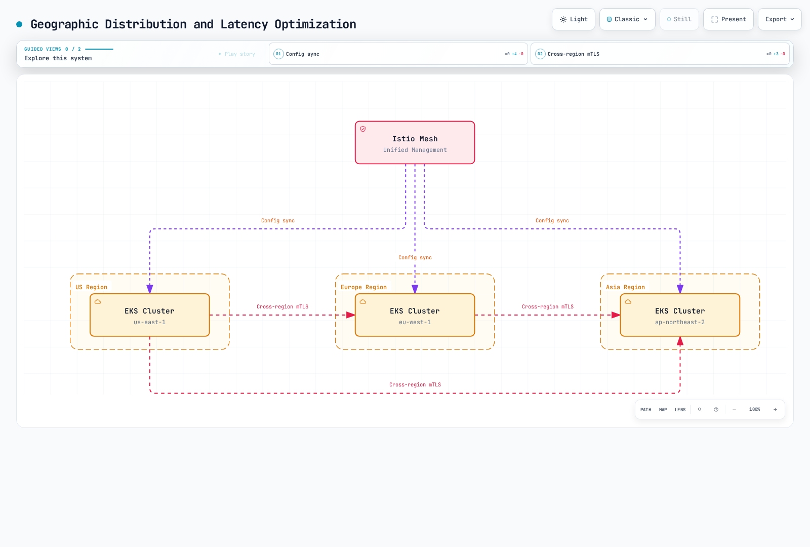
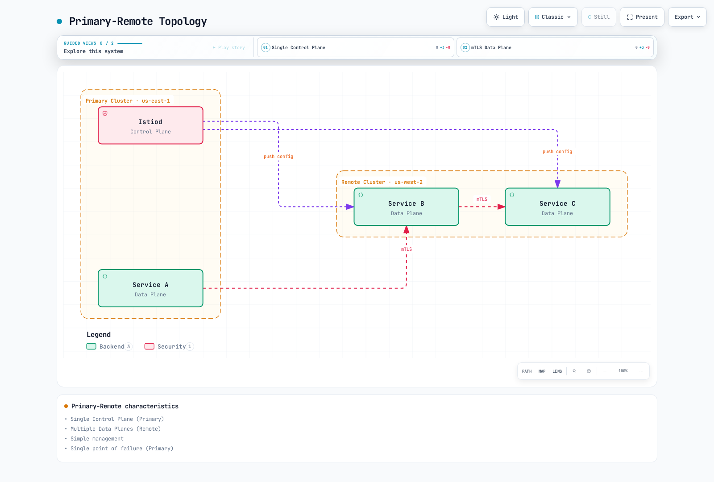

# Multiclúster

> **Última actualización**: 16 de octubre de 2026 · Istio 1.31 · Kubernetes 1.32–1.37. Los ejemplos de instalación describen topologías **sidecar** y son alternativas independientes. Ambient tiene límites de compatibilidad distintos. Esta auditoría no desplegó ningún clúster, recurso de AWS ni carga de producción.

Service Mesh multiclúster conecta varios clústeres de Kubernetes en una malla de servicios unificada.

## Índice

1. [¿Realmente necesita multiclúster?](02-multi-cluster.md#do-you-really-need-multi-cluster)
2. [Guía para elegir arquitectura](02-multi-cluster.md#architecture-selection-guide)
3. [Istio frente a AWS VPC Lattice](02-multi-cluster.md#istio-vs-aws-vpc-lattice)
4. [Topología](02-multi-cluster.md#topology)
5. [Configuración Primary-Remote](02-multi-cluster.md#primary-remote-setup)
6. [Configuración Multi-Primary](02-multi-cluster.md#multi-primary-setup)
7. [Comunicación entre clústeres](02-multi-cluster.md#cross-cluster-communication)
8. [Uso con VPC Lattice](02-multi-cluster.md#using-with-vpc-lattice)
9. [Ejemplos prácticos](02-multi-cluster.md#practical-examples)
10. [Comparación de rendimiento y costos](02-multi-cluster.md#performance-and-cost-comparison)
11. [Solución de problemas](02-multi-cluster.md#troubleshooting)

## ¿Realmente necesita multiclúster? {#do-you-really-need-multi-cluster}

Service Mesh multiclúster es potente, pero aumenta la complejidad y el costo. Antes de adoptarla, es necesario evaluar cuidadosamente el caso.

### Flujo de decisión

Use los requisitos siguientes como restricciones; ninguna puntuación de lista de comprobación hace que una arquitectura sea universalmente preferible.

### Cuándo se necesita el multiclúster

#### 1. Distribución geográfica y optimización de latencia



[🔍 Ver diagrama interactivo](https://www.atomai.click/kubernetes-docs/archmaps/en-service-mesh-istio-advanced-02-multi-cluster-1.html)

**Cuándo se necesita**:

* Servicios globales orientados a usuarios (objetivo de latencia <100 ms)
* Obligaciones de ubicación de datos específicas de las cargas de trabajo; una malla no garantiza por sí sola el cumplimiento
* Enrutamiento del tráfico regional y aislamiento de fallos

#### 2. Recuperación ante desastres (DR)


[🔍 Ver diagrama interactivo](https://www.atomai.click/kubernetes-docs/archmaps/en-service-mesh-istio-advanced-02-multi-cluster-2.html)

**Cuándo se necesita**:

* RTO (objetivo de tiempo de recuperación) <1 hora
* RPO (objetivo de punto de recuperación) <15 minutos
* Conmutación por error automática ante una avería regional

Las cifras de RTO/RPO anteriores son requisitos de ejemplo, no resultados que garantice una malla. El diagrama de DR supone que la replicación de despliegues/datos y el enrutamiento DNS por estado de salud se implementan por separado; los clientes, las cachés y las conexiones existentes afectan al cambio de destino.

#### 3. Separación de entornos y despliegues por etapas

**Cuándo se necesita**:

* Separar los clústeres de desarrollo, staging y producción con una gestión unificada
* Despliegues Blue/Green a nivel de clúster
* Despliegues canary con expansión regional gradual

#### 4. Límites organizativos y aislamiento de seguridad

**Cuándo se necesita**:

* Operación independiente de cada clúster por equipo o departamento
* Multitenencia mejorada
* Límites de aislamiento evaluados explícitamente; compartir la confianza de la malla es una decisión aparte

### Cuándo NO se necesita el multiclúster

#### 1. Servicios pequeños en una sola región


[🔍 Ver diagrama interactivo](https://www.atomai.click/kubernetes-docs/archmaps/en-service-mesh-istio-advanced-02-multi-cluster-3.html)

**Use en su lugar**:

* Separación mediante namespaces de Kubernetes
* NetworkPolicy para aislar la red
* RBAC para controlar el acceso

#### 2. Cuando no se puede gestionar la complejidad operativa

**Requisitos operativos del multiclúster**:

* Un equipo responsable capaz de operar redes, PKI, actualizaciones e incidentes entre clústeres
* Gestión y supervisión de gateways este-oeste
* Gestión de certificados entre clústeres
* Capacidad para depurar problemas entre clústeres

**Si el equipo es pequeño**:

* Istio en un solo clúster, o
* AWS VPC Lattice (servicio administrado)

#### 3. Cuando el costo es un factor decisivo

**Costos adicionales del multiclúster**:

* Horas/capacidad de balanceadores de carga este-oeste y cargos por procesamiento de la plataforma elegida
* Bytes facturables entre regiones y tarifas específicas por dirección/región
* Réplicas del plano de control/gateway y capacidad de observabilidad/almacenamiento

### Lista de comprobación

Responda estas preguntas antes de adoptar la arquitectura:

**Arquitectura**:

* [ ] ¿Ya hay dos o más clústeres en operación?
* [ ] ¿Se necesita una implementación multirregional?
* [ ] ¿Son frecuentes las llamadas entre clústeres?

**Requisitos de negocio**:

* [ ] ¿Se atiende a usuarios globales?
* [ ] ¿Es esencial la recuperación ante desastres (DR)?
* [ ] ¿Son estrictos los requisitos de RTO/RPO?

**Seguridad y cumplimiento**:

* [ ] ¿Se necesita localización de datos?
* [ ] ¿Se necesita un aislamiento sólido entre clústeres?

**Capacidad operativa**:

* [ ] ¿Tiene expertos en Istio?
* [ ] ¿Puede depurar problemas complejos de red?
* [ ] ¿Puede asumir los costos adicionales?

**Resultados**:

Use las respuestas como datos de diseño, no como una puntuación numérica para recomendar una arquitectura. Las restricciones de región, confianza, API, recuperación y operación pueden descartar una opción independientemente de cuántas casillas se marquen.

## Guía para elegir arquitectura {#architecture-selection-guide}

| Decisión | Evidencia necesaria |
|---|---|
| Alta disponibilidad regional frente a recuperación ante desastres regional | Ubicación del plano de control y las cargas, datos replicados y procedimientos de recuperación probados |
| Malla entre clústeres | API/gateways accesibles, diseño de confianza común, identidad de namespace/servicio y configuración distribuida por separado |
| Conectividad regional con Lattice | Red de servicios regional, asociaciones/endpoints de VPC, modo de listener/autenticación y accesibilidad de los destinos |
| Conectividad entre regiones | Diseño explícito de red/endpoints globales y de aplicación/datos; las asociaciones directas entre VPC regionales no forman una red global |
| Costos y personal | Carga medida, supuestos de tráfico equivalentes, facturación real y esfuerzo operativo |

### Comparación de cada solución

#### Istio en un solo clúster

**Ventajas**:

* Administración más sencilla
* Menos componentes pueden simplificar el modelo de costos; mida la carga real
* Depuración rápida
* Disponibilidad de todas las funciones de Istio

**Desventajas**:

* Un dominio de fallo compartido, aunque se puede configurar alta disponibilidad regional
* Dependencia regional si no existe otra arquitectura de recuperación
* Un plano de control de EKS es regional; distribuirlo entre dominios de fallo más amplios requiere diseño adicional

**Adecuado cuando**:

* Se prestan servicios en una sola región
* Los objetivos de fiabilidad regional del equipo caben en este alcance operativo
* Se puede lograr alta disponibilidad regional sin requerir recuperación ante desastres entre regiones

#### Istio multiclúster

**Ventajas**:

* Distribución geográfica completa
* Base para diseñar explícitamente la conmutación por error del tráfico; la recuperación ante desastres de la aplicación y los datos sigue siendo independiente
* Todas las funciones L7 (Retry, Timeout, Circuit Breaker)
* Control granular del tráfico
* Observabilidad unificada

**Desventajas**:

* Complejidad operativa elevada
* Requiere administrar el gateway este-oeste
* Costos de transferencia entre regiones
* Depuración difícil

**Adecuado cuando**:

* Hay servicios globales
* Se necesita recuperación ante desastres sólida
* Es esencial el control granular L7

#### AWS VPC Lattice

**Ventajas**:

* Servicio totalmente administrado por AWS
* Configuración sencilla
* Baja carga operativa
* Conectividad entre VPC con asociaciones y políticas de acceso explícitas
* Modele los costos del servicio, las solicitudes, los datos y la operación para la carga real

**Desventajas**:

* Controles de resiliencia distintos; la API de reglas del listener no ofrece una configuración equivalente de reintentos por salto/detección de valores atípicos
* Dependencia de AWS
* Enrutamiento por encabezado/método/ruta y destinos ponderados, con tipos de coincidencia y límites distintos de Istio
* Interfaces distintas para métricas/registros; el trazado completo requiere integración en la aplicación

**Adecuado cuando**:

* La arquitectura se centra en AWS
* Solo se necesita conectividad sencilla entre servicios
* Se prioriza simplificar la operación

## Istio frente a AWS VPC Lattice {#istio-vs-aws-vpc-lattice}

### Comparación de funciones

| Área | Malla sidecar de Istio | Servicios de VPC Lattice |
|---|---|---|
| Enrutamiento | Políticas de VirtualService/DestinationRule | Coincidencia exact/prefix/contains de encabezados HTTP, exact/prefix de ruta, método y reglas de grupos de destino ponderados |
| Resiliencia | Reintentos/tiempos de espera por salto, circuit breakers del pool y detección de valores atípicos | Límites administrados de servicio/conexión; no equivale a una API configurable de reintentos/detección por salto |
| Identidad TLS | mTLS de cargas de trabajo con una confianza compatible de la malla | HTTPS termina en Lattice; TLS passthrough puede transportar mTLS de aplicación, pero no administra una identidad SPIFFE |
| Autorización | Políticas de Istio/aplicación | Políticas de autenticación HTTP(S) e IAM/SigV4 cuando corresponda; permitir solo con SourceVpc puede incluir llamantes anónimos |
| Límites de TLS passthrough | Dependen del gateway configurado | SNI de dominio personalizado, grupo de destino TCP y solo una regla predeterminada; políticas de autenticación para principal anónimo, no autenticación IAM por encabezado HTTP |
| Observabilidad | Métricas, registros y trazas configurados del proxy/la aplicación | Métricas de CloudWatch y registros de acceso; el trazado/contexto de aplicación se integra por separado |
| Costo | Cómputo, gateways, transferencia de datos y operación | Tiempo de servicio, solicitudes/procesamiento de datos y cargos de recursos/endpoints aplicables; no hay una opción universalmente más barata |

Los servicios, las configuraciones de recursos y las redes de Lattice son regionales. Los clientes entre regiones o desde instalaciones locales requieren una ruta de red/endpoint compatible y explícita; el tráfico por peering/tránsito necesita el endpoint de VPC de la red de servicios correspondiente, no solo una asociación. TLS passthrough y la terminación HTTPS tienen contratos distintos de enrutamiento/autenticación. Una arquitectura híbrida debe especificar cada límite de TLS e identidad.

### Comparación de patrones de arquitectura

#### Patrón 1: solo Istio multiclúster

**Ventajas**:

* Todas las funciones de Istio
* Observabilidad unificada
* Control granular

**Desventajas**:

* Requiere administrar el gateway este-oeste
* Complejidad elevada
* Costos de transferencia entre regiones

#### Patrón 2: solo VPC Lattice


[🔍 Ver diagrama interactivo](https://www.atomai.click/kubernetes-docs/archmaps/en-service-mesh-istio-advanced-02-multi-cluster-5.html)

**Ventajas**:

* Servicio totalmente administrado por AWS
* Configuración sencilla
* Baja carga operativa

**Desventajas**:

* No se pueden usar las funciones de Istio
* Control limitado del tráfico
* La integración con Kubernetes requiere AWS Gateway API Controller y sus API compatibles

#### Patrón 3: híbrido (una opción de conectividad regional)


[🔍 Ver diagrama interactivo](https://www.atomai.click/kubernetes-docs/archmaps/en-service-mesh-istio-advanced-02-multi-cluster-6.html)

**Ventajas**:

* Dentro del clúster: todas las funciones avanzadas de Istio (Retry, Circuit Breaker y enrutamiento granular)
* Entre clústeres: administración sencilla y estabilidad de VPC Lattice
* Menor complejidad operativa (sin gateway este-oeste)
* Es necesario medir los costos; elegir Lattice no reduce por sí solo los bytes necesarios entre regiones

**Desventajas**:

* Es necesario comprender dos stacks tecnológicos
* La conectividad entre clústeres se limita a las funciones de Lattice

**Adecuado cuando**:

* El entorno es AWS
* Se necesita control complejo del tráfico dentro del clúster
* Solo se requiere conectividad sencilla entre clústeres

## Descripción general del multiclúster

Service Mesh multiclúster permite:

* Implementaciones multirregionales
* Recuperación ante desastres (DR)
* Separación de entornos (desarrollo/staging/producción)
* Descubrimiento y comunicación entre clústeres

## Topología {#topology}

Estas son topologías sidecar. La compatibilidad actual de Ambient multiclúster ofrece Beta para multi-primary/multi-network, con limitaciones distintas; no reutilice las instrucciones primary/remote para Ambient. Cada primary lee las API de Kubernetes autorizadas. Istiod no replica otros CRD de Istio, configuración de aplicaciones ni bases de datos a otro primary; distribúyalos por separado. Un trust domain compartido asigna la misma identidad de namespace/ServiceAccount en todos los clústeres, por lo que separarlos no aísla la autorización.

Una instalación primary puede tener varias réplicas. Una interrupción del primary afecta el descubrimiento, la inyección y las operaciones de certificados; los proxies existentes pueden conservar su configuración, por lo que no provoca necesariamente una interrupción inmediata y universal del tráfico. Multi-primary reduce esa dependencia, pero no elimina todos los modos de fallo compartidos.

### Primary-Remote



[🔍 Ver diagrama interactivo](https://www.atomai.click/kubernetes-docs/archmaps/en-service-mesh-istio-advanced-02-multi-cluster-7.html)

**Características**:

* Un plano de control (Primary)
* Varios planos de datos (Remote)
* Administración sencilla
* Dependencia compartida de la implementación primary para operaciones de descubrimiento/inyección/certificados

### Multi-Primary

**Características**:

* Varios planos de control
* Alta disponibilidad
* Administración compleja
* Autonomía regional

### Requisitos previos compartidos

Trabaje desde el directorio de distribución de Istio 1.31, con dos clústeres existentes y compatibles, y contextos de kubeconfig revisados. Los ejemplos suponen la revisión predeterminada; si es distinta, conserve la revisión instalada en las etiquetas de namespace y en la generación del gateway. Deben ser accesibles ambas API de Kubernetes y las rutas necesarias de datos/plano de control. Planifique la confianza compartida antes de instalar: los emisores de certificados multi-primary deben encadenar a una raíz común de confianza (o a un diseño de confianza compatible explícitamente); que las cadenas meshID coincidan no establece confianza de certificados. Siga los [requisitos previos oficiales y la preparación de CA](https://istio.io/latest/docs/setup/install/multicluster/before-you-begin/) y proteja el material de CA privado. Distribuya por separado la configuración de la aplicación/malla; los secretos remotos no la replican.

```bash
export CTX_CLUSTER1=cluster1
export CTX_CLUSTER2=cluster2
kubectl --context="$CTX_CLUSTER1" get nodes
kubectl --context="$CTX_CLUSTER2" get nodes
```

## Configuración Primary-Remote {#primary-remote-setup}

Esta es la topología oficial **sidecar basada en IP y en una misma red**: los Pods deben ser directamente accesibles entre clústeres y la API remota debe ser accesible desde el primary. No es una receta para usar hostnames de NLB de EKS. El chart 1.31 puede representar un remotePilotAddress con valor DNS mediante un Service ExternalName; la búsqueda por IP de este recorrido no constituye un diseño EKS basado en DNS completo. Use la [guía del plano de control externo](https://istio.io/latest/docs/setup/install/external-controlplane/) para la URL de inyección, los certificados DNS firmados y la conectividad real con el plano de control. Renderizar un valor DNS no verifica la implementación. IstioOperator es una entrada para istioctl, no un recurso de operador dentro del clúster.

### 1. Configuración del clúster primary

```bash
# Context setup
export CTX_CLUSTER1=cluster1

# Install Istio
istioctl install --context="${CTX_CLUSTER1}" -f - <<EOF
apiVersion: install.istio.io/v1alpha1
kind: IstioOperator
spec:
  values:
    global:
      meshID: mesh1
      externalIstiod: true
      multiCluster:
        clusterName: cluster1
      network: network1
EOF

# Install East-West Gateway
samples/multicluster/gen-eastwest-gateway.sh --network network1 > primary-eastwest.yaml
# Review platform-specific L4 load balancer and access settings before applying
istioctl install --context="${CTX_CLUSTER1}" -f primary-eastwest.yaml

# Expose Gateway
kubectl apply --context="${CTX_CLUSTER1}" -f \
  samples/multicluster/expose-istiod.yaml
```

### 2. Configuración del clúster remoto

```bash
# Context setup
export CTX_CLUSTER2=cluster2

# Prepare the remote namespace and identify its managing primary
kubectl --context="$CTX_CLUSTER2" create namespace istio-system --dry-run=client -o yaml | kubectl --context="$CTX_CLUSTER2" apply -f -
kubectl --context="$CTX_CLUSTER2" annotate namespace istio-system topology.istio.io/controlPlaneClusters=cluster1 --overwrite
DISCOVERY_ADDRESS=$(kubectl --context="$CTX_CLUSTER1" -n istio-system get svc istio-eastwestgateway -o jsonpath='{.status.loadBalancer.ingress[0].ip}')
if [ -z "$DISCOVERY_ADDRESS" ]; then
  echo "This IP-based lab requires a reachable LB IP; DNS-based EKS endpoints need the external-control-plane design." >&2
  exit 1
fi


# Install Istio with Remote configuration
istioctl install --context="${CTX_CLUSTER2}" -f - <<EOF
apiVersion: install.istio.io/v1alpha1
kind: IstioOperator
spec:
  profile: remote
  values:
    istiodRemote:
      injectionPath: /inject/cluster/cluster2/net/network1
    global:
      meshID: mesh1
      multiCluster:
        clusterName: cluster2
      network: network1
      remotePilotAddress: ${DISCOVERY_ADDRESS}
EOF

# Give the primary access to the REMOTE API after remote components are configured
istioctl create-remote-secret \
  --context="${CTX_CLUSTER2}" \
  --name=cluster2 | \
  kubectl apply -f - --context="${CTX_CLUSTER1}"
```

## Configuración Multi-Primary {#multi-primary-setup}

En esta topología de redes separadas, cada primary debe poder acceder a la API del peer y a su gateway este-oeste. Aprovisione los secretos de CA adecuados para la topología antes de instalar Istiod. Configure balanceadores L4, accesibilidad del gateway y acceso acotado para la plataforma; un ALB u otro salto L7 que termine TLS no es compatible con AUTO_PASSTHROUGH. Consulte [integración con AWS](../04-aws-integration.md) para los requisitos de balanceadores de carga de EKS.

### 1. Configurar ambos clústeres como primary

```bash
# Cluster 1
istioctl install --context="${CTX_CLUSTER1}" -f - <<EOF
apiVersion: install.istio.io/v1alpha1
kind: IstioOperator
spec:
  values:
    global:
      meshID: mesh1
      multiCluster:
        clusterName: cluster1
      network: network1
EOF

# Cluster 2
istioctl install --context="${CTX_CLUSTER2}" -f - <<EOF
apiVersion: install.istio.io/v1alpha1
kind: IstioOperator
spec:
  values:
    global:
      meshID: mesh1
      multiCluster:
        clusterName: cluster2
      network: network2
EOF
```

```bash
# Both networks need their own gateway and service exposure
kubectl --context="$CTX_CLUSTER1" label namespace istio-system topology.istio.io/network=network1 --overwrite
kubectl --context="$CTX_CLUSTER2" label namespace istio-system topology.istio.io/network=network2 --overwrite
samples/multicluster/gen-eastwest-gateway.sh --network network1 > eastwest-cluster1.yaml
samples/multicluster/gen-eastwest-gateway.sh --network network2 > eastwest-cluster2.yaml
# Review platform-specific LB/access settings in these generated inputs before installing
istioctl install --context="$CTX_CLUSTER1" -f eastwest-cluster1.yaml
istioctl install --context="$CTX_CLUSTER2" -f eastwest-cluster2.yaml
kubectl --context="$CTX_CLUSTER1" apply -n istio-system -f samples/multicluster/expose-services.yaml
kubectl --context="$CTX_CLUSTER2" apply -n istio-system -f samples/multicluster/expose-services.yaml
```

### 2. Registrar secretos remotos en ambas direcciones

```bash
# Cluster 1's Secret to Cluster 2
istioctl create-remote-secret \
  --context="${CTX_CLUSTER1}" \
  --name=cluster1 | \
  kubectl apply -f - --context="${CTX_CLUSTER2}"

# Cluster 2's Secret to Cluster 1
istioctl create-remote-secret \
  --context="${CTX_CLUSTER2}" \
  --name=cluster2 | \
  kubectl apply -f - --context="${CTX_CLUSTER1}"
```

## Comunicación entre clústeres {#cross-cluster-communication}

Use descubrimiento remoto con los mismos nombres de Service/namespace y la visibilidad DNS necesaria. Istiod no copia objetos Service ni Deployments entre clústeres. Este laboratorio define el Service en ambos clústeres, implementa el backend solo en cluster2 y llama a ese backend desde un cliente inyectado en cluster1. En redes distintas, Istio selecciona el gateway este-oeste y la ruta SNI/mTLS; no lo sustituya por un ServiceEntry HTTP al puerto 15443.

Guarde lo siguiente como `shared-httpbin-service.yaml`:

```yaml
apiVersion: v1
kind: Service
metadata:
  name: httpbin
  namespace: multicluster-demo
spec:
  selector:
    app: httpbin
  ports:
  - name: http
    port: 8000
    targetPort: 8080
```

```bash
for context in "$CTX_CLUSTER1" "$CTX_CLUSTER2"; do
  kubectl --context="$context" create namespace multicluster-demo --dry-run=client -o yaml | kubectl --context="$context" apply -f -
  # Default revision lab; use the recorded revision label if installed differently
  kubectl --context="$context" label namespace multicluster-demo istio-injection=enabled --overwrite
  kubectl --context="$context" apply -f shared-httpbin-service.yaml
done
kubectl --context="$CTX_CLUSTER2" apply -n multicluster-demo -f samples/httpbin/httpbin.yaml
kubectl --context="$CTX_CLUSTER1" apply -n multicluster-demo -f samples/curl/curl.yaml
kubectl --context="$CTX_CLUSTER2" rollout status deployment/httpbin -n multicluster-demo --timeout=120s
kubectl --context="$CTX_CLUSTER1" rollout status deployment/curl -n multicluster-demo --timeout=120s
istioctl proxy-config endpoints deployment/curl --context="$CTX_CLUSTER1" -n multicluster-demo --cluster 'outbound|8000||httpbin.multicluster-demo.svc.cluster.local'
kubectl --context="$CTX_CLUSTER1" exec -n multicluster-demo deploy/curl -c curl -- curl -sS --max-time 5 http://httpbin:8000/headers
```

La respuesta HTTP prueba la ruta de la aplicación, no la confianza del certificado por sí sola. Inspeccione la configuración TLS del llamante/receptor y las pruebas de identidad como se explica en el capítulo de seguridad. La [verificación multiclúster oficial](https://istio.io/latest/docs/setup/install/multicluster/verify/) ofrece escenarios adicionales. Estos comandos presuponen que ya se cumplen los requisitos previos de confianza, red, políticas y descubrimiento.

## Uso con VPC Lattice {#using-with-vpc-lattice}

### Contratos híbridos y fragmentos de configuración

Esta alternativa parte de mallas Istio independientes y de una ruta regional de servicio Lattice. Cambiar `meshID` o establecer un supuesto interruptor `multiCluster.enabled` no es una forma segura de desconectar una malla que ya se unió. Use la guía de instalación y una migración revisada de confianza/secretos remotos/políticas al cambiar la topología.

Los siguientes comandos son ejemplos de configuración, no una implementación de producción de extremo a extremo. Suponen identidades de administración autorizadas, IDs reales de VPC/grupos de seguridad, AWS Gateway API Controller/CRD instalados y un servicio Lattice HTTPS funcional. Las credenciales de administración de estos comandos son independientes del rol llamante de la aplicación, que solo necesita los permisos de plano de datos previstos. Los servicios/redes de Lattice son regionales; los clientes que llegan mediante peering/tránsito necesitan la ruta de red/endpoint de red de servicios compatible. Las asociaciones directas entre dos VPC de la misma región no crean una red de tres regiones.

#### 1. Crear o seleccionar la red de servicios regional

Para una red nueva, capture el ID devuelto en vez de buscar un nombre ambiguo. Si la red ya existe, use su ID verificado en lugar de crear otra. La asociación de VPC habilita una ruta para el cliente; no publica Services de Kubernetes ni autoriza cada solicitud.

```bash
# Both VPCs below are in this Region; use real reviewed VPC/security-group IDs
LATTICE_REGION=us-east-1
: "${VPC1_ID:?Set cluster1 VPC ID}"
: "${VPC2_ID:?Set cluster2 VPC ID}"
: "${LATTICE_SG1_ID:?Set cluster1 association security group}"
: "${LATTICE_SG2_ID:?Set cluster2 association security group}"
SERVICE_NETWORK_ID=$(aws vpc-lattice create-service-network   --region "$LATTICE_REGION" --name my-service-network --auth-type AWS_IAM   --query id --output text)
aws vpc-lattice create-service-network-vpc-association --region "$LATTICE_REGION"   --service-network-identifier "$SERVICE_NETWORK_ID" --vpc-identifier "$VPC1_ID"   --security-group-ids "$LATTICE_SG1_ID"
aws vpc-lattice create-service-network-vpc-association --region "$LATTICE_REGION"   --service-network-identifier "$SERVICE_NETWORK_ID" --vpc-identifier "$VPC2_ID"   --security-group-ids "$LATTICE_SG2_ID"
```

#### 2. Publicar mediante el controlador con un límite de entrada definido

La GatewayClass `amazon-vpc-lattice` y Gateway del controlador hacen referencia por nombre a una red de servicios. Un Gateway llamado `my-service-network` puede apuntar a la red administrada por separado descrita arriba. Un HTTPRoute/GRPCRoute compatible define el enrutamiento del servicio/listener/destinos y tiene su propio endpoint asignado; el Gateway no es un endpoint DNS universal para servicios.

`ServiceExport` es una API válida específica del controlador, pero crea un **grupo de destino**, no una asociación completa de servicio/red Lattice. La antigua anotación `lattice-service-network` no proporcionaba ese flujo. La exportación opcional de abajo supone un Service de entrada existente `lattice-entry` en el puerto 80; crearlo por sí solo no publica una ruta completa:

```yaml
# Optional target-group export only; assumes this ingress Service already exists
apiVersion: application-networking.k8s.aws/v1alpha1
kind: ServiceExport
metadata:
  name: lattice-entry
  namespace: istio-system
spec:
  exportedPorts:
  - port: 80
    routeType: HTTP
```

Para publicar de verdad, complete la configuración de [Gateway](https://www.gateway-api-controller.eks.aws.dev/latest/api-types/gateway/), [HTTPRoute](https://www.gateway-api-controller.eks.aws.dev/latest/api-types/http-route/) y, cuando corresponda, ServiceImport. Use la misma versión del controlador/CRD instalada; `exportedPorts` se comprobó con v2.1.3.

Lattice no origina mTLS SPIFFE de Istio hacia un backend STRICT. Proporcione una frontera de entrada configurada por separado que acepte el tráfico Lattice previsto, restrinja las rutas alternativas y origine mTLS de la malla al backend, o diseñe explícitamente otro contrato de seguridad compatible. No debilite la política del backend sin hacerlo explícito. El backend puede ver la identidad de entrada en lugar del llamante IAM original; la propagación de identidad de confianza requiere un diseño propio. Este documento no aprovisiona esa frontera, los roles IAM, los certificados ACM ni DNS.

#### 3. Detectar y llamar al endpoint HTTPS real

Cuando la ruta del proveedor y la asociación a la red de servicios estén listas, obtenga el nombre DNS real del servicio. La aplicación debe usar HTTPS, verificar el certificado correspondiente y firmar el host/ruta/payload reales cuando se requiera acceso autenticado. No invente un nombre `.lattice.svc.cluster.local` ni añada TLS SIMPLE alrededor del TLS de la aplicación.

```bash
# Obtain the real service ID from the reconciled provider configuration
: "${LATTICE_SERVICE_ID:?Set the created and associated HTTPS Lattice service ID}"
aws vpc-lattice get-service --region "$LATTICE_REGION"   --service-identifier "$LATTICE_SERVICE_ID" > lattice-service.json
LATTICE_SERVICE_DNS=$(jq -er '.dnsEntry.domainName' lattice-service.json)
LATTICE_SERVICE_ARN=$(jq -er '.arn' lattice-service.json)

# JSON is also a valid Kubernetes manifest; this explicitly renders the hostname
jq -n --arg host "$LATTICE_SERVICE_DNS" '{
  apiVersion:"networking.istio.io/v1",kind:"ServiceEntry",
  metadata:{name:"remote-service-via-lattice",namespace:"default"},
  spec:{hosts:[$host],location:"MESH_EXTERNAL",resolution:"DNS",
        ports:[{number:443,name:"https",protocol:"HTTPS"}]}
}' > lattice-service-entry.json
kubectl --context="$CTX_CLUSTER1" apply -f lattice-service-entry.json
```

Este ServiceEntry solo hace que el servicio externo sea conocido en el registro de Istio del llamante; no aprovisiona la conectividad Lattice, la política ni un firmante. El HTTPS originado por la aplicación es opaco para el sidecar, así que el enrutamiento/métricas a nivel HTTP requieren otra ruta de terminación TLS diseñada explícitamente.

#### 4. Exigir el llamante IAM previsto

`AWS_IAM` habilita la evaluación de políticas. Un Principal comodín con solo una condición SourceVpc puede permitir solicitudes anónimas; no demuestra autenticación IAM. Este ejemplo nombra un rol IAM y limita el acceso a un servicio y a las dos VPC con asociación directa.

```bash
: "${CALLER_ROLE_ARN:?Set the explicitly authorized caller IAM role ARN}"
# Compact resource policy; explicit role requires an authenticated caller
jq -cn --arg role "$CALLER_ROLE_ARN" --arg service "$LATTICE_SERVICE_ARN"   --arg vpc1 "$VPC1_ID" --arg vpc2 "$VPC2_ID" '{
  Version:"2012-10-17",Statement:[{
    Effect:"Allow",Principal:{AWS:$role},Action:"vpc-lattice-svcs:Invoke",
    Resource:($service+"/*"),
    Condition:{StringEquals:{"vpc-lattice-svcs:SourceVpc":[$vpc1,$vpc2]}}
  }]
}' > lattice-auth-policy.json
aws vpc-lattice put-auth-policy --region "$LATTICE_REGION"   --resource-identifier "$SERVICE_NETWORK_ID" --policy file://lattice-auth-policy.json
```

El rol llamante también necesita el permiso Invoke adecuado basado en identidad. Todas las políticas de autenticación habilitadas de la red/servicio deben permitir la solicitud y prevalece cualquier denegación explícita. Si se habilita la autenticación a nivel de servicio, gestione también esa política; evite que CLI y controlador compitan por administrarla. Use un SDK/firmante de aplicación compatible o un proxy de firma validado con credenciales de la carga de trabajo. La configuración TLS de Istio no genera firmas SigV4; cambiar el host/ruta/cuerpo después de firmar puede invalidarlas.

### Flujo del tráfico y observabilidad

El flujo previsto es: el llamante firma y establece HTTPS → Lattice autoriza y termina HTTPS → la frontera de entrada configurada accede a la malla backend → la aplicación recibe la solicitud. TLS passthrough es otro contrato: SNI de dominio personalizado/destinos TCP, solo una regla predeterminada y políticas de autenticación para principal anónimo; puede transportar mTLS de aplicación, pero no ofrece autenticación IAM por encabezados HTTP.

Mantenga compatible el contexto de traza y la configuración de Collector/backend entre aplicaciones. Cruzar un límite de clúster o de Lattice no divide una traza por sí mismo. Verifique la ruta real de identidad, TLS y telemetría en lugar de dar por hecho que el diagrama original de dos clústeres es una implementación completa.

## Ejemplos prácticos {#practical-examples}

### Ejemplo 1: comercio electrónico global (Multi-Primary + VPC Lattice)

Una aplicación global puede implementar mallas regionales y redes de servicio regionales de Lattice. Dentro de una región, un servicio Order local puede llamar a un servicio Payment local mediante el contrato definido de Lattice/entrada. Las llamadas entre regiones requieren un diseño independiente de red/endpoints compatible; el diagrama retirado no establecía esa ruta al dibujar tres regiones alrededor de una sola red de servicios. La replicación de datos y la conmutación por error regional siguen siendo responsabilidades de la aplicación/infraestructura.

El siguiente ejemplo dentro del clúster supone que existe un Service `cart` real y que coinciden sus etiquetas de Pod v1/v2. El encabezado de tipo de usuario elige una ruta; no autentica al usuario. Los reintentos de la malla están desactivados porque las operaciones de carrito pueden tener efectos secundarios.

#### Ejemplo de configuración

**Clúster 1/2: Frontend -> Cart (Istio)**

```yaml
apiVersion: networking.istio.io/v1
kind: VirtualService
metadata:
  name: cart-service
  namespace: default
spec:
  hosts:
  - cart.default.svc.cluster.local
  http:
  - match:
    - headers:
        user-type:
          exact: premium
    route:
    - destination:
        host: cart.default.svc.cluster.local
        subset: v2
      weight: 100
    retries:
      attempts: 0
  - route:
    - destination:
        host: cart.default.svc.cluster.local
        subset: v1
      weight: 100
    retries:
      attempts: 0
---
apiVersion: networking.istio.io/v1
kind: DestinationRule
metadata:
  name: cart-service
  namespace: default
spec:
  host: cart.default.svc.cluster.local
  trafficPolicy:
    connectionPool:
      tcp:
        maxConnections: 100
      http:
        http1MaxPendingRequests: 1024
        maxRequestsPerConnection: 10
    outlierDetection:
      interval: 10s
      baseEjectionTime: 30s
      consecutive5xxErrors: 5
      minHealthPercent: 0
  subsets:
  - name: v1
    labels:
      version: v1
  - name: v2
    labels:
      version: v2
```

**Order regional → Payment mediante Lattice**

Use el DNS HTTPS real y el ServiceEntry renderizado de la sección híbrida, junto con una ruta funcional del proveedor, una frontera de entrada compatible y un llamante SigV4. No añada TLS SIMPLE alrededor de una conexión HTTPS de aplicación ni invente un alias Kubernetes `.svc.cluster.local`. Una ruta regional de Lattice no resuelve por sí sola el enrutamiento global ni la recuperación de datos.

### Ejemplo 2: escenario de recuperación ante desastres (DR)

Esta es una **configuración manual de failover de alias de Route 53** para dos NLB regionales existentes. No implementa cargas de trabajo, balanceadores, listeners TLS, replicación ni un servicio de estado de salud. Primero configure una comprobación real de readiness/estado de salud en los grupos de destino. No combine este propietario de registros con las anotaciones ExternalDNS incompletas anteriores ni invente IDs de comprobaciones de estado.

El ejemplo usa `EvaluateTargetHealth` para los alias de NLB, sin una comprobación HTTPS pública de estado independiente. Si necesita comprobar el estado profundo de la aplicación/datos, diseñe una señal adecuada de endpoint/alarma; el antiguo Service HTTP80 no coincidía con la comprobación HTTPS443. Los comprobadores HTTP públicos de Route 53 no pueden probar directamente endpoints exclusivamente privados.

```bash
# Existing, healthy NLBs and a DNS zone controlled by this workflow
PRIMARY_REGION=us-east-1
STANDBY_REGION=us-west-2
RECORD_NAME=api.example.com
: "${PRIMARY_LB_ARN:?Set the primary NLB ARN}"
: "${STANDBY_LB_ARN:?Set the standby NLB ARN}"
: "${ZONE_ID:?Set the Route53 hosted zone ID}"
aws elbv2 describe-load-balancers --region "$PRIMARY_REGION" \
  --load-balancer-arns "$PRIMARY_LB_ARN" > primary-nlb.json
aws elbv2 describe-load-balancers --region "$STANDBY_REGION" \
  --load-balancer-arns "$STANDBY_LB_ARN" > standby-nlb.json

# Each regional load balancer supplies its own canonical hosted-zone ID
jq -n --arg name "$RECORD_NAME" \
  --slurpfile primary primary-nlb.json --slurpfile standby standby-nlb.json '
  def record($id; $mode; $lb):
    {Action:"UPSERT",ResourceRecordSet:{
      Name:$name,Type:"A",SetIdentifier:$id,Failover:$mode,
      AliasTarget:{HostedZoneId:$lb.CanonicalHostedZoneId,
                   DNSName:$lb.DNSName,EvaluateTargetHealth:true}
    }};
  {Changes:[
    record("primary";"PRIMARY";$primary[0].LoadBalancers[0]),
    record("secondary";"SECONDARY";$standby[0].LoadBalancers[0])
  ]}
' > failover-config.json

# Review the records/zone before applying; do not give another DNS controller ownership
aws route53 change-resource-record-sets --hosted-zone-id "$ZONE_ID" \
  --change-batch file://failover-config.json
```

Compruebe los registros existentes y los planes de restauración/reversión antes de cambiar DNS. Un registro alias A no es una configuración IPv6 completa; el uso de dualstack también necesita registros AAAA y conectividad adecuados. Las cachés DNS, la reutilización de conexiones, la semántica del estado de los grupos de destino y el comportamiento cuando todos los destinos están en mal estado afectan a la conmutación por error. Pruebe todo esto junto con la recuperación de la aplicación/datos. Ni DNS ni Istio establecen por sí solos un RPO de 15 minutos o un RTO de una hora.

## Comparación de rendimiento y costos {#performance-and-cost-comparison}

La antigua tabla de latencia/RPS/CPU/memoria no incluía fuente de benchmark reproducible, versión, hardware ni condiciones de carga. La tabla de costos comparaba volúmenes de tráfico distintos (10 TB frente a 5 TB) y presupuestos arbitrarios de personal. No demuestra qué arquitectura es más barata/rápida y no se presenta como mediciones actuales.

| Componente | Medición o costo que debe calcularse explícitamente |
|---|---|
| Latencia/rendimiento de aplicación | Mismas regiones, payload, concurrencia, TLS, políticas, capacidad de aplicación y definición de percentil |
| Cómputo de malla | Réplicas y consumo reales de Istiod/proxy/gateway/telemetría; contabilice Kubernetes/EKS por separado |
| Red | Mismos bytes/direcciones facturables, transferencia regional, procesamiento/capacidad de LB/endpoints/TGW/peering |
| Servicios Lattice | Tiempo aprovisionado, solicitudes y procesamiento de datos; configuraciones de recursos/endpoints tienen su propio modelo |
| Operación/DR | Esfuerzo de ingeniería observado, ejercicios de incidentes/recuperación y supuestos de impacto empresarial |

Use los [precios de Lattice](https://aws.amazon.com/vpc/lattice/pricing/) y los datos reales de facturación. El peering de VPC no elimina automáticamente los cargos de transferencia entre regiones. Lattice documenta que no hay cargos adicionales de transferencia de datos entre AZ dentro de su servicio, lo que no equivale a costo cero por procesamiento de datos. Ambient no garantiza un ahorro de recursos del 90 %; mida con políticas equivalentes. Ni una cantidad fija de personal ni un umbral de costo por inactividad de 1.000 USD/hora determinan la arquitectura.

## Solución de problemas {#troubleshooting}

```bash
# Verify cross-cluster connectivity
istioctl ps --context="${CTX_CLUSTER1}"
istioctl ps --context="${CTX_CLUSTER2}"

# Check Remote Secret
kubectl get secrets -n istio-system --context="${CTX_CLUSTER1}"

# Verify cross-cluster traffic
kubectl logs -n istio-system -l app=istiod --context="${CTX_CLUSTER1}"
```

## Referencias

### Documentación oficial

* [Istio multiclúster](https://istio.io/latest/docs/setup/install/multicluster/)
* [Multi-Primary](https://istio.io/latest/docs/setup/install/multicluster/multi-primary/)
* [Primary-Remote](https://istio.io/latest/docs/setup/install/multicluster/primary-remote/)
* [AWS VPC Lattice](https://docs.aws.amazon.com/vpc-lattice/latest/ug/what-is-vpc-lattice.html)
* [AWS Gateway API Controller](https://www.gateway-api-controller.eks.aws.dev/latest/)

* [Componentes regionales y patrones entre regiones de Lattice](https://aws.amazon.com/vpc/lattice/faqs/)
* [Política de autenticación de Lattice y llamantes anónimos](https://docs.aws.amazon.com/vpc-lattice/latest/ug/auth-policies.html)
* [Solicitudes SigV4 de Lattice](https://docs.aws.amazon.com/vpc-lattice/latest/ug/sigv4-authenticated-requests.html)
* [TLS passthrough de Lattice](https://docs.aws.amazon.com/vpc-lattice/latest/ug/tls-listeners.html)
* [Alias de failover de Route 53](https://docs.aws.amazon.com/Route53/latest/DeveloperGuide/resource-record-sets-values-failover-alias.html)

### Blogs y casos prácticos

* [Tetrate: Istio multiclúster](https://tetrate.io/blog/multicluster-istio/)

### Documentos relacionados

* [Modo Ambient](01-ambient-mode.md) - Optimización de recursos
* [mTLS](../security/01-mtls.md) - Comunicación segura entre clústeres
* [VPC Lattice](../../../networking/02-vpc-lattice.md) - Redes de servicios administradas por AWS

## Resumen

Elija una topología según los requisitos reales de confianza, red, API y recuperación. Un clúster regional puede ofrecer alta disponibilidad multizona. El multiclúster sidecar puede ampliar el descubrimiento y mTLS de la malla si se cumplen sus requisitos, pero no replica el estado de la aplicación. Lattice es una red de aplicaciones regional administrada con contratos de TLS/autenticación específicos de cada listener. Una arquitectura híbrida debe definir cada límite de identidad/terminación y cualquier ruta entre regiones. Valide el comportamiento y los costos con cargas equivalentes antes de recomendar una opción.
