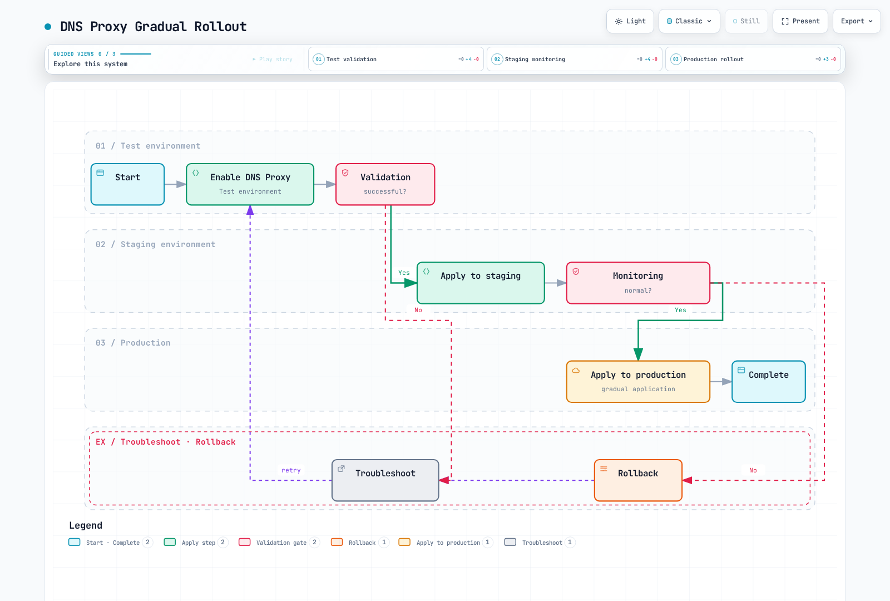

# Proxy DNS y caché de DNS

> **Base de verificación**: Istio 1.31.0, Kubernetes 1.32–1.37
> **Última revisión**: 16 de octubre de 2026

Optimice el rendimiento del acceso a servicios externos y controle las consultas DNS mediante las funciones de administración de DNS de Istio.

## Tabla de contenido

1. [Descripción general del proxy DNS](#dns-proxy-overview)
2. [Proxy DNS y caché DNS](#dns-proxy-vs-dns-caching)
3. [Configuración del proxy DNS](#dns-proxy-configuration)
4. [Integración con ServiceEntry](#serviceentry-integration)
5. [Configuración de la caché DNS](#dns-caching-configuration)
6. [Asignación automática de direcciones](#automatic-address-allocation)
7. [Solución de problemas](#troubleshooting)
8. [Prácticas recomendadas](#best-practices)

## Descripción general del proxy DNS {#dns-proxy-overview}

En modo sidecar, las consultas DNS de las aplicaciones se redirigen al **servidor DNS de Go de istio-agent**, no a un listener HTTP/DNS de Envoy. El agente responde usando la tabla de nombres/IP que proporciona Istiod y reenvía los nombres desconocidos a los resolutores ascendentes definidos en `/etc/resolv.conf`. Admite DNS por UDP y TCP; el puerto DNS habitual del sidecar es 15053.

En modo ambient, ztunnel gestiona el DNS y la captura está habilitada de forma predeterminada desde Istio 1.25. El modo sidecar todavía requiere habilitación explícita. DNS-over-HTTPS/TLS y las cachés administradas por las aplicaciones son independientes de la captura habitual del puerto 53. El EnvoyFilter y los diagnósticos del agente que se describen a continuación corresponden al **modo sidecar**.

## Proxy DNS y caché DNS {#dns-proxy-vs-dns-caching}

| Capa | Responsabilidad | Configuración |
|---|---|---|
| Caché del resolutor de la aplicación/SO | Nombres de la aplicación, TTL y caché negativa | Runtime de la aplicación, sistema operativo y resolutor |
| Proxy DNS de Istio | Tabla local de nombres/IP de la mesh y reenvío ascendente de otros nombres | Sidecar `ISTIO_META_DNS_CAPTURE`, CNI/ztunnel de ambient |
| Descubrimiento de servicios DNS de Envoy | Actualización de endpoints de clústeres ascendentes basados en DNS | ServiceEntry y configuración generada del clúster DNS |
| Caché DNS de dynamic forward proxy de Envoy | Resolución de destinos dinámicos a partir de Host/SNI de la solicitud | Configuración independiente de DYNAMIC_DNS/DFP |

`dns_refresh_rate` no habilita el almacenamiento en caché de todas las respuestas DNS de la aplicación. El agente del sidecar tampoco conserva como caché general las respuestas ascendentes de nombres desconocidos. Los nombres conocidos pueden evitar una consulta a CoreDNS, mientras que la actualización de los endpoints ascendentes sigue ocurriendo de forma independiente; habilitar ambos mecanismos no garantiza un rendimiento óptimo.

## Configuración del proxy DNS {#dns-proxy-configuration}

### 1. Habilitación global

Integre esta entrada de `istioctl` en la configuración de instalación existente. No es un recurso que deba aplicarse con `kubectl apply` al Operator del clúster que ya se retiró. En instalaciones de Helm, integre los valores equivalentes de meshConfig en la configuración existente del chart. Las reglas de captura de sidecar existentes surten efecto en los Pods que se inyecten o inicien de nuevo; despliegue gradualmente solo las cargas de trabajo revisadas.

```yaml
apiVersion: install.istio.io/v1alpha1
kind: IstioOperator
metadata:
  name: istio
  namespace: istio-system
spec:
  meshConfig:
    defaultConfig:
      proxyMetadata:
        ISTIO_META_DNS_CAPTURE: "true"
```

La asignación actual de direcciones corresponde al controlador de Istiod y está habilitada de forma predeterminada. No agregue los metadatos heredados `ISTIO_META_DNS_AUTO_ALLOCATE` como requisito previo de nuevas instalaciones.

### 2. Habilitación por namespace

Una etiqueta de inyección en el namespace, por sí sola, no habilita la captura DNS. Utilice GitOps, Kustomize o Helm para integrar el siguiente fragmento en las plantillas de Pod de los Deployment del namespace seleccionado. Reemplazar el ConfigMap central `istio-sidecar-injector` por valores parciales no es una configuración limitada al namespace. Conserve los demás campos de las anotaciones `proxy.istio.io/config` existentes.

### 3. Habilitación por Pod

```yaml
# Existing Deployment: merge into spec.template, not a complete workload
metadata:
  annotations:
    proxy.istio.io/config: |
      proxyMetadata:
        ISTIO_META_DNS_CAPTURE: "true"
```

Conserve el modo de inyección heredado o basado en revisiones que ya esté en uso y vuelva a crear los Pods seleccionados. Esto es un fragmento de plantilla, no un Pod completo con una imagen supuesta `myapp:v1`. Para los Pods de ambient, revise en su lugar el comportamiento predeterminado de captura y la opción de exclusión `ambient.istio.io/dns-capture: "false"`.

### 4. Verificación de la redirección y las respuestas

La redirección DNS en el namespace de red del Pod varía según el modo de instalación y el CNI. No suponga que la imagen del proxy contiene bash, iptables o tcpdump, ni que dispone de privilegios net-admin. En lugar de elevar los privilegios de un Pod de producción, comience con las comprobaciones siguientes de la tabla de nombres del agente, las consultas DNS y los endpoints ascendentes. Si hace falta, inspeccione las rutas UDP/TCP 53 y 15053 en un entorno de diagnóstico aprobado.

## Integración con ServiceEntry {#serviceentry-integration}

El proxy DNS está estrechamente integrado con ServiceEntry.

### ServiceEntry básico

```yaml
apiVersion: networking.istio.io/v1
kind: ServiceEntry
metadata:
  name: external-api
  namespace: default
spec:
  hosts:
  - api.example.com
  ports:
  - number: 443
    name: https
    protocol: HTTPS
  location: MESH_EXTERNAL
  resolution: DNS
```

**Comportamiento del proxy DNS**:

1. La aplicación consulta por DNS `api.example.com`
2. El proxy DNS del agente devuelve una VIP asignada (por ejemplo, `240.240.0.1`)
3. La aplicación envía la solicitud a la dirección IP virtual
4. Envoy enruta ese destino al endpoint ascendente real, resuelto por separado

### Registro de varios hosts

Registre los servicios ascendentes independientes con nombres concretos distintos. Los nombres example.com son ejemplos de configuración; sustitúyalos por backends reales, accesibles y con DNS/TLS configurados.

```yaml
apiVersion: networking.istio.io/v1
kind: ServiceEntry
metadata:
  name: partner-api
  namespace: default
spec:
  hosts: ["api.partner.example.com"]
  ports:
  - number: 443
    name: https
    protocol: HTTPS
  location: MESH_EXTERNAL
  resolution: DNS
---
apiVersion: networking.istio.io/v1
kind: ServiceEntry
metadata:
  name: assets-cdn
  namespace: default
spec:
  hosts: ["cdn.example.com"]
  ports:
  - number: 443
    name: https
    protocol: HTTPS
  location: MESH_EXTERNAL
  resolution: DNS
```

Un comodín como `*.example.com` con `resolution: DNS` y sin endpoints concretos no puede resolver todos los subdominios. El reenvío de comodines en modo sidecar al destino original de la aplicación usa un patrón independiente con `resolution: NONE` y no proporciona respuestas DNS. `DYNAMIC_DNS` de Istio 1.31 es un modo distinto basado en Host/SNI; ambient requiere un waypoint y no admite TCP sin procesar. Elija según la API actual y la configuración generada.

### Endpoints explícitos

`addresses` identifica la VIP que ven los clientes; `endpoints` identifica los backends reales. Un prefijo CIDR puede coincidir con tráfico, pero no es una única respuesta DNS A/AAAA. Estas direcciones TEST-NET no implementan una base de datos; utilice una configuración real y sin conflictos para la VIP, el backend y TLS.

```yaml
apiVersion: networking.istio.io/v1
kind: ServiceEntry
metadata:
  name: external-database
  namespace: default
spec:
  hosts:
  - database.external.com
  addresses:
  - 198.51.100.10  # Explicit example VIP
  ports:
  - number: 3306
    name: mysql
    protocol: TCP
  location: MESH_EXTERNAL
  resolution: STATIC
  endpoints:
  - address: 203.0.113.10
  - address: 203.0.113.11
  - address: 203.0.113.12
```

## Configuración de la caché DNS {#dns-caching-configuration}

### Actualización de servicios ascendentes basados en DNS

Istio 1.31 establece `respect_dns_ttl: true` en los clústeres DNS ordinarios y el valor predeterminado de `dnsRefreshRate` de la mesh es 60 segundos. Las respuestas correctas respetan el TTL de DNS; los fallos y los TTL de cero se rigen por la configuración generada del resolutor y del clúster. La afirmación de la página conceptual de DNS de que el intervalo es “fijo en 30 segundos y no se puede cambiar” no coincide con el código fuente de esta versión; inspeccione la configuración efectiva.

Esta alternativa de bajo nivel modifica **un único clúster DNS api.example.com:443** para `app: frontend` en `default`. `cluster.service` coincide con el nombre de un servicio real, no con un selector de comodín. No aplique parches generales a todos los clústeres desde el namespace raíz.

```yaml
apiVersion: networking.istio.io/v1alpha3
kind: EnvoyFilter
metadata:
  name: external-api-dns-refresh
  namespace: default
spec:
  workloadSelector:
    labels:
      app: frontend
  configPatches:
  - applyTo: CLUSTER
    match:
      context: SIDECAR_OUTBOUND
      cluster:
        service: api.example.com
        portNumber: 443
    patch:
      operation: MERGE
      value:
        dns_refresh_rate: 30s
        respect_dns_ttl: true
        dns_failure_refresh_rate:
          base_interval: 5s
          max_interval: 30s
```

### TTL, actualización tras fallos y resolutor

Con `respect_dns_ttl: true`, esto no obliga a actualizar cada resolución correcta cada 30 segundos. `dns_failure_refresh_rate` controla cuándo se vuelve a intentar después de un fallo; no controla el TTL del registro ni la retención de respuestas obsoletas. `dns_query_timeout` no es un campo de Cluster; valide la configuración tipada específica del resolutor. Conserve la familia IP que haya seleccionado Istio en lugar de forzar siempre IPv4 o AUTO.

No suponga que protobuf `MERGE` puede borrar un `respect_dns_ttl: true` existente al establecer en `false` el valor escalar predeterminado. Algunos campos DNS del clúster están obsoletos en Envoy, pero Istio 1.31 todavía genera esta forma. Vuelva a comprobar las extensiones del clúster DNS y la configuración del resolutor al actualizar.

### Inspección de la configuración aplicada

```bash
istioctl proxy-config clusters <client-pod> -n default --fqdn api.example.com -o json |
  jq '.[] | {name,type,dnsRefreshRate,respectDnsTtl,dnsFailureRefreshRate,dnsLookupFamily,typedDnsResolverConfig,loadAssignment}'
```

## Asignación automática de direcciones {#automatic-address-allocation}

### Controlador y estado de la asignación

El controlador de asignación IP de Istiod, habilitado de forma predeterminada, asigna VIP por cada host elegible de ServiceEntry y registra `host`/`value` en `status.addresses`. Los comodines ordinarios con `resolution: DNS` no son elegibles; los comodines `DYNAMIC_DNS` tienen una ruta compatible independiente. Las entradas con `spec.addresses` explícito o con `networking.istio.io/enable-autoallocate-ip: "false"` no siguen la misma ruta de asignación.

### Rangos de direcciones

Los prefijos predeterminados publicados son IPv4 `240.240.0.0/16` e IPv6 `2001:2::/48`. Esto muestra la **configuración real del plano de control y sus valores predeterminados**; evite conflictos con las redes de usuarios, las VPN y los CIDR de servicios.

```yaml
# Advanced istioctl input: these are the released defaults, not new ranges.
apiVersion: install.istio.io/v1alpha1
kind: IstioOperator
spec:
  values:
    pilot:
      env:
        PILOT_ENABLE_IP_AUTOALLOCATE: "true"
        PILOT_IP_AUTOALLOCATE_IPV4_PREFIX: "240.240.0.0/16"
        PILOT_IP_AUTOALLOCATE_IPV6_PREFIX: "2001:2::/48"
```

`defaultServiceExportTo` controla la visibilidad y `outboundTrafficPolicy` se refiere al tráfico saliente no registrado; ninguno cambia los prefijos de asignación. Cambiar las VIP existentes puede afectar las cachés DNS, las conexiones y el enrutamiento, así que no se ha demostrado que cambiar el prefijo sea una migración sin tiempo de inactividad. No edite manualmente el estado que administra el controlador.

### Verificación de las direcciones asignadas

```bash
kubectl get serviceentry external-api -n default -o json |
  jq '{hosts:.spec.hosts, explicitAddresses:.spec.addresses, allocatedAddresses:.status.addresses}'

# Inspect the client's mapping and the actual upstream separately.
istioctl proxy-config listeners <client-pod> -n default
istioctl proxy-config clusters <client-pod> -n default --fqdn api.example.com -o json
istioctl proxy-config endpoints <client-pod> -n default --cluster 'outbound|443||api.example.com'
```

La VIP asignada forma parte de las respuestas DNS de la aplicación y de la coincidencia de destinos. `loadAssignment` del clúster DNS contiene el nombre del backend real que debe resolverse; los endpoints en tiempo de ejecución contienen las direcciones resueltas. No presente la VIP como si fuera la IP real del servicio ascendente externo.

## Solución de problemas {#troubleshooting}

### Verificación del funcionamiento del proxy DNS

```bash
# Inspect classic or native sidecar metadata without assuming a shell in the image.
kubectl get pod <client-pod> -n default -o json |
  jq '[.spec.containers[], .spec.initContainers[]?] |
      .[] | select(.name == "istio-proxy") |
      {name,env:[.env[]? | select(.name == "ISTIO_META_DNS_CAPTURE")]}'

istioctl analyze -n default
istioctl proxy-status
kubectl get serviceentry external-api -n default -o yaml
kubectl logs -n default <client-pod> -c istio-proxy --tail=100

# Requires a reviewed diagnostic container with nslookup in this Pod's network namespace.
kubectl exec -n default <client-pod> -c <diagnostic-container> -- nslookup api.example.com
```

```bash
# Terminal 1: sidecar agent's local status server (not Envoy admin 15000)
kubectl port-forward -n default <client-pod> 15020:15020
```

```bash
# Terminal 2 while the forward remains active
curl --fail --silent http://127.0.0.1:15020/debug/ndsz |
  jq '.table["api.example.com"]'
curl --fail --silent http://127.0.0.1:15020/stats/prometheus |
  grep '^istio_agent_dns_'
```

`/debug/ndsz` del agente solo acepta solicitudes de localhost y puede devolver 404 cuando el estado de DNS o de la tabla de nombres no está disponible. Buscar el puerto 15053 del agente en el volcado de listeners del puerto 15000 de Envoy no es una comprobación válida. Si la aplicación no incluye nslookup, utilice el proceso de diagnóstico establecido en lugar de modificar la imagen base o aumentar sus privilegios.

### Problemas frecuentes

1. **Las consultas siguen llegando a CoreDNS**: Es normal reenviar los nombres desconocidos. Distinga los nombres presentes y ausentes de la tabla local, y revise la captura, search/ndots, el fallback a TCP y DoH/TLS de la aplicación.
2. **Falta ServiceEntry**: Compruebe `exportTo`, el descubrimiento del namespace y el alcance de Sidecar, la resolución, la asignación en el estado, la inyección/revisión y la sincronización de NDS/xDS. Use `istioctl analyze -n default`; el tipo y el nombre del recurso no son sus argumentos posicionales. No empiece eliminando un Pod para “forzar la sincronización”.
3. **Fallan las conexiones a la VIP**: Inspeccione por separado la coincidencia de la VIP, los endpoints/DNS ascendentes, las rutas de red, Host/SNI de TLS y los certificados. Llamar a `http://VIP` no es una prueba válida para un servicio HTTPS en el puerto 443.

```bash
# Run inside an approved diagnostic container sharing the captured Pod network namespace.
# Replace VIP4 with the actual IPv4 status.addresses value, and keep the real Host/SNI.
VIP4=240.240.0.1
curl --fail --show-error --resolve "api.example.com:443:${VIP4}" https://api.example.com/
```

Sustituya la VIP de ejemplo por la que se haya asignado realmente y ejecute la prueba dentro del namespace de red capturado del Pod. No suponga que se puede acceder a esta dirección no enrutable desde otro host. Mantenga habilitada la verificación de certificados y compruebe la ruta DNS de la aplicación por separado de la prueba directa a la VIP.

### API de administración de Envoy e inspección de paquetes

```bash
# Terminal 1
kubectl port-forward -n default <client-pod> 15000:15000
```

```bash
# Terminal 2: Envoy endpoint discovery, distinct from agent name-table metrics
curl --fail --silent http://127.0.0.1:15000/clusters
curl --fail --silent http://127.0.0.1:15000/config_dump > envoy-config.json
```

Si necesita capturar paquetes, siga el proceso aprobado con un contenedor o nodo de diagnóstico para inspeccionar UDP/TCP 53 y 15053 en el namespace de red del Pod. No suponga que istio-proxy incluye tcpdump, tar o privilegios de captura. Los nombres DNS pueden ser confidenciales; limite la duración, el alcance y la retención de la captura, y siga el proceso de eliminación después del análisis.

## Prácticas recomendadas {#best-practices}

### 1. Estrategia para habilitar el proxy DNS

**Enfoque recomendado**: Despliegue gradual



[🔍 Ver diagrama interactivo](https://www.atomai.click/kubernetes-docs/archmaps/en-service-mesh-istio-advanced-04-dns-cache-3.html)

### 2. Administración de ServiceEntry

```yaml
# Create separate ServiceEntry per external service
apiVersion: networking.istio.io/v1
kind: ServiceEntry
metadata:
  name: payment-api
  namespace: default
  labels:
    app: payment
    team: platform
spec:
  hosts:
  - payments.example.com
  ports:
  - number: 443
    name: https
    protocol: HTTPS
  location: MESH_EXTERNAL
  resolution: DNS
---
apiVersion: networking.istio.io/v1
kind: ServiceEntry
metadata:
  name: analytics-api
  namespace: default
  labels:
    app: analytics
    team: data
spec:
  hosts:
  - analytics.example.com
  ports:
  - number: 443
    name: https
    protocol: HTTPS
  location: MESH_EXTERNAL
  resolution: DNS
```

### 3. Configuración del TTL de la caché DNS

Observe por separado el TTL del registro, la caché de la aplicación, la tabla de nombres del agente y la actualización de endpoints de Envoy. No asigne 300 segundos a todas las CDN ni 10 segundos a todos los clústeres de API solo por su categoría. En las zonas DNS que controle, elija el TTL según los objetivos de failover y la carga de consultas. El alcance de `exportTo`/Sidecar de ServiceEntry puede reducir el descubrimiento innecesario por proxy; ninguno de los dos constituye un límite de seguridad de red.

Para actualizar tras fallos en un clúster DNS específico, utilice el ejemplo anterior limitado por carga de trabajo, host y puerto, y verifique la configuración efectiva y el comportamiento ante fallos.

### 4. Métricas de monitoreo

Estas son métricas reales del **agente sidecar** de Istio 1.31. Suponen que Prometheus recopila el puerto 15020 en `/stats/prometheus` y asigna las etiquetas de destino `namespace`/`pod`. No las mezcle con métricas de ztunnel o de la caché DFP de Envoy.

```promql
# Application queries handled by the sidecar agent
sum by (namespace, pod) (
  rate(istio_agent_dns_requests_total{namespace="default"}[5m])
)

# Fraction forwarded upstream; not a DNS response-cache hit/miss ratio
100 *
sum by (namespace, pod) (
  rate(istio_agent_dns_upstream_requests_total{namespace="default"}[5m])
) /
sum by (namespace, pod) (
  rate(istio_agent_dns_requests_total{namespace="default"}[5m])
)

# Requests for which the agent synthesized SERVFAIL after upstream exchange failures
100 *
sum by (namespace, pod) (
  rate(istio_agent_dns_upstream_failures_total{namespace="default"}[5m])
) /
sum by (namespace, pod) (
  rate(istio_agent_dns_upstream_requests_total{namespace="default"}[5m])
)

# Upstream request duration p99, in seconds
histogram_quantile(0.99,
  sum by (le, namespace, pod) (
    rate(istio_agent_dns_upstream_request_duration_seconds_bucket{namespace="default"}[5m])
  )
)
```

`dns_upstream_failures_total` cuenta las respuestas SERVFAIL generadas por el agente tras fallos en el intercambio con el servidor ascendente. No cuenta todos los NXDOMAIN/SERVFAIL recibidos en un paquete de respuesta ascendente válido. Sin solicitudes, las proporciones y cuantiles pueden ser NaN o no aparecer; compruebe conjuntamente el tráfico y el estado de la recopilación. No invente una “tasa de aciertos de caché” a partir de estos valores.

### 5. Consideraciones de seguridad

La captura DNS, el registro de ServiceEntry y la asignación de VIP no aplican una lista de permitidos externos. Una AuthorizationPolicy que selecciona una carga de trabajo sidecar evalúa su tráfico **entrante**, no sus solicitudes DNS/HTTPS salientes. Un `DENY/notHosts` aplicado a todo el namespace puede bloquear tráfico interno o tráfico TCP al que le falten atributos HTTP.

Controle el tráfico saliente mediante el CNI/NetworkPolicy adecuado, límites de firewall/grupos de seguridad y, cuando sea necesario, un gateway de salida que no se pueda omitir y que aplique autorización. Las rutas TLS-passthrough no pueden inspeccionar HTTP Host; las restricciones de SNI/destino y la verificación de certificados requieren controles separados. Siga todos los requisitos previos de [Control de salida](../traffic-management/11-egress-control.md).

### 6. Ajuste del rendimiento

Antes de cambiar la configuración para aliviar un cuello de botella, mida la carga DNS, los fallos y la duración de las consultas junto con la latencia de propagación de Istiod y el uso de CPU/memoria del agente sidecar y Envoy. La concurrencia de workers de Envoy no determina el dimensionamiento del servidor DNS de Go del agente; añadir réplicas de Istiod o HPA, por sí solo, no acelera todas las rutas DNS.

Pruebe la caché de la aplicación y ndots, el TTL de DNS, la cantidad/visibilidad de ServiceEntry, la carga periódica de consultas entre las réplicas del proxy y el comportamiento de endpoints/conexiones obsoletos durante la recuperación de fallos. Los valores fijos de CPU, memoria o HPA sin mediciones no constituyen una optimización de producción.

## Referencias

### Documentación oficial
- [Proxy DNS de Istio](https://istio.io/latest/docs/ops/configuration/traffic-management/dns-proxy/)
- [Caché DNS de Envoy](https://www.envoyproxy.io/docs/envoy/latest/intro/arch_overview/upstream/service_discovery)
- [ServiceEntry](https://istio.io/latest/docs/reference/config/networking/service-entry/)

- [Servidor DNS de Istio 1.31](https://raw.githubusercontent.com/istio/istio/1.31.0/pkg/dns/client/dns.go)
- [Asignación de IP y prefijos de Istio 1.31](https://raw.githubusercontent.com/istio/istio/1.31.0/pilot/pkg/features/pilot.go)
- [Estado de asignación de Istio 1.31](https://raw.githubusercontent.com/istio/istio/1.31.0/pilot/pkg/controllers/ipallocate/ipallocate.go)
- [Generación del clúster DNS de Istio 1.31](https://raw.githubusercontent.com/istio/istio/1.31.0/pilot/pkg/networking/core/cluster_builder.go)
- [Valores predeterminados de mesh de Istio 1.31](https://raw.githubusercontent.com/istio/istio/1.31.0/pkg/config/mesh/mesh.go)
- [Métricas DNS del agente de Istio 1.31](https://raw.githubusercontent.com/istio/istio/1.31.0/pkg/dns/client/monitoring.go)
- [Endpoint de estado del agente de Istio 1.31](https://raw.githubusercontent.com/istio/istio/1.31.0/pilot/cmd/pilot-agent/status/server.go)
- [API de clúster de Envoy](https://www.envoyproxy.io/docs/envoy/latest/api-v3/config/cluster/v3/cluster.proto)

### Documentos relacionados
- [Arquitectura de Istio: mecanismo de procesamiento DNS](../03-architecture.md)
- [ServiceEntry](../traffic-management/12-service-entry.md)
- [Control de salida](../traffic-management/11-egress-control.md)
