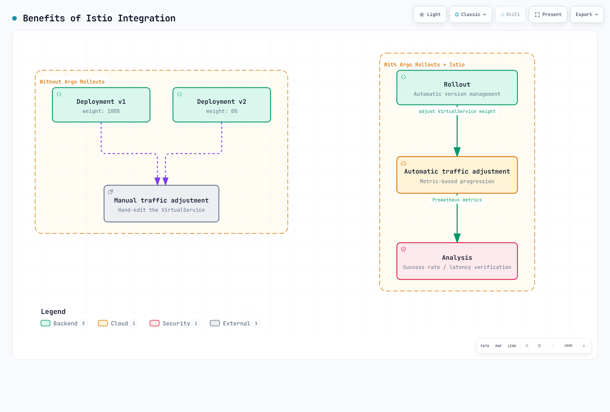

# Integración de Argo Rollouts con Istio

> **Versiones de referencia verificadas**: Argo Rollouts 1.10.1, Istio 1.31.0, Kubernetes 1.32–1.37
> **Última revisión**: 16 de octubre de 2026
> **Dificultad**: Avanzada

Argo Rollouts controla la selección de réplicas y los pesos del tráfico de Istio durante un despliegue progresivo. El análisis debe configurarse y recibir observaciones fiables. Instalar ambos controladores no crea por sí solo una validación automática de calidad ni garantiza la disponibilidad.

## Índice

1. [Descripción general](#overview)
2. [Arquitectura](#architecture)
3. [Conceptos fundamentales](#core-concepts)
4. [Instalación y configuración](#setup-and-configuration)
5. [Estrategias de enrutamiento](#traffic-routing-strategies)
6. [Análisis y métricas](#analysis-and-metrics)
7. [Patrones avanzados de despliegue](#advanced-deployment-patterns)
8. [Solución de problemas](#troubleshooting)
9. [Buenas prácticas](#best-practices)

## Descripción general {#overview}

Canary dirige gradualmente el tráfico a la nueva revisión; blue/green cambia el selector del Service activo. Un análisis configurado puede permitir que la actualización continúe, abortarla o pausarla. El resultado que observan los usuarios también depende de la propagación del tráfico, del estado Ready, de la capacidad adicional, de las conexiones persistentes y de la compatibilidad de la aplicación y los datos.



[Ver diagrama interactivo](https://www.atomai.click/kubernetes-docs/archmaps/en-service-mesh-istio-advanced-08-argo-rollouts-0.html)

El diagrama supone que el análisis está configurado. Durante una actualización, abortarla puede devolver el tráfico gestionado a la revisión estable, pero no revierte la imagen deseada en Git. Argo Rollouts también admite otros sistemas de enrutamiento de tráfico, cada uno con su propia implementación y estado de mantenimiento.

## Arquitectura {#architecture}

Argo CD y GitOps son opcionales. El controlador de Rollouts lee los recursos Rollout y Analysis y actualiza los Services configurados o las etiquetas de los subconjuntos de DestinationRule y los pesos de VirtualService. Istiod convierte estos recursos en configuración para los proxies. Las solicitudes pasan por Envoy y después llegan a los endpoints de la aplicación; VirtualService y DestinationRule son objetos de configuración, no saltos de red.

Prometheus recopila las métricas de los proxies correspondientes y el proveedor de análisis consulta Prometheus. El controlador actúa según la fase resultante de AnalysisRun. Solo el tráfico que atraviesa el proxy o gateway configurado de la malla sigue el reparto de Istio. Un cliente fuera de la malla o una conexión directa a un Pod, incluida la redirección de puertos, puede eludirlo.

## Conceptos fundamentales {#core-concepts}

### 1. Recurso Rollout

Un Rollout gestiona ReplicaSets mediante estrategias canary o blue/green. Es una API distinta de Deployment; no basta con renombrar un Deployment que tenga `strategy: RollingUpdate`. Para migrar un Deployment existente, revise un plan de migración o de uso de workloadRef. No permita que dos controladores gestionen los mismos Pods.

### 2. Control de VirtualService

Rollouts ajusta los pesos de las rutas con nombre que tiene configuradas y puede añadir o quitar los destinos de los experimentos que gestiona. Conserva los campos de enrutamiento admitidos; no sobrescribe indiscriminadamente todo el array de destinos. Para añadir destinos de otros subconjuntos, configure `additionalSubsetNames` y pesos cuya suma sea válida. Los destinos no gestionados pueden eliminarse. Asigne cada ruta gestionada a un solo Rollout y coordine qué campos controla GitOps.

### 3. Reparto por host o por subconjunto

| Enfoque | Recursos que crea el usuario | Campos que controla Rollouts |
|---|---|---|
| Por host, utilizado en el laboratorio principal | Rollout, Services stable/canary, VirtualService | Selectores hash de los Services y pesos de las rutas con nombre |
| Alternativa por subconjunto | Rollout, un Service, VirtualService, DestinationRule | Etiquetas hash de los subconjuntos stable/canary y pesos de las rutas con nombre |

No introduzca manualmente hashes de ReplicaSet de ejemplo. En el reparto por host, el controlador añade `rollouts-pod-template-hash` a los selectores de ambos Services. En el reparto por subconjunto, añade el hash a las etiquetas de los subconjuntos configurados en DestinationRule; el único Service sigue seleccionando toda la carga de trabajo.

La siguiente configuración es una **alternativa independiente basada en subconjuntos**. No debe añadirse al laboratorio basado en hosts. Tanto su Service como su VirtualService utilizan `test`:

```yaml
apiVersion: v1
kind: Service
metadata:
  name: test
  namespace: rollouts-demo
spec:
  selector:
    app: test
  ports:
  - name: http
    port: 8080
    targetPort: http
---
apiVersion: networking.istio.io/v1
kind: VirtualService
metadata:
  name: test-subsets
  namespace: rollouts-demo
spec:
  hosts:
  - test
  - test.rollouts-demo.svc.cluster.local
  http:
  - name: primary
    route:
    - destination:
        host: test
        port:
          number: 8080
        subset: stable
      weight: 100
    - destination:
        host: test
        port:
          number: 8080
        subset: canary
      weight: 0
    retries:
      attempts: 0
---
apiVersion: networking.istio.io/v1
kind: DestinationRule
metadata:
  name: test-subsets
  namespace: rollouts-demo
spec:
  host: test
  subsets:
  - name: stable
    labels:
      app: test
  - name: canary
    labels:
      app: test
```

Sustituya la estrategia canary del Rollout principal por este fragmento y conserve la carga de trabajo y la plantilla reales. En esta alternativa, omita los campos `stableService`/`canaryService` del reparto por host:

```yaml
spec:
  strategy:
    canary:
      trafficRouting:
        istio:
          virtualService:
            name: test-subsets
            routes:
            - primary
          destinationRule:
            name: test-subsets
            canarySubsetName: canary
            stableSubsetName: stable
      steps:
      - setWeight: 10
      - pause: {}
```

Hasta que el controlador escriba hashes distintos, dos selectores de subconjunto iguales o vacíos no aíslan las revisiones. Antes de enviar tráfico de prueba, compruebe las etiquetas resultantes y el estado Ready. Un subconjunto no se convierte automáticamente en un `destination_service_name` distinto; el análisis de esta alternativa necesita métricas verificadas que identifiquen la revisión o la carga de trabajo. `destination_workload_label_rollouts_pod_template_hash` **no es una etiqueta predeterminada de las métricas de Istio**.

### 4. Resultados del análisis

Prometheus devuelve un vector. Compruebe su longitud y que el valor sea finito antes de acceder a `result[0]`. Si solo se define `successCondition`, un resultado falso cuenta como una medición fallida. Los errores del proveedor o de la expresión son errores distintos. Si se definen condiciones de éxito y de fallo y ninguna se cumple, la medición resulta inconclusa.

`failureLimit: 2` tolera dos mediciones fallidas y declara el fallo en la tercera (`failed > failureLimit`). Por tanto, `count: 5` con ese límite no exige cinco mediciones exitosas. El ejemplo principal utiliza `failureLimit: 0`, también cuando faltan datos o no son finitos, y exige un volumen mínimo de tráfico observado. Los umbrales y el número de muestras son ejemplos: no garantizan confianza estadística ni el cumplimiento de SLO de producción.

## Instalación y configuración {#setup-and-configuration}

### Requisitos y alcance

Instale versiones coincidentes del controlador y los CRD de Rollouts y del plugin de la CLI, un plano de datos de Istio compatible que utilice sidecars y una configuración de recopilación de Prometheus. El proveedor de análisis debe disponer de DNS, RBAC y acceso de red que funcionen. Consulte la [guía de observabilidad](../observability/README.md) y la [guía de inyección](07-sidecar-injection.md). Compruebe las métricas reales antes de habilitar el análisis.

Esta demostración HTTP aislada utiliza las imágenes oficiales blue/green fijadas mediante digest. Las imágenes verificadas son **solo para Linux amd64**, por lo que la plantilla del Pod selecciona esa arquitectura. Para Arm64 o Graviton, utilice una imagen Arm64 o multiplataforma que haya probado de forma independiente. Esta revisión no probó un clúster, la ejecución de las imágenes, carga de producción ni un rollout real.

El ejemplo crea un espacio de nombres nuevo, `rollouts-demo`, con la inyección de sidecars predeterminada o heredada. Si su instalación utiliza revisiones, seleccione una revisión o etiqueta instalada y respete las reglas de inyección de la guía enlazada.

### 1. Espacio de nombres y Rollout

```yaml
apiVersion: v1
kind: Namespace
metadata:
  name: rollouts-demo
  labels:
    istio-injection: enabled
---
apiVersion: argoproj.io/v1alpha1
kind: Rollout
metadata:
  name: test
  namespace: rollouts-demo
spec:
  replicas: 3
  revisionHistoryLimit: 2
  selector:
    matchLabels:
      app: test
  template:
    metadata:
      labels:
        app: test
    spec:
      nodeSelector:
        kubernetes.io/os: linux
        kubernetes.io/arch: amd64
      terminationGracePeriodSeconds: 45
      containers:
      - name: app
        image: argoproj/rollouts-demo@sha256:3225193a6415b14b3fcdd160c40248b2bfd62f8c77326480559b91a41ced6e20
        ports:
        - name: http
          containerPort: 8080
        readinessProbe:
          httpGet:
            path: /
            port: http
          initialDelaySeconds: 3
          periodSeconds: 5
          timeoutSeconds: 1
        resources:
          requests:
            cpu: 100m
            memory: 128Mi
          limits:
            cpu: 200m
            memory: 256Mi
  strategy:
    canary:
      stableService: test-stable
      canaryService: test-canary
      maxSurge: 1
      maxUnavailable: 0
      trafficRouting:
        istio:
          virtualService:
            name: test
            routes:
            - primary
      steps:
      - setWeight: 10
      - pause:
          duration: 5m
      - analysis:
          templates:
          - templateName: success-rate
          args:
          - name: service-name
            value: test-canary
          - name: namespace
            value: rollouts-demo
      - setWeight: 50
      - pause:
          duration: 5m
      - analysis:
          templates:
          - templateName: success-rate
          args:
          - name: service-name
            value: test-canary
          - name: namespace
            value: rollouts-demo
      - setWeight: 80
      - pause:
          duration: 5m
      - analysis:
          templates:
          - templateName: success-rate
          args:
          - name: service-name
            value: test-canary
          - name: namespace
            value: rollouts-demo
```

La imagen, los recursos de CPU y memoria y el número de réplicas son valores de la demostración. Los 45 segundos de gracia para la terminación contemplan los retrasos de apagado documentados de la demo. Valide el ciclo de vida de su aplicación para un despliegue real. La estrategia desactiva expresamente los reintentos de la malla en la ruta principal de VirtualService y ejecuta análisis en línea después de las pausas de calentamiento.

### 2. Services stable/canary

```yaml
apiVersion: v1
kind: Service
metadata:
  name: test-stable
  namespace: rollouts-demo
spec:
  selector:
    app: test
  ports:
  - name: http
    port: 8080
    targetPort: http
---
apiVersion: v1
kind: Service
metadata:
  name: test-canary
  namespace: rollouts-demo
spec:
  selector:
    app: test
  ports:
  - name: http
    port: 8080
    targetPort: http
```

Rollouts controla el selector hash que añade a cada Service. No añada un selector fijo `version: v1`, que impediría al Service estable seleccionar la revisión recién promovida.

### 3. VirtualService

```yaml
apiVersion: networking.istio.io/v1
kind: VirtualService
metadata:
  name: test
  namespace: rollouts-demo
spec:
  hosts:
  - test-stable
  - test-stable.rollouts-demo.svc.cluster.local
  http:
  - name: primary
    route:
    - destination:
        host: test-stable
        port:
          number: 8080
      weight: 100
    - destination:
        host: test-canary
        port:
          number: 8080
      weight: 0
    retries:
      attempts: 0
```

Este ejemplo realiza **enrutamiento HTTP dentro de la malla** y no presupone un Gateway de entrada. Mantenga tráfico de prueba desde un cliente con sidecar inyectado hacia `http://test-stable.rollouts-demo.svc.cluster.local:8080/color`. Llamar directamente al Service canary, redirigir el puerto de un Pod o utilizar un cliente fuera de la malla no valida la ruta con pesos.

### 4. AnalysisTemplate y contrato de datos

El ejemplo consulta métricas estándar por Service con `reporter="source"` y el espacio de nombres del Service de destino. Supone que, para este conjunto de datos, las métricas de cada proxy de origen se recopilan una sola vez y que sus etiquetas reales coinciden con los selectores.

Mantenga tráfico de prueba durante todo el rollout. Los cinco minutos de calentamiento superan la ventana de dos minutos de la consulta y evitan que el primer análisis mezcle datos del selector anterior. El volumen mínimo se estima a partir del incremento del contador; no demuestra significación estadística. Un tráfico bajo o la falta de métricas no deben promover una revisión sin advertencia.

```yaml
apiVersion: argoproj.io/v1alpha1
kind: AnalysisTemplate
metadata:
  name: success-rate
  namespace: rollouts-demo
spec:
  args:
  - name: service-name
  - name: namespace
  metrics:
  - name: request-volume
    interval: 30s
    successCondition: len(result) == 1 && !isNaN(result[0]) && !isInf(result[0]) && result[0] >= 20
    failureLimit: 0
    provider:
      prometheus:
        address: http://prometheus.istio-system.svc.cluster.local:9090
        query: sum(increase(istio_requests_total{reporter="source",destination_service_name="{{args.service-name}}",destination_service_namespace="{{args.namespace}}"}[2m]))
    count: 5
  - name: http-availability
    interval: 30s
    successCondition: len(result) == 1 && !isNaN(result[0]) && !isInf(result[0]) && result[0] >= 0.95
    failureLimit: 0
    provider:
      prometheus:
        address: http://prometheus.istio-system.svc.cluster.local:9090
        query: |-
          (sum(rate(istio_requests_total{reporter="source",destination_service_name="{{args.service-name}}",destination_service_namespace="{{args.namespace}}",response_code!~"5..|0"}[2m])) or vector(0))
          /
          sum(rate(istio_requests_total{reporter="source",destination_service_name="{{args.service-name}}",destination_service_namespace="{{args.namespace}}"}[2m]))
    count: 5
```

El cálculo de disponibilidad cuenta las respuestas HTTP que no son 5xx ni tienen código cero, incluidas las 4xx; no demuestra éxito de la operación de negocio. Es una demostración HTTP, no un SLO basado en estados gRPC. Al interpretar los resultados, tenga en cuenta la recopilación duplicada, los retrasos, los reinicios de contadores y las ventanas superpuestas.

### Flujo de despliegue

Guarde los recursos revisados en archivos separados y cree sus dependencias antes de crear el Rollout:

```bash
kubectl argo rollouts lint -f rollout.yaml
kubectl apply -f namespace.yaml
kubectl apply -f analysis-templates.yaml -f services.yaml -f virtualservice.yaml
kubectl apply -f rollout.yaml

kubectl argo rollouts get rollout test -n rollouts-demo --watch
```

La creación inicial establece una revisión estable. Para probar la estrategia canary, cambie después la imagen mientras sigue fluyendo tráfico de prueba. Si GitOps gestiona el entorno, cambie la imagen deseada en Git. Los comandos directos de la CLI siguientes son alternativas para el laboratorio:

```bash
kubectl argo rollouts set image test app=argoproj/rollouts-demo@sha256:e32df3d15f759d36c323b3dccb7003d38df1a4274d37217715151f085c24c58f -n rollouts-demo
kubectl argo rollouts get rollout test -n rollouts-demo --watch

# Choose the action appropriate to the observed state; do not run these as a sequence.
kubectl argo rollouts promote test -n rollouts-demo
kubectl argo rollouts abort test -n rollouts-demo
kubectl argo rollouts retry rollout test -n rollouts-demo
```

Promote reanuda una pausa prevista; no sustituye la investigación de un análisis fallido. Abort conserva la plantilla de Pod deseada. Antes de retry o undo, ajuste la versión deseada, especialmente si otro controlador GitOps puede volver a imponerla.

## Estrategias de enrutamiento {#traffic-routing-strategies}

Todos los fragmentos de esta sección son **alternativas a la estrategia canary principal**. Intégrelos con los Services existentes, las referencias de enrutamiento y la plantilla de la carga de trabajo. No los aplique como recursos independientes.

### 1. Canary basado en pesos

Coloque `setWeight` y `pause` en pasos separados. El porcentaje es un objetivo de enrutamiento, no una proporción exacta en una muestra pequeña. La afinidad de sesión y las solicitudes persistentes también pueden alterar la distribución observada.


[Ver diagrama interactivo](https://www.atomai.click/kubernetes-docs/archmaps/en-service-mesh-istio-advanced-08-argo-rollouts-4.html)

### 2. Enrutamiento gestionado por encabezados

Utilice `managedRoutes`/`setHeaderRoute` para que Rollouts pueda ordenar y eliminar la ruta que genera. Prepare una réplica canary para la fase que solo recibe tráfico por encabezado, antes de volver a ajustar las réplicas según el peso del tráfico:

```yaml
spec:
  strategy:
    canary:
      trafficRouting:
        managedRoutes:
        - name: beta-header
        istio:
          virtualService:
            name: test
            routes:
            - primary
      steps:
      - setCanaryScale:
          replicas: 1
      - setWeight: 0
      - setHeaderRoute:
          name: beta-header
          match:
          - headerName: x-beta-user
            headerValue:
              exact: 'true'
      - pause:
          duration: 5m
      - setHeaderRoute:
          name: beta-header
      - setCanaryScale:
          matchTrafficWeight: true
      - setWeight: 10
      - pause: {}
```

La versión 1.10 genera esta ruta sin copiar la política de reintentos de la ruta principal. Utilice el fragmento solo para solicitudes idempotentes de la demostración e inspeccione la ruta generada. No restringe los métodos a operaciones de lectura ni garantiza que las escrituras no se reintenten. Un despliegue que atienda escrituras necesita un diseño de reintentos y autorización controlado y validado por separado.

El encabezado `x-beta-user` no autentica la identidad de quien realiza las pruebas. Si debe restringir el acceso, utilice un punto de autenticación fiable. Una ruta por encabezado escrita manualmente fuera de la lista de rutas gestionadas de Rollouts no desaparece automáticamente al abortar o completar el despliegue y puede seguir alcanzando endpoints canary.

### 3. Tráfico espejo gestionado

El ejemplo solo duplica solicitudes GET, conserva las respuestas al usuario en la ruta estable durante la fase de prueba en paralelo y elimina el espejo antes de enviar tráfico canary normal:

```yaml
spec:
  strategy:
    canary:
      trafficRouting:
        managedRoutes:
        - name: shadow-read
        istio:
          virtualService:
            name: test
            routes:
            - primary
      steps:
      - setCanaryScale:
          replicas: 1
      - setWeight: 0
      - setMirrorRoute:
          name: shadow-read
          percentage: 10
          match:
          - method:
              exact: GET
      - pause:
          duration: 5m
      - setMirrorRoute:
          name: shadow-read
      - setCanaryScale:
          matchTrafficWeight: true
      - setWeight: 10
      - pause: {}
```

La ruta espejo generada tampoco hereda la política de reintentos principal; inspeccione los valores predeterminados efectivos de la malla. Las respuestas duplicadas se descartan, pero las solicitudes sí se ejecutan. Incluso GET puede producir efectos secundarios en una aplicación. Valide la semántica y, cuando sea necesario, aísle los datos y las dependencias. El espejo añade carga de recursos y de red y no garantiza ausencia de impacto en los usuarios. Compruebe el Host real de las solicitudes duplicadas y que la aplicación las acepte.

### 4. Varias rutas con nombre

```yaml
apiVersion: networking.istio.io/v1
kind: VirtualService
metadata:
  name: test
  namespace: rollouts-demo
spec:
  hosts:
  - test-stable
  - test-stable.rollouts-demo.svc.cluster.local
  http:
  - name: api-route
    match:
    - uri:
        exact: /api
    - uri:
        prefix: /api/
    route:
    - destination:
        host: test-stable
        port:
          number: 8080
      weight: 100
    - destination:
        host: test-canary
        port:
          number: 8080
      weight: 0
    retries:
      attempts: 0
  - name: web-route
    match:
    - uri:
        exact: /web
    - uri:
        prefix: /web/
    route:
    - destination:
        host: test-stable
        port:
          number: 8080
      weight: 100
    - destination:
        host: test-canary
        port:
          number: 8080
      weight: 0
    retries:
      attempts: 0
---
spec:
  strategy:
    canary:
      trafficRouting:
        istio:
          virtualService:
            name: test
            routes:
            - api-route
            - web-route
      steps:
      - setWeight: 10
      - pause: {}
```

Ambas rutas utilizan el mismo peso objetivo de canary. Los límites de coincidencia distinguen `/api` y `/api/…` de otros prefijos. Las solicitudes fuera de estas rutas necesitan un enrutamiento diseñado explícitamente.

## Análisis y métricas {#analysis-and-metrics}

La captura histórica del proyecto muestra la separación de métricas por Service. No representa una arquitectura de integración ni un benchmark actual:


### 1. Análisis en línea

El Rollout principal ejecuta `success-rate` como un paso en línea y espera a que termine. Pasa ambos argumentos obligatorios en cada ejecución. Un análisis fallido aborta el despliegue y uno inconcluso puede pausarlo. El proveedor de análisis no puede generar el tráfico que falta ni corregir un selector de métricas equivocado.

### 2. Análisis continuo en segundo plano

Una plantilla en segundo plano con `count: 5` se detiene tras realizar ese número de mediciones. Omita count para mantener un análisis continuo en segundo plano:

```yaml
apiVersion: argoproj.io/v1alpha1
kind: AnalysisTemplate
metadata:
  name: success-rate-continuous
  namespace: rollouts-demo
spec:
  args:
  - name: service-name
  - name: namespace
  metrics:
  - name: request-volume
    interval: 30s
    successCondition: len(result) == 1 && !isNaN(result[0]) && !isInf(result[0]) && result[0] >= 20
    failureLimit: 0
    provider:
      prometheus:
        address: http://prometheus.istio-system.svc.cluster.local:9090
        query: sum(increase(istio_requests_total{reporter="source",destination_service_name="{{args.service-name}}",destination_service_namespace="{{args.namespace}}"}[2m]))
  - name: http-availability
    interval: 30s
    successCondition: len(result) == 1 && !isNaN(result[0]) && !isInf(result[0]) && result[0] >= 0.95
    failureLimit: 0
    provider:
      prometheus:
        address: http://prometheus.istio-system.svc.cluster.local:9090
        query: |-
          (sum(rate(istio_requests_total{reporter="source",destination_service_name="{{args.service-name}}",destination_service_namespace="{{args.namespace}}",response_code!~"5..|0"}[2m])) or vector(0))
          /
          sum(rate(istio_requests_total{reporter="source",destination_service_name="{{args.service-name}}",destination_service_namespace="{{args.namespace}}"}[2m]))
---
spec:
  strategy:
    canary:
      analysis:
        templates:
        - templateName: success-rate-continuous
        startingStep: 2
        args:
        - name: service-name
          value: test-canary
        - name: namespace
          value: rollouts-demo
      steps:
      - setWeight: 10
      - pause:
          duration: 5m
      - setWeight: 30
      - pause:
          duration: 5m
      - setWeight: 50
      - pause: {}
```

`startingStep: 2` utiliza un índice que comienza en cero: corresponde al tercer paso de este fragmento (`setWeight: 30`). La pausa anterior permite llenar la ventana de datos de dos minutos. El análisis continúa junto con los pasos posteriores hasta que el rollout lo termina o completa, o se cumple una condición de fallo. No garantiza una reversión instantánea de extremo a extremo.

### 3. Métricas compuestas

Esta alternativa más estricta exige volumen de solicitudes, disponibilidad del 99% según respuestas no 5xx ni de código cero, p95 de como máximo 0.5 segundos y tasa de errores de como máximo el 1%. Aquí las comprobaciones de disponibilidad y errores se complementan. Aun así, debe justificar estos valores para su carga de trabajo.

```yaml
apiVersion: argoproj.io/v1alpha1
kind: AnalysisTemplate
metadata:
  name: comprehensive-analysis
  namespace: rollouts-demo
spec:
  args:
  - name: service-name
  - name: namespace
  metrics:
  - name: request-volume
    interval: 30s
    successCondition: len(result) == 1 && !isNaN(result[0]) && !isInf(result[0]) && result[0] >= 20
    failureLimit: 0
    provider:
      prometheus:
        address: http://prometheus.istio-system.svc.cluster.local:9090
        query: sum(increase(istio_requests_total{reporter="source",destination_service_name="{{args.service-name}}",destination_service_namespace="{{args.namespace}}"}[2m]))
    count: 5
  - name: http-availability
    interval: 30s
    successCondition: len(result) == 1 && !isNaN(result[0]) && !isInf(result[0]) && result[0] >= 0.99
    failureLimit: 0
    provider:
      prometheus:
        address: http://prometheus.istio-system.svc.cluster.local:9090
        query: |-
          (sum(rate(istio_requests_total{reporter="source",destination_service_name="{{args.service-name}}",destination_service_namespace="{{args.namespace}}",response_code!~"5..|0"}[2m])) or vector(0))
          /
          sum(rate(istio_requests_total{reporter="source",destination_service_name="{{args.service-name}}",destination_service_namespace="{{args.namespace}}"}[2m]))
    count: 5
  - name: latency-p95
    interval: 30s
    successCondition: len(result) == 1 && !isNaN(result[0]) && !isInf(result[0]) && result[0] <= 0.5
    failureLimit: 0
    provider:
      prometheus:
        address: http://prometheus.istio-system.svc.cluster.local:9090
        query: |-
          histogram_quantile(0.95,
            sum by (le) (rate(istio_request_duration_milliseconds_bucket{reporter="source",destination_service_name="{{args.service-name}}",destination_service_namespace="{{args.namespace}}"}[2m]))
          ) / 1000
    count: 5
  - name: http-error-rate
    interval: 30s
    successCondition: len(result) == 1 && !isNaN(result[0]) && !isInf(result[0]) && result[0] <= 0.01
    failureLimit: 0
    provider:
      prometheus:
        address: http://prometheus.istio-system.svc.cluster.local:9090
        query: |-
          (sum(rate(istio_requests_total{reporter="source",destination_service_name="{{args.service-name}}",destination_service_namespace="{{args.namespace}}",response_code=~"5..|0"}[2m])) or vector(0))
          /
          sum(rate(istio_requests_total{reporter="source",destination_service_name="{{args.service-name}}",destination_service_namespace="{{args.namespace}}"}[2m]))
    count: 5
```

El histograma de duración de Istio utiliza milisegundos, por lo que la consulta divide entre 1000 antes de comparar con segundos. Las expresiones comprueban que el vector instantáneo no esté vacío, no contenga varios valores y no devuelva NaN o Inf. Las ventanas superpuestas no producen muestras estadísticamente independientes.

### 4. Comprobaciones previas y posteriores

Canary tiene un solo campo `analysis` en segundo plano. Dos claves `analysis` en el mismo objeto YAML no implementan comprobaciones previas y posteriores. Utilice pasos de análisis en línea en los puntos adecuados, con el tráfico y los requisitos necesarios, o los mecanismos `prePromotionAnalysis` y `postPromotionAnalysis` de blue/green que se muestran a continuación.

## Patrones avanzados de despliegue {#advanced-deployment-patterns}

### 1. Blue/green

Este fragmento es un **esquema de estrategia independiente**. Reutilice una plantilla de carga de trabajo revisada, pero sustituya la estrategia canary y las referencias a los Services que reciben tráfico de clientes. Cree los Services activo y de vista previa antes de ejecutarlo:

```yaml
apiVersion: v1
kind: Service
metadata:
  name: test-active
  namespace: rollouts-demo
spec:
  selector:
    app: test
  ports:
  - name: http
    port: 8080
    targetPort: http
---
apiVersion: v1
kind: Service
metadata:
  name: test-preview
  namespace: rollouts-demo
spec:
  selector:
    app: test
  ports:
  - name: http
    port: 8080
    targetPort: http
---
spec:
  strategy:
    blueGreen:
      activeService: test-active
      previewService: test-preview
      autoPromotionEnabled: false
      prePromotionAnalysis:
        templates:
        - templateName: smoke-test
        args:
        - name: service-name
          value: test-preview
        - name: namespace
          value: rollouts-demo
      postPromotionAnalysis:
        templates:
        - templateName: post-promotion-analysis
        args:
        - name: service-name
          value: test-active
        - name: namespace
          value: rollouts-demo
      scaleDownDelaySeconds: 600
---
apiVersion: networking.istio.io/v1
kind: VirtualService
metadata:
  name: test-bluegreen
  namespace: rollouts-demo
spec:
  hosts:
  - test-active
  - test-active.rollouts-demo.svc.cluster.local
  http:
  - name: active
    route:
    - destination:
        host: test-active
        port:
          number: 8080
      weight: 100
    retries:
      attempts: 0
---
apiVersion: argoproj.io/v1alpha1
kind: AnalysisTemplate
metadata:
  name: post-promotion-analysis
  namespace: rollouts-demo
spec:
  args:
  - name: service-name
  - name: namespace
  metrics:
  - name: request-volume
    interval: 30s
    successCondition: len(result) == 1 && !isNaN(result[0]) && !isInf(result[0]) && result[0] >= 20
    failureLimit: 0
    provider:
      prometheus:
        address: http://prometheus.istio-system.svc.cluster.local:9090
        query: sum(increase(istio_requests_total{reporter="source",destination_service_name="{{args.service-name}}",destination_service_namespace="{{args.namespace}}"}[2m]))
    count: 5
    initialDelay: 5m
  - name: http-availability
    interval: 30s
    successCondition: len(result) == 1 && !isNaN(result[0]) && !isInf(result[0]) && result[0] >= 0.99
    failureLimit: 0
    provider:
      prometheus:
        address: http://prometheus.istio-system.svc.cluster.local:9090
        query: |-
          (sum(rate(istio_requests_total{reporter="source",destination_service_name="{{args.service-name}}",destination_service_namespace="{{args.namespace}}",response_code!~"5..|0"}[2m])) or vector(0))
          /
          sum(rate(istio_requests_total{reporter="source",destination_service_name="{{args.service-name}}",destination_service_namespace="{{args.namespace}}"}[2m]))
    count: 5
    initialDelay: 5m
  - name: latency-p95
    interval: 30s
    successCondition: len(result) == 1 && !isNaN(result[0]) && !isInf(result[0]) && result[0] <= 0.5
    failureLimit: 0
    provider:
      prometheus:
        address: http://prometheus.istio-system.svc.cluster.local:9090
        query: |-
          histogram_quantile(0.95,
            sum by (le) (rate(istio_request_duration_milliseconds_bucket{reporter="source",destination_service_name="{{args.service-name}}",destination_service_namespace="{{args.namespace}}"}[2m]))
          ) / 1000
    count: 5
    initialDelay: 5m
  - name: http-error-rate
    interval: 30s
    successCondition: len(result) == 1 && !isNaN(result[0]) && !isInf(result[0]) && result[0] <= 0.01
    failureLimit: 0
    provider:
      prometheus:
        address: http://prometheus.istio-system.svc.cluster.local:9090
        query: |-
          (sum(rate(istio_requests_total{reporter="source",destination_service_name="{{args.service-name}}",destination_service_namespace="{{args.namespace}}",response_code=~"5..|0"}[2m])) or vector(0))
          /
          sum(rate(istio_requests_total{reporter="source",destination_service_name="{{args.service-name}}",destination_service_namespace="{{args.namespace}}"}[2m]))
    count: 5
    initialDelay: 5m
```

La aplicación debe aportar e implementar el AnalysisTemplate `smoke-test` y validarlo previamente; esta guía no lo incluye. Debe declarar los argumentos `service-name`/`namespace` y probar la revisión de vista previa con la identidad, el acceso de red y las comprobaciones funcionales adecuadas. La plantilla posterior a la promoción espera cinco minutos antes de consultar su ventana de dos minutos. Compruebe la propagación y que siga llegando tráfico a `test-active`; no suponga que las conexiones o los datos anteriores desaparecen inmediatamente. No copie el fragmento como si fuera un despliegue completo de smoke-test.

`autoPromotionEnabled` es true de forma predeterminada; este ejemplo lo desactiva expresamente. `scaleDownDelaySeconds` retrasa la reducción de réplicas del ReplicaSet anterior. No elimina todo el historial de revisiones ni migra las conexiones existentes. La propagación de los Services y endpoints y el comportamiento del balanceador de carga pueden seguir causando interrupciones.


[Ver diagrama interactivo](https://www.atomai.click/kubernetes-docs/archmaps/en-service-mesh-istio-advanced-08-argo-rollouts-6.html)

### 2. Experimento con pesos de tráfico

Istio admite experimentos con enrutamiento de tráfico. Los valores válidos de `specRef` en este ejemplo son `stable` y `canary`; no existe una revisión de origen `experimental`:

```yaml
spec:
  strategy:
    canary:
      steps:
      - experiment:
          duration: 10m
          templates:
          - name: baseline
            specRef: stable
            weight: 5
          - name: candidate
            specRef: canary
            weight: 5
      - setWeight: 10
      - pause: {}
```

En este primer paso de experimento, el controlador crea ReplicaSets y Services propios para los experimentos, dirige el 5% a cada uno y conserva el 90% en el destino estable. Los hashes de sus Pods son distintos de los del Rollout principal. El fragmento programa diez minutos de exposición; por sí solo no realiza una comparación con validez estadística. Añada un AnalysisTemplate que realice la comparación y pase como argumentos las identidades o Services generados para el propio experimento.

### 3. Despliegue progresivo lento

```yaml
spec:
  strategy:
    canary:
      steps:
      - setWeight: 1
      - pause:
          duration: 1h
      - setWeight: 5
      - pause:
          duration: 1h
      - setWeight: 10
      - pause:
          duration: 2h
      - setWeight: 25
      - pause:
          duration: 4h
      - setWeight: 50
      - pause:
          duration: 8h
      - setWeight: 75
      - pause:
          duration: 8h
      analysis:
        templates:
        - templateName: success-rate-continuous
        startingStep: 2
        args:
        - name: service-name
          value: test-canary
        - name: namespace
          value: rollouts-demo
```

Las pausas indicadas suman 24 horas, además del tiempo necesario para el estado Ready, el análisis y la propagación. Un calendario prolongado no sustituye el tráfico representativo, la detección de fallos, la capacidad ni un procedimiento de recuperación revisado.

## Solución de problemas {#troubleshooting}

Compruebe los recursos del espacio de nombres y el enrutamiento efectivo del proxy:

```bash
kubectl argo rollouts get rollout test -n rollouts-demo
kubectl describe rollout test -n rollouts-demo
kubectl get virtualservice test -n rollouts-demo -o yaml
kubectl get services test-stable test-canary -n rollouts-demo -o yaml
kubectl get pods -n rollouts-demo -l app=test --show-labels
kubectl get endpointslices -n rollouts-demo -l kubernetes.io/service-name=test-canary
istioctl proxy-config routes <client-pod> -n rollouts-demo
istioctl proxy-config clusters <client-pod> -n rollouts-demo
kubectl get analysisruns -n rollouts-demo
kubectl logs -n argo-rollouts deployment/argo-rollouts
```

Si los pesos no se actualizan, revise RBAC, los nombres de ruta referenciados, los eventos del controlador y las escrituras de GitOps que puedan competir por los mismos campos. Si canary no recibe tráfico, compruebe los selectores hash de los Services o subconjuntos, los EndpointSlices listos, la ruta real del cliente o gateway de la malla y el tamaño de la muestra.

Si falla el análisis, revise los valores y mensajes de las mediciones de AnalysisRun y ejecute la consulta exacta en la misma fuente de datos de Prometheus. Compruebe el reporter de origen, las etiquetas de espacio de nombres y Service, el volumen de tráfico, la ventana de consulta y la autenticación y el acceso de red del proveedor. Distinga los umbrales incumplidos de los resultados inconclusos y los errores del proveedor.

Después de completar un rollout, abort no sirve como comando general para volver a una revisión histórica. Revise el historial y restaure la plantilla y la versión deseadas:

```bash
kubectl argo rollouts get rollout test -n rollouts-demo
kubectl argo rollouts undo test --to-revision=<reviewed-revision> -n rollouts-demo
```

Si utiliza GitOps, cambie también la versión deseada en Git y asegúrese de que se aplique. Los ReplicaSets conservados y la compatibilidad de las bases de datos y las API limitan qué puede restaurar undo de forma segura.

## Buenas prácticas {#best-practices}

### Control de campos con GitOps

Una Application de Argo CD puede ignorar únicamente los campos que Rollouts controla en ejecución y respetar esas exclusiones durante la sincronización:

```yaml
spec:
  ignoreDifferences:
  - group: networking.istio.io
    kind: VirtualService
    name: test
    namespace: rollouts-demo
    jqPathExpressions:
    - .spec.http[] | select(.name == "primary") | .route[].weight
  - group: ''
    kind: Service
    name: test-stable
    namespace: rollouts-demo
    jqPathExpressions:
    - .spec.selector["rollouts-pod-template-hash"]
  - group: ''
    kind: Service
    name: test-canary
    namespace: rollouts-demo
    jqPathExpressions:
    - .spec.selector["rollouts-pod-template-hash"]
  syncPolicy:
    syncOptions:
    - RespectIgnoreDifferences=true
```

Este es un fragmento de `spec` de una Application, no una Application independiente. La creación inicial de recursos sigue necesitando pesos y selectores correctos. Si enruta por subconjuntos, limite también la exclusión de la etiqueta hash a los subconjuntos de DestinationRule gestionados. Para rutas gestionadas por encabezados o espejos, contemple sus entradas de ejecución con nombres específicos. No ignore toda la especificación de VirtualService: los hosts, destinos y campos de enrutamiento relevantes para la seguridad deben poder revisarse.

### Pasos, mediciones y capacidad

Elija los porcentajes y las pausas según el volumen de solicitudes, el riesgo y el tiempo de recuperación. No existe un intervalo mínimo universal de 30 segundos, un nivel de confianza garantizado por cinco muestras ni una regla que exija promover rápidamente el último tramo. Mantenga una sola acción por CanaryStep y coordine los reintentos y la compatibilidad del esquema y los datos.

```yaml
spec:
  revisionHistoryLimit: 2
  progressDeadlineSeconds: 600
  progressDeadlineAbort: false
  template:
    spec:
      containers:
      - name: app
        resources:
          requests:
            cpu: 100m
            memory: 128Mi
          limits:
            cpu: 200m
            memory: 256Mi
```

`revisionHistoryLimit` configura la retención; no establece un mínimo universal de dos. `progressDeadlineSeconds` se refiere a la falta de progreso, mientras que las pausas y el ciclo del análisis requieren consideración independiente. Si `progressDeadlineAbort` se establece explícitamente en false, alcanzar el plazo de progreso no aborta automáticamente el despliegue. La proporción de 2× entre requests y limits es solo un valor del ejemplo original.

Tres réplicas no implican una réplica por AZ. Si necesita distribuirlas por zonas, revise las restricciones de topología y la capacidad; consulte [Argo Rollouts con distribución por zonas](09-zone-aware-argo-rollouts.md). El enrutamiento puede necesitar más capacidad estable y canary de la que sugiere una estimación simple de réplicas adicionales. Un PDB afecta a las expulsiones voluntarias, no a todos los fallos ni a la reducción de réplicas que realiza el controlador:

```yaml
apiVersion: policy/v1
kind: PodDisruptionBudget
metadata:
  name: test-pdb
  namespace: rollouts-demo
spec:
  minAvailable: 2
  selector:
    matchLabels:
      app: test
```

Antes de actualizar, compruebe los controladores y CRD, la inyección, DNS, la plataforma de la imagen, los Services y rutas, el acceso del proveedor, las etiquetas de métricas y el tráfico de prueba continuo. Durante la actualización, inspeccione la selección efectiva de endpoints y los resultados de AnalysisRun. Después de la promoción, compruebe la imagen deseada, los pesos gestionados, el estado Ready de los endpoints y la reducción de réplicas y retención de los ReplicaSets anteriores. No espere que se eliminen todos los ReplicaSets antiguos.

## Referencias

- [Integración de Argo Rollouts con Istio](https://argoproj.github.io/argo-rollouts/features/traffic-management/istio/)
- [Ciclo de vida del análisis](https://argoproj.github.io/argo-rollouts/features/analysis/)
- [Proveedor Prometheus](https://argoproj.github.io/argo-rollouts/analysis/prometheus/)
- [Enrutamiento de tráfico y rutas gestionadas](https://argoproj.github.io/argo-rollouts/features/traffic-management/)
- [Blue/green](https://argoproj.github.io/argo-rollouts/features/bluegreen/)
- [Experimentos](https://argoproj.github.io/argo-rollouts/features/experiment/)
- [Especificación de Rollout](https://argoproj.github.io/argo-rollouts/features/specification/)
- [Preguntas frecuentes de Rollouts](https://argoproj.github.io/argo-rollouts/FAQ/)
- [Implementación publicada de Istio en Rollouts 1.10](https://raw.githubusercontent.com/argoproj/argo-rollouts/v1.10.1/rollout/trafficrouting/istio/istio.go)
- [Evaluación de fallos de análisis publicada en 1.10](https://raw.githubusercontent.com/argoproj/argo-rollouts/v1.10.1/analysis/analysis.go)
- [Opciones de sincronización de Argo CD](https://raw.githubusercontent.com/argoproj/argo-cd/master/docs/user-guide/sync-options.md)
- [División del tráfico](../traffic-management/04-traffic-splitting.md)
- [VirtualService](../traffic-management/01-gateway-virtualservice.md)
- [DestinationRule](../traffic-management/03-destination-rule.md)
