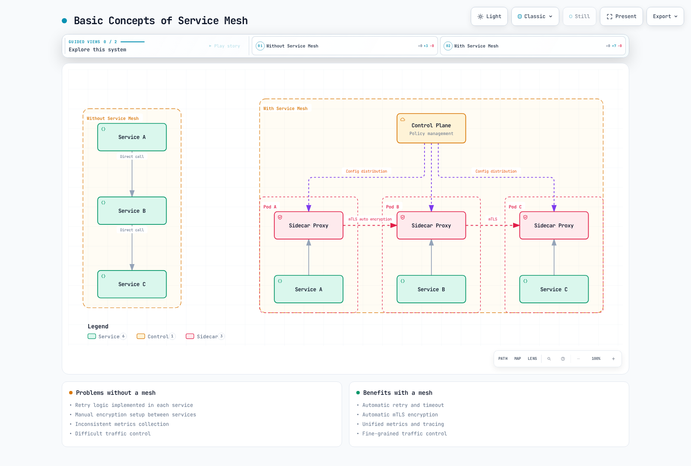
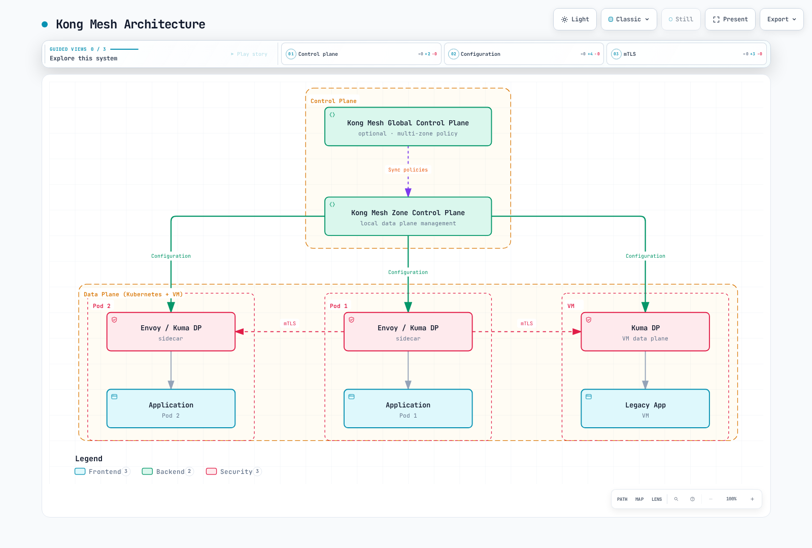

# Comparación de soluciones de Service Mesh

> **Última actualización**: September 11, 2026
> **Comprobaciones de API/artefactos**: Istio 1.31.0; Linkerd edge-26.9.1; Kong Mesh/Kuma 2.14.4; Consul/chart 2.0.4

Las versiones de los artefactos identifican las fuentes usadas para comprobar ejemplos. **No son una matriz compartida de compatibilidad con Kubernetes** ni evidencia de un sistema de producción desplegado. Las cifras originales de rendimiento de Istio 1.24/Linkerd 2.15/Kong Mesh 2.8/Consul 1.19 se conservan a continuación con su estado histórico y no verificado.

## Contenido

1. [Arquitectura](#architecture)
2. [Evidencia de rendimiento](#performance-evidence)
3. [Gestión de tráfico](#traffic-management)
4. [Seguridad](#security)
5. [Observabilidad](#observability)
6. [Multiclúster](#multicluster)
7. [Instalación y operaciones](#installation-and-operations)
8. [Coste y licencias](#cost-and-licensing)
9. [Selección y validación](#selection-and-validation)

## Arquitectura {#architecture}

Un service mesh desplaza funciones de comunicación seleccionadas a componentes de infraestructura. La interceptación del tráfico puede ser transparente para el código de la aplicación, pero la selección de protocolos, propiedad del tráfico, identidad de las cargas de trabajo y políticas aún requieren configuración. El tracing distribuido también necesita propagación/instrumentación de contexto. Un mesh no hace que reintentos arbitrarios de una aplicación sean seguros.



[Ver diagrama interactivo](https://www.atomai.click/kubernetes-docs/archmaps/en-service-mesh-istio-comparison-01-service-mesh-comparison-0.html)

El diagrama ilustra un despliegue de sidecar configurado; no afirma que todas las características estén habilitadas de forma predeterminada ni que ambient/Cilium usen la misma topología por Pod.

### Istio


[Ver diagrama interactivo](https://www.atomai.click/kubernetes-docs/archmaps/en-service-mesh-istio-comparison-01-service-mesh-comparison-2.html)

Istiod combina funciones de configuración/detección y gestión de identidades históricamente asociadas con Pilot, Citadel y Galley; esos nombres no representan tres despliegues actuales adicionales. Los planos de datos sidecar usan Envoy. Ambient usa ztunnel por nodo para L4 y waypoints de Envoy separados para el procesamiento L7 compatible. Los gateways de ingress/egress implementan rutas de frontera seleccionadas explícitamente.

Se admiten Kubernetes y la integración documentada de VM, con requisitos previos de red/confianza. El GA del núcleo de Ambient no implica paridad de características con los sidecars: la asociación de políticas a waypoint, la compatibilidad con EnvoyFilter y la madurez multiclúster difieren. Seleccione el modo y el comportamiento de API necesario antes de estimar recursos o complejidad.

### Linkerd


[Ver diagrama interactivo](https://www.atomai.click/kubernetes-docs/archmaps/en-service-mesh-istio-comparison-01-service-mesh-comparison-3.html)

Linkerd usa su proxy Rust diseñado específicamente y recursos, anotaciones y CRD de Kubernetes. Las características actuales incluyen enrutamiento de solicitudes de Gateway API, timeouts/reintentos, autorización por ruta y limitación de tasa local. Describirlo como un mesh solo de anotaciones o de «solo características básicas» es inexacto.

La expansión del mesh fuera de Kubernetes está documentada mediante ExternalWorkload, un proxy en la máquina externa, identidad SPIFFE/SPIRE compatible, DNS y acceso de red. No significa «sin soporte de VM», ni registrar una IP externa instala o autentica automáticamente un proxy.

### Kong Mesh y Kuma



[Ver diagrama interactivo](https://www.atomai.click/kubernetes-docs/archmaps/en-service-mesh-istio-comparison-01-service-mesh-comparison-4.html)

Kong Mesh se basa en Kuma. El modo Kubernetes usa recursos/almacenamiento de Kubernetes; el modo Universal admite entornos de VM/bare-metal y usa su base de datos configurada. Kong ofrece opciones autohospedadas y de plano de control global administrado; las características de edición y los términos de soporte deben verificarse por separado de Kuma upstream.

En un despliegue multizona, los planos de control global y de zona intercambian recursos mediante KDS, mientras que cada zona suministra xDS a sus proxies locales. El tráfico de datos entre zonas usa el ingress de la zona de destino y, cuando está configurado, el egress de la zona local. El plano de control global no es un backend automático de agregación de Prometheus/tracing.

El descubrimiento de un Service no especifica por sí mismo una división 80% local/20% remota. La ponderación de endpoints heredada y la configuración de localidad actual de MeshLoadBalancingStrategy tienen valores predeterminados distintos. Inspeccione la política seleccionada, los endpoints elegibles y la configuración entre zonas/de failover, en lugar de tratar las ponderaciones de un diagrama como comportamiento inherente.

Use políticas actuales como MeshHTTPRoute, MeshTrafficPermission, MeshRetry, MeshTimeout, MeshMetric, MeshTrace y MeshAccessLog cuando corresponda. TrafficRoute y TrafficPermission son interfaces heredadas/obsoletas, no necesariamente API eliminadas en la versión comprobada. Migre las políticas dependientes juntas; no combine TrafficPermission antiguo con MeshTrafficPermission. Un tipo de política por sí solo no establece la propiedad o propagación «global» frente a «solo de zona».

El fallo del plano de control global puede dejar funcionando el tráfico de datos existente mientras se detiene la propagación de cambios de políticas y servicios remotos. El fallo del plano de control de zona puede impedir nuevos proxies, actualizaciones de configuración y renovación de certificados. La configuración retenida no es una garantía de disponibilidad indefinida. Valide el registro, las actualizaciones, el drenaje y la expiración bajo condiciones reales de fallo.

### Consul Service Mesh

Consul proporciona funciones de descubrimiento de servicios, configuración e identidad con soporte de primera clase para Envoy. Las integraciones actuales de Kubernetes normalmente usan consul-dataplane para administrar el sidecar; la imagen antigua de un client-agent-por-nodo no es la única ni la arquitectura predeterminada de Kubernetes.

La descripción general oficial del proxy también describe un proxy L4 integrado para desarrollo/pruebas y desaconseja su uso en producción. No debe presentarse como equivalente al conjunto de características L7 de producción de Envoy, ni describirse incorrectamente como eliminado sin evidencia de una versión. Consul también admite integraciones documentadas de VM y otros runtimes además de Kubernetes.

### Cilium en la misma decisión

Cilium combina un datapath de red eBPF con proxies como Envoy para el análisis/política L7. No es una red L7 completamente libre de proxies. La autenticación mutua fuera de banda de Cilium 1.20.1 es Beta y usa un handshake fuera de banda; el cifrado WireGuard/IPsec es un requisito separado. Consulte la [guía de mesh de Cilium](../../cilium-service-mesh/README.md) para conocer sus características reales y restricciones de Cluster Mesh.

Cilium 1.20.1 también proporciona una [beta independiente de cifrado transparente ztunnel](https://github.com/cilium/cilium/blob/v1.20.1/Documentation/security/network/encryption-ztunnel.rst), seleccionada con `encryption.type: ztunnel`. Proporciona mTLS de cargas de trabajo TCP con inscripción por namespace; ambos endpoints deben estar inscritos. Excluye ClusterMesh y Pods con red de host, y la guía publicada advierte que las políticas L4 normales no funcionan en esta ruta salvo al dirigirse al puerto HBONE 15008. Es una elección de despliegue distinta, con sus propios requisitos de CA/bootstrap.

## Evidencia de rendimiento {#performance-evidence}

### Cifras originales: históricas y no verificadas

El texto anterior describía una prueba de **EKS 1.28 de tres nodos, m5.xlarge, 100 servicios y 1.000 RPS** y mencionaba Istio 1.24, Linkerd 2.15, Kong Mesh 2.8 y Consul 1.19. No proporcionaba muestras sin procesar, un harness reproducible, versiones exactas de patch/proxy ni un benchmark de origen. Estos números no pueden establecer una clasificación actual de productos:

| Entrada original | p50 | p95 | p99 | Afirmación de CPU | Afirmación de memoria |
|---|---:|---:|---:|---:|---:|
| Línea base |0.1 ms|0.2 ms|0.3 ms|—|—|
| Linkerd |+0.5 ms|+0.8 ms|+1.2 ms|+3–8%|+20–50 MB|
| Istio |+1.0 ms|+2.5 ms|+3.5 ms|+5–15%|+50–150 MB|
| Kong Mesh |+0.8 ms|+2.0 ms|+3.0 ms|+5–12%|+40–120 MB|
| Consul |+1.0 ms|+2.5 ms|+3.5 ms|+6–14%|+50–140 MB|

Las estimaciones originales del plano de control eran Istio 0.5–1 CPU/1–2 GB, Linkerd 0.1–0.3 CPU/200–500 MB, Kong 0.2–0.5 CPU/500 MB–1 GB y Consul 0.5–1 CPU/1–2 GB. Las estimaciones de CPU por proxy iban desde 20–100m para Linkerd hasta 100–500m para Istio/Consul. Son entradas no verificadas, no valores predeterminados, mediciones ni recomendaciones de capacidad. Contar los distintos componentes de Linkerd tampoco equivale a contar réplicas de un componente.

El gráfico de rendimiento eliminado afirmaba que Linkerd mantenía el 95–98%, Kong el 90–95% e Istio/Consul el 85–92% del rendimiento de la línea base, sin datos de respaldo. No puede justificar «Linkerd es el más rápido», un porcentaje fijo de recursos ni un tamaño mínimo de flota.

### Una comparación reproducible

Mantenga las versiones reales de producto/proxy/Kubernetes, hardware y configuración completa adjuntas a los resultados. Iguale el protocolo/payload/concurrencia de tráfico, TLS/autenticación, política, telemetría y límites de recursos. Informe las distribuciones de latencia absoluta de línea base y con mesh, el rendimiento bajo un límite definido de error/SLO, CPU/memoria por componente y variabilidad de ejecuciones repetidas.

Compare el comportamiento equivalente de HA y fallos, incluidos rollout, drenaje, reutilización de conexiones, telemetría ausente y pérdida del plano de control. Mida los errores sin procesar por separado de los resultados visibles para el cliente tras los reintentos. No adelante las etiquetas de versión históricas sin volver a ejecutar y conservar el experimento.

## Gestión de tráfico {#traffic-management}

| Capacidad | Qué comparar de forma concreta |
|---|---|
| Enrutamiento ponderado/por encabezado | Comportamiento de Istio VirtualService, Linkerd HTTPRoute, Kong MeshHTTPRoute y Consul router/splitter/resolver |
| Blue/Green o canary | Una ruta es solo una parte; un controlador de rollout o flujo de trabajo de despliegue debe gestionar revisiones, análisis y reversión |
| Reintentos/timeouts | Alcance de solicitud/protocolo compatible, política predeterminada, presupuestos e idempotencia de la aplicación |
| Limitación de tasa | Contadores locales frente a compartidos, identidad, política de fallos y alcance real de las réplicas |
| Fallos/mirroring | API/filtro compatible y configuración generada observada; las escrituras reflejadas pueden tener efectos secundarios |

Linkerd admite limitación de tasa local mediante HTTPLocalRateLimitPolicy, incluidos límites por identidad, y enrutamiento dinámico por propiedades de solicitud. Los límites locales por proxy no son una cuota global de servicio. Las características de Consul y Kong pueden depender de la edición/API seleccionada; una tabla general de «básico/enterprise/no» es insuficiente.

### Ejemplos independientes de enrutamiento de solo lectura

Úselos como **alternativas en el mesh apropiado**, no como controladores superpuestos en una misma carga de trabajo. Asumen Pods `reviews` existentes en `mesh-demo`, etiquetas de versión reales, un listener HTTP en 9080 e inscripción de mesh coincidente. Esta forma de Service proporciona puertos explícitos; no crea las aplicaciones:

```yaml
apiVersion: v1
kind: Service
metadata:
  name: reviews
  namespace: mesh-demo
spec:
  selector:
    app: reviews
  ports:
  - name: http
    port: 9080
    targetPort: 9080
    appProtocol: http
---
apiVersion: v1
kind: Service
metadata:
  name: reviews-v1
  namespace: mesh-demo
spec:
  selector:
    app: reviews
    version: v1
  ports:
  - name: http
    port: 9080
    targetPort: 9080
    appProtocol: http
---
apiVersion: v1
kind: Service
metadata:
  name: reviews-v2
  namespace: mesh-demo
spec:
  selector:
    app: reviews
    version: v2
  ports:
  - name: http
    port: 9080
    targetPort: 9080
    appProtocol: http
```

Las siguientes comparaciones se refieren a solicitudes de revisión de solo lectura. Antes de enrutar escrituras, audite por separado los reintentos heredados de mesh/cliente y la idempotencia. Un encabezado de enrutamiento es una entrada controlada por el cliente, no autenticación.

#### Istio

```yaml
apiVersion: networking.istio.io/v1
kind: VirtualService
metadata:
  name: reviews
  namespace: mesh-demo
spec:
  hosts:
  - reviews
  http:
  - name: canary-header
    match:
    - headers:
        x-release:
          exact: canary
    route:
    - destination:
        host: reviews
        subset: v2
        port:
          number: 9080
      weight: 100
    retries:
      attempts: 0
  - name: weighted
    route:
    - destination:
        host: reviews
        subset: v1
        port:
          number: 9080
      weight: 90
    - destination:
        host: reviews
        subset: v2
        port:
          number: 9080
      weight: 10
    retries:
      attempts: 0
---
apiVersion: networking.istio.io/v1
kind: DestinationRule
metadata:
  name: reviews
  namespace: mesh-demo
spec:
  host: reviews
  subsets:
  - name: v1
    labels:
      version: v1
  - name: v2
    labels:
      version: v2
```

Ambas rutas deshabilitan explícitamente los reintentos del mesh. Las etiquetas de subset deben coincidir con endpoints reales; las ponderaciones de tráfico no crean ni escalan las versiones. La exposición de Gateway, si es necesaria, requiere su propia asociación host/TLS.

#### Linkerd

```yaml
apiVersion: gateway.networking.k8s.io/v1
kind: HTTPRoute
metadata:
  name: reviews-outbound
  namespace: mesh-demo
spec:
  parentRefs:
  - group: ''
    kind: Service
    name: reviews
    port: 9080
  rules:
  - matches:
    - headers:
      - name: x-release
        type: Exact
        value: canary
    backendRefs:
    - group: ''
      kind: Service
      name: reviews-v2
      port: 9080
      weight: 100
  - backendRefs:
    - group: ''
      kind: Service
      name: reviews-v1
      port: 9080
      weight: 90
    - group: ''
      kind: Service
      name: reviews-v2
      port: 9080
      weight: 10
```

Esta ruta productora de Gateway API se asocia al Service y configura los **clientes** con mesh. El grupo Service central es la cadena vacía. No requiere la extensión SMI TrafficSplit obsoleta. Los ServiceProfiles existentes tienen prioridad sobre los HTTPRoutes de salida para el mismo Service; resuelva esa propiedad deliberadamente. Inspeccione Accepted/ResolvedRefs y el enrutamiento real antes de depender de él.

#### Kong Mesh

```yaml
apiVersion: kuma.io/v1alpha1
kind: MeshHTTPRoute
metadata:
  name: reviews-weighted
  namespace: mesh-demo
  labels:
    kuma.io/mesh: default
spec:
  targetRef:
    kind: Dataplane
    labels:
      app: productpage
  to:
  - targetRef:
      kind: MeshService
      name: reviews
      sectionName: http
    rules:
    - matches:
      - path:
          type: PathPrefix
          value: /
      default:
        backendRefs:
        - kind: MeshService
          name: reviews-v1
          port: 9080
          weight: 90
        - kind: MeshService
          name: reviews-v2
          port: 9080
          weight: 10
```

Aquí `reviews`, `reviews-v1` y `reviews-v2` denotan **nombres reales de recursos MeshService**, no la suposición de que todo nombre generado es igual al nombre del Service de Kubernetes. Resuelva sus nombres, secciones de namespace/puerto y preparación de backend en el entorno instalado. El Dataplane del llamador seleccionado debe incluir la etiqueta de aplicación, y los puertos HTTP de Service deben declarar el protocolo compatible. El ejemplo cambia ponderaciones, no prioridad de localidad ni capacidad.

#### Consul

```yaml
apiVersion: consul.hashicorp.com/v1alpha1
kind: ServiceDefaults
metadata:
  name: reviews
  namespace: mesh-demo
spec:
  protocol: http
---
apiVersion: consul.hashicorp.com/v1alpha1
kind: ServiceResolver
metadata:
  name: reviews
  namespace: mesh-demo
spec:
  subsets:
    v1:
      filter: Service.Meta.version == v1
      onlyPassing: true
    v2:
      filter: Service.Meta.version == v2
      onlyPassing: true
---
apiVersion: consul.hashicorp.com/v1alpha1
kind: ServiceSplitter
metadata:
  name: reviews
  namespace: mesh-demo
spec:
  splits:
  - weight: 90
    service: reviews
    serviceSubset: v1
  - weight: 10
    service: reviews
    serviceSubset: v2
```

Estas son las formas CRD de Kubernetes de las entradas de configuración de Consul y requieren el controlador/RBAC de Consul configurado. Los metadatos de Service en el catálogo de Consul deben contener realmente `version=v1/v2`; una etiqueta de Pod de Kubernetes por sí sola no prueba que existan metadatos en el catálogo. El protocolo HTTP y los subsets del resolver completan la definición de división. Revise el mapeo Kubernetes-a-Consul de namespace/Service y los endpoints saludables en lugar de aplicar varios propietarios a la misma entrada de configuración.


## Seguridad {#security}

El cifrado, la identidad de pares, la autorización del llamador y la autenticación de la aplicación son controles independientes. El mTLS automático entre proxies inscritos no significa que se deniegue todo el tráfico sin mesh ni que todos los llamadores estén autorizados.

### Istio: mTLS de entrada y autorización de solicitudes

```yaml
apiVersion: security.istio.io/v1
kind: PeerAuthentication
metadata:
  name: reviews-strict
  namespace: mesh-demo
spec:
  selector:
    matchLabels:
      app: reviews
  mtls:
    mode: STRICT
---
apiVersion: security.istio.io/v1
kind: AuthorizationPolicy
metadata:
  name: reviews-read
  namespace: mesh-demo
spec:
  selector:
    matchLabels:
      app: reviews
  action: ALLOW
  rules:
  - from:
    - source:
        principals:
        - cluster.local/ns/mesh-demo/sa/productpage
    to:
    - operation:
        methods:
        - GET
        paths:
        - /reviews/*
```

Este ejemplo de sidecar requiere la identidad ServiceAccount real de productpage y la carga de trabajo reviews. Auto mTLS puede seleccionar el transporte de salida adecuado; no se requiere una DestinationRule ISTIO_MUTUAL global de `*.local` y esta puede romper destinos no relacionados/de texto plano. STRICT es aplicación entrante, mientras que la política ALLOW controla la identidad/método/ruta mostrados.

La coincidencia de cadenas de AuthorizationPolicy es exacta, por prefijo, sufijo o presencia; `*Mobile*` no es una coincidencia general de substring-regex. User-Agent tampoco es una identidad de carga de trabajo. La asociación L7 de Ambient requiere el modelo de política de waypoint compatible en lugar de copiar sin cambios un selector de sidecar.

### Linkerd: política de entrada explícita

```yaml
apiVersion: policy.linkerd.io/v1beta3
kind: Server
metadata:
  name: reviews-http
  namespace: mesh-demo
spec:
  podSelector:
    matchLabels:
      app: reviews
  port: 9080
  proxyProtocol: HTTP/1
  accessPolicy: deny
---
apiVersion: gateway.networking.k8s.io/v1
kind: HTTPRoute
metadata:
  name: reviews-read
  namespace: mesh-demo
spec:
  parentRefs:
  - group: policy.linkerd.io
    kind: Server
    name: reviews-http
  rules:
  - matches:
    - method: GET
      path:
        type: PathPrefix
        value: /reviews/
---
apiVersion: policy.linkerd.io/v1alpha1
kind: AuthorizationPolicy
metadata:
  name: reviews-read
  namespace: mesh-demo
spec:
  targetRef:
    group: gateway.networking.k8s.io
    kind: HTTPRoute
    name: reviews-read
  requiredAuthenticationRefs:
  - kind: ServiceAccount
    name: productpage
```

El Server selecciona un puerto de Pod declarado real y aquí se establece de forma predeterminada para denegar. El HTTPRoute entrante selecciona solicitudes GET bajo `/reviews/`; la AuthorizationPolicy requiere el ServiceAccount productpage. Los grupos de API objetivo son explícitos: omitir un grupo significa el grupo central, no un Server de Linkerd inferido. Una referencia ausente/incorrecta no crea una concesión de autorización.

Los CRD edge comprobados sirven Server v1beta3 y versiones anteriores, incluida v1beta1; no se afirma que la API anterior se haya eliminado. Use las versiones de API admitidas por el artefacto seleccionado. La política de namespace/Pod predeterminada `all-unauthenticated` es distinta del cifrado automático entre pares con mesh y de esta política Server explícita.

### Kong Mesh: habilitar mTLS con permisos deliberados

La instalación básica no cifra automáticamente todo el tráfico de Service. Planifique los permisos antes de habilitar mTLS en cargas de trabajo existentes, porque la comunicación sin permisos coincidentes puede bloquearse. La configuración mínima de Mesh es:

```yaml
apiVersion: kuma.io/v1alpha1
kind: Mesh
metadata:
  name: default
spec:
  mtls:
    enabledBackend: ca-1
    backends:
    - name: ca-1
      type: builtin
```

Un ejemplo restringido de nivel de servicio es:

```yaml
apiVersion: kuma.io/v1alpha1
kind: MeshTrafficPermission
metadata:
  name: productpage-to-reviews
  namespace: mesh-demo
  labels:
    kuma.io/mesh: default
spec:
  targetRef:
    kind: Dataplane
    labels:
      app: reviews
  from:
  - targetRef:
      kind: MeshSubset
      tags:
        kuma.io/service: productpage
    default:
      action: Allow
```

Reemplace `productpage` por la etiqueta de identidad `kuma.io/service` de origen real y verifique las etiquetas/namespace del Dataplane objetivo. No se garantiza que sea igual a un nombre de Service de Kubernetes simple. Este permiso es autorización a nivel de servicio, no equivalente a las reglas GET/ruta de Istio/Linkerd anteriores. No lo combine con TrafficPermission heredado. Los recursos necesarios de transporte, identidad y política deben estar listos antes de cambiar la aplicación de producción.

### Consul: Intentions L7

```yaml
apiVersion: consul.hashicorp.com/v1alpha1
kind: ServiceIntentions
metadata:
  name: reviews
  namespace: mesh-demo
spec:
  destination:
    name: reviews
  sources:
  - name: productpage
    permissions:
    - action: allow
      http:
        methods:
        - GET
        pathPrefix: /reviews/
```

Las identidades de Service de Consul y la configuración del protocolo HTTP deben coincidir con el catálogo y los proxies reales. Los permisos L7 demuestran por qué «Consul solo tiene autorización básica a nivel de servicio» es inexacto. No combine la acción L4 de una fuente con sus permisos L7 como si ambas se aplicaran de forma independiente. Revise otras intentions/política predeterminada, namespaces/partitions y el mapeo del controlador.

La versión mínima de TLS de una entrada de configuración de mesh cambia una configuración TLS; no inscribe una aplicación, instala un proxy ni crea una configuración completa de CA/ACL. Las extensiones de Envoy y las API de escape también requieren los permisos de la versión real de Consul; la versión 2.0.4 refuerza los requisitos mesh:write para extensiones que ejecutan código.

## Observabilidad {#observability}

El recuento de métricas no es una clasificación fija significativa: las estadísticas, dimensiones, política, scraping e instrumentación de aplicación habilitados afectan tanto a la señal como a la sobrecarga. EnvoyFilter no es una API de extensión de telemetría ilimitada, y todos los backends de tracing no son intercambiables sin protocolos/exportadores compatibles.

| Mesh | Configurar y verificar |
|---|---|
| Istio | API de Telemetry, métricas reales de proxy/plano de control, formato de access-log, proveedor de tracing y backends; integración opcional de Kiali/Grafana |
| Linkerd | Métricas golden/por ruta del proxy, configuración de viz o monitorización externa seleccionada y tracing de proxy/aplicación configurado |
| Kong Mesh | MeshMetric, MeshTrace y MeshAccessLog con backends compatibles; disponibilidad de GUI/plano de control y acceso configurados por separado |
| Consul | Métricas de proxy/agent, tracing configurado y proveedor de métricas de UI con configuraciones reales de endpoint/autenticación |

Para trazas de extremo a extremo, propague el contexto entre llamadas de aplicación, inicie/muestree trazas según sea necesario y configure la entrega al collector/backend. Linkerd documenta explícitamente esos requisitos; un span de proxy por sí solo no es la traza completa de la aplicación. Un collector OpenTelemetry puede conectar protocolos compatibles, pero su presencia no prueba todas las combinaciones de producto/backend.

Con los componentes pertinentes ya instalados y autorizados, los comandos de inspección útiles incluyen:

```bash
istioctl dashboard kiali -n istio-system
linkerd viz check
linkerd viz stat deploy -n mesh-demo
linkerd viz dashboard
```

Estos no instalan dashboards ni backends. La configuración y compatibilidad actuales de Kiali deben verificarse por separado; el ejemplo antiguo accessible_namespaces y los valores heredados de addon incluido de Istio no son una receta de instalación actual. Consulte la [guía de observabilidad](../observability/README.md) para configuraciones mantenidas y límites de validación. La GUI de Kong no se habilita mediante un backend de métricas Mesh vacío, y una URL de métricas de UI de Consul debe resolverse desde el entorno real del servidor.

## Multiclúster

| Sistema | Ruta de descubrimiento/datos | Límite importante |
|---|---|---|
| Istio | Cada primario lee API de Kubernetes autorizadas; el tráfico entre redes usa gateways east-west configurados | Los secretos remotos no copian CRD ni establecen red/confianza. Sidecar y ambient admiten topologías diferentes. |
| Linkerd | Los Services locales reflejados describen servicios remotos; el modo jerárquico usa el gateway **objetivo**; el modo plano admite rutas directas de Pod | El mirror está en el clúster de origen. Un gateway de origen no es inherentemente necesario. Los Services federados usan el modelo plano y no admiten miembros headless. |
| Kong Mesh | KDS intercambia recursos de zona/Service; el ingress de zona de destino y el egress opcional de zona de origen transportan tráfico entre zonas | El comportamiento de localidad/failover procede de la política aplicable y los endpoints elegibles; no hay una división 80/20 inherente ni failover incondicional. |
| Consul | Modelo de peering de clúster o federación WAN compatible con rutas de descubrimiento y mesh-gateway | Elija la topología real y configure confianza, servicios exportados, autorización y enrutamiento; los nombres por sí solos no unen clústeres. |


[Ver diagrama interactivo](https://www.atomai.click/kubernetes-docs/archmaps/en-service-mesh-istio-comparison-01-service-mesh-comparison-16.html)

Los límites originales de «máximo aproximado de diez clústeres de Linkerd» y «docenas» genéricas no tenían fuente de cuota/prueba de carga. La capacidad depende de la topología real del plano de control/datos, el recuento de servicios/endpoints, la tasa de actualización y los recursos. El descubrimiento automático de servicios no es replicación automática de políticas ni recuperación ante desastres de aplicación/datos.

Compruebe la accesibilidad de API/gateway remota, confianza de certificados, DNS, identidad de namespace/Service, servicios exportados y comportamiento ante fallos en ambas direcciones. Prefiera la [guía mantenida de multiclúster de Istio](../advanced/02-multi-cluster.md) a los dos comandos de instalación anteriores con etiquetas meshID y un secreto: esos comandos no constituían una configuración completa de mesh.

## Instalación y operaciones {#installation-and-operations}

### Las versiones son entradas independientes

| Fuente/artefacto comprobado | Evidencia y limitación de compatibilidad |
|---|---|
| Istio 1.31.0 | Kubernetes 1.32–1.37 compatible; siga sus reglas reales de actualización/skew y requisitos de plataforma |
| CLI/CRD Linkerd edge-26.9.1 | La guía edge pertenece a ese artefacto. La tabla **2.20** publicada por separado enumera Kubernetes 1.31–1.35 y Gateway API 1.2.1–1.5.1; no los trate como límites automáticos para cada build edge/vendor posterior. |
| Kong Mesh/chart 2.14.4 | Publicado el 3 de septiembre con Kuma 2.14.4. La tabla de validación de Kubernetes publicada actualmente se detiene en 2.13; no se infiere certificación de compatibilidad de 2.14 a partir de un render de chart. La tabla de soporte enumera por separado 2.13 LTS. |
| Consul/chart 2.0.4 | Aplicación publicada y artefacto Helm comprobados por separado. El mínimo de Kubernetes del chart es metadatos, no una matriz completa de versiones compatibles ni una evaluación de actualización. |

Los CRD de Gateway API son dependencias de todo el clúster compartidas por controladores. No instale a ciegas la versión más reciente del catálogo ni degrade un bundle existente sin comprobar cada consumidor.

### Traspaso de revisión de Istio

Use la CLI coincidente y una ruta de actualización admitida desde la versión instalada. La etiqueta histórica 1.24 de este artículo no es autorización para saltar directamente a 1.31. Conserve los valores de instalación revisados, la configuración de gateway/CNI y la propiedad de la revisión.

Una entrada ilustrativa de perfil predeterminado puede establecer los límites de recursos/HPA del plano de control:

```yaml
apiVersion: install.istio.io/v1alpha1
kind: IstioOperator
spec:
  profile: default
  components:
    pilot:
      k8s:
        hpaSpec:
          minReplicas: 3
          maxReplicas: 10
        resources:
          requests:
            cpu: 2000m
            memory: 4Gi
```

No hay un perfil `production` integrado. Estos números de CPU/memoria/réplicas son entradas de dimensionamiento, no una garantía de capacidad de producción. Instalar otra revisión por sí solo no actualiza los proxies existentes:

```bash
istioctl install -f reviewed-istio.yaml --revision 1-31-0
kubectl label namespace mesh-demo istio-injection-
kubectl label namespace mesh-demo istio.io/rev=1-31-0 --overwrite
: "${DEPLOYMENT:?Set the actual staged Deployment name}"
kubectl rollout restart deployment/"$DEPLOYMENT" -n mesh-demo
kubectl rollout status deployment/"$DEPLOYMENT" -n mesh-demo
```

Revise las anulaciones existentes de namespace y Pod antes del traspaso. Una etiqueta de inyección heredada puede tener prioridad sobre la selección de revisión. Reinicie solo la cohorte de cargas de trabajo prevista; los componentes gateway y ambient tienen sus propios procedimientos de actualización. Las revisiones canary no garantizan cero errores durante cada rollout de aplicación.

### Instalación y actualización de Linkerd

Seleccione primero un artefacto edge o de proveedor explícito y su Gateway API compatible. Para el flujo de trabajo actual de la CLI upstream:

```bash
linkerd check --pre
linkerd install --crds > linkerd-crds.yaml
kubectl apply -f linkerd-crds.yaml
linkerd install > linkerd-control-plane.yaml
kubectl apply -f linkerd-control-plane.yaml
linkerd check
```

Este es un flujo de CLI orientado a laboratorio; la guía de instalación de producción recomienda Helm para repetibilidad y configuraciones de identidad revisadas. Anotar un namespace habilita la inyección para Pods creados posteriormente, no la inserción inmediata de proxies en Pods en ejecución. Actualice los CRD/plano de control mediante el procedimiento de la versión seleccionada y después haga rollout de las cargas de trabajo deliberadamente para actualizar los proxies de plano de datos; no se implica un rollout automático de cargas de trabajo.

### Inspección de charts de Kong y Consul

Estos comandos obtienen y renderizan los charts exactos comprobados para revisión; no despliegan un sistema de producción:

```bash
helm repo add kong-mesh https://kong.github.io/kong-mesh-charts
helm repo add hashicorp https://helm.releases.hashicorp.com
helm repo update kong-mesh hashicorp
helm show values kong-mesh/kong-mesh --version 2.14.4 > kong-values.reference.yaml
helm show values hashicorp/consul --version 2.0.4 > consul-values.reference.yaml
helm template kong-mesh kong-mesh/kong-mesh --version 2.14.4   --namespace kong-mesh-system --include-crds --values reviewed-kong-values.yaml
helm template consul hashicorp/consul --version 2.0.4   --namespace consul --include-crds --values reviewed-consul-values.yaml
```

Los archivos de valores revisados son entradas específicas del entorno, no archivos proporcionados por esta comparación. Confirme soporte de Kubernetes, edición/licencia, identidad de CA/ACL/bootstrap, almacenamiento, HA, configuración de injector/controlador y notas de actualización antes de seguir la guía de instalación de cada producto. Un render Helm correcto no prueba ni la preparación en runtime ni una actualización in situ segura.

### Solución de problemas

```bash
istioctl proxy-status
istioctl analyze -n mesh-demo
istioctl proxy-config clusters "$POD" -n mesh-demo
linkerd check
linkerd viz stat deploy -n mesh-demo
kubectl get meshhttproutes,meshtrafficpermissions -n mesh-demo
kubectl get servicedefaults,serviceresolvers,servicesplitters -n mesh-demo
```

Ejecute comandos específicos de producto solo en el entorno instalado previsto. Inspeccione nombres y logs de componentes reales en lugar de asumir que cada sidecar de Consul tiene un nombre de contenedor histórico fijo. Los logs de tap/debug pueden exponer información de solicitudes; limite y restaure la configuración de diagnóstico temporal. Mida el trabajo del equipo en el flujo de trabajo real en lugar de afirmar una instalación de ocho horas o cinco minutos para cada organización.


## Coste y licencias {#cost-and-licensing}

### Las entradas de coste originales no son un presupuesto

La tabla original de 100 Pods/m5.xlarge asignaba una línea base de $300 y estas cantidades mensuales adicionales:

| Entrada de producto original | CPU/memoria del plano de control | CPU/memoria agregada de proxy | Importe mensual extra anterior |
|---|---|---|---:|
| Linkerd |300m / 500 MB|2 vCPU / 5 GB|$50|
| Istio |1 vCPU / 2 GB|10 vCPU / 15 GB|$150|
| Kong Mesh |500m / 1 GB|8 vCPU / 12 GB|$120|
| Consul |1 vCPU / 2 GB|10 vCPU / 14 GB|$145|

Ninguna región, recuento de nodos, horas operativas, modelo de compra, fórmula de asignación ni datos de facturación respaldaban esos precios. Las solicitudes de recursos no compran automáticamente nodos EC2 fraccionarios, y el margen liberado no reduce necesariamente una factura. Consérvelos solo como entradas hipotéticas anteriores; no los use para elegir el producto más barato.

Las suposiciones anteriores de personal fueron configuración inicial 40/8/20/24 horas, operaciones mensuales 20/5/10/12 horas, solución de problemas mensual 15/3/8/10 horas y actualizaciones trimestrales 8/2/4/5 horas para Istio/Linkerd/Kong/Consul respectivamente. No son productividad de equipo medida, y la configuración inicial no es un gasto mensual recurrente.

Un modelo de costes significativo usa capacidad retenida real, restricciones de HA y autoscaling, balanceadores de carga/transferencia, almacenamiento/telemetría, cargos de plataforma, suscripciones de soporte y esfuerzo de ingeniería observado. Compare el mismo requisito de carga de trabajo, seguridad y disponibilidad y declare cada unidad/tarifa/fecha. Calcule ROI solo a partir de una diferencia fundamentada y el coste de migración.

### Licencias de artefactos y productos

| Componente | Distinción que conservar |
|---|---|
| Istio | Proyecto upstream con licencia Apache; las distribuciones alojadas/comerciales tienen sus propios términos y costes |
| Linkerd | Proyecto upstream con licencia Apache; los artefactos edge upstream y las distribuciones estables de proveedores son decisiones diferentes de versión/soporte |
| Kuma / Kong Mesh | Kuma upstream y el producto comercial Kong Mesh son distintos; verifique la edición y el contrato de soporte elegidos |
| Consul | La licencia de la **aplicación Consul 2.0.4** comprobada es Business Source License 1.1 con su concesión de uso declarada y condiciones posteriores de cambio a MPL, no simplemente MPL-2.0 actual |

El chart Helm de Consul anuncia una licencia MPL para ese artefacto; no anula la licencia del binario de la aplicación. Revise los términos exactos de artefacto/versión. La configuración HA del plano de control de Linkerd no es inherentemente una característica exclusiva de enterprise; el soporte/SLA de pago y las características del producto deben distinguirse de las capacidades upstream. No infiera soporte de un nombre de proveedor o una clasificación por signos de dólar.

## Selección y validación {#selection-and-validation}

| Situación | Preguntas que determinan la elección |
|---|---|
| Despliegue grande | ¿Qué API exactas de enrutamiento/seguridad, escala de endpoint/actualización y comportamiento de HA se requieren? |
| Equipo pequeño o inicio rápido | ¿Qué flujo de trabajo de ciclo de vida y solución de problemas puede operar el equipo, incluida identidad y actualizaciones? |
| Restricciones de recursos | ¿Qué consume realmente una carga de trabajo de política equivalente, incluidos todos los proxies, waypoints, gateways y telemetría? |
| VM o carga de trabajo heredada | ¿La integración documentada de identidad/red/runtime encaja? Istio y Linkerd también tienen rutas de integración con VM. |
| Multicloud o multiclúster | ¿Qué límites de confianza, API, plano de datos, distribución de políticas y recuperación ante desastres se necesitan? |
| Observabilidad sólida | ¿Qué señales de aplicación/proxy, rutas de collector/exporter, retención y controles de acceso se requieren? |

Un Service ExternalName por sí solo no conecta una VM al mesh ni crea una identidad de proxy. Un binario de plano de datos necesita además registro compatible, credenciales, redirección de red y conectividad real con el plano de control. De modo similar, establecer cadenas meshID/network en dos instalaciones de Istio no es un diseño multiclúster completo.

Use una prueba de concepto acotada con las cargas de trabajo y políticas requeridas reales, conserve mediciones reproducibles y pruebe el fallo/recuperación. El [índice de comparación](README.md) y la [guía Istio frente a VPC Lattice](02-istio-vs-lattice.md) proporcionan criterios de decisión relacionados. La elección del producto no está determinada por el recuento de servicios, una etiqueta genérica de «más características» ni una afirmación de ROI rápido no respaldada.

## Referencias oficiales

- [Arquitectura de Istio](https://istio.io/latest/docs/ops/deployment/architecture/) y [versiones compatibles](https://istio.io/latest/docs/releases/supported-releases/)
- [Integración de VM de Istio](https://istio.io/latest/docs/setup/install/virtual-machine/) y [multiclúster](https://istio.io/latest/docs/setup/install/multicluster/)
- [Versiones de Linkerd](https://linkerd.io/releases/), [compatibilidad con Kubernetes](https://linkerd.io/docs/reference/k8s-versions/) y [compatibilidad con Gateway API](https://linkerd.io/docs/features/gateway-api/)
- [Enrutamiento de solicitudes de Linkerd](https://linkerd.io/docs/features/request-routing/), [HTTPRoute](https://linkerd.io/docs/reference/httproute/), [autorización](https://linkerd.io/docs/reference/authorization-policy/) y [limitación de tasa](https://linkerd.io/docs/features/rate-limiting/)
- [Multiclúster de Linkerd](https://linkerd.io/docs/features/multicluster/), [expansión de VM](https://linkerd.io/docs/tasks/adding-non-kubernetes-workloads/) y [tracing](https://linkerd.io/docs/features/distributed-tracing/)
- [Changelog de Kong Mesh](https://developer.konghq.com/mesh/changelog/), [soporte](https://developer.konghq.com/mesh/support-policy/) y [versiones validadas](https://developer.konghq.com/mesh/version-compatibility/)
- [Kong MeshHTTPRoute](https://developer.konghq.com/mesh/policies/meshhttproute/), [MeshTrafficPermission](https://developer.konghq.com/mesh/policies/meshtrafficpermission/) y [política de balanceo de carga](https://developer.konghq.com/mesh/policies/meshloadbalancingstrategy/)
- [Despliegue multizona de Kong](https://developer.konghq.com/mesh/mesh-multizone-service-deployment/) e [instalación](https://developer.konghq.com/mesh/deploy-mesh-self-managed/)
- [Proxies de Consul](https://developer.hashicorp.com/consul/docs/connect/proxy), [valores predeterminados de Service](https://developer.hashicorp.com/consul/docs/reference/config-entry/service-defaults), [resolver](https://developer.hashicorp.com/consul/docs/reference/config-entry/service-resolver), [splitter](https://developer.hashicorp.com/consul/docs/reference/config-entry/service-splitter) e [intentions](https://developer.hashicorp.com/consul/docs/reference/config-entry/service-intentions)
- [Licencia de la aplicación Consul 2.0.4](https://raw.githubusercontent.com/hashicorp/consul/v2.0.4/LICENSE)
- [Arquitectura de Istio en esta guía](../03-architecture.md)