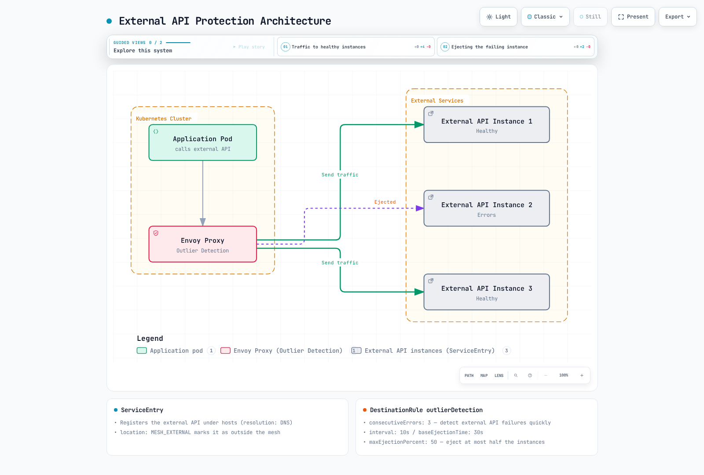

# Detección de instancias anómalas (Outlier Detection)

> **Última actualización**: 11 de septiembre de 2026 · Istio 1.31. Los ejemplos son independientes y utilizan sidecars. Antes de probarlos, cree los espacios de nombres indicados y prepare cargas de trabajo y endpoints reales. Las configuraciones para un mismo host son alternativas. Los valores sirven de ejemplo y no se han probado bajo carga.

Outlier Detection aplica el patrón Circuit Breaker para detectar instancias de servicio que presentan fallos y excluirlas del conjunto de destinos que reciben tráfico.

## Índice

1. [Descripción general](#overview)
2. [Funcionamiento](#how-it-works)
3. [Configuración básica](#basic-configuration)
4. [Configuración avanzada](#advanced-configuration)
5. [Protección de servicios externos (ServiceEntry)](#protecting-external-services-serviceentry)
6. [Ejemplos prácticos](#practical-examples)
7. [Monitorización](#monitoring)
8. [Solución de problemas](#troubleshooting)

## Descripción general {#overview}

La detección es pasiva y cada proxy toma sus propias decisiones a partir del tráfico que observa. Cuando puede inspeccionar HTTP, cuenta las respuestas del backend que cumplen los criterios y los fallos locales de conexión. DestinationRule no ofrece un umbral de latencia para esta detección, y el proxy no envía sondas periódicas de recuperación. Una expulsión excluye el host del balanceo de carga de ese proxy; no elimina el Pod ni repara el servicio.


### Funciones principales

1. **Detección**: cuenta los fallos consecutivos de HTTP o transporte definidos en la configuración.
2. **Expulsión**: excluye un host si la política permite hacer efectiva la expulsión y no se supera su límite.
3. **Reincorporación**: vuelve a permitir que el host reciba tráfico al terminar el período de expulsión. Para confirmar su recuperación, aún deben observarse solicitudes exitosas.

## Funcionamiento {#how-it-works}

### Proceso de detección de instancias anómalas

Una respuesta exitosa reinicia la secuencia de errores consecutivos correspondiente. Un fallo que cumpla los criterios y alcance el umbral puede provocar la expulsión inmediatamente, sin esperar a `interval`. Si un host se expulsa repetidamente, la duración aumenta según la duración base y el multiplicador, hasta el límite de Envoy. No se trata de una sonda que se ejecute cada 30 segundos ni de una duración que se duplique exponencialmente.


### Métodos de detección

| Método | Descripción | Escenario de uso |
|--------|-------------|--------------|
| **Errores consecutivos** | Detecta errores 5xx consecutivos | Fallos de aplicación |
| **Errores de gateway** | Detecta errores 502, 503 y 504 | Sobrecarga del servicio |
| **Fallos de conexión** | Detecta fallos de conexión TCP | Problemas de red |
| **Latencia** | DestinationRule no ofrece un umbral de latencia para Outlier Detection | Observe la latencia y configure por separado los tiempos de espera de la aplicación o la ruta |

## Configuración básica {#basic-configuration}

### Detección basada en errores consecutivos

```yaml
apiVersion: networking.istio.io/v1
kind: DestinationRule
metadata:
  name: reviews-outlier
  namespace: default
spec:
  host: reviews
  trafficPolicy:
    outlierDetection:
      consecutive5xxErrors: 5
      interval: 30s
      baseEjectionTime: 30s
      maxEjectionPercent: 50
      minHealthPercent: 0
```

### Descripción de los parámetros principales

#### consecutive5xxErrors
- **Descripción**: número de errores consecutivos que activa la detección
- **Valor predeterminado**: 5
- **Rango de ejemplo para el ajuste**: 3-10, según las características del servicio

```yaml
# Sensitive service (fast detection)
consecutive5xxErrors: 3

# General service
---
consecutive5xxErrors: 5

# Lenient setting (prevent false positives)
---
consecutive5xxErrors: 10
```

#### interval
- **Descripción**: intervalo del barrido periódico de expulsiones; la detección de errores consecutivos es inmediata
- **Valor predeterminado**: 10s
- **Rango de ejemplo para el ajuste**: 10s-60s

```yaml
# Fast detection (high load)
interval: 10s

# General case
---
interval: 30s

# Stable service
---
interval: 60s
```

#### baseEjectionTime
- **Descripción**: duración mínima de la expulsión de una instancia
- **Valor predeterminado**: 30s
- **Rango de ejemplo para el ajuste**: 30s-300s

```yaml
# Fast recovery attempt
baseEjectionTime: 30s

# General case
---
baseEjectionTime: 60s

# Cautious recovery
---
baseEjectionTime: 300s
```

#### maxEjectionPercent
- **Descripción**: porcentaje máximo de instancias que pueden permanecer expulsadas a la vez
- **Valor predeterminado**: 10%
- **Rango de ejemplo para el ajuste**: 10%-50%

```yaml
# Conservative (stability first)
maxEjectionPercent: 10

# Balanced setting
---
maxEjectionPercent: 30

# Aggressive (quality first)
---
maxEjectionPercent: 50
```

## Configuración avanzada {#advanced-configuration}

### Detección basada en errores de gateway

```yaml
apiVersion: networking.istio.io/v1
kind: DestinationRule
metadata:
  name: reviews-gateway-errors
  namespace: default
spec:
  host: reviews
  trafficPolicy:
    outlierDetection:
      consecutiveGatewayErrors: 3
      interval: 10s
      baseEjectionTime: 60s
      maxEjectionPercent: 50
      minHealthPercent: 0
```

### Umbral de pánico según la proporción de hosts sanos

```yaml
apiVersion: networking.istio.io/v1
kind: DestinationRule
metadata:
  name: reviews-panic-threshold-example
  namespace: default
spec:
  host: reviews
  trafficPolicy:
    outlierDetection:
      consecutive5xxErrors: 5
      interval: 30s
      baseEjectionTime: 30s
      minHealthPercent: 50
      maxEjectionPercent: 30
```

`minHealthPercent: 50` permite optar por un comportamiento fail-open en modo pánico: cuando la proporción de hosts sanos cae por debajo del umbral, el proxy también puede enviar tráfico a hosts no sanos. No define un número mínimo de solicitudes, no garantiza capacidad sana ni evita un split-brain. El valor predeterminado de Istio es 0; los otros ejemplos utilizan 0 para desactivar este umbral. Limitar las expulsiones no convierte los endpoints restantes en endpoints sanos.

### Detección basada en fallos de conexión

```yaml
apiVersion: networking.istio.io/v1
kind: DestinationRule
metadata:
  name: reviews-connection-errors
  namespace: default
spec:
  host: reviews
  trafficPolicy:
    connectionPool:
      tcp:
        maxConnections: 100
      http:
        http1MaxPendingRequests: 10
        maxRequestsPerConnection: 2
    outlierDetection:
      consecutiveLocalOriginFailures: 5
      interval: 10s
      baseEjectionTime: 30s
      maxEjectionPercent: 50
      splitExternalLocalOriginErrors: true
      minHealthPercent: 0
```

### Detección basada en la tasa de éxito (avanzada)

Envoy ofrece detección estadística basada en la tasa de éxito. Esta depende de un número mínimo de hosts, del volumen de solicitudes y de la desviación estadística; no consiste simplemente en detectar una tasa inferior al 95%. La API DestinationRule de Istio 1.31 no expone `enforcingConsecutiveErrors`/`enforcingSuccessRate` ni esos umbrales estadísticos. La [implementación publicada](https://github.com/istio/istio/blob/1.31.0/pilot/pkg/networking/core/cluster_traffic_policy.go) desactiva explícitamente las expulsiones basadas en la tasa de éxito. `splitExternalLocalOriginErrors` separa las clases de errores; no establece un mínimo de solicitudes. Utilice aquí los campos admitidos para errores consecutivos. Los cambios avanzados mediante EnvoyFilter deben adaptarse a la versión y validarse en la configuración efectiva del proxy.

## Protección de servicios externos (ServiceEntry) {#protecting-external-services-serviceentry}

Registre las API externas o los sistemas heredados mediante ServiceEntry y configure Outlier Detection para limitar la propagación de sus fallos.

### Arquitectura de protección de API externas



[🔍 Ver diagrama interactivo](https://www.atomai.click/kubernetes-docs/archmaps/en-service-mesh-istio-resilience-01-outlier-detection-2.html)

Para que el proxy pueda inspeccionar HTTP en estos ejemplos de API externas, la aplicación debe llamar al **puerto HTTP 80** y el sidecar debe iniciar TLS hacia el puerto de destino 443. Las configuraciones establecen SNI/SAN y utilizan el almacén de certificados de confianza del sistema operativo del proxy. Si utiliza una CA privada, monte el paquete de CA correspondiente. El tramo entre la aplicación y el sidecar no está cifrado, por lo que este diseño no sirve cuando ese tramo también requiere cifrado. Si la aplicación inicia HTTPS, utilice paso directo sin añadir otra capa TLS SIMPLE: Envoy podrá observar fallos de transporte, pero no el estado ni la latencia HTTP ni aplicar reglas de reintento HTTP. Antes de enviar credenciales, compruebe la incorporación a la malla, el enrutamiento y la validación de certificados. Los hosts y las IP siguientes son ejemplos; sustitúyalos por endpoints reales y autorizados.

### Ejemplo 1: API externa única (basada en DNS)

```yaml
apiVersion: networking.istio.io/v1
kind: ServiceEntry
metadata:
  name: external-payment-api
  namespace: payment
spec:
  hosts:
  - api.payment-provider.com
  resolution: DNS
  ports:
  - number: 80
    name: http
    protocol: HTTP
    targetPort: 443
  location: MESH_EXTERNAL
---
apiVersion: networking.istio.io/v1
kind: DestinationRule
metadata:
  name: external-payment-api
  namespace: payment
spec:
  host: api.payment-provider.com
  trafficPolicy:
    connectionPool:
      tcp:
        maxConnections: 100
        connectTimeout: 3s
      http:
        http1MaxPendingRequests: 50
        http2MaxRequests: 100
        maxRequestsPerConnection: 10
        maxRetries: 3
    outlierDetection:
      consecutive5xxErrors: 3
      consecutiveGatewayErrors: 2
      interval: 10s
      baseEjectionTime: 30s
      maxEjectionPercent: 50
      splitExternalLocalOriginErrors: true
      consecutiveLocalOriginFailures: 3
      minHealthPercent: 0
    portLevelSettings:
    - port:
        number: 80
      tls:
        mode: SIMPLE
        sni: api.payment-provider.com
        subjectAltNames:
        - api.payment-provider.com
---
apiVersion: networking.istio.io/v1
kind: VirtualService
metadata:
  name: external-payment-api
  namespace: payment
spec:
  hosts:
  - api.payment-provider.com
  http:
  - name: no-retries
    route:
    - destination:
        host: api.payment-provider.com
        port:
          number: 80
    retries:
      attempts: 0
    timeout: 5s
```

**Ejemplo de uso**:
```go
package payment

import (
    "bytes"
    "context"
    "fmt"
    "io"
    "net/http"
    "time"
)

var paymentClient = &http.Client{
    Timeout: 5 * time.Second,
    CheckRedirect: func(req *http.Request, via []*http.Request) error {
        return http.ErrUseLastResponse
    },
}

// payload, authentication and payment-provider idempotency are application concerns.
// Requires the port80-to443 sidecar TLS-origination policy above.
func processPayment(ctx context.Context, payload []byte) error {
    req, err := http.NewRequestWithContext(ctx, http.MethodPost,
        "http://api.payment-provider.com/v1/charge", bytes.NewReader(payload))
    if err != nil { return err }
    req.Header.Set("Content-Type", "application/json")
    resp, err := paymentClient.Do(req)
    if err != nil { return fmt.Errorf("payment transport failed: %w", err) }
    defer resp.Body.Close()
    _, _ = io.Copy(io.Discard, io.LimitReader(resp.Body, 1<<20))
    if resp.StatusCode < 200 || resp.StatusCode >= 300 {
        return fmt.Errorf("payment endpoint returned HTTP %d", resp.StatusCode)
    }
    return nil
}
```

Outlier Detection modifica la selección del host para las solicitudes posteriores; no reintenta pagos ni elimina operaciones duplicadas. VirtualService desactiva explícitamente los reintentos de la malla. Un nombre DNS puede corresponder a un único host de Envoy, por lo que su expulsión no garantiza que exista otro endpoint del proveedor. Un error de transporte no permite saber si la transacción remota llegó a confirmarse.

### Ejemplo 2: varios endpoints de API externa

```yaml
apiVersion: networking.istio.io/v1
kind: ServiceEntry
metadata:
  name: external-weather-api
  namespace: weather
spec:
  hosts:
  - weather.api.com
  resolution: STATIC
  ports:
  - number: 80
    name: http
    protocol: HTTP
    targetPort: 443
  location: MESH_EXTERNAL
  endpoints:
  - address: 203.0.113.10
    labels:
      region: us-east-1
    locality: us-east-1
  - address: 203.0.113.20
    labels:
      region: us-west-2
    locality: us-west-2
  - address: 203.0.113.30
    labels:
      region: eu-central-1
    locality: eu-central-1
---
apiVersion: networking.istio.io/v1
kind: DestinationRule
metadata:
  name: external-weather-api
  namespace: weather
spec:
  host: weather.api.com
  trafficPolicy:
    loadBalancer:
      simple: LEAST_REQUEST
    connectionPool:
      tcp:
        maxConnections: 50
        connectTimeout: 5s
      http:
        http1MaxPendingRequests: 20
        maxRequestsPerConnection: 5
    outlierDetection:
      consecutive5xxErrors: 5
      consecutiveGatewayErrors: 3
      consecutiveLocalOriginFailures: 5
      interval: 30s
      baseEjectionTime: 60s
      maxEjectionPercent: 33
      splitExternalLocalOriginErrors: true
      minHealthPercent: 0
    portLevelSettings:
    - port:
        number: 80
      tls:
        mode: SIMPLE
        sni: weather.api.com
        subjectAltNames:
        - weather.api.com
---
apiVersion: networking.istio.io/v1
kind: VirtualService
metadata:
  name: external-weather-api
  namespace: weather
spec:
  hosts:
  - weather.api.com
  http:
  - name: no-retries
    route:
    - destination:
        host: weather.api.com
        port:
          number: 80
    retries:
      attempts: 0
    timeout: 5s
```

Las tres IP de documentación representan miembros de un mismo conjunto de backends. `maxEjectionPercent` limita las expulsiones en ese conjunto, no a «una por región». Las etiquetas son metadatos y `locality` describe la topología. El redondeo, el número de hosts descubiertos y las expulsiones que ya están activas determinan cuántos hosts pueden excluirse realmente.

### Ejemplo 3: protección de una base de datos heredada

```yaml
apiVersion: networking.istio.io/v1
kind: ServiceEntry
metadata:
  name: legacy-postgres
  namespace: database
spec:
  hosts:
  - legacy-db.company.internal
  resolution: DNS
  ports:
  - number: 5432
    name: tcp-postgres
    protocol: TCP
  location: MESH_EXTERNAL
---
apiVersion: networking.istio.io/v1
kind: DestinationRule
metadata:
  name: legacy-postgres
  namespace: database
spec:
  host: legacy-db.company.internal
  trafficPolicy:
    connectionPool:
      tcp:
        maxConnections: 50
        connectTimeout: 10s
    outlierDetection:
      consecutive5xxErrors: 10
      consecutiveLocalOriginFailures: 5
      interval: 60s
      baseEjectionTime: 300s
      maxEjectionPercent: 20
      splitExternalLocalOriginErrors: true
      minHealthPercent: 0
```

Este ejemplo TCP observa fallos de conexión y transporte; no detecta errores SQL, bloqueos ni latencia de consultas. Asegúrese de que ServiceEntry identifique el destino sin ambigüedad. Si varios destinos comparten un puerto TCP, puede ser necesario diseñar la captura de DNS y el uso de VIP. Esta configuración no elige el primario de escritura de una base de datos ni garantiza una conmutación segura entre réplicas.

### Ejemplo 4: API externa con reintentos

```yaml
apiVersion: networking.istio.io/v1
kind: ServiceEntry
metadata:
  name: external-geocoding-api
  namespace: location
spec:
  hosts:
  - maps.googleapis.com
  resolution: DNS
  ports:
  - number: 80
    name: http
    protocol: HTTP
    targetPort: 443
  location: MESH_EXTERNAL
---
apiVersion: networking.istio.io/v1
kind: VirtualService
metadata:
  name: external-geocoding-api
  namespace: location
spec:
  hosts:
  - maps.googleapis.com
  http:
  - name: writes-no-retry
    match:
    - method:
        regex: ^(POST|PUT|PATCH|DELETE)$
    route:
    - destination:
        host: maps.googleapis.com
        port:
          number: 80
    retries:
      attempts: 0
    timeout: 5s
  - timeout: 5s
    retries:
      attempts: 3
      perTryTimeout: 2s
      retryOn: gateway-error,connect-failure,refused-stream
    route:
    - destination:
        host: maps.googleapis.com
        port:
          number: 80
    name: idempotent-reads
    match:
    - method:
        regex: ^(GET|HEAD|OPTIONS)$
  - name: other-methods-no-retry
    route:
    - destination:
        host: maps.googleapis.com
        port:
          number: 80
    retries:
      attempts: 0
    timeout: 5s
---
apiVersion: networking.istio.io/v1
kind: DestinationRule
metadata:
  name: external-geocoding-api
  namespace: location
spec:
  host: maps.googleapis.com
  trafficPolicy:
    connectionPool:
      tcp:
        maxConnections: 100
        connectTimeout: 3s
      http:
        http1MaxPendingRequests: 50
        maxRequestsPerConnection: 10
        maxRetries: 3
    outlierDetection:
      consecutive5xxErrors: 3
      consecutiveGatewayErrors: 2
      consecutiveLocalOriginFailures: 3
      interval: 10s
      baseEjectionTime: 30s
      maxEjectionPercent: 50
      splitExternalLocalOriginErrors: true
      minHealthPercent: 0
    portLevelSettings:
    - port:
        number: 80
      tls:
        mode: SIMPLE
        sni: maps.googleapis.com
        subjectAltNames:
        - maps.googleapis.com
```

El ejemplo de geocodificación solo reintenta las lecturas idempotentes que coinciden con las reglas. La aplicación debe utilizar el puerto HTTP 80 para que el proxy pueda inspeccionar el método; esta política HTTP no puede aplicarse a HTTPS en paso directo. Tres reintentos más el intento inicial no caben en el tiempo de espera total de 5s si cada intento dura 2s.

### Ejemplo 5: servicio externo con límite de solicitudes

```yaml
apiVersion: networking.istio.io/v1
kind: ServiceEntry
metadata:
  name: external-rate-limited-api
  namespace: api
spec:
  hosts:
  - api.third-party.com
  resolution: DNS
  ports:
  - number: 80
    name: http
    protocol: HTTP
    targetPort: 443
  location: MESH_EXTERNAL
---
apiVersion: v1
kind: ConfigMap
metadata:
  name: ratelimit-config
  namespace: api
data:
  config.yaml: "domain: external-api-ratelimit\ndescriptors:\n- key: destination_cluster\n  value: outbound|80||api.third-party.com\n  rate_limit:\n    unit: second\n    requests_per_unit: 100\n"
---
apiVersion: networking.istio.io/v1
kind: DestinationRule
metadata:
  name: external-rate-limited-api
  namespace: api
spec:
  host: api.third-party.com
  trafficPolicy:
    connectionPool:
      tcp:
        maxConnections: 100
      http:
        http1MaxPendingRequests: 50
        http2MaxRequests: 100
        maxRequestsPerConnection: 10
    outlierDetection:
      consecutive5xxErrors: 3
      consecutiveGatewayErrors: 2
      interval: 10s
      baseEjectionTime: 60s
      maxEjectionPercent: 50
      splitExternalLocalOriginErrors: true
      consecutiveLocalOriginFailures: 3
      minHealthPercent: 0
    portLevelSettings:
    - port:
        number: 80
      tls:
        mode: SIMPLE
        sni: api.third-party.com
        subjectAltNames:
        - api.third-party.com
---
apiVersion: networking.istio.io/v1
kind: VirtualService
metadata:
  name: external-rate-limited-api
  namespace: api
spec:
  hosts:
  - api.third-party.com
  http:
  - name: no-retries
    route:
    - destination:
        host: api.third-party.com
        port:
          number: 80
    retries:
      attempts: 0
    timeout: 5s
```

El ConfigMap contiene únicamente un fragmento de configuración del servicio de limitación de solicitudes. Debe montarse en un servicio compatible que esté en ejecución, disponga de su almacenamiento de respaldo y tenga configurados el filtro de Envoy para tráfico saliente y el descriptor `destination_cluster` correspondiente. El ConfigMap por sí solo no impone ningún límite. Los errores de gateway son 502/503/504, no 429, y la detección estándar de 5xx tampoco trata 429 como un error de gateway. El período de expulsión no coincide necesariamente con el momento en que el proveedor restablece su cuota. Procese los errores según la cuota, respete Retry-After y utilice esperas progresivas en la aplicación, en lugar de expulsar todos los hosts sanos que han agotado su cuota.

### Buenas prácticas de Outlier Detection para servicios externos

#### 1. Distinguir los tipos de errores

```yaml
outlierDetection:
  # Gateway errors (502, 503, 504)
  consecutiveGatewayErrors: 2  # Detect quickly

  # 5xx errors (500, 501, etc.)
  consecutive5xxErrors: 3

  # Local errors (timeout, connection failure)
  consecutiveLocalOriginFailures: 3

  # Track local and remote errors separately
  splitExternalLocalOriginErrors: true
```

**Importante**: al establecer `splitExternalLocalOriginErrors: true`:
- **Fallos de origen local**: conexiones que agotan el tiempo de espera, se reinician o se rechazan, cuando el fallo puede atribuirse a un host de destino. Un fallo de resolución DNS puede no dejar ningún host que expulsar.
- **Fallos del backend**: errores 5xx devueltos por la API externa.

Se cuentan por separado para una detección más precisa.

#### 2. Configuración de tiempos de espera

```yaml
apiVersion: networking.istio.io/v1
kind: ServiceEntry
metadata:
  name: external-api
  namespace: default
spec:
  hosts:
  - api.external.com
  location: MESH_EXTERNAL
  resolution: DNS
  ports:
  - number: 80
    name: http
    protocol: HTTP
    targetPort: 443
---
apiVersion: networking.istio.io/v1
kind: VirtualService
metadata:
  name: external-api
  namespace: default
spec:
  hosts:
  - api.external.com
  http:
  - name: writes-no-retry
    match:
    - method:
        regex: ^(POST|PUT|PATCH|DELETE)$
    route:
    - destination:
        host: api.external.com
        port:
          number: 80
    retries:
      attempts: 0
    timeout: 5s
  - timeout: 5s
    retries:
      attempts: 3
      perTryTimeout: 2s
      retryOn: gateway-error,connect-failure,refused-stream
    route:
    - destination:
        host: api.external.com
        port:
          number: 80
    name: idempotent-reads
    match:
    - method:
        regex: ^(GET|HEAD|OPTIONS)$
  - name: other-methods-no-retry
    route:
    - destination:
        host: api.external.com
        port:
          number: 80
    retries:
      attempts: 0
    timeout: 5s
---
apiVersion: networking.istio.io/v1
kind: DestinationRule
metadata:
  name: external-api
  namespace: default
spec:
  host: api.external.com
  trafficPolicy:
    connectionPool:
      tcp:
        connectTimeout: 3s
    outlierDetection:
      consecutiveLocalOriginFailures: 3
      splitExternalLocalOriginErrors: true
      minHealthPercent: 0
    portLevelSettings:
    - port:
        number: 80
      tls:
        mode: SIMPLE
        sni: api.external.com
        subjectAltNames:
        - api.external.com
```

#### 3. Monitorización de servicios externos

```promql
# Outlier Detection metrics
# 1. Ejected external endpoints
envoy_cluster_outlier_detection_ejections_active{
  namespace="default", cluster_name=~"outbound.*api\\.external\\.com.*"
}

# 2. Local errors (timeout, connection failure)
rate(envoy_cluster_upstream_rq_timeout{
  namespace="default", cluster_name=~"outbound.*api\\.external\\.com.*"
}[5m])

# 3. External API 5xx errors
rate(istio_requests_total{
  reporter="source", source_workload_namespace="default",
  destination_service="api.external.com",
  response_code=~"5.."
}[5m])

# 4. External API response time
histogram_quantile(0.95,
  sum(rate(istio_request_duration_milliseconds_bucket{
    reporter="source", source_workload_namespace="default",
    destination_service="api.external.com"
  }[5m])) by (le)
)
```

#### 4. Configuración de alertas

Este fragmento pertenece a un archivo de reglas de Prometheus, no a un recurso de Kubernetes. Monte el archivo y configure Prometheus para cargarlo, o incluya los grupos en un PrometheusRule seleccionado por su configuración. Antes de adoptar los umbrales como SLO, debe validarlos teniendo en cuenta el volumen de tráfico, la ausencia de datos y el estado de la recopilación. Las consultas siguientes expresan la latencia en milisegundos y las tasas por segundo.


```yaml
# Prometheus Alert Rules
groups:
- name: external_api_alerts
  interval: 1m
  rules:
  # High external API error rate
  - alert: ExternalAPIHighErrorRate
    expr: |
      (sum(rate(istio_requests_total{
        reporter="source", source_workload_namespace="default",
        destination_service=~".*external.*",
        response_code=~"5.."
      }[5m])) by (destination_service)
      /
      sum(rate(istio_requests_total{
        reporter="source", source_workload_namespace="default",
        destination_service=~".*external.*"
      }[5m])) by (destination_service))
      * 100 > 5
    for: 2m
    labels:
      severity: warning
    annotations:
      summary: "High error rate for external API {{ $labels.destination_service }}"
      description: "Error rate is {{ $value }}%"

  # External API instance ejected
  - alert: ExternalAPIInstanceEjected
    expr: |
      envoy_cluster_outlier_detection_ejections_active{
        namespace="default", cluster_name=~"outbound.*external.*"
      } > 0
    for: 1m
    labels:
      severity: warning
    annotations:
      summary: "External API instance ejected"
      description: "{{ $value }} instances ejected from {{ $labels.cluster_name }}"

  # Increased external API timeouts
  - alert: ExternalAPIHighTimeout
    expr: |
      rate(envoy_cluster_upstream_rq_timeout{
        namespace="default", cluster_name=~"outbound.*external.*"
      }[5m]) > 0.1
    for: 2m
    labels:
      severity: warning
    annotations:
      summary: "High timeout rate for external API"
      description: "Timeout rate is {{ $value }} req/s"
```

#### 5. Solución de problemas

Ejecute el diagnóstico en el proxy del cliente que realiza las llamadas. El comando de conectividad necesita curl en un contenedor autorizado de la aplicación o de pruebas, y debe apuntar a un endpoint real de estado que solo realice lecturas. Ejecutar curl dentro de `istio-proxy` puede eludir la ruta habitual del tráfico de la aplicación. Las consultas genéricas de monitorización corresponden al ejemplo independiente `default`/`api.external.com`; ajuste su ámbito para los demás ejemplos.


```bash
# 1. Check ServiceEntry
kubectl get serviceentry -A
kubectl describe serviceentry external-api -n <namespace>

# 2. Verify DestinationRule application
istioctl proxy-config clusters <pod-name> -n <namespace> --fqdn api.external.com -o json | \
  jq '.[] | {name: .name, outlierDetection: .outlierDetection}'

# 3. Test external API connection
kubectl exec <client-pod> -n default -c <app-container> -- \
  curl --max-time 5 -v http://api.external.com/health

# 4. Check Envoy statistics
istioctl x envoy-stats <pod-name> -n <namespace> --output prom | grep "outbound.*external"

# 5. Outlier Detection status
istioctl x envoy-stats <pod-name> -n <namespace> --type clusters
```

### Escenarios de fallo de servicios externos

#### Escenario 1: fallo temporal de API externa

```yaml
# Configuration: Fast detection and recovery
outlierDetection:
  consecutive5xxErrors: 3           # 3 consecutive errors
  consecutiveGatewayErrors: 2    # 2 gateway errors
  interval: 10s                  # Evaluate every 10 seconds
  baseEjectionTime: 30s          # Recovery attempt after 30 seconds
  maxEjectionPercent: 50         # Maximum 50% ejection
```

**Comportamiento esperado, sujeto a los límites efectivos**:

1. Las respuestas 502/503 que cumplen los criterios cuentan para el umbral de errores de gateway.
2. Dos fallos de gateway consecutivos pueden provocar la expulsión si la política permite hacerla efectiva y no se supera el límite.
3. Al terminar el período de expulsión, el host vuelve a poder recibir tráfico. Este ejemplo no configura sondas activas.
4. Las expulsiones repetidas aumentan la duración según el multiplicador y el límite de Envoy. La reincorporación no demuestra que el proveedor se haya recuperado.

#### Escenario 2: caída completa de la API externa

```yaml
apiVersion: networking.istio.io/v1
kind: ServiceEntry
metadata:
  name: external-api-ha
  namespace: default
spec:
  hosts:
  - api.external.com
  resolution: STATIC
  endpoints:
  - address: 203.0.113.10
    labels:
      tier: primary
  - address: 203.0.113.20
    labels:
      tier: secondary
  - address: 203.0.113.30
    labels:
      tier: tertiary
  ports:
  - number: 80
    name: http
    protocol: HTTP
    targetPort: 443
  location: MESH_EXTERNAL
---
apiVersion: networking.istio.io/v1
kind: DestinationRule
metadata:
  name: external-api-ha
  namespace: default
spec:
  host: api.external.com
  trafficPolicy:
    outlierDetection:
      consecutive5xxErrors: 3
      consecutiveLocalOriginFailures: 3
      interval: 10s
      baseEjectionTime: 60s
      maxEjectionPercent: 66
      minHealthPercent: 0
      splitExternalLocalOriginErrors: true
    portLevelSettings:
    - port:
        number: 80
      tls:
        mode: SIMPLE
        sni: api.external.com
        subjectAltNames:
        - api.external.com
---
apiVersion: networking.istio.io/v1
kind: VirtualService
metadata:
  name: external-api-ha
  namespace: default
spec:
  hosts:
  - api.external.com
  http:
  - name: no-retries
    route:
    - destination:
        host: api.external.com
        port:
          number: 80
    retries:
      attempts: 0
    timeout: 5s
```

**Interpretación**:

Los tres endpoints pertenecen a un mismo conjunto. Las etiquetas `tier: primary/secondary/tertiary` no establecen un orden de conmutación: el balanceo normal puede elegir cualquiera de los endpoints disponibles. El proxy puede excluir localmente un endpoint con fallos y seleccionar otro, pero el enrutamiento no repara un servicio externo que ha fallado por completo. `minHealthPercent: 0` desactiva el uso de hosts no sanos en modo pánico; el límite de expulsiones no garantiza que quede algún host sano. Si necesita una conmutación ordenada, configure explícitamente prioridades de localidad o utilice un mecanismo de la aplicación o del proveedor. Sustituya las IP de documentación antes de probar la conectividad.

## Ejemplos prácticos {#practical-examples}

### Ejemplo 1: cadena de microservicios

```yaml
apiVersion: networking.istio.io/v1
kind: DestinationRule
metadata:
  name: backend-outlier
  namespace: default
spec:
  host: backend
  trafficPolicy:
    outlierDetection:
      consecutive5xxErrors: 3
      interval: 10s
      baseEjectionTime: 30s
      maxEjectionPercent: 50
      minHealthPercent: 0
---
apiVersion: networking.istio.io/v1
kind: DestinationRule
metadata:
  name: database-outlier
  namespace: default
spec:
  host: database
  trafficPolicy:
    outlierDetection:
      consecutive5xxErrors: 10
      interval: 60s
      baseEjectionTime: 300s
      maxEjectionPercent: 20
      minHealthPercent: 0
```

### Ejemplo 2: uso con despliegue canary

```yaml
apiVersion: networking.istio.io/v1
kind: VirtualService
metadata:
  name: reviews-canary
  namespace: default
spec:
  hosts:
  - reviews
  http:
  - route:
    - destination:
        host: reviews
        subset: v1
      weight: 90
    - destination:
        host: reviews
        subset: v2
      weight: 10
    retries:
      attempts: 0
---
apiVersion: networking.istio.io/v1
kind: DestinationRule
metadata:
  name: reviews
  namespace: default
spec:
  host: reviews
  subsets:
  - name: v1
    labels:
      version: v1
  - name: v2
    labels:
      version: v2
    trafficPolicy:
      outlierDetection:
        consecutive5xxErrors: 3
        interval: 10s
        baseEjectionTime: 60s
        maxEjectionPercent: 100
        minHealthPercent: 0
```

Expulsar todos los endpoints v2 no transfiere a v1 su peso de ruta del 10%. Las solicitudes dirigidas a un subconjunto canary vacío pueden fallar. El controlador del despliegue debe cambiar el peso de la ruta o revertir el despliegue según el estado observado. Las etiquetas de las cargas de trabajo deben coincidir con las de ambos subconjuntos.

### Ejemplo 3: despliegue multirregión

```yaml
apiVersion: networking.istio.io/v1
kind: DestinationRule
metadata:
  name: api-multi-region
  namespace: default
spec:
  host: api
  trafficPolicy:
    loadBalancer:
      localityLbSetting:
        enabled: true
        distribute:
        - from: us-east-1/*
          to:
            us-east-1/*: 80
            us-west-2/*: 20
    outlierDetection:
      consecutive5xxErrors: 10
      interval: 60s
      baseEjectionTime: 120s
      maxEjectionPercent: 30
      minHealthPercent: 0
```

La política 80/20 envía tráfico a ambas regiones mientras están sanas; la segunda región no queda en espera como reserva. El diseño requiere metadatos reales de localidad regional, conectividad entre regiones y capacidad suficiente. Escribir un nombre de región no crea por sí solo una malla multiclúster.

### Ejemplo 4: grupo de conexiones + Outlier Detection

```yaml
apiVersion: networking.istio.io/v1
kind: DestinationRule
metadata:
  name: reviews-full-protection
  namespace: default
spec:
  host: reviews
  trafficPolicy:
    connectionPool:
      tcp:
        maxConnections: 100
      http:
        http1MaxPendingRequests: 50
        http2MaxRequests: 100
        maxRequestsPerConnection: 2
    outlierDetection:
      consecutive5xxErrors: 5
      consecutiveGatewayErrors: 3
      interval: 30s
      baseEjectionTime: 30s
      maxEjectionPercent: 50
      minHealthPercent: 0
```

## Monitorización {#monitoring}

### Métricas de Prometheus

Habilite las estadísticas opcionales del proxy y las etiquetas de recopilación como se explica en la [descripción general de resiliencia](README.md#resilience-metrics). Los ejemplos conservan `pod`/`cluster_name` para identificar cada proxy. Sumar las expulsiones observadas por distintos clientes no equivale a contar Pods de servidor únicos. La configuración de arranque publicada de Istio utiliza `cluster_name`; compruebe qué etiquetas quedan después del reetiquetado del recopilador. Los contadores `enforced_*` registran expulsiones efectivas, mientras que `detected_*` pueden aumentar aunque un límite impida expulsar al host.

```promql
# Current ejections, not a cumulative event counter
envoy_cluster_outlier_detection_ejections_active{namespace="default"}

# Enforced ejection events per second
rate(envoy_cluster_outlier_detection_ejections_enforced_total{namespace="default"}[5m])

# Percentage of the total observed pool, excluding zero-size pools
100 * envoy_cluster_outlier_detection_ejections_active{namespace="default"} /
(envoy_cluster_membership_total{namespace="default"} > 0)

rate(envoy_cluster_outlier_detection_ejections_enforced_consecutive_5xx{namespace="default"}[5m])
rate(envoy_cluster_outlier_detection_ejections_enforced_consecutive_gateway_failure{namespace="default"}[5m])
rate(envoy_cluster_outlier_detection_ejections_enforced_consecutive_local_origin_failure{namespace="default"}[5m])
```

### Ejemplo de panel de Grafana

Guarde este objeto de dashboard siguiendo el [procedimiento de aprovisionamiento mediante archivos](../observability/04-dashboards.md). Requiere una fuente de datos con UID `prometheus` y las etiquetas reales `namespace`/`pod`/`cluster_name`. Crear un ConfigMap no basta para cargar el dashboard.

```json
{
  "uid": "istio-outlier-detection",
  "title": "Istio Outlier Detection",
  "panels": [
    {
      "id": 1,
      "title": "Ejected Hosts",
      "type": "timeseries",
      "datasource": {
        "type": "prometheus",
        "uid": "prometheus"
      },
      "targets": [
        {
          "expr": "envoy_cluster_outlier_detection_ejections_active{namespace=\"default\"}",
          "legendFormat": "{{pod}} / {{cluster_name}}",
          "refId": "A"
        }
      ],
      "gridPos": {
        "x": 0,
        "y": 0,
        "w": 24,
        "h": 8
      },
      "fieldConfig": {
        "defaults": {
          "unit": "short"
        }
      }
    },
    {
      "id": 2,
      "title": "Enforced Ejections per Second",
      "type": "timeseries",
      "datasource": {
        "type": "prometheus",
        "uid": "prometheus"
      },
      "targets": [
        {
          "expr": "rate(envoy_cluster_outlier_detection_ejections_enforced_total{namespace=\"default\"}[5m])",
          "legendFormat": "{{pod}} / {{cluster_name}}",
          "refId": "A"
        }
      ],
      "gridPos": {
        "x": 0,
        "y": 8,
        "w": 24,
        "h": 8
      },
      "fieldConfig": {
        "defaults": {
          "unit": "short"
        }
      }
    },
    {
      "id": 3,
      "title": "Ejected Pool Percentage",
      "type": "timeseries",
      "datasource": {
        "type": "prometheus",
        "uid": "prometheus"
      },
      "targets": [
        {
          "expr": "100 * envoy_cluster_outlier_detection_ejections_active{namespace=\"default\"} / (envoy_cluster_membership_total{namespace=\"default\"} > 0)",
          "legendFormat": "{{pod}} / {{cluster_name}}",
          "refId": "A"
        }
      ],
      "gridPos": {
        "x": 0,
        "y": 16,
        "w": 24,
        "h": 8
      },
      "fieldConfig": {
        "defaults": {
          "unit": "percent"
        }
      }
    }
  ],
  "time": {
    "from": "now-1h",
    "to": "now"
  },
  "refresh": "30s"
}
```

### Monitorización en tiempo real

```bash
# Check Envoy statistics
istioctl x envoy-stats <pod-name> -n <namespace> --output prom | grep outlier

# Key metrics:
# envoy_cluster_outlier_detection_ejections_active: Currently ejected instances
# envoy_cluster_outlier_detection_ejections_enforced_total: Total ejection count
# envoy_cluster_outlier_detection_ejections_enforced_consecutive_5xx: Ejections due to 5xx errors
```

### Verificar en Kiali

```bash
# Access Kiali
istioctl dashboard kiali

# Things to check:
# 1. Graph → Select service → Traffic tab
# 2. Graph health is aggregate telemetry, not every caller proxy’s ejection state
# 3. Check Outlier Detection metrics
```

## Solución de problemas {#troubleshooting}

### Outlier Detection no funciona

```bash
# 1. Check DestinationRule
kubectl get destinationrule -n <namespace>
kubectl describe destinationrule <name> -n <namespace>

# 2. Check Envoy cluster configuration
istioctl proxy-config clusters <pod-name> -n <namespace> --fqdn <service-fqdn> -o json | \
  jq '.[] | .outlierDetection'

# 3. Check Envoy logs
kubectl logs -n <namespace> <pod-name> -c istio-proxy | grep outlier

# 4. Validate control-plane configuration (istiod does not perform per-proxy ejections)
istioctl analyze -n <namespace>
```

### Se expulsan demasiadas instancias

Antes de cambiar los umbrales, revise los contadores de expulsiones efectivas, detecciones y expulsiones bloqueadas por el límite, junto con la capacidad restante y los tipos de error observados. Aumente el umbral de errores consecutivos solo si la aplicación puede tolerar esos fallos. Reduzca el límite de expulsiones teniendo en cuenta su efecto sobre la disponibilidad. Aumentar `interval` no retrasa una expulsión inmediata por errores consecutivos.

```yaml
# DestinationRule trafficPolicy fragment; illustrative values
outlierDetection:
  consecutive5xxErrors: 10
  interval: 30s
  baseEjectionTime: 30s
  maxEjectionPercent: 30
  minHealthPercent: 0
```

### No hay backends sanos

Este problema no equivale a un split-brain de base de datos. Compruebe el estado Ready, el descubrimiento y el enrutamiento, los endpoints y las expulsiones locales del proxy del cliente. `minHealthPercent: 50` puede permitir que se envíe tráfico a hosts no sanos en modo fail-open, pero no los recupera. Si se han expulsado todos los endpoints de un subconjunto canary, puede ser necesario revertir su ruta. Consulte el estado efectivo de los endpoints y de los clústeres del proxy; el YAML de DestinationRule o un icono de Kiali no bastan.

### Recuperación demasiado lenta tras la expulsión

Revise las expulsiones repetidas y el límite efectivo de duración de Envoy. Reducir `baseEjectionTime` puede devolver antes el tráfico a un host que sigue fallando; no repara el servicio. Las comprobaciones activas de estado son una función independiente y este DestinationRule no las habilita.

### Falsos positivos por errores temporales

Distinga los fallos de conexión de los de aplicación y compruebe si los reintentos los amplifican. Una respuesta 5xx puede ser intencionada; una respuesta lenta pero exitosa no activa por sí sola una detección basada en latencia. Limite el alcance del despliegue y compruebe la configuración modificada en el proxy. Los registros predeterminados pueden no incluir eventos de Outlier Detection.

## Buenas prácticas

### 1. Configuración por tipo de servicio

```yaml
# Critical service (fast detection)
outlierDetection:
  consecutive5xxErrors: 3
  interval: 10s
  baseEjectionTime: 30s
  maxEjectionPercent: 50

# General service
---
outlierDetection:
  consecutive5xxErrors: 5
  interval: 30s
  baseEjectionTime: 60s
  maxEjectionPercent: 30

# Stable service (lenient settings)
---
outlierDetection:
  consecutive5xxErrors: 10
  interval: 60s
  baseEjectionTime: 120s
  maxEjectionPercent: 20
```

### 2. Combinar con grupos de conexiones cuando sea necesario

```yaml
# Independent limits; size against measured caller/endpoint capacity
trafficPolicy:
  connectionPool:
    tcp:
      maxConnections: 100
    http:
      http1MaxPendingRequests: 50
  outlierDetection:
    consecutive5xxErrors: 5
    interval: 30s
```

### 3. Elegir deliberadamente el comportamiento de pánico

`minHealthPercent: 0` es el valor predeterminado de Istio y desactiva el umbral de pánico que permite utilizar hosts no sanos. Un valor distinto de cero implica un equilibrio entre disponibilidad y aislamiento; no garantiza que queden hosts sanos. Los límites de conexiones del patrón Circuit Breaker y Outlier Detection son controles independientes.

### 4. Despliegue gradual

Recopile primero una referencia y compruebe las políticas efectivas de la malla, el espacio de nombres y las cargas de trabajo. Aplique después un ajuste basado en mediciones a un grupo de prueba aislado, y amplíe el despliegue solo tras validarlo. No utilice `maxEjectionPercent: 0` como un modo de solo monitorización: la [implementación de Istio 1.31](https://github.com/istio/istio/blob/1.31.0/pilot/pkg/networking/core/cluster_traffic_policy.go) solo establece el campo de Envoy para valores mayores que 0. Con 0 se conserva el valor predeterminado de Envoy; no se desactivan las expulsiones. Los ajustes omitidos también pueden heredar valores de la malla. Compruebe las expulsiones efectivas y los endpoints restantes antes de ampliar el despliegue.

### 5. Monitorización y alertas

```yaml
# Prometheus Alerting Rule
groups:
- name: istio_outlier_detection
  rules:
  - alert: HighEjectionRate
    expr: rate(envoy_cluster_outlier_detection_ejections_enforced_total{namespace="default"}[5m]) > 0.1
    for: 5m
    labels:
      severity: warning
    annotations:
      summary: "High outlier ejection rate"
      description: "{{ $labels.cluster_name }} has enforced ejection rate > 0.1 events/s"
```

## Referencias

- [Outlier Detection de Istio](https://istio.io/latest/docs/reference/config/networking/destination-rule/#OutlierDetection)
- [Outlier Detection de Envoy](https://www.envoyproxy.io/docs/envoy/latest/intro/arch_overview/upstream/outlier)
- [Circuit Breaker](https://istio.io/latest/docs/tasks/traffic-management/circuit-breaking/)
