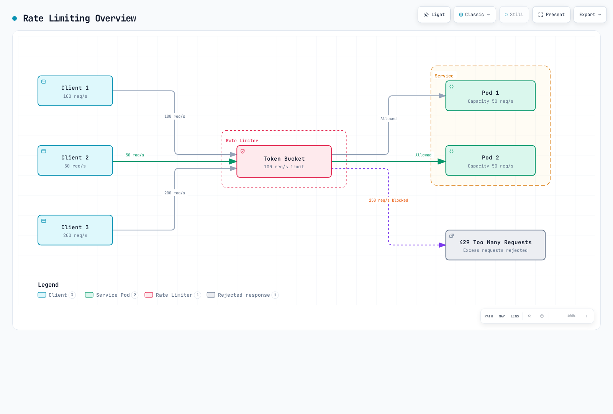
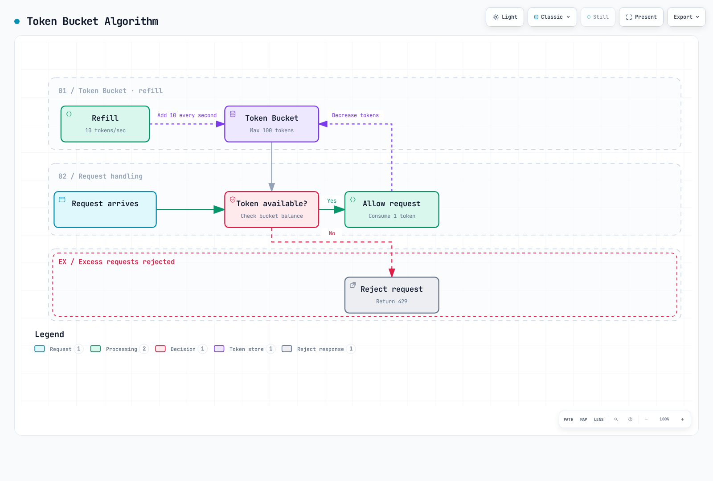
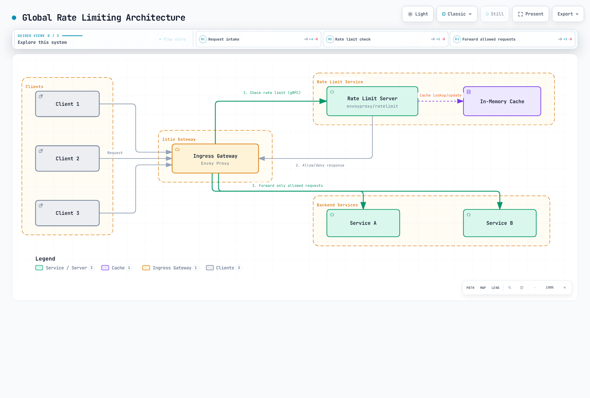

# Limitación de solicitudes

> **Última actualización**: 11 de septiembre de 2026 · Istio 1.31. Los ejemplos son independientes: elija una sola política local por carga de trabajo y listener. Las aplicaciones con sidecar usan HTTP en el puerto 8080, dentro del namespace `default`; los ejemplos de gateway seleccionan un gateway dedicado con la etiqueta `istio: ingressgateway`, en `istio-system`. Compruebe las etiquetas y los listeners reales antes de aplicar la configuración. Estas configuraciones no se han desplegado ni sometido a pruebas de carga.

La limitación de solicitudes restringe la frecuencia de las peticiones para proteger los servicios frente a la sobrecarga, distribuir los recursos de forma equitativa y controlar los costes.

## Índice

1. [Descripción general](#overview)
2. [Tipos](#rate-limiting-types)
3. [Limitación local](#local-rate-limiting)
4. [Limitación global](#global-rate-limiting)
5. [Ejemplos prácticos](#practical-examples)
6. [Monitorización](#monitoring)
7. [Resolución de problemas](#troubleshooting)

## Descripción general {#overview}

La limitación de solicitudes resulta útil en las siguientes situaciones:



[🔍 Ver diagrama interactivo](https://www.atomai.click/kubernetes-docs/archmaps/en-service-mesh-istio-resilience-02-rate-limiting-0.html)

### Objetivos

1. **Protección del servicio**: Evitar la sobrecarga.
2. **Equidad**: Diseñar expresamente los descriptores y el modelo de identidad; un bucket compartido no garantiza un reparto equitativo entre clientes.
3. **Control de costes**: Gestionar el coste de las llamadas a API externas.
4. **Reducción del abuso**: Limitar las solicitudes HTTP seleccionadas. Este control no sustituye la protección perimetral o frente a DDoS, ni evita el agotamiento de conexiones o recursos TLS.

## Tipos de limitación {#rate-limiting-types}

### 1. Limitación local

**Características**:
- Cada proxy Envoy aplica el límite de forma independiente.
- Responde con rapidez, sin llamadas de red adicionales.
- En un entorno distribuido, el límite se aplica a cada instancia.

```yaml
# 100 req/s limit per pod
# Three independently configured buckets can sustain roughly 300 req/s in aggregate,
# subject to traffic distribution; each bucket also has its own burst allowance.
```

### 2. Limitación global

**Características**:
- Utiliza un servidor centralizado de limitación de solicitudes.
- Comparte contadores para un dominio, un descriptor y una ventana definidos; el comportamiento del backend y ante fallos afecta al resultado.
- Añade una pequeña latencia por la llamada al servicio externo.

```yaml
# Shared descriptor quota:100 per backend second-window
# Replicas must use the same counter; test window boundaries and backend failures.
```

### Comparación

| Característica | Limitación local | Limitación global |
|----------------|---------------------|----------------------|
| **Alcance de la cuota** | Cada bucket local configurado | Dominio y descriptor compartidos |
| **Rendimiento** | Muy rápido | Algo más lento |
| **Complejidad** | Baja | Alta: requiere un servicio externo |
| **Caso de uso** | Protección general | Control preciso de las solicitudes |

## Limitación local {#local-rate-limiting}

### Algoritmo de bucket de tokens



[🔍 Ver diagrama interactivo](https://www.atomai.click/kubernetes-docs/archmaps/en-service-mesh-istio-resilience-02-rate-limiting-1.html)

### Configuración básica

```yaml
apiVersion: networking.istio.io/v1alpha3
kind: EnvoyFilter
metadata:
  name: local-ratelimit
  namespace: default
spec:
  workloadSelector:
    labels:
      app: myapp
  configPatches:
  - applyTo: HTTP_FILTER
    match:
      context: SIDECAR_INBOUND
      listener:
        filterChain:
          filter:
            name: envoy.filters.network.http_connection_manager
            subFilter:
              name: envoy.filters.http.router
        portNumber: 8080
    patch:
      operation: INSERT_BEFORE
      value:
        name: envoy.filters.http.local_ratelimit
        typed_config:
          '@type': type.googleapis.com/envoy.extensions.filters.http.local_ratelimit.v3.LocalRateLimit
          stat_prefix: http_local_rate_limiter
          token_bucket:
            max_tokens: 100
            tokens_per_fill: 10
            fill_interval: 1s
          filter_enabled:
            default_value:
              numerator: 100
              denominator: HUNDRED
          filter_enforced:
            default_value:
              numerator: 100
              denominator: HUNDRED
          response_headers_to_add:
          - header:
              key: x-local-rate-limit
              value: 'true'
            append_action: OVERWRITE_IF_EXISTS_OR_ADD
```

**Parámetros principales**:
- `max_tokens`: Número máximo de tokens que puede contener el bucket; permite absorber ráfagas.
- `tokens_per_fill`: Tokens que se añaden en cada fill_interval.
- `fill_interval`: Intervalo entre reposiciones de tokens.

**Ejemplo**:
```yaml
# 10 requests per second, 100 burst allowed
token_bucket:
  max_tokens: 100
  tokens_per_fill: 10
  fill_interval: 1s

# Result:
# - Average: 10 req/s
# - Burst: up to100 immediately available tokens, not a second sustained rate
```

### Limitación por ruta

```yaml
apiVersion: networking.istio.io/v1alpha3
kind: EnvoyFilter
metadata:
  name: path-based-ratelimit
  namespace: default
spec:
  workloadSelector:
    labels:
      app: api-service
  configPatches:
  - applyTo: HTTP_FILTER
    match:
      context: SIDECAR_INBOUND
      listener:
        filterChain:
          filter:
            name: envoy.filters.network.http_connection_manager
            subFilter:
              name: envoy.filters.http.router
        portNumber: 8080
    patch:
      operation: INSERT_BEFORE
      value:
        name: envoy.filters.http.local_ratelimit
        typed_config:
          '@type': type.googleapis.com/envoy.extensions.filters.http.local_ratelimit.v3.LocalRateLimit
          stat_prefix: http_local_rate_limiter
          descriptors:
          - entries:
            - key: header_match
              value: /api/v1/users
            token_bucket:
              max_tokens: 1000
              tokens_per_fill: 100
              fill_interval: 1s
          - entries:
            - key: header_match
              value: /api/v1/admin
            token_bucket:
              max_tokens: 100
              tokens_per_fill: 10
              fill_interval: 1s
          filter_enabled:
            default_value:
              numerator: 100
              denominator: HUNDRED
          filter_enforced:
            default_value:
              numerator: 100
              denominator: HUNDRED
          token_bucket:
            max_tokens: 100
            tokens_per_fill: 10
            fill_interval: 1s
          always_consume_default_token_bucket: false
          rate_limits:
          - actions:
            - header_value_match:
                descriptor_value: /api/v1/users
                headers:
                - name: :path
                  string_match:
                    prefix: /api/v1/users
          - actions:
            - header_value_match:
                descriptor_value: /api/v1/admin
                headers:
                - name: :path
                  string_match:
                    prefix: /api/v1/admin
```

`rate_limits` genera entradas `header_match`, y `descriptors` selecciona los buckets de tokens correspondientes. Este campo está disponible en la versión de la API de Envoy incluida en Istio 1.31. Al configurarlo aquí, sustituye la búsqueda de acciones de limitación de solicitudes en rutas y virtual hosts que realiza el filtro local. Los valores de ruta son claves literales de descriptor; la coincidencia por prefijo se define en `headers`. Cada prefijo también coincide con rutas más largas que comiencen por el mismo texto. El bucket predeterminado limita las solicitudes que no coinciden con ningún descriptor; `always_consume_default_token_bucket: false` evita que el límite predeterminado de 10 solicitudes/s se aplique también al grupo que dispone de 100 solicitudes/s.

### Limitación por cabeceras

```yaml
apiVersion: networking.istio.io/v1alpha3
kind: EnvoyFilter
metadata:
  name: user-based-ratelimit
  namespace: default
spec:
  workloadSelector:
    labels:
      app: api-service
  configPatches:
  - applyTo: HTTP_FILTER
    match:
      context: SIDECAR_INBOUND
      listener:
        filterChain:
          filter:
            name: envoy.filters.network.http_connection_manager
            subFilter:
              name: envoy.filters.http.router
        portNumber: 8080
    patch:
      operation: INSERT_BEFORE
      value:
        name: envoy.filters.http.local_ratelimit
        typed_config:
          '@type': type.googleapis.com/envoy.extensions.filters.http.local_ratelimit.v3.LocalRateLimit
          stat_prefix: http_local_rate_limiter
          descriptors:
          - entries:
            - key: header_match
              value: x-user-tier:premium
            token_bucket:
              max_tokens: 1000
              tokens_per_fill: 100
              fill_interval: 1s
          - entries:
            - key: header_match
              value: x-user-tier:free
            token_bucket:
              max_tokens: 100
              tokens_per_fill: 10
              fill_interval: 1s
          filter_enabled:
            default_value:
              numerator: 100
              denominator: HUNDRED
          filter_enforced:
            default_value:
              numerator: 100
              denominator: HUNDRED
          token_bucket:
            max_tokens: 100
            tokens_per_fill: 10
            fill_interval: 1s
          always_consume_default_token_bucket: false
          rate_limits:
          - actions:
            - header_value_match:
                descriptor_value: x-user-tier:premium
                headers:
                - name: x-user-tier
                  string_match:
                    exact: premium
          - actions:
            - header_value_match:
                descriptor_value: x-user-tier:free
                headers:
                - name: x-user-tier
                  string_match:
                    exact: free
```

Los descriptores de nivel comparten un bucket por nivel en cada proxy local, en lugar de asignar uno a cada usuario. Un componente autenticado situado antes del servicio debe eliminar las cabeceras de nivel enviadas por el cliente e insertar un nivel fiable. El servicio también debe impedir que se eluda ese recorrido. Si el nivel falta o es desconocido, se aplica el bucket predeterminado, que tiene un límite. Una cabecera premium, por sí sola, no autentica al usuario.

## Limitación global {#global-rate-limiting}

La limitación global consulta a un servicio de decisión compartido para un dominio y un descriptor. La cuota puede abarcar varias réplicas del gateway, pero no incluye automáticamente todas las solicitudes del clúster. El almacenamiento de los contadores, los límites entre ventanas, la conmutación ante fallos y la política de errores determinan las garantías reales.

### Arquitectura



[🔍 Ver diagrama interactivo](https://www.atomai.click/kubernetes-docs/archmaps/en-service-mesh-istio-resilience-02-rate-limiting-2.html)

### Método de configuración

La limitación global requiere desplegar un servicio externo de limitación de solicitudes e integrarlo mediante EnvoyFilter.

La caché del diagrama debe utilizar un almacén de contadores compartido, como Redis. Las cachés independientes de cada proceso no establecen una cuota global. El siguiente Deployment presupone un **servicio Redis TCP ya disponible** en `redis-ratelimit.istio-system.svc.cluster.local:6379`, dentro de un laboratorio aislado. El aprovisionamiento, la autenticación/TLS, la persistencia, la alta disponibilidad y la conmutación ante fallos de ese backend son requisitos aparte; el ejemplo no lo crea. Para un backend protegido, configure las opciones REDIS_AUTH, REDIS_TLS y de certificados de la versión fijada del servicio mediante los Secrets y los volúmenes montados adecuados.

La imagen corresponde al commit publicado 8fe6ea42, del 24 de agosto de 2026. Está fijada mediante el digest de su manifiesto y está disponible para linux/amd64 y linux/arm64. El proyecto utiliza etiquetas de commit en lugar de versiones semánticas posteriores a v1.4.0; esto no acredita una versión estable ni certificada para producción. Revise y pruebe cada actualización. El Deployment solicita expresamente la inyección de un sidecar: compruebe que el inyector lo selecciona y que el gateway puede acceder a su Service gRPC con las políticas de malla y red vigentes.

#### 1. Desplegar el servicio de límites

**Nota**: Istio usa [envoyproxy/ratelimit](https://github.com/envoyproxy/ratelimit) como dependencia externa.

```yaml
apiVersion: v1
kind: ConfigMap
metadata:
  name: ratelimit-config
  namespace: istio-system
data:
  config.yaml: "domain: production-ratelimit\ndescriptors:\n  # Global limit: 100 per second\n  - key: generic_key\n    value: \"global\"\n    rate_limit:\n      unit: second\n      requests_per_unit: 100\n\n  # Per-path limit\n  - key: header_match\n    value: \"/api/v1/*\"\n    rate_limit:\n      unit: second\n      requests_per_unit: 50\n\n  # Per-user limit (per minute)\n  - key: remote_address\n    rate_limit:\n      unit: minute\n      requests_per_unit: 1000\n"
---
apiVersion: apps/v1
kind: Deployment
metadata:
  name: ratelimit
  namespace: istio-system
spec:
  replicas: 1
  selector:
    matchLabels:
      app: ratelimit
  template:
    metadata:
      labels:
        app: ratelimit
      annotations:
        sidecar.istio.io/inject: 'true'
    spec:
      containers:
      - name: ratelimit
        image: docker.io/envoyproxy/ratelimit:8fe6ea42@sha256:a61547259607d40aff153050c2a87873ca1676d1d9f5f06937d412000dcc2df1
        ports:
        - containerPort: 8080
          name: http
        - containerPort: 8081
          name: grpc
        env:
        - name: LOG_LEVEL
          value: info
        - name: CONFIG_TYPE
          value: FILE
        - name: RUNTIME_ROOT
          value: /data
        - name: RUNTIME_SUBDIRECTORY
          value: ratelimit
        - name: RUNTIME_APPDIRECTORY
          value: config
        - name: RUNTIME_WATCH_ROOT
          value: 'false'
        - name: RUNTIME_IGNOREDOTFILES
          value: 'true'
        - name: USE_STATSD
          value: 'false'
        - name: REDIS_SOCKET_TYPE
          value: tcp
        - name: REDIS_URL
          value: redis-ratelimit.istio-system.svc.cluster.local:6379
        - name: HOST
          value: '::'
        - name: GRPC_HOST
          value: '::'
        - name: HEALTHY_WITH_AT_LEAST_ONE_CONFIG_LOADED
          value: 'true'
        volumeMounts:
        - name: config-volume
          mountPath: /data/ratelimit/config
          readOnly: true
        command:
        - /bin/ratelimit
        resources:
          requests:
            memory: 128Mi
            cpu: 100m
          limits:
            memory: 512Mi
            cpu: 500m
        readinessProbe:
          httpGet:
            path: /healthcheck
            port: 8080
          initialDelaySeconds: 5
          periodSeconds: 5
      volumes:
      - name: config-volume
        configMap:
          name: ratelimit-config
---
apiVersion: v1
kind: Service
metadata:
  name: ratelimit
  namespace: istio-system
spec:
  ports:
  - port: 8080
    name: http
    targetPort: 8080
  - port: 8081
    name: grpc
    targetPort: 8081
  selector:
    app: ratelimit
```

#### 2. Configurar límites globales con EnvoyFilter

```yaml
apiVersion: networking.istio.io/v1alpha3
kind: EnvoyFilter
metadata:
  name: filter-ratelimit
  namespace: istio-system
spec:
  workloadSelector:
    labels:
      istio: ingressgateway
  configPatches:
  - applyTo: HTTP_FILTER
    match:
      context: GATEWAY
      listener:
        filterChain:
          filter:
            name: envoy.filters.network.http_connection_manager
            subFilter:
              name: envoy.filters.http.router
    patch:
      operation: INSERT_BEFORE
      value:
        name: envoy.filters.http.ratelimit
        typed_config:
          '@type': type.googleapis.com/envoy.extensions.filters.http.ratelimit.v3.RateLimit
          domain: production-ratelimit
          failure_mode_deny: true
          timeout: 0.1s
          rate_limit_service:
            grpc_service:
              envoy_grpc:
                cluster_name: outbound|8081||ratelimit.istio-system.svc.cluster.local
                authority: ratelimit.istio-system.svc.cluster.local
            transport_api_version: V3
```

#### 3. Añadir acciones al VirtualHost del gateway

Aplique este conjunto de acciones una sola vez al mismo gateway dedicado que utiliza el filtro. La configuración abarca deliberadamente todos sus virtual hosts HTTP. Si el gateway es compartido, restrinja la coincidencia a un virtual host generado cuyo nombre haya comprobado. Las acciones generan descriptores globales, por prefijo de ruta y por IP de cliente, de acuerdo con el ConfigMap. `remote_address` representa una IP fiable del cliente que se conecta al proxy, no la identidad del usuario. Antes de emplearla para asignar cuotas, configure la cadena real de confianza de proxies/XFF y tenga en cuenta NAT.


```yaml
apiVersion: networking.istio.io/v1alpha3
kind: EnvoyFilter
metadata:
  name: filter-ratelimit-actions
  namespace: istio-system
spec:
  workloadSelector:
    labels:
      istio: ingressgateway
  configPatches:
  - applyTo: VIRTUAL_HOST
    match:
      context: GATEWAY
    patch:
      operation: MERGE
      value:
        rate_limits:
        - actions:
          - generic_key:
              descriptor_value: global
        - actions:
          - header_value_match:
              descriptor_value: /api/v1/*
              headers:
              - name: :path
                string_match:
                  prefix: /api/v1/
        - actions:
          - remote_address: {}
```

El filtro utiliza el clúster gRPC generado por Istio, por lo que se aplican el descubrimiento de servicios y la política TLS de la malla habituales. No se añade un clúster manual en texto plano. Con `failure_mode_deny: true`, un error del servicio de decisión suele devolver HTTP 500, mientras que una respuesta que indique un exceso de cuota devuelve HTTP 429. Con false, las solicitudes pueden permitirse cuando el servicio falla. El presupuesto de 100 ms es orientativo: ajústelo a los tiempos de espera de Redis, la latencia y los plazos del cliente que realiza la llamada. Compruebe los contadores al pasar de una ventana a otra, al reiniciar Redis, durante la conmutación ante fallos y al cambiar el número de réplicas del servicio. Tras modificar el ConfigMap, confirme que la configuración se ha recargado o reinicie el servicio; que un Pod esté en ejecución no demuestra que la política se haya cargado.

### Parámetros principales

| Parámetro | Descripción |
|-----------|-------------|
| `domain` | Dominio de configuración del servicio de límites; debe coincidir con el ConfigMap. |
| `failure_mode_deny` | Determina si se rechazan las solicitudes cuando falla el servicio de límites. |
| `timeout` | Tiempo máximo de espera de la respuesta del servicio de límites. |
| `rate_limit_service` | Endpoint gRPC del servicio externo de límites. |

### Criterios para elegir global o local

**Use la limitación local cuando necesite**:
- Una configuración sencilla.
- Una respuesta rápida.
- Evitar dependencias externas.
- Un límite por bucket, teniendo en cuenta que el número de réplicas y el reparto del tráfico afectan al rendimiento agregado.

**Use la limitación global cuando necesite**:
- Límites compartidos para los descriptores seleccionados.
- Reglas complejas por usuario, IP o ruta.
- Gestión centralizada.
- Un servicio externo, con la complejidad adicional que conlleva.
- Aceptar una pequeña latencia por la llamada gRPC.

**Recomendaciones**:
- **API Gateway en producción**: Limitación global cuando se necesite un control preciso.
- **Protección de microservicios**: Limitación local para responder con rapidez.
- **Modelo híbrido**: Limitación global en el gateway y local en los servicios internos.

## Ejemplos prácticos {#practical-examples}

### Ejemplo 1: Limitación de solicitudes en API Gateway

```yaml
apiVersion: networking.istio.io/v1alpha3
kind: EnvoyFilter
metadata:
  name: api-gateway-ratelimit
  namespace: istio-system
spec:
  workloadSelector:
    labels:
      istio: ingressgateway
  configPatches:
  - applyTo: HTTP_FILTER
    match:
      context: GATEWAY
      listener:
        filterChain:
          filter:
            name: envoy.filters.network.http_connection_manager
            subFilter:
              name: envoy.filters.http.router
    patch:
      operation: INSERT_BEFORE
      value:
        name: envoy.filters.http.local_ratelimit
        typed_config:
          '@type': type.googleapis.com/envoy.extensions.filters.http.local_ratelimit.v3.LocalRateLimit
          stat_prefix: http_local_rate_limiter
          descriptors:
          - entries:
            - key: header_match
              value: /api/v1/public/*
            token_bucket:
              max_tokens: 100
              tokens_per_fill: 10
              fill_interval: 1s
          - entries:
            - key: header_match
              value: /api/v1/protected/*
            token_bucket:
              max_tokens: 1000
              tokens_per_fill: 100
              fill_interval: 1s
          - entries:
            - key: header_match
              value: /graphql
            token_bucket:
              max_tokens: 500
              tokens_per_fill: 50
              fill_interval: 1s
          filter_enabled:
            default_value:
              numerator: 100
              denominator: HUNDRED
          filter_enforced:
            default_value:
              numerator: 100
              denominator: HUNDRED
          token_bucket:
            max_tokens: 100
            tokens_per_fill: 10
            fill_interval: 1s
          always_consume_default_token_bucket: false
          rate_limits:
          - actions:
            - header_value_match:
                descriptor_value: /api/v1/public/*
                headers:
                - name: :path
                  string_match:
                    prefix: /api/v1/public/
          - actions:
            - header_value_match:
                descriptor_value: /api/v1/protected/*
                headers:
                - name: :path
                  string_match:
                    prefix: /api/v1/protected/
          - actions:
            - header_value_match:
                descriptor_value: /graphql
                headers:
                - name: :path
                  string_match:
                    prefix: /graphql
```

Este ejemplo de limitación local en el gateway clasifica las solicitudes por prefijo de ruta; `/protected` no exige autenticación por sí mismo. Cada réplica del gateway dispone de buckets independientes. Las rutas desconocidas utilizan el bucket predeterminado. El campo `rate_limits` del propio filtro local evita depender de un nombre supuesto de ruta generada.

### Ejemplo 2: Límites por nivel de usuario

```yaml
apiVersion: networking.istio.io/v1alpha3
kind: EnvoyFilter
metadata:
  name: tiered-ratelimit
  namespace: default
spec:
  workloadSelector:
    labels:
      app: api-service
  configPatches:
  - applyTo: HTTP_FILTER
    match:
      context: SIDECAR_INBOUND
      listener:
        filterChain:
          filter:
            name: envoy.filters.network.http_connection_manager
            subFilter:
              name: envoy.filters.http.router
        portNumber: 8080
    patch:
      operation: INSERT_BEFORE
      value:
        name: envoy.filters.http.local_ratelimit
        typed_config:
          '@type': type.googleapis.com/envoy.extensions.filters.http.local_ratelimit.v3.LocalRateLimit
          stat_prefix: http_local_rate_limiter
          descriptors:
          - entries:
            - key: header_match
              value: x-api-tier:enterprise
            token_bucket:
              max_tokens: 10000
              tokens_per_fill: 1000
              fill_interval: 1s
          - entries:
            - key: header_match
              value: x-api-tier:premium
            token_bucket:
              max_tokens: 1000
              tokens_per_fill: 100
              fill_interval: 1s
          - entries:
            - key: header_match
              value: x-api-tier:free
            token_bucket:
              max_tokens: 100
              tokens_per_fill: 10
              fill_interval: 1s
          filter_enabled:
            default_value:
              numerator: 100
              denominator: HUNDRED
          filter_enforced:
            default_value:
              numerator: 100
              denominator: HUNDRED
          token_bucket:
            max_tokens: 100
            tokens_per_fill: 10
            fill_interval: 1s
          always_consume_default_token_bucket: false
          rate_limits:
          - actions:
            - header_value_match:
                descriptor_value: x-api-tier:enterprise
                headers:
                - name: x-api-tier
                  string_match:
                    exact: enterprise
          - actions:
            - header_value_match:
                descriptor_value: x-api-tier:premium
                headers:
                - name: x-api-tier
                  string_match:
                    exact: premium
          - actions:
            - header_value_match:
                descriptor_value: x-api-tier:free
                headers:
                - name: x-api-tier
                  string_match:
                    exact: free
```

Las cuotas enterprise, premium y free del ejemplo se comparten por nivel en cada bucket del proxy configurado. Requieren los mismos controles de cabeceras fiables y de prevención de accesos que eludan el control descritos en el ejemplo anterior. La cuota de 1000 solicitudes/s no es una asignación independiente para cada usuario enterprise.

### Ejemplo 3: Proteger API externa

```yaml
apiVersion: networking.istio.io/v1alpha3
kind: EnvoyFilter
metadata:
  name: external-api-ratelimit
  namespace: default
spec:
  workloadSelector:
    labels:
      app: myapp
  configPatches:
  - applyTo: HTTP_FILTER
    match:
      context: SIDECAR_OUTBOUND
      listener:
        filterChain:
          filter:
            name: envoy.filters.network.http_connection_manager
            subFilter:
              name: envoy.filters.http.router
    patch:
      operation: INSERT_BEFORE
      value:
        name: envoy.filters.http.local_ratelimit
        typed_config:
          '@type': type.googleapis.com/envoy.extensions.filters.http.local_ratelimit.v3.LocalRateLimit
          stat_prefix: egress_rate_limiter
  - applyTo: VIRTUAL_HOST
    match:
      context: SIDECAR_OUTBOUND
      routeConfiguration:
        vhost:
          name: api.external.com:80
    patch:
      operation: MERGE
      value:
        typed_per_filter_config:
          envoy.filters.http.local_ratelimit:
            '@type': type.googleapis.com/envoy.extensions.filters.http.local_ratelimit.v3.LocalRateLimit
            stat_prefix: egress_rate_limiter
            token_bucket:
              max_tokens: 1000
              tokens_per_fill: 10
              fill_interval: 1s
            response_headers_to_add:
            - header:
                key: x-rate-limit-exceeded
                value: 'true'
              append_action: OVERWRITE_IF_EXISTS_OR_ADD
            filter_enabled:
              default_value:
                numerator: 100
                denominator: HUNDRED
            filter_enforced:
              default_value:
                numerator: 100
                denominator: HUNDRED
```

Este ejemplo de tráfico saliente presupone el ServiceEntry y el DestinationRule de `api.external.com` que convierten HTTP en el puerto 80 a TLS en el 443, descritos en [protección de servicios externos](01-outlier-detection.md#protecting-external-services-serviceentry). Compruebe que el virtual host generado se llama `api.external.com:80`. El listener instala un filtro inactivo, y solo ese virtual host recibe un bucket habilitado. El ejemplo no limita los demás hosts HTTP de salida. Un filtro HTTP no puede clasificar el tráfico HTTPS de la aplicación cuando permanece cifrado. Cada cliente que realiza llamadas dispone de su propio bucket; no se establece una cuota compartida del proveedor o de la cuenta. La cabecera de respuesta identifica los rechazos, pero no configura el registro de eventos.

## Monitorización {#monitoring}

### Métricas Prometheus

Incorpore la anotación a la plantilla de Pods de la aplicación o del gateway correspondiente y despliegue nuevos proxies. Utilice la configuración de recopilación descrita en [métricas](../observability/01-metrics.md). Las consultas presuponen las etiquetas de recopilación `namespace` y `pod`, y una sola recopilación por proxy. Compruebe los nombres reales de las métricas, ya que el prefijo local depende de `stat_prefix`.

```yaml
spec:
  template:
    metadata:
      annotations:
        proxy.istio.io/config: |
          proxyStatsMatcher:
            inclusionRegexps:
            - ".*http_local_rate_limit.*"
            - ".*ratelimit.*"
```

Las consultas muestran, en este orden: rechazos locales efectivos por segundo, decisiones dentro del límite por segundo, proporción de solicitudes consultadas que se rechazan y, finalmente, resultados globales por segundo: exceso de cuota, OK, error y solicitudes permitidas ante un fallo. `rate_limited` cuenta las decisiones por falta de tokens incluso cuando no se aplican los rechazos; `enforced` cuenta los rechazos efectivos. `over_limit` no representa el número total de llamadas globales. Los contadores del filtro global pertenecen al clúster de destino al que se dirige la solicitud, que no tiene por qué ser el clúster del servicio de límites.

```promql
sum by (namespace, pod) (rate({__name__=~"envoy_.*http_local_rate_limit_enforced",namespace="default"}[5m]))

sum by (namespace, pod) (rate({__name__=~"envoy_.*http_local_rate_limit_ok",namespace="default"}[5m]))

100 * sum by (namespace, pod) (rate({__name__=~"envoy_.*http_local_rate_limit_enforced",namespace="default"}[5m])) / sum by (namespace, pod) (rate({__name__=~"envoy_.*http_local_rate_limit_enabled",namespace="default"}[5m]))

rate(envoy_cluster_ratelimit_over_limit{namespace="istio-system"}[5m])

rate(envoy_cluster_ratelimit_ok{namespace="istio-system"}[5m])

rate(envoy_cluster_ratelimit_error{namespace="istio-system"}[5m])

rate(envoy_cluster_ratelimit_failure_mode_allowed{namespace="istio-system"}[5m])
```

Para las políticas locales del gateway, utilice `namespace="istio-system"` y restrinja las etiquetas de Pod, clúster y prefijo a la política elegida. Defina cómo tratar un denominador cero, una estadística ausente o un fallo de recopilación. La propia aplicación puede devolver HTTP 429; esa respuesta, por sí sola, no demuestra que el filtro haya aplicado una cuota.

### Panel de Grafana

Este objeto de panel requiere una fuente de datos con el UID `prometheus` y las etiquetas anteriores. Siga el procedimiento de [aprovisionamiento de paneles desde archivos](../observability/04-dashboards.md). Una etiqueta de ConfigMap, por sí sola, no carga el panel.

```json
{
  "uid": "istio-rate-limiting",
  "title": "Istio Rate Limiting",
  "panels": [
    {
      "id": 1,
      "title": "Local Enforced Rejections per Second",
      "type": "timeseries",
      "datasource": {
        "type": "prometheus",
        "uid": "prometheus"
      },
      "targets": [
        {
          "expr": "sum by (namespace, pod) (rate({__name__=~\"envoy_.*http_local_rate_limit_enforced\",namespace=\"default\"}[5m]))",
          "legendFormat": "{{namespace}} / {{pod}}",
          "refId": "A"
        }
      ],
      "gridPos": {
        "x": 0,
        "y": 0,
        "w": 24,
        "h": 8
      },
      "fieldConfig": {
        "defaults": {
          "unit": "short"
        }
      }
    },
    {
      "id": 2,
      "title": "Local Enforced Fraction",
      "type": "timeseries",
      "datasource": {
        "type": "prometheus",
        "uid": "prometheus"
      },
      "targets": [
        {
          "expr": "100 * sum by (namespace, pod) (rate({__name__=~\"envoy_.*http_local_rate_limit_enforced\",namespace=\"default\"}[5m])) / sum by (namespace, pod) (rate({__name__=~\"envoy_.*http_local_rate_limit_enabled\",namespace=\"default\"}[5m]))",
          "legendFormat": "{{namespace}} / {{pod}}",
          "refId": "A"
        }
      ],
      "gridPos": {
        "x": 0,
        "y": 8,
        "w": 24,
        "h": 8
      },
      "fieldConfig": {
        "defaults": {
          "unit": "percent"
        }
      }
    }
  ],
  "time": {
    "from": "now-1h",
    "to": "now"
  },
  "refresh": "30s"
}
```

## Resolución de problemas {#troubleshooting}

### La limitación de solicitudes no funciona

```bash
# 1. Check EnvoyFilter
kubectl get envoyfilter -A

# 2. Check Envoy configuration
istioctl proxy-config listeners <pod-name> -n <namespace> -o json | \
  jq '.. | objects | select(.name? == "envoy.filters.http.local_ratelimit" or .name? == "envoy.filters.http.ratelimit")'

# 3. Check route/vhost overrides and actual optional counters
istioctl proxy-config routes <pod-name> -n <namespace> -o json
istioctl x envoy-stats <pod-name> -n <namespace> --output prom | grep -E "rate_limit|ratelimit"
```

### Fallo de conexión con el servicio de límites globales

```bash
# Check Rate Limit Service
kubectl get pods -n istio-system -l app=ratelimit
kubectl logs -n istio-system -l app=ratelimit

# Check Redis connection
kubectl exec <redis-client-pod> -n istio-system -c <client-container> -- \
  redis-cli -h redis-ratelimit.istio-system.svc.cluster.local -p 6379 PING

# Check the gateway-to-service cluster and ready backend endpoints
istioctl proxy-config clusters <gateway-pod> -n istio-system --fqdn ratelimit.istio-system.svc.cluster.local
kubectl get endpointslice -n istio-system -l kubernetes.io/service-name=ratelimit
```

El comando de Redis requiere un contenedor cliente ya disponible y autorizado, que disponga de redis-cli y de la configuración TLS y de autenticación del backend. La imagen fijada del servicio de límites es distroless: no incluye un intérprete de comandos ni redis-cli. Revise los registros del servicio y `/healthcheck`, la configuración cargada, los selectores de namespace, la política de malla y la correspondencia de los descriptores. Un Pod que parezca funcionar o un registro predeterminado de proxy vacío no demuestra que se apliquen los límites.

## Referencias

- [Limitación de solicitudes en Istio](https://istio.io/latest/docs/tasks/policy-enforcement/rate-limit/)
- [Limitación de solicitudes en Envoy](https://www.envoyproxy.io/docs/envoy/latest/configuration/http/http_filters/local_rate_limit_filter)
- [Servicio de límites globales de Envoy](https://github.com/envoyproxy/ratelimit)
