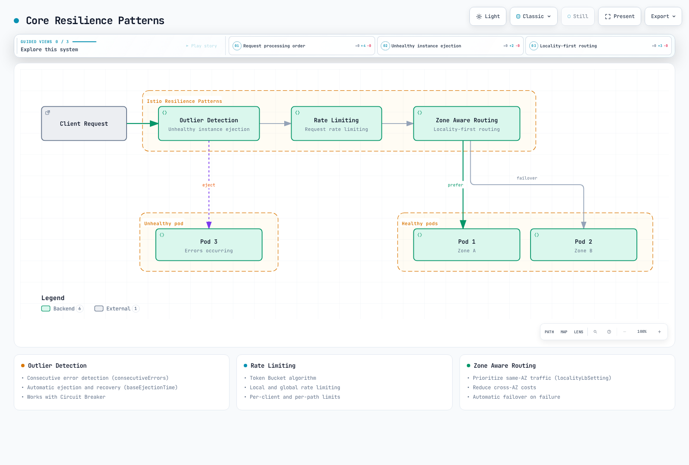
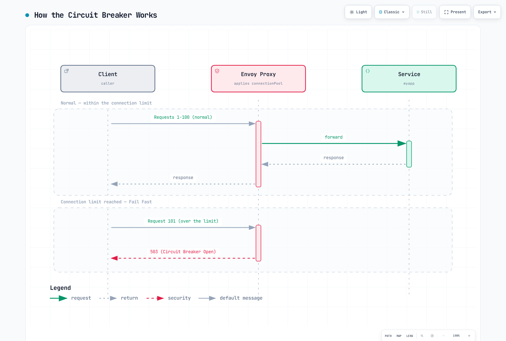
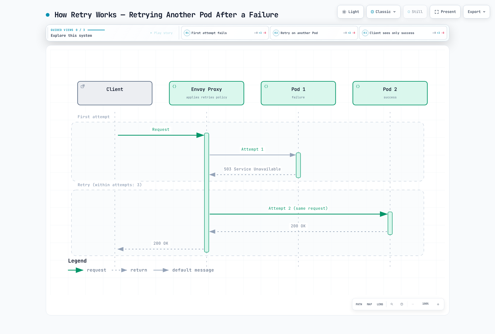
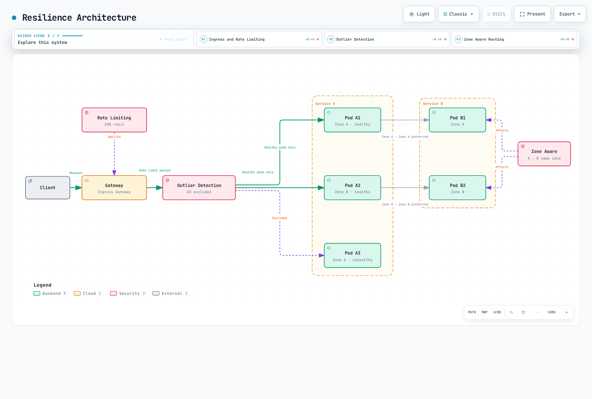

# Resiliencia

> **Última actualización**: 11 de septiembre de 2026 · Istio 1.31. Ejemplos sidecar independientes en `default`, con HTTP `myapp` en 8080. No aplique juntos todos los ejemplos del mismo host. Valide configuración real y capacidad; no se desplegaron ni probaron con carga. Ambient L7 requiere waypoint y asociación de política admitida.

Las funciones de resiliencia de Istio ayudan a contener fallos cuando se configuran según semántica y capacidad de la aplicación.

## Índice

1. [Detección de anomalías](01-outlier-detection.md)
2. [Limitación de tasa](02-rate-limiting.md)
3. [Enrutamiento consciente de zona](03-zone-aware-routing.md)

### Patrones adicionales

La documentación también cubre:

- **Disyuntor (circuit breaker)**: limitar conexiones y solicitudes con un pool de conexiones
- **Reintentos**: políticas para repetir solicitudes
- **Tiempo de espera**: límites de duración de las solicitudes
- **Inyección de fallos**: Pruebas de fallos inducidos

## Descripción general

La resiliencia es esencial en sistemas distribuidos. Istio puede implementar automáticamente varios patrones.

### Patrones principales



[🔍 Ver diagrama interactivo](https://www.atomai.click/kubernetes-docs/archmaps/en-service-mesh-istio-resilience-readme-0.html)

Las figuras resumen conceptos, no una secuencia fija de servicios de red. La detección de anomalías y la selección por localidad son decisiones de balanceo del proxy; los filtros HTTP de limitación de tasa configurados se ejecutan en el listener o la ruta seleccionados.

### 1. Detección de anomalías

Detecta automáticamente instancias con comportamiento anómalo y las excluye del conjunto de destinos disponibles.

```yaml
apiVersion: networking.istio.io/v1
kind: DestinationRule
metadata:
  name: myapp
  namespace: default
spec:
  host: myapp
  trafficPolicy:
    outlierDetection:
      consecutive5xxErrors: 5
      interval: 30s
      baseEjectionTime: 30s
      maxEjectionPercent: 50
```

**Funciones principales**:
- Detección de errores consecutivos
- Expulsión temporal y posibilidad de volver a recibir tráfico más adelante
- Se complementa con el disyuntor

La expulsión es local a cada proxy observador, no elimina Pod ni da un veredicto global de salud. Fallos consecutivos pueden detectar inmediatamente; `interval` es el período de barrido. La expulsión caduca y puede repetirse; no prueba recuperación.

### 2. Limitación de tasa

Limita el ritmo de las solicitudes para evitar que los servicios se sobrecarguen.

```yaml
apiVersion: networking.istio.io/v1alpha3
kind: EnvoyFilter
metadata:
  name: ratelimit
  namespace: default
spec:
  configPatches:
  - applyTo: HTTP_FILTER
    match:
      context: SIDECAR_INBOUND
      listener:
        portNumber: 8080
        filterChain:
          filter:
            name: envoy.filters.network.http_connection_manager
            subFilter:
              name: envoy.filters.http.router
    patch:
      operation: INSERT_BEFORE
      value:
        name: envoy.filters.http.local_ratelimit
        typed_config:
          '@type': type.googleapis.com/envoy.extensions.filters.http.local_ratelimit.v3.LocalRateLimit
          stat_prefix: http_local_rate_limiter
          token_bucket:
            max_tokens: 100
            tokens_per_fill: 10
            fill_interval: 1s
          filter_enabled:
            default_value:
              numerator: 100
              denominator: HUNDRED
          filter_enforced:
            default_value:
              numerator: 100
              denominator: HUNDRED
  workloadSelector:
    labels:
      app: myapp
```

**Funciones principales**:
- Algoritmo de cubo de tokens (token bucket)
- Límites locales y globales
- Límites por cliente y ruta

El ejemplo aplica un bucket por proceso Envoy al listener HTTP coincidente: 100 tokens iniciales y después 10/s. No es cuota de todo el servicio; réplicas y distribución afectan el rendimiento agregado. Una cuota global requiere un servicio de limitación de tasa con descriptores coincidentes. Clasificar clientes/rutas requiere confianza adicional; una cabecera del llamante no es identidad autenticada.

### 3. Enrutamiento consciente de zona

Optimiza el tráfico entre zonas de disponibilidad (AZ) para reducir la latencia y los costes.

```yaml
apiVersion: networking.istio.io/v1
kind: DestinationRule
metadata:
  name: myapp
  namespace: default
spec:
  host: myapp
  trafficPolicy:
    loadBalancer:
      localityLbSetting:
        enabled: true
        distribute:
        - from: us-east-1/us-east-1a/*
          to:
            us-east-1/us-east-1a/*: 80
            us-east-1/us-east-1b/*: 20
    outlierDetection:
      consecutive5xxErrors: 5
      interval: 10s
      baseEjectionTime: 30s
      maxEjectionPercent: 50
      minHealthPercent: 0
```

**Funciones principales**:
- Prioriza el tráfico dentro de la misma zona de disponibilidad
- Reduce los costes del tráfico entre zonas de disponibilidad
- Permite configurar por separado una política de conmutación por error según la localidad

Las rutas de localidad son `region/zone/subzone`. El ejemplo distribuye deliberadamente el tráfico en una proporción 80/20 mientras ambas zonas están sanas; ese 20% es tráfico normal entre zonas, no capacidad reservada para la conmutación por error. Use el patrón de prioridades separado para preferir la zona local y desviar tráfico cuando sea necesario. No combine `distribute` con `failover` o `failoverPriority`. Requiere detección de anomalías, endpoints Ready y capacidad de reserva; el ahorro depende del tráfico facturado.

### 4. Disyuntor (circuit breaker)

Limita conexiones y solicitudes para evitar sobrecarga.

```yaml
apiVersion: networking.istio.io/v1
kind: DestinationRule
metadata:
  name: circuit-breaker
  namespace: default
spec:
  host: myapp
  trafficPolicy:
    connectionPool:
      tcp:
        maxConnections: 100
      http:
        http1MaxPendingRequests: 10
        http2MaxRequests: 100
        maxRequestsPerConnection: 2
    outlierDetection:
      consecutive5xxErrors: 5
      interval: 30s
      baseEjectionTime: 30s
```

**Funcionamiento**:


[🔍 Ver diagrama interactivo](https://www.atomai.click/kubernetes-docs/archmaps/en-service-mesh-istio-resilience-readme-1.html)

**Funciones principales**:
- Límites de conexiones TCP
- Límites de solicitudes HTTP
- Límites de solicitudes pendientes
- Fallo rápido al desbordarse

Los límites del disyuntor son locales al clúster de destino (upstream) y a la prioridad de cada proxy; no establecen un límite global por Pod servidor. `http2MaxRequests` también aplica a HTTP/1.1. Al alcanzar el límite de conexiones, se puede poner una solicitud en cola hasta superar los límites de solicitudes pendientes o activas. La figura ilustra un desbordamiento HTTP que devuelve 503/UO; no representa cada caso en que se alcanza el límite de conexiones. El desbordamiento TCP no tiene un estado HTTP.

### 5. Reintento

Reintenta solicitudes automáticamente ante fallos transitorios.

```yaml
apiVersion: networking.istio.io/v1
kind: VirtualService
metadata:
  name: myapp
  namespace: default
spec:
  hosts:
  - myapp
  http:
  - name: writes-no-retry
    match:
    - method:
        regex: ^(POST|PUT|PATCH|DELETE)$
    route:
    - destination:
        host: myapp
    timeout: 10s
    retries:
      attempts: 0
  - route:
    - destination:
        host: myapp
    retries:
      attempts: 3
      perTryTimeout: 2s
      retryOn: gateway-error,connect-failure,refused-stream
    timeout: 10s
    name: idempotent-reads
    match:
    - method:
        regex: ^(GET|HEAD|OPTIONS)$
  - name: other-methods-no-retry
    route:
    - destination:
        host: myapp
    timeout: 10s
    retries:
      attempts: 0
```

**Condiciones de reintento** (`retryOn`):
- `5xx`: errores del servidor (500, 502, 503 y 504)
- `reset`: conexión TCP restablecida
- `connect-failure`: fallo al establecer la conexión
- `refused-stream`: Flujo HTTP/2 rechazado
- `retriable-4xx`: Solo HTTP 409 bajo esta política Envoy
- `gateway-error`: errores de pasarela (502, 503 y 504)

**Espera progresiva y localidad (fragmento para la ruta de lectura anterior)**:
```yaml
retries:
  attempts: 5
  perTryTimeout: 2s
  retryOn: gateway-error,connect-failure,refused-stream
  backoff: 25ms
  retryRemoteLocalities: true
```

**Funcionamiento**:


[🔍 Ver diagrama interactivo](https://www.atomai.click/kubernetes-docs/archmaps/en-service-mesh-istio-resilience-readme-2.html)

El valor `attempts: 3` permite hasta tres reintentos después del intento inicial, aunque el tiempo de espera de la ruta puede terminar antes. La coincidencia por método de lectura presupone que la operación es idempotente; antes de habilitar reintentos para PUT o DELETE, verifique su semántica y las claves de idempotencia de la aplicación. Si se omite la política, pueden heredarse los reintentos de la malla; por eso las rutas de escritura y de alternativa especifican `attempts: 0`. Un reintento puede volver al mismo host y no garantiza el éxito. La espera entre reintentos crece de forma exponencial con una variación aleatoria; permitir localidades remotas no define esa espera.

### 6. Tiempo de espera

Establece límites para evitar esperas indefinidas.

```yaml
apiVersion: networking.istio.io/v1
kind: VirtualService
metadata:
  name: myapp
  namespace: default
spec:
  hosts:
  - myapp
  http:
  - name: writes-no-retry
    match:
    - method:
        regex: ^(POST|PUT|PATCH|DELETE)$
    route:
    - destination:
        host: myapp
    timeout: 5s
    retries:
      attempts: 0
  - route:
    - destination:
        host: myapp
    timeout: 5s
    retries:
      attempts: 3
      perTryTimeout: 2s
      retryOn: gateway-error,connect-failure,refused-stream
    name: idempotent-reads
    match:
    - method:
        regex: ^(GET|HEAD|OPTIONS)$
  - name: other-methods-no-retry
    route:
    - destination:
        host: myapp
    timeout: 5s
    retries:
      attempts: 0
```

**Jerarquía de tiempos de espera** (requiere configurar por separado `my-gateway` en `default`):
```yaml
apiVersion: networking.istio.io/v1
kind: VirtualService
metadata:
  name: gateway-timeout
  namespace: default
spec:
  gateways:
  - my-gateway
  hosts:
  - example.com
  http:
  - route:
    - destination:
        host: frontend
    timeout: 30s
    retries:
      attempts: 0
---
apiVersion: networking.istio.io/v1
kind: VirtualService
metadata:
  name: service-timeout
  namespace: default
spec:
  hosts:
  - backend
  http:
  - route:
    - destination:
        host: backend
    timeout: 5s
    retries:
      attempts: 0
```

**Presupuestos ilustrativos** (derive los valores reales de los SLO y las dependencias):
- Pasarela -> frontend: 30-60 segundos, para solicitudes orientadas al usuario
- Servicio -> servicio: 5-10 segundos, para comunicación interna
- Consultas a bases de datos: 2-5 segundos
- API externas: 10-30 segundos

Los tiempos de espera HTTP no configuran los del cliente o la consulta a la base de datos ni garantizan que se cancele el trabajo posterior. Propague los plazos de la aplicación; un tiempo total menor permite deliberadamente menos reintentos.

### 7. Inyección de fallos

Introduce fallos deliberados para ingeniería del caos.

```yaml
apiVersion: networking.istio.io/v1
kind: VirtualService
metadata:
  name: fault-injection
  namespace: default
spec:
  hosts:
  - myapp
  http:
  - fault:
      delay:
        percentage:
          value: 10.0
        fixedDelay: 5s
      abort:
        percentage:
          value: 5.0
        httpStatus: 503
    route:
    - destination:
        host: myapp
```

**Escenarios de uso**:

1. **Simular latencia de red**:
```yaml
fault:
  delay:
    percentage:
      value: 100.0
    fixedDelay: 7s
```

2. **Probar fallos intermitentes**:
```yaml
fault:
  abort:
    percentage:
      value: 20.0
    httpStatus: 500
```

3. **Inyectar solo para usuarios concretos**:
```yaml
apiVersion: networking.istio.io/v1
kind: VirtualService
metadata:
  name: fault-injection-user
  namespace: default
spec:
  hosts:
  - myapp
  http:
  - match:
    - headers:
        end-user:
          exact: test-user
    fault:
      abort:
        percentage:
          value: 100.0
        httpStatus: 503
    route:
    - destination:
        host: myapp
  - name: ordinary-traffic
    route:
    - destination:
        host: myapp
    retries:
      attempts: 0
```

La inyección de fallos es una operación de laboratorio controlada. En una ruta de cliente con `fault`, Istio no habilita los reintentos ni los tiempos de espera de esa ruta. Pruebe los reintentos inyectando el fallo en otro salto posterior. Una cabecera de usuario de prueba solo delimita el tráfico; controle quién puede enviarla. La ruta alternativa para el tráfico normal evita que queden solicitudes sin coincidencia.

## Combinaciones de patrones

### Detección de anomalías + circuit breaker

```yaml
apiVersion: networking.istio.io/v1
kind: DestinationRule
metadata:
  name: myapp-resilient
  namespace: default
spec:
  host: myapp
  trafficPolicy:
    connectionPool:
      tcp:
        maxConnections: 100
      http:
        http1MaxPendingRequests: 50
        maxRequestsPerConnection: 2
    outlierDetection:
      consecutive5xxErrors: 5
      interval: 30s
      baseEjectionTime: 30s
      maxEjectionPercent: 50
      minHealthPercent: 0
```

### Limitación de tasa + reintentos

```yaml
apiVersion: networking.istio.io/v1
kind: VirtualService
metadata:
  name: myapp
  namespace: default
spec:
  hosts:
  - myapp
  http:
  - name: writes-no-retry
    match:
    - method:
        regex: ^(POST|PUT|PATCH|DELETE)$
    route:
    - destination:
        host: myapp
    timeout: 10s
    retries:
      attempts: 0
  - route:
    - destination:
        host: myapp
    retries:
      attempts: 3
      perTryTimeout: 2s
      retryOn: gateway-error,connect-failure,refused-stream
    timeout: 10s
    name: idempotent-reads
    match:
    - method:
        regex: ^(GET|HEAD|OPTIONS)$
  - name: other-methods-no-retry
    route:
    - destination:
        host: myapp
    timeout: 10s
    retries:
      attempts: 0
---
apiVersion: networking.istio.io/v1alpha3
kind: EnvoyFilter
metadata:
  name: ratelimit
  namespace: default
spec:
  workloadSelector:
    labels:
      app: myapp
  configPatches:
  - applyTo: HTTP_FILTER
    match:
      context: SIDECAR_INBOUND
      listener:
        portNumber: 8080
        filterChain:
          filter:
            name: envoy.filters.network.http_connection_manager
            subFilter:
              name: envoy.filters.http.router
    patch:
      operation: INSERT_BEFORE
      value:
        name: envoy.filters.http.local_ratelimit
        typed_config:
          '@type': type.googleapis.com/envoy.extensions.filters.http.local_ratelimit.v3.LocalRateLimit
          stat_prefix: http_local_rate_limiter
          token_bucket:
            max_tokens: 1000
            tokens_per_fill: 100
            fill_interval: 1s
          filter_enabled:
            default_value:
              numerator: 100
              denominator: HUNDRED
          filter_enforced:
            default_value:
              numerator: 100
              denominator: HUNDRED
```

## Arquitectura de resiliencia



[🔍 Ver diagrama interactivo](https://www.atomai.click/kubernetes-docs/archmaps/en-service-mesh-istio-resilience-readme-3.html)

## Métricas de resiliencia {#resilience-metrics}

Recopile métricas de un endpoint de proxy previsto por Pod, como se describe en [métricas](../observability/01-metrics.md). Envoy no exporta toda estadística opcional por defecto. Combine la anotación en la plantilla relevante y despliegue proxies nuevos antes de comprobar nombres/etiquetas reales:

```yaml
spec:
  template:
    metadata:
      annotations:
        proxy.istio.io/config: |
          proxyStatsMatcher:
            inclusionRegexps:
            - ".*outlier_detection.*"
            - ".*circuit_breakers.*"
            - ".*upstream_rq_retry.*"
            - ".*upstream_rq_timeout.*"
            - ".*upstream_rq_.*overflow.*"
            - ".*http_local_rate_limit.*"
            - ".*fault.*"
```

### Consultas Prometheus

Las tasas se expresan por segundo; `_open` es un indicador de capacidad de tipo gauge con valor 0 o 1, y `ejections_active` cuenta los hosts expulsados en ese momento. Los ejemplos presuponen etiquetas `namespace` y `pod` de un solo clúster; acote el clúster de destino al analizar una dependencia concreta. El prefijo de limitación de tasa depende de `stat_prefix` y del nombre de estadística que se emita. `rate_limited` cuenta la falta de tokens aunque no se aplique el límite; `enforced` cuenta los límites aplicados. Los contadores de desbordamiento de solicitudes activas varían según la versión de Envoy: compruebe si se expone `upstream_rq_active_overflow` en lugar de suponer que todo desbordamiento incrementa el contador de solicitudes pendientes.

```promql
# Active ejections per observed cluster
 envoy_cluster_outlier_detection_ejections_active{namespace="default"}

# Locally rate-limited requests per second, retaining Pod identity
sum by (namespace, pod) (rate({__name__=~"envoy_.*http_local_rate_limit_enforced",namespace="default"}[5m]))

# Request circuit breaker currently at capacity (not a cumulative count)
envoy_cluster_circuit_breakers_default_rq_open{namespace="default"}

# Pending-queue circuit-breaker overflows per second
sum(rate(envoy_cluster_upstream_rq_pending_overflow{namespace="default"}[5m]))

# Retry attempts and retry-success events per second (different event counters)
sum(rate(envoy_cluster_upstream_rq_retry{namespace="default"}[5m]))
sum(rate(envoy_cluster_upstream_rq_retry_success{namespace="default"}[5m]))

# Upstream request timeouts per second
sum(rate(envoy_cluster_upstream_rq_timeout{namespace="default"}[5m]))

# Observed destination HTTP 2xx/3xx fraction; define your own SLI for 4xx/gRPC
sum(rate(istio_requests_total{reporter="destination",destination_service_namespace="default",response_code=~"[23].."}[5m])) /
sum(rate(istio_requests_total{reporter="destination",destination_service_namespace="default"}[5m]))
```

`source_zone` y `destination_zone` no son etiquetas estándar de Istio. Para informar por zona de disponibilidad, hace falta enriquecer los datos con topología validada o usar otra fuente de tráfico zonal; los identificadores de clúster no son identificadores de zona. Las métricas del destino excluyen las solicitudes que no llegaron al servicio, así que revise también las señales de fallo en el origen.

### Paneles Grafana

Muestre por separado las conexiones activas, el estado abierto o cerrado y la tasa de desbordamiento. No existe un indicador estándar de capacidad llamado `envoy_cluster_circuit_breakers_default_cx_max` ni un indicador de disyuntor `...rq_overflow`. Al calcular la capacidad, use los umbrales efectivos; nunca divida por el indicador abierto de 0 o 1.

```promql
envoy_cluster_upstream_cx_active{namespace="default"}
envoy_cluster_circuit_breakers_default_cx_open{namespace="default"}

# Source-side observed final HTTP 5xx fraction, not hypothetical no-retry errors
sum(rate(istio_requests_total{reporter="source",destination_service_namespace="default",response_code=~"5.."}[5m])) /
sum(rate(istio_requests_total{reporter="source",destination_service_namespace="default"}[5m]))
```

Los contadores de reintentos no permiten reconstruir una «tasa de errores sin reintentos» hipotética. Correlacione los intentos, los resultados finales, la latencia y la carga mediante mediciones acotadas; los periodos sin tráfico y las series ausentes requieren un tratamiento aparte.

## Buenas prácticas

### 1. Ajustar umbrales de anomalías

```yaml
# Adjust according to service characteristics
outlierDetection:
  consecutive5xxErrors: 5          # 5 consecutive failures
  interval: 30s                 # Evaluate every 30 seconds
  baseEjectionTime: 30s         # 30 second ejection
  maxEjectionPercent: 50        # Maximum 50% ejected
  minHealthPercent: 0           # Disable unhealthy-pool fail-open threshold
```

`minHealthPercent` no garantiza capacidad saludable: por debajo de un umbral distinto de cero se desactiva la detección de anomalías y el proxy puede usar hosts sanos y enfermos. `0` desactiva ese umbral. Expulsiones repetidas pueden durar más que `baseEjectionTime`; monitorice hosts expulsados y capacidad restante.

### 2. Limitación por etapas

```yaml
# Apply limits at Gateway -> Service stages
# Gateway: Overall traffic limit
# Service: Individual service limit
```

### 3. Prioridad de enrutamiento por zona

Para preferir la zona local y permitir la conmutación por error, use prioridades en lugar de una distribución 80/20. Confirme las etiquetas de región y zona de los nodos y los endpoints disponibles. El [capítulo de enrutamiento por zona](03-zone-aware-routing.md) trata la distribución y la conmutación por error como modos distintos.

### 4. Configurar el disyuntor

Dimensione los límites del clúster de destino de cada proxy llamante según la concurrencia medida y la capacidad disponible. También influyen la cantidad de llamantes, la multiplexación HTTP, la distribución del tráfico y los aumentos de capacidad durante un despliegue. Multiplicar la cantidad de Pods por un factor arbitrario no establece un límite global de admisión. Las colas largas pueden ocultar una sobrecarga.

```yaml
# DestinationRule trafficPolicy fragment; example values require load tests
connectionPool:
  tcp:
    maxConnections: 100
  http:
    http1MaxPendingRequests: 10
    http2MaxRequests: 100
    maxRequestsPerConnection: 0
    maxRetries: 10
```

`maxRequestsPerConnection: 0` permite reutilizar sin ese máximo; `1` desactiva keep-alive. Valores 1–5 no son optimización universal. `maxRetries` limita los reintentos simultáneos pendientes por clúster de destino (upstream), no los reintentos por solicitud.

### 5. Política de reintentos

Use la protección de escritura y coincidencia de lectura explícitas del ejemplo completo. Un comentario YAML «solo GET» no restringe coincidencias. Reintente solo operaciones cuya semántica permita repetirlas, con un número limitado de intentos, espera progresiva acotada y un plazo total definido. No reintente automáticamente respuestas 429 ni de sobrecarga: los reintentos pueden anular la limitación de tasa y agravar el fallo. El ejemplo combinado usa bucket local mayor, 1000 tokens iniciales y 100/s, no cuota global.

### 6. Configurar los tiempos de espera

Presupueste todo el flujo de llamadas, incluidos el primer intento, los reintentos, la espera progresiva y el procesamiento de la aplicación. Si deben caber todos los intentos:

```text
route budget >= (1 + attempts) × perTryTimeout + backoff + other overhead
```

Con `attempts: 3` y `perTryTimeout: 2s`, cuatro intentos completos consumen 8 segundos, sin contar la espera progresiva ni otros costes. `timeout: 10s` es un presupuesto de ejemplo, no una garantía; `timeout: 5s` deliberadamente no alcanza para cuatro intentos completos de dos segundos. Los plazos límite de la aplicación también deben contemplar la carga y la transmisión en flujo, y propagar la cancelación cuando corresponda.

### 7. Pruebas de inyección de fallos

Use la ruta completa que coincide con la cabecera y la ruta alternativa para el tráfico normal. Separe el salto que genera el fallo de la política de reintentos o del tiempo de espera que esté probando. Empiece en un entorno de prueba desechable y luego pase a un grupo acotado, con criterios de cancelación en preproducción. Cualquier experimento en producción requiere autorización específica para la carga, observabilidad y umbrales de reversión; una secuencia fija del 1% al 5% y luego al 10% no es segura en todos los casos.

## Resolución de problemas

### La detección de anomalías no funciona

```bash
# 1. Check DestinationRule
kubectl get destinationrule -A

# 2. Check Envoy cluster status
istioctl proxy-config clusters <pod-name> -n <namespace>

# 3. Check Outlier Detection metrics
istioctl x envoy-stats <pod-name> -n <namespace> --output prom | grep outlier
```

### No se aplica la limitación de tasa

```bash
# 1. Check EnvoyFilter
kubectl get envoyfilter -A

# 2. Check Envoy configuration
istioctl proxy-config listener <pod-name> -n <namespace> -o json

# 3. Check Rate Limit metrics
istioctl x envoy-stats <pod-name> -n <namespace> --output prom | grep rate_limit
```

### El enrutamiento por zona no funciona

```bash
# 1. Check DestinationRule
kubectl get destinationrule -A

# 2. Map Pods to node topology; Pod zone labels are not added automatically
kubectl get pods -n <namespace> -o wide
kubectl get nodes -L topology.kubernetes.io/region,topology.kubernetes.io/zone

# 3. Check Locality information
istioctl proxy-config endpoints <pod-name> -n <namespace>
```

### El disyuntor no se abre

```bash
# 1. Check DestinationRule connectionPool settings
kubectl get destinationrule <name> -o yaml

# 2. Check Circuit Breaker metrics
istioctl x envoy-stats <pod-name> -n <namespace> --output prom | grep circuit_breakers

# 3. Check for overflow
istioctl x envoy-stats <pod-name> -n <namespace> --output prom | grep overflow

# 4. Check active connection count
istioctl x envoy-stats <pod-name> -n <namespace> --output prom | grep upstream_cx_active
```

### Los reintentos no funcionan

```bash
# 1. Check VirtualService
kubectl get virtualservice <name> -o yaml

# 2. Check Retry metrics
istioctl x envoy-stats <pod-name> -n <namespace> --output prom | grep retry

# 3. Inspect enabled access/debug logs; default logs need not contain each retry
kubectl logs -n <namespace> <pod-name> -c istio-proxy | grep retry

# 4. Check retry conditions
istioctl proxy-config routes <pod-name> -n <namespace> -o json | \
  jq '.[] | .virtualHosts[]? | {name, domains, routes: [.routes[]? | {name, match, retryPolicy: .route.retryPolicy}]}'
```

### No se aplica el tiempo de espera

```bash
# 1. Check VirtualService timeout
kubectl get virtualservice <name> -o yaml | grep timeout

# 2. Check Timeout metrics
istioctl x envoy-stats <pod-name> -n <namespace> --output prom | grep timeout

# 3. Check request duration
istioctl x envoy-stats <pod-name> -n <namespace> --output prom | grep request_duration

# 4. Check Envoy route configuration
istioctl proxy-config routes <pod-name> -n <namespace> -o json | \
  jq '.[] | .virtualHosts[].routes[].route.timeout'
```

### La inyección de fallos no funciona

```bash
# 1. Check VirtualService fault configuration
kubectl get virtualservice <name> -o yaml | grep -A 10 fault

# 2. Check request headers (if match conditions exist)
curl -H "end-user: test-user" http://your-service/api

# 3. Check Envoy filters
istioctl proxy-config routes <pod-name> -n <namespace> -o json | \
  jq '.[] | .virtualHosts[]?.routes[]? | select(.typedPerFilterConfig["envoy.filters.http.fault"] != null) | {name, fault: .typedPerFilterConfig["envoy.filters.http.fault"]}'

# 4. Check Fault metrics
istioctl x envoy-stats <pod-name> -n <namespace> --output prom | grep fault
```

## Siguientes pasos

1. **[Detección de anomalías](01-outlier-detection.md)**: Detectar automáticamente las instancias que presentan fallos
2. **[Limitación de tasa](02-rate-limiting.md)**: Controlar el ritmo de las solicitudes
3. **[Enrutamiento por zona](03-zone-aware-routing.md)**: Enrutamiento por localidad

## Referencias

### Documentación oficial
- [Resiliencia Istio](https://istio.io/latest/docs/concepts/traffic-management/#network-resilience-and-testing)
- [Detección de anomalías](https://istio.io/latest/docs/reference/config/networking/destination-rule/#OutlierDetection)
- [Disyuntores](https://istio.io/latest/docs/tasks/traffic-management/circuit-breaking/)
- [Tiempos de espera de solicitudes](https://istio.io/latest/docs/tasks/traffic-management/request-timeouts/)
- [Reintentos](https://istio.io/latest/docs/concepts/traffic-management/#retries)
- [Limitación de tasa](https://istio.io/latest/docs/tasks/policy-enforcement/rate-limit/)
- [Inyección de fallos](https://istio.io/latest/docs/tasks/traffic-management/fault-injection/)
- [Balanceo por localidad](https://istio.io/latest/docs/tasks/traffic-management/locality-load-balancing/)

### Recursos relacionados de AWS
- [Mejorar resiliencia de red con Istio en EKS](https://aws.amazon.com/blogs/opensource/enhancing-network-resilience-with-istio-on-amazon-eks/)
- [Buenas prácticas EKS: fiabilidad](https://docs.aws.amazon.com/eks/latest/best-practices/reliability.html)

### Patrones y arquitectura
- [Patrones de microservicios: disyuntor](https://microservices.io/patterns/reliability/circuit-breaker.html)
- [Release It!: patrones de estabilidad](https://pragprog.com/titles/mnee2/release-it-second-edition/)
- [Principios de ingeniería del caos](https://principlesofchaos.org/)

## Cuestionario

Pruebe lo aprendido con el [cuestionario de resiliencia Istio](../../../quizzes/service-mesh/istio/resilience.md).
