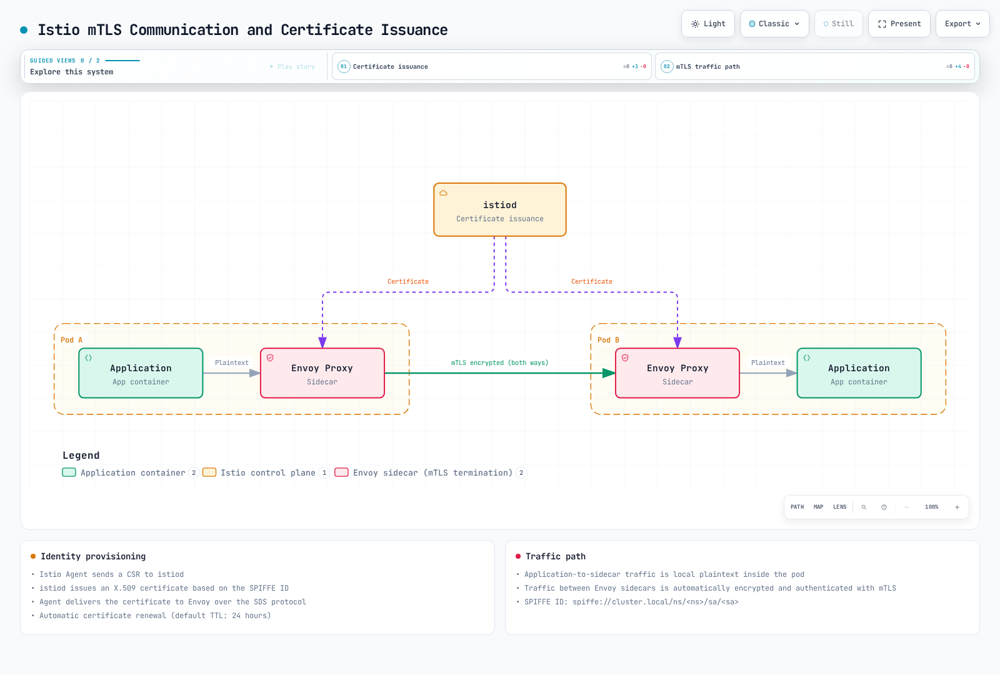

# mTLS {#mtls}

Mutual TLS (mTLS) es una función de seguridad fundamental de Istio que cifra y autentica automáticamente la comunicación entre servicios.

## Índice {#table-of-contents}

1. [Descripción general de mTLS](#mtls-overview)
2. [Modos de mTLS](#mtls-modes)
3. [Gestión de certificados](#certificate-management)
4. [Configuración de PeerAuthentication](#peerauthentication-configuration)
5. [Integración de mTLS con servicios de AWS](#mtls-integration-with-aws-services)
6. [mTLS con servicios externos](#mtls-with-external-services)
7. [Estrategia de migración](#migration-strategy)
8. [Problemas comunes y soluciones](#common-issues-and-solutions)
9. [Rendimiento y supervisión](#performance-and-monitoring)

## Descripción general de mTLS {#mtls-overview}

<p align="center">
  
</p>

Auto mTLS selecciona TLS para los pares compatibles de la malla. En modo sidecar, utilice `STRICT` para rechazar el tráfico sin cifrar en el proxy receptor y AuthorizationPolicy para restringir las identidades. Auto mTLS por sí solo no constituye una política completa de confianza cero. El flujo de identidad siguiente describe los sidecars; el modo ambient utiliza ztunnel y, opcionalmente, waypoints.

### Seguridad basada en identidad {#identity-based-security}

Istio utiliza el estándar **SPIFFE (Secure Production Identity Framework for Everyone)** para asignar identidades sólidas a cada carga de trabajo:

```
spiffe://cluster.local/ns/default/sa/productpage
  |         |           |     |      |    |
  |         |           |     |      |    +- ServiceAccount name
  |         |           |     |      +----- "sa" (ServiceAccount)
  |         |           |     +------------ Namespace name
  |         |           +------------------ "ns" (Namespace)
  |         +------------------------------ Trust Domain
  +---------------------------------------- Protocol
```

**Proceso de aprovisionamiento de identidad**:
1. Kubernetes crea un pod y le asigna una ServiceAccount.
2. Istio Agent se inicia dentro del pod.
3. Agent envía una CSR (solicitud de firma de certificado) a Istiod.
4. Istiod emite un certificado X.509 basado en el SPIFFE ID.
5. Agent entrega el certificado a Envoy mediante el protocolo SDS.
6. Los certificados se renuevan automáticamente; el TTL predeterminado es de 24 horas.



[🔍 Ver diagrama interactivo](https://www.atomai.click/kubernetes-docs/archmaps/en-service-mesh-istio-security-01-mtls-0.html)

## Modos de mTLS {#mtls-modes}

Estos ejemplos son alternativas. Una política sin selector en el espacio de nombres raíz de la malla, normalmente `istio-system`, se aplica a toda la malla. Ambient cifra el tráfico capturado de la malla mediante HBONE; no admite `DISABLE`, mientras que `STRICT` rechaza el tráfico que intenta eludir ese plano de datos.

### Modo STRICT (recomendado) {#strict-mode-recommended}

```yaml
apiVersion: security.istio.io/v1
kind: PeerAuthentication
metadata:
  name: default
  namespace: istio-system
spec:
  mtls:
    mode: STRICT  # Only mTLS allowed
```

### Modo PERMISSIVE (para migración) {#permissive-mode-for-migration}

```yaml
apiVersion: security.istio.io/v1
kind: PeerAuthentication
metadata:
  name: default
  namespace: default
spec:
  mtls:
    mode: PERMISSIVE  # Both mTLS and plaintext allowed
```

### Modo DISABLE {#disable-mode}

```yaml
apiVersion: security.istio.io/v1
kind: PeerAuthentication
metadata:
  name: disable-mtls
  namespace: default
spec:
  mtls:
    mode: DISABLE  # mTLS disabled
```

## Gestión de certificados {#certificate-management}

### Certificado de la CA predeterminada de Istio {#istio-default-ca-certificate}

De forma predeterminada, istiod crea una CA raíz autofirmada y la utiliza directamente para firmar los certificados de las cargas de trabajo. Utilizar una CA raíz mantenida sin conexión y una CA intermedia independiente para la firma es una decisión de despliegue en producción; esa jerarquía no se crea automáticamente.

El agente solicita de forma predeterminada un certificado de **24 horas** y programa su renovación aproximadamente a la mitad de su vigencia, con una variación aleatoria. La CA puede limitar la duración solicitada. Los certificados raíz e intermedios tienen ciclos de vida independientes. Examine el certificado emitido para comprobar su algoritmo y su vigencia reales.

### Verificación de certificados {#certificate-verification}

```bash
# 1. Check CA certificate
kubectl get secret istio-ca-secret -n istio-system -o jsonpath='{.data.ca-cert\.pem}' | \
  base64 -d | openssl x509 -noout -issuer -subject -dates

# 2. Check workload certificate
istioctl proxy-config secret <pod-name> -n <namespace>

# 3. Certificate details
istioctl proxy-config secret <pod-name> -n <namespace> -o json | \
  jq -r '.dynamicActiveSecrets[] | select(.secret.name == "default") | .secret.tlsCertificate.certificateChain.inlineBytes' | \
  base64 -d | openssl x509 -text -noout

# 4. Check certificate expiration date
istioctl proxy-config secret <pod-name> -n <namespace> -o json | \
  jq -r '.dynamicActiveSecrets[] | select(.secret.name == "default") | .secret.tlsCertificate.certificateChain.inlineBytes' | \
  base64 -d | openssl x509 -noout -dates
```

### Uso de certificados de CA personalizados {#using-custom-ca-certificates}

Utilice una PKI privada capaz de emitir SAN de tipo URI para SPIFFE. Los certificados ACME públicos no son adecuados para la identidad de las cargas de trabajo. Este ejemplo de OpenSSL prepara una malla de prueba nueva; cree `istio-system` y `cacerts` antes de instalar istiod. En producción, proteja la clave raíz y manténgala sin conexión.

#### Paso 1: Generar el certificado y la clave de la CA {#step-1-generate-ca-certificate-and-key}

```bash
# 1. Generate Root CA
umask 077
openssl genrsa -out root-key.pem 4096

openssl req -new -x509 -days 3650 -key root-key.pem \
  -out root-cert.pem -addext "basicConstraints=critical,CA:TRUE" \
  -subj "/C=US/ST=California/L=San Francisco/O=MyOrg/OU=IT/CN=Root CA"

# 2. Generate Intermediate CA
openssl genrsa -out ca-key.pem 4096

openssl req -new -key ca-key.pem -out ca-cert.csr \
  -subj "/C=US/ST=California/L=San Francisco/O=MyOrg/OU=IT/CN=Intermediate CA"

# 3. Sign Intermediate CA with Root CA
cat > ca-extensions.txt <<EOF
basicConstraints=critical,CA:TRUE,pathlen:0
keyUsage=critical,keyCertSign,cRLSign
EOF

openssl x509 -req -days 1825 -in ca-cert.csr \
  -CA root-cert.pem -CAkey root-key.pem -CAcreateserial \
  -out ca-cert.pem -extfile ca-extensions.txt

# 4. Create Certificate Chain
cat ca-cert.pem root-cert.pem > cert-chain.pem
```

#### Paso 2: Crear un Secret de Kubernetes {#step-2-create-kubernetes-secret}

```bash
kubectl create secret generic cacerts -n istio-system \
  --from-file=ca-cert.pem=ca-cert.pem \
  --from-file=ca-key.pem=ca-key.pem \
  --from-file=root-cert.pem=root-cert.pem \
  --from-file=cert-chain.pem=cert-chain.pem
```

#### Paso 3: Instalar la malla nueva {#step-3-install-the-new-mesh}

Tras crear `cacerts`, instale una versión compatible y fijada de Istio siguiendo la [guía de instalación](../01-installation.md). No utilice este procedimiento de instalación inicial para sustituir la raíz de una malla en funcionamiento.

#### Paso 4: Verificación {#step-4-verification}

```bash
# Verify CA certificate is loaded correctly
kubectl logs -l app=istiod -n istio-system | grep "Use plugged-in cert"

# Verify workload certificates are issued by new CA
istioctl proxy-config secret <pod-name> -n <namespace> -o json | \
  jq -r '.dynamicActiveSecrets[] | select(.secret.name == "default") | .secret.tlsCertificate.certificateChain.inlineBytes' | \
  base64 -d | openssl x509 -noout -issuer
```

### Integración con AWS Private CA {#aws-private-ca-integration}

Utilice **cert-manager → AWS Private CA issuer → istio-csr** para firmar los certificados de las cargas de trabajo. Prepare un clúster nuevo sin Istio, una Private CA activa y permisos IAM para la ServiceAccount del emisor limitados a esa CA (`DescribeCertificateAuthority`, `GetCertificate`, `IssueCertificate`). Utilice EKS Pod Identity o IRSA. La CA debe permitir los SAN de SPIFFE y la vigencia solicitada.

Instale una versión de cert-manager compatible con Kubernetes; la versión 1.21 admite Kubernetes 1.33–1.36. Instale después AWS Private CA issuer. Sustituya el ARN siguiente por el de la CA seleccionada; un archivo YAML por sí solo no expande las variables del shell.

```yaml
apiVersion: awspca.cert-manager.io/v1beta1
kind: AWSPCAClusterIssuer
metadata:
  name: istio-ca
spec:
  arn: arn:aws:acm-pca:us-west-2:123456789012:certificate-authority/REPLACE_WITH_CA_ID
  region: us-west-2
```

Cree `istio-root-ca` en el espacio de nombres `cert-manager` a partir de un paquete verificado de certificados raíz públicos (`ca.pem`). Configure después istio-csr con estos valores de Helm:

```yaml
# istio-csr Helm values fragment
app:
  certmanager:
    issuer:
      group: awspca.cert-manager.io
      kind: AWSPCAClusterIssuer
      name: istio-ca
  tls:
    rootCAFile: /var/run/secrets/istio-csr/ca.pem
volumeMounts:
- name: root-ca
  mountPath: /var/run/secrets/istio-csr
  readOnly: true
volumes:
- name: root-ca
  secret:
    secretName: istio-root-ca
```

Siga la [guía de instalación actual de istio-csr](https://cert-manager.io/docs/usage/istio-csr/installation/) para obtener el chart completo y el manifiesto de instalación de Istio compatibles con la versión. Este último deshabilita la CA de istiod (`ENABLE_CA_SERVER=false`), establece el endpoint de CA en `cert-manager-istio-csr.cert-manager.svc:443` y monta el certificado emitido para el servicio istiod y la raíz fijada. Utilice `istioctl install -f` con ese manifiesto. Para ambient también debe configurar en istio-csr las ServiceAccount de ztunnel de confianza. Esa guía no admite instalar istio-csr después de una instalación de Istio ya existente.

Un recurso `Certificate` de cert-manager suele crear `tls.crt`, `tls.key` y, en algunos casos, `ca.crt`. Llamar `cacerts` a su Secret **no** genera los archivos `ca-cert.pem`, `ca-key.pem`, `root-cert.pem` y `cert-chain.pem` que necesita Istio. La integración mediante istio-csr evita depender de ese Secret incompatible.

### Política de renovación de certificados {#certificate-renewal-policy}

El agente sidecar controla la duración que solicita y la ventana de rotación. Lo siguiente es una entrada para `istioctl`; aplíquela mediante el flujo de instalación y reinicie gradualmente los proxies seleccionados cuando cambie su configuración de arranque:

```yaml
# Input to istioctl install -f; not kubectl apply
apiVersion: install.istio.io/v1alpha1
kind: IstioOperator
spec:
  meshConfig:
    defaultConfig:
      proxyMetadata:
        SECRET_TTL: "24h"
        SECRET_GRACE_PERIOD_RATIO: "0.5"
```

`SECRET_TTL` tiene un valor predeterminado de 24h y `SECRET_GRACE_PERIOD_RATIO` de 0.5; la renovación también incluye una variación aleatoria. Son ajustes del agente, no los antiguos ejemplos de `CITADEL_CERT_TTL`/`CITADEL_GRACE_PERIOD`. El emisor real del certificado puede acortar su vigencia.

### Rotación de certificados {#certificate-rotation}

La renovación de certificados de las cargas de trabajo, la renovación de una CA intermedia bajo la misma raíz y la sustitución de la raíz son operaciones distintas. Para cambiar la raíz:

1. Distribuya un paquete con **las raíces antigua y nueva** a todas las cargas de trabajo, gateways y clústeres afectados. Verifique la confianza activa antes de cambiar el emisor.
2. Incorpore el nuevo emisor y emita certificados nuevos para las cargas de trabajo mientras ambas raíces sigan siendo de confianza.
3. Compruebe el estado de SDS, las cadenas de certificados, el tráfico entre clústeres y los certificados antiguos que aún queden. Tenga en cuenta las cargas de trabajo desconectadas y las conexiones de larga duración.
4. Retire la raíz antigua solo cuando hayan terminado la migración y la ventana de reversión.

Utilice el procedimiento de rotación admitido por el proveedor de CA elegido. Sobrescribir `cacerts` y reiniciar en un solo paso no garantiza la continuidad del servicio. Evite reiniciar todos los espacios de nombres para forzar la renovación.

## Configuración de PeerAuthentication {#peerauthentication-configuration}

### Configuración global {#global-configuration}

```yaml
apiVersion: security.istio.io/v1
kind: PeerAuthentication
metadata:
  name: default
  namespace: istio-system
spec:
  mtls:
    mode: STRICT
```

### Configuración por espacio de nombres {#namespace-level-configuration}

```yaml
apiVersion: security.istio.io/v1
kind: PeerAuthentication
metadata:
  name: namespace-policy
  namespace: production
spec:
  mtls:
    mode: STRICT
```

### Configuración por carga de trabajo {#workload-level-configuration}

```yaml
apiVersion: security.istio.io/v1
kind: PeerAuthentication
metadata:
  name: workload-policy
  namespace: default
spec:
  selector:
    matchLabels:
      app: reviews
      version: v1
  mtls:
    mode: STRICT
```

### Configuración por puerto {#port-level-configuration}

```yaml
apiVersion: security.istio.io/v1
kind: PeerAuthentication
metadata:
  name: port-policy
  namespace: default
spec:
  selector:
    matchLabels:
      app: myapp
  mtls:
    mode: STRICT
  portLevelMtls:
    8080:
      mode: DISABLE  # mTLS disabled for port 8080
```

## Integración de mTLS con servicios de AWS {#mtls-integration-with-aws-services}

### AWS Application Load Balancer (ALB) y mTLS {#aws-application-load-balancer-alb-and-mtls}

ALB admite mTLS basado en certificados de cliente.


[🔍 Ver diagrama interactivo](https://www.atomai.click/kubernetes-docs/archmaps/en-service-mesh-istio-security-01-mtls-2.html)

#### Configurar el listener de ALB y el gateway {#configure-the-alb-listener-and-gateway}

Cree un almacén de confianza de ALB a partir del paquete de certificados de las CA de clientes y utilice su nombre más abajo. AWS Load Balancer Controller gestiona este Ingress y los ajustes de su listener. El deployment del gateway debe existir previamente con la etiqueta `istio: ingressgateway`, un Secret TLS `gateway-cert` y un VirtualService asociado a `istio-system/public-gateway` que dirija `api.example.com` a la aplicación.

```yaml
apiVersion: v1
kind: Service
metadata:
  name: istio-gateway
  namespace: istio-system
spec:
  type: ClusterIP
  selector:
    istio: ingressgateway
  ports:
  - name: https
    port: 443
    targetPort: 8443
  - name: status-port
    port: 15021
    targetPort: 15021
---
apiVersion: networking.k8s.io/v1
kind: Ingress
metadata:
  name: istio-edge
  namespace: istio-system
  annotations:
    alb.ingress.kubernetes.io/scheme: internet-facing
    alb.ingress.kubernetes.io/target-type: ip
    alb.ingress.kubernetes.io/listen-ports: '[{"HTTPS":443}]'
    alb.ingress.kubernetes.io/certificate-arn: arn:aws:acm:us-west-2:123456789012:certificate/REPLACE_WITH_CERT_ID
    alb.ingress.kubernetes.io/mutual-authentication: '[{"port":443,"mode":"verify","trustStore":"istio-client-trust-store","ignoreClientCertificateExpiry":false}]'
    alb.ingress.kubernetes.io/backend-protocol: HTTPS
    alb.ingress.kubernetes.io/healthcheck-protocol: HTTP
    alb.ingress.kubernetes.io/healthcheck-port: '15021'
    alb.ingress.kubernetes.io/healthcheck-path: /healthz/ready
spec:
  ingressClassName: alb
  rules:
  - host: api.example.com
    http:
      paths:
      - path: /
        pathType: Prefix
        backend:
          service:
            name: istio-gateway
            port:
              number: 443
---
apiVersion: networking.istio.io/v1
kind: Gateway
metadata:
  name: public-gateway
  namespace: istio-system
spec:
  selector:
    istio: ingressgateway
  servers:
  - port:
      number: 443
      name: https
      protocol: HTTPS
    tls:
      mode: SIMPLE
      credentialName: gateway-cert
    hosts:
    - api.example.com
```

El modo `verify` de ALB valida el certificado del cliente durante la negociación TLS. Su modo `passthrough` reenvía la cadena de certificados para que la aplicación la valide, pero también termina TLS. Los grupos de destino HTTPS cifran el tráfico de ALB al gateway, aunque **ALB no valida los certificados de los destinos**. Restrinja el tráfico hacia los destinos al grupo de seguridad de ALB y a los puertos de comprobación de estado. Un Service ClusterIP por sí solo no impide que otros pods del clúster lleguen al gateway.

ALB genera `X-Amzn-Mtls-Clientcert-Serial-Number`, `-Subject`, `-Issuer`, `-Validity` y `-Leaf`. Estas cabeceras HTTP son afirmaciones de identidad emitidas por el perímetro de confianza; no representan una sesión TLS del cliente en Envoy. Impida el acceso directo al origen y elimine las cabeceras de identidad proporcionadas por el cliente que puedan entrar en conflicto. En los backends, exija la identidad autenticada del gateway dentro de la malla y aplique después la autorización de la aplicación a los atributos verificados. La mera presencia de una cabecera o una cadena Subject no basta. Un ConfigMap arbitrario con YAML de arranque de Envoy no configura el gateway.

### Amazon CloudFront y mTLS {#amazon-cloudfront-and-mtls}

CloudFront admite mTLS nativo para los clientes. Utilice un almacén de confianza de CloudFront con el paquete aprobado de certificados de las CA de clientes y `ViewerMtlsConfig.Mode=required` para exigir un certificado válido. El almacén lee el paquete de S3 cuando se crea o actualiza; modificar solo el objeto de S3 no lo renueva. Actualmente, mTLS para los clientes requiere HTTP/2 en lugar de HTTP/3, y todos los comportamientos de caché deben rechazar o redirigir HTTP.

#### Actualizar la distribución seleccionada {#update-the-selected-distribution}

El ejemplo siguiente conserva la configuración existente completa y utiliza su ETag. Antes de aplicarlo, revise la distribución seleccionada, los ajustes HTTPS del origen, todos los comportamientos de caché y el almacén de confianza. Utilice una AWS CLI actual que admita la API de mTLS para clientes.

```bash
# Existing distribution and trust store selected explicitly by the operator.
DIST_ID=REPLACE_WITH_DISTRIBUTION_ID
TRUST_STORE_ID=REPLACE_WITH_TRUST_STORE_ID
aws cloudfront get-distribution-config --id "$DIST_ID" --output json > dist-before.json
ETAG=$(jq -r '.ETag' dist-before.json)
jq --arg trust "$TRUST_STORE_ID" '
  .DistributionConfig
  | .HttpVersion = "http2"
  | .DefaultCacheBehavior.ViewerProtocolPolicy = "https-only"
  | (if .CacheBehaviors.Quantity > 0 then
       .CacheBehaviors.Items |= map(.ViewerProtocolPolicy = "https-only")
     else . end)
  | .ViewerMtlsConfig = {
      Mode: "required",
      TrustStoreConfig: {
        TrustStoreId: $trust,
        AdvertiseTrustStoreCaNames: true,
        IgnoreCertificateExpiry: false
      }
    }
' dist-before.json > dist-mtls.json
# Review the complete diff before applying to the selected distribution.
diff -u <(jq '.DistributionConfig' dist-before.json) dist-mtls.json || true
aws cloudfront update-distribution --id "$DIST_ID" --if-match "$ETAG" \
  --distribution-config file://dist-mtls.json
```

#### Reenviar y autorizar la identidad del certificado {#forward-and-authorize-certificate-identity}

Utilice una política de solicitudes al origen para reenviar únicamente las cabeceras `CloudFront-Viewer-Cert-*` necesarias: `Present`, `Sha256`, `Serial-Number`, `Issuer`, `Subject` y, de forma opcional, `Validity`/`Pem`. La cabecera PEM solo está disponible para el origen, no para las funciones de borde. Para respuestas específicas de cada usuario, deshabilite la caché o utilice una clave de caché que tenga en cuenta la identidad. Una política de solicitudes al origen no modifica la clave de caché.

Una CloudFront Function opcional para viewer-request puede aplicar una lista de identidades permitidas **después de la verificación mTLS nativa**. Una huella digital identifica el certificado; los números de serie solo son únicos dentro de un mismo emisor. Mantenga la lista sincronizada con la rotación de los certificados de clientes:

```javascript
// Additional authorization after native CloudFront viewer mTLS verification.
function handler(event) {
    var fingerprint = event.request.headers['cloudfront-viewer-cert-sha256'];
    var allowed = ['REPLACE_WITH_VERIFIED_CERT_SHA256'];
    if (!fingerprint || allowed.indexOf(fingerprint.value) === -1) {
        return {statusCode: 403, statusDescription: 'Forbidden'};
    }
    return event.request;
}
```

Exija que el origen acepte tráfico únicamente de la distribución prevista mediante los controles de acceso al origen, el diseño de red y la autenticación del origen admitidos. Un backend no debe confiar en estas cabeceras cuando proceden de cualquier cliente. La validación del certificado del cliente termina en CloudFront; HTTPS hacia el origen constituye otra sesión TLS. Consulte la [configuración de mTLS de CloudFront](https://docs.aws.amazon.com/AmazonCloudFront/latest/DeveloperGuide/enable-mtls-distributions.html) y las [cabeceras de certificados](https://docs.aws.amazon.com/AmazonCloudFront/latest/DeveloperGuide/viewer-mtls-headers.html).

### Seguridad entre varios saltos TLS {#security-across-multiple-tls-hops}

El diagrama siguiente utiliza sesiones TLS independientes. Su título histórico «End-to-End mTLS» no significa que el certificado del cliente sea la identidad de una carga de trabajo de la malla. Los saltos de CloudFront a ALB y de ALB al gateway utilizan TLS con autenticación del servidor y cifrado, además de afirmaciones de identidad reenviadas; no transportan la sesión mTLS del cliente a través de todos los saltos.


[🔍 Ver diagrama interactivo](https://www.atomai.click/kubernetes-docs/archmaps/en-service-mesh-istio-security-01-mtls-4.html)

**Seguridad por segmento**:
1. **Cliente -> CloudFront**: mTLS, con verificación del certificado del cliente.
2. **CloudFront -> ALB**: TLS y cabeceras con información del certificado.
3. **ALB -> Istio Gateway**: TLS y cabeceras con información del certificado.
4. **Dentro de la malla Istio**: mTLS automático entre proxies Envoy.

## mTLS con servicios externos {#mtls-with-external-services}

### Integración con sistemas heredados {#legacy-system-integration}

Para un servidor heredado que admita HTTPS convencional, un sidecar puede iniciar TLS. La aplicación envía `http://legacy.external.com:80`; el proxy se conecta al puerto 443. Si la aplicación ya envía HTTPS, mantenga ese tráfico opaco y no añada otra capa TLS con esta regla. Las CA privadas del servidor necesitan un paquete explícito de CA de confianza.

```yaml
apiVersion: networking.istio.io/v1
kind: ServiceEntry
metadata:
  name: legacy-system
  namespace: default
spec:
  hosts: [legacy.external.com]
  location: MESH_EXTERNAL
  resolution: DNS
  ports:
  - number: 80
    targetPort: 443
    name: http
    protocol: HTTP
---
apiVersion: networking.istio.io/v1
kind: DestinationRule
metadata:
  name: legacy-system
  namespace: default
spec:
  host: legacy.external.com
  trafficPolicy:
    tls:
      mode: SIMPLE
      sni: legacy.external.com
      subjectAltNames: [legacy.external.com]
```

### Autenticación de cliente mTLS para API externas {#external-api-mtls-client-authentication}

Para iniciar mTLS a partir de HTTP, coloque la cadena de certificados del cliente, su clave y el paquete de confianza del servidor en el **espacio de nombres del proxy cliente**. El ejemplo de sidecar con `credentialName` requiere el selector de carga de trabajo del DestinationRule siguiente. Los SAN del certificado deben coincidir con `api.external.com`.

```bash
kubectl create secret generic client-mtls-credential -n default \
  --from-file=tls.crt=client-chain.pem \
  --from-file=tls.key=client-key.pem \
  --from-file=ca.crt=server-ca.pem
```

```yaml
apiVersion: networking.istio.io/v1
kind: ServiceEntry
metadata:
  name: external-api
  namespace: default
spec:
  hosts: [api.external.com]
  location: MESH_EXTERNAL
  resolution: DNS
  ports:
  - number: 80
    targetPort: 443
    name: http
    protocol: HTTP
---
apiVersion: networking.istio.io/v1
kind: DestinationRule
metadata:
  name: external-api-mtls
  namespace: default
spec:
  host: api.external.com
  workloadSelector:
    matchLabels:
      app: external-api-client
  trafficPolicy:
    tls:
      mode: MUTUAL
      credentialName: client-mtls-credential
      sni: api.external.com
      subjectAltNames: [api.external.com]
```

La carga de trabajo seleccionada envía `http://api.external.com:80`; solo su proxy inicia mTLS. Este método y el del egress gateway descrito a continuación son alternativas.

### mTLS externo mediante egress gateway {#external-mtls-via-egress-gateway}

Instale un egress gateway siguiendo la [guía de control de salida](../traffic-management/11-egress-control.md). Este ejemplo presupone el Service `istio-egressgateway.istio-system.svc.cluster.local`, el puerto de servicio 443 y la etiqueta de pod del gateway `istio: egressgateway`. Mantenga el ServiceEntry anterior visible desde ambos espacios de nombres, omita el DestinationRule del cliente directo y cree el Secret de credenciales del cliente en `istio-system` para el gateway.

```yaml
apiVersion: networking.istio.io/v1
kind: Gateway
metadata:
  name: egress-gateway
  namespace: istio-system
spec:
  selector:
    istio: egressgateway
  servers:
  - port:
      number: 443
      name: https
      protocol: HTTPS
    hosts: [api.external.com]
    tls:
      mode: ISTIO_MUTUAL
---
apiVersion: networking.istio.io/v1
kind: DestinationRule
metadata:
  name: to-egress-gateway
  namespace: default
spec:
  host: istio-egressgateway.istio-system.svc.cluster.local
  trafficPolicy:
    tls:
      mode: ISTIO_MUTUAL
      sni: api.external.com
---
apiVersion: networking.istio.io/v1
kind: VirtualService
metadata:
  name: external-api-through-egress
  namespace: default
spec:
  hosts: [api.external.com]
  gateways: [mesh, istio-system/egress-gateway]
  http:
  - match:
    - gateways: [mesh]
      port: 80
    route:
    - destination:
        host: istio-egressgateway.istio-system.svc.cluster.local
        port:
          number: 443
  - match:
    - gateways: [istio-system/egress-gateway]
      port: 443
    route:
    - destination:
        host: api.external.com
        port:
          number: 80
---
apiVersion: networking.istio.io/v1
kind: DestinationRule
metadata:
  name: external-api-from-egress
  namespace: istio-system
spec:
  host: api.external.com
  workloadSelector:
    matchLabels:
      istio: egressgateway
  trafficPolicy:
    tls:
      mode: MUTUAL
      credentialName: client-mtls-credential
      sni: api.external.com
      subjectAltNames: [api.external.com]
```

El tráfico sigue esta ruta: HTTP de la aplicación:80 → ISTIO_MUTUAL del gateway:443 → MUTUAL del servidor externo:443; el puerto 80 de ServiceEntry se asigna a targetPort 443. Verifique los secretos SDS del gateway, los clústeres generados, la validación de SAN del servidor y el tráfico de prueba. Dirigir el tráfico a través de un gateway no impide eludirlo; aplique las restricciones de salida por separado mediante los controles de red correspondientes.

## Estrategia de migración {#migration-strategy}

### Paso 1: Comprobar el estado actual {#step-1-check-current-state}

```bash
# Check current mTLS configuration
kubectl get peerauthentication -A

# Check mTLS status by service
istioctl proxy-config clusters <pod-name> -n <namespace> -o json
```

Utilice esta secuencia únicamente para una migración planificada. Limite cualquier excepción de tráfico sin cifrar al espacio de nombres o a la carga de trabajo más pequeña que la necesite. No reduzca la protección de una malla que ya utilice STRICT solo para diagnosticar un fallo.

### Paso 2: Cambiar al modo PERMISSIVE {#step-2-switch-to-permissive-mode}

```yaml
apiVersion: security.istio.io/v1
kind: PeerAuthentication
metadata:
  name: default
  namespace: istio-system
spec:
  mtls:
    mode: PERMISSIVE  # Allow both mTLS and plaintext
```

### Paso 3: Supervisión {#step-3-monitoring}

Utilice las métricas `istio_requests_total`/`istio_tcp_connections_opened_total` emitidas por el destino y agrupadas por `connection_security_policy` para localizar el tráfico sin cifrar observado. Genere tráfico representativo y examine los clústeres y certificados efectivos de los proxies. La ausencia de métricas no demuestra que no existan clientes que envíen tráfico sin cifrar.

### Paso 4: Cambiar al modo STRICT {#step-4-switch-to-strict-mode}

```yaml
apiVersion: security.istio.io/v1
kind: PeerAuthentication
metadata:
  name: default
  namespace: istio-system
spec:
  mtls:
    mode: STRICT  # Only mTLS allowed
```

## Problemas comunes y soluciones {#common-issues-and-solutions}

### 1. Fallo de conexión mTLS {#1-mtls-connection-failure}

**Síntomas**:
```
upstream connect error or disconnect/reset before headers. reset reason: connection failure
```

**Análisis de la causa raíz**:

```bash
# 1. Check PeerAuthentication
kubectl get peerauthentication -A

# 2. Check DestinationRule mTLS mode
kubectl get destinationrule -A -o yaml | grep -A 5 "trafficPolicy"

# 3. Check certificates
istioctl proxy-config secret <pod-name> -n <namespace>

# 4. Verify TLS connection
istioctl proxy-config clusters <source-pod> -n <namespace> --fqdn <dest-service> -o json

# 5. Check Envoy logs in detail
kubectl logs <pod-name> -c istio-proxy -n <namespace> | grep -E "(TLS|SSL|certificate)"
```

**Soluciones**:

1. **Incompatibilidad entre PeerAuthentication y DestinationRule**:
```yaml
# Problem: PeerAuthentication is STRICT, DestinationRule is DISABLE
# Solution: Change DestinationRule to ISTIO_MUTUAL
apiVersion: networking.istio.io/v1
kind: DestinationRule
metadata:
  name: fix-mtls
spec:
  host: myservice.default.svc.cluster.local
  trafficPolicy:
    tls:
      mode: ISTIO_MUTUAL  # Match STRICT mode
```

2. **Pod sin inyección de sidecar**:
```bash
# Add istio-injection label to namespace
kubectl label namespace default istio-injection=enabled

# Restart pod
kubectl rollout restart deployment/<deployment-name> -n default
```

### 2. Expiración de certificados {#2-certificate-expiration-issue}

**Síntomas**:
```
TLS error: Secret is not supplied by SDS
x509: certificate has expired
```

**Comprobar la expiración de certificados**:

```bash
# Check workload certificate expiration date
istioctl proxy-config secret <pod-name> -n <namespace> -o json | \
  jq -r '.dynamicActiveSecrets[] | select(.secret.name == "default") | .secret.tlsCertificate.certificateChain.inlineBytes' | \
  base64 -d | openssl x509 -noout -dates

# Check CA certificate expiration
kubectl get secret istio-ca-secret -n istio-system -o json | \
  jq -r '.data."ca-cert.pem"' | base64 -d | openssl x509 -noout -dates

# Check certificate expiration for all workloads
for pod in $(kubectl get pods -n default -o jsonpath='{.items[*].metadata.name}'); do
  echo "Pod: $pod"
  istioctl proxy-config secret $pod -n default -o json 2>/dev/null | \
    jq -r '.dynamicActiveSecrets[] | select(.secret.name == "default") | .secret.tlsCertificate.certificateChain.inlineBytes' | \
    base64 -d 2>/dev/null | openssl x509 -noout -dates 2>/dev/null || echo "No cert found"
done
```

**Soluciones**:

Restablezca primero la conectividad con la CA, la confianza válida y la hora del nodo; examine los registros del agente y de istiod para investigar los fallos de renovación. Reiniciar istiod no repara por sí solo una CA expirada. Si una carga de trabajo seleccionada no puede recuperarse después de resolver la causa, realice un reinicio gradual y controlado respetando su presupuesto de interrupciones.

### 3. Desfase de reloj (sincronización de hora) {#3-clock-skew-time-synchronization-issue}

Los errores `certificate is not valid yet` o de certificado expirado pueden indicar problemas con el reloj del nodo. Compare la hora UTC con `NotBefore`/`NotAfter` del certificado; no existe una tolerancia TLS universal de ±5 minutos. En el nodo EC2 afectado, examine chrony en lugar de consultar la dirección NTP como si fuera HTTP:

```bash
date -u
chronyc tracking
chronyc sources -v
# Amazon Time Sync NTP: 169.254.169.123 (not an HTTP metadata URL)
```

Repare el servicio de sincronización de hora configurado en el nodo según su sistema operativo (`chronyd` o `chrony`). No invente una variable de entorno de período de gracia del certificado para eludir las comprobaciones de vigencia.

### 4. Dependencia circular {#4-circular-dependency}

Un ciclo de llamadas Service A → B → A no provoca por sí mismo un fallo de mTLS. Examine las trazas distribuidas, los plazos de la aplicación, los reintentos, los errores de conexión y los registros de los proxies para distinguir la recursión o el agotamiento de recursos de un problema de negociación TLS. `istioctl analyze` comprueba la configuración, pero no reconstruye el grafo de llamadas en ejecución. Aumentar el tiempo de espera de conexión TCP no resuelve un ciclo de dependencias.

### 5. Mezcla de protocolos (mTLS y tráfico sin cifrar) {#5-mixed-protocol-mtls--plaintext}

`WRONG_VERSION_NUMBER` suele indicar una incompatibilidad entre TLS y tráfico sin cifrar en un puerto. Examine los protocolos de los puertos del Service, el esquema utilizado por la aplicación, PeerAuthentication, DestinationRule y los clústeres reales de los proxies. Retire una configuración TLS explícita incorrecta o corrija el protocolo del destino; utilice mTLS automático para los pares habituales de la malla. Una excepción PERMISSIVE con alcance limitado sirve para una migración intencionada, no como solución universal.

### 6. mTLS con servicios headless {#6-headless-service-mtls}

Los servicios headless también admiten mTLS automático. Compruebe primero el descubrimiento de endpoints y el nombre del puerto del servicio. La regla explícita siguiente es opcional y no puede reparar metadatos ausentes de endpoints ni una incompatibilidad de protocolo de la aplicación.

**Síntomas**: Fallo de conexión mTLS en servicios headless

**Solución**:

```yaml
apiVersion: networking.istio.io/v1
kind: DestinationRule
metadata:
  name: headless-service-mtls
spec:
  host: headless-service.default.svc.cluster.local
  trafficPolicy:
    tls:
      mode: ISTIO_MUTUAL
    portLevelSettings:
    - port:
        number: 3306
      tls:
        mode: ISTIO_MUTUAL
```

### 7. Conflicto entre mTLS y NetworkPolicy {#7-mtls-and-networkpolicy-conflict}

El mTLS de sidecar utiliza el puerto de destino de la aplicación; **15008 corresponde a HBONE de ambient**, no a un puerto universal de mTLS de sidecar. Este ejemplo de sidecar permite gateway → productpage:9080, productpage → reviews/details:9080, istiod:15012 y DNS del clúster. Antes de aplicarlo, adapte las etiquetas, todas las dependencias reales, la recopilación de métricas, las sondas y NodeLocal DNS. Ambient requiere su propio tratamiento del CNI y de las políticas de red.

```yaml
apiVersion: networking.k8s.io/v1
kind: NetworkPolicy
metadata:
  name: productpage-sidecar
  namespace: default
spec:
  podSelector:
    matchLabels:
      app: productpage
  policyTypes: [Ingress, Egress]
  ingress:
  - from:
    - namespaceSelector:
        matchLabels:
          kubernetes.io/metadata.name: istio-system
      podSelector:
        matchLabels:
          istio: ingressgateway
    ports:
    - protocol: TCP
      port: 9080
  egress:
  - to:
    - podSelector:
        matchLabels:
          app: reviews
    - podSelector:
        matchLabels:
          app: details
    ports:
    - protocol: TCP
      port: 9080
  - to:
    - namespaceSelector:
        matchLabels:
          kubernetes.io/metadata.name: istio-system
      podSelector:
        matchLabels:
          app: istiod
    ports:
    - protocol: TCP
      port: 15012
  - to:
    - namespaceSelector:
        matchLabels:
          kubernetes.io/metadata.name: kube-system
      podSelector:
        matchLabels:
          k8s-app: kube-dns
    ports:
    - protocol: UDP
      port: 53
    - protocol: TCP
      port: 53
```

## Rendimiento y supervisión {#performance-and-monitoring}

### Impacto de mTLS en el rendimiento: mediciones en EKS {#mtls-performance-impact-measured-on-eks}

La prueba histórica siguiente compara rutas completas del plano de datos, incluidos el cifrado y el procesamiento de los proxies. Esta guía obtuvo los valores siguientes en un clúster EKS dedicado: Graviton m7g.xlarge, fortio a 200 qps durante 60s con 16 conexiones y Code 200 al 100% en todos los casos.

| Caso (mTLS STRICT) | P50 | P90 | P99 | Sobrecoste P50 respecto a la referencia sin malla |
|--------------------|-----|-----|-----|-------------------------|
| sin malla (referencia sin cifrar) | 0.82ms | 1.73ms | 1.97ms | - |
| sidecar | 2.11ms | 2.89ms | 3.91ms | **+1.29ms** |
| ambient L4 (solo ztunnel) | 0.86ms | 1.74ms | 1.98ms | **+0.04ms (despreciable)** |
| ambient L7 (waypoint) | 2.68ms | 3.63ms | 3.98ms | **+1.86ms** |

No existe un coeficiente único según el cual «mTLS cueste un +20%». En esta ejecución, ambient L4 añadió 0.04ms al P50. Como los casos difieren en el procesamiento L7 y en las rutas de los proxies, estos valores no aíslan el coste de la criptografía TLS ni demuestran que sea cero. Consulte la [comparación con mediciones entre sidecar y ambient](../comparison/03-sidecar-vs-ambient.md) para conocer la metodología, las tasas de 503 durante los reinicios graduales y los pasos de reproducción. Debe repetir las mediciones para otras cargas de trabajo.

**Métodos de optimización**:

1. **Aceleración criptográfica adecuada para la arquitectura**: AES-NI es una extensión de x86; Graviton utiliza extensiones criptográficas de Arm. Verifique las funciones de la CPU y mida el cifrado y la carga de trabajo reales.
```bash
lscpu
rg -m 1 "^(flags|Features)" /proc/cpuinfo
```

2. **Utilizar TLS 1.3**, que permite una negociación más rápida:
```yaml
apiVersion: install.istio.io/v1alpha1
kind: IstioOperator
spec:
  meshConfig:
    meshMTLS:
      minProtocolVersion: TLSV1_3
```

3. **Reutilizar conexiones mediante un pool**:
```yaml
apiVersion: networking.istio.io/v1
kind: DestinationRule
metadata:
  name: connection-pool
spec:
  host: myservice.default.svc.cluster.local
  trafficPolicy:
    connectionPool:
      tcp:
        maxConnections: 100
        connectTimeout: 1s
      http:
        http1MaxPendingRequests: 1024
        http2MaxRequests: 1024
        maxRequestsPerConnection: 0  # No request-count cap; reuse connections
        idleTimeout: 900s
```

### Métricas de Prometheus {#prometheus-metrics}

Mida por separado la adopción, los errores de la aplicación, la renovación de certificados y las negociaciones TLS. Las métricas HTTP siguientes requieren telemetría L7 de sidecars o waypoints; la telemetría L4 de ztunnel no puede informar del estado HTTP. Las métricas de certificados del agente requieren recopilar datos del endpoint del agente sidecar, normalmente el puerto 15020 y la ruta `/stats/prometheus`. Pueden no existir para certificados montados desde archivos u otros planos de datos. Confirme los nombres y las etiquetas de las métricas en su despliegue.

```promql
# Observed HTTP request share protected by mTLS (destination reporter).
sum by (destination_service_name) (rate(istio_requests_total{reporter="destination",connection_security_policy="mutual_tls"}[5m]))
/
sum by (destination_service_name) (rate(istio_requests_total{reporter="destination"}[5m]))

# Remaining sidecar workload certificate lifetime in seconds.
istio_agent_cert_expiry_seconds{resource_name="default"}

# HTTP 5xx fraction on mTLS-protected requests; not TLS handshake failures.
sum by (destination_service_name) (rate(istio_requests_total{reporter="destination",response_code=~"5.*",connection_security_policy="mutual_tls"}[5m]))
/
sum by (destination_service_name) (rate(istio_requests_total{reporter="destination",connection_security_policy="mutual_tls"}[5m]))
```

La proporción de tráfico cifrado respecto al total describe la **adopción en el tráfico observado**, no el éxito de las negociaciones TLS. Un HTTP 5xx puede ser un fallo de la aplicación sobre una conexión TLS perfectamente válida. Envoy expone los contadores TLS `handshake`, `connection_error` y `fail_verify_*` en las estadísticas SSL de listeners y clústeres. El antiguo ejemplo `ssl_connection_handshake_duration_bucket` no es un histograma estándar de Envoy. Habilite las estadísticas necesarias del proxy y examine los nombres realmente exportados antes de crear consultas.

### Panel de Grafana {#grafana-dashboard}

Cree paneles para la adopción de mTLS, el tiempo de vigencia restante de los certificados de las cargas de trabajo en segundos, los HTTP 5xx sobre mTLS y los contadores reales de verificación TLS. Utilice las expresiones anteriores con la fuente de datos de Prometheus configurada. Para aprovisionar el dashboard, debe montar su JSON mediante el proveedor de dashboards de Grafana o configurar un sidecar de dashboards; crear un ConfigMap por sí solo no carga el dashboard. Un archivo aprovisionado contiene el objeto del dashboard directamente, sin el contenedor `{ "dashboard": ... }` de la API HTTP.

### Alertas de expiración de certificados {#certificate-expiration-alerts}

El ejemplo siguiente presupone certificados de cargas de trabajo con sidecar de 24 horas y renovación automática, y un Prometheus Operator que seleccione este PrometheusRule. Ajuste los umbrales al TTL emitido y al calendario de renovación. Configure alertas independientes para fallos de recopilación y ausencia de las series esperadas: la ausencia de métricas de certificados no significa que estén en buen estado. El gauge del agente expresado en segundos puede ser negativo; el gauge de Envoy que expresa días enteros hasta la expiración no es adecuado para una alerta de siete días sobre certificados de 24 horas ni ofrece una señal fiable de expiración negativa.

```yaml
apiVersion: monitoring.coreos.com/v1
kind: PrometheusRule
metadata:
  name: istio-cert-expiration-alert
  namespace: istio-system
spec:
  groups:
  - name: istio-certificates
    rules:
    - alert: IstioWorkloadCertificateExpiringSoon
      expr: istio_agent_cert_expiry_seconds{resource_name="default"} < 3600
      for: 5m
      labels:
        severity: warning
      annotations:
        summary: "Workload certificate has less than one hour remaining"
    - alert: IstioWorkloadCertificateExpired
      expr: istio_agent_cert_expiry_seconds{resource_name="default"} < 0
      for: 1m
      labels:
        severity: critical
      annotations:
        summary: "Workload certificate has expired"
    - alert: IstioHTTP5xxOverMTLS
      expr: |
        sum by (destination_service_name) (rate(istio_requests_total{reporter="destination",response_code=~"5.*",connection_security_policy="mutual_tls"}[5m]))
        /
        sum by (destination_service_name) (rate(istio_requests_total{reporter="destination",connection_security_policy="mutual_tls"}[5m])) > 0.05
      for: 5m
      labels:
        severity: warning
      annotations:
        summary: "HTTP 5xx fraction exceeds 5% on mTLS traffic"
```

### Registros y depuración {#logging-and-debugging}

```bash
# 1. Change Envoy log level dynamically
istioctl proxy-config log <pod-name> -n <namespace> --level connection:debug

# 2. Filter mTLS-related logs
kubectl logs <pod-name> -c istio-proxy -n <namespace> | grep -E "(TLS|SSL|certificate|handshake)"

# 3. Check certificates from Envoy Admin Interface
kubectl exec -it <pod-name> -c istio-proxy -n <namespace> -- \
  curl -s localhost:15000/certs | jq '.'

# 4. TLS connection statistics
kubectl exec -it <pod-name> -c istio-proxy -n <namespace> -- \
  curl -s localhost:15000/stats | grep ssl

# 5. Real-time mTLS traffic verification
istioctl dashboard envoy <pod-name>.<namespace>
# Check ssl metrics at http://localhost:15000/stats/prometheus
```

Después de recopilar los diagnósticos, restaure el nivel de registro anterior. Las imágenes mínimas de proxy pueden no incluir curl; utilice el reenvío local de puertos para examinar el endpoint de administración.

### Prácticas recomendadas {#best-practices}

1. **Entorno de producción**:
   - Utilizar el modo STRICT.
   - Utilizar certificados de CA personalizados.
   - Configurar la renovación automática de certificados.
   - Configurar alertas de expiración.

2. **Optimización del rendimiento**:
   - Utilizar TLS 1.3.
   - Habilitar la reutilización de conexiones mediante un pool.
   - Utilizar aceleración criptográfica adecuada para la CPU.

3. **Supervisión**:
   - Realizar un seguimiento de la expiración de los certificados.
   - Supervisar por separado la adopción de mTLS y los errores de verificación TLS.
   - Realizar un seguimiento de los contadores reales de negociación y de la renovación de certificados.

4. **Seguridad**:
   - Rotar las CA periódicamente.
   - Aplicar el principio de mínimo privilegio.
   - Combinar estas medidas con NetworkPolicy.

## Referencias {#references}

- [mTLS de Istio](https://istio.io/latest/docs/concepts/security/#mutual-tls-authentication)
- [Referencia de PeerAuthentication](https://istio.io/latest/docs/reference/config/security/peer_authentication/)
- [TLS de DestinationRule](https://istio.io/latest/docs/reference/config/networking/destination-rule/#ClientTLSSettings)
- [Cert-Manager](https://cert-manager.io/docs/)
- [AWS Certificate Manager](https://docs.aws.amazon.com/acm/)
- [mTLS de AWS ALB](https://docs.aws.amazon.com/elasticloadbalancing/latest/application/mutual-authentication.html)

- [Requisitos de una CA personalizada](https://istio.io/latest/docs/tasks/security/cert-management/plugin-ca-cert/)
- [Ajustes de certificados del agente](https://istio.io/latest/docs/reference/commands/pilot-agent/)
- [Anotaciones de AWS Load Balancer Controller](https://kubernetes-sigs.github.io/aws-load-balancer-controller/latest/guide/ingress/annotations/)
- [Estadísticas TLS de Envoy](https://www.envoyproxy.io/docs/envoy/latest/configuration/upstream/cluster_manager/cluster_stats)
