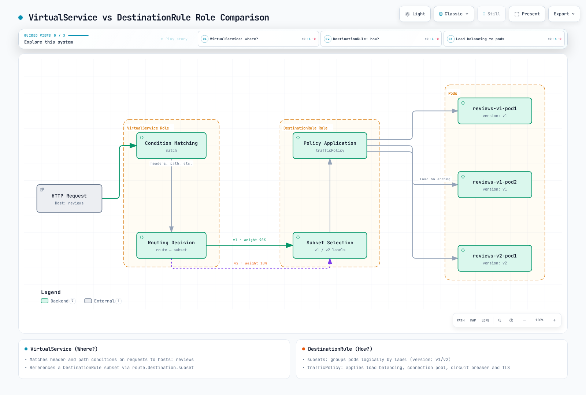

# DestinationRule

> **Versión revisada**: Istio 1.31.0
> **Versión de la API**: `networking.istio.io/v1`
> **Última actualización**: 11 de septiembre de 2026

DestinationRule es un recurso esencial de Istio que define cómo se trata el tráfico después de que VirtualService lo enruta a su destino.

## Tabla de contenidos

1. [¿Qué es DestinationRule?](#what-is-destinationrule)
2. [VirtualService frente a DestinationRule](#virtualservice-vs-destinationrule)
3. [Concepto de Subset](#subset-concept)
4. [Estructura básica](#basic-structure)
5. [Definición de Subsets](#defining-subsets)
6. [Descripción general de Traffic Policy](#traffic-policy-overview)
7. [Uso con VirtualService](#using-with-virtualservice)
8. [Ejemplos prácticos](#practical-examples)
9. [Prácticas recomendadas](#best-practices)
10. [Resolución de problemas](#troubleshooting)

## ¿Qué es DestinationRule? {#what-is-destinationrule}

Estos son patrones independientes de configuración para sidecars. DestinationRule y VirtualService son entradas de configuración que istiod compila; no son saltos adicionales que procesen el tráfico. DestinationRule también se aplica cuando no hay un VirtualService. Los subsets solo seleccionan endpoints ya descubiertos para el Service: no crean cargas de trabajo, no aíslan entornos ni asignan porcentajes de tráfico. Usa etiquetas que coincidan con las de las plantillas de pods y rutas explícitas hacia los subsets.

DestinationRule define las **políticas de tráfico posteriores al enrutamiento**. Si VirtualService decide «adónde» enviar el tráfico, DestinationRule decide «cómo» tratarlo.


[🔍 Ver el diagrama interactivo](https://www.atomai.click/kubernetes-docs/archmaps/en-service-mesh-istio-traffic-management-03-destination-rule-0.html)

### Funciones principales de DestinationRule

| Función | Descripción | Ejemplo |
|------|-------------|---------|
| **Definición de subsets** | Agrupa versiones de un servicio | v1, v2, canary, stable |
| **Balanceo de carga** | Algoritmo para distribuir la carga | ROUND_ROBIN, LEAST_REQUEST |
| **Grupo de conexiones** | Parámetros del grupo de conexiones | Conexiones máximas, tiempo de espera |
| **Circuit breaker** | Aislamiento de fallos | Detección de endpoints atípicos |
| **Configuración de TLS** | Política de cifrado | mTLS, TLS SIMPLE |

## VirtualService frente a DestinationRule {#virtualservice-vs-destinationrule}

Estos dos recursos trabajan juntos para ofrecer una gestión integral del tráfico.

### Comparación de funciones



[🔍 Ver el diagrama interactivo](https://www.atomai.click/kubernetes-docs/archmaps/en-service-mesh-istio-traffic-management-03-destination-rule-1.html)

### Separación de responsabilidades

**VirtualService (¿Adónde?)**:
```yaml
apiVersion: networking.istio.io/v1
kind: VirtualService
metadata:
  name: reviews
spec:
  hosts:
  - reviews
  http:
  - match:
    - headers:
        end-user:
          exact: jason
    route:
    - destination:
        host: reviews
        subset: v2  # ← References subset from DestinationRule
  - route:
    - destination:
        host: reviews
        subset: v1  # ← References subset from DestinationRule
```

**DestinationRule (¿Cómo?)**:
```yaml
apiVersion: networking.istio.io/v1
kind: DestinationRule
metadata:
  name: reviews
spec:
  host: reviews
  trafficPolicy:  # ← Default policy applied to all subsets
    loadBalancer:
      simple: LEAST_REQUEST
  subsets:  # ← Subset definitions referenced by VirtualService
  - name: v1
    labels:
      version: v1
  - name: v2
    labels:
      version: v2
    trafficPolicy:  # ← Policy applied only to v2
      loadBalancer:
        simple: ROUND_ROBIN
```

## Concepto de Subset {#subset-concept}

Un subset define un **grupo lógico** dentro de un servicio. Normalmente se distingue por versión, etapa de despliegue, región, entre otros criterios.

### La esencia de los subsets


[🔍 Ver el diagrama interactivo](https://www.atomai.click/kubernetes-docs/archmaps/en-service-mesh-istio-traffic-management-03-destination-rule-2.html)

### Casos de uso de los subsets

#### 1. Enrutamiento por versión

```yaml
apiVersion: networking.istio.io/v1
kind: DestinationRule
metadata:
  name: reviews-versions
spec:
  host: reviews
  subsets:
  - name: v1
    labels:
      version: v1
  - name: v2
    labels:
      version: v2
  - name: v3
    labels:
      version: v3
```

```yaml
# Pod-template label excerpt
metadata:
  labels:
    app: reviews
    version: v1  # ← Matches Subset
```

#### 2. Separación por etapa de despliegue

```yaml
apiVersion: networking.istio.io/v1
kind: DestinationRule
metadata:
  name: reviews-deployment-stages
spec:
  host: reviews
  subsets:
  - name: stable
    labels:
      stage: stable
  - name: canary
    labels:
      stage: canary
  - name: test
    labels:
      stage: test
```

#### 3. Separación por región

```yaml
apiVersion: networking.istio.io/v1
kind: DestinationRule
metadata:
  name: api-regions
spec:
  host: api-service
  subsets:
  - name: us-west
    labels:
      region: us-west
  - name: us-east
    labels:
      region: us-east
  - name: eu-central
    labels:
      region: eu-central
```

#### 4. Separación por entorno

```yaml
apiVersion: networking.istio.io/v1
kind: DestinationRule
metadata:
  name: payment-environments
spec:
  host: payment-service
  subsets:
  - name: production
    labels:
      env: production
  - name: staging
    labels:
      env: staging
```

## Estructura básica {#basic-structure}

### Campos obligatorios

```yaml
apiVersion: networking.istio.io/v1
kind: DestinationRule
metadata:
  name: my-destination-rule
  namespace: default
spec:
  host: my-service  # Required: Target service
  subsets:          # Optional: Subset definitions
  - name: v1
    labels:
      version: v1
  trafficPolicy:    # Optional: Traffic policy
    loadBalancer:
      simple: ROUND_ROBIN
```

### Formas de especificar el host

**1. Nombre del Service (mismo espacio de nombres)**
```yaml
spec:
  host: reviews
```

**2. FQDN (espacio de nombres diferente)**
```yaml
spec:
  host: reviews.production.svc.cluster.local
```

**3. Comodín**
```yaml
spec:
  host: "*.example.com"
```

**4. Servicio externo (con ServiceEntry)**
```yaml
spec:
  host: api.external.com
```

## Definición de subsets {#defining-subsets}

### Subset sencillo

```yaml
apiVersion: networking.istio.io/v1
kind: DestinationRule
metadata:
  name: reviews-simple
spec:
  host: reviews
  subsets:
  - name: v1
    labels:
      version: v1
  - name: v2
    labels:
      version: v2
```

### Políticas específicas de cada subset

```yaml
apiVersion: networking.istio.io/v1
kind: DestinationRule
metadata:
  name: reviews-subset-policies
spec:
  host: reviews
  trafficPolicy:  # Default policy (all subsets)
    loadBalancer:
      simple: LEAST_REQUEST
  subsets:
  - name: v1
    labels:
      version: v1
    # v1 uses default policy

  - name: v2
    labels:
      version: v2
    trafficPolicy:  # v2-only policy (overrides default)
      loadBalancer:
        simple: ROUND_ROBIN
      connectionPool:
        http:
          http1MaxPendingRequests: 10
```

### Coincidencia compleja de etiquetas

```yaml
apiVersion: networking.istio.io/v1
kind: DestinationRule
metadata:
  name: api-complex
spec:
  host: api-service
  subsets:
  - name: us-west-v2
    labels:
      version: v2
      region: us-west
      tier: premium
  - name: us-east-v1
    labels:
      version: v1
      region: us-east
      tier: standard
```

## Descripción general de Traffic Policy {#traffic-policy-overview}

`trafficPolicy` en DestinationRule proporciona distintas funciones para controlar el tráfico.

### Jerarquía de Traffic Policy


[🔍 Ver el diagrama interactivo](https://www.atomai.click/kubernetes-docs/archmaps/en-service-mesh-istio-traffic-management-03-destination-rule-3.html)

### Componentes de Traffic Policy

#### 1. Balanceador de carga

```yaml
trafficPolicy:
  loadBalancer:
    simple: ROUND_ROBIN  # LEAST_REQUEST, RANDOM, PASSTHROUGH
```

Consulta [Balanceo de carga](06-load-balancing.md) para obtener más detalles.

#### 2. Grupo de conexiones

```yaml
trafficPolicy:
  connectionPool:
    tcp:
      maxConnections: 100
    http:
      http1MaxPendingRequests: 50
      http2MaxRequests: 100
      maxRequestsPerConnection: 2
```

Consulta [Circuit breaker](07-circuit-breaker.md) para obtener más detalles.

#### 3. Detección de endpoints atípicos

```yaml
trafficPolicy:
  outlierDetection:
    consecutive5xxErrors: 5
    interval: 30s
    baseEjectionTime: 30s
    maxEjectionPercent: 50
```

Consulta [Circuit breaker](07-circuit-breaker.md) para obtener más detalles.

#### 4. Configuración de TLS

```yaml
trafficPolicy:
  tls:
    mode: ISTIO_MUTUAL  # DISABLE, SIMPLE, MUTUAL
```

Consulta [Seguridad](../security/01-mtls.md) para obtener más detalles.

#### 5. Configuración a nivel de puerto

```yaml
trafficPolicy:
  portLevelSettings:
  - port:
      number: 80
    loadBalancer:
      simple: ROUND_ROBIN
  - port:
      number: 443
    tls:
      mode: SIMPLE
```

## Uso con VirtualService {#using-with-virtualservice}

VirtualService y DestinationRule trabajan juntos para ofrecer un control integral del tráfico.

### Patrón básico: despliegue canary

En una puesta en producción, aplica primero DestinationRule y confirma que el nuevo subset aparece en la configuración de clusters del proxy; después actualiza VirtualService. Aplicar varios documentos en una sola operación no garantiza el orden de propagación. Elimina las referencias de las rutas antes de borrar un subset.

```yaml
# DestinationRule: Subset definition
apiVersion: networking.istio.io/v1
kind: DestinationRule
metadata:
  name: reviews
spec:
  host: reviews
  subsets:
  - name: v1
    labels:
      version: v1
  - name: v2
    labels:
      version: v2
---
# VirtualService: Traffic distribution
apiVersion: networking.istio.io/v1
kind: VirtualService
metadata:
  name: reviews
spec:
  hosts:
  - reviews
  http:
  - route:
    - destination:
        host: reviews
        subset: v1  # ← References DestinationRule subset
      weight: 90
    - destination:
        host: reviews
        subset: v2  # ← References DestinationRule subset
      weight: 10
```

### Enrutamiento basado en encabezados

```yaml
# DestinationRule
apiVersion: networking.istio.io/v1
kind: DestinationRule
metadata:
  name: reviews
spec:
  host: reviews
  subsets:
  - name: v1
    labels:
      version: v1
  - name: v2
    labels:
      version: v2
---
# VirtualService
apiVersion: networking.istio.io/v1
kind: VirtualService
metadata:
  name: reviews
spec:
  hosts:
  - reviews
  http:
  # Developers use v2
  - match:
    - headers:
        x-dev-user:
          exact: "true"
    route:
    - destination:
        host: reviews
        subset: v2
  # Regular users use v1
  - route:
    - destination:
        host: reviews
        subset: v1
```

### Enrutamiento por URI y políticas específicas del subset

```yaml
# DestinationRule: Different policies per subset
apiVersion: networking.istio.io/v1
kind: DestinationRule
metadata:
  name: api-service
spec:
  host: api-service
  subsets:
  - name: v1
    labels:
      version: v1
    trafficPolicy:
      loadBalancer:
        simple: ROUND_ROBIN
  - name: v2
    labels:
      version: v2
    trafficPolicy:
      loadBalancer:
        simple: LEAST_REQUEST
      connectionPool:
        http:
          http1MaxPendingRequests: 10
---
# VirtualService: URI-based routing
apiVersion: networking.istio.io/v1
kind: VirtualService
metadata:
  name: api-service
spec:
  hosts:
  - api-service
  http:
  - match:
    - uri:
        prefix: "/api/v2"
    route:
    - destination:
        host: api-service
        subset: v2
  - route:
    - destination:
        host: api-service
        subset: v1
```

## Ejemplos prácticos {#practical-examples}

### Ejemplo 1: gestión de versiones de microservicios

```yaml
apiVersion: networking.istio.io/v1
kind: DestinationRule
metadata:
  name: reviews-versions
  namespace: production
spec:
  host: reviews
  trafficPolicy:
    loadBalancer:
      simple: LEAST_REQUEST
    connectionPool:
      tcp:
        maxConnections: 100
      http:
        http1MaxPendingRequests: 50
        maxRequestsPerConnection: 2
  subsets:
  - name: v1
    labels:
      version: v1
  - name: v2
    labels:
      version: v2
  - name: v3
    labels:
      version: v3
```

**Casos de uso**:
- v1: versión estable (la mayor parte del tráfico)
- v2: versión canary (el 10 % del tráfico)
- v3: versión de prueba (solo para desarrolladores)

### Ejemplo 2: despliegue multirregional

Se presupone que la malla ya puede descubrir los endpoints de cada región y acceder a ellos. Las etiquetas personalizadas `region` de los pods seleccionan los subsets; las etiquetas de topología de los nodos proporcionan por separado la localidad de Envoy. Los subsets regionales necesitan rutas explícitas, y la conmutación por error basada en localidad requiere detección de endpoints atípicos y capacidad saludable accesible.

```yaml
apiVersion: networking.istio.io/v1
kind: DestinationRule
metadata:
  name: api-multi-region
spec:
  host: api-service
  trafficPolicy:
    loadBalancer:
      simple: LEAST_REQUEST
      localityLbSetting:
        enabled: true
  subsets:
  - name: us-west
    labels:
      region: us-west
    trafficPolicy:
      connectionPool:
        tcp:
          maxConnections: 1000
  - name: us-east
    labels:
      region: us-east
    trafficPolicy:
      connectionPool:
        tcp:
          maxConnections: 1000
  - name: eu-central
    labels:
      region: eu-central
    trafficPolicy:
      connectionPool:
        tcp:
          maxConnections: 500
```

### Ejemplo 3: políticas por etapa de despliegue

```yaml
apiVersion: networking.istio.io/v1
kind: DestinationRule
metadata:
  name: payment-service-stages
spec:
  host: payment-service
  subsets:
  # Production: Strict policy
  - name: production
    labels:
      stage: production
    trafficPolicy:
      connectionPool:
        tcp:
          maxConnections: 100
        http:
          http1MaxPendingRequests: 10
          maxRequestsPerConnection: 1
      outlierDetection:
        consecutive5xxErrors: 3
        interval: 10s
        baseEjectionTime: 60s

  # Canary: Moderate policy
  - name: canary
    labels:
      stage: canary
    trafficPolicy:
      connectionPool:
        tcp:
          maxConnections: 50
        http:
          http1MaxPendingRequests: 20
      outlierDetection:
        consecutive5xxErrors: 5
        interval: 30s
        baseEjectionTime: 30s

  # Staging: Lenient policy
  - name: staging
    labels:
      stage: staging
    trafficPolicy:
      connectionPool:
        tcp:
          maxConnections: 200
        http:
          http1MaxPendingRequests: 100
      outlierDetection:
        consecutive5xxErrors: 10
        interval: 60s
        baseEjectionTime: 30s
```

### Ejemplo 4: integración con un servicio externo

```yaml
# ServiceEntry: Register external API
apiVersion: networking.istio.io/v1
kind: ServiceEntry
metadata:
  name: external-payment-api
spec:
  hosts:
  - api.payment-gateway.com
  ports:
  - number: 80
    name: http
    protocol: HTTP
    targetPort: 443
  location: MESH_EXTERNAL
  resolution: DNS
---
# DestinationRule: External API policy
apiVersion: networking.istio.io/v1
kind: DestinationRule
metadata:
  name: external-payment-api
spec:
  host: api.payment-gateway.com
  trafficPolicy:
    connectionPool:
      tcp:
        maxConnections: 10
      http:
        http1MaxPendingRequests: 5
        maxRequestsPerConnection: 1
    outlierDetection:
      consecutive5xxErrors: 3
      interval: 30s
      baseEjectionTime: 120s
    tls:
      mode: SIMPLE
      sni: api.payment-gateway.com
      subjectAltNames:
      - api.payment-gateway.com
```

Esta variante espera que la aplicación envíe HTTP al puerto registrado 80; el sidecar origina TLS verificado hacia el puerto 443. Sustituye el host de ejemplo por tu endpoint. Si la aplicación ya envía HTTPS, omite la originación TLS y los ajustes de política exclusivos de HTTP para esa ruta de TLS opaco, a fin de evitar el doble cifrado.

### Ejemplo 5: grupo de conexiones de base de datos

```yaml
apiVersion: networking.istio.io/v1
kind: DestinationRule
metadata:
  name: postgres-connection-pool
spec:
  host: postgres-primary
  trafficPolicy:
    connectionPool:
      tcp:
        maxConnections: 50  # DB connection limit
        connectTimeout: 5s
        tcpKeepalive:
          time: 7200s
          interval: 75s
    outlierDetection:
      consecutive5xxErrors: 3
      interval: 60s
      baseEjectionTime: 120s
  subsets:
  - name: primary
    labels:
      role: primary
  - name: replica
    labels:
      role: replica
    trafficPolicy:
      connectionPool:
        tcp:
          maxConnections: 100  # More for replicas
```

Los límites de conexiones TCP anteriores se aplican por cada proxy; no constituyen un presupuesto global de conexiones para la base de datos. PostgreSQL no utiliza los parámetros de conexión HTTP. Los subsets de principal y réplica deben estar incluidos en los endpoints del Service seleccionado, y la aplicación debe elegir correctamente los destinos de lectura y escritura.

## Prácticas recomendadas {#best-practices}

### 1. Convenciones para nombrar subsets

```yaml
# ✅ Good example: Meaningful names
subsets:
- name: v1
- name: v2
- name: stable
- name: canary
- name: us-west
- name: production
```

```yaml
# ❌ Bad example: Vague names
subsets:
- name: subset1
- name: test
- name: new
```

### 2. Patrón de política predeterminada y anulación

```yaml
# ✅ Good example: Define default policy and override when needed
apiVersion: networking.istio.io/v1
kind: DestinationRule
metadata:
  name: reviews
spec:
  host: reviews
  trafficPolicy:  # Default policy
    loadBalancer:
      simple: LEAST_REQUEST
  subsets:
  - name: v1
    labels:
      version: v1
    # v1 uses default policy
  - name: v2
    labels:
      version: v2
    trafficPolicy:  # Override only for v2
      loadBalancer:
        simple: ROUND_ROBIN
```

### 3. Ajusta el aislamiento ante fallos

```yaml
# Tune outlierDetection for the service and failure model
apiVersion: networking.istio.io/v1
kind: DestinationRule
metadata:
  name: api-service
spec:
  host: api-service
  trafficPolicy:
    loadBalancer:
      simple: LEAST_REQUEST
    outlierDetection:  # Optional policy
      consecutive5xxErrors: 5
      interval: 30s
      baseEjectionTime: 30s
```

### 4. Configuración del grupo de conexiones

```yaml
# ✅ Connection Pool appropriate for service characteristics
apiVersion: networking.istio.io/v1
kind: DestinationRule
metadata:
  name: high-traffic-service
spec:
  host: api-gateway
  trafficPolicy:
    connectionPool:
      tcp:
        maxConnections: 1000
      http:
        http2MaxRequests: 1000
        maxRequestsPerConnection: 100
```

### 5. Despliegue gradual

```yaml
# ✅ Gradually increase canary ratio
# Step 1: 5%
apiVersion: networking.istio.io/v1
kind: VirtualService
metadata:
  name: reviews-canary-step1
spec:
  hosts:
  - reviews
  http:
  - route:
    - destination:
        host: reviews
        subset: v1
      weight: 95
    - destination:
        host: reviews
        subset: v2
      weight: 5

# Step 2: After monitoring, increase to 10%
# Step 3: 25% → 50% → 100%
```

### 6. Documentación

```yaml
apiVersion: networking.istio.io/v1
kind: DestinationRule
metadata:
  name: payment-service
  annotations:
    description: "Payment service traffic management"
    owner: "payments-team"
    subset-purpose: |
      - production: Main production traffic
      - canary: New version testing (10%)
      - staging: Pre-production testing
spec:
  host: payment-service
  # ...
```

## Resolución de problemas {#troubleshooting}

### El subset no funciona

**Síntoma**:
```bash
# VirtualService exists but traffic isn't routed
kubectl get virtualservice reviews -o yaml
```

**Causa y solución**:

```bash
# 1. Check DestinationRule
kubectl get destinationrule reviews -o yaml

# 2. Verify subset names match
# VirtualService: subset: v2
# DestinationRule: name: v2

# 3. Check pod labels
kubectl get pods --show-labels | grep reviews

# 4. Verify pods have version=v2 label
kubectl get deployment reviews-v2 -o jsonpath='{.spec.template.metadata.labels}'
```

### La política de tráfico no se aplica

```bash
# Check Envoy configuration
istioctl proxy-config clusters <pod-name> --fqdn reviews.default.svc.cluster.local -o json

# Check Circuit Breaker settings
istioctl proxy-config clusters <pod-name> -o json | jq '.[] | select(.name=="outbound|9080||reviews.default.svc.cluster.local") | .circuitBreakers'
```

### Conflictos entre subsets

Istio puede combinar los fragmentos aplicables de DestinationRule para un mismo host. Los dos subsets distintos que se muestran a continuación no entran en conflicto por sí solos. Si hay nombres de subset duplicados, se utiliza la primera definición sin combinarlas; si hay varios bloques de trafficPolicy de nivel superior, también se conserva solo el primero que se procesa. La búsqueda y visibilidad entre espacios de nombres siguen siendo importantes; una única regla administrada por un responsable es más fácil de entender.

**Problema**:
```yaml
# Same-host DestinationRule fragments can merge with restrictions
apiVersion: networking.istio.io/v1
kind: DestinationRule
metadata:
  name: reviews-1
spec:
  host: reviews
  subsets:
  - name: v1
    labels:
      version: v1
---
# Unique subset names can merge; duplicate names/policies are the problem
apiVersion: networking.istio.io/v1
kind: DestinationRule
metadata:
  name: reviews-2
spec:
  host: reviews
  subsets:
  - name: v2
    labels:
      version: v2
```

**Solución**:
```yaml
# ✅ Define all subsets in one DestinationRule
apiVersion: networking.istio.io/v1
kind: DestinationRule
metadata:
  name: reviews
spec:
  host: reviews
  subsets:
  - name: v1
    labels:
      version: v1
  - name: v2
    labels:
      version: v2
```

### Análisis con istioctl

```bash
# Validate DestinationRule
istioctl analyze

# Specific namespace
istioctl analyze -n production

# Example output
# Inspect actual analyzer messages and confirm subset clusters in proxy-config output
```

## Próximos pasos

Después de comprender DestinationRule, continúa con estos temas:

1. **[División del tráfico](04-traffic-splitting.md)**: despliegues canary y Blue/Green
2. **[Balanceo de carga](06-load-balancing.md)**: distintos algoritmos y políticas
3. **[Circuit breaker](07-circuit-breaker.md)**: aislamiento de fallos y resiliencia
4. **[Reintentos y tiempos de espera](05-retry-timeout.md)**: configuración de reintentos y tiempos de espera

## Referencias

- [Referencia de Istio DestinationRule](https://istio.io/latest/docs/reference/config/networking/destination-rule/)
- [Gestión del tráfico de Istio](https://istio.io/latest/docs/concepts/traffic-management/)
- [Configuración de clusters de Envoy](https://www.envoyproxy.io/docs/envoy/latest/intro/arch_overview/upstream/upstream)

- [Combinación de DestinationRule y despliegue seguro de subsets](https://istio.io/latest/docs/ops/best-practices/traffic-management/)
- [Originación TLS](https://istio.io/latest/docs/tasks/traffic-management/egress/egress-tls-origination/)
