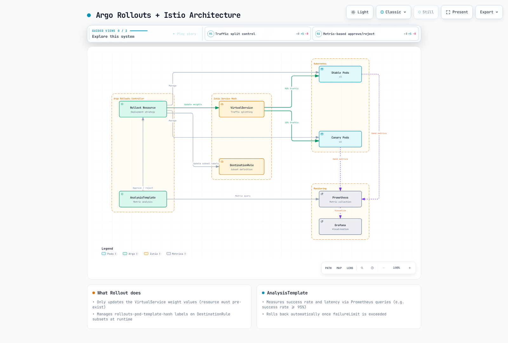
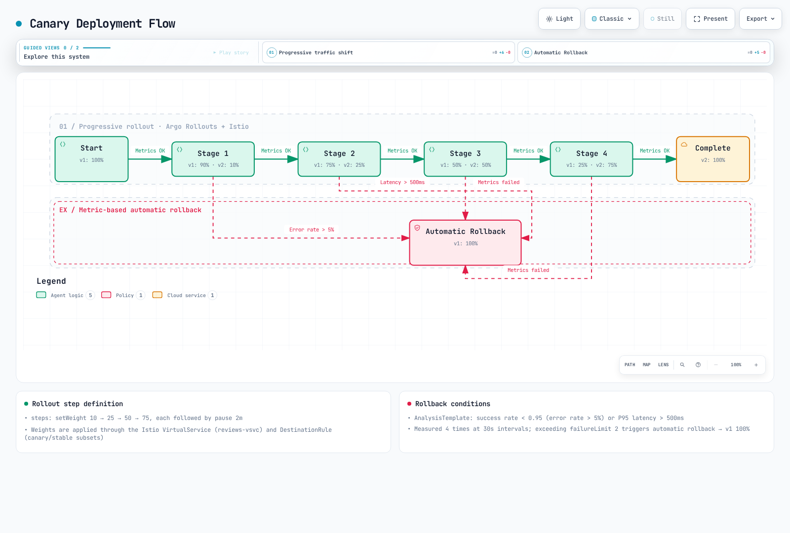

# División del tráfico

La división del tráfico es una de las funciones más potentes de Istio: permite realizar despliegues Canary, pruebas A/B y despliegues Blue/Green sin modificar el código.

## Tabla de contenido

1. [Descripción general de la división del tráfico](#traffic-splitting-overview)
2. [Despliegue Canary](#canary-deployment)
3. [Despliegue Blue/Green](#bluegreen-deployment)
4. [Pruebas A/B](#ab-testing)
5. [Lanzamiento progresivo](#progressive-rollout)
6. [Uso con la duplicación del tráfico](#using-with-traffic-mirroring)
7. [Ejemplos prácticos](#practical-examples)
8. [Supervisión y reversión](#monitoring-and-rollback)
9. [Solución de problemas](#troubleshooting)

## Descripción general de la división del tráfico {#traffic-splitting-overview}

Revisado con Istio 1.31.0 y Argo Rollouts 1.10.1. Estos son ejemplos alternativos para un espacio de nombres de prueba desechable; no ejecutes varios Rollouts con el mismo selector ni permitas que scripts manuales o GitOps sobrescriban los pesos y los hashes de subconjuntos administrados por Rollouts. Instala los Services, DestinationRules, AnalysisTemplates, la gateway y Prometheus mencionados antes del rollout. El primer despliegue establece un ReplicaSet estable; los pasos y el análisis Canary ejercitan una actualización posterior. El peso controla la distribución de solicitudes, no un porcentaje estable de usuarios.

La división del tráfico usa el campo `weight` de VirtualService para distribuir el tráfico entre varias versiones de un servicio según una proporción.


[🔍 Ver diagrama interactivo](https://www.atomai.click/kubernetes-docs/archmaps/en-service-mesh-istio-traffic-management-04-traffic-splitting-0.html)

### Estructura básica

```yaml
apiVersion: networking.istio.io/v1
kind: VirtualService
metadata:
  name: reviews
spec:
  hosts:
  - reviews
  http:
  - route:
    - destination:
        host: reviews
        subset: v1
      weight: 90  # 90% of traffic
    - destination:
        host: reviews
        subset: v2
      weight: 10  # 10% of traffic
```

## Despliegue Canary {#canary-deployment}

Un despliegue Canary es una estrategia que valida de forma segura una versión nueva al desplegarla primero solo para un pequeño subconjunto de usuarios. Usar Argo Rollouts con Istio permite automatizar el despliegue progresivo y la reversión automática basada en métricas.

### Arquitectura de Argo Rollouts + Istio



[🔍 Ver diagrama interactivo](https://www.atomai.click/kubernetes-docs/archmaps/en-service-mesh-istio-traffic-management-04-traffic-splitting-1.html)

### Flujo del despliegue Canary



[🔍 Ver diagrama interactivo](https://www.atomai.click/kubernetes-docs/archmaps/en-service-mesh-istio-traffic-management-04-traffic-splitting-2.html)

### Paso 1: Instalar Argo Rollouts

```bash
# Install Argo Rollouts
kubectl create namespace argo-rollouts
kubectl apply -n argo-rollouts -f https://github.com/argoproj/argo-rollouts/releases/download/v1.10.1/install.yaml

# Install Argo Rollouts CLI (optional)
curl -LO https://github.com/argoproj/argo-rollouts/releases/download/v1.10.1/kubectl-argo-rollouts-linux-amd64
chmod +x kubectl-argo-rollouts-linux-amd64
sudo mv kubectl-argo-rollouts-linux-amd64 /usr/local/bin/kubectl-argo-rollouts

# Run Argo Rollouts Dashboard
kubectl argo rollouts dashboard
```

### Paso 2: Definir el recurso Rollout

```yaml
apiVersion: argoproj.io/v1alpha1
kind: Rollout
metadata:
  name: reviews
  namespace: default
spec:
  replicas: 5
  revisionHistoryLimit: 2
  selector:
    matchLabels:
      app: reviews
  template:
    metadata:
      labels:
        app: reviews
        sidecar.istio.io/inject: "true"
    spec:
      containers:
      - name: reviews
        image: docker.io/istio/examples-bookinfo-reviews-v2:1.20.3
        ports:
        - containerPort: 9080
        resources:
          requests:
            memory: "64Mi"
            cpu: "100m"
          limits:
            memory: "128Mi"
            cpu: "200m"

  # Canary Deployment Strategy
  strategy:
    canary:
      # Traffic Control via Istio VirtualService
      trafficRouting:
        istio:
          virtualService:
            name: reviews-vsvc
            routes:
            - primary
          destinationRule:
            name: reviews-destrule
            canarySubsetName: canary
            stableSubsetName: stable

      # Canary Steps Definition
      steps:
      - setWeight: 10    # 10% traffic to Canary
      - pause:
          duration: 2m   # Wait 2 minutes

      - analysis:
          templates:
          - templateName: success-rate
          - templateName: latency
          args:
          - name: service-name
            value: reviews
          - name: pod-template-hash
            valueFrom:
              podTemplateHashValue: Latest

      - setWeight: 25    # 25% traffic to Canary
      - pause:
          duration: 2m

      - analysis:
          templates:
          - templateName: success-rate
          - templateName: latency
          args:
          - name: service-name
            value: reviews
          - name: pod-template-hash
            valueFrom:
              podTemplateHashValue: Latest

      - setWeight: 50    # 50% traffic to Canary
      - pause:
          duration: 2m

      - analysis:
          templates:
          - templateName: success-rate
          - templateName: latency
          args:
          - name: service-name
            value: reviews
          - name: pod-template-hash
            valueFrom:
              podTemplateHashValue: Latest

      - setWeight: 75    # 75% traffic to Canary
      - pause:
          duration: 2m

      - analysis:
          templates:
          - templateName: success-rate
          - templateName: latency
          args:
          - name: service-name
            value: reviews
          - name: pod-template-hash
            valueFrom:
              podTemplateHashValue: Latest

```

### Paso 3: Crear el Service

Primero, crea el Service de Kubernetes:

```yaml
apiVersion: v1
kind: Service
metadata:
  name: reviews
  namespace: default
spec:
  ports:
  - port: 9080
    name: http
  selector:
    app: reviews  # Select all Pods from Rollout
```

### Paso 4: Definir el VirtualService

**Importante**: Argo Rollouts actualiza los pesos de las rutas del VirtualService al que se hace referencia. No crea ese VirtualService; debes crearlo primero.

```yaml
apiVersion: networking.istio.io/v1
kind: VirtualService
metadata:
  name: reviews-vsvc
  namespace: default
spec:
  hosts:
  - reviews
  http:
  - name: primary  # Route name referenced by Rollout (required)
    route:
    - destination:
        host: reviews
        subset: stable  # Stable version
      weight: 100
    - destination:
        host: reviews
        subset: canary  # Canary version
      weight: 0
```

**Puntos clave**:
- Las rutas enumeradas explícitamente en Rollout necesitan valores coincidentes de `http[].name`; se puede omitir la lista de rutas si hay exactamente una ruta
- Rollout solo actualiza automáticamente los valores de `weight` de este VirtualService
- Se necesitan dos destinos: stable y canary

### Paso 5: Definir el DestinationRule

**Importante**: Argo Rollouts **NO** crea automáticamente el DestinationRule. Debes crearlo de antemano.

```yaml
apiVersion: networking.istio.io/v1
kind: DestinationRule
metadata:
  name: reviews-destrule
  namespace: default
spec:
  host: reviews
  subsets:
  - name: stable
    labels:
      app: reviews
  - name: canary
    labels:
      app: reviews
```

**Puntos clave**:
- Los nombres de los subconjuntos (`stable`, `canary`) deben coincidir con `stableSubsetName` y `canarySubsetName` de Rollout
- Rollout agrega automáticamente la etiqueta `rollouts-pod-template-hash` a los Pods
- Los subconjuntos de DestinationRule seleccionan los Pods según esta etiqueta
- Conserva las etiquetas de aplicación estables si las necesitas; Rollout agrega y actualiza el hash de la plantilla del Pod en cada subconjunto. Espera a que estén listos esos selectores antes de enviar tráfico.

### Paso 6: Definir AnalysisTemplate

Antes de usar estas condiciones Canary, agrega esta regla de reetiquetado al **trabajo de scrape de Pods de Prometheus que recopila las métricas de Istio de las cargas de trabajo**. Confirma que `rollout_hash` y `reporter="destination"` aparezcan en las series recopiladas. La regla identifica el ReplicaSet Canary real indicado por `podTemplateHashValue: Latest`; los promedios de todo el servicio ocultarían los errores de una Canary pequeña. Proporciona tráfico de solicitudes representativo; las mediciones ausentes o NaN no deben promover una versión.

```yaml
# Add to the existing pod scrape job's relabel_configs
- source_labels: [__meta_kubernetes_pod_label_rollouts_pod_template_hash]
  target_label: rollout_hash
```

#### Análisis de la tasa de éxito

```yaml
apiVersion: argoproj.io/v1alpha1
kind: AnalysisTemplate
metadata:
  name: success-rate
  namespace: default
spec:
  args:
  - name: service-name
  - name: pod-template-hash

  metrics:
  - name: success-rate
    interval: 30s
    count: 4  # Four measurements; interval is not total elapsed duration
    successCondition: len(result) == 1 && !isNaN(result[0]) && result[0] >= 0.95
    failureLimit: 0  # No failed measurement tolerated
    provider:
      prometheus:
        address: http://prometheus.istio-system:9090
        query: |
          sum(rate(
            istio_requests_total{
              destination_service_name="{{args.service-name}}",
              reporter="destination",
              rollout_hash="{{args.pod-template-hash}}",
              destination_workload_namespace="default",
              response_code!~"5.*"
            }[2m]
          ))
          /
          sum(rate(
            istio_requests_total{
              destination_service_name="{{args.service-name}}",
              reporter="destination",
              rollout_hash="{{args.pod-template-hash}}",
              destination_workload_namespace="default"
            }[2m]
          ))
```

#### Análisis de latencia

```yaml
apiVersion: argoproj.io/v1alpha1
kind: AnalysisTemplate
metadata:
  name: latency
  namespace: default
spec:
  args:
  - name: service-name
  - name: pod-template-hash

  metrics:
  - name: latency-p95
    interval: 30s
    count: 4
    successCondition: len(result) == 1 && !isNaN(result[0]) && result[0] <= 500
    failureLimit: 0
    provider:
      prometheus:
        address: http://prometheus.istio-system:9090
        query: |
          histogram_quantile(0.95,
            sum(rate(
              istio_request_duration_milliseconds_bucket{
                destination_service_name="{{args.service-name}}",
              reporter="destination",
              rollout_hash="{{args.pod-template-hash}}",
                destination_workload_namespace="default"
              }[2m]
            )) by (le)
          )
```

### Ejecución y supervisión del despliegue

#### Desplegar una versión nueva

```bash
# Start Canary deployment with image update
kubectl argo rollouts set image reviews \
  reviews=docker.io/istio/examples-bookinfo-reviews-v3:1.20.3

# Check Rollout status
kubectl argo rollouts get rollout reviews --watch

# Real-time dashboard
kubectl argo rollouts dashboard
```

#### Aprobación/rechazo manual

```bash
# Manual approval to proceed to next step
kubectl argo rollouts promote reviews

# Abort and rollback Canary deployment
kubectl argo rollouts abort reviews

# Rollback to specific revision
kubectl argo rollouts undo reviews
```

#### Supervisar el progreso del despliegue

```bash
# Check Rollout status
kubectl argo rollouts status reviews

# Check analysis results
kubectl get analysisrun -w

# Check Canary vs Stable traffic distribution
kubectl get virtualservice reviews-vsvc -o yaml

# Check actual Pod status
kubectl get pods -l app=reviews --show-labels
```

### Configuración avanzada: progresión automática basada en métricas

Combina esta estrategia con el Rollout completo anterior y conserva su selector y plantilla. Los demás ejemplos abreviados de Rollout que aparecen a continuación también son superposiciones, no manifiestos independientes.

```yaml
apiVersion: argoproj.io/v1alpha1
kind: Rollout
metadata:
  name: reviews-auto
spec:
  replicas: 5
  strategy:
    canary:
      trafficRouting:
        istio:
          virtualService:
            name: reviews-vsvc
            routes:
            - primary
          destinationRule:
            name: reviews-destrule
            canarySubsetName: canary
            stableSubsetName: stable

      steps:
      - setWeight: 10
      - pause:
          duration: 1m

      # Automatic Analysis - Automatically proceed to next step on success
      - analysis:
          templates:
          - templateName: success-rate
          - templateName: latency
          args:
          - name: service-name
            value: reviews
          - name: pod-template-hash
            valueFrom:
              podTemplateHashValue: Latest

      - setWeight: 25
      - pause:
          duration: 1m

      - analysis:
          templates:
          - templateName: success-rate
          - templateName: latency
          args:
          - name: service-name
            value: reviews
          - name: pod-template-hash
            valueFrom:
              podTemplateHashValue: Latest

      - setWeight: 50
      - pause:
          duration: 1m

      - analysis:
          templates:
          - templateName: success-rate
          - templateName: latency
          args:
          - name: service-name
            value: reviews
          - name: pod-template-hash
            valueFrom:
              podTemplateHashValue: Latest

      - setWeight: 75
      - pause:
          duration: 1m

      - analysis:
          templates:
          - templateName: success-rate
          - templateName: latency
          args:
          - name: service-name
            value: reviews
          - name: pod-template-hash
            valueFrom:
              podTemplateHashValue: Latest
```

### Consideraciones clave

#### 1. VirtualService y DestinationRule deben crearse de antemano

Argo Rollouts no crea estos recursos. Deben crearse antes de desplegar Rollout:

```bash
# Order is important
kubectl apply -f service.yaml
kubectl apply -f destination-rule.yaml
kubectl apply -f virtual-service.yaml
kubectl apply -f analysis-templates.yaml
kubectl apply -f rollout.yaml
```

#### 2. Etiquetas administradas por Rollout

Argo Rollouts agrega y administra automáticamente las siguientes etiquetas:

```yaml
# Labels automatically added by Rollout
rollouts-pod-template-hash: <hash>  # For ReplicaSet identification
```

Estas etiquetas se usan para seleccionar subconjuntos en DestinationRule.

#### 3. Se requiere el nombre de la ruta HTTP

Solo las rutas seleccionadas explícitamente necesitan el nombre indicado. No hace falta asignar un nombre a las rutas de encabezado no administradas; este ejemplo selecciona `primary`:

```yaml
# Wrong example
http:
- route:  # No name!
  - destination:
      host: reviews
```

```yaml
# Correct example
http:
- name: primary  # Required!
  route:
  - destination:
      host: reviews
```

#### 4. Habilitar la inyección de Istio

Se debe inyectar un sidecar de Istio en los Pods de Rollout:

```bash
# Method 1: Namespace level
kubectl label namespace default istio-injection=enabled
```

```yaml
# Method 2: Pod level
template:
  metadata:
    labels:
      sidecar.istio.io/inject: "true"
```

### Uso con condiciones match de VirtualService

Los encabezados de tester, región o nivel de usuario deben ser proporcionados por una capa de confianza si controlan el acceso privilegiado. Las rutas no administradas que siempre seleccionan `canary` no cambian cuando se revierte un peso y pueden seguir apuntando a una Canary cuya escala se haya reducido; elimínalas o modifícalas al abortar o limpiar.

Argo Rollouts se puede usar con condiciones match de VirtualService. Esto permite dirigir a Canary solo el tráfico que cumpla condiciones específicas.

#### Ejemplo 1: Canary basada en encabezados (para testers internos)

```yaml
apiVersion: networking.istio.io/v1
kind: VirtualService
metadata:
  name: reviews-vsvc
spec:
  hosts:
  - reviews
  http:
  # Priority 1: Internal testers always go to Canary
  - match:
    - headers:
        x-canary-tester:
          exact: "true"
    route:
    - destination:
        host: reviews
        subset: canary

  # Priority 2: Normal traffic - Rollout manages this route's weight
  - name: primary
    route:
    - destination:
        host: reviews
        subset: stable
      weight: 100
    - destination:
        host: reviews
        subset: canary
      weight: 0
```

**Escenario de uso**:
```bash
# Internal testers always access Canary version
curl -H "x-canary-tester: true" http://reviews:9080/

# Regular users are routed based on Rollout's weight
curl http://reviews:9080/
```

#### Ejemplo 2: Despliegue por etapas según la región

```yaml
apiVersion: networking.istio.io/v1
kind: VirtualService
metadata:
  name: reviews-vsvc
spec:
  hosts:
  - reviews
  http:
  # Priority 1: Dev environment always gets latest version
  - match:
    - headers:
        x-env:
          exact: "dev"
    route:
    - destination:
        host: reviews
        subset: canary

  # Priority 2: Only specific region for Canary test (e.g., Seoul)
  - match:
    - headers:
        x-region:
          exact: "ap-northeast-2"
    name: seoul-traffic
    route:
    - destination:
        host: reviews
        subset: stable
      weight: 100
    - destination:
        host: reviews
        subset: canary
      weight: 0

  # Priority 3: Other regions stay on stable version
  - name: other-regions
    route:
    - destination:
        host: reviews
        subset: stable
```

**Configuración de Rollout**:
```yaml
apiVersion: argoproj.io/v1alpha1
kind: Rollout
metadata:
  name: reviews
spec:
  # ... (same as before)
  strategy:
    canary:
      trafficRouting:
        istio:
          virtualService:
            name: reviews-vsvc
            routes:
            - seoul-traffic  # Only apply Canary to Seoul traffic
          destinationRule:
            name: reviews-destrule
            canarySubsetName: canary
            stableSubsetName: stable
      steps:
      - setWeight: 10
      - pause: {duration: 2m}
      - setWeight: 50
      - pause: {duration: 2m}
```

#### Ejemplo 3: Despliegue por nivel de usuario

```yaml
apiVersion: networking.istio.io/v1
kind: VirtualService
metadata:
  name: reviews-vsvc
spec:
  hosts:
  - reviews
  http:
  # Priority 1: Beta program participants
  - match:
    - headers:
        x-user-tier:
          exact: "beta"
    route:
    - destination:
        host: reviews
        subset: canary

  # Priority 2: Only premium users for Canary test
  - match:
    - headers:
        x-user-tier:
          exact: "premium"
    name: premium-users
    route:
    - destination:
        host: reviews
        subset: stable
      weight: 100
    - destination:
        host: reviews
        subset: canary
      weight: 0

  # Priority 3: Free users get stable version
  - name: free-users
    route:
    - destination:
        host: reviews
        subset: stable
```

#### Ejemplo 4: Despliegue según la versión de la aplicación móvil

```yaml
apiVersion: networking.istio.io/v1
kind: VirtualService
metadata:
  name: reviews-vsvc
spec:
  hosts:
  - reviews
  http:
  # Priority 1: Only latest app version users get Canary
  - match:
    - headers:
        x-app-version:
          regex: "^3\\.([1-9][0-9]+)\\.[0-9]+$"  # 3.x.y with minor >= 10; not 4.x
    name: latest-app-version
    route:
    - destination:
        host: reviews
        subset: stable
      weight: 100
    - destination:
        host: reviews
        subset: canary
      weight: 0

  # Priority 2: Legacy app only gets stable version
  - name: legacy-app-version
    route:
    - destination:
        host: reviews
        subset: stable
```

### Ejemplo completo de despliegue

Manifiesto de referencia combinado para una instalación nueva de laboratorio. Los despliegues existentes requieren cambios ordenados y comprobaciones de propagación; esta aplicación no es atómica:

```yaml
---
# Service
apiVersion: v1
kind: Service
metadata:
  name: reviews
spec:
  ports:
  - port: 9080
    name: http
  selector:
    app: reviews

---
# DestinationRule
apiVersion: networking.istio.io/v1
kind: DestinationRule
metadata:
  name: reviews-destrule
spec:
  host: reviews
  subsets:
  - name: stable
    labels: {app: reviews}  # Rollout adds the revision hash
  - name: canary
    labels: {app: reviews}  # Rollout adds the revision hash

---
# VirtualService
apiVersion: networking.istio.io/v1
kind: VirtualService
metadata:
  name: reviews-vsvc
spec:
  hosts:
  - reviews
  http:
  - name: primary
    route:
    - destination:
        host: reviews
        subset: stable
      weight: 100
    - destination:
        host: reviews
        subset: canary
      weight: 0

---
# Rollout
apiVersion: argoproj.io/v1alpha1
kind: Rollout
metadata:
  name: reviews
spec:
  replicas: 3
  selector:
    matchLabels:
      app: reviews
  template:
    metadata:
      labels:
        app: reviews
    spec:
      containers:
      - name: reviews
        image: istio/examples-bookinfo-reviews-v1:1.20.3
        ports:
        - containerPort: 9080

  strategy:
    canary:
      trafficRouting:
        istio:
          virtualService:
            name: reviews-vsvc
            routes:
            - primary
          destinationRule:
            name: reviews-destrule
            canarySubsetName: canary
            stableSubsetName: stable

      steps:
      - setWeight: 20
      - pause: {duration: 1m}
      - setWeight: 40
      - pause: {duration: 1m}
      - setWeight: 60
      - pause: {duration: 1m}
      - setWeight: 80
      - pause: {duration: 1m}
```

### Consideraciones al usar match

#### 1. El orden de las rutas importa

Las rutas HTTP de VirtualService se **evalúan en orden**. Las rutas con match deben colocarse antes de las rutas administradas por Rollout:

```yaml
# Correct example
http:
- match:
    - headers:
        x-tester: {exact: "true"}
  route:
    - destination: {host: reviews, subset: canary}

- name: primary  # Managed by Rollout
  route:
    - destination: {host: reviews, subset: stable}
      weight: 100
    - destination: {host: reviews, subset: canary}
      weight: 0
```

```yaml
# Wrong example - match is ignored if primary comes first
http:
- name: primary
  route: [...]

- match: [...]  # Never reached!
  route: [...]
```

#### 2. Rollout solo administra las rutas especificadas

Rollout solo modifica los pesos de las rutas especificadas en el campo `routes`:

```yaml
strategy:
  canary:
    trafficRouting:
      istio:
        virtualService:
          name: reviews-vsvc
          routes:
          - primary  # Only modifies this route's weight
          # Other routes with match are not modified
```

#### 3. Administrar varias rutas a la vez

Si es necesario, se pueden administrar varias rutas a la vez:

```yaml
apiVersion: networking.istio.io/v1
kind: VirtualService
metadata:
  name: reviews-vsvc
spec:
  hosts:
  - reviews
  http:
  # Premium users route
  - match:
    - headers:
        x-user-tier: {exact: "premium"}
    name: premium-route
    route:
    - destination: {host: reviews, subset: stable}
      weight: 100
    - destination: {host: reviews, subset: canary}
      weight: 0

  # Standard users route
  - name: standard-route
    route:
    - destination: {host: reviews, subset: stable}
      weight: 100
    - destination: {host: reviews, subset: canary}
      weight: 0

---
apiVersion: argoproj.io/v1alpha1
kind: Rollout
metadata:
  name: reviews
spec:
  strategy:
    canary:
      trafficRouting:
        istio:
          virtualService:
            name: reviews-vsvc
            routes:
            - premium-route    # Manage both routes
            - standard-route
          destinationRule:
            name: reviews-destrule
            canarySubsetName: canary
            stableSubsetName: stable
      steps:
      - setWeight: 10
      - pause: {duration: 2m}
```

### Solución de problemas {#troubleshooting}

#### Rollout atascado en el estado Progressing

```bash
# Check Rollout status
kubectl argo rollouts get rollout reviews

# Check Events
kubectl describe rollout reviews

# Common causes:
# 1. VirtualService/DestinationRule doesn't exist
kubectl get virtualservice reviews-vsvc
kubectl get destinationrule reviews-destrule

# 2. HTTP route name is wrong
kubectl get virtualservice reviews-vsvc -o yaml | grep "name:"

# 3. Istio sidecar not injected
kubectl get pods -l app=reviews -o jsonpath='{.items[*].spec.containers[*].name}'
```

#### El tráfico no se dirige a Canary

```bash
# Check VirtualService weight
kubectl get virtualservice reviews-vsvc -o yaml

# Check DestinationRule subsets
kubectl get destinationrule reviews-destrule -o yaml

# Check Pod labels
kubectl get pods -l app=reviews --show-labels

# Check Envoy configuration
istioctl proxy-config routes <pod-name>
```

#### Reversión de Rollout

```bash
# Rollback to previous revision
kubectl argo rollouts undo reviews

# Rollback to specific revision
kubectl argo rollouts undo reviews --to-revision=2

# Abort and rollback immediately
kubectl argo rollouts abort reviews
```

### Despliegue Blue/Green con Argo Rollouts

Argo Rollouts también admite la estrategia Blue/Green:

```yaml
apiVersion: argoproj.io/v1alpha1
kind: Rollout
metadata:
  name: reviews-bluegreen
spec:
  replicas: 5
  selector:
    matchLabels:
      app: reviews
  template:
    metadata:
      labels:
        app: reviews
    spec:
      containers:
      - name: reviews
        image: docker.io/istio/examples-bookinfo-reviews-v2:1.20.3
        ports:
        - containerPort: 9080

  strategy:
    blueGreen:
      activeService: reviews-active
      previewService: reviews-preview
      autoPromotionEnabled: false  # Manual approval
      scaleDownDelaySeconds: 30
      prePromotionAnalysis:
        templates:
        - templateName: smoke-tests
        args:
        - name: service-name
          value: reviews-preview
        - name: pod-template-hash
          valueFrom:
            podTemplateHashValue: Latest
```

<span id="bluegreen-deployment"></span>

## Despliegue Blue/Green

Un despliegue Blue/Green mantiene dos entornos de producción idénticos y cambia el tráfico de uno a otro al instante. Usar Argo Rollouts con Istio permite hacer el cambio de forma segura y revertirlo automáticamente.

Los cambios en los selectores de Service se propagan de forma asíncrona y las conexiones existentes pueden continuar usando el ReplicaSet anterior. Una pausa manual no equivale a una aprobación fallida. Si falla la comprobación previa a la promoción, la producción permanece en la versión anterior; el análisis posterior a la promoción puede volver a ella mientras se conserva el ReplicaSet anterior.

### Arquitectura Blue/Green de Argo Rollouts


[🔍 Ver diagrama interactivo](https://www.atomai.click/kubernetes-docs/archmaps/en-service-mesh-istio-traffic-management-04-traffic-splitting-3.html)

### Flujo del despliegue Blue/Green


[🔍 Ver diagrama interactivo](https://www.atomai.click/kubernetes-docs/archmaps/en-service-mesh-istio-traffic-management-04-traffic-splitting-4.html)

### Paso 1: Definir los Services

El despliegue Blue/Green requiere dos Services:

```yaml
---
# Active Service - Production traffic
apiVersion: v1
kind: Service
metadata:
  name: reviews-active
spec:
  ports:
  - port: 9080
    name: http
  selector:
    app: reviews
    # Rollout automatically updates selector

---
# Preview Service - Test traffic
apiVersion: v1
kind: Service
metadata:
  name: reviews-preview
spec:
  ports:
  - port: 9080
    name: http
  selector:
    app: reviews
    # Rollout automatically updates selector
```

### Paso 2: Gateway y VirtualService de Istio

```yaml
---
# Gateway
apiVersion: networking.istio.io/v1
kind: Gateway
metadata:
  name: reviews-gateway
spec:
  selector:
    istio: ingressgateway
  servers:
  - port:
      number: 80
      name: http
      protocol: HTTP
    hosts:
    - reviews.example.com
    - reviews-preview.example.com

---
# VirtualService - Active Service
apiVersion: networking.istio.io/v1
kind: VirtualService
metadata:
  name: reviews-vsvc
spec:
  hosts:
  - reviews.example.com
  gateways:
  - reviews-gateway
  http:
  - route:
    - destination:
        host: reviews-active  # Route to Active Service
        port:
          number: 9080

---
# VirtualService - Preview Service (for testing)
apiVersion: networking.istio.io/v1
kind: VirtualService
metadata:
  name: reviews-preview-vsvc
spec:
  hosts:
  - reviews-preview.example.com
  gateways:
  - reviews-gateway
  http:
  - route:
    - destination:
        host: reviews-preview  # Route to Preview Service
        port:
          number: 9080
```

### Paso 3: Definir el recurso Rollout

```yaml
apiVersion: argoproj.io/v1alpha1
kind: Rollout
metadata:
  name: reviews
spec:
  replicas: 3
  revisionHistoryLimit: 2
  selector:
    matchLabels:
      app: reviews
  template:
    metadata:
      labels:
        app: reviews
    spec:
      containers:
      - name: reviews
        image: istio/examples-bookinfo-reviews-v1:1.20.3
        ports:
        - containerPort: 9080

  strategy:
    blueGreen:
      # Specify Active/Preview Services
      activeService: reviews-active
      previewService: reviews-preview

      # Auto-promotion settings
      autoPromotionEnabled: false  # false: manual approval, true: auto-approve
      autoPromotionSeconds: 30     # Ignored while autoPromotionEnabled=false

      # Blue environment retention time
      scaleDownDelaySeconds: 600   # Retain old capacity through the post-promotion checks
      scaleDownDelayRevisionLimit: 2  # Keep up to 2 previous versions

      # Pre-test (validate Preview before deployment)
      prePromotionAnalysis:
        templates:
        - templateName: smoke-tests
        args:
        - name: service-name
          value: reviews-preview
        - name: pod-template-hash
          valueFrom:
            podTemplateHashValue: Latest

      # Post-verification (validate Active after switch)
      postPromotionAnalysis:
        templates:
        - templateName: post-promotion-tests
        args:
        - name: service-name
          value: reviews-active
        - name: pod-template-hash
          valueFrom:
            podTemplateHashValue: Latest

      # Anti-affinity (deploy Blue/Green on different nodes)
      antiAffinity:
        requiredDuringSchedulingIgnoredDuringExecution: {}
```

### Paso 4: Definir AnalysisTemplate

#### Prueba previa (pruebas de humo)

El proveedor Job se considera exitoso cuando el Job termina con el código de salida 0; no interpreta un estado HTTP impreso como `result`. Estas pruebas usan los endpoints Bookinfo `/health` y `/reviews/0`. La anotación explícita de sidecar nativo permite que el Job termine mientras se conserva mTLS de la malla; requiere compatibilidad con el comportamiento de sidecar nativo de Kubernetes e Istio. Prueba esto en la versión de EKS seleccionada.

```yaml
apiVersion: argoproj.io/v1alpha1
kind: AnalysisTemplate
metadata:
  name: smoke-tests
spec:
  args:
  - name: service-name
  - name: pod-template-hash

  metrics:
  # 1. HTTP status code check
  - name: http-status
    interval: 10s
    count: 5
    provider:
      job:
        spec:
          activeDeadlineSeconds: 60
          template:
            metadata:
              labels:
                sidecar.istio.io/inject: "true"
              annotations:
                sidecar.istio.io/nativeSidecar: "true"
            spec:
              containers:
              - name: curl
                image: curlimages/curl:8.16.0
                command:
                - sh
                - -c
                - |
                  test "$(curl -fsS -o /dev/null -w "%{http_code}" http://{{args.service-name}}:9080/health)" = 200
              restartPolicy: Never
          backoffLimit: 1

  # 2. Basic functional test
  - name: functional-test
    interval: 10s
    count: 3
    provider:
      job:
        spec:
          activeDeadlineSeconds: 60
          template:
            metadata:
              labels:
                sidecar.istio.io/inject: "true"
              annotations:
                sidecar.istio.io/nativeSidecar: "true"
            spec:
              containers:
              - name: test
                image: curlimages/curl:8.16.0
                command:
                - sh
                - -c
                - |
                  # API endpoint test
                  curl -fsS http://{{args.service-name}}:9080/reviews/0
              restartPolicy: Never
          backoffLimit: 1
```

#### Pruebas de verificación posterior

```yaml
apiVersion: argoproj.io/v1alpha1
kind: AnalysisTemplate
metadata:
  name: post-promotion-tests
spec:
  args:
  - name: service-name
  - name: pod-template-hash

  metrics:
  # Prometheus metric-based verification
  - name: error-rate
    interval: 30s
    count: 10
    successCondition: len(result) == 1 && !isNaN(result[0]) && result[0] < 0.05
    provider:
      prometheus:
        address: http://prometheus.istio-system:9090
        query: |
          sum(rate(
            istio_requests_total{
              destination_service_name="{{args.service-name}}",
              reporter="destination",
              rollout_hash="{{args.pod-template-hash}}",
              response_code=~"5.."
            }[1m]
          ))
          /
          sum(rate(
            istio_requests_total{
              destination_service_name="{{args.service-name}}",
              reporter="destination",
              rollout_hash="{{args.pod-template-hash}}"
            }[1m]
          ))

  - name: response-time
    interval: 30s
    count: 10
    successCondition: len(result) == 1 && !isNaN(result[0]) && result[0] < 500
    provider:
      prometheus:
        address: http://prometheus.istio-system:9090
        query: |
          histogram_quantile(0.95,
            sum(rate(
              istio_request_duration_milliseconds_bucket{
                destination_service_name="{{args.service-name}}",
              reporter="destination",
              rollout_hash="{{args.pod-template-hash}}"
              }[1m]
            )) by (le)
          )
```

### Ejecución y administración del despliegue

#### Desplegar una versión nueva

```bash
# Start Blue/Green deployment with image update
kubectl argo rollouts set image reviews \
  reviews=istio/examples-bookinfo-reviews-v2:1.20.3

# Check Rollout status
kubectl argo rollouts get rollout reviews --watch

# Test Preview environment
curl http://reviews-preview.example.com/
```

#### Aprobación manual (promoción)

```bash
# Manually approve after pre-tests succeed
kubectl argo rollouts promote reviews

# Or approve from dashboard
kubectl argo rollouts dashboard
```

#### Comprobar el estado

```bash
# Rollout status
kubectl argo rollouts status reviews

# Check Active/Preview Services
kubectl get svc reviews-active reviews-preview

# Check Pod status
kubectl get pods -l app=reviews --show-labels

# Check Analysis results
kubectl get analysisrun
```

#### Reversión

```bash
# Immediate rollback (switch to Blue)
kubectl argo rollouts abort reviews

# Rollback to previous version
kubectl argo rollouts undo reviews

# Rollback to specific revision
kubectl argo rollouts undo reviews --to-revision=3
```

<span id="ab-testing"></span>

## Pruebas A/B

Las pruebas A/B ejecutan dos versiones al mismo tiempo y clasifican a los usuarios según criterios específicos para medir la eficacia.


[🔍 Ver diagrama interactivo](https://www.atomai.click/kubernetes-docs/archmaps/en-service-mesh-istio-traffic-management-04-traffic-splitting-5.html)

### Pruebas A/B basadas en cookies

```yaml
apiVersion: networking.istio.io/v1
kind: VirtualService
metadata:
  name: myapp-ab-test
spec:
  hosts:
  - myapp.example.com
  http:
  # Group A (cookie value "a")
  - match:
    - headers:
        cookie:
          regex: "(^|.*;[ ]*)ab_test=a(;.*|$)"
    route:
    - destination:
        host: myapp
        subset: version-a

  # Group B (cookie value "b")
  - match:
    - headers:
        cookie:
          regex: "(^|.*;[ ]*)ab_test=b(;.*|$)"
    route:
    - destination:
        host: myapp
        subset: version-b

  # New users (no cookie) - 50/50 split
  - route:
    - destination:
        host: myapp
        subset: version-a
      weight: 50
      headers:
        response:
          add:
            set-cookie: "ab_test=a; Max-Age=2592000; Path=/; SameSite=Lax"
    - destination:
        host: myapp
        subset: version-b
      weight: 50
      headers:
        response:
          add:
            set-cookie: "ab_test=b; Max-Age=2592000; Path=/; SameSite=Lax"
```

### Pruebas A/B basadas en encabezados

```yaml
apiVersion: networking.istio.io/v1
kind: VirtualService
metadata:
  name: myapp-ab-header
spec:
  hosts:
  - myapp
  http:
  # Mobile users -> Version B (new mobile UI)
  - match:
    - headers:
        user-agent:
          regex: ".*Mobile.*"
    route:
    - destination:
        host: myapp
        subset: version-b

  # Premium users -> Version B (new features)
  - match:
    - headers:
        x-user-tier:
          exact: "premium"
    route:
    - destination:
        host: myapp
        subset: version-b

  # Regular users -> Version A
  - route:
    - destination:
        host: myapp
        subset: version-a
```

### Pruebas A/B geográficas

```yaml
apiVersion: networking.istio.io/v1
kind: VirtualService
metadata:
  name: myapp-ab-geo
spec:
  hosts:
  - myapp
  http:
  # Test new version only in specific regions
  - match:
    - headers:
        x-country-code:
          regex: "US|CA"  # USA, Canada
    route:
    - destination:
        host: myapp
        subset: version-b
      weight: 50
    - destination:
        host: myapp
        subset: version-a
      weight: 50

  # Other regions get existing version
  - route:
    - destination:
        host: myapp
        subset: version-a
```

## Lanzamiento progresivo {#progressive-rollout}

El lanzamiento progresivo aumenta automáticamente con el tiempo la proporción de tráfico. Usar la estrategia Canary de Argo Rollouts permite automatizar el despliegue progresivo.

### Lanzamiento progresivo manual

Para la operación manual, configura pausas explícitas y avanza una sola etapa después de revisar AnalysisRun y el tráfico real. Un temporizador y una búsqueda de un contador sin procesar no constituyen una condición para la tasa de errores. En este ejemplo administrado por el controlador, usa lo siguiente:

```bash
kubectl argo rollouts get rollout reviews
kubectl get analysisruns
kubectl argo rollouts promote reviews
# If the active rollout fails validation:
kubectl argo rollouts abort reviews
```

## Uso con la duplicación del tráfico {#using-with-traffic-mirroring}

Combinar la división del tráfico con la duplicación permite realizar despliegues con mayor seguridad.

```yaml
apiVersion: networking.istio.io/v1
kind: VirtualService
metadata:
  name: myapp-canary-with-mirror
spec:
  hosts:
  - myapp
  http:
  - route:
    # Main traffic: 90% v1, 10% v2
    - destination:
        host: myapp
        subset: v1
      weight: 90
    - destination:
        host: myapp
        subset: v2
      weight: 10
    # Mirroring: duplicate all traffic to v3 (ignore response)
    mirror:
      host: myapp
      subset: v3
    mirrorPercentage:
      value: 100
```

## Ejemplos prácticos {#practical-examples}

### Ejemplo 1: Despliegue por segmento de usuario

```yaml
apiVersion: networking.istio.io/v1
kind: VirtualService
metadata:
  name: myapp-segmented-rollout
spec:
  hosts:
  - myapp.example.com
  http:
  # Internal employees - use new version first
  - match:
    - headers:
        x-employee:
          exact: "true"
    route:
    - destination:
        host: myapp
        subset: v2

  # Beta testers - next to use new version
  - match:
    - headers:
        x-beta-tester:
          exact: "true"
    route:
    - destination:
        host: myapp
        subset: v2

  # VIP customers - Canary 50%
  - match:
    - headers:
        x-user-tier:
          exact: "vip"
    route:
    - destination:
        host: myapp
        subset: v1
      weight: 50
    - destination:
        host: myapp
        subset: v2
      weight: 50

  # Regular customers - Canary 10%
  - route:
    - destination:
        host: myapp
        subset: v1
      weight: 90
    - destination:
        host: myapp
        subset: v2
      weight: 10
```

### Ejemplo 2: Despliegue según la hora

```yaml
apiVersion: networking.istio.io/v1
kind: VirtualService
metadata:
  name: myapp-time-based
spec:
  hosts:
  - myapp
  http:
  # Korea daytime (KST 09:00-18:00) - stable version
  - match:
    - headers:
        x-country-code:
          exact: "KR"
        x-hour:
          regex: "0[9]|1[0-7]"  # 09-17 hours
    route:
    - destination:
        host: myapp
        subset: v1

  # Korea nighttime - Canary test
  - match:
    - headers:
        x-country-code:
          exact: "KR"
    route:
    - destination:
        host: myapp
        subset: v1
      weight: 80
    - destination:
        host: myapp
        subset: v2
      weight: 20

  # Other regions
  - route:
    - destination:
        host: myapp
        subset: v1
```

### Ejemplo 3: Canary para una cadena de microservicios

```yaml
# Frontend Canary
apiVersion: networking.istio.io/v1
kind: VirtualService
metadata:
  name: frontend-canary
spec:
  hosts:
  - frontend
  http:
  - route:
    - destination:
        host: frontend
        subset: v1
      weight: 90
    - destination:
        host: frontend
        subset: v2
      weight: 10
---
# Backend Canary (only used by Frontend v2)
apiVersion: networking.istio.io/v1
kind: VirtualService
metadata:
  name: backend-canary
spec:
  hosts:
  - backend
  http:
  # Only requests from Frontend v2 go to Backend v2
  - match:
    - sourceLabels:
        app: frontend
        version: v2
    route:
    - destination:
        host: backend
        subset: v2

  # Rest go to Backend v1
  - route:
    - destination:
        host: backend
        subset: v1
```

## Supervisión y reversión {#monitoring-and-rollback}

### Consultas de Prometheus

```promql
# Requests per version
sum(rate(istio_requests_total{reporter="destination",destination_service="myapp.default.svc.cluster.local"}[5m])) by (destination_version)

# Error rate per version
sum(rate(istio_requests_total{reporter="destination",destination_service="myapp.default.svc.cluster.local",response_code=~"5.."}[5m])) by (destination_version)
/
sum(rate(istio_requests_total{reporter="destination",destination_service="myapp.default.svc.cluster.local"}[5m])) by (destination_version)

# Latency per version (P95)
histogram_quantile(0.95, sum(rate(istio_request_duration_milliseconds_bucket{reporter="destination",destination_service="myapp.default.svc.cluster.local"}[5m])) by (destination_version, le))

# Traffic split ratio
sum(rate(istio_requests_total{reporter="destination",destination_service="myapp.default.svc.cluster.local"}[5m])) by (destination_version)
/
scalar(sum(rate(istio_requests_total{reporter="destination",destination_service="myapp.default.svc.cluster.local"}[5m])))
```

### Reversión automática

Usa los AnalysisTemplates anteriores como condición del rollout. Los totales de los contadores de Prometheus no son tasas, y una consulta vacía o fallida no demuestra que el sistema esté en buen estado. Comprueba las mediciones del ReplicaSet más reciente, el tráfico mínimo y la fase de AnalysisRun. Deja que Argo Rollouts administre los cambios de enrutamiento; no apliques un VirtualService que compita con él ni des por sentado que `abort` revierte la imagen deseada. `undo` revierte la plantilla deseada, mientras que `abort` detiene un rollout activo y dirige el tráfico según el estado estable de la estrategia. Después de completar la promoción, valida el procedimiento adecuado para `undo` o volver a desplegar.

```bash
kubectl get analysisruns
kubectl describe analysisrun <analysis-run>
kubectl argo rollouts get rollout reviews
```

## Solución de problemas

### La división del tráfico no funciona

```bash
# 1. Check DestinationRule
kubectl get destinationrule -A
kubectl describe destinationrule <name> -n <namespace>

# 2. Check subset labels
kubectl get pods -n <namespace> --show-labels

# 3. Check VirtualService configuration
istioctl proxy-config routes <pod-name> -n <namespace> -o json

# 4. Check actual traffic distribution
istioctl proxy-config routes <pod-name> -n <namespace> -o json
```

### Los pesos no se comportan como se esperaba

```bash
# Check Envoy cluster weights
istioctl proxy-config routes <pod-name> -n <namespace> -o json

# Check endpoint status
kubectl get endpointslices -n <namespace> -l kubernetes.io/service-name=<service-name> -o yaml

# Check Pod ready status
kubectl get pods -n <namespace> -l version=v2
```

## Prácticas recomendadas

### 1. Rollout por etapas

```yaml
# Good example: Gradual increase
# 5% -> 10% -> 25% -> 50% -> 100%

# Bad example: Sudden increase
# 5% -> 100%
```

### 2. Preparar un plan de reversión

```bash
# Prepare rollback YAML file in advance
cat > rollback-v1.yaml <<EOF
apiVersion: networking.istio.io/v1
kind: VirtualService
metadata:
  name: myapp
spec:
  hosts:
  - myapp
  http:
  - route:
    - destination:
        host: myapp
        subset: v1
      weight: 100
EOF

# Rollback command
kubectl apply -f rollback-v1.yaml
```

### 3. La supervisión es esencial

- Supervisión de **señales doradas**: latencia, tráfico, errores y saturación
- **Decisiones basadas en SLO**: reversión automática si no se cumple el SLO objetivo
- **Alertas en tiempo real**: configura notificaciones mediante Slack, PagerDuty, etc.

### 4. Automatización de pruebas

Usa AnalysisTemplate de Argo Rollouts para implementar pruebas y verificaciones automatizadas:

```yaml
# AnalysisTemplate for automated testing and verification
apiVersion: argoproj.io/v1alpha1
kind: AnalysisTemplate
metadata:
  name: success-rate
spec:
  args:
  - name: service-name
  - name: pod-template-hash
  metrics:
  - name: success-rate
    interval: 1m
    count: 10
    successCondition: len(result) == 1 && !isNaN(result[0]) && result[0] >= 0.95
    failureLimit: 3
    provider:
      prometheus:
        address: http://prometheus.istio-system:9090
        query: |
          sum(rate(
            istio_requests_total{
              destination_service_name="{{args.service-name}}",
              reporter="destination",
              rollout_hash="{{args.pod-template-hash}}",
              response_code!~"5.*"
            }[1m]
          ))
          /
          sum(rate(
            istio_requests_total{
              destination_service_name="{{args.service-name}}",
              reporter="destination",
              rollout_hash="{{args.pod-template-hash}}"
            }[1m]
          ))
---
# Using AnalysisTemplate in Rollout
apiVersion: argoproj.io/v1alpha1
kind: Rollout
metadata:
  name: myapp
spec:
  strategy:
    canary:
      steps:
      - setWeight: 10
      - pause: {duration: 1m}
      - analysis:
          templates:
          - templateName: success-rate
          args:
          - name: service-name
            value: myapp
          - name: pod-template-hash
            valueFrom:
              podTemplateHashValue: Latest
```

### 5. Documentación

```yaml
# Annotation excerpt to merge into an existing VirtualService
metadata:
  name: myapp-canary
  annotations:
    description: "Canary deployment for myapp v2"
    owner: "platform-team"
    rollout-date: "2025-11-24"
    rollout-plan: "5% -> 10% -> 25% -> 50% -> 100%"
    monitoring-dashboard: "https://grafana.example.com/d/canary"
```

## Referencias

### Referencias de Istio
- [Desvío del tráfico de Istio](https://istio.io/latest/docs/tasks/traffic-management/traffic-shifting/)
- [Despliegues Canary](https://istio.io/latest/blog/2017/0.1-canary/)

### Referencias de Argo Rollouts
- [Documentación oficial de Argo Rollouts](https://argo-rollouts.readthedocs.io/)
- [Guía de integración con Istio](https://argo-rollouts.readthedocs.io/en/stable/features/traffic-management/istio/)
- [Argo Rollouts en GitHub](https://github.com/argoproj/argo-rollouts)
- [Ejemplos de Argo Rollouts](https://github.com/argoproj/argo-rollouts/tree/master/examples)

### Entrega progresiva
- [Entrega progresiva](https://www.weave.works/blog/what-is-progressive-delivery-all-about)
- [Conceptos de entrega progresiva de Argo Rollouts](https://github.com/argoproj/argo-rollouts/blob/v1.10.1/docs/concepts.md)

- [Referencia principal 1](https://raw.githubusercontent.com/argoproj/argo-rollouts/v1.10.1/docs/features/traffic-management/istio.md)
- [Referencia principal 2](https://raw.githubusercontent.com/argoproj/argo-rollouts/v1.10.1/docs/analysis/prometheus.md)
- [Referencia principal 3](https://raw.githubusercontent.com/argoproj/argo-rollouts/v1.10.1/docs/analysis/job.md)
- [Referencia principal 4](https://raw.githubusercontent.com/argoproj/argo-rollouts/v1.10.1/docs/features/analysis.md)
- [Referencia principal 5](https://raw.githubusercontent.com/argoproj/argo-rollouts/v1.10.1/docs/features/bluegreen.md)
- [Referencia principal 6](https://raw.githubusercontent.com/istio/istio/1.31.0/samples/bookinfo/platform/kube/bookinfo.yaml)
- [Referencia principal 7](https://raw.githubusercontent.com/istio/istio/1.31.0/samples/curl/curl.yaml)
- [Referencia principal 8](https://istio.io/latest/docs/reference/config/annotations/)
- [Referencia principal 9](https://istio.io/latest/docs/reference/config/networking/virtual-service/)
- [Referencia principal 10](https://prometheus.io/docs/prometheus/latest/configuration/configuration/)
