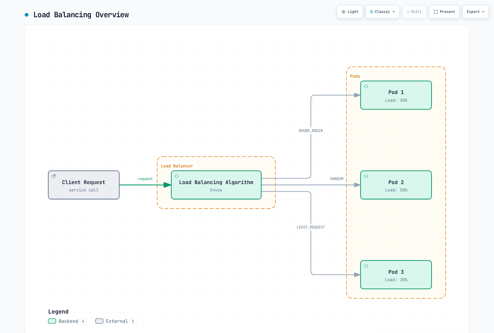

# Balanceo de carga

Istio ofrece varios algoritmos de balanceo de carga mediante Envoy para distribuir el tráfico de forma eficiente.

## Tabla de contenido

1. [¿Por qué usar balanceo de carga?](#why-load-balancing)
2. [Descripción general](#load-balancing-overview)
3. [Algoritmos de balanceo de carga](#load-balancing-algorithms)
4. [Detalles del hash consistente](#consistent-hash-details)
5. [Balanceo basado en localidad](#locality-based-load-balancing)
6. [Configuración de pools de conexiones](#connection-pool-settings)
7. [Ejemplos prácticos](#practical-examples)
8. [Guía de selección de algoritmos](#algorithm-selection-guide)
9. [Prácticas recomendadas](#best-practices)
10. [Solución de problemas](#troubleshooting)

## ¿Por qué usar balanceo de carga? {#why-load-balancing}

### Uso eficiente de los recursos

El balanceo de carga reparte el tráfico entre varias instancias para mejorar el rendimiento general y la estabilidad del sistema.


[🔍 Ver diagrama interactivo](https://www.atomai.click/kubernetes-docs/archmaps/en-service-mesh-istio-traffic-management-06-load-balancing-0.html)

### Beneficios principales

| Problema | Sin balanceo de carga | Con balanceo de carga |
|---------|------------------------|---------------------|
| **Disponibilidad** | Punto único de fallo (SPOF) | Conmutación automática ante fallos |
| **Rendimiento** | Una instancia sobrecargada | Reparto uniforme de la carga |
| **Escalabilidad** | Escalado horizontal difícil | Ampliación horizontal sencilla |
| **Tiempo de respuesta** | Variable (0-1000ms+) | Tiempo de respuesta consistente |
| **Uso de recursos** | Uso parcial e ineficiente | Uso eficiente |

## Descripción general del balanceo de carga {#load-balancing-overview}



[🔍 Ver diagrama interactivo](https://www.atomai.click/kubernetes-docs/archmaps/en-service-mesh-istio-traffic-management-06-load-balancing-1.html)

## Algoritmos de balanceo de carga {#load-balancing-algorithms}

En Istio 1.31.0, el algoritmo predeterminado es LEAST_REQUEST. Los ejemplos son DestinationRules independientes; no deben combinarse como una única configuración para el mismo host. Los resultados dependen de la salud de los endpoints, el costo de las solicitudes, la reutilización de conexiones y la localidad del proxy. Ningún algoritmo garantiza un uso idéntico de CPU ni una latencia constante. `consistentHash` es una rama de configuración independiente, no un valor enumerado `simple: CONSISTENT_HASH`.

Istio dispone de los siguientes algoritmos de balanceo de carga.

### Comparación de algoritmos

| Algoritmo | Descripción | Casos de uso | Ventajas | Desventajas |
|-----------|-------------|-----------|------|------|
| **ROUND_ROBIN** | Reparto secuencial, seleccionado explícitamente | Servicios sin estado | Simple y equitativo | Puede haber desequilibrio de carga |
| **LEAST_REQUEST** | Menor número de solicitudes activas | APIs de alto rendimiento y conexiones de base de datos | Equilibra la carga | Ligera sobrecarga |
| **RANDOM** | Reparto aleatorio | Tráfico de gran volumen | Simple y rápido | Posible desequilibrio a corto plazo |
| **PASSTHROUGH** | Destino original | Proxy TCP y enrutamiento SNI | Flexibilidad | Control limitado |
| **CONSISTENT_HASH** | Afinidad basada en hash | Sesiones y cachés | Afinidad de sesión | Puede haber desequilibrio |

### 1. ROUND_ROBIN

Reparte las solicitudes de forma secuencial entre los endpoints.


[🔍 Ver diagrama interactivo](https://www.atomai.click/kubernetes-docs/archmaps/en-service-mesh-istio-traffic-management-06-load-balancing-2.html)

**Ejemplo de configuración:**

```yaml
apiVersion: networking.istio.io/v1
kind: DestinationRule
metadata:
  name: reviews-round-robin
spec:
  host: reviews
  trafficPolicy:
    loadBalancer:
      simple: ROUND_ROBIN
```

**Casos de uso:**
- APIs REST sin estado
- Pods con rendimiento equivalente
- Cuando bastan las opciones predeterminadas

**Ventajas:**
- Implementación simple y predecible
- Reparto equitativo

**Desventajas:**
- No considera las diferencias de carga entre Pods
- Las solicitudes largas pueden provocar desequilibrio

### 2. LEAST_REQUEST (predeterminado)

Cuando los endpoints tienen el mismo peso, Envoy normalmente elige dos hosts disponibles al azar y selecciona el que tiene menos solicitudes activas. No examina todos los Pods ni mide su CPU o la carga de sus consultas de base de datos. Con pesos distintos utiliza otro algoritmo ponderado.

Con pesos iguales, LEAST_REQUEST selecciona de forma predeterminada el endpoint menos ocupado de dos candidatos aleatorios.

**Ejemplo de configuración:**

```yaml
apiVersion: networking.istio.io/v1
kind: DestinationRule
metadata:
  name: api-least-request
spec:
  host: api-service
  trafficPolicy:
    loadBalancer:
      simple: LEAST_REQUEST
      warmup:
        duration: 60s  # 60 second warmup (optional)
```

**Configuración avanzada:**

```yaml
apiVersion: networking.istio.io/v1
kind: DestinationRule
metadata:
  name: api-least-request-advanced
spec:
  host: api-service
  trafficPolicy:
    loadBalancer:
      simple: LEAST_REQUEST
      warmup:
        duration: 120s  # New pod warmup
    connectionPool:
      http:
        http2MaxRequests: 100
        maxRequestsPerConnection: 10
```

**Casos de uso:**
- APIs con tiempos de respuesta variables
- Pools de conexiones de base de datos
- Servicios con procesamiento intensivo
- Necesidad de adaptar el reparto a la carga en tiempo real

**Ventajas:**
- Se adapta a la carga en tiempo real
- Mejora la consistencia del tiempo de respuesta
- Compensa diferencias de rendimiento entre Pods

**Desventajas:**
- Ligera sobrecarga para registrar solicitudes activas

### 3. RANDOM

Selecciona un endpoint al azar.

```yaml
apiVersion: networking.istio.io/v1
kind: DestinationRule
metadata:
  name: reviews-random
spec:
  host: reviews
  trafficPolicy:
    loadBalancer:
      simple: RANDOM
```

**Casos de uso:**
- Tráfico de gran volumen con reparto estadísticamente uniforme
- Selección simple y rápida
- Pods con rendimiento equivalente

**Ventajas:**
- Selección muy rápida
- Implementación simple
- Reparto estadísticamente uniforme a gran escala

**Desventajas:**
- Posible desequilibrio a corto plazo
- Selección impredecible

### 4. PASSTHROUGH

Conecta directamente con el destino original indicado por el cliente.

```yaml
apiVersion: networking.istio.io/v1
kind: DestinationRule
metadata:
  name: tcp-passthrough
spec:
  host: "*.external-service.com"
  trafficPolicy:
    loadBalancer:
      simple: PASSTHROUGH
```

**Casos de uso:**
- Proxy TCP
- Enrutamiento basado en SNI
- Conexiones directas a servicios externos
- Modo TLS PASSTHROUGH

**Ventajas:**
- Conserva la dirección de destino original
- Permite un enrutamiento flexible

**Desventajas:**
- Control limitado del balanceo de carga

PASSTHROUGH en DestinationRule utiliza balanceo hacia el destino original. En un Gateway, `tls.mode: PASSTHROUGH` controla la terminación TLS y es una opción distinta. El enrutamiento SNI requiere una ruta TLS en VirtualService.

### 5. LEAST_CONN (obsoleto → LEAST_REQUEST)

**Nota**: `LEAST_CONN` está **obsoleto** y se sustituye por `LEAST_REQUEST`.

**Migración:**
```yaml
# Old version (deprecated)
trafficPolicy:
  loadBalancer:
    simple: LEAST_CONN
```

```yaml
# New version
trafficPolicy:
  loadBalancer:
    simple: LEAST_REQUEST
```

## Detalles del hash consistente {#consistent-hash-details}

El hash consistente ofrece afinidad flexible para la misma clave mientras se mantenga estable la vista de endpoints. Añadir o retirar endpoints, cambiar su salud o usar proxies con distintas localidades puede reasignar solicitudes. Este algoritmo no almacena sesiones de forma duradera.

### Principio de funcionamiento del hash consistente


[🔍 Ver diagrama interactivo](https://www.atomai.click/kubernetes-docs/archmaps/en-service-mesh-istio-traffic-management-06-load-balancing-4.html)

### 1. Basado en un encabezado HTTP

Calcula un hash a partir del valor de un encabezado HTTP específico.

```yaml
apiVersion: networking.istio.io/v1
kind: DestinationRule
metadata:
  name: user-hash
spec:
  host: api-service
  trafficPolicy:
    loadBalancer:
      consistentHash:
        httpHeaderName: "x-user-id"
```

**Casos de uso:**
- Afinidad de sesión por usuario
- Enrutamiento basado en una clave de API
- Afinidad por clave de tenant; el aislamiento debe aplicarse por separado

### 2. Basado en una cookie HTTP

Calcula un hash a partir de una cookie y genera una automáticamente si falta.

```yaml
apiVersion: networking.istio.io/v1
kind: DestinationRule
metadata:
  name: cookie-hash
spec:
  host: web-service
  trafficPolicy:
    loadBalancer:
      consistentHash:
        httpCookie:
          name: "user-session"
          ttl: 3600s  # 1 hour TTL
```

**Casos de uso:**
- Afinidad de sesión en aplicaciones web
- Continuidad del carrito de compras
- Experiencia de usuario consistente

### 3. Basado en la IP de origen

Calcula un hash a partir de la dirección IP de origen del cliente.

```yaml
apiVersion: networking.istio.io/v1
kind: DestinationRule
metadata:
  name: source-ip-hash
spec:
  host: api-service
  trafficPolicy:
    loadBalancer:
      consistentHash:
        useSourceIp: true
```

**Casos de uso:**
- Afinidad de sesión por IP
- Afinidad para un limitador externo de tasa por IP; el hash no aplica el límite
- Caché regional

**Precauciones:**
- Los clientes detrás de NAT pueden terminar en el mismo Pod
- Con proxies, compruebe qué IP de cliente se observa realmente

### 4. Basado en un parámetro de consulta HTTP

Calcula un hash a partir del valor de un parámetro de consulta.

```yaml
apiVersion: networking.istio.io/v1
kind: DestinationRule
metadata:
  name: query-param-hash
spec:
  host: api-service
  trafficPolicy:
    loadBalancer:
      consistentHash:
        httpQueryParameterName: "user_id"
```

**Casos de uso:**
- Enrutamiento por ID de recurso en APIs RESTful
- Enrutamiento que favorece la caché
- Estrategias de particionamiento (sharding)

### 5. Tamaño mínimo del anillo

Ajuste el número de nodos virtuales del anillo para mejorar el reparto de claves distintas. El ajuste no elimina las reasignaciones ni la concentración de tráfico en una clave muy utilizada.

```yaml
apiVersion: networking.istio.io/v1
kind: DestinationRule
metadata:
  name: hash-with-ring-size
spec:
  host: cache-service
  trafficPolicy:
    loadBalancer:
      consistentHash:
        httpHeaderName: "x-cache-key"
        ringHash:
          minimumRingSize: 1024  # Default: 1024
```

**Explicación:**
- Un anillo mayor puede repartir las claves de forma más uniforme
- No garantiza una menor proporción de reasignaciones al cambiar los endpoints
- Aumenta ligeramente el uso de memoria

**Valores ilustrativos que deben medirse, no umbrales universales de dimensionamiento:**
- Escala pequeña (< 10 Pods): 1024 (predeterminado)
- Escala media (10-50 Pods): 2048
- Escala grande (50+ Pods): 4096

### Ejemplo de configuración de hash consistente

```yaml
apiVersion: networking.istio.io/v1
kind: DestinationRule
metadata:
  name: advanced-consistent-hash
spec:
  host: api-service
  trafficPolicy:
    loadBalancer:
      consistentHash:
        httpCookie:
          name: "session-id"
          path: "/api"
          ttl: 7200s  # 2 hours
        ringHash:
          minimumRingSize: 2048
    connectionPool:
      http:
        maxRequestsPerConnection: 100
        idleTimeout: 300s
```

### Precauciones del hash consistente

#### 1. Riesgo de desequilibrio


[🔍 Ver diagrama interactivo](https://www.atomai.click/kubernetes-docs/archmaps/en-service-mesh-istio-traffic-management-06-load-balancing-5.html)

**Causa**: concentración de tráfico en determinados valores de hash.

**Soluciones:**
- Aumente `ringHash.minimumRingSize` solo si las claves distintas están mal distribuidas; una clave muy utilizada sigue correspondiendo a un único host
- Use combinaciones de varias claves de hash
- Envoy admite hash con carga acotada mediante hash_balance_factor, pero DestinationRule de Istio no expone esa opción directamente

#### 2. Reasignación al añadir o retirar Pods

```yaml
# On pod scale out
# - Before: Pod 1, Pod 2, Pod 3
# - After: Pod 1, Pod 2, Pod 3, Pod 4
# - Result: ~25% of sessions redistributed to different pods
```

**Estrategias de mitigación:**
- Use un apagado controlado
- Almacene las sesiones fuera de los Pods, por ejemplo en Redis o Memcached
- Escale gradualmente

## Balanceo basado en localidad {#locality-based-load-balancing}

Configure porcentajes `distribute` o reglas explícitas `failover`, pero no ambos en la misma opción de localidad. La conmutación requiere detección de fallos y endpoints saludables accesibles. Las etiquetas de región y zona representan topología, no distancia medida. DestinationRule no crea conectividad entre regiones ni descubrimiento de servicios. En EKS, use los valores reales de topología de los nodos.

El balanceo basado en localidad prioriza endpoints geográficamente cercanos.

### Configuración básica de localidad

```yaml
apiVersion: networking.istio.io/v1
kind: DestinationRule
metadata:
  name: locality-lb
spec:
  host: reviews
  trafficPolicy:
    loadBalancer:
      localityLbSetting:
        enabled: true
```

### Porcentajes de distribución por localidad

```yaml
apiVersion: networking.istio.io/v1
kind: DestinationRule
metadata:
  name: locality-distribute
spec:
  host: reviews
  trafficPolicy:
    loadBalancer:
      localityLbSetting:
        enabled: true
        distribute:
        - from: us-west/zone-1/*
          to:
            "us-west/zone-1/*": 80  # 80% to same zone
            "us-west/zone-2/*": 20  # 20% to other zone
```

### Conmutación por localidad

Cambia automáticamente a otra región cuando una falla.

```yaml
apiVersion: networking.istio.io/v1
kind: DestinationRule
metadata:
  name: locality-failover
spec:
  host: api-service
  trafficPolicy:
    loadBalancer:
      localityLbSetting:
        enabled: true
        failover:
        - from: us-west
          to: us-east
    outlierDetection:
      consecutive5xxErrors: 5
      interval: 5s
      baseEjectionTime: 30s
```

### Ejemplo multirregión

```yaml
apiVersion: networking.istio.io/v1
kind: DestinationRule
metadata:
  name: global-service-locality
spec:
  host: global-api
  trafficPolicy:
    loadBalancer:
      simple: LEAST_REQUEST
      localityLbSetting:
        enabled: true
        distribute:
        # US West clients
        - from: us-west/*
          to:
            "us-west/*": 90      # 90% local
            "us-east/*": 10      # 10% remote (DR)
        # US East clients
        - from: us-east/*
          to:
            "us-east/*": 90
            "us-west/*": 10
    outlierDetection:
      consecutive5xxErrors: 5
      interval: 30s
      baseEjectionTime: 30s
```

**Casos de uso:**
- Despliegues multirregión
- Reducción de latencia
- Recuperación ante desastres entre regiones
- Optimización de costos mediante comunicación dentro de la misma AZ

## Configuración de pools de conexiones {#connection-pool-settings}

Configure el pool de conexiones junto con el balanceo de carga para optimizar el rendimiento.

### Pool de conexiones HTTP/1.1

```yaml
apiVersion: networking.istio.io/v1
kind: DestinationRule
metadata:
  name: http1-connection-pool
spec:
  host: api-service
  trafficPolicy:
    loadBalancer:
      simple: LEAST_REQUEST
    connectionPool:
      tcp:
        maxConnections: 100        # Maximum connections
        connectTimeout: 3s         # Connection timeout
      http:
        http1MaxPendingRequests: 50  # Pending request count
        maxRequestsPerConnection: 100 # Max requests per connection
        idleTimeout: 300s             # Idle connection timeout
```

### Pool de conexiones HTTP/2

```yaml
apiVersion: networking.istio.io/v1
kind: DestinationRule
metadata:
  name: http2-connection-pool
spec:
  host: grpc-service
  trafficPolicy:
    loadBalancer:
      simple: LEAST_REQUEST
    connectionPool:
      tcp:
        maxConnections: 50
      http:
        http2MaxRequests: 1000     # HTTP/2 concurrent requests
        maxRequestsPerConnection: 0 # Unlimited (HTTP/2 multiplexing)
        h2UpgradePolicy: UPGRADE    # Allow HTTP/2 upgrade
```

## Ejemplos prácticos {#practical-examples}

### Ejemplo 1: servicio de API de alto rendimiento

```yaml
apiVersion: networking.istio.io/v1
kind: DestinationRule
metadata:
  name: api-high-performance
  namespace: production
spec:
  host: api-service
  trafficPolicy:
    loadBalancer:
      simple: LEAST_REQUEST
      warmup:
        duration: 60s  # New pod warmup
    connectionPool:
      tcp:
        maxConnections: 200
        connectTimeout: 5s
      http:
        http2MaxRequests: 500
        maxRequestsPerConnection: 100
        idleTimeout: 300s
    outlierDetection:
      consecutive5xxErrors: 5
      interval: 30s
      baseEjectionTime: 30s
      maxEjectionPercent: 50
```

**Escenarios de uso:**
- APIs REST de alto rendimiento
- Solicitudes con tiempos de respuesta variables
- Diferencias de rendimiento entre Pods

### Ejemplo 2: enrutamiento por sesión de usuario

```yaml
apiVersion: networking.istio.io/v1
kind: DestinationRule
metadata:
  name: web-session-affinity
spec:
  host: web-frontend
  trafficPolicy:
    loadBalancer:
      consistentHash:
        httpCookie:
          name: "session-id"
          ttl: 7200s  # 2 hours
        ringHash:
          minimumRingSize: 2048
    connectionPool:
      tcp:
        maxConnections: 500
      http:
        http1MaxPendingRequests: 100
        maxRequestsPerConnection: 50
```

**Escenarios de uso:**
- Afinidad de sesión en aplicaciones web
- Consistencia del carrito de compras
- Aprovechamiento de la caché por usuario

### Ejemplo 3: servicio global multirregión

```yaml
apiVersion: networking.istio.io/v1
kind: DestinationRule
metadata:
  name: global-api-multi-region
spec:
  host: global-api
  trafficPolicy:
    loadBalancer:
      simple: LEAST_REQUEST
      localityLbSetting:
        enabled: true
        distribute:
        # US West
        - from: us-west-1/*
          to:
            "us-west-1/*": 80
            "us-west-2/*": 15
            "us-east-1/*": 5
        # US East
        - from: us-east-1/*
          to:
            "us-east-1/*": 80
            "us-east-2/*": 15
            "us-west-1/*": 5
        # EU
        - from: eu-central-1/*
          to:
            "eu-central-1/*": 90
            "eu-west-1/*": 10
    connectionPool:
      tcp:
        maxConnections: 1000
      http:
        http2MaxRequests: 2000
    outlierDetection:
      consecutive5xxErrors: 5
      interval: 30s
      baseEjectionTime: 60s
```

**Escenarios de uso:**
- Servicios SaaS globales
- Reducción de latencia
- Recuperación ante desastres por región
- Reducción del costo de tráfico entre AZ

### Ejemplo 4: optimización de un servicio de caché

Este ejemplo supone una caché HTTP que acepta x-cache-key. El tráfico nativo de Redis no incluye un encabezado HTTP. Para repartir claves Redis, utilice un cliente compatible con Redis o el mecanismo de particionamiento de su clúster.

```yaml
apiVersion: networking.istio.io/v1
kind: DestinationRule
metadata:
  name: cache-service-optimized
spec:
  host: http-cache
  trafficPolicy:
    loadBalancer:
      consistentHash:
        httpHeaderName: "x-cache-key"
        ringHash:
          minimumRingSize: 4096  # Large ring size to minimize redistribution
    connectionPool:
      tcp:
        maxConnections: 100
        connectTimeout: 1s
      http:
        http1MaxPendingRequests: 20
        maxRequestsPerConnection: 1000
        idleTimeout: 600s
    outlierDetection:
      consecutive5xxErrors: 3
      interval: 10s
      baseEjectionTime: 30s
```

**Escenarios de uso:**
- Mejorar la tasa de aciertos de caché
- Enrutar de forma consistente las claves de caché
- Aplicar estrategias de particionamiento

### Ejemplo 5: pool de conexiones de base de datos

```yaml
apiVersion: networking.istio.io/v1
kind: DestinationRule
metadata:
  name: database-connection-pool
spec:
  host: postgres-primary
  trafficPolicy:
    loadBalancer:
      simple: ROUND_ROBIN
    connectionPool:
      tcp:
        maxConnections: 50  # DB connection limit
        connectTimeout: 5s
    outlierDetection:
      consecutive5xxErrors: 3
      interval: 60s
      baseEjectionTime: 120s
```

**Escenarios de uso:**
- Administración del pool de conexiones de base de datos
- Selección de conexiones nuevas; las consultas SQL en conexiones existentes no se redistribuyen
- Aplicación de límites de conexiones

### Ejemplo 6: procesamiento de gran volumen de tráfico

```yaml
apiVersion: networking.istio.io/v1
kind: DestinationRule
metadata:
  name: high-traffic-service
spec:
  host: analytics-ingestion
  trafficPolicy:
    loadBalancer:
      simple: RANDOM  # Fast selection to minimize overhead
    connectionPool:
      tcp:
        maxConnections: 5000
        connectTimeout: 1s
      http:
        http2MaxRequests: 10000
        maxRequestsPerConnection: 1000
        idleTimeout: 60s
    outlierDetection:
      consecutive5xxErrors: 10
      interval: 30s
      baseEjectionTime: 30s
      maxEjectionPercent: 20  # Limited ejection at scale
```

**Escenarios de uso:**
- Recopilación de eventos para análisis
- Recopilación de logs
- Procesamiento de datos a gran escala

## Guía de selección de algoritmos {#algorithm-selection-guide}

### Árbol de decisión

Para tráfico HTTP, empiece con LEAST_REQUEST. Use hash consistente cuando necesite afinidad flexible y compare otros algoritmos con una carga representativa.

### Algoritmos recomendados por tipo de servicio

| Tipo de servicio | Algoritmo recomendado | Motivo |
|-------------|----------------------|--------|
| **API REST** | LEAST_REQUEST | Consistencia del tiempo de respuesta |
| **API GraphQL** | LEAST_REQUEST | Reparto de consultas complejas |
| **gRPC** | LEAST_REQUEST | Balanceo de carga de streams |
| **Frontend web** | CONSISTENT_HASH (cookie) | Afinidad de sesión |
| **WebSocket** | Afinidad opcional al reconectar | Una conexión establecida permanece en su upstream |
| **Servicio de caché** | CONSISTENT_HASH (encabezado) | Tasa de aciertos de caché |
| **Análisis/recopilación de logs** | RANDOM | Procesamiento a gran escala |
| **Base de datos** | Cliente/pool que conozca la base de datos; política TCP según se necesite | Conservar la semántica de primarios y réplicas |
| **Contenido estático** | ROUND_ROBIN | Simple y suficiente |
| **Cola de mensajes** | Asignación de consumidores mediante broker/cliente | Las solicitudes HTTP activas no miden la carga de una cola |
| **Procesamiento por lotes** | LEAST_REQUEST | Reparto de trabajos |

### Selección según el patrón de tráfico

```yaml
# 1. Uniform small requests (< 10ms)
trafficPolicy:
  loadBalancer:
    simple: ROUND_ROBIN  # Simple and efficient
```

```yaml
# 2. Variable requests (10ms ~ 1s+)
trafficPolicy:
  loadBalancer:
    simple: LEAST_REQUEST  # Load adaptive
```

```yaml
# 3. Very high traffic (10,000+ RPS)
trafficPolicy:
  loadBalancer:
    simple: RANDOM  # Minimize overhead
```

```yaml
# 4. Session-based (user state)
trafficPolicy:
  loadBalancer:
    consistentHash:
      httpCookie:
        name: "session-id"
        ttl: 3600s
```

```yaml
# 5. Multi-region
trafficPolicy:
  loadBalancer:
    simple: LEAST_REQUEST
    localityLbSetting:
      enabled: true
```

## Prácticas recomendadas {#best-practices}

### 1. Principios de selección de algoritmos

**Buen ejemplo:**
```yaml
# API with variable response times
apiVersion: networking.istio.io/v1
kind: DestinationRule
metadata:
  name: api-service-best-practice
spec:
  host: api-service
  trafficPolicy:
    loadBalancer:
      simple: LEAST_REQUEST  # Load adaptive
      warmup:
        duration: 60s  # New pod warmup
```

**Mal ejemplo:**
```yaml
# Using ROUND_ROBIN with variable response times
apiVersion: networking.istio.io/v1
kind: DestinationRule
metadata:
  name: api-service-bad-practice
spec:
  host: api-service
  trafficPolicy:
    loadBalancer:
      simple: ROUND_ROBIN  # Causes load imbalance
```

### 2. Ajustar los pools de conexiones

Ajuste los límites opcionales de los pools según la demanda medida. Son límites por proxy, no un presupuesto global de conexiones del servicio:

```yaml
apiVersion: networking.istio.io/v1
kind: DestinationRule
metadata:
  name: complete-lb-config
spec:
  host: api-service
  trafficPolicy:
    loadBalancer:
      simple: LEAST_REQUEST
    connectionPool:  # Optional tuning
      tcp:
        maxConnections: 100
      http:
        http1MaxPendingRequests: 50
        maxRequestsPerConnection: 100
```

### 3. Combinar con detección de endpoints anómalos

Combínelo con Circuit Breaker para retirar de la selección los Pods que fallan:

```yaml
apiVersion: networking.istio.io/v1
kind: DestinationRule
metadata:
  name: lb-with-outlier
spec:
  host: api-service
  trafficPolicy:
    loadBalancer:
      simple: LEAST_REQUEST
    outlierDetection:  # Health-based ejection
      consecutive5xxErrors: 5
      interval: 30s
      baseEjectionTime: 30s
```

### 4. Precauciones al usar hash consistente

```yaml
# Good example: Using session storage
apiVersion: networking.istio.io/v1
kind: DestinationRule
metadata:
  name: web-with-redis-session
  annotations:
    description: "Uses Redis for session storage"
spec:
  host: web-frontend
  trafficPolicy:
    loadBalancer:
      consistentHash:
        httpCookie:
          name: "session-id"
          ttl: 3600s
    # Using Redis session storage maintains
    # sessions even on pod restart
```

```yaml
# Caution: Local session only
apiVersion: networking.istio.io/v1
kind: DestinationRule
metadata:
  name: web-local-session-only
  annotations:
    warning: "No external session storage - sessions lost on pod restart"
spec:
  host: web-frontend
  trafficPolicy:
    loadBalancer:
      consistentHash:
        httpCookie:
          name: "session-id"
          ttl: 3600s
    # Warning: Sessions lost on pod restart
```

### 5. Despliegue multirregión

```yaml
# Good example: Locality + Failover
apiVersion: networking.istio.io/v1
kind: DestinationRule
metadata:
  name: multi-region-best-practice
spec:
  host: global-service
  trafficPolicy:
    loadBalancer:
      simple: LEAST_REQUEST
      localityLbSetting:
        enabled: true
        failover:  # Required
        - from: us-west
          to: us-east
    outlierDetection:
      consecutive5xxErrors: 5
      interval: 5s
      baseEjectionTime: 30s
```

### 6. Monitorización y métricas

Supervise la eficacia del balanceo de carga:

```promql
# Per-pod inbound request distribution (assumes scrape labels retain namespace/pod)
sum by (namespace, pod) (rate(istio_requests_total{reporter="destination"}[5m]))

# Per-pod inbound P95 latency
histogram_quantile(0.95,
  sum by (namespace, pod, le) (
    rate(istio_request_duration_milliseconds_bucket{reporter="destination"}[5m])
  )
)

# Raw Envoy connection statistics do not have Istio destination_workload labels
sum by (namespace, pod) (envoy_cluster_upstream_cx_active)
```

### 7. Aplicación gradual

Empiece con LEAST_REQUEST, el algoritmo predeterminado actual. Mida tráfico representativo y después ajuste por separado el algoritmo, el pool de conexiones, el calentamiento y la detección de endpoints anómalos. Los valores de los ejemplos son puntos de partida, no umbrales de rendimiento garantizados.

### 8. Documentación

Las anotaciones siguientes contienen valores ilustrativos. Sustituya las cifras de latencia y carga por sus mediciones; no son resultados de rendimiento obtenidos en esta revisión. El almacenamiento de sesiones Redis requiere integración en la aplicación; una anotación DestinationRule no lo configura.

```yaml
apiVersion: networking.istio.io/v1
kind: DestinationRule
metadata:
  name: api-service-lb
  annotations:
    # Configuration rationale
    purpose: "Distribute load based on active requests"

    # Algorithm selection basis
    algorithm-rationale: |
      - LEAST_REQUEST: Response times vary 10ms-500ms
      - warmup.duration: New pods need 60s to warm up cache

    # Test results
    test-results: |
      - Load test: 1000 RPS evenly distributed
      - P95 latency: 150ms (improved from 300ms with ROUND_ROBIN)
      - No pod overload observed

    # Monitoring
    monitoring: |
      - Dashboard: grafana.example.com/d/istio-workload
      - Alert: High P95 latency > 500ms
spec:
  host: api-service
```

## Solución de problemas {#troubleshooting}

### Distribución de carga desequilibrada

**Síntomas:**
```bash
# Check CPU usage per pod
kubectl top pods -n production

# Output:
# NAME                CPU    MEMORY
# api-pod-1           800m   2048Mi
# api-pod-2           200m   1024Mi
# api-pod-3           150m   1024Mi
```

**Causas y soluciones:**

```yaml
# 1. Change ROUND_ROBIN -> LEAST_REQUEST
apiVersion: networking.istio.io/v1
kind: DestinationRule
metadata:
  name: api-service-fix
spec:
  host: api-service
  trafficPolicy:
    loadBalancer:
      simple: LEAST_REQUEST  # Changed

# 2. Add Warmup
      warmup:
        duration: 60s

# 3. Add Outlier Detection
    outlierDetection:
      consecutive5xxErrors: 5
      interval: 30s
      baseEjectionTime: 30s
```

### Desequilibrio del hash consistente

**Síntomas:**
```bash
# Check Envoy metrics
kubectl exec -it pod-name -c istio-proxy -- \
  curl localhost:15000/stats/prometheus | grep upstream_rq_total

# Requests concentrated on specific pod
```

**Solución:**

```yaml
apiVersion: networking.istio.io/v1
kind: DestinationRule
metadata:
  name: hash-fix
spec:
  host: api-service
  trafficPolicy:
    loadBalancer:
      consistentHash:
        httpHeaderName: "x-user-id"
        ringHash:
          minimumRingSize: 4096  # Increase 2048 -> 4096
```

### El enrutamiento por localidad no funciona

Compruebe la topología del nodo que ejecuta la carga y la localidad de los endpoints en Envoy. Kubernetes/EKS normalmente añade etiquetas de región y zona a los Nodes, no a los Pods de aplicaciones. Corrija la configuración real de los nodos o de su aprovisionador; evite inventar etiquetas de región o zona para forzar el enrutamiento.

```bash
kubectl get pods -o wide
kubectl get nodes -L topology.kubernetes.io/region,topology.kubernetes.io/zone
istioctl proxy-config endpoints <pod-name> -o json
istioctl proxy-config clusters <pod-name> --fqdn api-service.default.svc.cluster.local -o json
```

## Referencias

- [Balanceo de carga de Istio](https://istio.io/latest/docs/reference/config/networking/destination-rule/#LoadBalancerSettings)
- [Balanceo de carga de Envoy](https://www.envoyproxy.io/docs/envoy/latest/intro/arch_overview/upstream/load_balancing/load_balancing)
- [Hash consistente](https://www.toptal.com/big-data/consistent-hashing)
- [Balanceo por localidad](https://istio.io/latest/docs/tasks/traffic-management/locality-load-balancing/)

- [Referencia primaria 1](https://istio.io/latest/docs/reference/config/networking/destination-rule/)
- [Referencia primaria 2](https://raw.githubusercontent.com/istio/istio/1.31.0/pilot/pkg/networking/core/cluster_traffic_policy.go)
- [Referencia primaria 3](https://www.envoyproxy.io/docs/envoy/latest/intro/arch_overview/upstream/load_balancing/load_balancers)
- [Referencia primaria 4](https://www.envoyproxy.io/docs/envoy/latest/api-v3/config/cluster/v3/cluster.proto)
- [Referencia primaria 5](https://istio.io/latest/docs/tasks/traffic-management/locality-load-balancing/failover/)
- [Referencia primaria 6](https://kubernetes.io/docs/reference/kubectl/generated/kubectl_top/kubectl_top_pod/)
