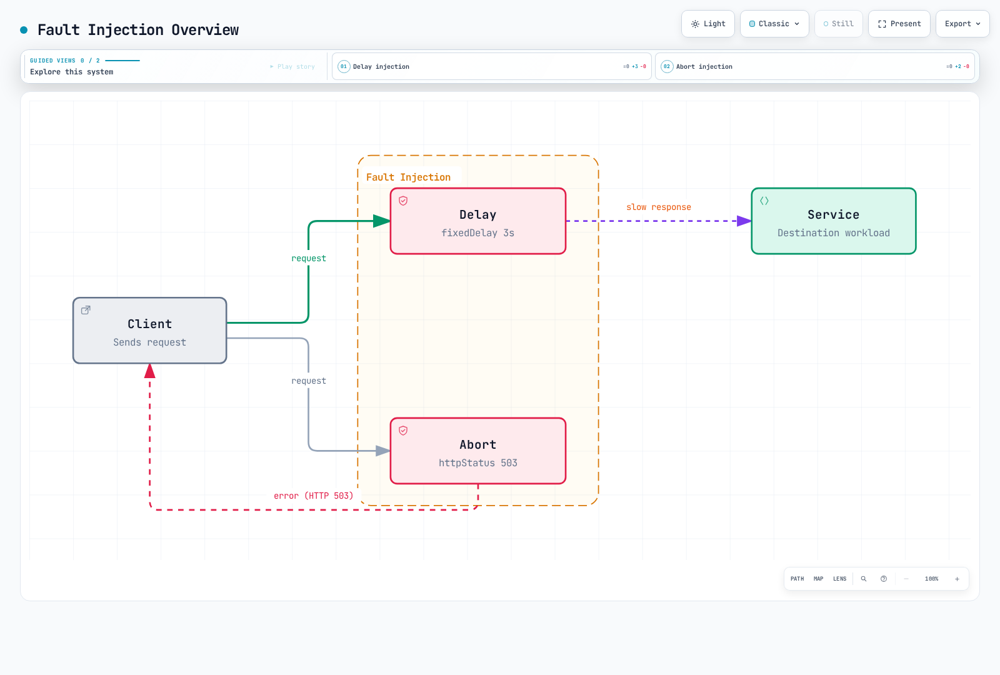

# Inyección de fallos

La inyección de fallos introduce fallos de forma intencionada para comprobar la resiliencia del sistema.

## Tabla de contenidos

1. [¿Por qué inyectar fallos?](#why-fault-injection)
2. [Cuándo usar la inyección de fallos](#when-to-use-fault-injection)
3. [Descripción general de la inyección de fallos](#fault-injection-overview)
4. [Inyección de retrasos](#delay-injection)
5. [Inyección de abortos](#abort-injection)
6. [Ejemplos prácticos](#practical-examples)
7. [Escenarios del mundo real](#real-world-scenarios)
8. [Estrategias de prueba](#testing-strategies)
9. [Buenas prácticas](#best-practices)

Estas pruebas alternativas operan en la capa HTTP. Empiece en un espacio de nombres aislado, conserve la configuración completa de enrutamiento sin fallos y defina una vía de limpieza independiente antes de programar la prueba. El porcentaje se aplica a las solicitudes coincidentes, no a un porcentaje de los Pods. Las cabeceras de prueba no autentican al usuario y deben propagarse a la llamada posterior que se quiere evaluar. Las pruebas de SQL/TCP nativo, pérdida de paquetes, preparación de Pods y fallos de nodos requieren otros métodos.

## ¿Por qué inyectar fallos? {#why-fault-injection}

### Probar la resiliencia en entornos de producción

En una arquitectura de microservicios, muchos servicios dependen unos de otros, y **el fallo de un solo servicio puede afectar a todo el sistema**. La inyección de fallos es esencial por los siguientes motivos:

#### 1. **Principio fundamental de la ingeniería del caos**

La ingeniería del caos, popularizada por prácticas como Chaos Monkey de Netflix, busca **experimentar de forma proactiva los fallos en entornos de producción** y descubrir los puntos débiles del sistema.


[🔍 Ver diagrama interactivo](https://www.atomai.click/kubernetes-docs/archmaps/en-service-mesh-istio-traffic-management-08-fault-injection-0.html)

#### 2. **Reproducir escenarios reales de producción**

En producción pueden ocurrir los siguientes problemas:

| Escenario | Causa | Prueba de inyección de fallos |
|----------|-------|---------------------|
| **Latencia de red** | Latencia de red entre regiones | Inyección de retrasos |
| **Tiempo de espera del servicio** | Consultas lentas a la base de datos | Inyección de retrasos |
| **Fallo temporal** | Reinicio del servicio o reducción de escala | Inyección de abortos |
| **Fallo parcial** | Solo fallan algunos Pods | Inyección basada en porcentaje |
| **Fallo en cascada** | El fallo de un servicio se propaga a otros | Inyección combinada de fallos |

#### 3. **Verificar la configuración del disyuntor y los tiempos de espera**

La inyección de fallos permite comprobar cómo los servicios que realizan las llamadas gestionan los retrasos y los errores. Para probar los reintentos o tiempos de espera del proxy, o la expulsión de endpoints, el fallo debe producirse en una capa que esos mecanismos puedan observar.

Verifique por separado el comportamiento del servicio que realiza la llamada y la expulsión de endpoints por el proxy: un aborto inyectado localmente no equivale a un fallo del endpoint upstream. Las respuestas reales del servicio de pedidos determinan lo que reciben sus clientes.

#### 4. **Validar que los despliegues sean seguros**

Al desplegar versiones nuevas, puede comprobar **si son seguras incluso cuando fallan los servicios de los que dependen**:

- ¿La versión nueva gestiona correctamente los tiempos de espera?
- ¿Degrada el servicio de forma controlada cuando fallan sus dependencias?
- ¿Funciona correctamente la gestión de errores?

## Cuándo usar la inyección de fallos {#when-to-use-fault-injection}

La inyección de fallos puede utilizarse en las siguientes situaciones:

### 1. **Entornos de desarrollo y prueba**

#### Escenario: desarrollar un microservicio nuevo

```yaml
# Inject faults into service under development
apiVersion: networking.istio.io/v1
kind: VirtualService
metadata:
  name: payment-service-dev
  namespace: dev
spec:
  hosts:
  - payment-service
  http:
  - match:
    - headers:
        x-testing:
          exact: "true"  # Apply only to test traffic
    fault:
      delay:
        percentage:
          value: 50.0
        fixedDelay: 3s
      abort:
        percentage:
          value: 20.0
        httpStatus: 503
    route:
    - destination:
        host: payment-service
        subset: v2
  - route:
    - destination:
        host: payment-service
```

**Caso de uso**:
- Probar cómo reacciona el servicio de pedidos cuando el servicio de pagos se ralentiza o falla
- Comprobar que se muestran mensajes de error adecuados a los usuarios

### 2. **Pruebas de integración en preproducción**

#### Escenario: verificación final antes del despliegue en producción

```yaml
# Inject random faults into all dependent services
apiVersion: networking.istio.io/v1
kind: VirtualService
metadata:
  name: database-service-staging
spec:
  hosts:
  - database-service
  http:
  - fault:
      delay:
        percentage:
          value: 10.0  # 10% of requests delayed
        fixedDelay: 5s
      abort:
        percentage:
          value: 5.0   # 5% of requests fail
        httpStatus: 500
    route:
    - destination:
        host: database-service
```

**Caso de uso**:
- Comprobar la resiliencia del sistema completo antes del despliegue en producción
- Confirmar que las alertas de monitorización funcionan correctamente

### 3. **Pruebas de caos en producción**

#### Escenario: pruebas periódicas de resiliencia en producción

```yaml
# Inject faults at very low rate in production
apiVersion: networking.istio.io/v1
kind: VirtualService
metadata:
  name: recommendation-service-prod
spec:
  hosts:
  - recommendation-service
  http:
  - match:
    - headers:
        x-canary:
          exact: "true"  # Apply only to canary users
    fault:
      abort:
        percentage:
          value: 1.0  # Only 1% of requests fail
        httpStatus: 503
    route:
    - destination:
        host: recommendation-service
  - route:
    - destination:
        host: recommendation-service
```

**Caso de uso**:
- Aplicar ingeniería del caos al estilo de Netflix
- Comprobar en producción la capacidad real de responder a fallos
- **Nota**: comenzar con tasas muy bajas (1–5 %) y vigilar el impacto

### 4. **Ajustar las políticas de tiempo de espera y reintentos**

Istio no aplica la gestión de tiempos de espera ni de reintentos en la misma ruta del lado cliente cuando se habilita la inyección de fallos. Eliminar el tiempo de espera de la ruta en el ejemplo siguiente es intencional; para esta prueba, el cliente debe imponer el plazo límite.

#### Escenario: encontrar valores adecuados para el tiempo de espera

```yaml
# Test with various delay times
apiVersion: networking.istio.io/v1
kind: VirtualService
metadata:
  name: search-service-timeout-test
spec:
  hosts:
  - search-service
  http:
  - match:
    - headers:
        x-test-scenario:
          exact: "slow-response"
    fault:
      delay:
        percentage:
          value: 100.0
        fixedDelay: 10s  # 10 second delay
    route:
    - destination:
        host: search-service
  - route:
    - destination:
        host: search-service
```

**Caso de uso**:
- Probar un plazo límite de 5 segundos en la aplicación o el cliente mientras el proxy inyecta un retraso de 10 segundos
- Para probar el tiempo de espera de una ruta de Istio, usar un servicio upstream que realmente sea lento o inyectar el fallo en otro salto
- Encontrar un valor adecuado que no perjudique la experiencia del usuario

### 5. **Verificar la detección de valores atípicos**

Un aborto local inyectado se devuelve antes de enviar una solicitud upstream, por lo que no prueba el detector de errores consecutivos por endpoint de ese proxy. Use un backend HTTP controlado que realmente devuelva 503 y observe su expulsión. Por ejemplo, después de desplegar el ejemplo de Istio httpbin en el espacio de nombres de prueba:

```yaml
apiVersion: networking.istio.io/v1
kind: DestinationRule
metadata:
  name: httpbin-outlier-test
spec:
  host: httpbin
  trafficPolicy:
    outlierDetection:
      consecutive5xxErrors: 5
      interval: 5s
      baseEjectionTime: 30s
      maxEjectionPercent: 100
      minHealthPercent: 0
```

Envíe solicitudes desde un cliente de aplicación dentro de la malla a `http://httpbin:8000/status/503`. Esta prueba permite deliberadamente que se expulsen todos los endpoints de prueba; la recuperación depende del historial de expulsiones y del estado de salud posterior, no de una espera fija garantizada de 30 segundos. No aplique esta configuración a cargas de trabajo que no formen parte de la prueba.

### 6. **Probar grupos de usuarios específicos**

#### Escenario: inyectar fallos solo para los usuarios de la beta

```yaml
# Inject faults only for specific users
apiVersion: networking.istio.io/v1
kind: VirtualService
metadata:
  name: api-service-beta
spec:
  hosts:
  - api-service
  http:
  - match:
    - headers:
        end-user:
          exact: "beta-tester"  # Beta testers only
    fault:
      delay:
        percentage:
          value: 20.0
        fixedDelay: 2s
    route:
    - destination:
        host: api-service
  - route:  # Normal routing for regular users
    - destination:
        host: api-service
```

**Caso de uso**:
- Probar de forma segura sin afectar a los usuarios reales
- Mejorar el servicio a partir de los comentarios de los usuarios de la beta

## Descripción general de la inyección de fallos {#fault-injection-overview}



[🔍 Ver diagrama interactivo](https://www.atomai.click/kubernetes-docs/archmaps/en-service-mesh-istio-traffic-management-08-fault-injection-2.html)

## Inyección de retrasos {#delay-injection}

```yaml
apiVersion: networking.istio.io/v1
kind: VirtualService
metadata:
  name: reviews-delay
spec:
  hosts:
  - reviews
  http:
  - fault:
      delay:
        percentage:
          value: 10.0  # Inject delay in 10% of requests
        fixedDelay: 5s  # 5 second delay
    route:
    - destination:
        host: reviews
```

## Inyección de abortos {#abort-injection}

```yaml
apiVersion: networking.istio.io/v1
kind: VirtualService
metadata:
  name: reviews-abort
spec:
  hosts:
  - reviews
  http:
  - fault:
      abort:
        percentage:
          value: 10.0  # Abort 10% of requests
        httpStatus: 503  # Return HTTP 503 error
    route:
    - destination:
        host: reviews
```

## Ejemplos prácticos {#practical-examples}

### 1. Combinar retrasos y abortos

En producción, los retrasos y los fallos pueden ocurrir a la vez:

```yaml
apiVersion: networking.istio.io/v1
kind: VirtualService
metadata:
  name: ratings-combined-fault
spec:
  hosts:
  - ratings
  http:
  - fault:
      delay:
        percentage:
          value: 20.0  # 20% of requests delayed
        fixedDelay: 3s
      abort:
        percentage:
          value: 10.0  # 10% of requests fail
        httpStatus: 503
    route:
    - destination:
        host: ratings
```

**Resultado**:
- El 20 % de las solicitudes recibe un retraso de 3 segundos
- El aborto puede coincidir con el retraso, por lo que algunas solicitudes abortadas se retrasan primero
- No sume ambos porcentajes como si correspondieran a grupos independientes; mida cuántas solicitudes se solapan

### 2. Inyección de fallos condicional

Inyecte fallos solo cuando se cumplan condiciones específicas:

```yaml
apiVersion: networking.istio.io/v1
kind: VirtualService
metadata:
  name: reviews-conditional-fault
spec:
  hosts:
  - reviews
  http:
  # Inject faults only for mobile users
  - match:
    - headers:
        user-agent:
          regex: ".*Mobile.*"
    fault:
      delay:
        percentage:
          value: 30.0
        fixedDelay: 2s
    route:
    - destination:
        host: reviews
        subset: v2
  # Normal routing for regular users
  - route:
    - destination:
        host: reviews
        subset: v1
```

### 3. Inyección progresiva de fallos

Pruebe el sistema aumentando gradualmente la tasa de fallos:

```yaml
# Stage 1: 5% faults
apiVersion: networking.istio.io/v1
kind: VirtualService
metadata:
  name: api-fault
spec:
  hosts:
  - api-service
  http:
  - fault:
      abort:
        percentage:
          value: 5.0
        httpStatus: 500
    route:
    - destination:
        host: api-service
```

```yaml
# Stage 2: 10% faults (apply after monitoring)
apiVersion: networking.istio.io/v1
kind: VirtualService
metadata:
  name: api-fault
spec:
  hosts:
  - api-service
  http:
  - fault:
      abort:
        percentage:
          value: 10.0
        httpStatus: 500
    route:
    - destination:
        host: api-service
```

```yaml
# Stage 3: 20% faults (apply after sufficient validation)
apiVersion: networking.istio.io/v1
kind: VirtualService
metadata:
  name: api-fault
spec:
  hosts:
  - api-service
  http:
  - fault:
      abort:
        percentage:
          value: 20.0
        httpStatus: 500
    route:
    - destination:
        host: api-service
```

### 4. Probar distintos códigos de estado HTTP

Pruebe distintos códigos de error HTTP:

```yaml
apiVersion: networking.istio.io/v1
kind: VirtualService
metadata:
  name: payment-error-scenarios
spec:
  hosts:
  - payment-service
  http:
  # Scenario 1: Service overload (503)
  - match:
    - headers:
        x-test-scenario:
          exact: "overload"
    fault:
      abort:
        percentage:
          value: 50.0
        httpStatus: 503
    route:
    - destination:
        host: payment-service
  # Scenario 2: Internal server error (500)
  - match:
    - headers:
        x-test-scenario:
          exact: "server-error"
    fault:
      abort:
        percentage:
          value: 30.0
        httpStatus: 500
    route:
    - destination:
        host: payment-service
  # Scenario 3: Gateway timeout (504)
  - match:
    - headers:
        x-test-scenario:
          exact: "timeout"
    fault:
      abort:
        percentage:
          value: 20.0
        httpStatus: 504
    route:
    - destination:
        host: payment-service
  # Default routing
  - route:
    - destination:
        host: payment-service
```

## Escenarios del mundo real {#real-world-scenarios}

### Escenario 1: simular una fachada HTTP de base de datos lenta

**Situación**: las consultas a la base de datos se vuelven lentas de manera intermitente

```yaml
apiVersion: networking.istio.io/v1
kind: VirtualService
metadata:
  name: database-slow-query
  namespace: chaos-tests
spec:
  hosts:
  - database-service
  http:
  - fault:
      delay:
        percentage:
          value: 15.0  # 15% of HTTP requests are delayed
        fixedDelay: 8s   # 8 second delay
    route:
    - destination:
        host: database-service
```

**Objetivos de la prueba**:
1. ¿Son adecuados los tiempos de espera de la aplicación?
2. ¿Se agota el pool de conexiones?
3. ¿Se muestran mensajes de error adecuados a los usuarios?

**Resultados esperados**:
- Un límite de tiempo adecuado permite responder al fallo con rapidez
- El pool de conexiones sigue funcionando con normalidad
- Si se demora la respuesta de todo el sistema, puede hacer falta un disyuntor

### Escenario 2: probar un fallo en cascada de microservicios

**Situación**: comprobar si el fallo de un servicio se propaga a otros servicios

Verifique por separado el comportamiento del servicio que realiza la llamada y la expulsión de endpoints por el proxy: un aborto inyectado localmente no equivale a un fallo del endpoint upstream. Las respuestas reales del servicio de pedidos determinan lo que reciben sus clientes.

```yaml
# Inject faults into payment service
apiVersion: networking.istio.io/v1
kind: VirtualService
metadata:
  name: payment-cascade-test
spec:
  hosts:
  - payment-service
  http:
  - fault:
      abort:
        percentage:
          value: 30.0  # 30% failure
        httpStatus: 503
    route:
    - destination:
        host: payment-service
---
# Configure Circuit Breaker for order service
apiVersion: networking.istio.io/v1
kind: DestinationRule
metadata:
  name: order-circuit-breaker
spec:
  host: order-service
  trafficPolicy:
    outlierDetection:
      consecutive5xxErrors: 5
      interval: 30s
      baseEjectionTime: 30s
```

**Objetivos de la prueba**:
1. ¿El servicio de pedidos gestiona correctamente el fallo del servicio de pagos?
2. ¿El servicio de pedidos mantiene el comportamiento que esperan sus clientes? La expulsión depende de los errores reales que devuelva el servicio de pedidos.
3. ¿Se muestran mensajes adecuados a los usuarios en el frontend?

### Escenario 3: simular que una API alcanza el límite de solicitudes

**Situación**: simular que una API externa alcanza su límite de solicitudes

```yaml
apiVersion: networking.istio.io/v1
kind: VirtualService
metadata:
  name: external-api-rate-limit
spec:
  hosts:
  - external-api-service
  http:
  - match:
    - headers:
        x-api-key:
          exact: "test-key"
    fault:
      abort:
        percentage:
          value: 40.0  # 40% of requests rate limited
        httpStatus: 429  # Too Many Requests
    route:
    - destination:
        host: external-api-service
  - route:
    - destination:
        host: external-api-service
```

**Objetivos de la prueba**:
1. ¿Se gestionan correctamente los errores 429?
2. ¿La lógica de reintentos aplica una espera exponencial entre intentos?
3. ¿Se utiliza la caché para reducir las llamadas a la API?

### Escenario 4: simular latencia de red entre regiones

**Situación**: latencia al llamar a servicios en regiones diferentes

```yaml
apiVersion: networking.istio.io/v1
kind: VirtualService
metadata:
  name: cross-region-latency
spec:
  hosts:
  - us-east-service
  http:
  - match:
    - sourceLabels:
        region: "eu-west"  # Calling from EU to US
    fault:
      delay:
        percentage:
          value: 100.0
        fixedDelay: 150ms  # 150ms delay (transatlantic)
    route:
    - destination:
        host: us-east-service
  - route:
    - destination:
        host: us-east-service
```

**Objetivos de la prueba**:
1. Confirmar el impacto de la latencia entre regiones en los servicios globales
2. Determinar si se puede optimizar con una caché o una CDN
3. ¿Se cumple el objetivo del SLA (por ejemplo, el 95 % de las solicitudes en menos de 500 ms)?

### Escenario 5: simular una indisponibilidad temporal durante un despliegue

**Situación**: algunos Pods no están disponibles temporalmente durante una actualización gradual

```yaml
apiVersion: networking.istio.io/v1
kind: VirtualService
metadata:
  name: deployment-transient-failure
spec:
  hosts:
  - app-service
  http:
  - match:
    - headers:
        x-deployment-test:
          exact: "true"
    fault:
      abort:
        percentage:
          value: 25.0  # 25% of matching requests fail; Pods remain running
        httpStatus: 503
      delay:
        percentage:
          value: 10.0
        fixedDelay: 5s   # Some start slowly
    route:
    - destination:
        host: app-service
        subset: v2
  - route:
    - destination:
        host: app-service
```

**Objetivos de la prueba**:
1. Medir cómo responde el servicio que realiza la llamada a los errores inyectados
2. Probar por separado la preparación de Pods mediante un cambio controlado en el estado de la carga de trabajo
3. Verificar por separado el enrutamiento a endpoints saludables; un aborto HTTP no marca un Pod como no preparado

## Estrategias de prueba {#testing-strategies}

### 1. Ingeniería del caos progresiva

Aumente gradualmente la tasa de fallos para encontrar los límites del sistema:


[🔍 Ver diagrama interactivo](https://www.atomai.click/kubernetes-docs/archmaps/en-service-mesh-istio-traffic-management-08-fault-injection-4.html)

**Ejecución paso a paso**:

```bash
# Stage 1: 1% fault injection
kubectl apply -f fault-injection-1percent.yaml
# Monitor for 15 minutes
kubectl logs -f deployment/monitoring

# If no issues, proceed to stage 2
kubectl apply -f fault-injection-5percent.yaml
# Monitor for 15 minutes

# Continue...
```

### 2. Pruebas basadas en el tiempo

Esta plantilla de programación debe permanecer suspendida hasta preparar sus requisitos previos: un espacio de nombres de prueba; una imagen de runner creada y fijada por la organización, con un shell y una versión compatible de kubectl; una cuenta de servicio existente `chaos-tester` con solo los permisos necesarios sobre el VirtualService de prueba creado previamente; y un ConfigMap `chaos-fixtures` con los manifiestos completos con y sin fallos para ese mismo recurso. La referencia a la imagen del registro es un marcador de posición. Las rutinas de shell definidas con `trap` no se ejecutan tras un SIGKILL ni si se pierde el nodo; establezca una comprobación de limpieza independiente.

Inyecte fallos solo durante periodos específicos:

```yaml
apiVersion: batch/v1
kind: CronJob
metadata:
  name: fault-injection-scheduler
  namespace: chaos-tests
spec:
  schedule: "0 2 * * *"
  timeZone: "Etc/UTC"
  suspend: true
  concurrencyPolicy: Forbid
  startingDeadlineSeconds: 300
  jobTemplate:
    spec:
      activeDeadlineSeconds: 420
      backoffLimit: 0
      template:
        metadata:
          labels:
            sidecar.istio.io/inject: "false"
        spec:
          serviceAccountName: chaos-tester
          restartPolicy: Never
          containers:
          - name: apply-fault
            image: registry.example.com/ops/chaos-runner:1.0.0
            command: ["/bin/sh", "-ec"]
            args:
            - |
              cleanup() { kubectl apply -n chaos-tests -f /config/no-fault.yaml; }
              trap cleanup EXIT
              trap 'exit 130' INT
              trap 'exit 143' TERM
              kubectl apply -n chaos-tests -f /config/fault-injection.yaml
              sleep 300
            volumeMounts:
            - name: fixtures
              mountPath: /config
              readOnly: true
          volumes:
          - name: fixtures
            configMap:
              name: chaos-fixtures
```

### 3. Pipeline de pruebas automatizadas

Integre estas pruebas en un pipeline de CI/CD:

```yaml
stages: [fault-injection-test]

fault_injection_test:
  stage: fault-injection-test
  script:
    - kubectl apply -n chaos-tests -f tests/fault-injection.yaml
    - k6 run --vus 100 --duration 5m tests/load-test.js
    - ./tests/check-fault-metrics.sh
  after_script:
    - kubectl apply -n chaos-tests -f tests/no-fault.yaml
```

Guarde el siguiente script como `tests/check-fault-metrics.sh` en el proyecto de prueba. El runner necesita kubectl, k6, curl y jq, además de los manifiestos revisados y la prueba de carga. Elija el servicio y el umbral medido según la hipótesis de la prueba: los errores que se inyectan intencionalmente en una dependencia no hacen que falle automáticamente el SLO de cara al usuario. Si falta la respuesta o es NaN, la comprobación falla. `after_script` de GitLab no está garantizado si se pierde el runner y tiene su propio tiempo de espera; verifique de forma independiente que se haya restaurado la configuración base.

```bash
#!/usr/bin/env bash
set -euo pipefail
: "${PROMETHEUS_URL:?Set the Prometheus base URL}"
: "${TEST_DESTINATION:?Set the exact destination_service label}"
: "${ERROR_THRESHOLD:?Set the error-fraction limit for the hypothesis}"
QUERY="sum(rate(istio_requests_total{reporter=\"source\",destination_service=\"${TEST_DESTINATION}\",response_code=~\"5..\"}[5m])) / sum(rate(istio_requests_total{reporter=\"source\",destination_service=\"${TEST_DESTINATION}\"}[5m]))"
curl -fsSG "$PROMETHEUS_URL/api/v1/query" --data-urlencode "query=$QUERY" |
  jq -e --argjson limit "$ERROR_THRESHOLD" '
    .status == "success" and
    (.data.result | length) == 1 and
    (.data.result[0].value[1] as $v |
      $v != "NaN" and $v != "+Inf" and $v != "-Inf" and
      (($v | tonumber) <= $limit))'
```

### 4. Monitorización y alertas

Monte o cargue este archivo de reglas en Prometheus, o use el recurso PrometheusRule del operador instalado. Un ConfigMap por sí solo no activa las alertas. Limite las reglas a los servicios de prueba y habilite las estadísticas de Envoy a las que hacen referencia.

Monitorice las métricas clave durante la inyección de fallos:

```yaml
# Prometheus alert rules
apiVersion: v1
kind: ConfigMap
metadata:
  name: prometheus-alerts
data:
  fault-injection-alerts.yaml: |
    groups:
    - name: fault-injection
      rules:
      # Error rate increase
      - alert: HighErrorRate
        expr: sum by (destination_service) (rate(istio_requests_total{reporter="source",response_code=~"5.."}[5m])) / sum by (destination_service) (rate(istio_requests_total{reporter="source"}[5m])) > 0.1
        for: 2m
        annotations:
          summary: "High error rate during fault injection"

      # Circuit Breaker activation
      - alert: CircuitBreakerOpen
        expr: envoy_cluster_circuit_breakers_default_rq_open > 0
        for: 1m
        annotations:
          summary: "Circuit breaker opened"

      # Response time increase
      - alert: HighLatency
        expr: histogram_quantile(0.95, sum by (destination_service, le) (rate(istio_request_duration_milliseconds_bucket{reporter="source"}[5m]))) > 3000
        for: 5m
        annotations:
          summary: "95th percentile latency > 3s"
```

### 5. Inyección de fallos en despliegues Blue-Green

Inyecte fallos en el entorno Blue y compárelo con el entorno Green:

```yaml
apiVersion: networking.istio.io/v1
kind: VirtualService
metadata:
  name: app-blue-green-test
spec:
  hosts:
  - app-service
  http:
  - match:
    - headers:
        x-version:
          exact: "blue"
    fault:
      delay:
        percentage:
          value: 20.0
        fixedDelay: 3s
    route:
    - destination:
        host: app-service
        subset: blue
  - route:
    - destination:
        host: app-service
        subset: green
```

**Métricas de comparación**:
- Tasa de errores
- Tiempo de respuesta (P50, P95, P99)
- Indicadores de experiencia del usuario

## Buenas prácticas {#best-practices}

### 1. Comience con poco

- **Comience con tasas bajas, del 1 al 5 %**
- Pruebe exhaustivamente en entornos de desarrollo y preproducción
- Ejecute las pruebas en producción cuando el impacto para el negocio sea bajo

### 2. La monitorización es esencial

Prepare un panel de monitorización antes de aplicar la inyección de fallos:

```yaml
# Grafana dashboard metrics
- istio_requests_total (Error rate)
- istio_request_duration_milliseconds (Latency)
- envoy_cluster_upstream_rq_retry (Retry count)
- envoy_cluster_circuit_breakers_* (Circuit Breaker status)
```

### 3. Use etiquetas claras

```yaml
# Metadata excerpt for the existing reviewed fault VirtualService
metadata:
  name: payment-fault
  labels:
    fault-injection: "true"
    test-type: "chaos-engineering"
    test-date: "2025-01-15"
  annotations:
    description: "Testing payment service resilience"
    owner: "platform-team"
```

### 4. Mecanismo de reversión automática

```bash
#!/usr/bin/env bash
set -euo pipefail
cleanup() { kubectl apply -n chaos-tests -f tests/no-fault.yaml; }
trap cleanup EXIT
trap 'exit 130' INT
trap 'exit 143' TERM
kubectl apply -n chaos-tests -f tests/fault-injection.yaml
sleep 300
./tests/check-fault-metrics.sh
# EXIT restores the full baseline on success or normal failure.
```

### 5. Documentación

Documente todas las pruebas de inyección de fallos:

```yaml
# Metadata excerpt for the existing reviewed fault VirtualService
metadata:
  name: api-fault-test
  annotations:
    # Test purpose
    test-purpose: "Verify caller error handling; test upstream ejection separately"

    # Expected behavior
    expected-behavior: |
      - Caller handles the injected error according to the test hypothesis
      - Requests fail fast with 503 error
      - Restore baseline and verify recovery

    # Success criteria
    success-criteria: |
      - Error rate < 5%
      - P95 latency < 500ms
      - No cascading failures

    # Rollback plan
    rollback-plan: "Restore the reviewed complete no-fault VirtualService"
```

### 6. Precauciones para el entorno de producción

- **Evaluación del impacto para el negocio**: analice el impacto de la inyección de fallos en los usuarios reales
- **Ampliación gradual**: aumente lentamente del 1 % al 5 % y luego al 10 %
- **Configuración de alertas**: configure alertas inmediatas si se superan los umbrales
- **Preparación para la reversión**: esté preparado para revertir los cambios de inmediato
- **Evite el horario laboral**: elija periodos con poco tráfico

### 7. Pruebas periódicas

```bash
# Change the prepared scheduler to weekly; suspension/prerequisites still apply
kubectl patch cronjob fault-injection-scheduler -n chaos-tests --type=merge \
  -p '{"spec":{"schedule":"0 3 * * 0","timeZone":"Etc/UTC"}}'
```

## Referencias

- [Inyección de fallos de Istio](https://istio.io/latest/docs/tasks/traffic-management/fault-injection/)
- [Principios de la ingeniería del caos](https://principlesofchaos.org/)
- [Ingeniería del caos de Netflix](https://netflix.github.io/chaosmonkey/)
- [Google SRE: pruebas de fiabilidad](https://sre.google/sre-book/testing-reliability/)

- [Referencia principal 1](https://istio.io/latest/docs/reference/config/networking/virtual-service/)
- [Referencia principal 2](https://istio.io/latest/docs/tasks/traffic-management/fault-injection/)
- [Referencia principal 3](https://www.envoyproxy.io/docs/envoy/latest/configuration/http/http_filters/fault_filter)
- [Referencia principal 4](https://www.envoyproxy.io/docs/envoy/latest/intro/arch_overview/upstream/outlier)
- [Referencia principal 5](https://kubernetes.io/docs/concepts/workloads/controllers/cron-jobs/)
- [Referencia principal 6](https://docs.gitlab.com/ci/yaml/)
- [Referencia principal 7](https://raw.githubusercontent.com/prometheus/prometheus/v3.14.0/docs/configuration/configuration.md)
