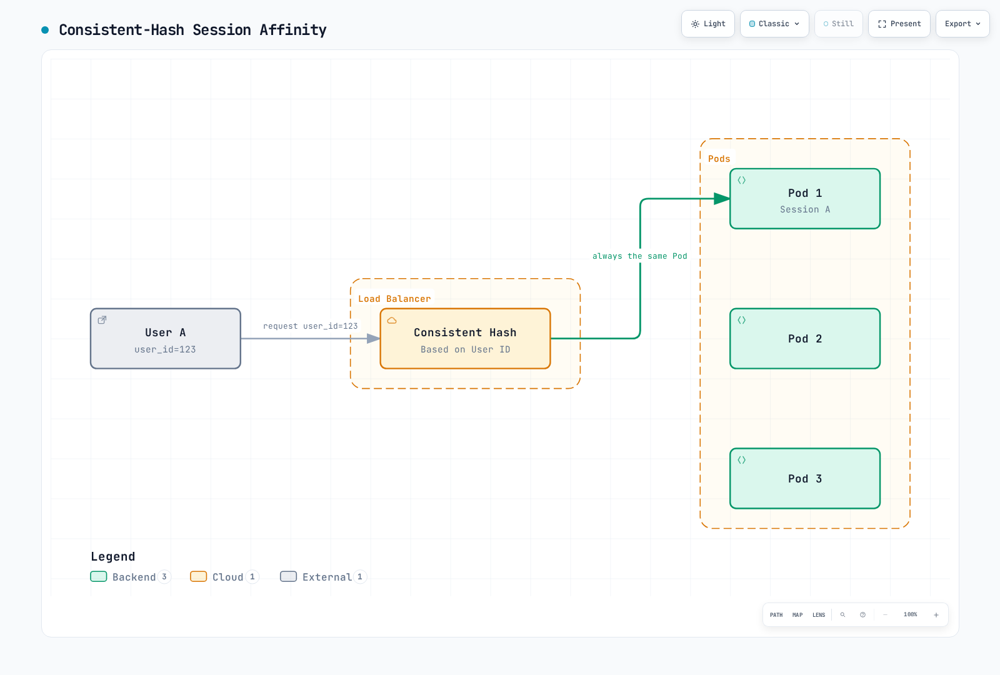

# Afinidad de sesión

La afinidad de sesión (o sesión persistente) es una técnica que proporciona afinidad flexible a las solicitudes que comparten la misma clave hash; no garantiza la asignación permanente a un Pod.

## Tabla de contenido

1. [Descripción general de la afinidad de sesión](#session-affinity-overview)
2. [Basada en hash consistente](#consistent-hash-based)
3. [Basada en cookies](#cookie-based)
4. [Basada en encabezado HTTP](#http-header-based)
5. [Basada en IP de origen](#source-ip-based)
6. [Consideraciones operativas](#operational-considerations)

## Descripción general de la afinidad de sesión {#session-affinity-overview}



[🔍 Ver diagrama interactivo](https://www.atomai.click/kubernetes-docs/archmaps/en-service-mesh-istio-traffic-management-10-session-affinity-0.html)

## Basada en hash consistente {#consistent-hash-based}

### Basada en encabezado HTTP {#http-header-based}

```yaml
apiVersion: networking.istio.io/v1
kind: DestinationRule
metadata:
  name: reviews-session-affinity
spec:
  host: reviews
  trafficPolicy:
    loadBalancer:
      consistentHash:
        httpHeaderName: "x-user-id"
```

### Basada en cookies {#cookie-based}

```yaml
apiVersion: networking.istio.io/v1
kind: DestinationRule
metadata:
  name: reviews-cookie-affinity
spec:
  host: reviews
  trafficPolicy:
    loadBalancer:
      consistentHash:
        httpCookie:
          name: "session-id"
          ttl: 0s  # Cookie expiration time (0s = session cookie)
```

### Basada en IP de origen {#source-ip-based}

```yaml
apiVersion: networking.istio.io/v1
kind: DestinationRule
metadata:
  name: reviews-ip-affinity
spec:
  host: reviews
  trafficPolicy:
    loadBalancer:
      consistentHash:
        useSourceIp: true
```

## Consideraciones operativas {#operational-considerations}

El diagrama supone que el conjunto de endpoints no cambia y que cada proxy ve los mismos endpoints. Agregar o quitar Pods, o las diferencias de endpoints debidas a la localidad, puede reasignar solicitudes. Almacene el estado de sesión de forma que una reasignación o un fallo de Pod no cause problemas.

Elija una de estas DestinationRules para el mismo host. El hash de encabezado HTTP o de cookie requiere procesamiento HTTP; un encabezado ausente no permite identificar al usuario. `ttl: 0s` crea una cookie de sesión si no existe, pero el navegador debe devolverla. Los atributos y la duración de la cookie deben ajustarse a los requisitos de la aplicación.

El hash por IP de origen usa la dirección que ve el proxy. NAT y los balanceadores de carga intermedios pueden hacer que varios clientes compartan una sola dirección; compruebe cómo se gestionan los proxies y las IP de cliente de confianza antes de depender de este método. Estos ejemplos de DestinationRule describen el comportamiento de sidecars; verifique por separado la compatibilidad de la función con waypoints.

## Referencias

- [Afinidad de sesión de Istio](https://istio.io/latest/docs/reference/config/networking/destination-rule/#LoadBalancerSettings-ConsistentHashLB)
