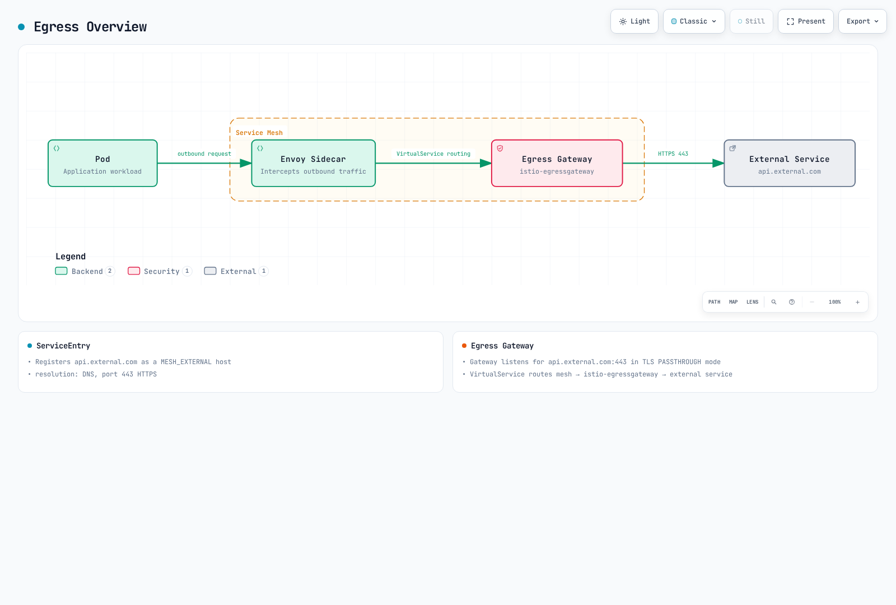

# Control del tráfico de salida (Egress)

El control de salida es una función que administra el tráfico saliente de la malla y refuerza la seguridad.

## Tabla de contenido

1. [Descripción general del tráfico de salida](#egress-overview)
2. [Configuración de ServiceEntry](#serviceentry-configuration)
3. [Gateway de salida](#egress-gateway)
4. [Inicio de TLS](#tls-origination)
5. [Verificación](#verification)

## Descripción general del tráfico de salida

Este ejemplo enruta el HTTPS originado por una aplicación a través de un sidecar y un gateway de salida. Sustituya `api.external.com` por un endpoint resoluble que controle y use un plano de control de Istio compatible que ya esté instalado. ServiceEntry registra un destino; no obliga a que el tráfico pase por un gateway ni funciona como firewall. Aplique también restricciones de salida mediante controles de red.



[🔍 Ver el diagrama interactivo](https://www.atomai.click/kubernetes-docs/archmaps/en-service-mesh-istio-traffic-management-11-egress-control-0.html)

## Configuración de ServiceEntry

### Registro de servicios externos

```yaml
apiVersion: networking.istio.io/v1
kind: ServiceEntry
metadata:
  name: external-api
spec:
  hosts:
  - api.external.com
  ports:
  - number: 443
    name: https
    protocol: HTTPS
  location: MESH_EXTERNAL
  resolution: DNS
```

### Servicio HTTP externo

```yaml
apiVersion: networking.istio.io/v1
kind: ServiceEntry
metadata:
  name: httpbin
spec:
  hosts:
  - httpbin.org
  ports:
  - number: 80
    name: http
    protocol: HTTP
  location: MESH_EXTERNAL
  resolution: DNS
```

## Gateway de salida

### Instalación del gateway de salida

```bash
helm install istio-egressgateway istio/gateway \
  -n istio-system \
  --version 1.31.0 \
  --set service.type=ClusterIP \
  --set labels.app=istio-egressgateway \
  --set labels.istio=egressgateway \
  --wait
```

### Configuración del gateway de salida

```yaml
apiVersion: networking.istio.io/v1
kind: Gateway
metadata:
  name: istio-egressgateway
  namespace: istio-system
spec:
  selector:
    istio: egressgateway
  servers:
  - port:
      number: 443
      name: tls
      protocol: TLS
    hosts:
    - api.external.com
    tls:
      mode: PASSTHROUGH
---
apiVersion: networking.istio.io/v1
kind: DestinationRule
metadata:
  name: egressgateway-for-external
  namespace: default
spec:
  host: istio-egressgateway.istio-system.svc.cluster.local
  subsets:
  - name: external
---
apiVersion: networking.istio.io/v1
kind: VirtualService
metadata:
  name: direct-external-through-egress-gateway
  namespace: default
spec:
  hosts:
  - api.external.com
  gateways:
  - mesh
  - istio-system/istio-egressgateway
  tls:
  - match:
    - gateways:
      - mesh
      port: 443
      sniHosts:
      - api.external.com
    route:
    - destination:
        host: istio-egressgateway.istio-system.svc.cluster.local
        subset: external
        port:
          number: 443
  - match:
    - gateways:
      - istio-system/istio-egressgateway
      port: 443
      sniHosts:
      - api.external.com
    route:
    - destination:
        host: api.external.com
        port:
          number: 443
```

## Inicio de TLS

El ejemplo conserva la conexión TLS de la aplicación con el servicio externo; el gateway de salida enruta mediante SNI. El inicio de TLS, en cambio, comienza TLS en un proxy después de que la aplicación envía HTTP. Para eso se necesita un puerto/`targetPort` HTTP de ServiceEntry coincidente y una política TLS de DestinationRule; siga la [guía de inicio de TLS](https://istio.io/latest/docs/tasks/traffic-management/egress/egress-tls-origination/) y evite iniciar una segunda capa TLS sobre una conexión de aplicación ya cifrada.

## Verificación

Configure el repositorio y la versión del chart como se indica en la [guía de instalación](../01-installation.md). Mantenga estos recursos en los namespaces especificados y asegúrese de que el ServiceEntry externo original esté en `default` o se exporte al namespace del cliente. Use un cliente de malla con SNI, inspeccione las rutas de ambos proxies y verifique que el gateway de salida recibe la conexión. Llegar al endpoint externo no demuestra por sí solo que se haya atravesado el gateway.

```bash
istioctl analyze -A
kubectl get pods -n istio-system -l istio=egressgateway
istioctl proxy-config listeners <egress-pod> -n istio-system
istioctl proxy-config clusters <client-pod> -n default
```

## Referencias

- [Tráfico de salida de Istio](https://istio.io/latest/docs/tasks/traffic-management/egress/)
- [Gateway de salida](https://istio.io/latest/docs/tasks/traffic-management/egress/egress-gateway/)
