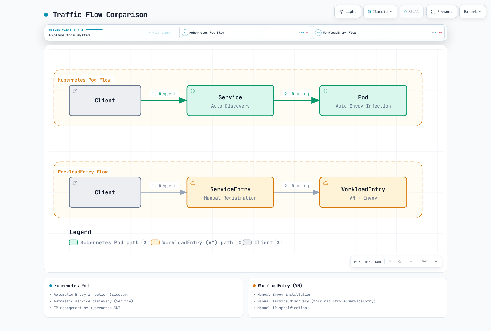
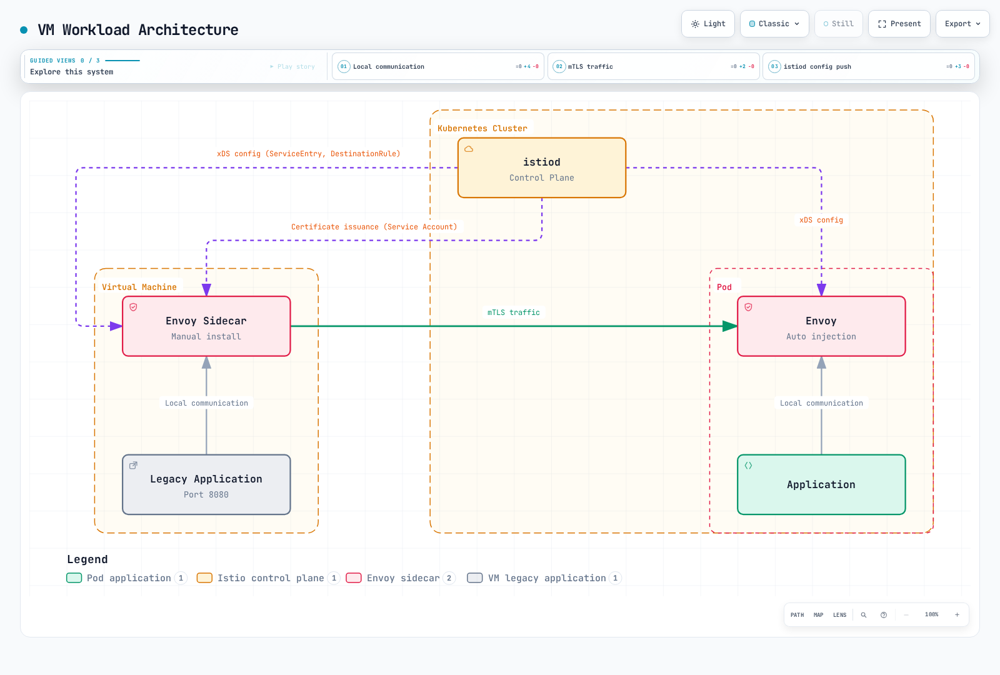
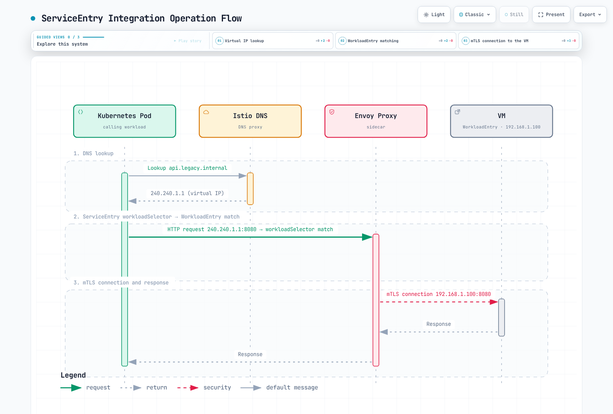

# WorkloadEntry

> **Versión revisada**: Istio 1.31.0
> **Última actualización**: 11 de septiembre de 2026

WorkloadEntry es un recurso para incorporar máquinas virtuales (VM) o servidores bare-metal a la malla de servicios de Istio. Así, las cargas de trabajo que se ejecutan fuera de Kubernetes pueden utilizar las funciones de gestión del tráfico, seguridad y observabilidad de la malla.

## Tabla de contenidos

1. [Descripción general](#overview)
2. [WorkloadEntry frente a Kubernetes Pod](#workloadentry-vs-kubernetes-pod)
3. [Arquitectura](#architecture)
4. [Uso básico](#basic-usage)
5. [Integración con ServiceEntry](#serviceentry-integration)
6. [Guía práctica para registrar VM](#vm-registration-practical-guide)
7. [Configuración de seguridad (mTLS)](#security-settings-mtls)
8. [Comprobaciones de estado y monitorización](#health-checks-and-monitoring)
9. [Configuración avanzada](#advanced-configuration)
10. [Solución de problemas](#troubleshooting)
11. [Prácticas recomendadas](#best-practices)

<span id="overview"></span>
## Descripción general

WorkloadEntry describe una carga de trabajo; crearlo no instala Envoy, inicializa una identidad, crea conectividad de red ni publica un registro DNS. Este capítulo utiliza la integración de VM en modo sidecar. Los ejemplos son independientes: mantenga cada ServiceEntry, los WorkloadEntry seleccionados y el ServiceAccount en el namespace previsto. Los diagramas muestran relaciones de registro y configuración, no saltos de red adicionales.

### ¿Qué es WorkloadEntry?

WorkloadEntry es una definición de recurso personalizado (CRD) de Istio que registra en la malla de servicios de Istio cargas de trabajo externas a ella, como VM y servidores bare-metal.

### Escenarios de uso


[🔍 Ver diagrama interactivo](https://www.atomai.click/kubernetes-docs/archmaps/en-service-mesh-istio-traffic-management-13-workload-entry-0.html)

**Casos de uso principales**:
1. **Migración gradual**: migrar aplicaciones heredadas a Kubernetes de forma incremental.
2. **Arquitectura híbrida**: operar VM y contenedores al mismo tiempo.
3. **Integración de bases de datos**: incorporar bases de datos externas a la malla.
4. **Cargas de alto rendimiento**: aprovechar hardware especializado, como servidores con GPU.

<span id="workloadentry-vs-kubernetes-pod"></span>
## WorkloadEntry frente a Kubernetes Pod

### Tabla comparativa

| Característica | Kubernetes Pod | WorkloadEntry (VM) |
|----------------|---------------|-------------------|
| **Ubicación del despliegue** | Dentro del clúster | Fuera del clúster |
| **Inyección de Envoy** | Automática (sidecar) | Instalación manual |
| **Descubrimiento de servicios** | Automático (Service) | Manual (WorkloadEntry) |
| **Gestión de IP** | CNI de Kubernetes | Especificación manual |
| **mTLS** | Automático | Automático (requiere instalar certificados) |
| **Comprobaciones de estado** | Automáticas (Liveness/Readiness) | Configuración manual |
| **Escalado** | HPA | Manual |
| **Complejidad operativa** | Baja | Alta |
| **Escenario de uso** | Aplicaciones nativas de la nube | Aplicaciones heredadas y hardware especializado |

### Comparación del flujo de tráfico



[🔍 Ver diagrama interactivo](https://www.atomai.click/kubernetes-docs/archmaps/en-service-mesh-istio-traffic-management-13-workload-entry-1.html)

<span id="architecture"></span>
## Arquitectura

### Arquitectura de cargas de trabajo en VM



[🔍 Ver diagrama interactivo](https://www.atomai.click/kubernetes-docs/archmaps/en-service-mesh-istio-traffic-management-13-workload-entry-2.html)

### Componentes clave

1. **WorkloadEntry**: registra información de la VM, como IP, puertos y etiquetas.
2. **ServiceEntry**: define el servicio y referencia WorkloadEntry.
3. **Envoy Proxy**: sidecar instalado manualmente en la VM.
4. **istiod**: distribuye configuración y gestiona certificados.
5. **ServiceAccount**: autentica la identidad de la VM.

<span id="basic-usage"></span>
## Uso básico

### Definición del recurso WorkloadEntry

```yaml
apiVersion: networking.istio.io/v1
kind: WorkloadEntry
metadata:
  name: legacy-api-vm-1
  namespace: production
spec:
  # VM's IP address
  address: 192.168.1.100

  # Labels for service selection
  labels:
    app: legacy-api
    version: v1.0
    tier: backend

  # Service account for mTLS authentication
  serviceAccount: legacy-api-sa

  # Ports to expose
  ports:
    http: 8080
    https: 8443
    metrics: 9090

  # Locality information (optional)
  locality: us-west-2/us-west-2a

  # Weight (for load balancing, optional)
  weight: 100

  # Network (multi-network environment, optional)
  network: vm-network
```

### Descripción de los campos obligatorios

| Campo | Descripción | Ejemplo |
|-------|-------------|---------|
| **address** | Dirección del endpoint (IP o DNS con resolución DNS; puede omitirse si hay una red remota configurada) | `192.168.1.100` |
| **labels** | Etiquetas para que ServiceEntry pueda seleccionar la carga | `app: legacy-api` |
| **serviceAccount** | SA para la autenticación mTLS | `legacy-api-sa` |
| **ports** | Mapa de puertos que se expondrán | `http: 8080` |

### Registrar varias VM

```yaml
# VM 1
apiVersion: networking.istio.io/v1
kind: WorkloadEntry
metadata:
  name: api-vm-1
  namespace: production
spec:
  address: 192.168.1.101
  labels:
    app: api-service
    version: v1
  serviceAccount: api-sa
  ports:
    http: 8080
---
# VM 2
apiVersion: networking.istio.io/v1
kind: WorkloadEntry
metadata:
  name: api-vm-2
  namespace: production
spec:
  address: 192.168.1.102
  labels:
    app: api-service
    version: v1
  serviceAccount: api-sa
  ports:
    http: 8080
---
# VM 3 (different version)
apiVersion: networking.istio.io/v1
kind: WorkloadEntry
metadata:
  name: api-vm-3
  namespace: production
spec:
  address: 192.168.1.103
  labels:
    app: api-service
    version: v2  # New version
  serviceAccount: api-sa
  ports:
    http: 8080
```

<span id="serviceentry-integration"></span>
## Integración con ServiceEntry

WorkloadEntry siempre se utiliza junto con ServiceEntry.

### Patrón básico de integración

```yaml
# 1. Define service with ServiceEntry
apiVersion: networking.istio.io/v1
kind: ServiceEntry
metadata:
  name: legacy-api
  namespace: production
spec:
  hosts:
  - api.legacy.internal
  addresses:
  - 240.240.1.1  # Virtual IP
  ports:
  - number: 8080
    name: http
    protocol: HTTP
  location: MESH_INTERNAL
  resolution: STATIC
  workloadSelector:
    labels:
      app: legacy-api  # Match with WorkloadEntry labels
---
# 2. Register VM with WorkloadEntry
apiVersion: networking.istio.io/v1
kind: WorkloadEntry
metadata:
  name: legacy-api-vm-1
  namespace: production
spec:
  address: 192.168.1.100
  labels:
    app: legacy-api  # Match with ServiceEntry
    version: v1
  serviceAccount: legacy-api-sa
  ports:
    http: 8080
```

### Flujo de operación



[🔍 Ver diagrama interactivo](https://www.atomai.click/kubernetes-docs/archmaps/en-service-mesh-istio-traffic-management-13-workload-entry-3.html)

### Balanceo de carga

El balanceo de carga se realiza automáticamente cuando hay varios WorkloadEntry:

```yaml
apiVersion: networking.istio.io/v1
kind: ServiceEntry
metadata:
  name: database-cluster
  namespace: vm-workloads
spec:
  hosts:
  - db.cluster.internal
  ports:
  - number: 5432
    name: postgresql
    protocol: TCP
  location: MESH_INTERNAL
  resolution: STATIC
  workloadSelector:
    labels:
      app: postgres
      tier: database
      role: primary
---
# Separate read-only replica service
apiVersion: networking.istio.io/v1
kind: ServiceEntry
metadata:
  name: database-replicas
  namespace: vm-workloads
spec:
  hosts:
  - db-replicas.cluster.internal
  ports:
  - number: 5432
    name: postgresql
    protocol: TCP
  location: MESH_INTERNAL
  resolution: STATIC
  workloadSelector:
    labels:
      app: postgres
      tier: database
      role: replica
---
# Primary DB
apiVersion: networking.istio.io/v1
kind: WorkloadEntry
metadata:
  name: postgres-primary
  namespace: vm-workloads
spec:
  serviceAccount: vm-postgres-sa
  address: 10.0.1.100
  labels:
    app: postgres
    tier: database
    role: primary
  weight: 100  # Weight
---
# Replica DB 1
apiVersion: networking.istio.io/v1
kind: WorkloadEntry
metadata:
  name: postgres-replica-1
  namespace: vm-workloads
spec:
  serviceAccount: vm-postgres-sa
  address: 10.0.1.101
  labels:
    app: postgres
    tier: database
    role: replica
  weight: 50
---
# Replica DB 2
apiVersion: networking.istio.io/v1
kind: WorkloadEntry
metadata:
  name: postgres-replica-2
  namespace: vm-workloads
spec:
  serviceAccount: vm-postgres-sa
  address: 10.0.1.102
  labels:
    app: postgres
    tier: database
    role: replica
  weight: 50
```

Envíe las escrituras solo al servicio principal y las lecturas a réplicas únicamente si la aplicación tolera la semántica de replicación. Los pesos genéricos de endpoint no identifican los roles de PostgreSQL. Configure la captura DNS o VIP únicas para servicios que usan el mismo puerto e inicialice cada VM con el ServiceAccount indicado.

<span id="vm-registration-practical-guide"></span>
## Guía práctica para registrar VM

### Requisitos previos

1. **Requisitos de las VM**:
   - Red: posibilidad de comunicarse con el clúster de Kubernetes.
   - SO/CPU: una distribución de Linux y una arquitectura admitidas por el paquete sidecar seleccionado; este ejemplo utiliza el paquete Debian.
   - Conectividad: acceso a xDS/CA de istiod mediante su gateway expuesto para VM (normalmente 15012) y una ruta para el tráfico de las cargas según la topología elegida. 15017 es un puerto de webhook de Kubernetes, no un requisito para las aplicaciones de VM.

2. **Preparación de Kubernetes**:
   - Istio debe estar instalado.
   - Cree un namespace para las VM.
   - Cree un ServiceAccount.

Antes de generar los archivos de inicialización, exponga el plano de control existente para que las VM puedan acceder a él, siguiendo el [procedimiento oficial de instalación de VM](https://istio.io/latest/docs/setup/install/virtual-machine/). Un Service de istiod accesible solo desde el clúster no es suficiente. Este recorrido supone conectividad enrutada entre Pods y VM dentro de una misma red lógica; para redes separadas, utilice la configuración de red/east-west documentada. El ID de clúster generado debe coincidir con la configuración de istiod.

### Paso 1: Crear un ServiceAccount

```bash
# Create namespace
kubectl create namespace vm-workloads

# Create ServiceAccount
kubectl create serviceaccount vm-postgres-sa -n vm-workloads

# VM identity bootstrap does not require listing Kubernetes Secrets.
```

### Paso 2: Preparar la entrada de inicialización de WorkloadGroup

WorkloadGroup sirve como plantilla para varios WorkloadEntry:

```yaml
apiVersion: networking.istio.io/v1
kind: WorkloadGroup
metadata:
  name: postgres-vms
  namespace: vm-workloads
spec:
  metadata:
    labels:
      app: postgres
      version: v14
  template:
    serviceAccount: vm-postgres-sa
    network: ""  # Same logical network in this walkthrough
    ports:
      postgresql: 5432
      metrics: 9187
```

### Paso 3: Instalar Envoy en la VM

#### Generar el script de instalación automática

```bash
# Generate VM registration files with istioctl
umask 077
istioctl x workload entry configure \
  -f workloadgroup.yaml \
  -o vm-postgres-1 \
  --clusterID Kubernetes

# Generated files:
# - cluster.env: Cluster information
# - istio-token: Authentication token
# - mesh.yaml: Mesh configuration
# - root-cert.pem: Root certificate
# - hosts: /etc/hosts entries
```

#### Ejecutar la instalación en la VM

```bash
# Run on the administration workstation before entering the VM shell
ssh user@192.168.1.100 'install -d -m 700 "$HOME/istio-bootstrap"'
scp vm-postgres-1/* user@192.168.1.100:istio-bootstrap/
ssh user@192.168.1.100

# From this point, run on the VM
VM_BOOTSTRAP_DIR="$HOME/istio-bootstrap"
curl -fsSLo istio-sidecar.deb \
  https://blob.istio.io/istio-release/releases/1.31.0/deb/istio-sidecar.deb
sudo dpkg -i istio-sidecar.deb
sudo install -d -o istio-proxy -m 0750 \
  /etc/certs /var/run/secrets/tokens /var/lib/istio/envoy /etc/istio/config /etc/istio/proxy
sudo install -o istio-proxy -m 0644 "$VM_BOOTSTRAP_DIR/root-cert.pem" /etc/certs/root-cert.pem
sudo install -o istio-proxy -m 0600 "$VM_BOOTSTRAP_DIR/istio-token" /var/run/secrets/tokens/istio-token
sudo install -o istio-proxy -m 0600 "$VM_BOOTSTRAP_DIR/cluster.env" /var/lib/istio/envoy/cluster.env
sudo install -o istio-proxy -m 0600 "$VM_BOOTSTRAP_DIR/mesh.yaml" /etc/istio/config/mesh
# Review/merge once; replace stale istiod entries rather than appending duplicates
cat "$VM_BOOTSTRAP_DIR/hosts" | sudo tee -a /etc/hosts >/dev/null
sudo systemctl enable --now istio
sudo systemctl status istio
```


### Paso 4: Registrar WorkloadEntry

Los comandos anteriores realizan el registro manual. Aplique este WorkloadEntry después de inicializar el agente de la VM; no cree también una entrada manual duplicada para una VM registrada automáticamente:

```yaml
apiVersion: networking.istio.io/v1
kind: WorkloadEntry
metadata:
  name: postgres-vm-1
  namespace: vm-workloads
spec:
  address: 192.168.1.100
  labels:
    app: postgres
    version: v14
  serviceAccount: vm-postgres-sa
  ports:
    postgresql: 5432
    metrics: 9187
```

```bash
kubectl apply -f workloadentry.yaml
```

### Paso 5: Crear ServiceEntry

```yaml
apiVersion: networking.istio.io/v1
kind: ServiceEntry
metadata:
  name: postgres-service
  namespace: vm-workloads
spec:
  hosts:
  - postgres.vm.internal
  addresses:
  - 240.240.2.1
  ports:
  - number: 5432
    name: postgresql
    protocol: TCP
  - number: 9187
    name: metrics
    protocol: HTTP
  location: MESH_INTERNAL
  resolution: STATIC
  workloadSelector:
    labels:
      app: postgres
```

```bash
kubectl apply -f serviceentry.yaml
```

### Paso 6: Probar la conexión

```yaml
apiVersion: v1
kind: Pod
metadata:
  name: pg-client
  namespace: vm-workloads
  labels:
    sidecar.istio.io/inject: "true"
  annotations:
    proxy.istio.io/config: |
      proxyMetadata:
        ISTIO_META_DNS_CAPTURE: "true"
spec:
  containers:
  - name: postgres
    image: postgres:14
    command: ["sleep", "infinity"]
```

```bash
kubectl apply -f pg-client.yaml
kubectl wait -n vm-workloads --for=condition=Ready pod/pg-client --timeout=120s
kubectl exec -it pg-client -n vm-workloads -c postgres -- \
  psql -h postgres.vm.internal -U dbuser -d mydb
```

Guarde el manifiesto del Pod como pg-client.yaml. La versión del cliente PostgreSQL es un ejemplo de aplicación, independiente de la versión de Istio. Introduzca interactivamente credenciales de base de datos válidas. Después de aplicar la política restrictiva siguiente, utilice para las pruebas un ServiceAccount autorizado; la identidad de prueba predeterminada será denegada. Elimine el Pod de prueba al terminar.

<span id="security-settings-mtls"></span>
## Configuración de seguridad (mTLS)

### Habilitación automática de mTLS

Una vez inicializado el agente de VM con el ServiceAccount declarado, los proxies de la malla pueden utilizar mTLS automático. WorkloadEntry por sí solo no convierte una VM sin proxy en participante de la malla:

```yaml
# Force mTLS with PeerAuthentication
apiVersion: security.istio.io/v1
kind: PeerAuthentication
metadata:
  name: default
  namespace: vm-workloads
spec:
  mtls:
    mode: STRICT  # mTLS required for both VM and pod
```

### Verificar la identidad de la VM

A diferencia de la inicialización de un sidecar en un Pod, la integración de VM conserva el certificado y la clave emitidos en /etc/certs y utiliza la identidad mTLS existente para la renovación. Estos archivos aparecen después de una inicialización correcta. Mantenga las claves privadas; regenere el material de inicialización solo como parte de una recuperación diagnosticada, no imprimiendo ni copiando credenciales en los registros.

```bash
# Check certificates on VM
sudo ls -la /etc/certs/
# cert-chain.pem: Certificate chain
# key.pem: Private key
# root-cert.pem: Root CA

# Check certificate contents
sudo openssl x509 -in /etc/certs/cert-chain.pem -text -noout

# Check Subject Alternative Name (SAN):
# spiffe://cluster.local/ns/vm-workloads/sa/vm-postgres-sa
```

### Control de acceso (AuthorizationPolicy)

```yaml
# PostgreSQL access control
apiVersion: security.istio.io/v1
kind: AuthorizationPolicy
metadata:
  name: postgres-access
  namespace: vm-workloads
spec:
  selector:
    matchLabels:
      app: postgres  # WorkloadEntry labels
  action: ALLOW
  rules:
  # Allow only API service access
  - from:
    - source:
        principals:
        - cluster.local/ns/production/sa/api-service-sa
    to:
    - operation:
        ports: ["5432"]

  # Allow monitoring service access
  - from:
    - source:
        principals:
        - cluster.local/ns/istio-system/sa/prometheus
    to:
    - operation:
        ports: ["9187"]  # postgres_exporter
```

### Verificar mTLS

```bash
# Use a PostgreSQL client in an authorized mesh workload; PostgreSQL is not HTTPS
kubectl exec -it <authorized-client-pod> -n production -c <app-container> -- \
  psql -h postgres.vm.internal -U dbuser -d mydb
# Inspect the client proxy's TLS transport and certificates separately
istioctl proxy-config clusters <authorized-client-pod> -n production --fqdn postgres.vm.internal -o json
istioctl proxy-config secret <authorized-client-pod> -n production
# On the VM, inspect public certificate information through its local admin interface
curl -fsS http://127.0.0.1:15000/certs
```

<span id="health-checks-and-monitoring"></span>
## Comprobaciones de estado y monitorización

### Configuración de comprobaciones de estado

Para el flujo automatizado opcional, los indicadores pertinentes del plano de control son `PILOT_ENABLE_WORKLOAD_ENTRY_AUTOREGISTRATION` y `PILOT_ENABLE_WORKLOAD_ENTRY_HEALTHCHECKS`; incorpórelos a la configuración de instalación existente tal como se documenta.

WorkloadGroup admite sondas de readiness. El flujo documentado de registro/comprobación automática requiere habilitar los indicadores de istiod, aplicar WorkloadGroup y generar los archivos de inicialización con --autoregister. Es un flujo optativo, distinto del registro manual anterior. DestinationRule ofrece detección pasiva de fallos de conexión, no una sonda de estado activa:

```yaml
apiVersion: networking.istio.io/v1
kind: DestinationRule
metadata:
  name: postgres-healthcheck
  namespace: vm-workloads
spec:
  host: postgres.vm.internal
  trafficPolicy:
    connectionPool:
      tcp:
        maxConnections: 100
    outlierDetection:
      consecutive5xxErrors: 5  # Exclude after 5 consecutive failures
      interval: 30s         # Check every 30 seconds
      baseEjectionTime: 30s # Exclude for 30 seconds
      maxEjectionPercent: 50 # Exclude up to 50%
      minHealthPercent: 0    # Disable panic fail-open threshold
```

```yaml
# Optional WorkloadGroup probe fragment for the documented auto-registration workflow
spec:
  probe:
    initialDelaySeconds: 5
    periodSeconds: 5
    timeoutSeconds: 3
    tcpSocket:
      host: 127.0.0.1
      port: 5432
```

### Endpoint de comprobación de estado de la VM

Añada un endpoint de comprobación de estado a la aplicación de la VM:

```python
# Python Flask example
from flask import Flask, jsonify
import psycopg2

app = Flask(__name__)

@app.route('/health', methods=['GET'])
def health():
    try:
        # Verify database connection
        conn = psycopg2.connect("dbname=mydb user=dbuser", connect_timeout=3)
        conn.close()
        return jsonify({"status": "healthy"}), 200
    except psycopg2.Error:
        return jsonify({"status": "unhealthy"}), 503

if __name__ == '__main__':
    app.run(host='127.0.0.1', port=8080)
```

### Recopilar métricas de Prometheus

ServiceMonitor descubre Services y endpoints de Kubernetes; no descubre directamente WorkloadEntry ni ServiceEntry. Para esta VM, despliegue postgres_exporter en el puerto 9187, exponga ese puerto con nombre en WorkloadEntry/ServiceEntry y añada un trabajo de scraping explícito a la configuración del colector existente. El colector debe resolver el nombre de host sintético, utilizar mTLS de la malla y tener una identidad permitida por AuthorizationPolicy del exporter.

```yaml
# Fragment for the existing Prometheus scrape_configs
- job_name: workloadentry-postgres
  scrape_interval: 30s
  metrics_path: /metrics
  static_configs:
  - targets: ["postgres.vm.internal:9187"]
```

### Consultas de panel de Grafana

```promql
# Native PostgreSQL traffic has TCP counters, not HTTP status/latency metrics
sum(rate(istio_tcp_connections_opened_total{reporter="source",destination_service="postgres.vm.internal"}[5m]))
sum(rate(istio_tcp_sent_bytes_total{reporter="source",destination_service="postgres.vm.internal"}[5m]))

# Collector/exporter health; inspect the actual emitted labels
up{job="workloadentry-postgres"}
pg_up{job="workloadentry-postgres"}
```

<span id="advanced-configuration"></span>
## Configuración avanzada

### Entorno con varias redes

Un nombre de red solo identifica la topología. Configure por separado la conectividad/gateways east-west y los datos de red correspondientes de la malla; el nombre no crea una ruta de VPC, una conexión de emparejamiento ni un gateway. La localidad se define por región/zona/subzona; utilice valores reales que coincidan con los del proxy cliente.

Registre VM en redes diferentes:

```yaml
# VM in Network A
apiVersion: networking.istio.io/v1
kind: WorkloadEntry
metadata:
  name: api-vm-network-a
spec:
  address: 192.168.1.100
  labels:
    app: api-service
  serviceAccount: api-sa
  network: network-a
  ports:
    http: 8080
---
# VM in Network B
apiVersion: networking.istio.io/v1
kind: WorkloadEntry
metadata:
  name: api-vm-network-b
spec:
  address: 10.0.1.100
  labels:
    app: api-service
  serviceAccount: api-sa
  network: network-b
  ports:
    http: 8080
```

### Balanceo de carga según la localidad

```yaml
apiVersion: networking.istio.io/v1
kind: WorkloadEntry
metadata:
  name: api-vm-us-west
spec:
  address: 192.168.1.100
  labels:
    app: api-service
  locality: us-west-2/us-west-2a
  weight: 100
---
apiVersion: networking.istio.io/v1
kind: WorkloadEntry
metadata:
  name: api-vm-us-east
spec:
  address: 10.0.1.100
  labels:
    app: api-service
  locality: us-east-1/us-east-1a
  weight: 100
---
# Locality-aware routing with DestinationRule
apiVersion: networking.istio.io/v1
kind: DestinationRule
metadata:
  name: api-locality-lb
spec:
  host: api.service.internal
  trafficPolicy:
    loadBalancer:
      localityLbSetting:
        enabled: true
        distribute:
        - from: us-west-2/*
          to:
            "us-west-2/*": 80
            "us-east-1/*": 20
        - from: us-east-1/*
          to:
            "us-east-1/*": 80
            "us-west-2/*": 20
```

### Despliegue canary

También se puede aplicar un despliegue canary a WorkloadEntry:

```yaml
# v1 version VM
apiVersion: networking.istio.io/v1
kind: WorkloadEntry
metadata:
  name: api-vm-v1
spec:
  address: 192.168.1.100
  labels:
    app: api-service
    version: v1
  serviceAccount: api-sa
---
# v2 version VM (Canary)
apiVersion: networking.istio.io/v1
kind: WorkloadEntry
metadata:
  name: api-vm-v2
spec:
  address: 192.168.1.101
  labels:
    app: api-service
    version: v2
  serviceAccount: api-sa
---
# Traffic splitting with VirtualService
apiVersion: networking.istio.io/v1
kind: VirtualService
metadata:
  name: api-service-canary
spec:
  hosts:
  - api.service.internal
  http:
  - route:
    - destination:
        host: api.service.internal
        subset: v1
      weight: 90
    - destination:
        host: api.service.internal
        subset: v2
      weight: 10
---
# Define subsets with DestinationRule
apiVersion: networking.istio.io/v1
kind: DestinationRule
metadata:
  name: api-service-subsets
spec:
  host: api.service.internal
  subsets:
  - name: v1
    labels:
      version: v1
  - name: v2
    labels:
      version: v2
```

<span id="troubleshooting"></span>
## Solución de problemas

### WorkloadEntry no registrado

**Síntoma**: el recurso aparece en `kubectl get workloadentry`, pero el tráfico no se enruta.

**Verificación**:

```bash
# 1. Check WorkloadEntry status
kubectl get workloadentry -n vm-workloads -o yaml

# 2. Check ServiceEntry's workloadSelector
kubectl get serviceentry -n vm-workloads -o yaml | grep -A 5 workloadSelector

# 3. Verify label matching
# WorkloadEntry labels:
#   app: postgres
# ServiceEntry workloadSelector:
#   labels:
#     app: postgres  # Must match

# 4. Check Envoy configuration
istioctl proxy-config endpoints <pod-name> -n production

# Output should include WorkloadEntry's IP:
# ENDPOINT            STATUS      CLUSTER
# 192.168.1.100:5432  HEALTHY     outbound|5432||postgres.vm.internal
```

**Resolución**:

```yaml
# Modify labels to match exactly
apiVersion: networking.istio.io/v1
kind: WorkloadEntry
metadata:
  name: postgres-vm-1
  namespace: vm-workloads
spec:
  address: 192.168.1.100
  serviceAccount: vm-postgres-sa
  labels:
    app: postgres  # Must be identical to ServiceEntry
    version: v14
```

### Fallo de conexión mTLS en la VM

**Síntoma**: `connection refused` o `TLS handshake failed`.

**Verificación**:

```bash
# Check Envoy logs on VM
sudo journalctl -u istio -f | grep -i tls

# Check certificates
sudo ls -la /etc/certs/
sudo openssl x509 -in /etc/certs/cert-chain.pem -text -noout

# Check certificate expiration
sudo openssl x509 -in /etc/certs/cert-chain.pem -noout -dates

# Check ServiceAccount token
sudo ls -la /var/run/secrets/tokens/
sudo stat /var/run/secrets/tokens/istio-token
```

**Resolución**:

```bash
# Regenerate bootstrap inputs from the admin workstation; this command does not issue a certificate
umask 077
istioctl x workload entry configure \
  -f workloadgroup.yaml \
  -o vm-postgres-1 \
  --clusterID Kubernetes

# Copy to VM and restart Envoy
scp vm-postgres-1/* user@192.168.1.100:istio-bootstrap/
# Reapply all reviewed runtime files and permissions using the VM installation steps,
# including the token and mesh configuration; then restart istio. Do not replace only the root CA.
```

### El tráfico no llega debido a un fallo de comprobación de estado

**Síntoma**: Envoy marca WorkloadEntry como `UNHEALTHY`.

**Verificación**:

```bash
# Check Envoy endpoint status
istioctl proxy-config endpoints <pod-name> -n production | grep postgres

# Output:
# 192.168.1.100:5432  UNHEALTHY  outbound|5432||postgres.vm.internal

# Check DestinationRule's outlierDetection
kubectl get destinationrule -n vm-workloads -o yaml
```

**Resolución**:

```yaml
# Adjust OutlierDetection settings
apiVersion: networking.istio.io/v1
kind: DestinationRule
metadata:
  name: postgres-healthcheck
  namespace: vm-workloads
spec:
  host: postgres.vm.internal
  trafficPolicy:
    outlierDetection:
      consecutive5xxErrors: 10     # More lenient
      interval: 60s             # Increase check interval
      baseEjectionTime: 60s
      maxEjectionPercent: 50    # Bound ejection; 100 would allow excluding every endpoint
```

### Fallo de resolución DNS

Un VIP de ServiceEntry por sí solo no crea un registro de CoreDNS. Habilite la captura DNS en el sidecar cliente y vuelva a crear su Pod, o proporcione un registro DNS real. La inicialización de la VM habilita el proxy DNS de VM; eso no habilita automáticamente la captura en todos los clientes de Kubernetes.

**Síntoma**: no se puede resolver `postgres.vm.internal` desde el Pod.

**Verificación**:

```bash
# Check ServiceEntry
kubectl get serviceentry -n vm-workloads

# DNS lookup test
kubectl exec pg-client -n vm-workloads -c postgres -- getent hosts postgres.vm.internal

# Check Istio DNS Proxy enablement
kubectl get pod <pod-name> -o yaml | grep ISTIO_META_DNS_CAPTURE
```

**Resolución**:

```yaml
# Add addresses to ServiceEntry
apiVersion: networking.istio.io/v1
kind: ServiceEntry
metadata:
  name: postgres-service
  namespace: vm-workloads
spec:
  hosts:
  - postgres.vm.internal
  addresses:
  - 240.240.2.1  # Specify virtual IP
  ports:
  - number: 5432
    name: postgresql
    protocol: TCP
  location: MESH_INTERNAL
  resolution: STATIC
  workloadSelector:
    labels:
      app: postgres
```

<span id="best-practices"></span>
## Prácticas recomendadas

### 1. Convenciones de nomenclatura

```text
# WorkloadEntry name: <app>-<role>-<id>
name: postgres-primary-1
name: postgres-replica-2
name: api-backend-vm-3

# ServiceEntry name: <app>-service
name: postgres-service
name: api-service

# ServiceAccount name: <app>-sa
name: postgres-sa
name: api-sa
```

### 2. Estrategia de etiquetas

```yaml
spec:
  labels:
    # Required labels
    app: postgres          # Application name
    version: v14           # Version

    # Optional labels
    tier: database         # Tier (frontend, backend, database)
    role: primary          # Role (primary, replica, canary)
    environment: production # Environment
    team: platform         # Team
```

### 3. Gestión de ServiceAccount

```bash
# Separate ServiceAccount by namespace
kubectl create sa db-sa -n databases
kubectl create sa api-sa -n applications
kubectl create sa cache-sa -n middleware

# Principle of least privilege
kubectl create role db-limited \
  --verb=get \
  --resource=configmaps \
  -n databases
```

### 4. Monitorización y alertas

```yaml
apiVersion: monitoring.coreos.com/v1
kind: PrometheusRule
metadata:
  name: workloadentry-alerts
  namespace: vm-workloads
spec:
  groups:
  - name: workloadentry
    rules:
    - alert: VMExporterScrapeDown
      expr: up{job="workloadentry-postgres"} == 0 or absent(up{job="workloadentry-postgres"})
      for: 5m
      labels:
        severity: critical
      annotations:
        summary: "VM exporter scrape target is unavailable"
    - alert: PostgresExporterReportsDown
      expr: pg_up{job="workloadentry-postgres"} == 0
      for: 5m
      labels:
        severity: warning
```

### 5. Documentación

Mantenga documentación para cada WorkloadEntry:

```yaml
apiVersion: networking.istio.io/v1
kind: WorkloadEntry
metadata:
  name: postgres-primary-1
  annotations:
    description: "Primary PostgreSQL database for production"
    owner: "platform-team@example.com"
    provisioned-date: "2025-11-26"
    os: "Ubuntu 22.04 LTS"
    location: "us-west-2a"
    runbook: "https://wiki.example.com/postgres-vm-runbook"
spec:
  address: 192.168.1.100
  labels:
    app: postgres
    version: v14
```

### 6. Copia de seguridad y recuperación ante desastres

Conserve por separado los manifiestos originales de WorkloadGroup/ServiceEntry/WorkloadEntry manual y la versión de la malla, no solo las exportaciones de diagnóstico. Realice copias de seguridad seguras de la identidad persistente de la VM según sea necesario. Los objetos exportados contienen metadatos y estado del servidor que deben revisarse antes de restaurar; las entradas registradas automáticamente deben ser recreadas por su controlador, no duplicarse manualmente. Primero restaure los namespaces/cuentas y la conectividad con el plano de control.

```bash
# Backup WorkloadEntry
kubectl get workloadentry -n vm-workloads -o yaml > workloadentries-backup.yaml

# Backup ServiceEntry
kubectl get serviceentry -n vm-workloads -o yaml > serviceentries-backup.yaml

# Restore
kubectl apply -f serviceentry.yaml
# Manual-registration path only: use the reviewed declarative source, not raw status snapshots
kubectl apply -f workloadentry.yaml
```

### 7. Estrategia de migración gradual


[🔍 Ver diagrama interactivo](https://www.atomai.click/kubernetes-docs/archmaps/en-service-mesh-istio-traffic-management-13-workload-entry-4.html)

Antes de iniciar estas fases, inicialice la identidad de la VM heredada y cree la ServiceEntry/subsets compartida que aparece a continuación. El despliegue de Kubernetes debe estar en vm-workloads con app=api y version=k8s, y su configuración de proxy/DNS debe estar lista antes de trasladar el tráfico.

```yaml
apiVersion: networking.istio.io/v1
kind: ServiceEntry
metadata:
  name: api-migration-service
  namespace: vm-workloads
spec:
  hosts: [api.internal]
  addresses: [240.240.4.1]
  ports:
  - number: 8080
    name: http
    protocol: HTTP
  location: MESH_INTERNAL
  resolution: STATIC
  workloadSelector:
    labels:
      app: api
---
apiVersion: networking.istio.io/v1
kind: DestinationRule
metadata:
  name: api-migration-subsets
  namespace: vm-workloads
spec:
  host: api.internal
  subsets:
  - name: legacy
    labels:
      version: legacy
  - name: k8s
    labels:
      version: k8s
```

**Fase 1: Registro de la VM en la malla**
```yaml
# Register WorkloadEntry
apiVersion: networking.istio.io/v1
kind: WorkloadEntry
metadata:
  name: legacy-api-vm
  namespace: vm-workloads
spec:
  serviceAccount: api-sa
  address: 192.168.1.100
  labels:
    app: api
    version: legacy
```

**Fase 2: División del tráfico (100 % VM)**
```yaml
apiVersion: networking.istio.io/v1
kind: VirtualService
metadata:
  name: api-migration
  namespace: vm-workloads
spec:
  hosts:
  - api.internal
  http:
  - route:
    - destination:
        host: api.internal
        subset: legacy
      weight: 100
```

**Fase 3: Despliegue en Kubernetes**
```bash
kubectl apply -n vm-workloads -f kubernetes-deployment.yaml
```

**Fase 4: Transición gradual del tráfico**
```yaml
# 10% Kubernetes
apiVersion: networking.istio.io/v1
kind: VirtualService
metadata:
  name: api-migration
  namespace: vm-workloads
spec:
  hosts:
  - api.internal
  http:
  - route:
    - destination:
        host: api.internal
        subset: legacy  # VM
      weight: 90
    - destination:
        host: api.internal
        subset: k8s     # Kubernetes
      weight: 10
```

**Fase 5: Retirada de la VM**
```bash
# After transitioning 100% traffic to Kubernetes
kubectl delete workloadentry legacy-api-vm -n vm-workloads
```

## Referencias

### Documentación oficial
- [Referencia de WorkloadEntry](https://istio.io/latest/docs/reference/config/networking/workload-entry/)
- [Referencia de WorkloadGroup](https://istio.io/latest/docs/reference/config/networking/workload-group/)
- [Instalación de máquinas virtuales](https://istio.io/latest/docs/setup/install/virtual-machine/)

### Documentos relacionados
- [Conceptos básicos: registro de cargas de trabajo de VM](../02-basic-concepts.md#vm-workload-registration)
- [ServiceEntry](12-service-entry.md)
- [Control de tráfico de salida](11-egress-control.md)
- [Seguridad: mTLS](../security/01-mtls.md)

### Recursos adicionales
- [Guía de integración de VM de Istio](https://istio.io/latest/blog/2020/workload-entry/)
- [Documentación de Envoy Proxy](https://www.envoyproxy.io/docs/envoy/latest/)

- [Referencia principal 1](https://istio.io/latest/docs/setup/install/virtual-machine/)
- [Referencia principal 2](https://istio.io/latest/docs/ops/diagnostic-tools/virtual-machines/)
- [Referencia principal 3](https://istio.io/latest/docs/reference/config/networking/workload-entry/)
- [Referencia principal 4](https://istio.io/latest/docs/reference/config/networking/workload-group/)
- [Referencia principal 5](https://istio.io/latest/docs/reference/config/security/authorization-policy/)
- [Referencia principal 6](https://istio.io/latest/docs/ops/configuration/traffic-management/dns-proxy/)
- [Referencia principal 7](https://prometheus-operator.dev/docs/api-reference/api/)
- [Referencia principal 8](https://istio.io/latest/docs/reference/config/networking/destination-rule/)
