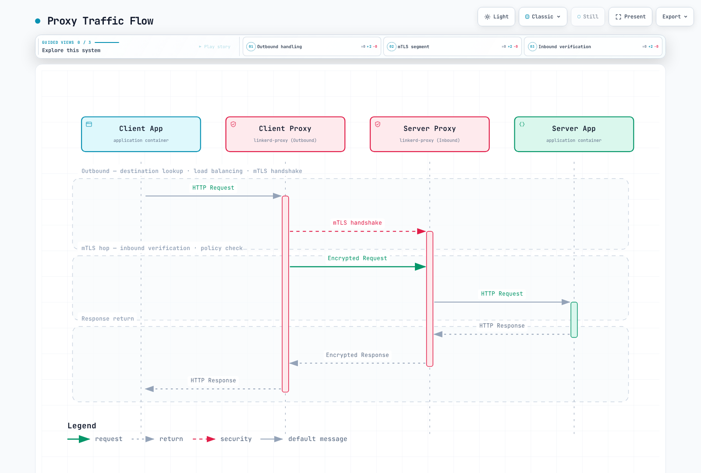
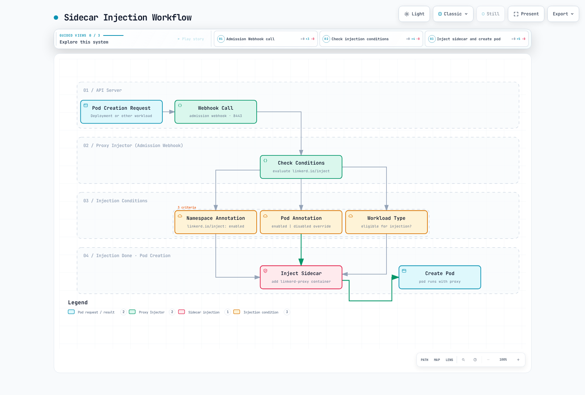

# Arquitectura de Linkerd

> **Última actualización**: 16 de octubre de 2026 · Linkerd edge-26.10.1 / proxy release/v2.370.0

Este capítulo explica las funciones actuales de los componentes, la jerarquía de identidades, la captura del tráfico y el ciclo de vida de la inyección. Consulta la [guía de instalación](01-installation.md) para ver la combinación compatible de versiones y clúster, así como los artefactos fijados. Los siguientes ejemplos ilustran configuraciones; en esta revisión no se realizó ningún despliegue real ni rotación de la CA.

## Arquitectura general


[Ver el diagrama interactivo](https://www.atomai.click/kubernetes-docs/archmaps/en-service-mesh-linkerd-02-architecture-0.html)

El espacio de nombres predeterminado del plano de control es linkerd. El chart fijado incluye tres implementaciones principales: linkerd-destination, linkerd-identity y linkerd-proxy-injector. Destination también contiene los contenedores del controlador de políticas y del validador de ServiceProfile; las funciones lógicas de los controladores no equivalen a implementaciones independientes. Los componentes opcionales Viz y multiclúster tienen ciclos de vida propios.

El plano de datos utiliza proxies Rust junto a las aplicaciones incorporadas a la malla. Los sidecars nativos son los predeterminados en esta versión. La implementación de Identity utiliza deliberadamente un proxy regular con la espera de inicio deshabilitada, por lo que al inspeccionarla hay que tener en cuenta ambos contenedores y los contenedores de inicialización.

## Plano de control

### Controlador Destination

Destination observa el estado de descubrimiento y, mediante API de streaming, proporciona direcciones de endpoints, identidades esperadas e información de perfiles. La configuración predeterminada actual utiliza EndpointSlices. ServiceProfile sigue siendo un mecanismo de configuración anterior; el enrutamiento y la autorización de Gateway API también involucran al controlador de políticas. No describas el enrutamiento actual de Linkerd como si dependiera solo de SMI TrafficSplit ni supongas que Destination observa directamente los recursos de esa extensión heredada.

| Responsabilidad | Significado |
|---|---|
| Descubrimiento | Altas y bajas de endpoints, y metadatos del Service solicitado |
| Identidad esperada | Información que el proxy saliente utiliza para autenticar al par seleccionado |
| Perfiles | Configuración de rutas y perfiles compatible para métricas, reintentos y tiempos de espera |
| Datos para el balanceo de carga | Información de endpoints y pesos configurados; las observaciones de latencia y la selección de solicitudes/conexiones en tiempo de ejecución ocurren en el proxy |

Este fragmento es un **extracto de un servicio Protocol Buffers**, no código fuente de Go. Las definiciones de mensajes y las importaciones se encuentran en la API fijada del proxy:

```protobuf
// Excerpt: message definitions/imports are in the linked API source.
service Destination {
  rpc Get(GetDestination) returns (stream Update) {}
  rpc GetProfile(GetDestination) returns (stream DestinationProfile) {}
}
```

Get transmite actualizaciones de Destination; GetProfile transmite actualizaciones de perfiles. Ni un flujo ni una caché local hacen que los cambios de configuración sean instantáneos o eliminan la necesidad de gestionar endpoints no disponibles.

### Controlador Identity

El flujo predeterminado de identidad de Kubernetes es el siguiente:

1. Al iniciarse, el proxy establece el material local de clave privada y CSR.
2. El cliente de identidad envía el CSR, la identidad solicitada y el token de ServiceAccount.
3. Identity valida el token mediante TokenReview de Kubernetes y deriva la identidad con formato DNS.
4. La **credencial de firma del emisor** configurado, normalmente el emisor intermedio, firma el certificado de la carga de trabajo.
5. El cliente carga el certificado y la cadena recibidos, y los renueva antes de que caduquen.

El ancla de confianza es la base para validar la cadena. El controlador de identidad de Linkerd no necesita su clave privada; la raíz no actúa como firmante en línea de cada CSR de las cargas de trabajo.

El siguiente fragmento de valores de Helm es para el responsable de la instalación:

```yaml
identity:
  issuer:
    issuanceLifetime: 24h0m0s
    clockSkewAllowance: 20s
    scheme: linkerd.io/tls
```

linkerd.io/tls es el esquema de emisor predeterminado. La integración kubernetes.io/tls utiliza el formato correspondiente de Secret administrado externamente. No cambies el esquema a menos que coincidan el responsable de la credencial y las claves; tampoco sobrescribas toda la entrada values de linkerd-config con un ConfigMap parcial de identidad.

### Inyector de proxies


[Ver el diagrama interactivo](https://www.atomai.click/kubernetes-docs/archmaps/en-service-mesh-linkerd-02-architecture-3.html)

El inyector es un webhook de admisión mutante. Su respuesta describe las mutaciones que aplica el servidor de API; el diagrama es conceptual, no un ejemplo del formato de transmisión. También se aplican la selección real del webhook, las anulaciones del Pod y los requisitos de compatibilidad de la plataforma.

Habilita un espacio de nombres seleccionado:

```yaml
apiVersion: v1
kind: Namespace
metadata:
  name: my-app
  annotations:
    linkerd.io/inject: enabled
```

En un Deployment, coloca las anulaciones en la **plantilla del Pod**. Este fragmento se inserta dentro de la definición existente de la carga de trabajo:

```yaml
spec:
  template:
    metadata:
      annotations:
        linkerd.io/inject: enabled
        config.linkerd.io/proxy-cpu-request: 100m
        config.linkerd.io/proxy-memory-request: 64Mi
        config.linkerd.io/proxy-cpu-limit: '1'
        config.linkerd.io/proxy-memory-limit: 250Mi
        config.linkerd.io/proxy-log-level: warn,linkerd=info
```

Utiliza un único valor literal —enabled o disabled—, no enabled|disabled. Añadir una anotación no modifica los Pods existentes. El webhook instalado excluye determinados espacios de nombres del sistema, y las anulaciones explícitas del Pod pueden deshabilitar una inyección que de otro modo estaría habilitada.

| Elemento inyectado o configurado | Función |
|---|---|
| linkerd-init | Configuración de la captura de tráfico de red del Pod cuando no se utiliza Linkerd CNI |
| linkerd-proxy | Proxy del plano de datos, normalmente un contenedor de inicialización reiniciable en esta versión |
| Token de identidad proyectado y almacenamiento local de identidad | Arranque y uso del certificado de la carga de trabajo; la clave del proxy no se distribuye como un Secret compartido de la carga de trabajo |
| Entorno, sondas y recursos | Configuración de ejecución específica de la versión que genera la inyección |

### Controlador de políticas

Policy controla la autorización del tráfico entrante y el comportamiento compatible del tráfico saliente y el enrutamiento de solicitudes. Este ejemplo selecciona Pods con la etiqueta app:web y un puerto declarado llamado http; además, autoriza el ServiceAccount api-gateway del espacio de nombres my-app, incorporado a la malla:

```yaml
apiVersion: policy.linkerd.io/v1beta3
kind: Server
metadata:
  name: web-http
  namespace: my-app
spec:
  podSelector:
    matchLabels:
      app: web
  port: http
  proxyProtocol: HTTP/1
  accessPolicy: deny
---
apiVersion: policy.linkerd.io/v1alpha1
kind: AuthorizationPolicy
metadata:
  name: web-api-gateway
  namespace: my-app
spec:
  targetRef:
    group: policy.linkerd.io
    kind: Server
    name: web-http
  requiredAuthenticationRefs:
  - kind: ServiceAccount
    name: api-gateway
```

Un Server selecciona pares existentes de Pod y puerto; no crea una aplicación, un Service ni un listener. El puerto con nombre debe existir. El tráfico seleccionado se deniega de forma predeterminada, salvo que lo permita una política aplicable o una política de acceso alternativa seleccionada explícitamente. Prepara y prueba el ámbito de la política antes de aplicarla.

AuthorizationPolicy puede seleccionar un Server o una ruta compatible. Las referencias a ServiceAccount son un requisito de autenticación práctico; MeshTLSAuthentication y NetworkAuthentication expresan conjuntos adicionales de identidades y redes. Todas las referencias de autenticación requeridas dentro de una política deben coincidir; revisa también otras políticas que puedan autorizar el tráfico.

Para un flujo de trabajo existente con ServerAuthorization, esta es una **alternativa** compatible, no un requisito adicional que se aplique junto con la autorización anterior:

```yaml
apiVersion: policy.linkerd.io/v1beta1
kind: ServerAuthorization
metadata:
  name: web-authz-legacy
  namespace: my-app
spec:
  server:
    name: web-http
  client:
    meshTLS:
      serviceAccounts:
      - name: api-gateway
        namespace: my-app
```

Los CRD publicados sirven ServerAuthorization v1beta1, no v1beta2 como en el ejemplo original. Server v1beta2 sigue estando disponible; el ejemplo utiliza su versión de almacenamiento actual, v1beta3. AuthorizationPolicy es la interfaz preferida y más flexible. No confundas estos recursos de Linkerd con los recursos de nombre parecido de Istio, que pertenecen a otro grupo de API.

## Plano de datos

### Comportamiento del proxy y ámbito de los protocolos

linkerd2-proxy está escrito en Rust y diseñado específicamente para la malla. Admite HTTP/1.1, HTTP/2, gRPC y TCP. El enrutamiento y las métricas de HTTP requieren que el tráfico HTTP sea visible; el TLS que origina la aplicación es opaco, y el tráfico UDP/QUIC o el tráfico que se excluye no pasa por la ruta del proxy TCP.

Para pares TCP aptos dentro de la malla, Linkerd proporciona mTLS de transporte. El transporte documentado de la malla utiliza TLS 1.3; el paso directo del TLS originado por la aplicación es una capa distinta. También hay que tener en cuenta por separado los pares ajenos a la malla y las anulaciones explícitas de la captura. La política de entrada predeterminada acepta tráfico en texto plano procedente de pares ajenos a la malla; mTLS automático no equivale a exigir acceso autenticado desde todos los orígenes.

El proxy utiliza balanceo basado en la latencia para las solicitudes HTTP y balanceo por conexión para el TCP opaco. Los pesos de endpoints y las reglas de enrutamiento son distintos de las estimaciones de latencia en tiempo de ejecución. No interpretes EWMA como una garantía de que cada solicitud vaya a un endpoint que sea, de forma determinista, el más rápido.

No hay una garantía universal de 10 MB de memoria, p99 <1 ms ni de un tamaño binario fijo. Las mediciones dependen de la versión y compilación, la arquitectura, el número de conexiones, las políticas y la configuración, la carga de trabajo y la instrumentación.

### Flujo de tráfico del proxy



[Ver el diagrama interactivo](https://www.atomai.click/kubernetes-docs/archmaps/en-service-mesh-linkerd-02-architecture-5.html)

El descubrimiento, enrutamiento y balanceo salientes, los reintentos y los tiempos de espera son distintos de la autorización entrante. Una conexión nueva puede realizar el descubrimiento y establecer mTLS; las conexiones existentes y la configuración almacenada en caché se pueden reutilizar. El comportamiento seguro de los reintentos de solicitudes sigue siendo una decisión de la aplicación y el protocolo, especialmente para las escrituras.

### Captura de tráfico: linkerd-init o CNI

Utiliza la configuración generada de proxy-init o Linkerd CNI. El siguiente orden es conceptual, **no son comandos de iptables del host que se deban ejecutar**:

```text
Inside the Pod network namespace:
  outbound TCP -> evaluate proxy-UID and configured bypass rules first
               -> redirect intercepted traffic to the outbound proxy (default 4140)
  inbound TCP  -> evaluate configured bypass rules
               -> redirect intercepted traffic to the inbound proxy (default 4143)

Linkerd CNI: installs the Linkerd-specific capture setup through the CNI chain.
linkerd-init: performs the setup at Pod startup when Linkerd CNI is not used.
```

El ejemplo anterior añadía la excepción del UID del proxy después de una regla REDIRECT para todo el tráfico TCP, por lo que no protegía el propio tráfico saliente del proxy. Aplicar esas reglas en el espacio de nombres del host tampoco configura Linkerd específicamente para el Pod. La implementación real incluye cadenas y exclusiones adicionales, y admite los modos de iptables configurados.

Los puertos opacos omiten la detección del protocolo, pero conservan el tratamiento del transporte por el proxy. Los puertos excluidos evitan el proxy y sus funciones de malla. Para el tráfico en el que el servidor habla primero, no uses la exclusión como sustituto de una configuración correcta de puertos opacos y protocolos.

### Inspecciona el Pod generado en vez de construir el proxy manualmente

Al Pod que se ensamblaba manualmente le faltaba material de identidad y arranque, y se basaba en la suposición de que existía una imagen upstream stable-2.16.0, que no está disponible. Genera o inspecciona la configuración con la CLI seleccionada y la configuración instalada del plano de control:

```bash
# The input is a complete, reviewed application manifest.
# Default mode adds the injection annotation for server-side admission.
linkerd inject web.yaml > web-annotated.yaml

# Manual mode materializes the proxy spec using the selected cluster configuration.
# Review/remove conflicting input config annotations before selecting CLI flags.
linkerd inject --manual --native-sidecar \
  --proxy-cpu-request 100m --proxy-memory-request 64Mi \
  --proxy-cpu-limit 1 --proxy-memory-limit 250Mi \
  web.yaml > web-manually-injected.yaml
```

El modo predeterminado de inyección es una transformación de anotaciones. En edge-26.9.1, la generación manual también utiliza las anotaciones de configuración que ya existan en la entrada: una anotación observada de solicitud de CPU de 700m tuvo prioridad sobre una opción de CLI de 100m y también se aplicó una anotación de nivel de registro de entrada. Actualiza o elimina las entradas en conflicto e inspecciona los campos resultantes del proxy. Los cambios posteriores en las anotaciones no regeneran automáticamente un proxy materializado de forma manual; actualiza la carga de trabajo generada mediante el controlador que la administra, en lugar de copiar un contenedor abreviado como si fuera una instalación completa.

```bash
: "${APP_POD:?Set an application Pod name in my-app}"
kubectl -n my-app get pod "$APP_POD" -o json |
  jq '{pod: .metadata.name, proxies: ([.spec.containers[]?, .spec.initContainers[]?] | map(select(.name == "linkerd-proxy") | {image, restartPolicy, resources, startupProbe, readinessProbe, livenessProbe}))}'
```

Los sidecars nativos aparecen en initContainers con restartPolicy: Always. Si se configura la ruta CNI, se omite el contenedor linkerd-init. Los endpoints de salud del proxy son /live y /ready en el puerto de administración configurado (4191 de forma predeterminada); el comportamiento nativo de inicio y disponibilidad es independiente de la disponibilidad de la aplicación.

## Jerarquía de certificados

| Material | Función y almacenamiento predeterminados |
|---|---|
| Certificado o paquete del ancla de confianza | Base pública de confianza; ConfigMap linkerd-identity-trust-roots, ca-bundle.crt |
| Clave privada de la CA raíz | Material del responsable de PKI; Linkerd no necesita la clave para funcionar |
| Certificado y clave privada del emisor | Secret linkerd-identity-issuer; el formato predeterminado utiliza crt.pem/key.pem |
| Integración de emisor TLS de Kubernetes | Alternativa configurada deliberadamente que utiliza tls.crt/tls.key y el esquema correspondiente |
| Clave y certificado de carga de trabajo | Credencial local del proxy; validez nominal del certificado de 24 h y renovación automática |

La validez del emisor y el ancla de confianza depende de la PKI configurada. Las raíces y los emisores que genera la CLI de forma predeterminada tienen una validez de un año; un ejemplo personalizado de diez años no es un valor predeterminado ni una recomendación universal. Inspecciona las fechas reales de los certificados en vez de copiar una marca temporal fija de ejemplo.

### Identidad de cargas de trabajo de Kubernetes

Con el mecanismo predeterminado de identidad de Kubernetes, la identidad tiene formato DNS:

```text
<service-account>.<namespace>.serviceaccount.identity.<linkerd-namespace>.<identity-trust-domain>

web-service.my-app.serviceaccount.identity.linkerd.cluster.local
```

Varios Pods que utilizan el mismo ServiceAccount comparten esta identidad, pero conservan sus propias credenciales locales. El dominio de confianza de la identidad es un concepto configurable y no necesariamente coincide con un sufijo DNS de Kubernetes modificado.

La cadena spiffe://root.linkerd.cluster.local/ns/.../sa/... del ejemplo original no era el formato predeterminado de identidad de Kubernetes. Las identidades basadas en SPIFFE/SPIRE son compatibles con una [ruta distinta para ampliar la malla a cargas de trabajo externas](https://linkerd.io/docs/tasks/adding-non-kubernetes-workloads/); no sustituyas TokenReview de Kubernetes por su modelo de identidad y arranque.

### Renovación y rotación

En proxy release/v2.370.0, el cliente de identidad normalmente programa el siguiente intento de obtener un certificado cuando ha transcurrido el 70 % de la validez **restante**, dentro de los intervalos mínimo y máximo de actualización configurados. Las rutas de error o caducidad pueden utilizar el retraso mínimo. No es una garantía de tiempo fija para todos los certificados.

Al solicitar certificados renovados, el cliente reutiliza los documentos de clave y CSR que tiene cargados. Renovar un certificado no es lo mismo que rotar la clave privada, el emisor o el ancla de confianza.

```bash
set -euo pipefail
kubectl -n linkerd get configmap linkerd-identity-trust-roots \
  -o jsonpath='{.data.ca-bundle\.crt}' > trust-bundle.pem
openssl crl2pkcs7 -nocrl -certfile trust-bundle.pem |
  openssl pkcs7 -print_certs -text -noout
kubectl -n linkerd get secret linkerd-identity-issuer -o json |
  jq -er '.data["crt.pem"] // .data["tls.crt"]' |
  base64 -d | openssl x509 -noout -dates
```

Una transición completa del ancla de confianza consta de varias fases:

1. Haz inventario de las raíces válidas actuales, el emisor, todos los consumidores y los responsables de la instalación y la PKI.
2. Añade la nueva raíz junto a la anterior mediante la configuración de su responsable. Comprueba que los proxies y componentes del plano de control afectados, además de los pares multiclúster, carguen realmente el paquete con ambas raíces.
3. Rota el emisor a una credencial firmada por la nueva raíz y confirma que el servicio de identidad la haya cargado.
4. Renueva o vuelve a crear los consumidores según lo requiera su fuente de configuración; verifica las credenciales nuevas y el tráfico mTLS real en las rutas afectadas.
5. Elimina la raíz anterior solo cuando ningún par necesario dependa de ella, distribuye el paquete final y vuelve a verificar.

La antigua actualización del ConfigMap seguida del reinicio de un espacio de nombres terminaba antes de rotar el emisor y eliminar la raíz antigua; no era un procedimiento de rotación completo. Evita los cambios directos que entren en conflicto con la administración de Helm, cert-manager o trust-manager. Si una raíz ya ha caducado, se necesita un procedimiento de recuperación, no una sustitución normal de una raíz válida.

```bash
linkerd check
linkerd check --proxy
kubectl -n linkerd get events --field-selector reason=IssuerUpdated
# Inspect each affected namespace/workload and its actual proxy version/identity.
kubectl -n my-app get pods -o wide
```

Un evento IssuerUpdated es una observación, no una prueba de que todos los proxies o clústeres remotos hayan completado la transición. cert-manager puede automatizar la renovación del emisor y trust-manager puede distribuir paquetes, pero el cambio de raíz aún necesita una verificación coordinada. Sigue el flujo [manual](https://linkerd.io/docs/tasks/manually-rotating-control-plane-tls-credentials/) o el de [credenciales administradas](https://linkerd.io/docs/tasks/automatically-rotating-control-plane-tls-credentials/) para el diseño de PKI real; en este capítulo no se realizó ninguna rotación.

## Detalles de la inyección de sidecars



[Ver el diagrama interactivo](https://www.atomai.click/kubernetes-docs/archmaps/en-service-mesh-linkerd-02-architecture-8.html)

Para las cargas de trabajo administradas por controladores, utiliza anotaciones en la plantilla del Pod e inspecciona los Pods resultantes. Las claves de metadatos duplicadas dentro de un mismo mapa YAML se sobrescriben o entran en conflicto; mantén los ejemplos de espacios de nombres y cargas de trabajo como recursos o fragmentos separados.

Las anotaciones de recursos y registros mostradas antes definen las solicitudes y los límites previstos para el proxy, así como la configuración de registros. No son mediciones del consumo real. Las anulaciones de puertos opacos sustituyen la lista de puertos predeterminada; no se limitan a añadir dos puertos de base de datos. Conserva todos los puertos necesarios. Las anulaciones de puertos excluidos retiran intencionalmente el tráfico de la malla.

## Comunicación entre componentes


[Ver el diagrama interactivo](https://www.atomai.click/kubernetes-docs/archmaps/en-service-mesh-linkerd-02-architecture-9.html)

| Componente o ruta | Puerto predeterminado | Protocolo o propósito |
|---|---|---|
| Service Destination | 8086 | gRPC de streaming para descubrimiento y perfiles |
| Service Identity | 8080 | gRPC de la API de certificados |
| Service Policy | 8090 | gRPC de políticas |
| Inyector de proxies | Service 443 → Pod 8443 | Webhook de admisión HTTPS |
| Entrada del proxy | 4143 | TCP interceptado, incluido HTTP/gRPC o tráfico opaco |
| Salida del proxy | 4140 | TCP saliente interceptado |
| Administración del proxy | 4191 | Endpoints HTTP de métricas y estado |

Estos puertos se pueden configurar y no establecen una regla general de acceso a la red. El endpoint de administración no es una interfaz de configuración de enrutamiento al estilo de Envoy; las políticas y la configuración se distribuyen mediante las API del plano de control.

## Comparación con la arquitectura de Istio

| Aspecto | Linkerd | Istio |
|---|---|---|
| Empaquetado del plano de control | Tres implementaciones principales en esta versión, con varios controladores lógicos | Istiod unificado para las funciones principales de control, más componentes específicos de cada modo |
| Plano de datos | Proxies Rust diseñados para la malla | Sidecars Envoy o ztunnel de ambient con waypoints seleccionados |
| Configuración | API gRPC de streaming de Linkerd y sus recursos compatibles | xDS para Envoy y configuración compatible de Istio/Gateway API |
| Extensiones | Comprueba las funciones y API compatibles de Linkerd | Comprueba la compatibilidad y la asociación de Envoy/Wasm/Lua específicas del modo y la versión |
| Comparación de recursos y rendimiento | Mide cargas de trabajo equivalentes con su configuración real | Mide cargas de trabajo equivalentes con su configuración real |

xDS también utiliza gRPC habitualmente; el nombre del protocolo no indica por sí solo una mayor complejidad. El número de CRD varía según las versiones y extensiones, y no mide la sobrecarga en tiempo de ejecución. Las solicitudes y los límites son reservas y topes configurados, no medidas de memoria o latencia observadas. Antes de elegir, compara la misma carga de trabajo, tráfico, protocolo, políticas y presupuesto de fallos; consulta la [comparación mantenida](../istio/comparison/README.md).

## Siguientes pasos y fuentes

- [Gestión del tráfico](03-traffic-management.md), [Seguridad](04-security.md), [Observabilidad](05-observability.md)
- [Cuestionario de arquitectura](../../quizzes/service-mesh/linkerd/architecture.md)
- [Arquitectura oficial](https://linkerd.io/docs/reference/architecture/), [inyección](https://linkerd.io/docs/features/proxy-injection/) y [referencia de políticas](https://linkerd.io/docs/reference/authorization-policy/)
- [mTLS automático](https://linkerd.io/docs/features/automatic-mtls/), [gestión de protocolos](https://linkerd.io/docs/features/protocol-detection/) y [balanceo de carga](https://linkerd.io/docs/features/load-balancing/)
- [API Destination fijada](https://github.com/linkerd/linkerd2-proxy-api/blob/v0.20.0/proto/destination.proto)
- [Validación de tokens de Kubernetes](https://github.com/linkerd/linkerd2/blob/edge-26.10.1/controller/identity/validator.go) y [formato de identidad](https://github.com/linkerd/linkerd2/blob/edge-26.10.1/controller/identity/domain.go)
- [Implementación fijada de actualización de certificados](https://github.com/linkerd/linkerd2-proxy/blob/0cdcc078e66eb27c79b9dfc030fc660042716d31/linkerd/proxy/identity-client/src/certify.rs)
