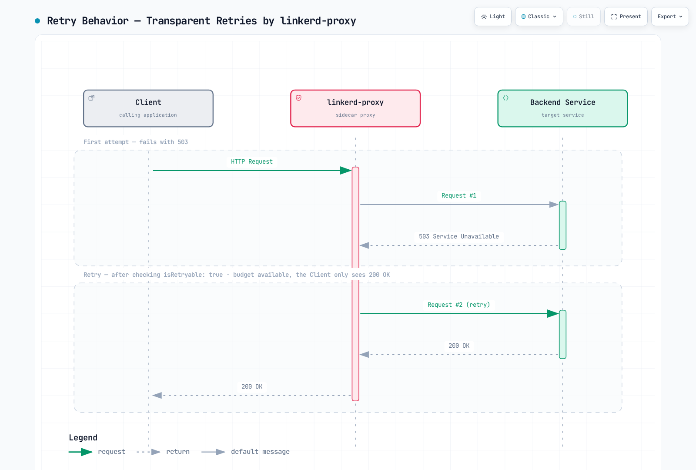
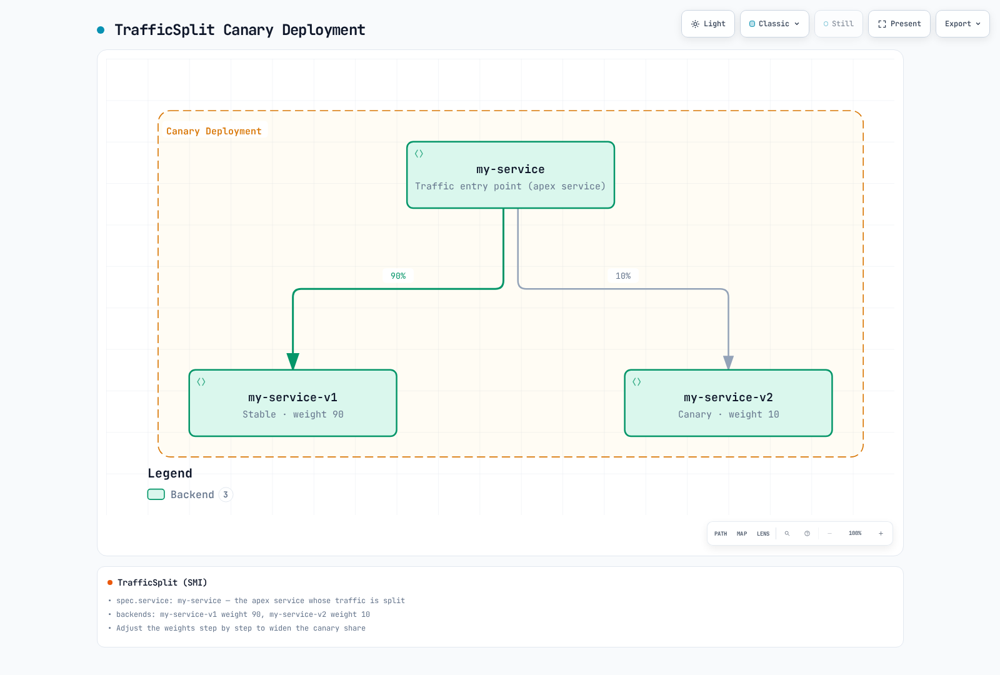

# Gestión del tráfico de Linkerd

> **Última actualización**: 16 de octubre de 2026 · Linkerd edge-26.10.1 · Gateway API 1.5.1 · Flagger 1.45.0

El enrutamiento actual de Linkerd utiliza recursos de Gateway API y las anotaciones compatibles. ServiceProfile mantiene la compatibilidad con la configuración anterior; TrafficSplit y linkerd-smi están obsoletos. Estas opciones no son intercambiables: un ServiceProfile existente tiene prioridad sobre los HTTPRoutes de salida del mismo Service e impide que se aplique la configuración más reciente de reintentos, tiempos de espera y detección de fallos acumulados.

Los ejemplos siguientes son ejercicios independientes para aplicaciones existentes y probadas. Requieren los [requisitos previos de instalación](01-installation.md), la incorporación adecuada de los namespaces a la malla, la declaración de los puertos de los Services y contenedores, y endpoints disponibles. Durante esta revisión no se instaló ningún clúster ni se modificó la distribución del tráfico ni se ejecutaron pruebas con carga de producción.

## Arquitectura de gestión del tráfico

| Configuración de la política | Función prevista | Limitación importante |
|---|---|---|
| HTTPRoute vinculado a un Service padre | Enrutamiento y fiabilidad de salida para clientes de la malla | El cliente debe estar incorporado a la malla y poder inspeccionar HTTP |
| HTTPRoute vinculado a un Server padre | Coincidencias para la autorización de entrada | La vinculación y la función de la política son diferentes |
| ServiceProfile | Métricas, reintentos y tiempos de espera de la configuración anterior de rutas | Tiene prioridad sobre la configuración más reciente del mismo Service |
| TrafficSplit | Enrutamiento ponderado mediante SMI heredado | Requiere su extensión y sus CRDs obsoletos |

Las políticas basadas en Services dependen del descubrimiento de servicios. Las conexiones directas a IP de Pods, los Services headless, los clientes fuera de la malla y el tráfico TLS opaco iniciado por la aplicación no reciben automáticamente el mismo comportamiento de L7. Gestione por separado la identidad, la autorización y el enrutamiento.

## Enrutamiento actual con HTTPRoute

### Services y enrutamiento ponderado

Para este ejercicio, prepare Deployments estables y canary con las etiquetas app:web y version:stable/canary, que escuchen en el puerto 8080 y tengan comprobaciones de disponibilidad adecuadas para la carga de trabajo. El namespace siguiente incorpora a la malla los nuevos Pods que cumplan los requisitos; no despliega las aplicaciones:

```yaml
apiVersion: v1
kind: Namespace
metadata:
  name: route-demo
  annotations:
    linkerd.io/inject: enabled
---
apiVersion: v1
kind: Service
metadata:
  name: web
  namespace: route-demo
spec:
  selector:
    app: web
    version: stable
  ports:
  - name: http
    port: 80
    targetPort: 8080
    appProtocol: http
---
apiVersion: v1
kind: Service
metadata:
  name: web-stable
  namespace: route-demo
spec:
  selector:
    app: web
    version: stable
  ports:
  - name: http
    port: 80
    targetPort: 8080
    appProtocol: http
---
apiVersion: v1
kind: Service
metadata:
  name: web-canary
  namespace: route-demo
spec:
  selector:
    app: web
    version: canary
  ports:
  - name: http
    port: 80
    targetPort: 8080
    appProtocol: http
```

El Service principal, o apex, selecciona Pods **estables** para el enrutamiento predeterminado de Kubernetes. Su selector sigue siendo necesario: el tráfico de clientes fuera de la malla o no sujeto a la política debe tener un backend elegido expresamente. El HTTPRoute dirige el tráfico de los clientes de la malla al que se aplica la política hacia los Services de backend:

```yaml
apiVersion: gateway.networking.k8s.io/v1
kind: HTTPRoute
metadata:
  name: web-route
  namespace: route-demo
spec:
  parentRefs:
  - group: ''
    kind: Service
    name: web
    port: 80
  rules:
  - backendRefs:
    - name: web-stable
      port: 80
      weight: 90
    - name: web-canary
      port: 80
      weight: 10
```

group:"" identifica el grupo principal de la API de Kubernetes en las referencias a Services. Linkerd conserva el alias heredado core en algunas configuraciones, pero los recursos portables de Gateway API deben utilizar el grupo vacío. El puerto 80 de la referencia corresponde al Service, no al puerto 8080 del contenedor.

Los pesos son valores relativos no negativos cuya suma debe ser positiva y utilizable. 90/10 y 9/1 expresan la misma proporción; no es necesario que sumen 100. Configuran el enrutamiento, pero no garantizan un número exacto de solicitudes en periodos cortos, el mismo reparto de conexiones ni una cantidad equivalente de réplicas.

```bash
kubectl -n route-demo get httproute web-route -o yaml
kubectl -n route-demo get endpointslices.discovery.k8s.io \
  -l kubernetes.io/service-name=web-stable -o yaml
linkerd diagnostics policy -n route-demo svc/web 80 -o json
linkerd viz stat deploy/client -n route-demo --to svc/web
linkerd viz stat pods -n route-demo
```

Revise las condiciones Accepted/ResolvedRefs de la ruta, la política efectiva del controlador y el tráfico real de los clientes. Consultar la política del controlador no demuestra que todos los proxies ya la hayan aplicado.

### Cabeceras y rutas

El siguiente ejemplo **sustituye web-route por una configuración alternativa**: añade una regla para una cabecera que identifica al grupo canary antes de la regla ponderada predeterminada:

```yaml
apiVersion: gateway.networking.k8s.io/v1
kind: HTTPRoute
metadata:
  name: web-route
  namespace: route-demo
spec:
  parentRefs:
  - group: ''
    kind: Service
    name: web
    port: 80
  rules:
  - matches:
    - headers:
      - name: x-release-track
        type: Exact
        value: canary
    backendRefs:
    - name: web-canary
      port: 80
  - backendRefs:
    - name: web-stable
      port: 80
      weight: 90
    - name: web-canary
      port: 80
      weight: 10
```

Los valores de las cabeceras no acreditan una identidad autenticada. Un cliente no confiable puede establecer x-release-track o x-debug; los backends privilegiados o de depuración requieren una autorización independiente. La coincidencia exacta con Cookie:beta=true exige que ese sea el valor completo de la cabecera, no que la cookie aparezca entre otros pares. Normalice una señal de grupo autorizada o analice las cookies de forma explícita; una coincidencia exacta de cabecera no implementa por sí sola el comportamiento general de las cookies.

Un ejemplo de enrutamiento por ruta para Services preparados por separado:

```yaml
apiVersion: gateway.networking.k8s.io/v1
kind: HTTPRoute
metadata:
  name: frontend-paths
  namespace: route-demo
spec:
  parentRefs:
  - group: ''
    kind: Service
    name: frontend
    port: 80
  rules:
  - matches:
    - path:
        type: PathPrefix
        value: /api
    backendRefs:
    - name: api-service
      port: 80
  - matches:
    - path:
        type: PathPrefix
        value: /static
    backendRefs:
    - name: static-service
      port: 80
  - backendRefs:
    - name: web-stable
      port: 80
```

Las condiciones de una misma entrada se combinan con AND. Las entradas o reglas alternativas y las rutas que compiten entre sí siguen la precedencia de Gateway API. No suponga que el orden en un archivo resuelve por sí solo los conflictos entre distintos objetos HTTPRoute.


## Reintentos y tiempos de espera

Los reintentos se habilitan explícitamente para el tráfico de salida; no garantizan que una solicitud fallida se recupere. Utilícelos solo cuando sea seguro repetir la operación concreta. Un reinicio de conexión, un error o un tiempo de espera agotado pueden dejar incierto el resultado de una escritura en el servidor. Controle por separado la idempotencia de la aplicación y los reintentos del cliente.

Para un Service api existente en retry-demo, estos dos recursos configuran reintentos únicamente para GET /api/read y sus rutas descendientes, y una ruta predeterminada que reenvía las demás solicitudes:

```yaml
apiVersion: gateway.networking.k8s.io/v1
kind: HTTPRoute
metadata:
  name: api-read
  namespace: retry-demo
  annotations:
    retry.linkerd.io/http: gateway-error
    retry.linkerd.io/limit: '2'
    retry.linkerd.io/timeout: 400ms
    timeout.linkerd.io/request: 2s
spec:
  parentRefs:
  - group: ''
    kind: Service
    name: api
    port: 80
  rules:
  - matches:
    - method: GET
      path:
        type: PathPrefix
        value: /api/read
    backendRefs:
    - name: api
      port: 80
---
apiVersion: gateway.networking.k8s.io/v1
kind: HTTPRoute
metadata:
  name: api-default
  namespace: retry-demo
spec:
  parentRefs:
  - group: ''
    kind: Service
    name: api
    port: 80
  rules:
  - matches:
    - path:
        type: PathPrefix
        value: /
    backendRefs:
    - name: api
      port: 80
```

Este ejemplo requiere **que el Service padre no tenga anotaciones de reintentos**, que no exista un ServiceProfile en conflicto y que no se habiliten cambios de política por solicitud procedentes de clientes no confiables. De lo contrario, la ruta predeterminada puede heredar reintentos. Revise la política efectiva y mida por separado las solicitudes de escritura: reenviar una escritura no demuestra que todas las capas hayan deshabilitado los reintentos.

Las anotaciones permiten como máximo dos reintentos, es decir, hasta tres intentos en total, con un tiempo de espera de 400 ms para cada intento reintentable y de 2 s para la solicitud completa. El plazo total incluye los intentos y puede terminar la operación antes de que se realicen todos los reintentos. En la referencia actual, no se reintentan las solicitudes cuyo cuerpo supera 64 KiB.

**No utilice retry.linkerd.io/limit:"0" para deshabilitar los reintentos en edge-26.10.1.** Consulte el [analizador de la versión publicada](https://github.com/linkerd/linkerd2/blob/edge-26.10.1/policy-controller/k8s/index/src/outbound/index/http.rs). El analizador interpreta el cero como un valor no especificado; si hay condiciones de reintento, aplica un reintento de forma predeterminada. Una cadena vacía de condiciones de reintento HTTP tampoco es una política compatible para deshabilitarlos. Mantenga los Services que atienden distintos métodos sin una configuración predeterminada de reintentos y habilítelos únicamente en las rutas de lectura previstas.

Las anotaciones de reintento de una ruta sustituyen, en conjunto, la configuración de reintentos del Service. Las anotaciones de tiempo de espera de la ruta sustituyen de forma similar las del Service. ServiceProfile tiene prioridad sobre estas anotaciones. Linkerd puede respetar las cabeceras l5d-* de cada solicitud si se habilita esa opción expresamente; no permita que clientes no confiables cambien la política mediante ellas ni las utilice como autenticación.

### Alcance de los tiempos de espera

| Configuración | Alcance |
|---|---|
| timeout.linkerd.io/request | Flujo completo de solicitud y respuesta |
| timeout.linkerd.io/response | Duración de la respuesta del backend mientras está en curso |
| timeout.linkerd.io/idle | Inactividad del flujo |
| retry.linkerd.io/timeout | Tiempo de espera de un intento reintentable, sujeto a la política y al límite de reintentos |
| Tiempo de espera de una ruta de ServiceProfile | Espera total de la ruta heredada, incluidos los reintentos |

Los tiempos de espera de solicitud, respuesta e inactividad son distintos del tiempo de espera de los intentos reintentables. Agotar un tiempo de espera no demuestra que se haya cancelado el trabajo de negocio. Una vez iniciado el envío de las cabeceras o del cuerpo de la respuesta, un fallo puede cerrar o reiniciar el flujo en lugar de generar una nueva respuesta de error HTTP.


[Ver diagrama interactivo](https://www.atomai.click/kubernetes-docs/archmaps/en-service-mesh-linkerd-03-traffic-management-2.html)

No asigne tiempos de 5, 60 o 600 segundos únicamente porque la operación se describa como «síncrona», «asíncrona» o «carga de archivos». Parta del plazo total de la aplicación, del procesamiento o la transmisión esperados y del comportamiento de cancelación del cliente y del servidor. Omitir el tiempo de espera de una política no elimina los demás límites de la aplicación, el transporte, el proxy o el balanceador de carga.

## ServiceProfiles: configuración de compatibilidad admitida

ServiceProfile sigue siendo compatible, pero el desarrollo de funciones nuevas utiliza la configuración de Gateway API. Este **ejercicio independiente en profile-demo** muestra condiciones válidas para rutas heredadas y la desactivación explícita de reintentos para escrituras:

```yaml
apiVersion: linkerd.io/v1alpha2
kind: ServiceProfile
metadata:
  name: api.profile-demo.svc.cluster.local
  namespace: profile-demo
spec:
  routes:
  - name: read-users
    condition:
      all:
      - method: GET
      - pathRegex: ^/api/users(/.*)?$
    isRetryable: true
    timeout: 5s
  - name: write-api
    condition:
      all:
      - any:
        - method: POST
        - method: PUT
        - method: PATCH
        - method: DELETE
      - pathRegex: ^/api/.*$
    isRetryable: false
    timeout: 10s
  - name: health
    condition:
      all:
      - method: GET
      - pathRegex: ^/(health|ready|live)$
    isRetryable: false
    timeout: 1s
  - name: stream
    condition:
      all:
      - method: GET
      - pathRegex: ^/stream$
    isRetryable: false
  retryBudget:
    retryRatio: 0.2
    minRetriesPerSecond: 10
    ttl: 10s
```

method exige un método HTTP exacto, no una expresión regular. POST|PUT|DELETE no representa una unión de métodos. Utilice condiciones explícitas any/all o rutas independientes, e incluya PATCH cuando corresponda. La selección de rutas y la clasificación de respuestas deben ajustarse a la aplicación. Marcar una ruta como reintentable expresa el criterio de seguridad del operador; no demuestra automáticamente que la operación sea idempotente.

isRetryable:false deshabilita el mecanismo de reintentos de ServiceProfile para la ruta coincidente. No impide los reintentos de un SDK, un cliente u otro intermediario. La ruta de transmisión omite el tiempo de espera del perfil: ese campo no impone un límite, pero la operación completa puede seguir teniendo otros límites.

### Presupuesto de reintentos

retryRatio:0.2 aporta una cantidad proporcional de reintentos permitidos. minRetriesPerSecond:10 añade otra cantidad independiente, por lo que **no se establece un límite estricto del 20 %** cuando hay poco tráfico. ttl es la ventana de observación o retención utilizada para calcular el presupuesto, no un temporizador que lo restablece periódicamente. Los reintentos efectivos también dependen de la elegibilidad de la ruta, la clasificación de respuestas, el almacenamiento en búfer, los plazos y los endpoints disponibles.



[Ver diagrama interactivo](https://www.atomai.click/kubernetes-docs/archmaps/en-service-mesh-linkerd-03-traffic-management-1.html)

Observe por separado los intentos fallidos, las entregas adicionales al servidor de destino y los resultados finales. El diagrama muestra un reintento exitoso concreto; no garantiza que se oculten todos los fallos.

### Generación y observación de perfiles

```bash
# SERVICE is the short Service name; the CLI adds the namespace/domain.
linkerd profile -n profile-demo --open-api swagger.yaml api > api-openapi-profile.yaml
linkerd profile -n profile-demo --proto service.proto api > api-proto-profile.yaml
# Requires actual Viz tap traffic; the final Service argument is mandatory.
linkerd viz profile -n profile-demo api --tap deploy/api --tap-duration 60s \
  > api-observed-profile.yaml
# For offline generation with default assumptions, use --ignore-cluster.
```

La CLI requiere el nombre corto del Service y rechaza el argumento original con el nombre completo. El comando tap también exige su argumento final de Service. Revise los perfiles generados a partir de OpenAPI, protobuf o tap: el tráfico observado no constituye un inventario completo de rutas y las rutas generadas pueden producir métricas de alta cardinalidad. Generar un perfil no demuestra que sea seguro reintentar todas sus operaciones.

```bash
linkerd viz routes service/api -n profile-demo -o wide
linkerd viz routes deploy/client -n profile-demo --to svc/api -o wide
linkerd viz stat deploy/client -n profile-demo --to svc/api
```

viz routes muestra las rutas de ServiceProfile. Utilice la salida wide/JSON y las métricas documentadas de la versión instalada. La antigua fila inventada [RETRIES] y la suposición de un campo .success_rate en el nivel superior no constituyen una interfaz fiable para automatizar comprobaciones.


## Balanceo de carga y detección de fallos acumulados

Para solicitudes HTTP, Linkerd utiliza EWMA teniendo en cuenta la latencia; para TCP, distribuye conexiones. Este comportamiento favorece los destinos saludables y rápidos, pero no significa que cada solicitud seleccione de forma determinista el destino con la puntuación más baja de todo el sistema. Las estadísticas por Pod y las de tráfico desde un origen hacia un Service representan agregaciones diferentes.

### Habilitación explícita del circuit breaker

La detección de fallos HTTP acumulados está **deshabilitada salvo que se configure en el Service** y es incompatible con un ServiceProfile para ese Service. El ejemplo siguiente requiere cargas de trabajo api preparadas en un namespace circuit-demo independiente:

```yaml
apiVersion: v1
kind: Service
metadata:
  name: api
  namespace: circuit-demo
  annotations:
    balancer.linkerd.io/failure-accrual: consecutive
    balancer.linkerd.io/failure-accrual-consecutive-max-failures: '7'
    balancer.linkerd.io/failure-accrual-consecutive-min-penalty: 1s
    balancer.linkerd.io/failure-accrual-consecutive-max-penalty: 1m
spec:
  selector:
    app: api
  ports:
  - name: http
    port: 80
    targetPort: 8080
    appProtocol: http
```

El umbral predeterminado de la política consecutive es 7; no se aplica automáticamente un umbral de cinco fallos de conexión. Esta política observa los fallos de respuesta HTTP/gRPC compatibles y no abarca de forma genérica todos los errores de conexión TCP. La versión seleccionada también documenta la política unified, con tratamiento de la tasa de éxito y de los límites de solicitudes; revise sus parámetros específicos antes de utilizarla.

| Estado | Significado |
|---|---|
| Disponible | El balanceador de carga puede seleccionar el endpoint |
| No disponible | Las solicitudes ordinarias se dirigen a otros destinos cuando es posible |
| En prueba | Tras la espera de retroceso, una solicitud real de la aplicación puede comprobar la recuperación |

El estado de prueba no genera sondas periódicas de salud de Kubernetes. Sin tráfico de aplicación al que se aplique la política, una comprobación /ready exitosa no basta para restablecer el endpoint. La espera de retroceso incluye los tiempos configurados y una variación aleatoria. Si fallan todos los endpoints utilizables, las solicitudes pueden seguir fallando o dirigirse a otro backend configurado.

```bash
linkerd diagnostics policy -n circuit-demo svc/api 80 -o json
linkerd viz stat pods -n circuit-demo
linkerd viz stat deploy/client -n circuit-demo --to svc/api
```

Revise la política efectiva y los resultados, además de la disponibilidad de los Pods y el éxito agregado. La métrica outbound_http_balancer_endpoints distingue los recuentos ready y pending; un endpoint pending no indica exclusivamente un problema de fallos acumulados.

## TrafficSplit y SMI heredados

TrafficSplit y linkerd-smi están obsoletos y requieren su extensión y sus CRDs independientes. Una instalación ordinaria actual de Linkerd no proporciona ese flujo de trabajo por el mero hecho de aplicar un YAML de TrafficSplit. Prefiera el enrutamiento compatible de Gateway API para trabajos nuevos y planifique la migración de una instalación SMI existente.



[Ver diagrama interactivo](https://www.atomai.click/kubernetes-docs/archmaps/en-service-mesh-linkerd-03-traffic-management-4.html)

El campo service del recurso heredado identifica el Service principal, o apex, y los backends especifican pesos relativos. Conocerlo ayuda a interpretar configuraciones existentes, pero los ejemplos activos anteriores utilizan HTTPRoute. Los selectores de Service siguen siendo necesarios para el tráfico de clientes fuera de la malla o que utiliza la ruta predeterminada. El selector del Service principal debe evitar que esos clientes accedan accidentalmente a Pods canary fuera de la política de tráfico.

Al modificar el tráfico manualmente de forma progresiva, evalúe una etapa cada vez, por ejemplo 99/1, 90/10 y 50/50, con datos reales de tráfico, errores y latencia. Aplicar varios recursos con el mismo nombre en un archivo no ejecuta un despliegue programado: prevalece el último estado aplicado.

### Reversión manual explícita

**Solo para el ejemplo route-demo gestionado manualmente**, guarde lo siguiente como web-stable-only.yaml para definir el estado que utiliza únicamente la versión estable:

```yaml
apiVersion: gateway.networking.k8s.io/v1
kind: HTTPRoute
metadata:
  name: web-route
  namespace: route-demo
spec:
  parentRefs:
  - group: ''
    kind: Service
    name: web
    port: 80
  rules:
  - backendRefs:
    - name: web-stable
      port: 80
      weight: 100
    - name: web-canary
      port: 80
      weight: 0
```

```bash
# Review the target context and this manually owned route before applying.
kubectl apply -f web-stable-only.yaml
kubectl -n route-demo get httproute web-route -o yaml
```

Después del cambio, compruebe la aceptación del controlador, la disponibilidad de los endpoints estables y los resultados reales de los clientes. El antiguo bucle de shell imprimía «Revirtiendo» y solo salía del bucle, sin restaurar los pesos. Tampoco gestionaba de forma fiable los errores ni la ausencia de datos. Utilice un controlador de entrega para automatizar el proceso y no sobrescriba manualmente una ruta gestionada por Flagger al margen de ese controlador.

## Entrega progresiva con Flagger

### Versión del controlador y responsabilidad de gestión

Este esquema utiliza Flagger y su chart 1.45.0, la instalación seleccionada de Linkerd/Gateway API y un Prometheus de Linkerd Viz existente. La implementación publicada sigue asignando meshProvider:linkerd al enrutador SMI. Para el enrutador HTTPRoute actual, utilice **gatewayapi:v1**; una cadena sin versión o correspondiente a otro proveedor no es equivalente.

Guarde como flagger-values.yaml:

```yaml
image:
  tag: 1.45.0
meshProvider: gatewayapi:v1
metricsServer: http://prometheus.linkerd-viz.svc.cluster.local:9090
crd:
  create: true
prometheus:
  install: false
podAnnotations:
  linkerd.io/inject: enabled
linkerdAuthPolicy:
  create: true
  namespace: linkerd-viz
```

```bash
helm repo add flagger https://flagger.app
helm repo update flagger
helm template flagger flagger/flagger --version 1.45.0 \
  -n flagger-system -f flagger-values.yaml > flagger-rendered.yaml
# Review existing CRD ownership, RBAC, injection and Prometheus access first.
helm upgrade --install flagger flagger/flagger --version 1.45.0 \
  -n flagger-system --create-namespace -f flagger-values.yaml \
  --wait --timeout 10m
```

El chart solo crea los CRDs de Flagger cuando se solicita. Antes de habilitar crd.create, compruebe quién gestiona los CRDs existentes. El Pod del controlador se incorpora a la malla y la autorización de Linkerd se aplica al Server prometheus-admin existente de Viz mediante el ServiceAccount del controlador. Una instalación externa de Prometheus necesita su propio diseño de recopilación de métricas, identidad, autenticación y autorización.

### Esquema de aplicación y análisis

Prepare un Deployment web existente en progressive-demo con un puerto HTTP 8080 declarado, comprobaciones de disponibilidad operativas, imágenes probadas y capacidad suficiente. Aplicar un Canary delega en Flagger la gestión del ciclo de vida del despliegue y de los Services: crea un Deployment primario y los Services principal, primario y canary; además, puede reducir a cero el destino original entre análisis. Esta configuración es distinta de los Deployments estables y canary gestionados manualmente en el ejercicio anterior.

El cliente debe estar incorporado a la malla para aplicar un HTTPRoute vinculado a un Service padre. Utilice tráfico controlado hacia el Service principal para validar el enrutamiento. Enviar carga directamente al Service canary permite probar esa versión, pero evita la decisión de reparto ponderado del Service principal.

```yaml
apiVersion: v1
kind: Namespace
metadata:
  name: progressive-demo
  annotations:
    linkerd.io/inject: enabled
---
apiVersion: flagger.app/v1beta1
kind: Canary
metadata:
  name: web
  namespace: progressive-demo
spec:
  provider: gatewayapi:v1
  targetRef:
    apiVersion: apps/v1
    kind: Deployment
    name: web
  progressDeadlineSeconds: 600
  service:
    port: 80
    targetPort: 8080
    gatewayRefs:
    - group: ''
      kind: Service
      name: web
      namespace: progressive-demo
      port: 80
  analysis:
    interval: 30s
    threshold: 5
    maxWeight: 50
    stepWeight: 10
    metrics:
    - name: linkerd-completed-responses
      templateRef:
        name: completed-responses
        namespace: progressive-demo
      thresholdRange:
        min: 20
      interval: 1m
    - name: linkerd-http-availability
      templateRef:
        name: http-availability
        namespace: progressive-demo
      thresholdRange:
        min: 99
        max: 100
      interval: 1m
    - name: linkerd-ttfb-p99-ms
      templateRef:
        name: ttfb-p99-ms
        namespace: progressive-demo
      thresholdRange:
        min: 0
        max: 500
      interval: 1m
```

gatewayRefs apunta deliberadamente a un Service, y el enrutador v1 del controlador conserva esa referencia al recurso padre. Ningún ServiceProfile debe tener prioridad sobre las rutas generadas. Mantenga un único responsable del HTTPRoute: no permita que otro controlador o un bucle manual lo gestionen simultáneamente.

threshold:5 es el umbral de comprobaciones fallidas; maxWeight:50 limita el porcentaje de tráfico canary durante el análisis; y stepWeight:10 aumenta ese porcentaje en pasos de diez puntos. No significan que se exijan cinco comprobaciones exitosas ni que se permitan 50 fallos. La reversión se realiza durante la reconciliación, después de alcanzar el umbral registrado de fallos o de producirse otra condición de fallo; no garantiza un efecto instantáneo.


### Plantillas explícitas de métricas de Linkerd

Cree estos MetricTemplates antes de habilitar el análisis del Canary. Los nombres personalizados evitan los observadores integrados request-success-rate/request-duration específicos de cada proveedor; no son intercambiables con esta configuración del enrutador de Gateway API.

```yaml
apiVersion: flagger.app/v1beta1
kind: MetricTemplate
metadata:
  name: completed-responses
  namespace: progressive-demo
spec:
  provider:
    type: prometheus
    address: http://prometheus.linkerd-viz.svc.cluster.local:9090
  query: sum(increase(response_total{namespace="{{ namespace }}",deployment="{{ target }}",direction="inbound"}[{{
    interval }}]))
---
apiVersion: flagger.app/v1beta1
kind: MetricTemplate
metadata:
  name: http-availability
  namespace: progressive-demo
spec:
  provider:
    type: prometheus
    address: http://prometheus.linkerd-viz.svc.cluster.local:9090
  query: |-
    (100 * (sum(rate(response_total{namespace="{{ namespace }}",deployment="{{ target }}",direction="inbound",classification="success"}[{{ interval }}])) or vector(0)) / sum(rate(response_total{namespace="{{ namespace }}",deployment="{{ target }}",direction="inbound"}[{{ interval }}])))
    and on() (sum(rate(response_total{namespace="{{ namespace }}",deployment="{{ target }}",direction="inbound"}[{{ interval }}])) > 0)
---
apiVersion: flagger.app/v1beta1
kind: MetricTemplate
metadata:
  name: ttfb-p99-ms
  namespace: progressive-demo
spec:
  provider:
    type: prometheus
    address: http://prometheus.linkerd-viz.svc.cluster.local:9090
  query: |-
    histogram_quantile(0.99,
      sum by (le) (rate(response_latency_ms_bucket{namespace="{{ namespace }}",deployment="{{ target }}",direction="inbound"}[{{ interval }}]))
    )
```

Las consultas suponen que la configuración de recopilación de Viz proporciona las etiquetas namespace/deployment y seleccionan expresamente las respuestas de entrada completadas del Deployment de destino. Confirme las etiquetas y las series en la instalación real de Prometheus. Un backend compartido o federado necesita el alcance de clúster y la eliminación de duplicados adecuados; de lo contrario, podrían combinarse cargas de trabajo con nombres similares.

Las comprobaciones tienen objetivos diferentes:

- completed-responses exige al menos 20 respuestas completadas durante la ventana de observación. increase es una estimación extrapolada del contador, no un recuento exacto de un registro de auditoría. El contador incluye observaciones finalizadas o con errores y no cuenta operaciones de negocio exitosas ni solicitudes únicas de usuarios.
- http-availability devuelve 0 cuando todas las respuestas de la ventana fallan, aunque no exista una serie de éxitos. Exige un total positivo, por lo que la ausencia de tráfico o un periodo sin actividad no se considera un estado saludable al 100 %.
- ttfb-p99-ms utiliza response_latency_ms, el histograma de tiempo hasta el primer byte de Linkerd, en **milisegundos**. No mide la duración de la respuesta completa. El proxy de la versión publicada registra la latencia al recibir el primer fragmento disponible del cuerpo, con un comportamiento alternativo si se descarta el cuerpo; por lo general, no espera a que termine todo el flujo. La clasificación y el recuento final de respuestas son independientes, por lo que las muestras del histograma y del contador de respuestas no tienen por qué registrarse a la vez.

Cada consulta agrega los datos en un único resultado. El proveedor de Prometheus de la versión publicada rechaza resultados vacíos y NaN. Los límites inferior y superior explícitos de disponibilidad y latencia también impiden que un valor infinito supere esas comprobaciones. Una consulta no garantiza que se detecten todos los casos de telemetría ausente u obsoleta: compruebe por separado la actualidad de los datos, el funcionamiento de la recopilación, las etiquetas del destino y la ventana de muestreo.

### Tráfico, hooks y observación

Un análisis útil requiere tráfico sostenido y representativo. El ejemplo no instala una aplicación ni un generador de carga. Los webhooks opcionales de aceptación previa al despliegue y de pruebas de carga durante el despliegue necesitan un endpoint privado compatible instalado por separado, políticas definidas de autenticación y red, una ejecución acotada y un comportamiento de prueba definido. Utilice una URL de webhook únicamente cuando el Service correspondiente exista.

```bash
kubectl -n progressive-demo get canary web
kubectl -n progressive-demo describe canary web
kubectl -n progressive-demo get httproute web -o yaml
kubectl -n progressive-demo get deployments,services
kubectl -n flagger-system logs deployment/flagger --tail=200
kubectl -n progressive-demo get events \
  --field-selector involvedObject.kind=Canary
```

Revise los Services web-primary/web-canary generados, el HTTPRoute del Service principal, los endpoints activos, los eventos del controlador y los valores reales de las métricas. Una prueba exitosa dirigida al canary no demuestra que el tráfico del Service principal siga la distribución prevista.

La reversión modifica el enrutamiento de las solicitudes posteriores y el estado del despliegue. No deshace escrituras ya confirmadas ni demuestra que se hayan detenido las solicitudes en curso. Defina por separado cómo recuperar los datos de la aplicación y gestionar los efectos de las operaciones.

## Lista de comprobación operativa

- Defina quién gestiona el enrutamiento: una configuración manual de HTTPRoute, Flagger o un controlador SMI heredado.
- Compruebe la prioridad de ServiceProfile antes de diagnosticar anotaciones de HTTPRoute que parezcan ignoradas.
- Habilite reintentos únicamente para operaciones cuya repetición se haya verificado como segura; establezca plazos y observe los intentos adicionales.
- Verifique tanto la política aceptada por el controlador como los resultados observados por clientes de la malla.
- Supervise conjuntamente la disponibilidad de los endpoints, la latencia, los intentos fallidos, los resultados finales y la disponibilidad de la telemetría.
- Trate la capacidad, la generación de carga, las imágenes de las aplicaciones y la reversión como requisitos específicos de cada entorno. Este documento no ofrece garantías verificadas en producción.

## Referencias

- [Referencia de HTTPRoute de Linkerd](https://linkerd.io/docs/reference/httproute/)
- [Reintentos](https://linkerd.io/docs/reference/retries/) y [tiempos de espera](https://linkerd.io/docs/reference/timeouts/)
- [ServiceProfiles](https://linkerd.io/docs/reference/service-profiles/)
- [Circuit breakers](https://linkerd.io/docs/reference/circuit-breaking/)
- [Balanceo de carga](https://linkerd.io/docs/features/load-balancing/)
- [División del tráfico y obsolescencia de SMI](https://linkerd.io/docs/features/traffic-split/)
- [Métricas del proxy](https://linkerd.io/docs/reference/proxy-metrics/)
- [Implementación publicada del momento de registro de las métricas de respuesta](https://github.com/linkerd/linkerd2-proxy/blob/a66af8117769df060adda6233302a2d1c4142229/linkerd/http/metrics/src/requests/service.rs)
- [Enrutador de Gateway API de Flagger 1.45.0](https://github.com/fluxcd/flagger/blob/v1.45.0/pkg/router/gateway_api.go)
- [Selección de proveedor de Flagger 1.45.0](https://github.com/fluxcd/flagger/blob/v1.45.0/pkg/router/factory.go)
- [Evaluación de métricas de Flagger 1.45.0](https://github.com/fluxcd/flagger/blob/v1.45.0/pkg/controller/scheduler_metrics.go)
- [Cuestionario de gestión del tráfico](../../quizzes/service-mesh/linkerd/traffic-management.md)
