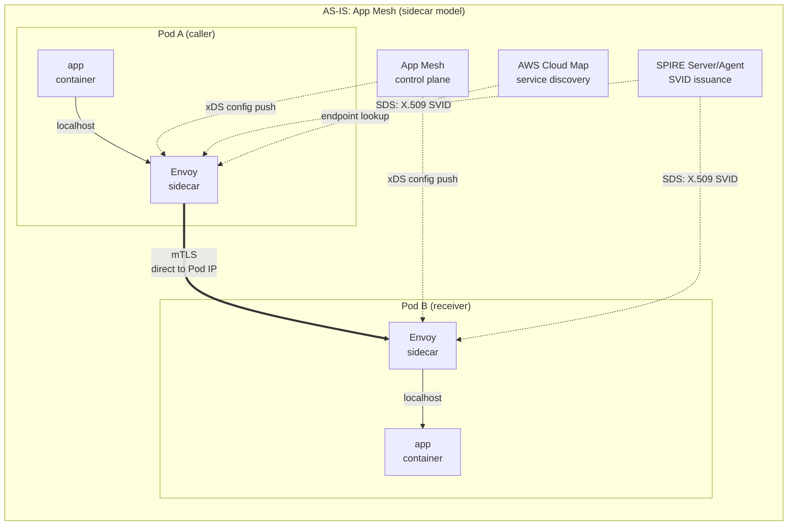
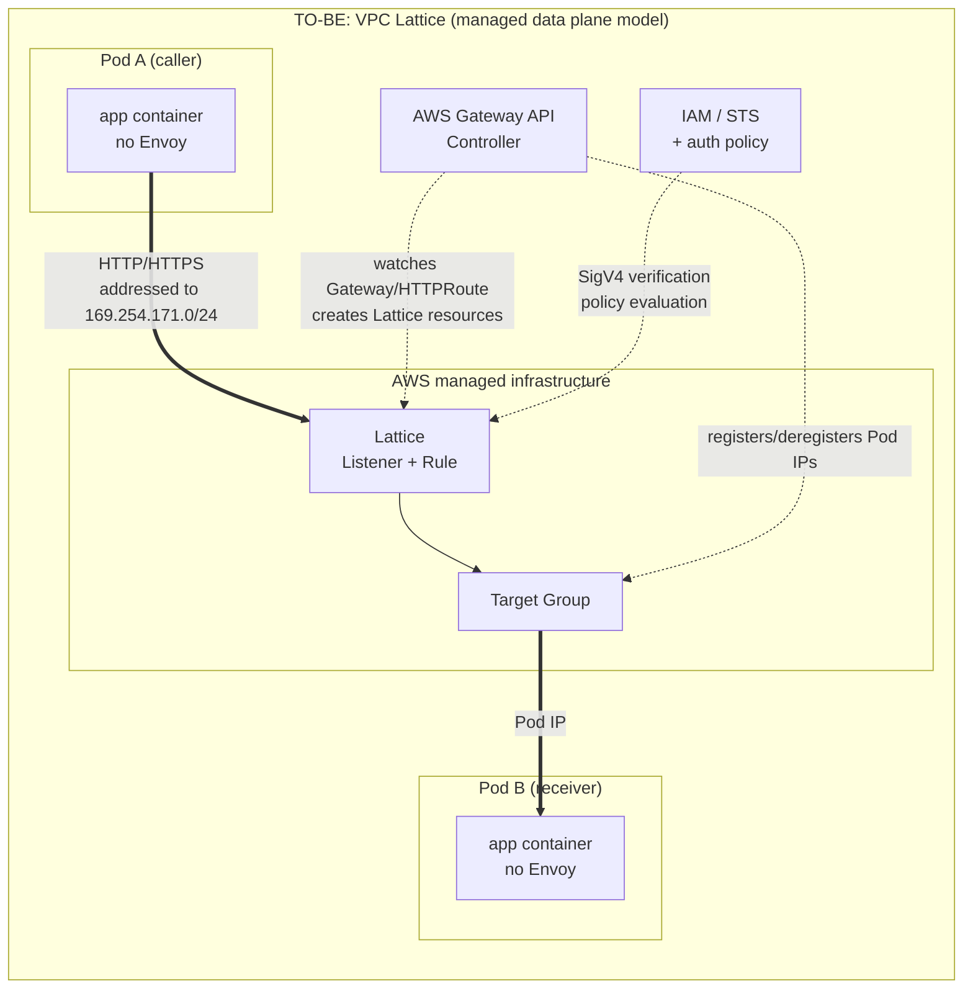

# Arquitectura de App Mesh frente a VPC Lattice

> **Alcance**: API de servicios y recursos de VPC Lattice y AWS Gateway API Controller; compruebe la versión seleccionada y los CRD instalados.
> **Última actualización**: 16 de octubre de 2026

## Qué cubre este documento

- Qué problema pretendía resolver cada modelo (con sidecar y plano de datos administrado)
- Cómo se corresponden los recursos de App Mesh con los de Lattice y por qué la correspondencia no es uno a uno
- Las brechas funcionales que se derivan de las partes sin correspondencia uno a uno y el papel intermedio de AWS Gateway API Controller

## Por qué se diseñaron de manera distinta los dos modelos

### El modelo con sidecar: colocar un proxy junto a la aplicación

App Mesh e Istio colocan Envoy dentro del Pod porque **algunas decisiones requieren el contexto de la aplicación.**

Un proxy en el lado del cliente puede mantener grupos de conexiones, observar fallos ascendentes y aplicar los reintentos configurados. Los controles exactos dependen del producto y de su API; que Envoy tenga una capacidad no significa que App Mesh la ofrezca automáticamente. Un servicio administrado también puede mantener estado, por lo que la ubicación del proxy por sí sola no demuestra que una función sea imposible.

El cliente opera las cargas de trabajo de Envoy inyectadas y cualquier infraestructura SPIRE implementada por separado. **AWS operaba el plano de control de App Mesh (el soporte terminó el 30 de septiembre de 2026).** Las actualizaciones de los proxies y el consumo de recursos siguen siendo responsabilidad del cliente en sus cargas de trabajo; no describa App Mesh como un plano de control totalmente autoadministrado.

### El modelo de plano de datos administrado: trasladar el proxy a la infraestructura

Lattice tomó la dirección opuesta. Saca el proxy del Pod y lo ubica en **infraestructura operada por AWS.** El Pod del cliente envía una solicitud HTTP normal sin conocer el proxy; cuando la solicitud se dirige a un servicio de Lattice, la infraestructura la intercepta y la gestiona.

Este diseño resuelve problemas de escala y heterogeneidad. Como no hay sidecar, el número de proxies no aumenta con el de Pods, y EKS, ECS, EC2 y Lambda pueden participar en la red de servicios **de la misma manera.** No se puede colocar Envoy dentro de una función Lambda, pero un proxy en la capa de infraestructura también puede servir a Lambda. La infraestructura absorbe los límites entre VPC y cuentas, incluso si los rangos de IP se solapan.

Al quitar Envoy, cambia el lugar donde se implementan la resiliencia y la telemetría. Compare **lo que ofrecía App Mesh con las API de Lattice expuestas actualmente** y determine qué controles deben trasladarse a la aplicación o a otro proxy. No deduzca la ubicación del estado interno de AWS ni límites permanentes de funciones a partir de esta topología conceptual.

## Arquitectura ANTES / DESPUÉS

Se destacan tres diferencias.

1. **Número de saltos por proxies**: ANTES se atraviesan **dos** proxies: el Envoy del emisor y el Envoy del receptor. DESPUÉS el tráfico pasa **una vez** por Lattice.
2. **Quién es propietario del plano de control**: ANTES, el plano de control de App Mesh envía la configuración a cada Envoy mediante xDS y SPIRE emite certificados. DESPUÉS, estas funciones pasan al dominio administrado por AWS y en el clúster del cliente solo queda una implementación de AWS Gateway API Controller.
3. **Dónde termina la conexión**: ANTES, el Envoy del emisor se conecta **directamente a la IP del Pod receptor.** DESPUÉS, se conecta a una dirección de Lattice y es Lattice quien conoce las IP de los Pods.

## Correspondencia entre recursos

| App Mesh | VPC Lattice | Relación |
|---|---|---|
| **Mesh** | **Service Network** | Ambos son límites lógicos. Un mesh de App Mesh no se limita necesariamente a Kubernetes; una red de servicios de Lattice asocia servicios y VPC, y la conectividad de recursos es una capacidad aparte. |
| **VirtualService** | **Lattice Service** | Nombre lógico del servicio. Un Lattice Service obtiene su propio nombre DNS. |
| **VirtualRouter** + **Route** | **Listener** + **Listener Rule** | La función de enrutamiento por protocolo de VirtualRouter pasa a Listener; la coincidencia y la acción de Route pasan a Listener Rule. |
| **VirtualNode** | **Target Group** | VirtualNode agrupaba «identidad de esta carga de trabajo + configuración del backend + configuración del listener» en un solo recurso; Target Group expresa únicamente el **conjunto de destinos de backend**. |
| **AWS Cloud Map** | **No se necesita** | Lattice incorpora el descubrimiento de servicios. Desaparece la gestión de espacios de nombres y servicios de Cloud Map. |
| **Sidecar de Envoy** | **Se elimina** | Desaparece del Pod. El plano de datos se traslada a la infraestructura de AWS. |
| **VirtualGateway** | **Lattice Service + Listener** (o ALB/NLB) | El tráfico norte-sur está fuera del alcance de AWS Gateway API Controller. Esa función corresponde a AWS Load Balancer Controller. |

### Por qué no debe interpretarse como una tabla de correspondencia uno a uno

**El problema está en la fila de VirtualNode.** Un VirtualNode de App Mesh expresaba tres cosas a la vez: quién es esta carga de trabajo (identidad, incluidos los ajustes de TLS del backend), adónde se dirige (backends) y dónde recibe tráfico (listeners, comprobaciones de estado, grupos de conexiones y detección de valores atípicos). En Lattice, estos tres elementos se distribuyen en distintos lugares.

- Solo **una parte de «dónde recibe»** (el conjunto de destinos y las comprobaciones de estado) pasa a ser un Target Group.
- **«Adónde se dirige»** deja de ser un recurso y pasa a depender de **políticas de autorización y permisos de IAM**.
- **«Quién es»** pasa a ser un **rol de IAM**, no un SVID (consulte el [documento 05](./05-spiffe-to-iam.md)).
- Los **grupos de conexiones y la detección de valores atípicos** no tienen **ningún recurso equivalente**.

En otras palabras, aunque se complete la columna de la derecha, no todos los atributos que contenía el recurso de la izquierda se trasladan. **La tabla relaciona nombres de recursos, no capacidades.**

## Brechas funcionales

Estas son **comprobaciones de migración**, no pruebas de que un plano de datos administrado nunca pueda implementar esas funciones. App Mesh, Istio y Envoy sin procesar exponen superficies de configuración distintas; compruebe qué función se utiliza realmente antes de elegir su sustituto.

| Capacidad | Comprobación para la migración |
|---|---|
| Límites de conexiones, reintentos y gestión de valores atípicos | Haga un inventario de los controles que expone el producto de origen real. Las comprobaciones de estado de Lattice no reproducen todas las políticas del lado del cliente de Envoy; valide la resiliencia de la aplicación y los presupuestos de reintentos. |
| Inyección de fallos y duplicación del tráfico | No atribuya todas las capacidades de Envoy/Istio a App Mesh. Cuando sea necesario, diseñe una vía de prueba o duplicación independiente y revisada. |
| Comprobaciones de estado | Las comprobaciones de estado de los grupos de destino sondeos activos de los destinos; no equivalen a la detección pasiva de valores atípicos por solicitud. |
| Identidad mediante certificado de cliente | Un listener HTTPS de servicio y mTLS de extremo a extremo mediante TLS passthrough tienen límites de confianza distintos. Consulte [redes](./04-networking-basics.md). |
| Métricas y trazas | Conserve los spans de OpenTelemetry de la aplicación. Los registros de acceso de Lattice y las métricas de CloudWatch añaden tiempos de solicitud y destino, así como correlación, pero no proporcionan un span de traza nativo de Lattice. |

### Cómo interpretar estas brechas en la práctica

Una tarea de migración importante es la **observabilidad**: haga un inventario de las métricas, los registros de acceso y el contexto de traza que aporta cada componente actual y compruebe de extremo a extremo la vía de sustitución.

Los interruptores de circuito y los reintentos tienen una alternativa clara («añadir una biblioteca a la aplicación») cuyo coste se puede estimar. La observabilidad también parece tener una alternativa clara, pero requiere otro tipo de trabajo. ANTES, los spans que Envoy generaba automáticamente se obtenían **sin tocar el código de la aplicación.** Para obtener el mismo nivel de trazas DESPUÉS, hay que instrumentar cada servicio con OpenTelemetry, lo que se convierte en una tarea para los equipos de aplicaciones.

Un span del cliente normalmente engloba el span del servidor descendente, por lo que restar la hora de finalización del span del emisor de la hora de inicio del span del receptor no mide la latencia de red. Correlacione los spans de la aplicación con campos de los registros de Lattice como `requestId`, `duration`, `requestToTargetDuration` y `responseFromTargetDuration`; la desviación de reloj, los límites de instrumentación y el tiempo de red restringen la atribución causal. Lattice añade `x-amzn-requestid` para correlacionar solicitudes HTTP; no es un span de OpenTelemetry.

## Función de AWS Gateway API Controller

Puede crear recursos de Lattice directamente con la CLI o la consola, pero en EKS normalmente se utiliza **AWS Gateway API Controller.** Este observa los recursos de Kubernetes Gateway API dentro del clúster y crea y elimina los recursos de Lattice correspondientes.

| Recurso de Kubernetes | Recurso de Lattice creado |
|---|---|
| `GatewayClass` (`amazon-vpc-lattice`) | Ninguno (declara Lattice como plano de datos) |
| `Gateway` | Apunta a una **Service Network**. El nombre de Gateway (sin espacio de nombres) corresponde al nombre de Service Network; varias Gateway con el mismo nombre apuntan a la misma Service Network. |
| `HTTPRoute` / `GRPCRoute` | **Lattice Service** + **Listener Rule**. Cada Route **obtiene su propio nombre de dominio**. |
| `TLSRoute` | Un Lattice Service para TLS Passthrough (consulte el [documento 04](./04-networking-basics.md)). |
| El Service al que hace referencia `backendRefs` | **Target Group** y los **Targets** que contiene. |
| `TargetGroupPolicy` | Protocolo de Target Group y configuración de la comprobación de estado. |
| `IAMAuthPolicy` | Política de autorización de la red de servicios o política de autorización del servicio, según el destino de asociación (consulte el [documento 03](./03-auth-flow.md)). |

### Por qué este controlador es clave para cerrar la brecha

En App Mesh, Cloud Map y Envoy eran los componentes que seguían las IP de los Pods. En Lattice, esa función la cumple este controlador.

El controlador observa **los cambios en los endpoints** de los Services de Kubernetes a los que hace referencia `backendRefs`. Cuando un Deployment escala y añade Pods o una actualización gradual cambia las IP de los Pods, el controlador detecta el cambio y **registra y da de baja** los Targets en el Target Group de Lattice. Mantener sincronizados el estado declarado en Kubernetes y la lista real de destinos de Lattice es la función principal de este controlador.

De ello se derivan dos consecuencias prácticas.

**Primero, si el controlador se detiene, los destinos de enrutamiento quedan desactualizados.** Lattice sigue reenviando tráfico, pero los Pods recién iniciados nunca se registran como Targets y los Pods inactivos nunca se dan de baja. La disponibilidad y los permisos de IAM de la implementación del controlador están directamente vinculados a la fiabilidad de la ruta de datos.

**Segundo, se pueden usar readiness gates de Pods.** Puede impedir que un Pod se marque como Ready hasta que el estado de su Target Group de Lattice sea `Healthy`. Así, durante una actualización gradual **no se terminan los Pods antiguos hasta que Lattice considera que los nuevos están en buen estado.** Este mecanismo es importante para evitar interrupciones durante la migración.

### Límites de alcance del controlador

Gateway API se diseñó para cubrir tanto el tráfico norte-sur (Ingress) como el este-oeste (Mesh), pero **AWS Gateway API Controller actualmente se centra solo en el tráfico este-oeste mediante Lattice.** No espere funciones norte-sur al estilo de ALB/NLB; esas corresponden a AWS Load Balancer Controller.

Esto es especialmente relevante en entornos que también ejecutan ingress-nginx. El tráfico norte-sur que gestiona ingress-nginx no forma parte de esta migración; solo el tráfico este-oeste se traslada a Lattice. Lo habitual es que ambas vías coexistan en la configuración.

## Resumen

- Compare las API de los productos y las capacidades configuradas; trasladar el proxy cambia las responsabilidades, pero no demuestra que las brechas funcionales sean inmutables.
- La tabla relaciona nombres de recursos. Los atributos que contenía VirtualNode se reparten entre varios lugares o desaparecen.
- La brecha que más se suele subestimar es la observabilidad. Los spans que Envoy proporcionaba sin esfuerzo se convierten en un proyecto de instrumentación.
- AWS Gateway API Controller refleja en los Targets de Lattice los cambios de endpoints de Kubernetes; su disponibilidad está vinculada a la fiabilidad de la ruta de datos.

A continuación: [Análisis del impacto en la latencia](./02-latency.md) examina cómo se contraponen la reducción de saltos por proxies y la incorporación de un recorrido por VPC.

## Referencias

- [Migración de AWS App Mesh a Amazon VPC Lattice (blog de AWS Containers)](https://aws.amazon.com/blogs/containers/migrating-from-aws-app-mesh-to-amazon-vpc-lattice/)
- [aws-samples/migrating-from-aws-app-mesh-to-amazon-vpc-lattice](https://github.com/aws-samples/migrating-from-aws-app-mesh-to-amazon-vpc-lattice)
- [AWS Gateway API Controller: conceptos básicos](https://www.gateway-api-controller.eks.aws.dev/latest/concepts/overview/)
- [AWS Gateway API Controller: referencia de Gateway API](https://www.gateway-api-controller.eks.aws.dev/latest/api-types/gateway/)
- [Guía del usuario de Amazon VPC Lattice](https://docs.aws.amazon.com/vpc-lattice/latest/ug/what-is-vpc-lattice.html)
- [Historial de documentos de App Mesh](https://docs.aws.amazon.com/app-mesh/latest/userguide/doc-history.html)
