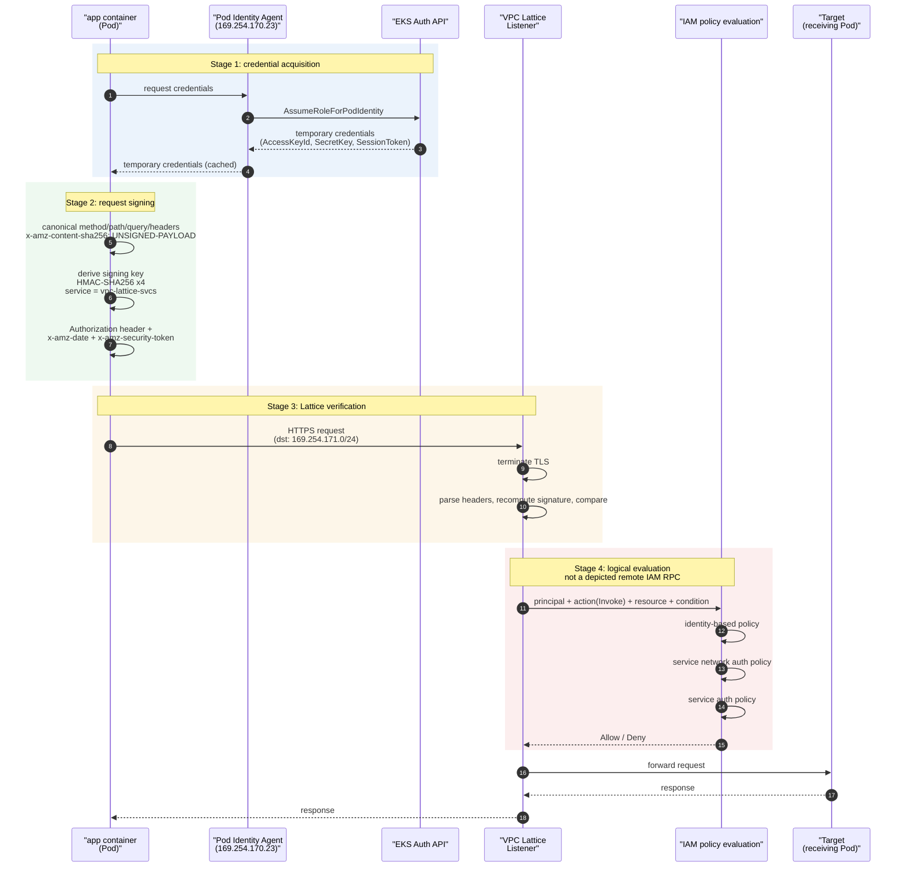
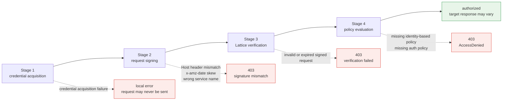

# Flujo de autenticación IAM en detalle

> **Alcance**: API de servicio/recurso de VPC Lattice y AWS Gateway API Controller; verifica la versión seleccionada y las CRD instaladas.
> **Última actualización**: 13 de septiembre de 2026

## Qué cubre este documento

- Las cuatro etapas por las que pasa una solicitud con autenticación IAM de Lattice: obtención de credenciales, firma de la solicitud, verificación de Lattice y evaluación de políticas
- Distinguir fallos de credenciales, firma, políticas y red usando evidencia; no se afirma ningún orden por frecuencia de fallos
- Qué significa pasar de la autenticación mutua por conexión a la **verificación de firmas por solicitud**

## ¿Por qué firmar las solicitudes?

mTLS de App Mesh comprueba el certificado de cada lado **una vez, al establecer la conexión**, y desde entonces confía en esa conexión. La identidad está vinculada a la conexión.

Lattice eligió algo distinto: **firmar cada solicitud y verificar cada solicitud**. Entender el motivo permite deducir de forma natural las restricciones posteriores.

La firma de solicitudes IAM es un mecanismo de identidad documentado y compartido por los clientes de cómputo de AWS. Lambda también puede usar certificados con una gestión adecuada de secretos/rotación; no afirmes que allí los certificados de cliente sean imposibles ni los uses para explicar decisiones de diseño de AWS que no están documentadas.

Así que Lattice optó por reutilizar «el sistema de identidad que ya tienen todas las plataformas de cómputo de AWS» y ese sistema opera por **solicitud de API**, no por conexión. Todo lo demás de este documento se deriva de esa elección.

## Secuencia de cuatro etapas



Ubicación posible del origen de un 403 en cada etapa:



## Etapa 1: obtención de credenciales

La firma SigV4 necesita una clave de acceso, una clave secreta y un token de sesión. Un Pod obtiene estos elementos de una de dos maneras.

### EKS Pod Identity frente a IRSA

| Elemento | EKS Pod Identity (recomendado) | IRSA |
|---|---|---|
| **Configuración de la relación de confianza** | Mediación de la API EKS Auth. La política de confianza del Role hace referencia al principal de servicio `pods.eks.amazonaws.com` | Registrar en IAM un proveedor OIDC por clúster y añadir condiciones OIDC a la política de confianza del Role |
| **Trabajo por cada clúster adicional** | Se pueden reutilizar los Roles | Registrar un proveedor OIDC y modificar las políticas de confianza de cada clúster |
| **Ruta de entrega de credenciales** | Pod Identity Agent (un DaemonSet de nodo) las sirve en una dirección de enlace local | Token proyectado de cuenta de servicio → el SDK llama a `AssumeRoleWithWebIdentity` |
| **Mecanismo de asociación** | Asociación `ServiceAccount` ↔ Role administrada mediante la API de EKS | Anotación `eks.amazonaws.com/role-arn` de `ServiceAccount` |
| **Etiquetas de sesión** | El contexto del Pod/clúster se puede pasar como etiquetas de sesión → utilizable en autorización condicional | Limitado |
| **Requisitos previos** | Complemento Pod Identity Agent instalado + Role del nodo con `AssumeRoleForPodIdentity` | Asociación con proveedor OIDC |

**El motivo práctico para preferir Pod Identity es el uso en varios clústeres.** Una motivación principal para adoptar Lattice es la comunicación entre clústeres e IRSA requiere registrar un proveedor OIDC por clúster y administrar políticas de confianza de Role para tantos clústeres como haya. Pod Identity evita esa carga.

### Dependencia de credenciales temporales de STS

Ambos enfoques terminan usando **credenciales temporales emitidas por STS**. Esta es una propiedad importante de la arquitectura.

- Las credenciales **caducan**. El SDK las almacena en caché y las renueva antes de que caduquen, pero la ruta de actualización debe estar disponible.
- Si el proveedor de credenciales configurado no puede renovarlas, la firma puede fallar localmente; también puede rechazarse una solicitud ya firmada pero caducada. IRSA usa STS, mientras que Pod Identity obtiene credenciales mediante la ruta Agent/EKS Auth.
- En otras palabras, **STS pasa a ser una dependencia de la ruta de datos East-West**. Esto refleja la función que tenía SPIRE Server en AS-IS, pero el propietario pasa del cliente a AWS (documentos [05](./05-spiffe-to-iam.md) y [06](./06-constraints.md)).

La consecuencia para la latencia se explicó en el [documento 02](./02-latency.md): si la renovación bloquea la ruta de solicitud, aparece en la cola p99.

## Etapa 2: firma de solicitudes

### Solicitud canónica → clave de firma → cabecera Authorization

La firma SigV4 se realiza en tres pasos.

**Primero, construye la solicitud canónica.** Canoniza el método, la ruta, la consulta y las cabeceras firmadas. Para Lattice, incluye **`x-amz-content-sha256: UNSIGNED-PAYLOAD`**; no se admite firmar la carga útil. Usa HTTPS para proteger el cuerpo durante el tránsito y añade integridad en la capa de aplicación cuando sea necesario.

**Segundo, deriva la clave de firma.** Partiendo de la clave secreta, aplica HMAC-SHA256 cuatro veces en secuencia: fecha → región → **nombre de servicio** → cadena de terminación. El nombre de servicio de Lattice es **`vpc-lattice-svcs`**.

Como este nombre de servicio es una entrada de la propia firma, **si te equivocas, la firma no se verificará**. Es fácil confundirlo con `vpc-lattice` (nombre de servicio de la API del plano de control de Lattice), pero las solicitudes del plano de datos deben firmarse con `vpc-lattice-svcs`. Esto coincide con el propio nombre DNS del servicio, que tiene la forma `<service>-<id>.<hash>.vpc-lattice-svcs.<region>.on.aws`.

**Tercero, añade las cabeceras.** La cabecera `Authorization` contiene el algoritmo, el ámbito de credenciales, la lista de cabeceras firmadas (`SignedHeaders`) y el valor de la firma; `x-amz-date` contiene la hora de la solicitud y, al usar credenciales temporales, `x-amz-security-token` contiene el token de sesión.

### Tres errores prácticos

#### ① Se firma la cabecera Host: cuidado con los dominios personalizados

En SigV4, la cabecera `Host` **siempre se incluye en la firma**. El host al que se dirige la solicitud queda vinculado a la firma.

Esto causa problemas con los **dominios personalizados**. Si asocias un dominio del cliente (`api.internal.example.com`) a un servicio Lattice, el cliente envía las solicitudes a ese dominio y, por tanto, firma `Host: api.internal.example.com`. Si el valor que espera el extremo verificador es distinto, la firma no coincide. A la inversa, si firmas con el dominio generado por Lattice pero la cabecera Host real de la solicitud contiene el dominio personalizado, tampoco coincide.

**Regla fundamental: el valor Host usado al firmar debe coincidir con la cabecera Host real de la solicitud.** Al introducir un dominio personalizado, confirma explícitamente qué valor usa la lógica de firma. El problema aparece **cuando asocias el dominio personalizado**, no al comenzar la migración, por eso es fácil pasarlo por alto.

#### ② Diferencia de reloj en x-amz-date

La guía general de AWS para SigV4 dice que las solicitudes, **en la mayoría de los casos**, deben llegar dentro de los cinco minutos posteriores a su marca de tiempo. Mantén los relojes sincronizados e inspecciona el error real de caducidad/diferencia horaria; no es una garantía específica de Lattice medida por separado.

Por tanto, **la sincronización del reloj del nodo es un requisito previo de autenticación**. En nodos EC2/EKS que usan Amazon Time Sync Service normalmente no es un problema, pero sí puede serlo si:

- La sincronización horaria del nodo o host híbrido está mal configurada
- Una aplicación firma con una marca de tiempo o zona horaria incorrecta
- El host se reanuda con una diferencia en el reloj

Este fallo es **intermitente y limitado a un nodo**, por lo que resulta difícil de diagnosticar. Si «solo los Pods de un nodo determinado reciben 403», comprueba primero la sincronización del reloj.

#### ③ Proxies intermedios que modifican cabeceras: firma en el último salto

Como la firma está vinculada al contenido de la solicitud, **si algo modifica un elemento firmado después de firmar, falla la verificación**.

Causas concretas:

- Proxies que cambian las rutas firmadas o el valor real de `Host`
- Proxies que añaden/eliminan parámetros de consulta o cambian sus valores/codificación; reordenar simplemente parámetros equivalentes no necesariamente cambia la consulta canónica
- SigV4 de Lattice no detecta la modificación del cuerpo cuando se usa el `UNSIGNED-PAYLOAD` requerido; protégelo con TLS y controles de aplicación

**Regla: firma en el último salto antes de Lattice.** No debe haber ninguna capa que modifique la solicitud entre la firma y Lattice.

Esto importa especialmente **cuando se firma mediante un proxy de egreso**. La implementación de referencia de aws-samples demuestra el patrón: un sidecar `sigv4proxy` que escucha en 8080, con un contenedor init que usa iptables para redirigir **solo el tráfico destinado a `169.254.171.0/24` (el rango de Lattice)** al puerto local 8080. El proxy firma y la solicitud sale directamente hacia Lattice, de modo que no queda nada entre ambos que pueda modificarla. Evita configuraciones en las que otro proxy procesa después una solicitud firmada.

## Etapa 3: verificación de Lattice

En un listener HTTPS, Lattice **termina TLS, analiza las cabeceras**, vuelve a calcular la firma de la cabecera `Authorization` y compara las firmas.

Aquí se esconde la restricción más importante de esta arquitectura.

> **Verificar la firma requiere leer las cabeceras, y leer las cabeceras requiere terminar TLS.**

**TLS Passthrough no termina TLS, por lo que Lattice no puede ver la cabecera `Authorization`** ni autenticar la firma SigV4 de la solicitud del cliente. Esta es la restricción descrita en el [documento 06](./06-constraints.md). No prohíbe todas las políticas de autenticación: los listeners TLS admiten políticas limitadas a principales anónimos, que no establecen la identidad autenticada del cliente.

El controlador documenta asociaciones de políticas para Gateway, HTTPRoute y GRPCRoute; comprueba en la CRD instalada los destinos de asociación compatibles. **Esa restricción del controlador no significa que se rechace toda política de autenticación TLS de VPC Lattice.**

::: tip Comportamiento de TLS documentado
AWS permite políticas de autenticación TLS Passthrough basadas en **principales anónimos**, sin identidad SigV4 autenticada ni inspección de cabeceras/rutas HTTP. Los listeners TLS requieren un dominio personalizado que coincida con el SNI sin cifrar y grupos de destino TCP; ECH/ESNI no se admite. Este repositorio no recomienda ejemplos de políticas con principal comodín. Consulta la [referencia de listener TLS](https://docs.aws.amazon.com/vpc-lattice/latest/ug/tls-listeners.html).
:::

La firma de solicitudes autenticadas y la autorización de contexto de red anónimo son controles distintos. Diseña explícitamente la autenticación del endpoint y las políticas aplicables del servicio/red de servicios.

Un error más: **las políticas de autenticación solo están activas cuando authType es `AWS_IAM`**. Con `NONE`, una política asociada no tiene efecto. Esta es la causa más común de «asocié una política pero cualquiera puede pasar».

## Etapa 4: evaluación de políticas

Para un principal autenticado, evalúa los permisos del cliente y cada política de recursos Lattice aplicable. **Solo los recursos configurados con `AWS_IAM` aplican su política de autenticación; `NONE` omite la política de ese recurso.** Siguen vigentes las denegaciones explícitas y otros controles IAM. No conviertas el diagrama de tres políticas en una regla universal para solicitudes anónimas o configuradas de otra manera.

| Política | Asociada a | Pregunta que responde | Propietario | Recurso Gateway API |
|---|---|---|---|---|
| **política basada en identidad** | Role IAM del cliente | «¿Este Role tiene permiso para ejecutar `vpc-lattice-svcs:Invoke`?» | Equipo de aplicación/plataforma | Ninguno (directamente en IAM) |
| **política de autenticación de red de servicios** | Service Network | «¿Puede este principal entrar en esta red de servicios?» (control general) | Administrador de red/nube | `IAMAuthPolicy` → `Gateway` |
| **política de autenticación del servicio** | Servicio Lattice | «¿Puede este principal invocar este servicio?» (control granular) | Equipo propietario del servicio | `IAMAuthPolicy` → `HTTPRoute`/`GRPCRoute` |

Para las **políticas de autenticación de invocación de servicios**, la acción es `vpc-lattice-svcs:Invoke`. Las configuraciones de recursos usan un modelo de acceso separado y no heredan las políticas de autenticación de la red de servicios.

### Claves de condición disponibles

Estas claves se pueden usar como condiciones en las políticas de autenticación. Las claves presentes al evaluar dependen del protocolo y de si la solicitud se firmó con SigV4.

| Clave de condición | Filtra por |
|---|---|
| `vpc-lattice-svcs:Port` | Puerto de servicio al que se envió la solicitud |
| `vpc-lattice-svcs:RequestMethod` | Método de solicitud |
| `vpc-lattice-svcs:RequestPath` | Parte de ruta de la URL de solicitud |
| `vpc-lattice-svcs:RequestHeader/<header-name>` | Par nombre-valor de una cabecera de solicitud |
| `vpc-lattice-svcs:RequestQueryString/<key-name>` | Par clave-valor de la cadena de consulta de la URL de solicitud |
| `vpc-lattice-svcs:ServiceArn` | ARN del servicio Lattice de destino |
| `vpc-lattice-svcs:ServiceNetworkArn` | ARN de la red de servicios |
| `vpc-lattice-svcs:SourceVpc` | VPC desde la que se originó la solicitud |
| `vpc-lattice-svcs:SourceVpcOwnerAccount` | Cuenta propietaria de la VPC de origen |

También se pueden usar junto a estas claves las claves de condición globales de IAM, como `aws:PrincipalOrgID` y `aws:PrincipalTag/<key>`.

::: warning Requiere verificación
La lista anterior se compiló a partir de la [referencia de autorización del servicio](https://docs.aws.amazon.com/service-authorization/latest/reference/list_vpc-lattice-svcs.html) y de ejemplos de políticas en la documentación de Gateway API Controller. Lattice incorpora funciones con el tiempo, así que **confirma la lista actual en esa referencia antes de finalizar el diseño**.
:::

Las condiciones de ruta, método y cabecera son útiles en la práctica: puedes aplicar fuera del código de la aplicación una regla como «solo estos Roles pueden invocar `POST /refund` en el servicio payments». Sin embargo, **añadir autorización basada en rutas a las políticas significa que los cambios de API requieren cambios de política**; decide intencionalmente qué capa expresa la autorización.

### El patrón de fallo 403 predominante

La ausencia del permiso `vpc-lattice-svcs:Invoke` es **una causa documentada** de que falle una solicitud autenticada. No se proporcionó un conjunto de datos sobre la frecuencia de incidentes, así que no se clasifica como la causa más común.

Es frecuente porque resulta contraintuitivo. Es natural pensar «la política de autenticación del servicio permite este Role, ya está», pero **el propio Role que llama también necesita permiso Invoke**. Una política de recurso por sí sola no basta.

Este es el mensaje de error real de la implementación de referencia:

```text
AccessDeniedException: User: arn:aws:sts::111122223333:assumed-role/eksctl-...-Role1-yz1hNJittmXj/1726632845600682009
is not authorized to perform: vpc-lattice-svcs:Invoke
on resource: arn:aws:vpc-lattice:us-west-2:111122223333:service/svc-0b13d4b53748cbdc7/catalogdetail
because no identity-based policy allows the vpc-lattice-svcs:Invoke action
```

La última cláusula, **`because no identity-based policy allows...`**, es clave para el diagnóstico. El mensaje indica qué política falta, así que léelo primero cuando encuentres un 403.

### Orden de diagnóstico para 403

| Orden | Qué comprobar | Cómo |
|---|---|---|
| 1 | La última cláusula del mensaje de error | `no identity-based policy` → permisos del Role cliente; en caso contrario → política de autenticación |
| 2 | Registros de acceso de Lattice y error devuelto | Correlaciona el ID de solicitud, registros del cliente, política y evidencia de red |
| 3 | ¿Se firmó realmente la solicitud? | Una solicitud sin firmar y una firma fallida son problemas distintos. Comprueba los registros del proxy de egreso |
| 4 | ¿authType es `AWS_IAM`? | Con `NONE`, las políticas no tienen efecto |
| 5 | Reloj del nodo | Si falla un solo nodo, sospecha una diferencia en `x-amz-date` |
| 6 | Cabecera Host | Si acabas de introducir un dominio personalizado, empieza aquí |

### Error fácil de pasar por alto: llamar directamente al DNS del Service de k8s evita la autorización

La documentación de AWS Gateway API Controller lo indica explícitamente:

> `IAMAuthPolicy` solo puede autorizar el tráfico que pasa **por Gateways, HTTPRoutes y GRPCRoutes**. La autorización no se aplica si el cliente envía tráfico directamente al DNS del Service de k8s.

Llamar directamente a `http://proddetail.prodcatalog-ns.svc.cluster.local` **evita la ruta de datos de Lattice**, por lo que su política de autenticación no evalúa esa solicitud. Es un límite de diseño, no una clasificación medida de causas de incidentes.

Durante la ventana de migración, cuando coexisten la ruta AS-IS (llamadas directas dentro del clúster) y la ruta TO-BE (a través de Lattice), **hay simultáneamente rutas donde se aplica la autorización y rutas donde no se aplica**. Necesitas controles compensatorios, como NetworkPolicy, para bloquear llamadas directas dentro del clúster, y eso forma parte del plan de migración.

## Comparación AS-IS

| Elemento | AS-IS: App Mesh + mTLS de SPIRE | TO-BE: autenticación IAM de Lattice |
|---|---|---|
| **Alcance de autenticación** | **Conexión** (una vez al establecerla) | **Solicitud** (cada solicitud) |
| **Direccionalidad** | **Autenticación mutua bidireccional** (cliente y servidor demuestran su identidad) | **Unidireccional**: el cliente demuestra su identidad. El servidor solo lo hace mediante su certificado TLS de servidor |
| **Forma de identidad** | ID SPIFFE en un SVID X.509 (URI) | ARN de Role IAM / ARN de sesión de assumed-role |
| **Prueba de identidad** | Certificado X.509 de corta duración (prueba de posesión de clave privada) | Firma SigV4 (prueba de posesión de clave secreta) |
| **Quién verifica** | Envoy de la carga de trabajo par | Lattice (infraestructura administrada por AWS) |
| **Raíz de confianza** | CA de SPIRE Server administrada por el cliente | AWS IAM / STS |
| **Dónde se autoriza** | Filtro de autorización de Envoy receptor | Evaluación triple de políticas de Lattice |
| **Dónde termina TLS** | Envoy del Pod receptor | Lattice (listener HTTPS) |
| **Al caducar credenciales** | Renovación automática de SVID (SPIRE Agent) | Actualización automática de credenciales STS (SDK) |
| **Observabilidad** | Métricas y registros de Envoy | Registros de acceso de Lattice (sin spans) |

### Las dos filas más importantes

**La fila «Direccionalidad»** es el punto central del asunto para el comité de revisión. Con mTLS, el servidor también demostraba su identidad. Con la autenticación IAM de Lattice, la prueba de identidad del lado servidor se limita al certificado TLS del servidor y no hay una etapa que confirme «¿es realmente este el servicio operado por ese equipo?» dentro de un sistema de identidad de cargas de trabajo. Los detalles están en el [documento 05](./05-spiffe-to-iam.md).

La conexión HTTPS entre cliente y Lattice termina en Lattice. El protocolo de destino es un ajuste independiente: HTTP va en texto sin cifrar en ese segmento y HTTPS añade cifrado sin que Lattice valide el certificado de destino. TLS/mTLS del endpoint mediante passthrough cambia el límite de confianza y no puede exponer a Lattice la identidad SigV4 de HTTP cifrado.

## Resumen

- Lattice eligió firmar cada solicitud para reutilizar la **base IAM/STS que ya comparten EKS, ECS, EC2 y Lambda**. Ese sistema opera por solicitud, no por conexión.
- El nombre de servicio para firmar es **`vpc-lattice-svcs`** y, como forma parte de la firma, equivocarse impide verificarla.
- Tres errores prácticos: **la cabecera Host se firma** (cuidado con los dominios personalizados), **diferencia de cinco minutos en x-amz-date** (sincroniza el reloj del nodo) y **firma en el último salto** (no coloques proxies modificadores en medio).
- TLS passthrough no puede autenticar cabeceras HTTP SigV4 cifradas, pero AWS admite políticas de autenticación de contexto de red anónimo para esa ruta.
- La ausencia del permiso Invoke es una posible causa de 403; usa el motivo devuelto y los registros correlacionados en lugar de afirmar una frecuencia no respaldada.
- **Llamar directamente al DNS del Service de k8s evita la evaluación de políticas de autenticación.** Durante la migración se necesitan controles compensatorios.

Siguiente: [Fundamentos: enlace local y SNI](./04-networking-basics.md) profundiza un nivel por debajo de «por qué se debe terminar TLS para ver las cabeceras».

## Referencias

- [Controlar el acceso a los servicios de VPC Lattice con políticas de autenticación](https://docs.aws.amazon.com/vpc-lattice/latest/ug/auth-policies.html)
- [Acciones, recursos y claves de condición para Amazon VPC Lattice Services](https://docs.aws.amazon.com/service-authorization/latest/reference/list_vpc-lattice-svcs.html)
- [AWS Gateway API Controller: referencia de la API IAMAuthPolicy](https://www.gateway-api-controller.eks.aws.dev/latest/api-types/iam-auth-policy/)
- [aws-samples: proteger la red e implementar autenticación IAM de AWS](https://github.com/aws-samples/migrating-from-aws-app-mesh-to-amazon-vpc-lattice/blob/main/vpc-lattice-config/IAMAUTH.md)
- [Implementar autenticación IAM de AWS con Amazon VPC Lattice y Amazon EKS](https://aws.amazon.com/blogs/containers/implement-aws-iam-authentication-with-amazon-vpc-lattice-and-amazon-eks/)
- [EKS Pod Identity](https://docs.aws.amazon.com/eks/latest/userguide/pod-identities.html) / [IAM Roles for Service Accounts](https://docs.aws.amazon.com/eks/latest/userguide/iam-roles-for-service-accounts.html)
- [Firmar solicitudes de API de AWS (SigV4)](https://docs.aws.amazon.com/IAM/latest/UserGuide/reference_sigv.html)

- [Solicitudes autenticadas SigV4 de Lattice](https://docs.aws.amazon.com/vpc-lattice/latest/ug/sigv4-authenticated-requests.html): cabecera de carga útil sin firmar requerida y ventana de validez
