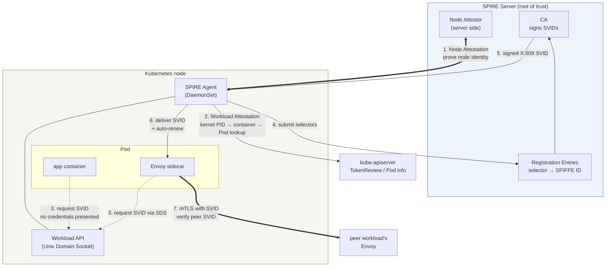

# Migración de identidad de cargas de trabajo: de SPIFFE a IAM

> **Ámbito**: API de servicios y recursos de VPC Lattice y AWS Gateway API Controller; verifica la versión seleccionada y las CRD instaladas.
> **Última actualización**: 13 de septiembre de 2026

## Qué cubre este documento

- Cómo SPIFFE/SPIRE resolvió el problema de identidad de las cargas de trabajo; en particular, cómo la atestación resuelve el problema de arranque
- Las similitudes entre mTLS basado en SPIFFE y Lattice IAM Auth (credenciales de corta duración más atestación de la plataforma), y las **dos diferencias decisivas**
- Por qué esas diferencias se vuelven el tema central de las revisiones de seguridad del sector financiero

## El problema de partida: ¿cómo demuestra su identidad una carga de trabajo?

Cuando el servicio A llama al servicio B, B necesita saber si «¿esta solicitud realmente viene de A?». El problema es difícil por **la forma de entregar, en primer lugar, el secreto necesario para demostrarlo**.

Para entregar un secreto (un certificado o una clave de API) a una carga de trabajo, tienes que saber que realmente es esa carga de trabajo; pero para saberlo, necesitas un secreto. Este es el **problema de arranque**, y las soluciones tradicionales solo trasladan el problema a otro lugar.

| Solución alternativa | A dónde traslada el problema |
|---|---|
| Incrustar certificados en la imagen | Una filtración de la imagen equivale a una filtración de identidad. Para renovarlos hay que volver a compilar la imagen |
| Montarlos como Secret | Todos los que pueden leer el Secret pueden suplantar esa identidad |
| Inyectarlos durante el despliegue | El sistema de CI/CD guarda la clave maestra de todas las identidades |

SPIFFE/SPIRE y Lattice IAM Auth **resuelven esto haciendo que la plataforma dé fe de la identidad de la carga de trabajo**. Por eso sus estructuras se parecen mucho. Y precisamente por esa similitud, **la revisión se centra en dónde difieren**.

## Los tres elementos de SPIFFE

SPIFFE (Secure Production Identity Framework For Everyone) es un **estándar** de identidad para cargas de trabajo: una especificación, no una implementación.

### ① SPIFFE ID: el nombre de la identidad

Identifica una carga de trabajo mediante un URI.

```text
spiffe://<trust-domain>/<workload-path>

e.g.: spiffe://finance.example.com/ns/prodcatalog/sa/prodcatalog-sa
```

El `trust-domain` es **el nombre de un límite de confianza**. Las cargas de trabajo del mismo dominio de confianza comparten una raíz de confianza común (la misma CA). La organización puede diseñar libremente la parte de ruta; en entornos de Kubernetes suele reflejar el espacio de nombres y el ServiceAccount.

Cabe destacar que **el nombre no incluye información de red**: ni IP, ni hostname ni puerto. Es intencional: sin importar dónde se programe una carga de trabajo o cómo cambie su IP, su identidad sigue siendo la misma. El cambio de «controles basados en IP» a «controles basados en identidad» descrito en el [documento 04](./04-networking-basics.md) empieza aquí.

### ② SVID: la credencial que demuestra la identidad

**SPIFFE Verifiable Identity Document**. Contiene un SPIFFE ID en un documento verificable, que puede tener una de dos formas.

| Forma | Contenido | Uso principal |
|---|---|---|
| **X.509-SVID** | Certificado X.509 con el SPIFFE ID en un URI SAN y una clave privada | Autenticación mutua mTLS |
| **JWT-SVID** | JWT con el SPIFFE ID en el claim `sub` | Transmitir la identidad en encabezados HTTP y autorización L7 |

**La característica clave es su corta duración.** Los SVID suelen emitirse por períodos de decenas de minutos a unas horas y se renuevan automáticamente. La corta duración importa porque **evita el problema de la revocación**. Las CRL y OCSP son incómodas desde el punto de vista operativo; si la credencial vence pronto de todos modos, el tiempo durante el cual puede aprovecharse una vulneración queda limitado sin necesidad de un mecanismo de revocación.

### ③ Workload API: el canal para entregar la identidad

Es la interfaz por la que una carga de trabajo obtiene su SVID. Lo fundamental es que **se expone mediante un socket de dominio Unix (UDS)**.

Por qué UDS es esencial para este diseño: **al conectarse al socket, la carga de trabajo no presenta ninguna credencial**. En su lugar, el kernel proporciona de manera fiable la información del proceso del otro extremo (PID, UID, GID), y SPIRE Agent la usa para **investigar directamente** quién es ese proceso.

En otras palabras, no se trata de **«presentar un secreto para probar la identidad», sino de que «la plataforma observe y determine la identidad»**. Así se resuelve el problema de arranque.

## Componentes de SPIRE

SPIRE es la implementación de referencia de SPIFFE.



| Componente | Función |
|---|---|
| **SPIRE Server** | **Raíz de confianza.** Conserva la CA y firma/emite SVID. Administra las Registration Entries (qué selectores reciben qué SPIFFE ID) |
| **SPIRE Agent** (DaemonSet) | Se ejecuta en cada nodo. Demuestra la identidad del propio nodo al Server; luego investiga las cargas de trabajo de ese nodo y obtiene, entrega y renueva SVID en su nombre |
| **Atestación** | Procedimiento para determinar la identidad. Tiene dos etapas: atestación del nodo y atestación de la carga de trabajo |
| **Integración de Envoy SDS** | Envoy recibe certificados del Agent mediante el protocolo **Secret Discovery Service**. El código de la aplicación no necesita conocer mTLS |

### Cómo la atestación resuelve el problema de arranque

Este es el núcleo de SPIRE y el punto de referencia para compararlo con IAM.

**Atestación del nodo**: Agent demuestra al Server «soy este nodo». La evidencia **no es un secreto preinstalado, sino una atestación emitida por la plataforma**. En AWS, es el documento IMDS firmado de la instancia EC2 o su documento de identidad de instancia. El Server puede validar esa evidencia con AWS, así que no hace falta colocar un secreto compartido en el nodo.

**Atestación de la carga de trabajo**: Agent investiga las cargas de trabajo del nodo:

1. La carga de trabajo se conecta al UDS **sin credenciales**
2. Agent obtiene del kernel el PID del proceso del otro extremo (**imposible de falsificar**): es un dato que informa el kernel
3. A partir del PID, lee el cgroup para determinar de qué contenedor se trata
4. Consulta kubelet/kube-apiserver para confirmar el Pod, el espacio de nombres, el ServiceAccount y las etiquetas de ese contenedor
5. Combina estos atributos en **selectores** y los envía al Server
6. Server busca el SPIFFE ID coincidente en las Registration Entries y emite un SVID

**En el paso 2 se resuelve el problema de arranque.** La carga de trabajo no afirma quién es, ni necesita hacerlo. El kernel informa un hecho y este se contrasta con los registros de la plataforma (Kubernetes). **Para falsificarlo habría que vulnerar el kernel o el servidor de API de Kubernetes; a ese nivel de vulneración, todo lo demás ya está comprometido.**

En una frase: **la identidad no se presenta; se observa y se determina**.
## Comparación con IAM Auth

El procedimiento de Lattice IAM Auth se describe en el [documento 03](./03-auth-flow.md). Comparación punto por punto:

| Elemento | SPIFFE/SPIRE (ACTUAL) | Lattice IAM Auth (OBJETIVO) |
|---|---|---|
| **Nombre de la identidad** | SPIFFE ID (`spiffe://<trust-domain>/ns/<ns>/sa/<sa>`) | ARN de rol de IAM / ARN de sesión de rol asumido |
| **Forma de la credencial** | X.509-SVID o JWT-SVID | Credenciales temporales de STS (clave de acceso + secreto + token de sesión) |
| **Método de prueba** | Prueba de posesión de la clave privada del certificado (handshake TLS) | Firma de solicitud SigV4 (prueba de posesión de la clave secreta) |
| **Alcance de la prueba** | **Conexión** (una vez al establecerla) | **Solicitud** (en cada solicitud) |
| **Quién realiza la atestación** | SPIRE Agent (nodo) + SPIRE Server | EKS Pod Identity Agent + EKS Auth API |
| **Evidencia de atestación** | PID del kernel → cgroup → búsqueda del Pod/ServiceAccount | Asociación `ServiceAccount` ↔ rol (EKS Auth API) o token OIDC (IRSA) |
| **Método de verificación** | Envoy del otro extremo valida la cadena SVID con el paquete de confianza | Lattice vuelve a calcular/comparar la firma y luego evalúa tres políticas |
| **Raíz de confianza** | **CA de SPIRE Server operada por el cliente** | **AWS IAM / STS** |
| **Duración de la credencial** | De decenas de minutos a horas; renovación automática | Credenciales temporales de STS; actualización automática |
| **Cómo se expresa la autorización** | Filtros de autorización de Envoy (basados en SPIFFE ID) | Tres políticas de IAM (basada en identidad + red de servicios + servicio) |
| **Observabilidad** | Métricas/registros de Envoy (por SPIFFE ID) | Registros de acceso de Lattice (por principal; sin spans) |
| **Carga operativa** | **Alta**: alta disponibilidad de SPIRE Server, administración y rotación de la clave de CA, administración de Registration Entries, implementación/actualización de Agent y distribución del paquete de confianza | **Baja**: complemento Pod Identity Agent y asociación ServiceAccount↔rol. Sin administración de CA ni de claves |
| **Varios clústeres** | Requiere diseñar dominios de confianza y federarlos | Reutilización de roles mediante Pod Identity, configuración mínima por clúster |
| **Cargas de trabajo fuera de AWS** | Posible con atestadores SPIRE adecuados | Requiere un proveedor de credenciales IAM adecuado y conectividad de Lattice compatible; IAM no lo prohíbe por naturaleza |

## Similitudes: por qué esta migración es viable

La tabla comparativa puede hacer que parezcan sistemas completamente distintos, pero **estructuralmente siguen el mismo patrón**. Eso es lo que da coherencia a la migración.

### ① Ambos usan credenciales de corta duración

Tanto los SVID como las credenciales temporales de STS duran poco y se renuevan automáticamente. Ambos se diseñaron así por el mismo motivo: **limitar el tiempo durante el cual se puede aprovechar una vulneración sin contar con un mecanismo de revocación**.

Ambos enfoques pueden evitar distribuir secretos de aplicación de larga duración, pero la revisión aún debe abarcar la duración de las credenciales, su renovación, la respuesta ante una vulneración y la autorización. Una duración breve no elimina los requisitos de revocación ni de denegación de emergencia.

### ② Ambos se basan en la atestación de la plataforma

La carga de trabajo no tiene un secreto por adelantado; la plataforma da fe de su identidad.

| Etapa | SPIRE | EKS Pod Identity |
|---|---|---|
| Identidad del nodo | Atestación del nodo (documento de identidad de EC2, etc.) | Permiso `AssumeRoleForPodIdentity` del rol del nodo |
| Determinación de la identidad de la carga de trabajo | PID del kernel → cgroup → Pod/SA | Asociación ServiceAccount ↔ rol del Pod |
| Entrega de la credencial | Workload API (UDS) | Pod Identity Agent (dirección link-local) |
| Renovación de credenciales | Agent renueva el SVID | SDK actualiza las credenciales |

Ambos enfoques usan evidencia de la plataforma, pero difieren en selectores, validación de tokens, exposición de credenciales y límites de confianza. Valida el atestador o proveedor de credenciales real en vez de declarar equivalentes ambos modelos.

**No aprovisionar un secreto de larga duración por adelantado no significa que no existan secretos durante la ejecución.** La entrega de un X.509-SVID incluye material de clave privada, y las credenciales temporales de IAM incluyen una clave de acceso secreta y un token de sesión. Protege los sockets/endpoints de los agentes, la memoria, los registros y las cachés de credenciales; la solidez de la atestación depende de los supuestos de confianza configurados.

## Dos diferencias decisivas

Aunque hay muchas similitudes, en una revisión se debate sobre todo **dónde difieren**. Estas dos son diferencias estructurales que no se resuelven con la comodidad operativa.

### Diferencia (a): autenticación mutua bidireccional frente a autenticación unidireccional más autenticación de solicitudes

**La arquitectura ACTUAL es bidireccional.**

En un handshake mTLS, el cliente y el servidor verifican el SVID **del otro**. El cliente confirma por SPIFFE ID «¿el par al que me conecté es realmente el servicio de pagos?»; el servidor confirma «¿el par que se conecta es realmente el servicio de pedidos?». Ambos lados demuestran su identidad dentro del sistema de identidad de cargas de trabajo.

**La arquitectura OBJETIVO es asimétrica.**

| Dirección | Arquitectura ACTUAL | Arquitectura OBJETIVO |
|---|---|---|
| Cliente → servidor (el cliente demuestra su identidad) | Autenticación mutua SVID | **Firma de solicitud SigV4** (por solicitud, con mayor granularidad) |
| Servidor → cliente (el servidor demuestra su identidad) | Autenticación mutua SVID | **Certificado de servidor TLS** (nivel TLS normal) |

SigV4 autentica los campos firmados de cada solicitud, mientras que mTLS autentica el par TLS; ambos diseños también pueden aplicar autorización por solicitud. Ninguno es superior en todos los casos. Lattice requiere `UNSIGNED-PAYLOAD`, así que protege las cargas útiles con TLS y considera explícitamente los riesgos de repetición y robo de credenciales.

**El problema es la prueba de identidad del servidor.** El cliente solo puede confirmar «este certificado TLS es válido y el dominio coincide». **En el sistema de identidad de cargas de trabajo no hay ningún paso que confirme «¿es realmente el servicio administrado por ese equipo?»**

La pregunta que suele aparecer en una revisión es:

> ¿Podrían cambios no autorizados en DNS, certificados, asociaciones de servicio o registro de destinos redirigir el tráfico de esta carga de trabajo? Revisa esos permisos del plano de control junto con la autenticación del endpoint. Que coincida un nombre visible no transfiere por sí solo la identidad DNS generada de un servicio existente.

La respuesta honesta es **«no dentro del sistema de identidad de cargas de trabajo; debes impedirlo mediante controles de IAM sobre la red de servicios y los recursos de Lattice»**. En otras palabras, **la defensa pasa de la autenticación mutua entre cargas de trabajo al control de permisos para crear recursos**.

No es una mala respuesta. Restringir estrictamente mediante IAM quién puede crear Services de Lattice, controlar las asociaciones a la red de servicios y vigilar la creación de recursos con CloudTrail sí gestiona el riesgo práctico. Pero **si la documentación de revisión decía «autenticación mutua», hay que reescribir ese punto y presentar la base del control en otra capa**. Descubrirlo tarde en la migración provoca retrasos importantes en el cronograma.
### Diferencia (b): propiedad de la raíz de confianza

**Este es el punto de mayor peso en las revisiones del sector financiero.**

| Elemento | Arquitectura ACTUAL | Arquitectura OBJETIVO |
|---|---|---|
| **Raíz de confianza** | CA de SPIRE Server operada por el cliente | AWS IAM / STS |
| **Propiedad de la clave privada de la CA** | El cliente o la CA upstream configurada | No hay una CA de Lattice del cliente; siguen existiendo credenciales secretas temporales de IAM |
| **Quién emite la identidad** | La CA del cliente, según sus Registration Entries | AWS STS |
| **Quién decide las reglas de emisión** | Control total del cliente | El cliente las controla mediante IAM; AWS las aplica |
| **Registro de auditoría** | Registros de SPIRE Server (conservados por el cliente) | CloudTrail (un servicio de AWS) |
| **Quién decide la rotación de CA** | El cliente | (No aplica) |
| **Funciona fuera de AWS** | Depende de los atestadores y la conectividad | Es posible con un proveedor de credenciales adecuado y conectividad privada compatible; Pod Identity no lo ofrece automáticamente |
| **Carga operativa** | A cargo del cliente | A cargo de AWS |

La compensación es explícita: **transfieres la carga operativa a AWS a cambio de ceder la propiedad de la raíz de confianza**.

Este punto tiene peso en el sector financiero por la regulación y las prácticas de revisión. Los estándares de seguridad de muchas organizaciones exigen explícitamente que **«la raíz de confianza de un sistema de autenticación esté bajo nuestro propio control»**, o incluyen cláusulas que se interpretan así. Operar tu propia CA era la forma más directa de cumplir ese requisito; es probable que SPIRE se adoptara precisamente tras superar esa revisión.

Pasar a Lattice IAM Auth requiere volver a fundamentar esa decisión. Posibles argumentos:

| Argumento | Contenido |
|---|---|
| **Modelo de responsabilidad compartida** | IAM/STS son controles que AWS ya opera bajo varios marcos regulatorios certificados |
| **Se conserva la autoridad sobre las políticas** | El cliente sigue definiendo por completo, mediante políticas de IAM, quién puede invocar qué |
| **Se protege el registro de auditoría** | CloudTrail proporciona el historial de emisión de credenciales y llamadas de API; los registros de acceso de Lattice aportan el historial de la ruta de datos |
| **Menos operaciones de CA** | AWS administra su PKI de servicio, mientras que el cliente sigue protegiendo credenciales temporales, roles, tokens y claves de endpoint |
| **Se conservan la duración breve y la atestación** | Se mantienen las dos similitudes mencionadas anteriormente |

**Pero el argumento dice que «el control se ejerce de otra manera», no que «sea equivalente»**. Que un revisor acepte lo primero depende de los estándares de la organización; no es un problema que pueda resolver la tecnología.

### Cómo se plantea en una revisión del sector financiero

Resumen de cómo se clasifican los temas de revisión:

| Elemento | Estado de revisión | Fundamento |
|---|---|---|
| Evitar secretos de larga duración incrustados | Verificar la configuración | Ambos pueden usar credenciales de corta duración que se renuevan automáticamente |
| Exposición de secretos durante la ejecución | Requiere revisión | Las claves privadas y los tokens de corta duración también necesitan protección |
| Autorización por solicitud | Comparar las políticas configuradas | La identidad mTLS también puede alimentar una autorización por solicitud; SigV4 no es la única forma |
| Prueba de identidad del cliente | Mecanismo distinto | La prueba del par TLS y la firma de solicitudes tienen alcances y supuestos de amenaza diferentes |
| **Prueba de identidad del servidor** | ⚠️ **Debilitada: hace falta un control compensatorio** | Pasa del sistema de identidad de cargas de trabajo al nivel del certificado TLS de servidor. La defensa se traslada al control de IAM sobre la creación de recursos |
| **Propiedad de la raíz de confianza** | ⚠️ **Transferida: hay que replantear el argumento** | CA del cliente → AWS IAM/STS |
| Cifrado de extremo a extremo | Elegir el límite de confianza | HTTPS termina en Lattice; el passthrough conserva TLS en el endpoint, pero no la identidad SigV4 de HTTP autenticada |
| Observabilidad (trazado) | ⚠️ **Reducida** | Desaparecen los spans de Envoy. Se necesita instrumentación en la aplicación ([documento 01](./01-appmesh-vs-lattice.md)) |
| Cargas de trabajo fuera de AWS | Diseño aparte | Evalúa las credenciales y el acceso de red compatible; no des por sentado que es imposible |

Revisa con el equipo de seguridad responsable los cambios en los límites de confianza y operativos. El mTLS en el endpoint, HTTP autenticado por Lattice y una política anónima basada en el contexto de red son controles distintos; elige según los requisitos reales sin afirmar que una configuración satisface los estándares de revisión de todas las organizaciones.

### La opción de conservar SPIRE

La migración no implica necesariamente retirar SPIRE.

- Para cargas de trabajo fuera de AWS, SPIRE puede seguir siendo útil; también se pueden evaluar otros enfoques de credenciales e identidad.
- **Si eliges la configuración TLS Passthrough**, los endpoints deben realizar mTLS por su cuenta y SPIRE puede seguir proporcionándoles los certificados
- En ese caso, la configuración final tendrá **App Mesh retirado pero SPIRE aún en uso**; resolver el fin del soporte de App Mesh y conservar SPIRE son decisiones separadas

Si uno de los objetivos de la migración era eliminar la carga operativa de SPIRE, comprueba primero si las condiciones anteriores entran en conflicto con ese objetivo.

## Resumen

- Los tres elementos de SPIFFE son **SPIFFE ID** (nombre con forma de URI), **SVID** (X.509/JWT de corta duración) y **Workload API** (mediante UDS).
- La atestación de SPIRE resuelve el problema de arranque porque **la identidad no se presenta, sino que se observa y determina**. No se puede falsificar el PID que informa el kernel.
- Ambos pueden usar credenciales de corta duración y evidencia de la plataforma; todavía hay que revisar los secretos durante la ejecución y las diferencias entre políticas.
- Las dos diferencias decisivas son: **(a) la autenticación mutua bidireccional pasa a ser unidireccional más autenticación de solicitudes, lo que debilita la prueba de identidad del servidor**, y **(b) la raíz de confianza pasa de una CA del cliente a AWS IAM/STS**.
- La tecnología no resuelve ninguna de las dos; ambas requieren una decisión organizativa. **Consúltalas con los responsables de seguridad antes de empezar, porque la respuesta cambia la arquitectura.**

Siguiente: [Restricciones y puntos de decisión](./06-constraints.md) reúne los asuntos que tienes que resolver antes de cerrar el diseño.

## Referencias

- [Documentación de SPIFFE](https://spiffe.io/docs/latest/spiffe-about/overview/)
- [Especificación de SPIFFE ID](https://github.com/spiffe/spiffe/blob/main/standards/SPIFFE-ID.md) / [especificación de X.509-SVID](https://github.com/spiffe/spiffe/blob/main/standards/X509-SVID.md)
- [Conceptos de SPIRE: atestación](https://spiffe.io/docs/latest/spire-about/spire-concepts/)
- [EKS Pod Identity](https://docs.aws.amazon.com/eks/latest/userguide/pod-identities.html)
- [Comunicación segura entre clústeres de EKS con etiquetas de sesión IAM de VPC Lattice y Pod Identity](https://aws.amazon.com/blogs/containers/secure-cross-cluster-communication-in-eks-with-vpc-lattice-and-pod-identity-iam-session-tags/)
- [Seguridad de Istio: mTLS](../istio/security/01-mtls.md): cómo funciona la autenticación mutua basada en sidecars
