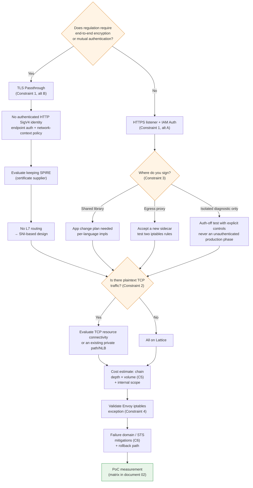

# Restricciones y puntos de decisión

> **Alcance**: API de servicio/recurso de VPC Lattice y AWS Gateway API Controller; verifica la versión seleccionada y las CRD instaladas.
> **Última actualización**: 16 de octubre de 2026

## Qué cubre este documento

- Seis restricciones que debes resolver antes de finalizar un diseño y las alternativas para cada una
- El árbol de decisiones que forman en conjunto: dónde una opción descarta otra
- Una lista de comprobación previa a la migración

## Resumen de restricciones

| N.º | Restricción | Naturaleza | Hay alternativas | Cuándo decidir |
|---|---|---|---|---|
| 1 | TLS passthrough no puede autenticar la identidad HTTP SigV4 | Comportamiento actual documentado del servicio | Autenticación en el endpoint; política anónima de contexto de red | Primero |
| 2 | TCP sin procesar no es un listener de servicio | Distingue la conectividad de recursos TCP | Gateway de recursos o ruta privada/NLB existente | Al principio |
| 3 | Impacto de firmar SigV4 en las aplicaciones | Decisión de implementación | 3 | Al principio |
| 4 | Validación de rutas/firmas al coexistir con la malla | Depende de la configuración | Exclusión explícita o reenvío configurado | Antes de la migración |
| 5 | Costos por solicitud y transferencia en cada salto | Estructural | Ajuste arquitectónico | Durante el diseño |
| 6 | Concentración del dominio de fallos y dependencia de STS | Estructural | Solo mitigación | Durante el diseño |

Las restricciones 1 y 2 son **decisiones sobre las capacidades actuales y los límites de confianza**, no predicciones de que AWS nunca pueda añadir funciones. Distingue listeners de servicio, conectividad de recursos y compatibilidad del controlador.

## Restricción 1: TLS Passthrough e identidad HTTP autenticada

### Principio

Dos hechos de los documentos [03](./03-auth-flow.md) y [04](./04-networking-basics.md) se combinan para generar esta restricción.

1. La verificación SigV4 debe leer la cabecera `Authorization`
2. Leer las cabeceras requiere terminar TLS

Por definición, TLS Passthrough no termina TLS. Por lo tanto, **Lattice no puede ver la cabecera de firma ni aplicar autenticación basada en la firma de la solicitud**.

La compatibilidad de asociaciones de políticas del controlador y las capacidades del servicio de AWS son independientes. TLSRoute no figura entre los destinos documentados de asociación de IAMAuthPolicy; aun así, los listeners TLS de AWS admiten políticas basadas en principales anónimos y contexto de red.

::: note Limitación confirmada
TLS passthrough no puede evaluar identidad HTTP SigV4 cifrada ni condiciones de ruta/cabecera HTTP. Se admiten políticas para principales anónimos; usa la [referencia de listener TLS](https://docs.aws.amazon.com/vpc-lattice/latest/ug/tls-listeners.html), no supongas que todas las políticas se rechazan o se ignoran.
:::

### Las dos alternativas

| Alternativa | Configuración | Qué obtienes | Qué pierdes |
|---|---|---|---|
| **A. Listener HTTPS + IAM Auth** | Lattice termina TLS, verifica SigV4 y evalúa tres políticas | Autorización IAM, condiciones de ruta/método/cabecera, enrutamiento L7 y registros de acceso detallados | Cifrado de extremo a extremo (termina una vez en Lattice), mTLS propio del endpoint |
| **B. TLS Passthrough + mTLS en el endpoint** | SNI de dominio personalizado selecciona el servicio; los endpoints autentican TLS | Cifrado en el endpoint e identidad de certificado | Sin identidad HTTP SigV4 autenticada ni inspección HTTP L7; la política anónima de contexto de red es distinta |

### Cómo elegir

**Este es el punto de bifurcación más importante de la migración.** La mayoría de las otras decisiones dependen de él.

El criterio es **si la regulación requiere cifrado de extremo a extremo o autenticación mutua entre cargas de trabajo**.

- **Si no, elige A.** La granularidad de autorización y la observabilidad de IAM Auth son ventajas importantes, y así está diseñado Lattice.
- **Si sí, elige B.** Pero elegir B implica rediseñar dónde se expresa la autorización. Lattice solo conoce SNI, por lo que la autorización debe realizarse en la aplicación o durante la validación del certificado mTLS del endpoint. Y, como se indica en el [documento 05](./05-spiffe-to-iam.md), **SPIRE podría seguir siendo necesario**.

Es posible combinar opciones. **Puedes separar A y B por servicio**: B para servicios sujetos a regulación y A para el resto. El costo es operar dos modelos de autorización al mismo tiempo.

## Restricción 2: elige conectividad de servicio o de recursos

### Principio

La ausencia de un listener de servicio TCP sin procesar no excluye los recursos TCP: las configuraciones de recursos/gateways de recursos de Lattice proporcionan un modelo de acceso independiente. Para TLS passthrough de servicio, el cliente debe iniciar TLS y enviar el SNI del dominio personalizado configurado.

Comprueba los requisitos del protocolo y la compatibilidad actual del controlador, en lugar de tratarlo como un límite permanente de todo el producto.

### Identifica qué se ve afectado

Al principio de la planificación, **identifica todas las comunicaciones East-West que usen TCP en texto sin cifrar**. Entre las habituales:

Haz un inventario de protocolos TCP personalizados, de bases de datos y de caché que usen texto sin cifrar. No incluyas gRPC sobre HTTP/2 (h2c) en la misma categoría no compatible; valida la configuración exacta de listener/ruta/destino HTTP.

### Alternativa: configuración híbrida

| Tipo de tráfico | Ruta |
|---|---|
| HTTP / HTTPS / gRPC | **VPC Lattice** |
| TCP con TLS | **TLS Passthrough** de Lattice (si es viable enrutar por SNI) |
| TCP en texto sin cifrar | Evalúa conectividad de recursos TCP de Lattice, conectividad privada existente o un NLB; las funciones L7 de servicio no se transfieren automáticamente |

La razón para recomendarlo es sencilla: **intentar migrarlo todo a Lattice es la causa más habitual de retrasos en la migración**. Si incluyes «introducir TLS para los servicios TCP en texto sin cifrar» en el alcance de migración, necesitarás cambios de aplicación y el calendario dejará de estar bajo tu control.

App Mesh también admitía rutas TCP. Haz un inventario de **todo el tráfico que realmente dependía de App Mesh**, no solo HTTP, y sustitúyelo. El soporte de App Mesh terminó el 30 de septiembre de 2026.

## Restricción 3: impacto de la firma SigV4 en las aplicaciones

Si elegiste IAM Auth (restricción 1, alternativa A), **alguien debe adjuntar firmas a las solicitudes**. Decidir quién lo hará es la elección que afecta más directamente a los equipos de aplicaciones.

| Enfoque | Implementación | Ventajas | Desventajas |
|---|---|---|---|
| **① Biblioteca compartida** | Aplicar firma SigV4 en el cliente HTTP de cada servicio (firma del SDK de AWS o una biblioteca por lenguaje) | Sin salto adicional → latencia mínima. La gestión de credenciales queda delegada al SDK | **Cambios de código en cada servicio.** Implementación por lenguaje. Gestión de versiones de la lógica de firma |
| **② Sidecar de proxy de egreso** | Sidecar `sigv4proxy` más redirección iptables solo para el rango de Lattice | **Sin cambios de código de aplicación.** Independiente del lenguaje. Existe implementación de referencia | Reaparece un sidecar (lo que compensa parcialmente la ventaja de eliminar Envoy). Un salto adicional. Operación/actualización del sidecar |
| **③ No usar IAM Auth** | authType `NONE`; autorizar en otra capa | Sin cambios de aplicación ni sobrecarga | **Sin autorización en el nivel de Lattice.** Cualquiera en la red de servicios puede llamar. Difícil de aprobar en una revisión |

### Recomendación práctica

**Si tienes varios lenguajes o poca capacidad en los equipos de aplicaciones, empieza con ②.** La implementación de referencia de aws-samples proporciona manifiestos validados: un sidecar `sigv4proxy` en 8080 y un contenedor init que redirige únicamente el tráfico destinado a `169.254.171.0/24` al proxy.

La ironía de ② es evidente: **migraste para eliminar el sidecar Envoy y añadiste un sidecar de firma**. Aun así, `sigv4proxy` es mucho más ligero que Envoy, no tiene plano de control xDS y usa configuración estática. Si el objetivo principal era «eliminar sidecars», necesitas ① y un plan de cambios de aplicación.

Una comparación con la autenticación desactivada solo es válida en una ruta de prueba aislada y aprobada explícitamente, sin tráfico empresarial y con controles compensatorios de red/aplicación. No deshabilites la autorización en producción para facilitar la migración o las pruebas de rendimiento.

**Sea cual sea el enfoque, comprueba los tres errores del [documento 03](./03-auth-flow.md): cabecera Host, reloj de x-amz-date y firma en el último salto.**

## Restricción 4: excepción de iptables de Envoy durante la coexistencia

Antes de elegir una exclusión o una ruta de proxy configurada explícitamente, verifica la política de la malla instalada y el comportamiento de reenvío observado. No todas las configuraciones de Envoy rechazan destinos desconocidos.

Las reglas iptables de la malla pueden interceptar tráfico destinado a Lattice. Que lo reenvíen, falle o modifique campos firmados depende de la política de salida y de la configuración de rutas. Inspecciona las reglas y registros reales y luego valida la ruta de firma IPv4/IPv6 elegida.

| Elemento | Valor |
|---|---|
| Rango que se debe excluir (IPv4) | `169.254.171.0/24` |
| Rango que se debe excluir (IPv6) | `fd00:ec2:80::/64` |
| Ubicación del ajuste de App Mesh | Lista de CIDR de egreso que se ignoran en el contenedor init |
| Ubicación del ajuste de Istio | Anotación `traffic.sidecar.istio.io/excludeOutboundIPRanges` |

### Puntos fáciles de pasar por alto

- **Si usas IPv6, también debes excluir el rango IPv6.** Excluir solo IPv4 en un clúster de doble pila produce fallos intermitentes.
- **Las anotaciones de nivel Pod se aplican solo a Pods recién creados.** Hay que reiniciar los Pods existentes.
- **Al combinarlo con el enfoque ② de la restricción 3, tendrás dos reglas iptables.** Debes excluir el rango de Lattice de la interceptación de App Mesh y redirigir simultáneamente ese rango al proxy de firma. Prueba siempre el orden y la interacción de ambas reglas.

Valida este ajuste **antes** de iniciar la migración. Es la causa número uno de que falle la primera llamada a Lattice.

## Restricción 5: los cargos por salto dependen sobre todo de la profundidad de la cadena de llamadas

### Estructura de facturación

La tarificación de VPC Lattice tiene tres dimensiones.

| Dimensión | Naturaleza |
|---|---|
| **Aprovisionamiento de servicios** | Por hora, proporcional a la cantidad de servicios |
| **Procesamiento de datos** | Por GB; **incluye los cargos entre AZ** (no hay un cargo separado entre AZ) |
| **Solicitudes/conexiones** | **Cantidad de solicitudes** para listeners HTTP/HTTPS; **cantidad de conexiones TCP** para listeners TLS |

::: warning Requiere verificación
Los precios unitarios varían por región y con el tiempo, y hay niveles gratuitos. **Antes de finalizar un diseño, consulta los precios unitarios actuales de tu región directamente en la [página de precios de VPC Lattice](https://aws.amazon.com/vpc/lattice/pricing/)**. Este documento no indica precios unitarios.
:::

### Por qué la profundidad de la cadena domina el costo

La clave es que los cargos son **por salto**.

En una cadena sencilla de cuatro llamadas con una solicitud Lattice por enlace, una operación del usuario produce cuatro solicitudes de servicio. El costo real también incluye fan-out, reintentos, polling, volumen de carga útil y horas aprovisionadas; la profundidad de la cadena por sí sola no es un modelo de costos completo.

En AS-IS (App Mesh), la estructura era distinta. App Mesh no tenía un cargo por solicitud; el costo aparecía en los recursos de cómputo consumidos por Envoy. **El cambio del modelo de costos de «recursos de cómputo» a «cantidad de solicitudes»** es la característica financiera de esta migración.

### Implicaciones prácticas

| Implicación | Respuesta |
|---|---|
| **Los servicios conversadores se encarecen** | Consolida los patrones que realizan muchas llamadas por solicitud en llamadas por lotes/agregadas |
| **Las cadenas profundas se encarecen** | Reducir la profundidad de la cadena mejora tanto el costo como la latencia ([documento 02](./02-latency.md)) |
| **Mover toda la comunicación a Lattice puede disparar el costo** | **Mantener fuera de Lattice la comunicación dentro del clúster** puede ser la decisión sensata |
| **El polling del cliente genera tráfico** | Cuenta las llamadas que atraviesan realmente listeners facturables; no confundas sondas del cliente con comprobaciones de estado de destinos administradas por Lattice sin revisar la tarificación |

**Los dos últimos puntos son los más importantes.** La ventaja de Lattice es la comunicación que cruza límites de clúster, VPC y cuenta; para el tráfico dentro del mismo clúster aporta poco y añade costo y latencia. **Enviar por Lattice solo el tráfico que cruza límites y dejar el tráfico intraclúster en ClusterIP** suele ser la opción adecuada tanto para el costo como para el rendimiento.

Pero aquí aparece la restricción del [documento 03](./03-auth-flow.md): **llamar directamente al DNS del Service de k8s dentro del clúster evita la evaluación de la política de autenticación**. Así que, si eliges «el tráfico interno no pasa por Lattice», debes **diseñar por separado la autorización del tráfico interno** mediante NetworkPolicy o la capa de aplicación. Aquí entran en conflicto la optimización de costos y la coherencia de autorización.

### Datos necesarios para estimar el costo

Recopílalos antes de migrar. Sin ellos, es imposible estimar el costo.

| Elemento | Cómo recopilarlo |
|---|---|
| Número de servicios que migrarán a Lattice | De la definición del alcance de la migración |
| Tasa de solicitudes por par de servicios (RPS) | Métricas de Envoy de App Mesh o métricas de aplicación |
| **Profundidad media de la cadena de llamadas** | Trazas de aplicación anteriores y posteriores a la migración; correlaciónalas con ID/registros de solicitudes de Lattice |
| Volumen transferido por par de servicios | Métricas de Envoy o registros de flujo |
| Frecuencia de comprobaciones de estado/polling | Configuración de cada servicio |

Conserva o añade trazas de aplicación durante la migración. Lattice no crea un span nativo, pero eso no elimina las trazas de aplicación ni imposibilita analizar cadenas de llamadas.

## Restricción 6: concentración del dominio de fallos y dependencia de STS

### Se concentra el dominio de fallos

AS-IS y TO-BE tienen características de fallo distintas.

| Aspecto | Ruta de sidecar | Ruta de Lattice |
|---|---|---|
| Alcance del fallo | Un proxy puede fallar localmente; los fallos de configuración, identidad y red compartidas pueden ser amplios | Depende del servicio, AZ, política y dependencia subyacente afectados; no necesariamente de todo el tráfico East-West |
| Mitigación | Reversión de carga/configuración, cambios de capacidad, ruta alternativa aprobada | Corrección por el cliente de políticas/destinos/controlador y recuperación del lado de AWS cuando corresponda |
| Responsabilidad | Responsabilidades del cliente respecto a cargas de trabajo e infraestructura compartida | Servicio administrado por AWS más responsabilidades del cliente respecto a IAM, destinos, controlador y aplicaciones |

Este capítulo no mide la probabilidad de fallo de ninguno de los dos modelos. Construye un modelo de fallos específico para las dependencias y prueba rutas de recuperación aprobadas; que el servicio esté administrado no elimina las responsabilidades de mitigación del cliente.

### Dependencia de STS

Con IAM Auth, **la obtención y renovación de credenciales dependen del proveedor configurado** ([documento 03](./03-auth-flow.md)). IRSA usa STS; EKS Pod Identity usa el agente del nodo y EKS Auth. Las credenciales válidas almacenadas en caché evitan una solicitud de credenciales remota por cada llamada de servicio.

- Las credenciales temporales caducan y el proveedor debe obtener reemplazos.
- Si falla la renovación y ya no quedan credenciales válidas, el cliente puede fallar antes de enviar la solicitud o enviar una que Lattice rechace; distingue estos resultados en vez de suponer que todo fallo produce un HTTP 403.
- Una interrupción de la ruta real de entrega de credenciales puede interrumpir llamadas de servicio cuando se agoten las credenciales válidas almacenadas; no recurras a solicitudes sin firmar.

En AS-IS, SPIRE Server ocupaba esa posición. **La dependencia no es nueva; el propietario cambia del cliente a AWS** (la misma estructura que la diferencia (b) del [documento 05](./05-spiffe-to-iam.md)).

### Mitigaciones

Esta restricción no se puede eliminar, solo mitigar.

| Mitigación | Contenido |
|---|---|
| **Confirma la duración de la caché de credenciales** | Registra la caducidad, el momento de renovación, el almacenamiento en caché y el comportamiento ante fallos del proveedor elegido; las credenciales válidas restantes limitan cuánto puede tolerar una interrupción de la ruta de entrega |
| **Prueba el comportamiento ante fallos de renovación** | En una prueba aislada aprobada, interrumpe la ruta real del proveedor: STS para IRSA, o Agent/EKS Auth para Pod Identity. Observa hasta después de la caducidad de credenciales, distingue fallos locales de obtención de respuestas de Lattice, registra los reintentos y restaura la ruta. Bloquear solo el egreso STS directo de un Pod no es una prueba universal |
| **Redundancia para rutas críticas** | Considera conservar una ruta alternativa (llamada directa, NLB) para las comunicaciones de mayor criticidad |
| **Migración gradual** | No lo migres todo de una vez; empieza con tráfico de menor criticidad. Conserva una ruta de reversión |
| **Recalcula RTO/RPO** | Cambiaron las características de fallo, así que revisa las premisas de los objetivos existentes |
| **Integra AWS Health/notificaciones de estado** | Como no puedes solucionar el problema directamente, la detección temprana es el núcleo de la respuesta |

**«Redundancia para rutas críticas» y «migración gradual» son las más eficaces en la práctica**, sobre todo conservar una ruta de reversión. El soporte de App Mesh terminó el 30 de septiembre de 2026, así que no se puede dar por supuesta una reversión a App Mesh; durante la ventana de validación debes poder volver a una ruta alternativa como llamadas directas o un NLB.

## Elementos sin confirmar

::: warning Requiere verificación
Los siguientes elementos no pudieron confirmarse en la documentación oficial. Verifícalos directamente si afectan tu diseño.

**① Interconexión con API Gateway**: confirma el tipo exacto de integración REST/HTTP API. No supongas que un ARN de red de servicios Lattice sea un destino VPC Link ni que un ALB/NLB pueda apuntar directamente a una dirección de enlace local de Lattice. Un diseño de interconexión requiere un proxy/consumidor implementado explícitamente y conectividad privada compatible, con su propia autenticación y comportamiento ante fallos.

**② Cuotas**: verifica en la [referencia actual de cuotas](https://docs.aws.amazon.com/general/latest/gr/vpc-lattice-service.html) y en la cuenta/región los límites necesarios de cantidad de recursos/destinos, ancho de banda, conexiones y solicitudes. No trates los antiguos valores predeterminados ni su posibilidad de ajuste como universales.

**③ Comportamiento de AZ**: AWS documenta afinidad de AZ en el DNS del lado del cliente, pero los destinos backend pueden abarcar varias AZ. No deduzcas a partir de ese comportamiento DNS que se seleccionan destinos de la misma AZ; mídelo con los destinos y la ruta del cliente elegidos.

**④ Comportamiento de políticas TLS** (confirmado): se pueden aplicar políticas para principales anónimos; no se puede autenticar identidad HTTP SigV4. Consulta la restricción 1.

**⑤ ECH/ESNI**: AWS los excluye explícitamente de los listeners TLS; consulta el [documento 04](./04-networking-basics.md).
:::

**En cambio, sí están confirmados** los rangos de enlace local (`169.254.171.0/24`, `fd00:ec2:80::/64`), el nombre de servicio SigV4 (`vpc-lattice-svcs`), los tres protocolos de listener (HTTP/HTTPS/TLS_PASSTHROUGH), la lista de claves de condición, la fecha de fin de soporte de App Mesh (30 de septiembre de 2026), la inclusión de los cargos entre AZ en el procesamiento de datos y la falta de compatibilidad con trace spans.

## Árbol de decisiones

Como las restricciones interactúan, **el orden de las decisiones importa**. Una decisión temprana descarta opciones posteriores.

**La primera rama (requisitos regulatorios) determina todo lo demás.** Esa decisión se basa en los estándares de revisión de la organización, no en la tecnología, así que **revisa con el equipo de seguridad la tabla de asuntos del [documento 05](./05-spiffe-to-iam.md) antes de continuar**. Confirmarlo más adelante implica deshacer todas las decisiones de diseño tomadas antes.

## Lista de comprobación previa a la migración

| Categoría | Elemento |
|---|---|
| **Revisión** | Revisión con responsables de seguridad de los asuntos ⚠️/❌ de la tabla del [documento 05](./05-spiffe-to-iam.md) |
| **Revisión** | Acordar controles compensatorios por la menor garantía de identidad del servidor (control IAM sobre creación de recursos, monitorización de CloudTrail) |
| **Revisión** | Reformular el argumento del cambio de raíz de confianza (CA del cliente → AWS IAM/STS) |
| **Diseño** | Decidir la rama de la restricción 1 (listener HTTPS + IAM Auth / TLS Passthrough) |
| **Diseño** | Enumerar el tráfico TCP en texto sin cifrar; fijar el alcance híbrido |
| **Diseño** | Decidir el enfoque de firma (biblioteca / proxy de egreso / por fases) |
| **Diseño** | Decidir el alcance de Lattice (solo cruces de límites / también interno) y el plan de autorización del tráfico interno |
| **Datos** | Conservar las trazas de aplicación y comparar el comportamiento de cadenas de llamadas antes/después de la migración |
| **Datos** | Recopilar RPS y volumen transferido por par de servicios |
| **Datos** | Medir la latencia de línea base AS-IS (matriz del [documento 02](./02-latency.md), incluido el uso de CPU de Envoy) |
| **Configuración** | Validar CIDR de excepción iptables de Envoy (IPv4 + IPv6) |
| **Configuración** | Permitir conexiones entrantes desde la lista de prefijos administrada de Lattice en los grupos SG de nodos |
| **Configuración** | Habilitar registros de acceso de Lattice y correlacionar los ID de solicitud con los registros de cliente/servidor |
| **Configuración** | Evaluar las barreras de disponibilidad de Pods (actualizaciones graduales sin tiempo de inactividad) |
| **Verificación** | Confirmar los elementos sin confirmar ①–⑤ en la documentación oficial actual |
| **Verificación** | Confirmar los valores actuales de cuotas y precios unitarios de la región |
| **Operaciones** | Plan de observabilidad: cómo compensar la ausencia de spans de Lattice (instrumentación de aplicación con OpenTelemetry) |
| **Operaciones** | Asegurar una ruta de reversión; definir el orden de migración gradual |
| **Operaciones** | Probar el comportamiento ante fallos de renovación STS |
| **Operaciones** | Recalcular RTO/RPO |

## Resumen

- Distingue la identidad autenticada TLS de las políticas para usuarios anónimos, y los listeners de servicio de la conectividad de recursos TCP.
- **La primera decisión determina todo lo demás.** Si la regulación exige cifrado de extremo a extremo o autenticación mutua, el resto del diseño depende de ello; llega a un acuerdo con los revisores de seguridad antes de empezar el trabajo técnico.
- **No intentes migrarlo todo a Lattice.** Una configuración híbrida (TCP en texto sin cifrar por NLB, tráfico intraclúster por ClusterIP) suele ser la respuesta correcta en costo, latencia y calendario. Pero debes diseñar por separado la autorización del tráfico interno.
- **El modelo de costos cambia de recursos de cómputo a cantidad de solicitudes.** El costo es proporcional a la cantidad de solicitudes × profundidad de la cadena, por lo que las comunicaciones frecuentes y las cadenas profundas se encarecen.
- Conserva las trazas de aplicación; la falta de un span nativo de Lattice no impide medir las cadenas de llamadas.
- No se pueden eliminar la concentración del dominio de fallos ni la dependencia de STS; **mitígalas con una migración gradual y una ruta de reversión asegurada**.

## Referencias

- [Precios de Amazon VPC Lattice](https://aws.amazon.com/vpc/lattice/pricing/)
- [Endpoints y cuotas de Amazon VPC Lattice](https://docs.aws.amazon.com/general/latest/gr/vpc-lattice-service.html)
- [Controlar el acceso a los servicios de VPC Lattice con políticas de autenticación](https://docs.aws.amazon.com/vpc-lattice/latest/ug/auth-policies.html)
- [AWS Gateway API Controller: IAMAuthPolicy](https://www.gateway-api-controller.eks.aws.dev/latest/api-types/iam-auth-policy/)
- [AWS Gateway API Controller: barreras de disponibilidad de Pods](https://www.gateway-api-controller.eks.aws.dev/latest/guides/pod-readiness-gates/)
- [aws-samples/migrating-from-aws-app-mesh-to-amazon-vpc-lattice](https://github.com/aws-samples/migrating-from-aws-app-mesh-to-amazon-vpc-lattice)
- [Comparación de costos de patrones habituales de arquitectura de red con Amazon VPC Lattice](https://repost.aws/articles/AR9Tt9m6kKR6mF5Ohj5K-3Og/comparing-the-costs-of-common-network-architecture-patterns-with-amazon-vpc-lattice)
- [Historial de documentación de App Mesh](https://docs.aws.amazon.com/app-mesh/latest/userguide/doc-history.html)
