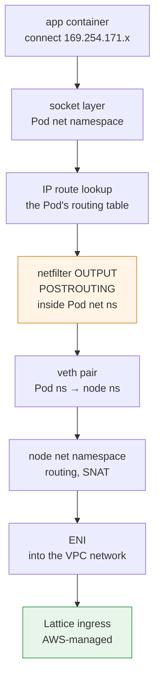
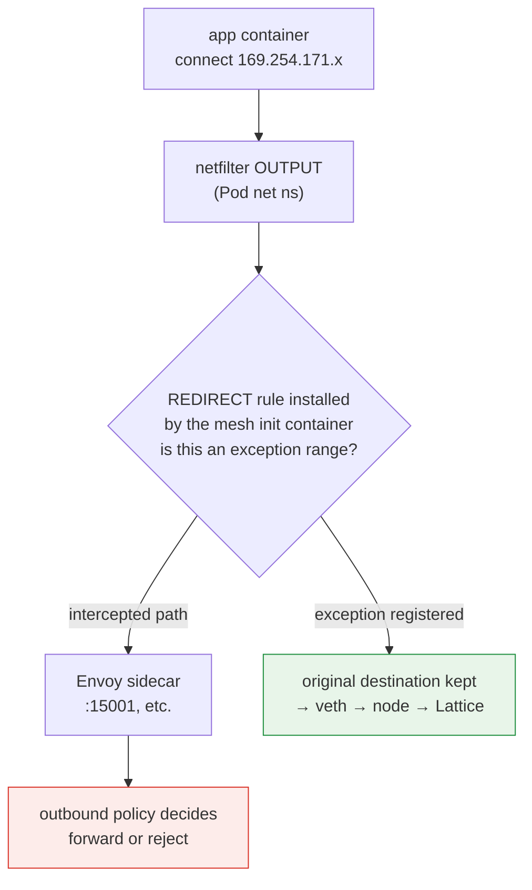
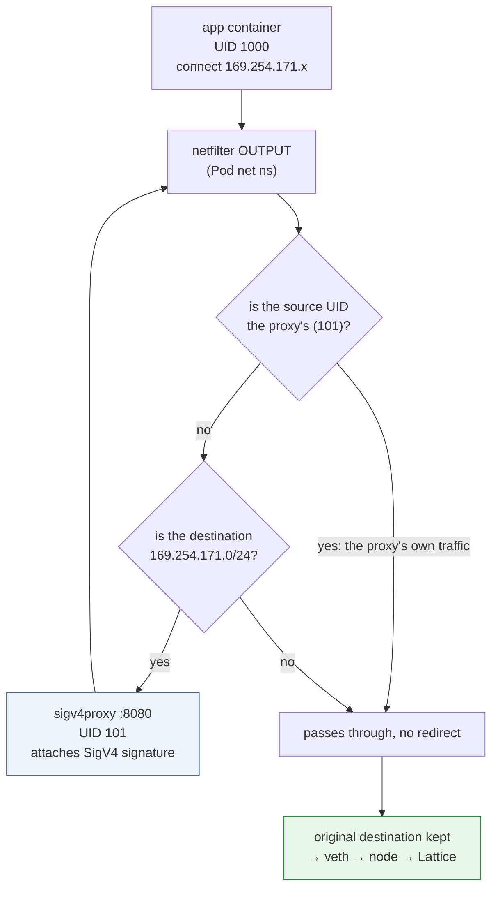

# Plano de datos del kernel: cómo funciona realmente la interceptación de enlace local

> **Alcance**: API de servicios y recursos de VPC Lattice y AWS Gateway API Controller; compruebe la versión seleccionada y los CRD instalados.
> **Última actualización**: 12 de octubre de 2026

## Qué cubre este documento

- La ruta que sigue dentro del kernel un paquete que un Pod envía a una dirección de Lattice
- El punto exacto del kernel donde choca la interceptación iptables de una malla con sidecar con el tráfico de Lattice
- El comportamiento de conntrack en esta configuración y por qué el enfoque de proxy de salida es sensible al orden de las reglas

## Por qué existe este documento

El [documento 04](./04-networking-basics.md) explicó que una dirección de enlace local es una marca que significa «la infraestructura gestiona este paquete». Conceptualmente basta, pero **los problemas que de hecho causan fallos durante una migración se encuentran en la capa del kernel.**

| Síntoma en producción | Realidad en la capa del kernel |
|---|---|
| «Fallan todas las llamadas a Lattice» | REDIRECT de iptables de Envoy también intercepta el rango de Lattice |
| «Añadí la excepción CIDR, pero sigue fallando» | Orden de las reglas o falta el rango IPv6 |
| «Añadí un proxy de salida y ahora forma un bucle» | Se vuelve a redirigir el propio tráfico del proxy |
| «Las conexiones se interrumpen de forma intermitente» | Agotamiento o tiempos de espera de conntrack |
| «Solo falla en algunos nodos» | Divergencia del estado de reglas por nodo o sincronización de reloj |

Este documento conecta el [documento 04](./04-networking-basics.md) con la [sección de kernel de Linux](../../kernel/README.md). Los conceptos generales del kernel se describen en [Funciones del kernel tras los contenedores](../../kernel/01-container-primitives.md) y [Pila de red del kernel](../../kernel/02-network-stack.md); aquí solo se cubre **lo específico de una configuración de Lattice**.

## Recorrido de un paquete: sin sidecar

Primero, el estado final limpio: sin Envoy y con la aplicación firmando directamente.



Hay que tener en cuenta tres cosas.

**① La pila IP usa una conexión normal.** La autenticación es independiente: una aplicación o un proxy de firma aún debe implementar la ruta de autenticación de solicitudes de Lattice elegida.

**② La búsqueda de ruta ocurre en la tabla de enrutamiento del Pod.** Como el espacio de nombres de red establece el límite del Pod ([Funciones del kernel de contenedores](../../kernel/01-container-primitives.md)), la decisión se toma con `ip route` dentro del Pod. Con VPC CNI, la ruta predeterminada del Pod pasa por veth hasta el nodo y el rango de enlace local sigue esa ruta predeterminada.

> El diagrama muestra una ruta conceptual de VPC CNI, no afirma nada sobre mecanismos internos de AWS no documentados. El alcance normal de direcciones de enlace local/ULA y el comportamiento de enrutamiento específico del servicio de AWS son cosas distintas. Inspeccione las rutas reales y la conectividad compatible en el entorno de destino.

**③ Los hooks de netfilter se evalúan dentro del espacio de nombres de red del Pod.** Esto es lo que permite el conflicto descrito en la sección siguiente.

## El conflicto: interceptación iptables de Envoy

### Qué instala una malla con sidecar

Los contenedores de inicialización de App Mesh e Istio instalan reglas de iptables dentro del espacio de nombres de red del Pod. La estructura básica es sencilla.

```text
# Conceptual form (real rules are more complex)
OUTPUT  → jump to a custom chain
custom chain:
  - traffic from Envoy's own UID → RETURN (prevents an infinite loop)
  - exception ranges → RETURN
  - everything else → REDIRECT to Envoy's port
```

`REDIRECT` es un destino de la familia DNAT de netfilter que **reescribe el destino para que use un puerto local.** La aplicación aún cree que envía el paquete a la dirección original, pero este se dirige a Envoy.

### Dónde ocurre exactamente el conflicto



La interceptación de malla puede ocurrir en **OUTPUT del espacio de nombres de red del Pod**. Que la solicitud interceptada se reenvíe, falle o tenga campos firmados alterados depende de la política de salida de Envoy y de los destinos configurados. Ver la solicitud en los registros de Envoy demuestra que pasó por el proxy, pero no identifica por sí solo la causa del fallo.

### Interpretar las pruebas del proxy junto con su configuración

Un proxy restringido puede devolver un error para un destino desconocido; una política allow-any/passthrough puede reenviarlo. Valide tanto la ruta como el error devuelto en lugar de suponer que cada excepción ausente provoca un 503 inmediato.

**Ruta de diagnóstico**: si fallan las llamadas a Lattice, compruebe si los registros del sidecar de Envoy contienen las solicitudes afectadas a `169.254.171.x`. Esto demuestra el paso por el proxy. Correlacione el error devuelto, la política de salida/ruta y cualquier cambio de campos firmados antes de atribuir el fallo a la interceptación; un proxy configurado también puede reenviar la solicitud correctamente.

### Registrar la excepción: qué hacer y dónde

| Malla | Ajuste |
|---|---|
| App Mesh | Añada el rango de Lattice a la lista de CIDR que el contenedor de inicialización excluye del tráfico saliente |
| Istio | La anotación `traffic.sidecar.istio.io/excludeOutboundIPRanges` |

Rangos que se deben excluir:

| Rango | ¿Obligatorio? |
|---|---|
| `169.254.171.0/24` | **Sí** |
| `fd00:ec2:80::/64` | **Sí en clústeres de doble pila** |

### Cuatro problemas prácticos

**① Falta IPv6**: excluir solo IPv4 causa fallos intermitentes en clústeres de doble pila. Si el cliente recibe un registro AAAA y se conecta por IPv6, esa ruta todavía se intercepta. **El síntoma de «fallo ocasional» dificulta el diagnóstico**, porque depende del orden de la respuesta DNS y de la selección de dirección del cliente.

**② Las anotaciones solo se aplican a Pods nuevos**: el contenedor de inicialización lee la anotación a nivel de Pod al crearlo. Es necesario reiniciar los Pods existentes.

**③ Orden de reglas**: netfilter evalúa las reglas de una cadena **de arriba abajo** y actúa en la primera coincidencia. La regla de excepción `RETURN` debe aparecer **antes** de la regla `REDIRECT`. Los contenedores estándar de inicialización de malla aplican este orden correctamente, pero si añade reglas manualmente, debe comprobarlo.

**④ Confusión con otros servicios de enlace local**: Pod Identity Agent usa `169.254.170.23` e IMDS usa `169.254.169.254`. Lattice usa `169.254.171.0/24`. **Son rangos distintos dentro del mismo `169.254.0.0/16`**, por lo que excluir todo `169.254.0.0/16` también retira IMDS y el tráfico de Pod Identity de la interceptación de malla. Quizá eso sea lo deseado (normalmente ese tráfico no debe interceptarse), pero **declare la intención y decídalo deliberadamente.**

### Verificación

```bash
# Required, explicit test target; these are diagnostic reads.
: "${LATTICE_CONTEXT:?}" "${LATTICE_NAMESPACE:?}" "${LATTICE_POD:?}"
: "${LATTICE_DIAG_CONTAINER:?}" "${LATTICE_APP_CONTAINER:?}" "${LATTICE_URL:?}"
kubectl --context "$LATTICE_CONTEXT" -n "$LATTICE_NAMESPACE" \
  exec "$LATTICE_POD" -c "$LATTICE_DIAG_CONTAINER" -- iptables -t nat -L -n -v

# Unsigned connectivity observation: AWS_IAM may reject it.
kubectl --context "$LATTICE_CONTEXT" -n "$LATTICE_NAMESPACE" \
  exec "$LATTICE_POD" -c "$LATTICE_APP_CONTAINER" -- \
  curl -sv --max-time 5 "$LATTICE_URL"

# Inspect the configured proxy container only when present.
kubectl --context "$LATTICE_CONTEXT" -n "$LATTICE_NAMESPACE" \
  logs "$LATTICE_POD" -c "$LATTICE_DIAG_CONTAINER" --tail=50
```

Realice esta verificación **antes** de iniciar la migración. Esta es la restricción 4 del [documento 06](./06-constraints.md).

## Capa del kernel del enfoque de proxy de salida

El enfoque de firma ② (proxy de salida) del [documento 03](./03-auth-flow.md) usa **el mismo mecanismo de iptables con el propósito contrario.**

### Estructura



Esta es la estructura de la implementación de referencia de aws-samples: el contenedor de inicialización usa iptables para redirigir **solo el tráfico con destino a `169.254.171.0/24`** al puerto local 8080, y el proxy adjunta la firma SigV4 al salir.

### Por qué es obligatoria la excepción basada en UID

La primera rama de ese diagrama es **el mecanismo que impide un bucle infinito.**

El paquete firmado que envía el proxy también tiene como destino `169.254.171.x`. Sin la excepción de UID, volvería a coincidir con la regla y se redirigiría a sí mismo, formando un bucle.

Use un **UID dedicado para el proxy** y una excepción de propietario que coincida. El UID 101 del diagrama es ilustrativo; compruebe el manifiesto real de ejemplo/instalado en vez de suponer que el UID es fijo en todas las versiones. Mantenga sus permisos separados de los de la aplicación.

**Consecuencia práctica**: `runAsUser` del contenedor proxy y el UID de la regla iptables **deben coincidir.** Si cambia uno de los dos, se forma un bucle o se pierde la firma. Este es el eslabón más frágil al personalizar los manifiestos.

### Cuando coexisten dos conjuntos de reglas iptables

Durante una migración, un mismo Pod puede tener tanto **la excepción de interceptación de malla como la redirección al proxy de firma.** Esto es lo que significa la restricción 4 del [documento 06](./06-constraints.md) cuando indica «probar siempre el orden y la interacción entre ambas reglas».

El orden requerido desde el punto de vista lógico es:

| Orden | Regla | Finalidad |
|---|---|---|
| 1 | UID del proxy → `RETURN` | Evitar bucles (máxima prioridad) |
| 2 | Rango de Lattice → `REDIRECT` al proxy de firma | Adjuntar la firma |
| 3 | Otros rangos de excepción de la malla → `RETURN` | Excluirlos de la interceptación de malla |
| 4 | Todo lo demás → `REDIRECT` a Envoy | Interceptación de malla |

**La regla 2 debe preceder a la regla 4** para que el tráfico de Lattice llegue al proxy de firma en lugar de a Envoy. Cuando dos contenedores de inicialización instalan reglas, el orden depende del orden de ejecución.

Afortunadamente, se puede verificar el lado de la malla; la fuente confirma cómo funciona en Istio, como se muestra a continuación.

### Orden real de reglas de Istio (confirmado en el código fuente)

El orden en que `istio-iptables` de Istio (`tools/istio-iptables/pkg/capture/run.go`) **añade** reglas a la cadena `ISTIO_OUTPUT`:

| Orden | Regla | Finalidad |
|---|---|---|
| 1 | Exclusiones basadas en puertos → `RETURN` | Comentario del código fuente: «Must be applied before connections back to self are redirected» |
| 2 | Gestión de loopback/llamada a sí mismo | Gestiona la ruta `appN => Envoy => Envoy => appN` |
| 3 | **`-m owner --uid-owner <proxy-uid>` → `RETURN`** | **Evita bucles.** Comentario del código fuente: «Avoid infinite loops. Don't redirect Envoy traffic directly back to Envoy» |
| 4 | **CIDR excluidos (`excludeOutboundIPRanges`) → `RETURN`** | Excluirlos de la interceptación |
| 5 | Gestión de puertos incluidos | |
| 6 | **`-j ISTIO_REDIRECT` (captura comodín)** | Envía todo lo demás a Envoy |

**Hallazgo clave**: el `RETURN` de los CIDR excluidos (4) se coloca **antes** del `REDIRECT` de captura general (6). Por tanto, añadir el rango de Lattice a `traffic.sidecar.istio.io/excludeOutboundIPRanges` de Istio funciona correctamente por sí solo, sin ajustar el orden.

Además, el **`RETURN` del UID del proxy (3) aparece incluso antes de los CIDR excluidos**, lo que significa que Istio usa el mismo mecanismo de prevención de bucles basado en UID descrito en este documento.

::: warning Requiere verificación
El orden anterior se confirmó en el código fuente de **Istio**. **No se ha validado el orden real de las reglas que instala el contenedor de inicialización de App Mesh**; es una implementación distinta y el soporte de App Mesh terminó el 30 de septiembre de 2026.

Además, una configuración que **añada un contenedor de inicialización para el proxy de firma** tiene dos contenedores de inicialización que instalan reglas, por lo que el orden depende del orden de la matriz `initContainers`. Para esa combinación, **vuelque las reglas reales con `iptables -t nat -L -n -v` en el entorno de destino** y verifíquelas.
:::

## conntrack: comportamiento en esta configuración

### Qué tráfico de Lattice deja en conntrack

Como se explica en [Funciones del kernel de contenedores](../../kernel/01-container-primitives.md), NAT crea entradas de conntrack. En esta configuración, las entradas se crean en los siguientes casos:

| Configuración | Seguimiento que se debe inspeccionar |
|---|---|
| La aplicación firma directamente | Puede haber seguimiento de Pod/nodo sin NAT; inspeccione la ruta real de CNI y cualquier SNAT |
| Proxy de firma de salida | Conexiones de aplicación a proxy y de proxy a servicio, más NAT según la configuración; la agrupación de conexiones cambia el recuento |
| Coexistencia de malla | Rutas y espacios de nombres adicionales; no deduzca un multiplicador fijo solo por el número de proxies |

Un proxy de salida introduce conexiones independientes entre la aplicación y el proxy y entre el proxy y el servicio. El coste de seguimiento depende de los espacios de nombres, la reutilización de conexiones y los ajustes de NAT; no deduzca un aumento fijo en la tabla del nodo basándose únicamente en el número de proxies.

Mida conntrack del Pod/nodo y la ocupación de cualquier mapa eBPF bajo una carga representativa. Un proxy puede agrupar conexiones ascendentes y a la vez añadir un segmento de conexión local; evalúe la compensación real en vez de suponer un multiplicador universal.

### Diagnóstico

El agotamiento de conntrack **descarta conexiones silenciosamente**, como se explica en la [sección del kernel](../../kernel/03-eks-node-tuning.md). En una configuración de Lattice, «las conexiones se interrumpen de forma intermitente» hace que sea una posible causa.

```bash
# Correlate insertion/drop signals with count/max and kernel logs.
conntrack -S | grep -E "insert_failed|drop"

# Check entries toward the Lattice range
conntrack -L | grep 169.254.171 | head

# Utilization
echo "$(cat /proc/sys/net/netfilter/nf_conntrack_count) / $(cat /proc/sys/net/netfilter/nf_conntrack_max)"
```

Un fallo parcial no descarta presión de conntrack: los espacios de nombres, zonas, tablas, reutilización de conexiones y tiempos de paquetes pueden diferir. Correlacione el recuento/máximo, los contadores de descartes/inserciones y los registros de la ruta afectada; no diagnostique basándose solo en que funcionen otros destinos.

## Grupos de seguridad y kernel

El [documento 04](./04-networking-basics.md) describió cómo abrir grupos de seguridad mediante listas de prefijos. Desde la perspectiva del kernel, hay un aspecto adicional.

**Un grupo de seguridad no es netfilter del kernel.** Es el firewall con estado de AWS que se aplica a la ENI en el nivel de VPC y se hace cumplir fuera de la instancia (hipervisor/infraestructura de red).

Consecuencias:

- Los listados de iptables del nodo no contienen las reglas de SG de AWS.
- Un paquete entrante que se rechace antes de entregarse no aparecerá en el punto de captura del nodo receptor.
- Un paquete saliente puede capturarse dentro del emisor antes de que un SG externo lo descarte. Interprete `tcpdump` según la interfaz, el espacio de nombres y la dirección; que no haya respuesta no demuestra por sí solo que exista un problema de SG.

Orden de diagnóstico:

| Observación | Posible causa |
|---|---|
| `tcpdump` no muestra ningún paquete saliente | Dentro del Pod: enrutamiento, interceptación o DNS |
| Se ve tráfico saliente, pero no hay respuesta | SG (compruebe ambas direcciones), enrutamiento o el lado de Lattice |
| Llega una respuesta, pero la aplicación no la recibe | Búferes de socket o problema en la ruta de interceptación |
| Aumentan los contadores de descartes | conntrack o qdisc ([Pila de red del kernel](../../kernel/02-network-stack.md)) |

## Divergencia por nodo: «solo falla en algunos nodos»

Este síntoma reduce las causas posibles a unas pocas.

| Causa | Comprobación |
|---|---|
| **Difieren los SG de los nodos** | Compruebe si la regla de entrada de la lista de prefijos se aplica a cada grupo de nodos |
| **Difieren las versiones del kernel** | Con AMI `kernel-default`, pueden coexistir las versiones 6.1 y 6.18, según cuándo se hayan sustituido los nodos ([Ajuste del kernel](../../kernel/03-eks-node-tuning.md)) |
| **Difieren los ajustes de conntrack** | Depende del estado de ConfigMap al iniciar el sistema |
| **Sincronización de reloj** | Desviación de 5 minutos de `x-amz-date`: errores 403 solo en algunos nodos ([documento 03](./03-auth-flow.md)) |
| **Si se reiniciaron los Pods** | Los cambios de anotación no se aplicaron a los Pods antiguos |

**El patrón de «algunos nodos» es en sí mismo información de diagnóstico.** Un fallo total apunta a la configuración o autenticación; un fallo limitado a nodos apunta a una divergencia de estado entre nodos.

## Resumen

- Un paquete con destino a Lattice usa **una conexión normal IPv4/IPv6.** La gestión especial ocurre en la infraestructura, no en la aplicación.
- Distinga entre enlace local IPv4, ULA IPv6 y la ruta específica del servicio de AWS documentada; no deduzca el enrutamiento interno solo a partir del prefijo.
- Inspeccione OUTPUT del espacio de nombres de red del Pod, la política de salida y los registros reales del proxy; la interceptación no implica que necesariamente haya un fallo.
- Problemas con las excepciones: **falta IPv6** (se manifiesta como un fallo intermitente), las anotaciones solo se aplican a Pods nuevos, **el orden de las reglas** y que excluir todo `169.254.0.0/16` también incluye IMDS y Pod Identity.
- El enfoque de proxy de salida requiere **evitar los bucles mediante UID**, y el `runAsUser` del proxy debe coincidir con el UID de iptables. También **crea entradas conntrack adicionales.**
- Cuando coexisten dos conjuntos de reglas iptables, **volcar las reglas reales es la única verificación fiable.**
- Los SG y netfilter son capas distintas; la visibilidad de las capturas de paquetes depende de la dirección y del punto de captura.

## Referencias

- [Descripción general del kernel de Linux](../../kernel/README.md): contexto general para este documento
- [Funciones del kernel tras los contenedores](../../kernel/01-container-primitives.md): espacios de nombres, netfilter y conntrack
- [Pila de red del kernel](../../kernel/02-network-stack.md): ruta de paquetes y puntos de observación
- [Ajuste del kernel de nodos EKS](../../kernel/03-eks-node-tuning.md): rutas de configuración de conntrack
- [aws-samples: autenticación IAM con VPC Lattice y EKS](https://github.com/aws-samples/migrating-from-aws-app-mesh-to-amazon-vpc-lattice/blob/main/vpc-lattice-config/IAMAUTH.md)
- [AWS Gateway API Controller: implementar el controlador](https://www.gateway-api-controller.eks.aws.dev/latest/guides/deploy/)
- [iptables-extensions(8): coincidencia owner](https://man7.org/linux/man-pages/man8/iptables-extensions.8.html)
- [istio/istio: tools/istio-iptables/pkg/capture/run.go](https://github.com/istio/istio/blob/master/tools/istio-iptables/pkg/capture/run.go): fuente principal sobre el orden de las reglas

Los comandos de diagnóstico requieren las utilidades indicadas y permisos en el contenedor/espacio de nombres de red seleccionado. Un rechazo HTTP a una solicitud sin firma no demuestra que la configuración de IAM haya fallado. Use la ruta de firma revisada para probar la autorización y **enmascare las credenciales en los registros detallados**.
