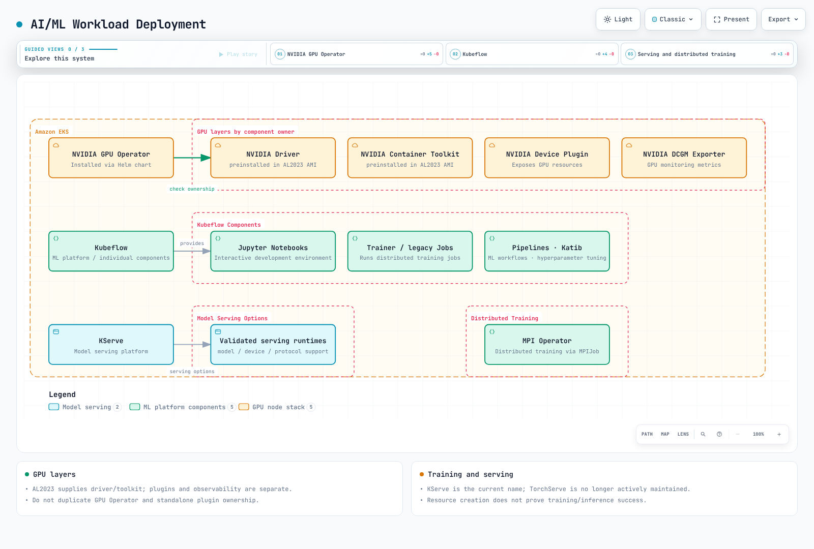
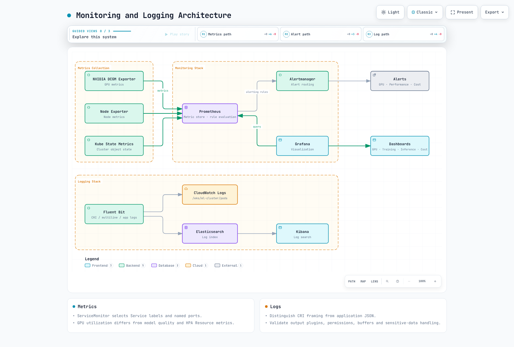

# AI/ML ワークロード

> **レビュー基準**: GPU Operator 26.7.2 / NVIDIA device plugin 0.20.1 / FSx CSI 1.11.0
> **最終更新日**: 2026年10月16日

Kubernetes は AI/ML ワークロードを実行するための強力なプラットフォームです。この章では、EKS で AI/ML ワークロードを実行する方法とベストプラクティスを学びます。

## AI/ML ワークロードの特性

AI/ML ワークロードには、一般的なアプリケーションワークロードとは異なる特性があります。


[🔍 インタラクティブな図を表示](https://www.atomai.click/kubernetes-docs/archmaps/en-ai-ml-01-ai-ml-workloads-0.html)

1. **リソース集約型**: GPU、高性能 CPU、大容量メモリを含む大規模なコンピューティングリソースを必要とします。
2. **データ集約型**: 大規模なデータセットへの高速なアクセスを必要とします。
3. **分散処理**: 大規模なモデル学習では、複数ノードにまたがる分散処理を必要とします。
4. **ワークロードの多様性**: 学習、推論、データ前処理など、さまざまな種類のワークロードが含まれます。

## AI/ML 設計における留意点

選択したフレームワーク、イメージ、デバイス、Kubernetes バージョンに対するサポートを確認します。

### 1. 大規模言語モデル（LLM）のデプロイ

大規模言語モデル（LLM）は、近年の AI で特に注目されている技術の一つです。Kubernetes 上に LLM を効率よくデプロイする際は、次の点を検討してください。

- **モデルシャーディング**: 大規模モデルを複数の GPU に分散すること
- **精度の選択**: FP16/BF16 演算と INT8/INT4 量子化を区別し、精度とデバイスのサポートを検証すること
- **推論の最適化**: vLLM、TensorRT、ONNX Runtime などを使用して推論パフォーマンスを向上させること
- **スケーリング戦略**: 水平スケーリングによってスループットを向上させること

### 2. AI オーケストレーションフレームワーク

Kubernetes 上で AI/ML ワークロードを管理する専用フレームワークには、次のものがあります。

- **Kubeflow**: 機械学習ワークフローの包括的なプラットフォーム
- **Ray on Kubernetes**: 分散コンピューティングフレームワーク
- **KServe**: Knative/Standard およびその他のパスによる推論管理
- **Seldon Core**: モデルサービングとモニタリング

### 3. GPU 共有と最適化

GPU リソースを効率的に利用するための技術:

- **MIG (Multi-Instance GPU)**: NVIDIA A100/H100 GPU のパーティショニング
- **共有アプローチ**: MPS とタイムスライシングは、分離性とサポートの点で互いに、また MIG とも異なります
- **動的割り当て**: 必要に応じた GPU リソースの動的な割り当て
- **GPU Operator**: Kubernetes における GPU 管理の自動化

### 4. MLOps と GitOps の統合

AI/ML ライフサイクル管理に DevOps 原則を適用します。

- **モデルのバージョン管理**: Git と統合されたモデルのバージョン管理
- **CI/CD パイプライン**: モデル学習とデプロイの自動化
- **A/B テストとカナリア**: 実験的な比較と段階的ロールアウトでは、目的と指標が異なります
- **モニタリングとフィードバックループ**: モデルパフォーマンスのモニタリングと再学習

### 5. ベクトルデータベースの統合

埋め込み表現と意味検索には、次のベクトルデータベースを利用できます。

- **Pinecone**: マネージドベクトル検索
- **Milvus**: オープンソースのベクトルデータベース
- **Faiss**: Facebook AI の効率的な類似度検索ライブラリ
- **OpenSearch**: ベクトル検索機能を持つ検索エンジン

バッチ推論とオンライン推論では、レイテンシーとスループットの目標が異なります。

## EKS における AI/ML インフラストラクチャの構成


[🔍 インタラクティブな図を表示](https://www.atomai.click/kubernetes-docs/archmaps/en-ai-ml-01-ai-ml-workloads-1.html)

### ノードタイプの選択

これらはキャパシティの例であり、最新カタログやランキングを網羅するものではありません。リージョンでの可用性、クォータ、CPU アーキテクチャ、GPU メモリ、ソフトウェア互換性を確認してください。

1. **GPU インスタンス**:
   - p4d.24xlarge: NVIDIA A100 GPU 8 基、GPU メモリ 320GB
   - p3.16xlarge: NVIDIA V100 GPU 8 基、GPU メモリ 128GB
   - g5.xlarge～g5.48xlarge: NVIDIA A10G GPU、最大 8 基
   - g4dn.12xlarge: T4 GPU 4 基、g4dn.16xlarge: T4 GPU 1 基（インスタンスサイズと GPU 数は比例して増えるとは限りません）

2. **CPU 最適化インスタンス**:
   - c6i.32xlarge: 128 vCPU、メモリ 256GB
   - c7g.16xlarge: 64 vCPU（AWS Graviton3）、メモリ 128GB

3. **メモリ最適化インスタンス**:
   - r6i.32xlarge: 128 vCPU、メモリ 1024GB
   - x2gd.16xlarge: 64 vCPU、メモリ 1024GB

4. **Inferentia インスタンス**:
   - inf1.24xlarge: AWS Inferentia チップ 16 基、96 vCPU、メモリ 192GB

5. **Trainium インスタンス**:
   - trn1.32xlarge: AWS Trainium チップ 16 基、128 vCPU、メモリ 512GB

### ストレージ構成

AI/ML ワークロードには高性能ストレージが必要です。

1. **Amazon EBS**:
   - gp3: デフォルトの汎用 SSD ストレージ
   - io2: 高性能 SSD ストレージ
   - st1: スループット最適化 HDD ストレージ

2. **Amazon EFS**:
   - 複数のノードが共有データにアクセスする必要がある場合に有用
   - パフォーマンスモード: General Purpose を推奨します。旧世代の Max I/O は Elastic スループットと互換性がありません
   - スループットモード: Elastic、Provisioned、Bursting — ワークロード要件、料金、制限を比較してください

3. **Amazon FSx for Lustre**:
   - 高性能な並列ファイルシステム
   - 大規模データセットへの高速アクセスを提供
   - S3 統合によりデータのインポートとエクスポートを簡素化

4. **Amazon S3**:
   - 大規模データセットを保存
   - 学習データとモデルアーティファクトを保存

### ネットワーク構成

分散学習のためのネットワーク構成:

1. **クラスター配置グループ**:
   - ノード間のレイテンシーを最小化
   - 同じアベイラビリティーゾーン内にノードを配置

2. **拡張ネットワーキング**:
   - Elastic Network Adapter (ENA)
   - ENA Express
   - Elastic Fabric Adapter (EFA)

3. **VPC CNI 構成**:
   - 大規模 Pod デプロイのための IP アドレス管理
   - セカンダリ IP アドレス範囲の構成

## AI/ML ワークロードのデプロイ



[🔍 インタラクティブな図を表示](https://www.atomai.click/kubernetes-docs/archmaps/en-ai-ml-01-ai-ml-workloads-2.html)

### NVIDIA GPU Operator とデバイス割り当て {#nvidia-gpu-operator-and-device-allocation}

EKS AL2023 NVIDIA AMI にはドライバーと Container Toolkit があらかじめ含まれているため、GPU Operator がこれらをインストールしないよう設定します。一方、device plugin と DRA driver は含まれないため、別途構成が必要です。Bottlerocket NVIDIA AMI には device plugin が含まれます。同じ機能を担うコンポーネントを重複して導入しないでください。

このコマンドは、レビュー済みの Operator chart を**ローカルでレンダリング**します。デプロイ前に ClusterPolicy/RBAC と実際のインストール要件を確認してください。

```bash
# AL2023 NVIDIA AMI profile: host driver/toolkit are already installed.
helm repo add nvidia https://helm.ngc.nvidia.com/nvidia
helm repo update nvidia
helm template gpu-operator nvidia/gpu-operator \
  --version v26.7.2 --namespace gpu-operator \
  --set driver.enabled=false --set toolkit.enabled=false \
  > gpu-operator.rendered.yaml
```

NVIDIA 拡張リソースは `nvidia.com/gpu` です。整数の limits は同じ requests を意味し、両方を指定する場合は一致している必要があります。`0.5` は有効な GPU 割り当てではありません。この CUDA 12.8 イメージは例示です。デプロイ前にホストドライバー/アーキテクチャの互換性を検証し、イメージ digest を固定してください。このレビューでは GPU 実行は行っていません。

```yaml
apiVersion: v1
kind: Pod
metadata:
  name: gpu-allocation-check
spec:
  restartPolicy: Never
  containers:
    - name: check
      image: nvidia/cuda:12.8.1-base-ubuntu22.04
      command: ["nvidia-smi", "-L"]
      resources:
        requests:
          cpu: "100m"
          memory: 128Mi
        limits:
          memory: 256Mi
          nvidia.com/gpu: 1
```

### Kubeflow と分散学習 {#kubeflow-and-distributed-training}

master ブランチにある一行のインストール手順ではなく、依存関係、ID 管理、ストレージを明記した固定版の [26.03.1 インストールガイド](kubeflow/01-architecture-installation.md) を使用してください。モデルサービングのプロジェクトは KServe で、KFServing は旧称です。

分散ジョブには [Trainer](kubeflow/05-training-operator.md)、従来の TFJob/PyTorchJob、または独立した MPI Operator を使用できます。インストール済みの CRD とバージョンを確認し、MPI Operator API と従来の Training Operator を使い分けてください。Job controller が Pod を作成し、MPI launcher または torchrun が各プロセスを起動します。

単一の Pod では torchrun --nnodes=2 を実行できず、実在しない Pod DNS 名では rendezvous できません。実際に使用する学習コードとイメージ、worker 数、Service/DNS、rank/backend、データ分割、チェックポイント、タイムアウト、リトライ時の動作を指定してください。Gang scheduling には、別途ポリシーまたはスケジューラーのサポートが必要です。


[🔍 インタラクティブな図](https://www.atomai.click/kubernetes-docs/archmaps/en-ai-ml-01-ai-ml-workloads-3.html)

EFA 経由の NCCL では、パスは AWS OFI NCCL plugin → libfabric → EFA です。MPI は、NCCL の必須トランスポートレイヤーではなくてもプロセスを起動できます。ENA/EFA、GPUDirect、security group、AMI、ライブラリを個別に確認してください。Multus/SR-IOV またはデバイスの hostPath mount だけでは、EKS 上の EFA/GPUDirect は構成されません。

### モデルサービング

[KServe](kubeflow/06-kserve.md) の Knative/Standard モード、runtime/モデル形式、URI アクセス、プロトコル、GPU デバイス構成を確認してください。GPU request だけでは GPU 推論は有効になりません。Triton にはモデルリポジトリ、backend 構成、readiness 検証も必要です。

TorchServe は、現在保守を行っておらず、今後のセキュリティ修正も予定していないと表明しています。そのため、新規デプロイで保守が継続する標準構成としては扱えません。認証されていない LoadBalancer を通じて、推論、管理、metrics のポートをまとめて公開しないでください。認証された ingress と、適切な内部管理アクセスを構成してください。


[🔍 インタラクティブな図](https://www.atomai.click/kubernetes-docs/archmaps/en-ai-ml-01-ai-ml-workloads-4.html)

## AI/ML ワークロードの最適化


[🔍 インタラクティブな図を表示](https://www.atomai.click/kubernetes-docs/archmaps/en-ai-ml-01-ai-ml-workloads-5.html)

### GPU 共有とメモリ

タイムスライシングでは GPU を共有できますが、メモリや障害は分離されず、利用時間に応じた性能も保証されません。MPS は別の制御デーモンを使用します。確認した device plugin の資料では、MPS のサポートは実験的で、MIG 有効時は対象外です。RuntimeClass と特権付き MPS Pod を用意するだけでは、ノード全体の共有は構成されません。

これはスタンドアロンの device-plugin 構成です。GPU Operator が plugin を所有している場合は、その所有者の構成パスを使用してください。

```yaml
# device-plugin-sharing.yaml: NVIDIA device plugin configuration, not a Pod.
version: v1
sharing:
  timeSlicing:
    renameByDefault: true
    failRequestsGreaterThanOne: true
    resources:
      - name: nvidia.com/gpu
        replicas: 2
```

```bash
# Alternative to an operator-owned plugin; do not install a second owner.
helm repo add nvdp https://nvidia.github.io/k8s-device-plugin
helm repo update nvdp
helm template nvdp nvdp/nvidia-device-plugin \
  --version 0.20.1 --namespace nvidia-device-plugin \
  --set config.default=shared \
  --set-file config.map.shared=device-plugin-sharing.yaml \
  > device-plugin.rendered.yaml
```

この設定により nvidia.com/gpu.shared が公開され、Pod はこのリソースを整数単位で要求できます。replicas=2 にしても、GPU メモリの半分が保証されるわけではありません。実際の GPU を使い、対象ノードでの割り当てと競合を検証してください。

### 配置とトポロジー {#placement-and-topology}

ゾーン/リージョンの annotation は Pod の配置を制御しません。実際のノードラベルに対して nodeSelector/affinity を使用してください。anti-affinity/spread selector も Pod ラベルと一致している必要があります。以下の実際の AZ に置き換えてください。同一 AZ への配置、ノード間への分散、gang admission はそれぞれ異なる制約です。

```yaml
apiVersion: v1
kind: Pod
metadata:
  name: placement-check
  labels:
    app: placement-check
spec:
  restartPolicy: Never
  nodeSelector:
    topology.kubernetes.io/zone: us-west-2a
  affinity:
    podAntiAffinity:
      preferredDuringSchedulingIgnoredDuringExecution:
        - weight: 100
          podAffinityTerm:
            labelSelector:
              matchLabels:
                app: placement-check
            topologyKey: kubernetes.io/hostname
  containers:
    - name: check
      image: python:3.12-slim
      command: ["python", "-c", "print('placement check')"]
      resources:
        requests:
          cpu: "100m"
          memory: 64Mi
        limits:
          cpu: "1"
          memory: 128Mi
```

### ストレージとキャッシュ {#storage-and-caching}

FSx CSI の静的プロビジョニングでは、既存のファイルシステムを PV/PVC に接続します。ファイルシステム ID、DNS 名、マウント名、容量、namespace を実際の値に置き換えてください。reclaim policy を Retain にするとファイルシステムの自動削除は避けられますが、別途クリーンアップするまで料金が発生します。

```yaml
apiVersion: v1
kind: PersistentVolume
metadata:
  name: ml-fsx-existing
spec:
  capacity:
    storage: 1200Gi
  volumeMode: Filesystem
  accessModes: [ReadWriteMany]
  storageClassName: ""
  persistentVolumeReclaimPolicy: Retain
  mountOptions: [flock]
  csi:
    driver: fsx.csi.aws.com
    volumeHandle: fs-0123456789abcdef0
    volumeAttributes:
      dnsname: fs-0123456789abcdef0.fsx.us-west-2.amazonaws.com
      mountname: replace-with-actual-mount-name
---
apiVersion: v1
kind: PersistentVolumeClaim
metadata:
  name: ml-dataset
  namespace: ml-workloads
spec:
  accessModes: [ReadWriteMany]
  storageClassName: ""
  volumeName: ml-fsx-existing
  resources:
    requests:
      storage: 1200Gi
```

動的プロビジョニングでは StorageClass/PVC からファイルシステムを作成します。静的構成用の volumeHandle/DNS を StorageClass に記述したり、定義されていない fsx.aws.k8s.io/Lustre リソースを混在させたりしないでください。[driver の動的プロビジョニング例](https://github.com/kubernetes-sigs/aws-fsx-csi-driver/tree/v1.11.0/examples/kubernetes/dynamic_provisioning) を参照し、デプロイ方式ごとのスループットとバックアップの条件を確認してください。SCRATCH_2 では永続ストレージ向けのオプションを使用できません。

Alluxio の worker DaemonSet だけではキャッシュ構成は完成しません。master/worker の役割、パス、メモリ、ネットワーク、一貫性、データ保持を設計してください。実際にマウントした PVC 上に別のテストパスを用意してベンチマークを実行してください。マウントされていない /data に対する FIO では FSx の性能を測定できません。

## モニタリングとロギング



[🔍 インタラクティブな図を表示](https://www.atomai.click/kubernetes-docs/archmaps/en-ai-ml-01-ai-ml-workloads-6.html)

### Prometheus と Grafana {#prometheus-and-grafana}

DCGM Exporter が提供するのは GPU のメトリクスであり、device plugin が公開する割り当て可能な容量とは別の情報です。Operator が管理する exporter を別の DaemonSet で重複して起動しないでください。containerd 環境では Docker socket のマウントは不要です。

ServiceMonitor は Pod のラベルを直接選ぶのではなく、**Service のラベルと名前付きポート**を使って対象を選択します。これらの値を、インストール済み exporter の Service に合わせてください。また、Prometheus 側でも ServiceMonitor の namespace とラベルが選択対象になるよう設定します。

```yaml
apiVersion: monitoring.coreos.com/v1
kind: ServiceMonitor
metadata:
  name: gpu-metrics
  namespace: monitoring
spec:
  namespaceSelector:
    matchNames: [gpu-operator]
  selector:
    matchLabels:
      app: nvidia-dcgm-exporter
  endpoints:
    - port: gpu-metrics
      interval: 15s
```

GPU の utilization/memory/errors を、アプリケーションの requests、errors、latency histogram とともに監視してください。精度には ground truth を備えた評価パスが必要です。replica を追加してもモデル品質は向上しません。古い Grafana graph/flot JSON を最新の time-series/gauge 形式と実際の datasource UID に置き換え、インポートを検証してください。

### ログ収集

containerd の CRI ログ形式とアプリケーションの JSON は、ログの異なる層です。Fluent Bit で CRI と複数行ログの解析、ログのパス、position database とローテーション、Kubernetes metadata 用 RBAC を設定してください。削除された Elasticsearch/OpenSearch の document type や、定義されていない parser 名は使わないでください。CloudWatch などへの出力には、必要な plugin を含むイメージ、ワークロード IAM、ネットワーク接続が必要です。機密性の高いモデルデータを含むログと、リトライ用バッファの増大にも注意してください。収集方法は[オブザーバビリティガイド](../observability/README.md)を参照してください。

## コスト最適化

### Spot とノードプロビジョニング {#spot-and-node-provisioning}

Spot の中断や容量不足に備え、外部チェックポイント、再試行時の冪等性、復旧時間を検証してください。イメージ/AMI のリビジョン、taint/toleration、上限値、中断処理を含む、[Karpenter ガイド](../autoscaling/02-karpenter.md)の最新 NodePool/EC2NodeClass 構成を使用してください。CPU/GPU の node group を混在させることと、EKS Hybrid Nodes 製品を使うことは別の構成です。

### HPA とメトリクス {#hpa-and-metrics}

metrics-server が提供する CPU/メモリ指標には、HPA の Resource metrics を使用します。nvidia.com/gpu の割り当て量は GPU 使用率を示す Resource metric ではありません。GPU 使用率や GPU request をスケーリング指標にするには、exporter と custom/external metrics adapter が必要です。

この例では、adapter が namespace/Pod ごとに公開する RPS を使います。対象の Deployment と adapter は別途インストールしてください。100 RPS は例示的な目標値であり、計測結果に基づいて調整します。同じ replica 数を複数の HPA/KEDA controller で制御せず、スケーリングを担う controller を一つに定めてください。

```yaml
apiVersion: autoscaling/v2
kind: HorizontalPodAutoscaler
metadata:
  name: inference-hpa
  namespace: ml-workloads
spec:
  scaleTargetRef:
    apiVersion: apps/v1
    kind: Deployment
    name: inference-service
  minReplicas: 1
  maxReplicas: 10
  metrics:
    - type: Pods
      pods:
        metric:
          name: inference_requests_per_second
        target:
          type: AverageValue
          averageValue: "100"
```

不適切な集約/ラベルグループ化により、adapter が Pod ごとの値を返せなくなる場合があります。histogram percentile やモデル精度は、自動的に適切な比例 HPA シグナルになるわけではありません。負荷/キュー/レイテンシー/utilization と達成スループットを合わせて測定してください。Pod を削減しても、ノードが終了するまで EC2 料金は残る場合があります。時刻だけでは On-Demand 料金は下がりません。

### データとモデルへのアクセス {#data-and-model-access}

Kubernetes RBAC で API アクセスを制御し、S3/KMS の権限にはワークロード IAM を使用してください。大きなモデルを Secret に格納したり、復号鍵を環境変数に置いたりせず、オブジェクトストレージ、暗号化、ファイルベースの認証情報を利用してください。Secret の base64 エンコードは暗号化ではありません。NetworkPolicy の同一 peer 内の namespaceSelector と podSelector は AND 条件で、別々の peer エントリは OR 条件です。DNS、ストレージ、メトリクスに必要な通信方向も許可してください。

## 検証と参考資料

この章は、公式 GPU Operator/device plugin の Helm レンダリングと manifest/構成のレビューに基づいて修正しました。実機での GPU 利用、FSx の作成やマウント、分散学習、モデルサービング、オートスケーリングは実行していません。対象環境でコンポーネントのバージョンとノード要件を確認してください。

- [EKS 高速コンピューティング向け AMI](https://docs.aws.amazon.com/eks/latest/userguide/ml-eks-optimized-ami.html)
- [Kubernetes の GPU スケジューリング](https://kubernetes.io/docs/tasks/manage-gpus/scheduling-gpus/)
- [NVIDIA device plugin 0.20.1](https://github.com/NVIDIA/k8s-device-plugin/tree/v0.20.1)
- [FSx CSI 1.11.0](https://github.com/kubernetes-sigs/aws-fsx-csi-driver/tree/v1.11.0)
- [EFS のパフォーマンスモード](https://docs.aws.amazon.com/efs/latest/ug/performance.html)
- [Kubernetes の HPA](https://kubernetes.io/docs/tasks/run-application/horizontal-pod-autoscale/)

## クイズ

学んだ内容を確認するには、[トピッククイズ](../quizzes/ai-ml/03-ai-ml-workloads-quiz.md)に取り組んでください。
